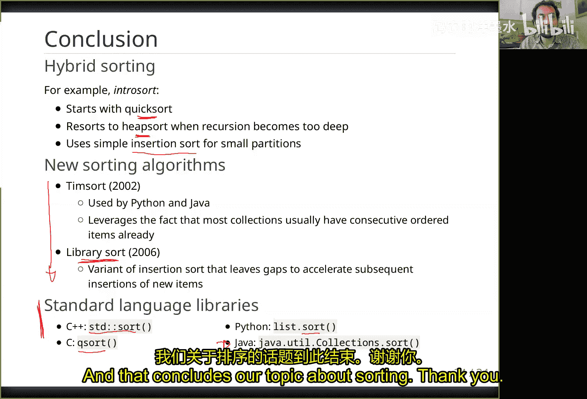

# 数据结构与算法编程：8-2：排序算法（下）🎯


在本节课中，我们将继续学习高效的排序算法，包括归并排序、快速排序，以及两种非比较排序算法：桶排序和基数排序。我们还将探讨现代混合排序算法及其应用。

上一节我们介绍了选择排序、插入排序和堆排序等基础算法。本节中，我们将深入探讨基于“分治”策略的更高效算法。

## 分治策略概述

归并排序和快速排序采用了“分治”策略。这类算法通常包含三个步骤：
1.  **分**：将复杂问题分解为更小的子问题。
2.  **治**：递归地解决这些子问题。
3.  **合**：将子问题的解合并，得到原问题的解。

## 归并排序 (Merge Sort) 🔄

归并排序是分治策略的典型应用。其核心思想是将数组递归地分成两半，分别排序，然后将两个已排序的子数组合并成一个完整的有序数组。

以下是合并两个已排序子数组的核心过程：

```cpp
void merge(vector<int>& A, vector<int>& aux, int low, int mid, int high) {
    // 将 A[low..high] 复制到辅助数组 aux
    for (int k = low; k <= high; k++) {
        aux[k] = A[k];
    }

    int i = low;      // 左半部分的起始索引
    int j = mid + 1;  // 右半部分的起始索引

    // 合并回原数组 A
    for (int k = low; k <= high; k++) {
        if (i > mid) {
            // 左半部分已耗尽
            A[k] = aux[j++];
        } else if (j > high) {
            // 右半部分已耗尽
            A[k] = aux[i++];
        } else if (aux[j] < aux[i]) {
            // 右半部分的当前元素更小
            A[k] = aux[j++];
        } else {
            // 左半部分的当前元素更小或相等（保持稳定性）
            A[k] = aux[i++];
        }
    }
}
```

归并排序的递归函数如下：

```cpp
void mergeSortRecursive(vector<int>& A, vector<int>& aux, int low, int high) {
    if (high <= low) return; // 递归基：子数组为空或只有一个元素
    int mid = low + (high - low) / 2;
    mergeSortRecursive(A, aux, low, mid);    // 排序左半部分
    mergeSortRecursive(A, aux, mid + 1, high); // 排序右半部分
    merge(A, aux, low, mid, high);           // 合并已排序的两部分
}
```

用户调用的顶层函数：

```cpp
void mergeSort(vector<int>& A) {
    vector<int> aux(A.size()); // 创建辅助数组
    mergeSortRecursive(A, aux, 0, A.size() - 1);
}
```

**归并排序特性总结：**
*   **时间复杂度**：**O(n log n)**。
*   **空间复杂度**：需要 **O(n)** 的额外辅助空间。
*   **稳定性**：**稳定**。当元素相等时，会优先取左边子数组的元素，保持了原始相对顺序。
*   **适用性**：特别适合链表排序，因为其合并过程是顺序访问的。

## 快速排序 (Quick Sort) ⚡

快速排序是另一种分治算法，但其核心是“分区”操作。它选择一个“基准”元素，将数组重新排列，使得所有小于基准的元素都在其左侧，所有大于基准的元素都在其右侧。然后递归地对左右两个子数组进行相同操作。

以下是分区过程的代码示例：

```cpp
int partition(vector<int>& A, int low, int high) {
    int pivot = A[low]; // 选择第一个元素作为基准（实践中可能有更好选择）
    int i = low + 1;
    int j = high;

    while (true) {
        // 从左向右找到第一个大于等于基准的元素
        while (i <= high && A[i] < pivot) i++;
        // 从右向左找到第一个小于等于基准的元素
        while (j >= low + 1 && A[j] > pivot) j--;

        if (i >= j) break; // 指针相遇或交叉，分区结束

        // 交换这两个元素
        swap(A[i], A[j]);
        i++;
        j--;
    }
    // 将基准元素放到正确位置（即 j 所指位置）
    swap(A[low], A[j]);
    return j; // 返回基准元素的最终位置
}
```

快速排序的递归函数：

```cpp
void quickSortRecursive(vector<int>& A, int low, int high) {
    if (high <= low) return; // 递归基
    int p = partition(A, low, high); // 分区，获取基准位置
    quickSortRecursive(A, low, p - 1); // 排序左子数组
    quickSortRecursive(A, p + 1, high); // 排序右子数组
}

void quickSort(vector<int>& A) {
    quickSortRecursive(A, 0, A.size() - 1);
}
```

**快速排序特性总结：**
*   **平均时间复杂度**：**O(n log n)**。
*   **最坏时间复杂度**：**O(n²)**（例如当数组已有序且总是选择最边缘元素作为基准时）。
*   **空间复杂度**：**原地排序**，但递归调用栈需要 **O(log n)** 的空间。
*   **稳定性**：**不稳定**。
*   **流行度**：因其在平均情况下的极高效率，是许多编程语言标准库（如C的`qsort`，Java对基本类型的排序）的默认或常用排序算法。

## 非比较排序算法

以下算法不直接通过比较元素大小来排序，因此在特定条件下可以达到线性时间复杂度。

### 桶排序 (Bucket Sort) 🪣

桶排序假设输入数据均匀分布在一定范围内。它将数据分到有限数量的“桶”中，然后对每个桶单独排序（可使用其他简单排序算法），最后按顺序连接所有桶。

以下是桶排序的简化思路：

```cpp
void bucketSort(vector<int>& A) {
    // 假设 A 中的元素在 [0, 99] 范围内
    int numBuckets = 10;
    vector<vector<int>> buckets(numBuckets);

    // 1. 将元素放入对应的桶中
    for (int num : A) {
        int bucketIdx = num / 10; // 根据十位数决定桶
        buckets[bucketIdx].push_back(num);
    }

    // 2. 对每个桶内部进行排序（例如使用插入排序）
    for (auto& bucket : buckets) {
        sort(bucket.begin(), bucket.end()); // 实际可用任何排序
    }

    // 3. 按顺序从桶中取出元素
    int idx = 0;
    for (int i = 0; i < numBuckets; ++i) {
        for (int num : buckets[i]) {
            A[idx++] = num;
        }
    }
}
```

**桶排序特性：**
*   在数据**分布均匀**且范围**不大**时，性能接近 **O(n)**。
*   最坏情况是所有数据落入同一个桶，性能取决于桶内排序算法。

### 基数排序 (Radix Sort) 🔢

基数排序是一种非比较整数排序算法。它根据键值的每位数字来分配和收集元素。可以从最低位（个位）开始（LSD），也可以从最高位开始（MSD）。

**算法步骤（LSD为例）：**
1.  按照**个位数**，将每个元素分配到0-9号桶中。
2.  按桶顺序（0->9）收集元素，形成新的序列。
3.  按照**十位数**，将新序列中的每个元素再次分配到0-9号桶中。
4.  再次收集。
5.  重复此过程，直到处理完最高位。完成后，序列即有序。

**基数排序特性：**
*   **时间复杂度**：**O(k * n)**，其中 k 是最大数字的位数。当 k 远小于 n 时，效率很高。
*   需要稳定的子排序过程（如计数排序）作为桶内收集的基础。
*   适用于整数、字符串等有固定“位”或“字符”结构的数据。

## 现代混合排序与总结 🏁

在实际应用中，标准库的排序函数往往是混合策略，以在各种场景下达到最佳性能。

*   **内省排序 (Introsort)**：结合了快速排序、堆排序和插入排序的优点。通常先使用快速排序，当递归深度过大时切换到堆排序避免最坏情况，对小数组则使用简单的插入排序。
*   **Timsort**：Python 和 Java 等语言采用的算法。它利用了现实中数据常部分有序的特性，是归并排序和插入排序的优化混合体。
*   **库排序 (Library Sort)**：受图书馆书架预留空间启发，在插入排序基础上预留“空隙”，便于后续插入新元素而无需完全重排。



**总结：**
本节课我们一起深入学习了多种排序算法。我们从**归并排序**和**快速排序**的分治思想入手，理解了它们的高效原理与实现细节。接着，我们探索了不基于比较的**桶排序**和**基数排序**，它们在特定条件下能达到线性时间复杂度。最后，我们了解到现代工业级排序（如内省排序、Timsort）是如何融合多种算法优势以应对真实世界的数据。排序是计算机科学的核心操作，大多数编程语言都提供了高度优化的内置排序函数，理解其背后的原理将帮助我们做出更好的技术选则和性能分析。