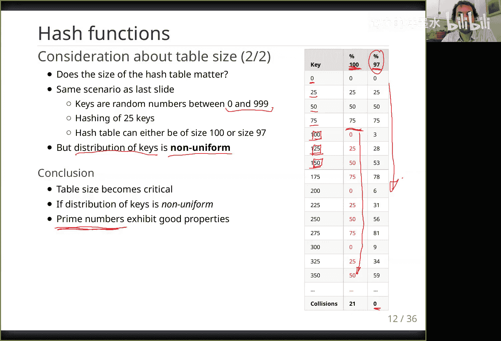

# 【全集】加州大学戴维斯分校 数据结构与算法编程 中英字幕 完整课件 p24 9-1 哈希 -BV1rJ2WBSE7P_p24-

Hi， everybody。So today we're going to start talking about the last topic of the quarter， hasushhing。

Before we dive into all of the intricate details around hashing。

 let's try to even start to understand what it could be used for。

And why do we need these new kind of data structures？There's this fundamental。

Opereration are like data structure that is very crucial in computer science called a symbol table。

It's something that we've kind of already mentioned in the past under different names。

 we have mentioned it as a map。Or a multimap， if it accepts multiple values for the same key or a dictionary and so on。

But overall like the overall concept is the concept of a symbol table。

It's a table that can be indexed by keys and for keys it contains values so we can associate a value with a key。

For symbol tables or maps or dictionaries。We have three primary operations that are really。

 really important。Insertion。Like inserting a new pair key value into this symbol table， remove。

And kind of search sort like whether it's called like contains or get the idea that like we want to see if a key exists in the table and potentially retrieve the value that corresponds to the key out of the out of the table so those are the few operations that are really like crucial the core of those symbol tables and then depending on the application there are other possible operations that we can expect out of a symbol table。

 but those are not at all mandatory。Opers， we can have min find the minimum key in the table。

 max to find the maximum key rank to find the rank of a certain key inside of the table。

 solid list so a solid list of all of the keys order from the minimum to the next to the maximum and so on。

The main focus of this lecture， but hashing will not be about those other operations we are going to focus mostly on those like crucial operations。

 insert， remove and search。So let me give you an example of what a symbol table could be used for。

For example， it could be used to analyze a text， imagine you have a text and you want to count the frequency of all of the letters right so you would start from the very first letter and essentially like go from one letter to the next and then go to the table。

 use the letter as a key and essentially like change the value and the value corresponding to a certain key would be in fact it's frequency。

And so after analyzing a certain text， you could determine that the letter A has been used 37 times letter B six times and so on。

 letter E， 50， four times and so on。So how what are the options among all of the data structures that we've studied so far。

 like what are the options in terms of implementation for that symbol table？If you remember。

 because that's the one that we mentioned a long time ago， we could just use regular a vector。

 if you will。That is totally unaued， right？😡，So we and essentially this array would be at first populated in the order of the letters that we encounter and then as we encounter the same letters again。

We would like increase their frequency。The search operation would be an U then because the letters are completely unaued。

If I want to look if say like the symbol table contains letter a。

 I have to start from the first item in this array and I have to scan the entire array until I find the item that corresponds to key A。

Insertion is super fast if the key doesn't yet exist， then inserting it。

Is in o of one because I can just like push it at the back of the array and since we know the size it's an o of one operation。

Deletion， it's actually the sort of。嗯。Composition of two sub operations for deletion we have to actually find the key。

 the location of the key that needs to be deleted like for example if I want to delete keyW I first need to like find it inside of D and that's going to be the same cost as searching like that's going to be in O of n the diletion in itself can be done pretty fast in O of one and actually like that's I don't think it's aing that we've talked about in the past。

Cause。Niveively， you could think， well， if I want to delete key W here。All let me change the width。

 okay。If I want to delete keyW here in the array， I would potentially need to then like move everything。

呃。By one， and so the deletion would also be in O of n。Well， in fact。

 there's a much easier way of doing that in O of one。Is that if you want to give W， well。

 you take whatever item is at the end。Of your array and you copy it over W and then you reduce the size of your array by one and that's how it like shrinks。

And that can be done in all of one。Anyway。And。So yeah， search， not so great in terms of complexity。

 insert。O of one delete okay then what do we have we have binary search if the array is maintained in order so if we can guarantee that all of the keys are maintained in order。

 then the search can be done in log of it remember we can like drum to the middle。

And then compare the key that we're looking for to the middle key and decide to discard one half or the other。

 and then we do that recursively up until we converge to the key that we're looking for。So log of it。

 pretty good。However， to optimize this search and make sure that the array stays ordered all the time。

 then insert is an over event because potentially you want to insert in the middle of existing keys and so you have to make room and making room in the array means that you need to potentially copy an entire ranch like one slot further。

And delete is the same like if you want to maintain an array order and you delete one key。

 you also have to like push back。All of the kids that are after that to maintain strict continuity。

So here， binary search optimizes the search， but insert and delete become pretty bad operations。

So now we know well rays are great and whatnot， but they're not the best kind of implementations for that and so a few weeks ago we started talking about trees。

And more specifically， binary search trees。So here。

 if you remember the idea is that like we organize all of the key in a tree。

And we do it even further， is that like？For every node containing a certain key。Everything。

 all of the sub nodes， all of its left sub only contain keys that are smallerer。

 so if the key here is D， then all of that subre contains keys that are smallerer than D and all of the keys in the right subre contain keys that are bigger。

呃。The complexity of those operations so search， insert and delete now entirely depends on the height。

Of the tree。With binary search tree， just regular binary search trees that are not structured in any way。

 then it kind of depends on the structure of the tree itself。

 so on average we're going to have log of n， but worst case if the tree actually kind of degenerating to a linked list。

 then the worst case would be U of n。And that would be for all of the operations like search， insert。

 and delete。Now， as we studied， there are ways to force this binary search tree to remain properly structured and to nevergenerate into a linked list。

And so we studied AviR trees or red and black trees and so on， and so with those trees。

 we really make sure that the height stays within certain bounds。

And so here we can guarantee that the search will always be in log of N。

 the insertion will always be in log of n， and the deletion is going to always be in log of n。

And don't get me wrong like that implementation using self balancing trees is really good like log oven is a really。

 really good type of complexity if you have a collection if you have a symbol table with a billion items in it。

That would make a tree。Of height 30 like 30 levels is enough to contain a billion of items。

 which is not that many step right like you have a billion of items and you're able to still perform insertions searches and deletions in essentially like 30 steps。

That's not too bad。But。You know， we're greedy。We want to do better。

 so the idea is that can we do better， can we do those three operations on a symbol table in o of one。

Searching all of one， insertion in O of one and division in all of one。

And that's pretty much what we're trying to address in this topic。

So here is a first case scenario to make you understand how in the first place could we do all of those operations in Ovo。

I could imagine that seems a little surprising， right？Well。

 you could use the data itself as an index in the symbol table， so for example。

If you consider that in order to count the frequency of letters。Well， letters are ASCI codes。

And ASI code really only have 128 characters， which is not that much。

 so technically you can make kind of a map of 128 entries。

And then you can use the ASI value of the character directly as a key。

And that brings you to the value right， And so here that's an example of such。Such a array。

At index 97 which corresponds to character A， then you would have its frequency and 98 which is character B and then character C and so on。

 and you would be have in fact the value so here you use the ASI characters directly as the key for your symbol table。

And that allows you to do search in U of one， because then you can just。Say like search。Sorry。

 search on character A， character A is encoded by 97 and you can directly index。

Your map at key 97 and you get to this position， there's no actual search like there's no scanning of the correction you can directly go there。

And so insert sessionion and dileution are essentially the same。Obviously。

It comes with some limitations， right？The first limitation is that it doesn't very efficiently support other operations as we talked about before like so the operations that allow you to find the minimum key in the symbol table or the maximum key in the symbol table or the rank of a certain key in the symbol table here if I want to do that if I want to find the minimum key or the maximum key probably need to scan my array from beginning to end right so those operations would not be optimized they would be pretty much in o of n or even works。

But I said we would not focus on those operations and like hash tables are not really specialized for those operations in the first place。

 they're just very good at insertion， diletion and searching。

Another issue that we have with this scenario is that we might be wasting a bunch of space right so tech for example like this very example。

 using the ASCI code as keys directly for an array。Well。

 the ASCI code doesn't only define letters and characters that you can find in a book， right。

 like so all of the letters like lower caps and upper caps。Plus all of the punctuations and whatnot。

 it also contains some characters called control characters because back in the day like ASCI code was also used to control a physical terminal so they included in the ASCI code like special codes to manage this terminal to like make the cursor move and that kind of stuff which here would be completely wasted because it's not characters that actually like really exist and that you could find in a book and so typically like。

A little more than 30 entries in your array would never be used。

 so you would have that space in your array so that you have all of the keys be contiguous。

 but in fact they would never be used。And maybe the biggest problem of all is that like here we are lucky because ASCI characters are only 128 characters。

 which is not that big， so you can very easily make an array of 128 entries。

What if the key in other scenarios is not that small。

 what is it what if it's pretty big and that actually like leads us to the secondon example。What if。

Instead of wanting to count the frequency of letters。I want to count the frequency of words。

Right so now I have a text and I want to count like I is one word was is one word。

 born is one word and so on， and so I can now like my key would be an entire word itself and I would want to count its frequency。

What's the issue here， what the issue is that you can have many， many words。

 it's not just like 128 characters now。In the English language。It's up to like almost 200，000 words。

 so if you wanted to use the same technique as before like just create a array that's big enough that it can contain all possible words like every single word would have its own entry that's almost like well pre created。

 you'd need to now make a map that has almost 200，000 entries， which is a lot of space， right？

Another issue is that now the key。Is not just。An integer index in the same way as like when we were just using characters and characters can just be transformed into their ASCI code and the ASCI code is an actual value。

Lower cap A is。Is integer value 97。Here， if you have string of O F。What's an integer of of。

 there's no clear integer there。And in C++ you cannot use a string to index an array because a string is not a number and when you index an array。

 you want to have a number because you want to have the offset you want to you want to know。

Which entry in this array is being accessed？So that technique can only work if indices are integers。

And that pretty much brings us to the idea of hashing， hashing is exactly that。

Hushing is the idea that's like。From any kind of key， even a strength。You can reduce it。

 or you can compute。An index in an array。 So an integer index that you can use to index an array。

And also。Hashing is the idea that like。Your keys。Can be of like within a certain range from zero to k minus1。

 so for example， like if your keys are English words。

 then your range would be from zero to 171 and some100，000。And you can reduce it。

To another rangerench that's usually smallerer because your hash table is smallerer and so you can reduce it to zero to m minus1。

And so， eventually， you can like。Take a string， like time， and hash it。

And that would give you a number。 And now that number you can use as an index in an array。

That span that is between zero and n M minus-1 entries。

And so the first question that we're going to try to answer。

In this lecture topic is how do we provide this hashing？

How do we do we devise of a function or of a method？That can take any type of keys， whether it's。

Bullion integers， floating point numbers， strings。Or whatever like structures， classes。

 How can we sort of compute that and extract a number that can be then used as an index in an array。

 That's pretty much what hashing is about。And then once we do that。

We're going to have an issue that we're going to need also to deal with， probably not today。

 but next time this issue is called collision。Because we're probably starting from a range that's like fairly big so like。

171000 key words in the English language。Down to， like。Integer indexes that are on a smallerer range。

It's possible that we were get in a situation where the hash。Of two different words。

Will be the same value。And so we'll sort of end up pointing at the same index in the array。

 and that's an issue because like。One location in the symbol table can only hold one pair。

Of key value， not two pairs。And that's exactly why we have a collision。

The fact that that happens is that harsh functions are typically said to be non injective。

 that's a mathematical term that essentially says it's a function for which two different inputs。

Can be mapped or can lead to the same output that's what non injectivity is And so the second big question that we're going to have to solve is how do we deal with that because it's a fact it's going to happen that's just bound to happen you try to reduce potentially something that's on a very large domain like like all of the words in the English language to something smaller that you can use as as array indices so it's bound to happen that's say the hash of two different words。

Lead you to the same index。And you need to have strategies to deal with that property and we're going to talk about those different strategies。

But first。We're going to talk about hashing。How do we h keys into indices？

Let me give you the big picture of that。So the what's going to do that。

 what's going to like hasush a key into an array index is called a hash function。

This hash function needs to have a few properties。Our requirements。

 the first is that it needs to be super simple and fast right because like every time we insert a key。

 every time we remove a key or like our repair of key value or every time we search for a key to get the associated value。

 we're going to have to run this hash function because we're going to have to h this key and get where in the index。

 the key is located or corresponds to。And so we need a function that can like execute pretty fast because we want to be an U of one。

 so we want to have like almost direct access。We also to make sure that like if we run the harsh function。

On the same key it's going to produce the same result like it could seem intuitive。

 but like it has to be guaranteed right if I hash the word time and get that time is I don't know like located at index five into my symbol table。

And a second later， I tried to search time in the symbol table and I hash it again。

 and now it tells me like， oh， it should be located in at index six。

It's not working every time we has the same key， it has to give us the same output。

 it has to point us to the same index in the array。

We also want to make sure that when we provide keys to the hash function and the hash function。

 ultimately like reduce that key。Into a range that goes from zero to m minus1。

 this rangech is like fully utilized。If like most of my English words end up being hashed and give me indices that are like almost all the same。

 it's not going to work like I really want the full output rangech to be like fully utilized。

So that's what it means。Yeah。So， this harsh function。Typically it will be made of two steps。

A first step will be that if the key is not already an integer。

 so if it's like say a string or if it's a structure， if if there's no like actual。

ANumber that directly comes from the key itself， we're going to need to make that key into a number。

Thats that's the very first step like I have a string。

 I need to extract some sort of number that represent that string。

And that number will be part of a branch that we could consider being between zero and8。

So that's the first step， like transform a key that's potentially not an integer into。An人te。

And we often call it a hash code。And once we have this ash code， that's between0 and n。

We can reduce this hash code so essentially like we have this hash code on a range0 n and we reduce it。

To another integer。That now will be used as an arrayray index to like really index or a hash table。

And that will be on a range zero to M。And often， like zero to M is smaller than zero to n。

 like we're reducing the range of the key to the range of the hash table itself。

So those are the two implicit steps。Before I give you examples of。Good。

Hsh tables not good hash function sorry let's start by actually giving you examples of bad hash functions and will go from there So this way you'll understand like。

What are the properties that we're expecting out of a hash function？

So let's start by the worst possible hash function we can think of。

It's a hash function that essentially retains always the same index。You can give it。Any kind of key。

Always retain the same index。You can imagine that with this function。

 we're going to have only collisions， right， because every input that you give is mapped to the same output。

So。Problems here are like quite obvious right， you can only boot insert one key because otherwise everything else is going to collide onto the same output。

So。The obvious solution here is that we need to make sure that the number。

 the array index that that is being returned by the hash function actually depends on the key right that's kind of step number one。

Here is another example that's a little tricky。im imagineine。Or a symbol table。

 the keys are phone numbers。Imagine I make a symbol table with everybody's phone number in the class right and I don't know the value would be like your name so everything would like the keys would be the phone numbers and the value would be the names。

And so the phone numbers are， you have this area code on three digits。

 then you have another three digit， and then you have four digits。And the class is not that big。

 so imagine I have a hash table that has a thousand entries。One idea would be to say， oh。

 you know what， like I'm not going to use all of those。Numbers， because it's a lot of numbers in the。

 in the in the。Phone number how many do we have like we have 10 numbers that that's a little bit much so what i'm going to do is that i'm going to use directly the area code。

And that's pretty much going to be what the hash re is。 So I discard。That part of the key。

 and I only look。At one chunk， and I can use this chunk directly as an index in my hash table if my hash table is of size。

1 thousand， then it's perfect because the area code is as a range of zero to 900。

99 so that would map perfectly with my hash table。That's why I think it might be a good idea。

Except that in fact。All the phone numbers with the same area code will collide。

And it turns out that like it would be a terrible solution to use here with you students at UC Davis。

 because I bet a lot of you have the same area code 530。

So it means that like I don't know if for like half of the class。

 all of your phone numbers would be hashed to the exact same index。5，3，0。

 so its it is not a really good idea。A solution here is to choose another subset of the key if we really want to go ahead and only take a part of the key to extract an array index out of it。

 then it might be better。Not to use the part of the key that's the area code that's like that doesn't show very good properties。

 but to use another subset that is a lot more random so for example。

 another solution is that we could use the last three digits。

Of the entire phone number here it's more likely that if we now look at everybody's phone number in the class。

 those last three digits are going to be much like are going to be。Way。Better distributed。

Across the range， zero to 999。Or even better and I'll show you examples of that in a few slides you can take into account the entire key like the like so all of those digits。

 but then you need to find a way to reduce that phone number。To something that fits into the range 0。

999。嗯。😊，Okay， so now let's start talking about real examples and let's start with the most simple one。

How do I hash like what kind of hash function can I use for positive integers。

 so the key would be a positive integer and find I want to find a hash function to process that。

The simplest way would be to use a modular operation。

So imagine so my key here that I receive as an argument is an unsigned integer。

That is within a certain range， zero2 k minus。And the array index that needs to be written by the hash function。

Is also。An enzymeign integer because it's something that needs to be used as an array index and array indices are always。

Unsigned integers between zero and the last entry of the array。

And so the range here would be0 to m minus1。The most obvious way of reducing a key that's an integer to another key that's also an integer。

 but that belong to different ranges is to use the modular operator。So here。

 if I want to make sure that like whatever is the key between zero and kman is one。

 will be properly mapped into potentially a smaller range。I can just。Use mod M here。

And the key will be reduced to belonging to the range zero to m minus1。

Let's try to characterize a little bit this option and you'll see that it's not obvious。

So here's some code that I wrote。So try to characterize it。So。😊，Imagine we have a hash table。

Has 100 entries， so that's our output range like the range0 to m minus1 here， so it would be0 to999。

And this harsh table is not complicated like we're just trying to associate a bullolean like if the key exists if we insert the key then we switch the bullolean to true。

 we're just trying to like keep track of different keys。And then the keys that we're going to insert。

 we're going to generate them randomly using a number generator。And this number generator will。

Produce random numbers in the rangech，0，999。So you get the gist here。

 we're going to have keys in the range 0，999。And we're going to hdge them。

In order to get something that。Is within the range 099。呃呃呃呀。And then here in this test program。

 we have a follow loop and we're going to generate。25 random numbers， like random keys。

In the range 0，999。We're going to has them。So we're going to have a hash code。

 which is an array index。And。And then we're going to try to see。If we have collisions。

 so after like we're going to run that 25 times。And so。嗯。If for a certain key。

 it's already been hushed into a certain array index and then a little bit later we have another key that gets hed into the same。

A rain index。Then this value here will be true， will be like bully and true。

 and willll be able to detect that there was a collision。And so。If we run that code in the terminal。

 that's the kind of output we would see。Those would be the numbers that are being randomly generated out of this random number generator。

And when we harsh them by using this function， the modulular function。

That's pretty much the output that we get， and that is the index in the hash table。

And so every time that we do that， it means that。At entry 48。Now the entry would become。True， right？

And so what happens is that， as you can see here， like when the keys。844， then it's being hashed。

Into 44。 And so at index 44 in the hash table。We now switch the value to true and so a little bit later。

 when we have another key which is different 544， it gets also hushed into 44 and we have a collision because this has output has already been seen。

So that's kind of the idea here。SoOne last thing before we move on to the next slide。

When we talk about a uniform distribution of random numbers。It means that。

Numbers are being generated uniformly across the specified range， so typically it means that。

If we were to generate a lot more than 25 random numbers。

 let's say we were generating a billion numbers。Out of this distribution。

 then probably a lot of the same numbers would be generated over time。

 The fact that it's a uniform distribution means that。

Each number within that range would get picked about the same number of times across the entire generation that that's what a uniform distribution is。

Okay， so let's continue doing this。Experiment， but。

Let's change one parameter and let's try to see if the size of the table would affect things in any way。

We're going to do the same scenario as the one that I just showed you with the little pieces of code。

 so we're going to have numbers being generated between 0 and 999。The distribution of those keys。

 those numbers is uniform and we're going to be hashing 25 keys， so same scenario as before。

Except that we're going to run this scenario on a hash table of size100。

 by we in the last slide and also on a hash table that has a size of。97。

What's interesting with number 97， and we'll talk about that later is that 97 is a prime number。So。

Let's run this program and what do we see？Not much really， we see that like when the table is 100。

Then we have a total of three collisions total for those 25 keys that are being generated。

And when we do the same generation of keys， but we choose a has table size of 97。

 which means that the modular function， the hashing function will be modo 97 and not mod 100。

Then we we got about like the same number of collisions， like a little less， only two collisions。

 but it's about the same number。So in that sense， the table size is not critical， right？

And that's mostly because the keys are being generated uniformly， right？

All of the keys within the input range have an equal。Chance of being picked。Now。

Let's run pretty much the same scenario again， but we're going to change one little thing。

We're going to make the distribution of keys be non uniform。

Which patent that now within this input range， 0 999。

Numbers will not have the same chance of being picked up。Let me show you the example。

Essentially it means that here we're going to focus only on a very specific subset of keys。

 like we're going to try key0， key 25， key 50， 75， 100 125。

So you see that here now the input is very specific， it's not almost it's not random。

 it exhibits some like very specific property， the fact that we're jumping from 25 to 25。

What happens there？Well， when we have a hash table of size 100， we start having collisions。

Like pretty fast。And then we only have collisions。And it can be。Almost like easily explained， right？

We have keys and like our size table is 100。And the hash function is modulular 100。Which means that。

 essentially。Only the last two digits。Are significant。And so。

Number 150 will be hashed with the same key as number 50 because we're discarding whatever leading digits are because we're doing the modular 100 on 100。

On the other hand。😊，When we pick 97， this prime number， which is not a multiple of any other numbers。

Now we have。A perfect distribution of output keys within our range 0 to 97 to the pan that like we have zero collision at the end。

Even when our keys are not uniform and really like actually exhibit some like pattern。

So here we can conclude that。The table size is critical。When the distribution of key is non uniform。

 which is。In fact， quite common that keys would not be uniform if you take。

If you want to count the frequency of words in a text。

Those words are not going to be uniformly taken from the entire English dictionary。

 like certain English words are going to come back。A lot and and and in a given text。

 we're not going to use the full range of existing English words we're going to like actually it's going to be a much narrower range。

And so in that sense。😊，It's actually a pretty good decision to take a harsh stable size that is of size of a prime number because it exhibits really good property to make sure that we avoid collisions。

And we're going to stop on this today。

