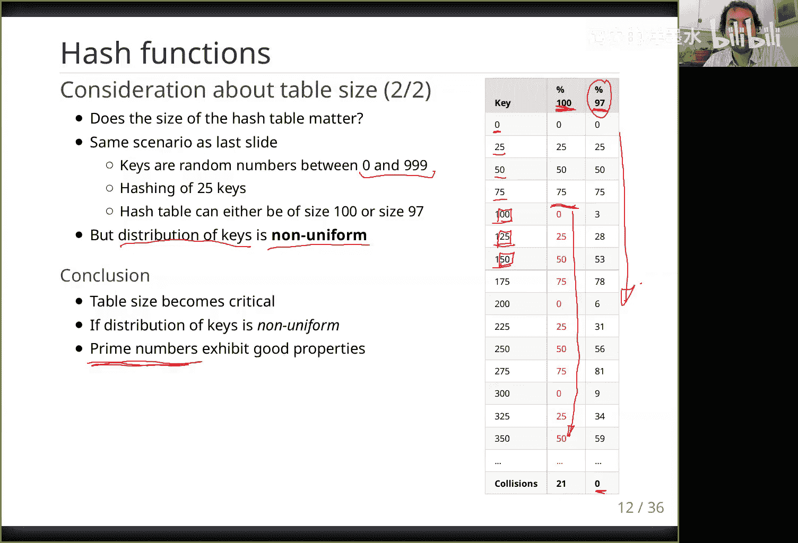

# 数据结构与算法：9-1：哈希表基础 🗂️


在本节课中，我们将要学习一个非常重要的数据结构——哈希表。我们将从理解它的基本概念开始，探讨为什么需要它，以及它是如何工作的。

## 概述

在计算机科学中，有一种基础且至关重要的数据结构称为**符号表**。它也被称为映射、字典等。符号表的核心功能是通过键来索引和存储值。我们将重点学习符号表的三个核心操作：插入、删除和搜索。本节课的目标是理解如何实现这些操作在常数时间复杂度 O(1) 内完成，并引入实现这一目标的关键技术——**哈希**。

## 什么是符号表？

符号表是一种可以按键索引并存储值的数据结构。它允许我们将一个值与一个键关联起来。

以下是符号表的三个核心操作：
*   **插入**：将一个新的键值对放入符号表。
*   **删除**：从符号表中移除一个键值对。
*   **搜索**：检查一个键是否存在于表中，并可能检索其对应的值。

除了这些核心操作，根据应用场景，符号表还可能支持其他操作，例如查找最小键、最大键或对键进行排序等。但本节课的重点将放在插入、删除和搜索上。

## 现有数据结构的局限性

在引入哈希表之前，我们先回顾一下已学过的数据结构在实现符号表时的表现。

### 无序数组/向量

如果使用无序数组来存储键值对，其操作复杂度如下：
*   **搜索**：需要扫描整个数组，复杂度为 **O(n)**。
*   **插入**：如果键不存在，可以直接添加到数组末尾，复杂度为 **O(1)**。
*   **删除**：需要先找到键的位置（O(n)），然后可以通过将最后一个元素移到该位置并缩小数组来实现删除，这部分为 O(1)。总体复杂度仍为 **O(n)**。

### 有序数组与二分查找

如果保持数组有序以使用二分查找，其操作复杂度如下：
*   **搜索**：使用二分查找，复杂度为 **O(log n)**。
*   **插入**：为了保持数组有序，需要在正确位置插入元素，这可能需要移动大量元素，复杂度为 **O(n)**。
*   **删除**：同样需要移动元素以保持有序，复杂度为 **O(n)**。

### 二叉搜索树

使用二叉搜索树来组织键，其操作复杂度如下：
*   在普通二叉搜索树中，搜索、插入和删除的复杂度**取决于树的高度**。平均情况下为 O(log n)，但在最坏情况（树退化成链表）下为 **O(n)**。
*   通过使用**自平衡二叉搜索树**（如AVL树、红黑树），可以保证树的高度始终在 O(log n) 范围内。因此，所有核心操作都能保证在 **O(log n)** 复杂度内完成。

O(log n) 已经是很好的性能，但我们能否做得更好？能否实现所有核心操作都在 **O(1)** 的常数时间内完成？这就是哈希表要解决的问题。

## 哈希表的直观想法

为了理解如何实现 O(1) 的操作，让我们看一个简单的例子。假设我们要统计一段文本中每个字母出现的频率。

我们可以直接使用字母的 ASCII 码作为数组的索引。例如，字母 ‘A’ 的 ASCII 码是 97，我们就在数组的第 97 个位置存储 ‘A’ 出现的次数。

```
// 伪代码示例
int frequency[128] = {0}; // ASCII 码范围是 0-127
for (char c in text) {
    int index = (int)c; // 将字符转换为 ASCII 码（整数）
    frequency[index]++; // 直接通过索引访问并增加计数
}
```

这种方法实现了：
*   **搜索/访问**：`frequency[‘A’]` 直接通过索引 97 访问，复杂度为 **O(1)**。
*   **插入/更新**：同上，为 **O(1)**。
*   **删除**：将对应位置清零，复杂度为 **O(1)**。

然而，这种方法有局限性：
1.  它不高效支持查找最小键、排序等其他操作。
2.  可能浪费空间。例如，ASCII 码中有许多控制字符不会在文本中出现，但数组仍需为它们预留位置。
3.  最关键的是，它要求**键本身必须是或能直接转换为一个小范围的整数**。如果我们的键是单词（字符串），就无法直接用字符串作为数组索引。

这引出了哈希的核心思想：**设计一个函数，能够将任意类型的键（如字符串）转换（或“映射”）为一个整数索引**，然后用这个索引来访问数组。

## 哈希函数

这个将键转换为数组索引的函数称为**哈希函数**。

哈希函数需要满足几个要求：
1.  **计算速度快**，因为我们希望所有操作都接近 O(1)。
2.  **确定性**：相同的键必须始终产生相同的哈希值（索引）。
3.  **均匀分布**：哈希函数应尽可能地将不同的键均匀地映射到整个索引范围内，以减少冲突。

### 哈希过程的两步走

典型的哈希过程包含两个步骤：
1.  **哈希码计算**：将键（可能不是整数，如字符串）转换为一个整数，称为哈希码。这个哈希码通常在一个较大的范围（如 0 到 N-1）内。
    *   公式：`hash_code = some_function(key)`
2.  **压缩函数**：将上一步得到的大范围哈希码压缩到哈希表数组的索引范围（0 到 M-1，其中 M 是数组大小）。通常 M 远小于 N。
    *   公式：`index = compress(hash_code) % M`

### 糟糕的哈希函数示例

理解什么是不好的哈希函数有助于我们设计好的哈希函数。

**示例1：常数函数**
一个总是返回相同索引（例如总是 0）的哈希函数。这会导致所有键都发生冲突，哈希表退化为一个单点，完全失效。

**示例2：使用键的局部特征**
假设键是电话号码（如 `(530) 123-4567`），哈希表大小为 1000。一个糟糕的想法是直接取电话号码的区号（530）作为索引。如果哈希表中许多号码的区号都是 530（例如 UC Davis 的学生），那么这些键都会冲突到索引 530 上，分布极不均匀。

更好的方法是考虑键的更多部分或全部，并使用一个能均匀混合键中信息的压缩方法。

## 整数键的哈希与取模运算

对于本身就是正整数的键，最简单的哈希函数是使用**取模运算**。

假设键 `k` 的范围是 `[0, K-1]`，我们希望将其映射到哈希表索引范围 `[0, M-1]`。哈希函数可以定义为：

```
index = k % M
```

这里，`%` 是取模运算符。这个函数简单地将键压缩到表大小的范围内。

### 表大小 M 的影响

表大小 `M` 的选择对哈希函数的性能，尤其是在键分布不均匀时，有重要影响。

让我们通过一个实验来观察。假设我们有一组键，范围在 0 到 999 之间。

**场景一：均匀分布的键**
当键是随机均匀生成时，无论 `M` 是 100 还是 97，冲突的数量大致相同且较低。这是因为每个索引被选中的概率均等。

**场景二：非均匀分布的键**
现在，假设我们的键不是随机的，而是呈现出某种模式，例如只取 0, 25, 50, 75, 100, 125… 这些值。
*   当 `M = 100` 时，由于我们使用 `k % 100`，这些键（50, 150, 250…）的哈希值都是 50，导致大量冲突。
*   当 `M = 97`（一个质数）时，同样的键集合被哈希后，会均匀地分布在 0 到 96 的索引上，在这个例子中甚至可以实现零冲突。

### 为什么质数有帮助？

取模运算 `k % M` 的结果只依赖于 `k` 除以 `M` 的余数。如果键 `k` 构成一个等差数列（如 0, 25, 50…），且公差 `d` 与 `M` 有公因数，那么哈希值序列也会出现周期性的重复，导致分布不均。选择质数作为 `M`，因为它与大多数可能的公差 `d` 都互质，有助于打破这种规律性，使得即使键有固定模式，哈希结果也能更均匀地分布。

## 总结

本节课我们一起学习了哈希表的基础知识。
*   我们首先明确了符号表的核心操作（插入、删除、搜索）以及追求 O(1) 时间复杂度目标的意义。
*   我们通过“用 ASCII 码作索引”的例子，直观理解了哈希的思想：**将键映射到数组索引**。
*   我们介绍了**哈希函数**的概念、要求以及其两步过程（计算哈希码和压缩）。
*   我们探讨了对于整数键，如何使用简单的取模运算作为哈希函数，并发现了**选择质数作为哈希表大小**可以在键分布不均匀时有效减少冲突。



然而，只要我们将一个大的键空间压缩到一个小的数组索引空间，**冲突**（两个不同的键哈希到同一个索引）就不可避免。在下一节课中，我们将重点讨论如何处理哈希冲突的各种策略。