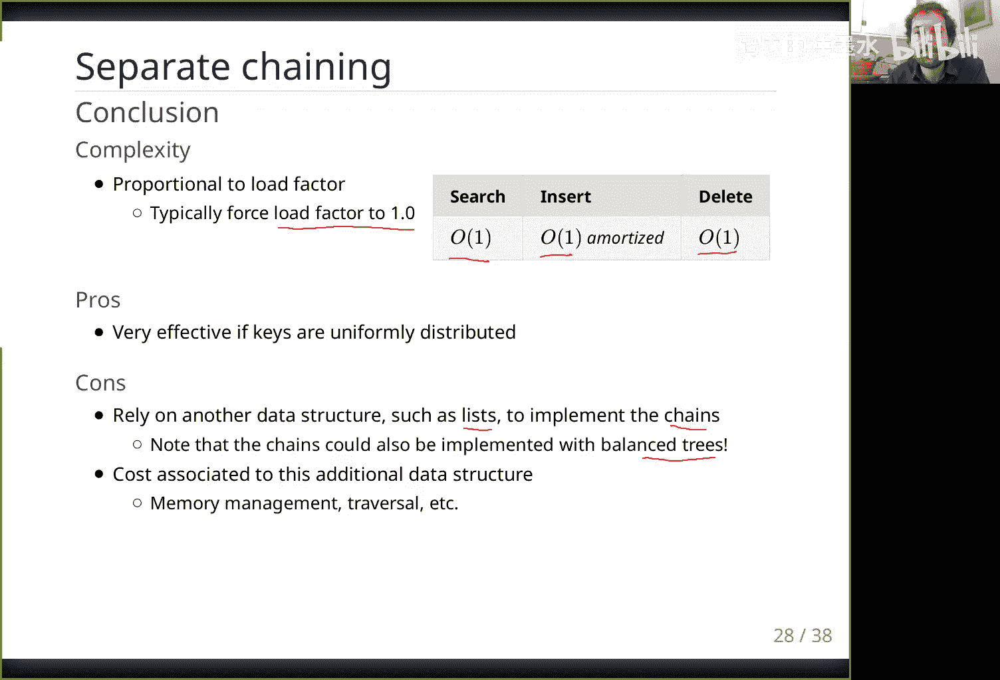

# 【全集】加州大学戴维斯分校 数据结构与算法编程 中英字幕 完整课件 p25 9-2 哈希 -BV1rJ2WBSE7P_p25-

Hi everybody， welcomee to Hshing partd 2。So last time we started talking about hashing。

 we mentioned the idea of hash table， so this new data structure。That is very efficient to implement。

Associative arrays that are mappings or maps from key to a certain value。

 so we saw that we could implement that using lists using trees and actually using trees we would have complexity running time complexity in the order of log n。

Here， the idea of harsh tables is that we can reach those complexities on average。Um， two of one。

 which is pretty， really good because it's u constant time so far。

 like searching a key or inserting a key or deleting a key。

The cornerstone of hash tables is hashing that is like the idea of having a hash function。

You have a certain key， whatever that is， like it could be an inte number， it can be a string。

 it can be astruct anything。The hash function can take this key。

 compute a hash code out of it that is like a number。

And reduce this number to an index in the harsh table itself。

 so in this associative array in order to find the corresponding value， that's the whole idea。

Now we started。Talking about hash functions and we studied。

Seeing how to deal with keys that would be just。Very simple positive integers so imagine that yeah the key is a positive integer in the rank zero K to minus1。

And you want to reduce it to an index in an array that goes from zero to m minus1。

Well here the simplest hasush function is by just using a module， so you take the key。

 which is an unsigned int， you use the module operator to reduce it。To the range 0 to m minus1。

Now we saw as well that choosing M the size of M， so essentially the size of the array in the hash table is actually pretty important especially if the distribution of keys is not uniform which is often the case and in that context。

 then choosing，A size that is a prime number， so that is not a multiple of anything is usually a very good idea because it minimizes the number of collisions。

 so the number of keys that would be hashed to the same index in the area。

We'll later talk about how to deal with those collisions because it's not something that we can avoid。

 but at least here by using an M value that is a prime number。

 we avoid those collisions as much as possible。So let's continue a little bit on hashing functions and then we'll start talking about a first hash table implementation。

So we talked about hashing very simple positive integers what if we want to hash strings so remember the example that I gave last time like where you would want to compute the frequency of words in a document。

 for example， here every word，Would be a string， so how do you kind of like keep track of that？嗯。

Here， a first approach which would be naive and we'll see why would be to receive so the key as a string and then we start with a hash code of zero。

We go through all of the ASI characters of the key using a follow loop and we essentially add that to the hash code so here the hash code at the end will contain the sum of all the ASI characters inside of that string so that's pretty much the step one let me go back just one slide so remember like the hash function is essentially like two steps first you have a key that can be any type of key you kind of。

AComputer hash code within a certain range。And then you reduce this hash code to the exact range of the array。

And we see here that we do have those two steps， one number one calculating the hash code out of all of the characters in the string and step number two。

 again using the modular operator， reducing this hash code to exactly the range of the hash table。

Now why is this approach a little naive and why does it not work that well let's make a few observations here first。

The first observation the is that in English， the length on average for all of the words is about 4。

5 like words on average of 4。5 characters。Considering that every character here is in ASCI and ASCI is in the range zero to 127。

If we have an average word of 4。5， it means that like an upper bound average will be around like 500 for the hash code。

Now in English， the longest word which probably never no one has ever used。

 and I'll just show it to you in the next slide is 45 letter long。

 that's the longest word in the English language。And so again。

 like if we take so 45 characters time the maximum ASI code。

We can get to a maximum harsh code of about like 5700。Now。

 imagine that in order to go through an entire book by counting like the the frequency of words。

We want to have a harsh table of size 10，000， something like that。

Because all of our words will be on average 4。5 characters and each character is multipied or like the ASI character is added。

 then it means that the indices at the beginning of the harsh table are going to be completely crowded。

And because we know that the longest word can yield a hash code that's not really higher than 5000。

 then it means that inner hash table that contains。10，000 entries。

The upper 5000 entries are never going to be used because there's no word that can be hashed to those values。

And actually， let me show you an example of that。So imagine I have a bunch of words here。

 I took what is it like eight words that are some of the most commonly used in English。

And then that's actually the longest word in the English dictionary， the one that has 45 layer long。

I'm not going to try to pronounce it you try， but essentially here I。

Try to hash all of that just to kind of show you the result so we go through the entire dictionary and we call this hash string function so the same as what's defined here。

on the key so on the word and we do the modo on 10000 and that's the result of the execution and what you see is exactly what we had predicted is that like most of those pretty small words that are the most commonly used in the English language。

Look at their hash codes like the result of the hash function。

 it's super super close it's everything between like 30007 up to like 444 with some of the words which are like super super close take those two like the hash code of the 321 hash code of four。

 327 theyre really really close and I'm sure that if you stop adding more words if you do like the hash of cat dog like many other words that are like rather small you're going have a ton of collisions so a ton of words which are different but they end up being hashed to the same value which is an issue。

And here we see that the hash of this longest word in the English language essentially gets you to 5000。

 which would be the highest high code， hash code of everything。

 which means that half of your hash table would be completely wasted。

So how do we do better than that？Well we do better than that by trying to like have。

Each character of a word play a more important role， and let me show you how we can do that。

We can do that by multiplying each character by a certain constant。

 so the only thing that I've changed from the code before is that。

Every time that we're going to go through。All of the characters in the string in the key。

 we're going to multiply the previous hash code by 31， which is a small prime number。

That's called the honors method。It essentially means that the first character of the key will eventually be multiplied by 31 to the power of the length of the key。

And then the second character will be also multiplied by 31 to the power of the length of the k minus1 and so on。

The goal behind that is that like now every letter that we add， like when we go through the。

So the key， every new character。Because it's multiplied。

 we're going to really like try to use the available range a lot more。

 like things are going to be a lot more distributed。As you can imagine， Nik。If the key。

 the string is rather long and we keep multiplying like every component by a certain power of 31。

 it's possible that we would overflow。The harsh code because size t here， it's not an infinite size。

 like at some point we hit the maximum value。But in fact。

 it's okay because size d is of type it's an unsigned int and unsigned int when you go to the maximum value and you continue adding things to it。

 it actually rubs back。2 zero， like the overflow is it's completely under control。

And it's totally fine。嗯。Also why 31 because it's a prime number so usually like it offers good properties also it's interesting so nowadays it's not really the case because modern processors they have a multiply instruction that's actually not too bad。

But back in the day or at least like on processors。For devices that are not very powerful。

 so I don't know like embedded devices and that kind of stuff。

 31 as a good property because you can easily do it by multiplying whatever by 32 which in fact is just shifting operation。

Which you can do on one cycle on pretty much like any type of processor。

And then you just subtract one item out of that， and that ends up multiplying by 31。

So on processors which don't have a multi instruction or have a multiply instruction that is very。

 very slow， then 31 has this nice property that you can essentially do it in two simple operations。

And also experimentations have shown that 31 has like good properties to distribute the output pretty well。

 so let's quickly redo the same experiment with the different words。

And now you see that like all those eight commonly used words in English。

They yield very like various hash codes。And remember like here， the modulular was on 10。

000 because we're trying to like the hash table has the size of 10，000。

 and here we see that now all of the indices that are being generated like pretty like cover pretty well this entire table。

So yeah。So that's for strings and we can apply kind of like the same method on other type of data。

 so just like regular structures so remember like I gave you the example of a phone number phone number where you have an area code it's called like an exchange code and an extension and essentially to make sure that you also have a good distribution when you have something like that one option is to multiply every part of this information by a power of 31。

And。And same again， like if you have astruct that contains different types of fields， so for example。

 like an address that would be composed by a number and a street name and you want to be able to kind of crunch that through a hash function that generates an array index。

 you could also do it by takinging each component out of it like each field and using the same rule that like you multiply each field by 31 so that you get a hash code that's well distributed and that you can later reduce to the size of the array。

We have to keep in mind that this hash function has to be like pretty fast and pretty efficient so we also like if if the object that we want to hash starts getting a little too complicated so for example like an address if the address starts being super long maybe we don't want to。

We don't want to hash the entire address， so one technique is to try to kind of isolate like interesting parts of the address and only hash that to maximize kind of like the randomness of the generated hash code so I don't know in the address if you have all the time like the word street then street is not necessarily something you want to keep in the hash function because it's something that almost all addresses have in common so it's not something that's going to generate like a lot of randomness in the hash code however the name of the street itself is definitely something that you want to hash because that's going make like every single different address generate a very different hash code。

Now， as I was sayingang before。Even with the best type of hasush function。

 because you have a set of keys that is larger， like very very large and you're trying to reduce that to an index in an array。

You're going to have collisions， that's just the way it is， it's baked in。And。😊。

So how do we deal with that right and also how do we characterize collisions like when are we going to have collisions in the first place？

So imagine you your hash table。Whi is an array as M entries。

 so the output range of the hash function is between zero and m minus1。Now quick question。

After how many keys？Will we have the first collision that kind of helps us like characterize like our collision is a big problem like how and then like how do we need to deal with them？

So actually， let me give you an example here。So imagine that M the size of the hash table is 97。

And then imagine that we start hashing different keys that are picked completely randomly。

Here by running this simulation， we can see that the first， very first collision。Happens。

At the 11th key。Here， when we hash 645， we get to entry 63 in the hash table。

 which in fact has already been found when we hash the very first key 548。So okay。

 that's an interesting result。Now imagine like， oh。

 I'm going to increase the size of my hash table and instead of having 97 entries。

 I'm going to have 223 entries。Now。How many collisions。

 like after how many keys that are insert in this new hash table will I notice the first collision？

Well， the problem is that now we need to restart another simulation。

 I would need to like reex in like change the number of entries of my array and run the program again in my terminal and detect again like after how many keys do I see the first collision？

Which is not a very good method。Ideally， I would like to have a certain formula that actually tells me。

If the size of the array is that， then you will see the first collision after that many insertions。

And in fact， it's a pretty well known issue in mathematics， which is called the birthday problem。

 it's pretty funny。It says that it ask the question， if you have a group of people of N people。

What is the probability that two of those people will have the same birthday， essentially the same。嗯。

There that they were born。What we can。Ne conclude is that。If we have。300。And 67 people。

 so essentially the number of possible days in the year plus one。

Then the probability that two people have the same birthday is 100%， right？

It's actually called the pigeonhole Pri。Like if you have a certain of holes。

That are variable and you have。As many pigeons as holes plus one。

 then necessary they're all going to be filled out。Now it actually gets interested， interesting。

When you lower the number of people and the birthday problem tells you that leg。

If you have a group of 23 people， you already have 50%。

Of chances that two people are going to have the same birthday。And it goes。Pretty high。

 very fast if you have a group of 70 people， so far lower than 367，70 people。

Now the chance is that two people will have the same birthdays， almost 100%， it's like 99。9%。

The we' not going to get into like all of the mathematical proof of that。

 I'm just going to show you the formula like the conclusion。The collision probability。

 like the probability that in a group of end people， two of them are going to have the same birthday。

 which is exactly the same formulas。When you start hashing keys and you have a hash table of M entries。

Then the first collision will happen。When you have square root of pi divided by two times m。

And being the number of entries in your array。And what's funny is that like now let's do it。

For when the hash table is of P size 97， exactly like the example I showed you in the previous slide。

 well， if you applied this formula， then mathematically it tells you that the first collision should arrive。

Add entry number 12 or like on the 12th insertion。Which is。Actually。

 pretty much exactly what we saw experimentally for us， it was like the 11th。Hshing， not the 12th。

 but still it's pretty close。And so now if we're asking the question of， okay。

 what if the harsh table is of size 223， then we just apply the same formula and we see that on average。

We should see the first collision between two keys。On the 18th。Inion。What it also tells us is that。

If we want to not have any collision on average， I mean， it' not something that we can guarantee。

 but on average， if we don not have any collision。That pretty much means that the table size。

 the size of the hash table。Needs to be quadratically bigger。

Then the number of items that we're going to try to hush and put into it。Right。

 because like before we have a square root here that essentially tells us that。

That's when we are going to have our first collision。

 so if we don't have if we don't want to have collisions。

 then we need to kind of cancel this square root。By having something that's quadratically bigger。

Which is obviously like not a pretty good idea， I mean if you want to have like 50 items in your hash table and not have a single collision then it pretty it pretty much means that you need to have a hash table that is 50 squared so really pretty big。

So。In conclusion， kind of like collisions are not something you can avoid， like it's just impossible。

So we need to deal with it， right， we need to find ways to deal with collisions。

And there are two main options that we're going to discuss， one is called separate chaining。

And the other one is called open addressing。So let's start with the first one today and next time we'll go over open addressing。

Separate chainning is the idea that like if we have a collision of two keys。

 so two keys are being hashed and get us to the same entry in the hash table， then that's fine。

 we're going to put them in the linked list。As you can see， looks very much like the。😊，呃呃呃。Adjacency。

 the list of adjacency for graphs， right？And so here， for example， like when we。

 if if the keys are characters。And we have a has table of size five。Indices are between0 and4。

Then it shows that character U would be hushed to entry number two in De。

And we see that key character A would also be hashed to entry number two in the array。

 so here we have a collision between key U and key A and that's fine it just means that at entry2 we're going to have a link list with key U and key A。

That's pretty much what separate chaining is the concept。诶。

Let me show you the implementation of separate training in terms of code。

So the public API of a hash table in general is those three functions we talked about them like contains。

 which is pretty much search， like do we have a key， a certain key inside of the hash table。

 and we return a Boolean insert， we insert a key remove we remove a key。

Typically in a hash table you would usually have pairs of key values like two a certain key is associated in a certain value。

 but here to just make like the implementation simpler。

 we drop the value and we just talk about keys， so it's kind of like a set slash hash table。

 but it doesn't matter。Let's look at the data structure now。

 so we're going to make a class so hash table implemented with a separate training。

The key will be a template parameter so that it can be anything and then we're going to have this has table which。

Is essentially the implementation of the concept I just searched showed you in the previous slide。

It's a vector， it's an array。And it's an array that contains linkists。

That can contain whatever this template parameter K is。嗯。At first。

 we have no items in this hash table， so current size is zero。And at first。

 we have an initial capacity of 11。11 is a small prime number， so it'll be good enough。

And so at the beginning， this vector， Ht， the hash table will have a capacity of 11。Yeah。

We will need a harsh function， something that gets a certain key and returns。

An an index in the array。Ht so we call that the function hash and that's going to be an internal function that will pretty much be used by all three functions every time that they receive a key。

 this key will be hashed through this helper method to get us to a certain index in the array H and then we'll be able to like deal with it right。

So let's first zoom on this hash function。Here， instead of implementing it manually with everything that we've discussed before。

 we're actually going to use directly what the C press library provides us。

And the C library has already a data type called STD hash that is already a templated data type。

 and that does a pretty good job at handling like。Pretty much。All types of has functions for。

Most basic types， so like integers floating points even like strings and whatnot this this。

Hash function will already work。So the way it works is that you declare it's actually an object。

 so you declare an object of type STD hash with the same template parameter k as our own hash table class。

That gets you variable， essentially like K ash， which we declare as static because it's global variable for that function。

And then we can essentially。Coll this object or apply this object to the key that we receive as an argument that will generate a hash code that is guaranteed by C++ to be like a pretty good hash code。

 like a hash code that's well distributed。And then we can do the modular operation on this hash code to reduce this hash code to the rangerench。

Of the actual hash table H so here like with the initial capacity。

 we reduce this hash code to a value that's between zero and 10。And。

Let me give you a little bit more example about this standard hashing facility。

As you can see like I can declare like multiple variables and here in the template parameter you essentially define what type of key you want to be hashing so for example like you can be hashing integers doubles even like string or even like pointers。

And then you could apply this class object on any type or on any key that corresponds to that type。

 so if like here we declared this like hashing object in on integers and so we can try to hash 42 or minus 42。

 if it's a double， we can give it a double and so on。

And the kind of ash code that are being generated， you see that very they are very big numbers so that they're pretty good like they really like try to be well distributed on the range of inte numbers。

And so once we have those big， big numbers that are well distributed。

 we can reduce them to our hash tables using the modo operator。Okay。So that's for the hash function。

 the internal hash function。Now let's start looking at the actual API like contains insert and remove and you'll see that it's really not a lot of lines of code。

 it's pretty easy。So let's start with contain here。So contain。Receive the key。

Tries to see if this key is currently part of the hash table and returns a bull true or false to actually say that。

So the first thing is that the key is hashed with the function that I just showed you that will return a valid index in the H array。

 and so that's why we can use directly whatever this hash function returns as an index in the H array。

The HDA is a vector of linkedists。So what we get when we access this array is a link list。

And then we can try to find in this linked list if the given key does exist。

And so for that I could use a thought loop， but that would be kind of inefficient instead I can use another function that is provided by the C+ library。

 which is called STD find。And with find， I essentially say like， okay。

 I want to find in between the beginning of this list and the end of this list。

 I want to find the given key。And find will return a boyan。

 which here I can like directly return as the result of the function。

Oh no sorry fine doesn't return a bullion it will actually return。The key， if it was found。

If the key was not found。Then STD find would return this very specific value。

 which is an end iterator， so what we do is that we actually compare whether find returns this end iterator or not。

And we do the comparison and the result of the comparison。

 which is a boolean is what we return from the function itself。Okay。

So that's for the contains function， the kind of search， now for insert。It's pretty simple as well。

 so first we would see if the key is already contained because if it's already contained there's no reason to insert it twice。

If it's not contained， then we would again like。Hush the key。 get the index in the hash table array。

And get the reference on the actual list on the link list。

And then we would push back this new key inside of the correct list。

That is part of the hash table vector。And we would not forget to update the size so now if've like added a new key inside of the hash table。

 we need to increase the number of elements。And so remove。To save sometime。

 we can also see if the key is contained or not because here like for remove。

 if the key is not contained already in the in the hash table， then there's nothing to do。

If it is contains， then once again we。Hush the key。

 get an array index that we use to extract the correct linked list。And then from that linked list。

 we can again use the find。AF to find the key within that list。

That returns an iterator and we can use this iterator to actually erase it out of the list。

And update the number of elements after it's been removed。And。And that's pretty much it， say kids。

Just on one slide， you have the implementation of the entire API for a hash table using separate chain。

So it's not done， there's one mu that we need to talk about。

Let's do a little bit of performance analysis here。So。

Hushing the the key to the index arrays of running the hashing function is。O have one。Super fast。Now。

Searching the key。In the linked list， so once you have a key you hash it that gives you an index in the vector。

 but at this index， potentially you have a linked list because multiple keys were hashed to the same entry。

And so if you're searching a key within that list， then the complexity would be o of the length of that particular entry。

And that's actually pretty important here。So what are the different options？Well。

It all depends on the harsh function that you're using。If you're using a。Really。

 really bad hash function。 remember， like the galaxy hash code。

 the hash function that doesn't even look at the key。Always retain the same value。Then it means that。

Regardless of the size of the hash table， only one entry would be populated with all of the keys。

 all of the items。And that linked list would essentially。Have the length of the number of items。

And so the running time， the running time complexity of all of the operations search in certain and remove would be inu of it。

 which is really bad and is really like。Contradiory to everything that we're trying to do here。

So that's why the hushing function is really really important。Now， if we use a good hash function。

 a hash function that really tries to like。Hush the keys。

Into array indices in such a way that the array indices are generated in a very uniform。

 like have a very uniform distribution。All across the different entries in the hash table。

Then on average。The length of the different chains of the different linked list for each entry in the hash table。

Would be n the number of elements total in the hash table divided by M the number of entries in the hash table。

And that would be a number that we call L。This L number is known as the load factor of a hash table。

So for example。If I have。Okay。A has table of， say， size， So 1，2，3，4，5。So size 5。And I have。1。

10 keys oop。嗯。And those10 keys were harshed in such a way that like on average。

I have essentially like a chain of two keys。Per entry。Then my load factor would be2， right。

 It's like， I have 10 items divided by。5 entries。In my my hash table， so on average。

 the length of each chain would be two。And so here in that case。😊。

It means that the runtime complexity for all of the operations is in O of this load factor。

 So here like O of。Say two， because I have。On average， two items per entry。Yeah。This O of L。

He's not too bad， but。The promise of hash tables is that we would be o of one。

 so how do we reconciliationci that？What。If we want to guarantee that the load factor。

Will be always constant。So that's the complexity， which is in O of L。Also， stays constant。

How do we do that？😮，The issue is that the number of items N。

Which is part of the calculation of this load factor L is not under our control right it's up to the client。

 it's up to the user。Who will call insert a bunch of time and add stuff to the hash table。

 So n is not under our control。However。M。The number of entries in the hash table。

That is under our control， that is something that we can define in the class。

 in the hash table class。Because when n varies， if we also vary M。

Then we control what the result of this division is and we control what the load factor becomes。

Let me show you an example of that。So。Imagine this harsh table。

U where we have so we have five entries like the hash table is of capacity five。

Using separate chaining and we have one，2， three， four， five， six， we have seven items。So right now。

 the load factor is7 divided by five entries equals 1。4。1。4 is therefore， like the number on average。

Of the length。Of the different chains in this hash table。

 given that the hashing function is uniformly distributed。

Now how do I do it so that like we can decrease this load factor to something that's say under one。

 like here it's 1。4， how do I make it be under one so that my complexity would be o of one？Well。

 I can increase the size of my hash table at the end of the day， that is just a vector。

 I can perfectly increase the size of a vector。Now。

 the thing is that if I increase the size of this vector。Then it means that in my hashing function。

 when I do my operation modular M， the result is going to be different。

And that means that we need to rehash。Every key that had been already inserted inside of the array to now like rerun the hasushhing function and determine in this increased hash table。

 where should they go？So now imagine that like we increase the size of the hash table to 11。

And we rehash all of those keys。With Moo 11。Now that's the result and as you can see。

 the result is that all of those keys because the hash table has become a lot bigger。

 all of those keys are now a lot better distributed。And on average， we've lowered。

The load factor to 0。63， which is well on the one。And which means that the running time complexity is now a lot better。

So let's try to apply this concept in in code。And for that。

 we're going to stay with the same implementation as before。

 but we're going to just modify a couple of things。And most importantly。

 we're going to implement a resize function so that dynamically we can change the capacity。

Of the hasushing function。So how will this reize be called， Well。

 typically the re will be called whenever。The load factor becomes bigger than a certain number。

If we want to keep a load factor of one so that on average， the running tag complexity is o of one。

 then we need to resize whenever the number of items becomes bigger than the number of entries in the hash table。

And in that case， we can increase the number of the hash table。

So here I didn't want to make it too complicated， I just take the size and multiply it by two。

In real life， that would not necessarily be a good strategy。Ideally。

 what we would want to do is text the size of the hash table， can of multiply it by two。

 but choose a prime number that's near this like doubling of the size to always stay with the prime number as the size of the hash table。

Okay， now let's look at this implementation of resize。😊。

And so how do we do it we're essentially going to back up the existing hash table。

 so here I make a variable and I essentially make it equal to the current hash table。

 so here we do a backup copy locally。Then。We resize our hash table。

 so we resize it with another capacity， like we change the size of the vector of the STD vector。

Then we go through all of the link list for every entry in that vector and we just clear the link list so we like。

Increase the size table and then we reset it to completely empty and we even like say， okay。

 we have no more items in this hash table。And then once we're good and we have this new hash table that's bigger and completely empty。

 we essentially reinsert。All of the previous items inside of it。So， we go through。

All of the chains in the old hash table。All of the keys inside of all of those chains and we reinsert them from scratch。

In this bigger hash table。This resizing operation is pretty intense， right。

 the resizing operation is in O of N。If you had N items in your hash table。

 you need to rehaush all of them。However， exactly the same as the dynamic array implementation when we were talking about list ADTs。

Here， the resizing is going to happen like fairly infrequently， it's going to only happen。

After you've inserted N items。And your root factor becomes more than one。

 then you essentially double the size of the hash table by two。

 and you can again insert another n items。Before you need to resize again and so on。

So that's typically an amortize。Complexity like fog and operations。

 you're going to be an o of one because your load factor is still smallerer than a certain constant。

And only at the n plus one operation， you need to pay this big price of all of it so overall like the the this operation is amortized。

Over an operation。嗯，そ呀。嗯。Conclusion on that。If you force the load factor to be around constant one。

 then。The running time complexity of all of your operations are also in U of one。嗯。

Here we went for a pretty simple implementation， we implemented the chains using like simple or link lists in more like involving implementation。

 you could actually implement the chains as balance trees so that inside of the chain itself or like inside of a hash table bucket like entry。

The items that are colliding with one another are like also stored instead of a link list are stored into a container that has very good running time properties。

So， and next time we'll talk about open addressing。

 the other way of dealing with collisions inside of Verlinist。

