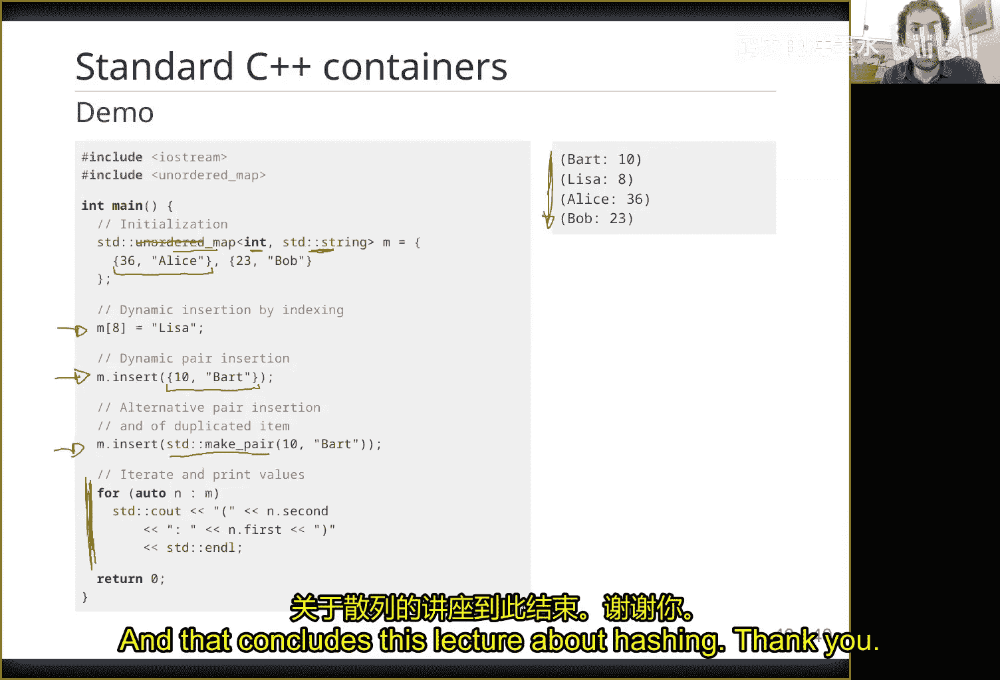

# 【全集】加州大学戴维斯分校 数据结构与算法编程 中英字幕 完整课件 p26 9-3 哈希 -BV1rJ2WBSE7P_p26-

Hi， everybody。Welcome to Hshing partd 3。So quick recap of what we did last time。

So last time we talked about different hashing functions for different types。

Stings and different like structures。And what works well is called the Hos method。

 which essentially says that like every part of the key that needs to be hashed。

can be multiplied by a small prime number powered to a certain number and so if you have a string for example。

 every character of the string is involved in that equation if you have astruct for say like a phone number so like area code exchange code and extension。

 you can multiply by this prime number power。Each component of the phone number and so on。

 so it's a method that applies to any type of key。We also talked about collisions and we saw through statistics that collisions can be cannot be avoided unless the hash table is quadraically bigger than the number of items that it contains。

 which would not be a good idea。Collions will happen and actually will happen fairly fast because we can also do we can only do a certain number of insertions of new keys within a harsh table or size M。

Before we start seeing the first collision。We started talking about a first implementation or a first approach to deal with collisions called separate chain。

So here the idea is that every entry in the hash table will in fact be a list。

And then if we have multiple keys that are hashed to the same index in the hash table array。

 then we actually put them inside of the same kind of linked list。And。Into a chain， hence the name。

Now to make sure that the complexity， the runtime complexity for all three operations， search。

 insert and remove， stays within a certain bound， we need to make sure that those chains here。

 they don't become too long。Yeah。If the hash function is well done and all of the keys are uniformly distributed all across the hash table。

Then on average， the length of a chain will be called the load factor and all the chains will the chains will on average。

 have about the same length。So the goal here is to make sure that this length。

 this load factor stays as low as possible and almost stays constant。And so for that。

 a trick is to reite。The hash table。嗯。😊，So make it bigger if the number of items that it contains mes the load factor becomes too high。

 then we increase the size of the hash table and we rehash the entire collection that it contains。

Today we're going to start talking about another approach to solving collision。

 this one is called open addressing。So in open addressing， we're not going to change anything。

 we're actually just going to keep the hash table exactly as it is。

So that means that if the hash table only has， I don't know， 11 spots。

 then it can only contain 11 keys， no matter what， like we cannot have more items than the number of entries in the hash table。

If two items are hash to the same array index， then we're going to put the result of the collision。

 we're going to insert at the next available index， so let me show you an example of that。So imagine。

And。Imagine we are trying to insert a key key number like key C。The result of the hash。

Will get us to a first index。Hge0。Except that at index age0。At index H0， sorry。We already have。

A certain key。 So we have a collision。Idea behind open addressing is that if we have a collision。

 then we will add a certain offset， and this offset is determined through a certain function。

We're going to add the option， which is the offset， which is f of12 H0。

And that will give us another array index， H1， and we look again and here we see， oh。

 we have another collision so we can still not insert key C。So we add another offset。

And now it's going to be f of two， and so essentially every time we have a collision。

 we call this function F， we'll see because there are different F functions that can be applied here。

And we call it with essentially like the number of attempts that were trying to solve this collision。

呃按。We get to， finally。An index in the array that is available where we can insert the key。

That's kind of the idea。And so this F function， the one that provides us with like offsets if ever we have collisions。

That's the collision resolution strategy and as we'll see in a couple slides。

 there are different strategies we have something called linear probing， quadraric probing and so on。

And so when we do an insert， if we get to a collision， if the result of the hash for this new key。

Cs the collision， then we'll continue calling this function F of I while incrementing I up until we finally get to an index that's available。

And search same so search if we're searching for a certain key， we h this key。

 we get to a first index index in the array and we try to see like is that the key？If it's not。

 then we do it again， adding the。The collision resolution strategy。

 and we kind of like go through the chain if there is a chain of collision here up until we either find a key or up until we get to an variable entry in the array。

 which means that the key was not found even if there was a chain of collision。嗯。Okay。And。

Let's zoom a little bit more on this function F and let's zoom on linear probing。

Linear probing is pretty much like the most intuitive resolution method。

 it's when the offset f of I is in fact I so for example like if we try to insert a certain key and it gets us index2 and there's already another key at index2 then we're going to try index3 and if three is taken we'll try index four and we'll just go one by one that's what linear probing is。

嗯。😊，So here's an example like if we take a hash table of size 17 and we try to insert characters。So。

So the keys are characters there in ASII right when we do the hash function and on upper cap I。

 we would get hash5。At the beginning， the harsh table is completely empty so we can in fact。

 insert I at index5。Then we insert this symbol at index nine， which is available， gets inserted at9。

 then we insert3，3 gets hash to index0，0 is variable we good， then L hash to index 8 inserted at8。

 and then we get to U and here we have a problem。U， when it gets hed， gets us to index zero。

Which is a collision here。With three because the index zero is already taken。

So here we apply the linear problem and if zero is taken， we're going to try one。

One has not been used so far， so that's where that's the index at which you will be inserted。

Now something weird happens。We try to insert the。V， when it gets hashed is hashed to index 1。

But one is already taken because of the collision of U with three。

 so we cannot insert V where it should actually be inserted into。So again， linear probing。

 if index1 is not available， we go to the next one， two。

 which is available and we can insert it there。You can see that here。

 like some collisions can create other collisions。Up to the point that we have something called clusters that happen。

 which are like blocks of contiguous keys that are caused by multiple collisions。

Like some keys have to be inserted that other indices because of some collisions and some other keys because of collisions caused by the previous collision。

Need also to be inserted elsewhere。嗯。😊，And that results in like having needing multiple attempts to insert keys in the hash table。

Okay， so let's now talk about implementations， let's actually see the code。For the most part here。

 the data structure is very similar to the one that we studied with the separate chain， right？

So we have a class。We have a hash table， which is of type vector， has a certain initial capacity。

At the beginning， we have no elements， so zero。We have the function hash。

 we have a function resize for when the hash table becomes full。

And because vectors cannot really have holes， you know， if you have a vector of five items。

 then you can really like remove the middle one， there's no way with STd vectors to kind of say like。

I don't want anything at'd say index three， but I want it to be available so instead what we say what we do is that we。

Dclare thestruct node。That contains a certain key because that's what we want the hash table to contain and that contains Boolean Vck taken。

And the vector here is a vector of those nodes。So now it means that like。If。

A certain index in the hash table is in fact available。

 then what we'll do is that we'll switch this second boolean to false if it's available because it's not taken。

And but it still exists like this this index is still。There。Okay。The has function。

 the one that like takes a key and returns an index in the array。

 is the same as the one we studied last time。Okay， so now let's look at the public API。

 the function search， insert and remove。And let's start with search or containss。

 so let's see what it looks like。诶。😊，At the beginning。

 it's very much like the one from the previous implementation， the separate chaining。So。

We get the key as parameter of the function。And we hash it。

And the result of the hash is an index in the hash table。

 and so what we can do now is actually access the hash table at this index。And see if that。嗯嗯。

Entry is taken。If it's taken， if it's an entry that is actually valid， then we're going to see， okay。

 is the key at this index entry？Is the key that we're looking for。If yes， then great。

 it means that this key does exist。And。😊，It's possible here that the key at this index would not be the key that we're looking for。

 but it's totally normal is because the key that we're looking for had a collision and is in fact inserted。

Elsewhere， like a a next index。So that's why here we do the linear probing on that line。

 we move the index by one。If we get to the end of the array。

 we make sure that we use the modulo to like go back to the beginning and then we loop back to the beginning of the world and we try to see。

 okay， the next like is the next index taken and is the key at the next index。

 the key that we're looking for？And we essentially keep looping in case we have one of those clusters。

If from the index that the key was hash to， we go through a cluster and we get to the end of that cluster so the first index that now is available and we still haven't found the key。

Then that will make us break out of the while loop and it means that the key was actually not found at all。

Okay。Now let's look at the insert function。Shouldn't be too complicated either。

Insert checks if the key already exists in the hash table because otherwise there's no reason to insert it again so we can skip it。

If the key doesn't exist， then we're going to try to insert it。So first。

 we're going to hdge the key and get the primary index。And then if we have a collision。

 we would do the linear probing and we would repeat this while loop as long as is required to find an empty space in the hash table by going like from one index to the next。

Once we found we find an index that is free， we can in fact。Insett the key there。

We can update the overall size of the hash table because we now inserted one more item。And。😊。

To make sure that the hash table doesn't become full and actually more than that like doesn't become two full。

We try here to maintain a load factor of 0。5， so essentially where it means that we will double the size of the hash table as soon as it gets half full。

Just to make sure if we were trying to maintain a load factor of one。

 it means that we would have like a ton of collisions all the time and it would not be sustainable。

So here to kind of like compromise between not having too many collisions and at the same time。

 not wasting too much space in memory。A good trade off is to maintain the hash table like about half full or half empty。

And。And so actually， let's look at this resize function。

 it will be the same principle as the one we saw last time with separate training。

So first thing first， we make a copy of the current hash table。

 then we resize the hash table to the new capacity。We empty the harsh table entirely。

 we clear everything and we just empty everything that it contains。

And we one by one reinsert the entire previous collection into the new hash tape。ok。

So here we have search， insert， and the resize。Now let's look。At the deletion。Operation。

 and you'll see that there's a little trick here。And let me explain that by showing you a certain scenario and you'll see。

 so that's from the previous slide。What if？😮，We want to remove K U。

 Like what if the user calls remove。On。You。😡，Intuitively， you would say， okay。

We're going to hasush you， so if we hasush you， it's going to get us index zero。At index zero。

We have three because there was a collision， so noise， we do the linear probing。

And we would add one to0 to get to index one and add index one， we find。要。

Which we can then remove and so we could remove just like change the node to taken equals false。

And that would make this spot available and were good。

The issue now is what if after we do remove you， we say something like。Say contains。When the。

Gets hashed， it gets hashed。2。Index1。Index one now。

Is available because you was there before and you has been removed。 and so at index1。

 we would get right away to a node。Which a taken member is false。

And so the result of contains V would return， no， I couldn't find V there。

And I didn't even do the linear probing at all。Because I got directly。

To a node to an entry that was available， so there's no reason for me to do any linear proing。

If V was in this hash table， it should be there。😡，Except that it's not。So that's the big。

 that's the big issue that I wrote there like if the index at U becomes free， then V。

Cannot be reached anymore。Because the hashsha V points to an entry that's now available and it should not and we could make the same case if we remove key3 and we hadn't removed like key key U。

 then we would have the same issue because they both hash to the same entry。

The solution is not very complicated， but the solution says that like。

When we want to remove a certain key， then we remove it exactly like we explained。

 but we need to do another operation right after。We need to make sure that。

We give that key that we are removing。Is in any way， part of a certain cluster of keys。

 then we need to rehash。All of the keys inside of that cluster that are located directly after the one we just removed。

If we were to do that， if we were to remove U and make index1 be available。

 then we should start rehashing whatever is at index 2。If we do that。

 then it means that we would rehaush and reinsert。K V。

 which would now be able to be inserted in its original hash position at index1 and would be good to go and V would stay reachable。

In other words， we would try to close any potential gaps in a cluster of keys。

So now that you understand the concept， let me show you the implementation。

 which is exactly what I just explained。So let's start there。

If the key is not even part of the hash table which we can detect with containss。

 then there's nothing to do， there's nothing to remove， we can just get out。那。😡。

If the key is in there， if the key that we're trying to remove is in the hash table。

 we need to find where so it's typical like a linear probing， we start by hashing the key。

 we get an index， then we loop around in case of if there was a collision and eventually we find where the key is。

And once we've identified the exact index over the keys。

 we remove it by switching the taken member to false that will make this node available。

And now that's where the trait happens。We move to the next item here。And if the next item is taken。

 it means that were right in the middle of a certain cluster。And so inside of that cluster。

 we're going to make sure that we。Essentially， we temporarily remove。

The key that is located right after， and we insert it。And so here。

 if the key that was right after was part of the collision itself。

 it will be rehaed and reinsered at the proper position。

 so here that's where we are closing any potential gaps that was created by this removal operation。

At the end， we update the overall size of the hash table and if necessary。

Which means that like if we got like less than a eighth full。

 then we resize the overall hashtable size。To be like， half that size。Okay。

Algorithm analysis for this data structure are like for this。嗯。

Approach of linear probing is actually pretty difficult to see like the running time is expressed with like this pretty intense equation that is a factor of load the load the load factor。

 sorry。But。Usually we just simplifyified by saying that linear probing is about over of one。

Compare so open addressing using linear probing compared to separate chain here we see that we have no overhead for memory management。

If you have a hash table of size 17， then you have 17 entries。

 not one more whereas with a separate chain， if you have a hash table of size 17。

 in fact you can have a linked list behind every single entry so you in fact have more space than that。

There is an effect of locality of reference， meaning that like a cluster of keys。

 they're going to be next to one another in memory。

 they're going to be coniguous and potentially that can help with overall performance。However。

 because we have to make sure that the hash table always stays bigger。

 like at least twice as big as the number of keys that it contains。

 it means that we're wasting a little bit of memory because we need a bigger hash table than what's necessary。

And also we have the issue of clustering like keys or collisions between keys that make it so that like a lot of keys can be packed within the same indices or within like sequential indices。

Now。Linear probing is not the only solution， so linear probing is when the offsets。

At a certain attempt is the number of the attend， so if index that I is taken， then we try index i+1。

 i+ 2， i+ K and so。There are other solutions。One of them is called quadratic probing。

 so here at every attempt we're actually going to square the attend number。So if index I is taken。

 then we're going to try at index I plus 2。If it's taken， then we'll try at index i+4 and so on。

And finally this one is a little intense， it's something called double hashing here the function that gives us where the next index that we should try in case of collision。

 where this next index should go so。Essential like the offset in between probes。Is in fact。

 determined by another hash function that also depends on the key that we're trying to insert。

Comparison， it's kind of interesting here。Linear probing is pretty bad at preventing clustering because like。

 oh， if this one is taken we're just going to try the next one and so on， however。嗯。

When we try to access a certain key， this key usually will still be quite nearby in like the offset will not bring us like way to。

A lot farther away。And on the other hand， when we get to a double hashing solution。

Then this one offers like really， really good performances in terms of clustering because every time we have a collision。

 we're going to go like really somewhere else that actually depends on the key itself。

 so we're probably not going to have too many collisions like that in the row and we' are not going to have packs of keys within the same cluster。

But because we have to potentially go farther away in the hash table。

 we lose what this thing called locality of reference。

 like we are going to need to make a new memory access that is probably not currently contained in the processor of cache and that's going to degrade a little bit of the performance。

嗯。Now， let me finish by。Mentioning what exists in the C++ library。So in the Cpress press library。

 we have two associative containers， which are called un ordered。

So remember like we have different types of associative containers， we have sets and maps。

 but those are ordered like sets and maps， they keep track of the order of the collection and that's why they are usually implemented using trees using selfbalancing trees。

Here those asative containers are in order， we do not care about the order of the collection within the collection。

 like the order of the items。And typically it means that those asative containers。

 they are implemented using。Hush tables。So we have something called。An ordered set。

That associative array or container would only contain keys。

 which is kind of what we've been doing in the example so far。Now。

 if we want to have pairs of key value， that would be a map， and in that case it would be an unaued。

map。Which would then be implemented with a hash table。

The difference obviously is that like if it's ordered then we'll get logarithmic complexity。

 but we have the fact that the collection is implicitly maintained in ordered in an ordered way which can be very。

 very useful in some cases。If we are not interested in the fact that it's maintained in order。

 then we can。Use the end order， and in which case operations are constant。That's the big。

 big difference。嗯。And so let me finish by showing you an example in the same way that I did when we studied maps and sets。

So here if I want to use a hash table， that would be an unaued map and I could so here if it's a map it's a pair of key values。

 so the key would be an integer and the value would be a string。And so I could insert。

Pairs of key values with like a number and say like the name of someone。

So I can initialize an ordered map like that， we can use the square brackets to directly insert new pairs of key value inside of that map。

There are different ways of inserting we can also insert it as a pair like that within curly brackets。

 we can insert pairs by using the。STG Mac pair， so different ways to insert new pairs of key values。

What's interesting here is that when we go through all of the items。In this unaudered map。

 then the order in which they're going to be traversed。

Kind of makes no sense like you see there's no particular order it's pretty much like how it's contained in the hash table and that depends on how the keys were being hashed and that's pretty much it。

If you go back to the slides about selfbalanced trees where we showed sets and maps。

 it was pretty much the same code except that we were using STD map instead of STD unaued map and in that case when we iterate through the map in order。

 then the values here are printed that's the big difference。

And that concludes this lecture about hashing， thank you。

