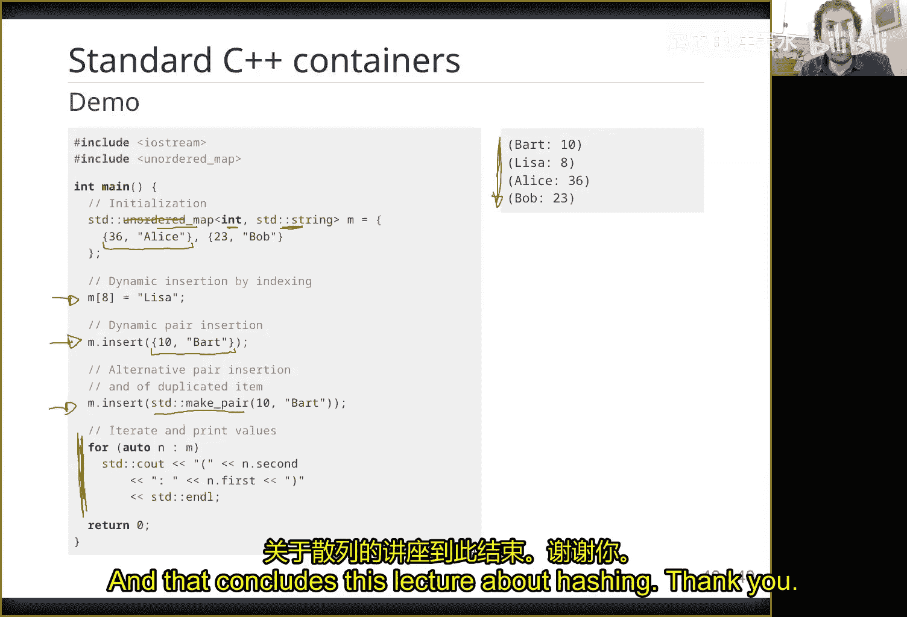

# 数据结构与算法：9-3：哈希（下）🔑


在本节课中，我们将继续学习哈希表，重点探讨处理哈希冲突的另一种核心方法——**开放寻址法**。我们将了解其工作原理、具体实现（包括线性探测、二次探测和双重哈希），并分析其优缺点。最后，我们会介绍C++标准库中基于哈希表的无序容器。

上一节我们介绍了使用**分离链接法**（Separate Chaining）来解决哈希冲突。本节中，我们来看看另一种截然不同的思路：**开放寻址法**（Open Addressing）。

## 开放寻址法概述

在开放寻址法中，哈希表的结构保持不变，即一个固定大小的数组。如果两个键被哈希到同一个数组索引（发生冲突），我们不会使用链表，而是按照一个预定的规则（探测函数）去寻找数组中下一个可用的位置来存放这个键。

其核心思想是：当在索引 `H0` 处发生冲突时，我们通过一个函数 `F(i)` 计算一个偏移量，从而尝试新的索引 `H1 = H0 + F(1)`。如果 `H1` 仍被占用，则继续尝试 `H2 = H0 + F(2)`，依此类推，直到找到一个空位。

以下是探测过程的伪代码描述：
```
index = hash(key)
i = 0
while table[(index + F(i)) % table_size] is occupied:
    i = i + 1
insert key at table[(index + F(i)) % table_size]
```

## 线性探测

线性探测是最直观的探测方法，其偏移函数为 `F(i) = i`。这意味着发生冲突时，我们简单地依次检查下一个索引位置。

例如，假设键 `U` 被哈希到索引0，但该位置已被键 `3` 占用。使用线性探测：
1.  尝试索引 `0+1 = 1`，如果空闲则插入 `U`。
2.  如果索引1也被占用，则尝试索引 `0+2 = 2`，以此类推。

线性探测容易导致**聚集**现象：连续的冲突会形成大块的已占用区域，这会导致后续插入需要多次探测，性能下降。

## 代码实现

我们来看一个基于线性探测的哈希表实现框架。哈希表的每个位置是一个节点，包含键和一个标记是否被占用的布尔值。

以下是节点和哈希表类的结构定义：
```cpp
struct Node {
    KeyType key;
    bool taken = false; // 标记此位置是否被占用
};

class HashTable {
private:
    std::vector<Node> table;
    int size = 0; // 当前存储的键数量
    int capacity; // 哈希表总容量
    // ... 哈希函数、调整大小函数等
public:
    bool contains(const KeyType& key);
    void insert(const KeyType& key);
    void remove(const KeyType& key);
};
```

### 查找操作

查找操作遵循探测逻辑：从哈希计算出的初始位置开始，如果该位置的键匹配，则查找成功。如果不匹配，则根据探测函数（如线性探测）检查下一个位置，直到找到键或遇到一个空位（表示键不存在）。

以下是查找操作的伪代码流程：
```
index = hash(key) % capacity
i = 0
while table[(index + i) % capacity] is taken:
    if table[(index + i) % capacity].key == target_key:
        return true
    i = i + 1 // 线性探测：F(i)=i
return false
```

### 插入操作

插入前先检查键是否已存在。如果不存在，则从哈希位置开始线性探测，寻找第一个空位进行插入。插入后，需要检查**负载因子**（已用位置数量 / 总容量）。为了平衡冲突概率和内存使用，我们通常设定一个阈值（例如0.5），当负载因子超过该阈值时，对哈希表进行**扩容**并重新哈希所有键。

### 删除操作

删除操作是开放寻址法中的一个难点。不能简单地将找到的键所在位置标记为空。考虑以下场景：键 `U` 和 `V` 哈希冲突，`U` 被插入到其下一个可用位置（比如索引1），`V` 又被插入到更下一个位置（索引2）。如果直接删除 `U` 并将索引1置空，那么后续查找 `V` 时，从 `V` 的原始哈希位置（索引1）开始探测，发现该位置为空，就会错误地认为 `V` 不存在。

解决方案是：删除一个键后，需要将其所在**聚集块**中后续的所有键**重新插入**（重新哈希），以填补可能产生的“空洞”，确保探测链的连续性。

## 其他探测方法

除了线性探测，还有其他的冲突解决策略：

*   **二次探测**：偏移函数为 `F(i) = i²`。即第一次冲突尝试偏移1，第二次冲突尝试偏移4，第三次尝试偏移9... 这有助于缓解线性探测带来的聚集问题。
*   **双重哈希**：偏移量由第二个哈希函数计算得出，即 `F(i, key) = i * hash2(key)`。这种方法能产生最好的分布性，极大减少聚集，但每次探测可能需要访问内存中相距较远的位置，可能影响缓存性能。

以下是三种方法的简单对比：
*   **线性探测**：实现简单，但容易产生聚集；探测步长短，缓存友好。
*   **二次探测**：减轻了聚集，但探测序列可能无法覆盖所有槽位。
*   **双重哈希**：分布性最好，聚集最少；但计算稍复杂，可能破坏局部性。

## C++标准库中的哈希表

C++标准库提供了基于哈希表的无序关联容器。它们不维护元素的任何特定顺序，但提供了平均情况为常数时间的查找、插入和删除操作。

*   `std::unordered_set`：仅存储键的集合。
*   `std::unordered_map`：存储键值对的映射。

这与之前学到的、基于红黑树实现的有序关联容器（`std::set`, `std::map`）形成对比。有序容器提供对数级复杂度的操作，并保持元素有序。

以下是一个使用 `std::unordered_map` 的示例：
```cpp
#include <unordered_map>
#include <iostream>

int main() {
    std::unordered_map<int, std::string> student_map;

    // 插入键值对
    student_map[101] = "Alice";
    student_map.insert({102, "Bob"});
    student_map.insert(std::make_pair(103, "Charlie"));

    // 遍历（顺序是不确定的）
    for (const auto& entry : student_map) {
        std::cout << entry.first << ": " << entry.second << std::endl;
    }
    // 输出顺序可能是 103: Charlie, 101: Alice, 102: Bob
    return 0;
}
```

## 总结



本节课中我们一起学习了哈希冲突的第二种主要解决方案——**开放寻址法**。我们深入探讨了其核心思想，即通过探测函数在数组内寻找空位。我们详细分析了**线性探测**的实现，包括查找、插入以及需要特殊处理的删除操作。我们还简要介绍了**二次探测**和**双重哈希**等其他策略。最后，我们了解了C++标准库中基于哈希表的无序容器（`std::unordered_map/set`）及其与有序容器的区别。选择开放寻址还是分离链接，取决于具体的应用场景、对内存和性能的权衡。