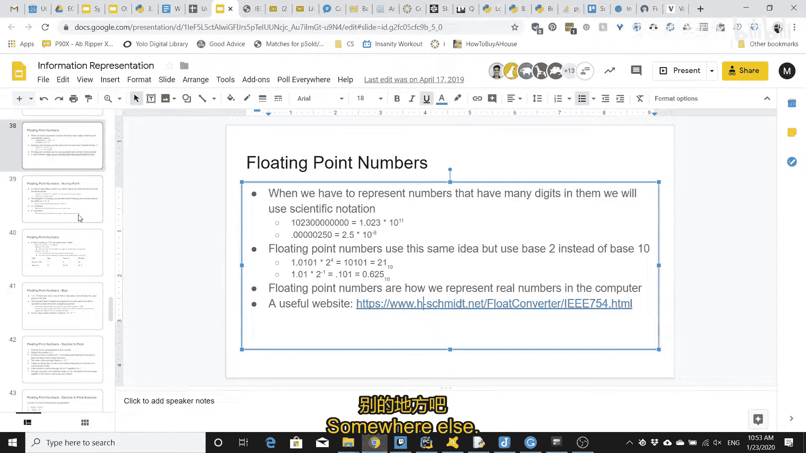
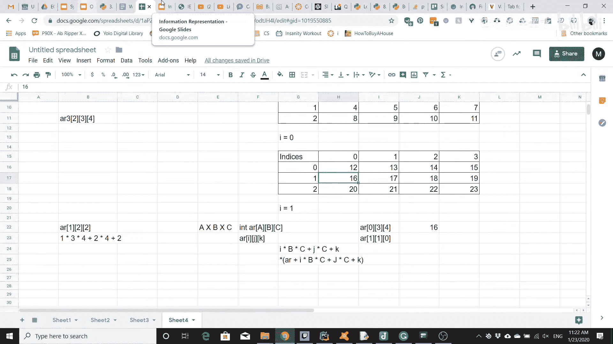

# 005：内存与底层


在本节课中，我们将要学习计算机内存中数据的底层表示与组织方式。我们将探讨二进制表示、浮点数、字符编码、数组的内存布局以及结构体的内存结构。理解这些概念对于编写高效且正确的程序至关重要。

## 二进制表示与解释

上一节我们回顾了二进制的基础，本节中我们来看看如何解释一个给定的比特模式。

一个比特模式本身没有意义，其含义取决于我们如何解释它。例如，比特模式 `10 1101` 可以代表不同的值：

*   如果解释为**无符号整数**，其值为：`1*32 + 0*16 + 1*8 + 1*4 + 0*2 + 1*1 = 45`。
*   如果解释为**原码**，最高位为符号位（1表示负），其余位表示大小：`-(0*16 + 1*8 + 1*4 + 0*2 + 1*1) = -13`。
*   如果解释为**补码**，最高位为1表示负数。求其绝对值的方法是：**按位取反，然后加1**。
    *   原模式：`10 1101`
    *   按位取反：`01 0010`
    *   加1：`01 0010 + 1 = 01 0011`
    *   `01 0011` 作为无符号整数的值是 `19`，因此原补码模式代表 `-19`。

## 浮点数表示

现在，让我们看看浮点数在内存中是如何表示的。浮点数遵循 IEEE 754 标准，使用类似科学计数法的方式，但是以2为底。

一个单精度浮点数（32位）由三部分组成：
*   符号位 S（1位）
*   指数位 E（8位）
*   尾数位 M（23位）




其表示的数值公式为：`(-1)^S * 1.M * 2^(E-127)`

**示例：求 -19.0 的浮点表示**

1.  **求绝对值的二进制**：`19` 的二进制是 `10011`。
2.  **规格化**：写成 `1.0011 * 2^4`。所以尾数 M = `0011`，指数部分应为 `4 + 127 = 131`（加上偏置值127）。
3.  **组合字段**：
    *   符号 S：1（因为是负数）
    *   指数 E：`131` 的二进制（`10000011`）
    *   尾数 M：`0011` 后补19个0，凑足23位。
4.  **最终32位模式**：`1 10000011 00110000000000000000000`

特殊值表示：
*   如果 **E=0 且 M=0**，表示数字 `0`。
*   如果 **E全为1 且 M=0**，表示 `无穷大 (Infinity)`。
*   如果 **E全为1 且 M≠0**，表示 `非数字 (NaN)`。

## 字符表示

字符在内存中也由比特模式表示，这种映射关系是人为定义的。常见的编码方案是ASCII（1字节）和Unicode（如UTF-16，2字节）。

在ASCII表中，字符的编码是连续的，这使得我们可以对字符进行算术运算。例如：
*   `'a'` 的ASCII码是 `97`，`'b'` 是 `98`，`'c'` 是 `99`。
*   因此，`'a' + 2` 的结果是 `99`，对应字符 `'c'`。
*   同样，`'c' - 'a'` 的结果是 `2`。

这种特性也解释了字符串比较时的行为：计算机会逐个比较字符的编码值。由于大写字母的编码（‘A‘=65）小于小写字母（‘a‘=97），所以 `"Zebra" < "apple"` 在字典序比较中结果为真。

## 数组的内存布局

数组元素在内存中是连续存储的。对于一维数组 `arr[i]`，其访问等价于 `*(arr + i)`。

对于多维数组，主要有两种内存组织方式：

### 1. 单一大块内存（行优先）

C语言中的静态多维数组采用这种方式。所有元素存储在一个连续的内存块中，按行排列。

对于一个 `M x N` 的二维数组，要访问 `arr[i][j]`，其对应的内存地址计算公式为：
`地址 = arr + i * N + j`

**示例**：一个 `3 x 4` 的数组，访问 `arr[1][2]`。
`地址 = arr + 1 * 4 + 2 = arr + 6`，即从起始地址向后偏移6个元素的位置。




对于更高维的数组（如 `D1 x D2 x D3`），访问 `arr[i1][i2][i3]` 的公式为：
`地址 = arr + i1 * (D2 * D3) + i2 * D3 + i3`
**规律是：每个索引乘以其后所有维度的乘积之和**。

### 2. 数组的数组（指针数组）

动态创建的多维数组或Python/Java中的列表的列表采用此方式。它实际上是一个“指针数组”，每个指针指向一个一维数组（一行）。

访问 `arr[i][j]` 需要两次解引用：
`值 = *(*(arr + i) + j)`

**优势与劣势对比**：

以下是两种方式的比较：

| 特性 | 单一大块内存 | 数组的数组 |
| :--- | :--- | :--- |
| **内存开销** | 小（仅一个头指针） | 大（需要额外存储指针数组） |
| **灵活性** | 差，每行大小必须相同 | 好，可创建“锯齿状数组” |
| **访问速度** | 快（一次计算，缓存友好） | 慢（多次指针跳转） |
| **函数传参** | 需指定除第一维外的所有维度 | 无需指定维度（使用指针的指针） |
| **内存分配** | 通常需在编译时确定大小 | 可在运行时动态决定大小 |

## 结构体的内存布局

结构体（或类）的成员在内存中也是顺序存放的，但可能会因为“内存对齐”而存在填充字节，以确保每个成员在自然边界上对齐，从而提升访问速度。

**示例**：
```c
struct Example {
    int x;      // 假设占4字节，偏移 0
    char y;     // 占1字节，偏移 4
    short s;    // 占2字节，偏移 6 (需对齐到2的倍数)
    char name[10]; // 占10字节，偏移 8
    double d;   // 占8字节，偏移 18 (需对齐到8的倍数，所以实际从24开始)
    float f;    // 占4字节，偏移 32
};
```
访问 `myStruct.member` 时，编译器会计算该成员相对于结构体起始地址的偏移量。

关于变量存储顺序：
*   **全局变量**：按声明顺序存储（先声明的在低地址）。
*   **函数参数**：按参数顺序存储（第一个参数在低地址）。
*   **局部变量**：通常按**声明逆序**存储（后声明的变量在低地址）。

## 绕过访问限制

C++中的 `private` 等访问控制是编译器层面的保护，硬件层面没有限制。如果你知道一个私有成员在对象内存布局中的偏移量，可以通过指针直接访问和修改它。
```cpp
class MyClass {
private:
    int secret;
public:
    MyClass() : secret(42) {}
    int getSecret() { return secret; }
};

int main() {
    MyClass obj;
    int* p = (int*)&obj; // p 指向对象起始地址，即 secret 的位置
    *p = 100; // 直接修改私有成员 secret
    cout << obj.getSecret(); // 将输出 100
}
```
**注意**：这是一种破坏封装性的危险操作，仅用于理解底层原理，不应在实际开发中使用。

## 总结


本节课中我们一起学习了计算机内存的底层表示。我们探讨了如何解释二进制比特模式，深入了解了浮点数的IEEE 754标准表示法，以及字符的编码原理。我们还分析了数组在内存中的两种主要组织方式——单一大块内存和数组的数组，并比较了它们的优缺点。最后，我们了解了结构体的内存布局，并看到了如何通过内存地址操作绕过高级语言的一些抽象限制。理解这些底层概念有助于你写出更高效、更可靠的代码，并更好地调试复杂问题。