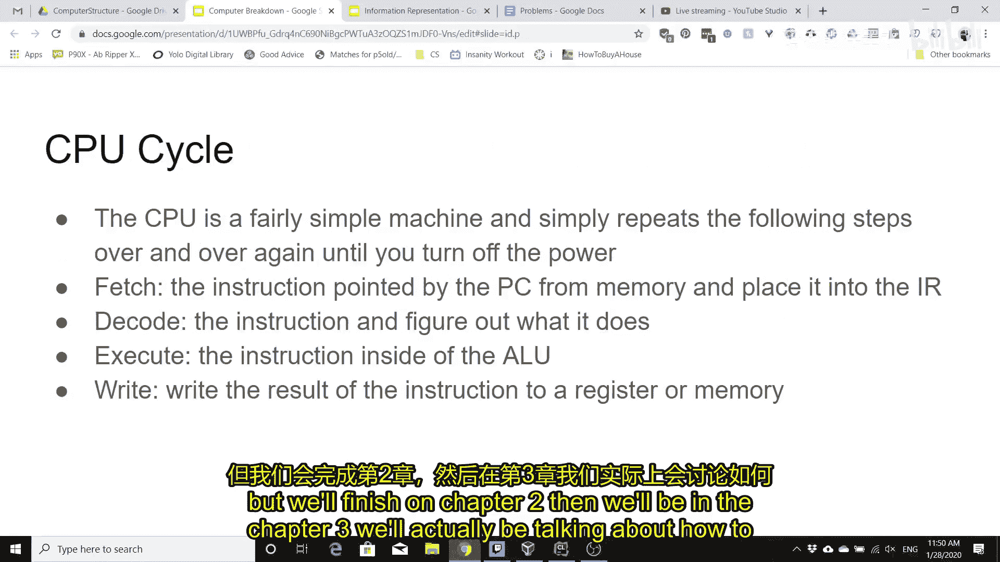
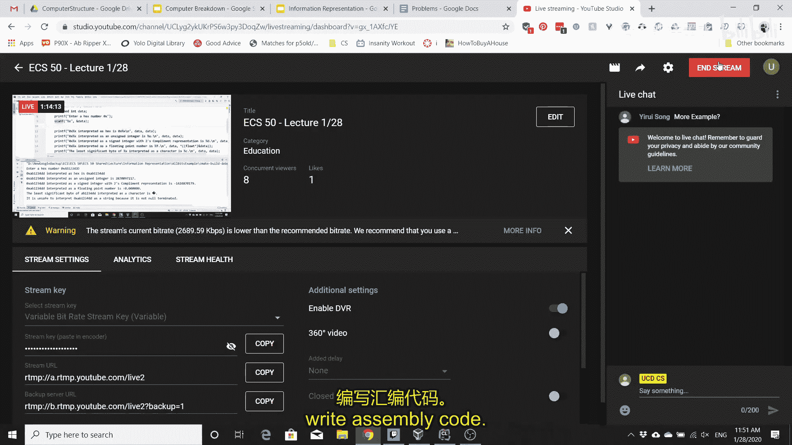

# 006：硬件基础知识

在本节课中，我们将学习计算机硬件的基础知识，包括位运算的实际应用、计算机内部数据的表示方式，以及CPU、内存、总线等核心硬件组件的工作原理。理解这些概念是学习汇编语言和深入理解程序运行机制的关键。

## 位运算应用

上一节我们介绍了位运算的基本操作符。本节中我们来看看如何利用这些操作符来精确地设置、清除或翻转一个整型变量中的特定位。

### 设置特定位为1

要将变量 `var` 的第 `i` 位设置为1，需要使用 **或（OR）** 运算。因为任何位与1进行或运算的结果都是1，而与0进行或运算则保持不变。

**公式**：`var |= (1 << i)`

以下是具体步骤：
1.  使用左移操作 `(1 << i)` 生成一个掩码，该掩码仅在位置 `i` 处为1，其余位均为0。
2.  使用 `|=` 操作符将变量 `var` 与该掩码进行或运算，从而将第 `i` 位设为1。

### 设置特定位为0

要将变量 `var` 的第 `i` 位设置为0，需要使用 **与（AND）** 运算。因为任何位与0进行与运算的结果都是0，而与1进行与运算则保持不变。

**公式**：`var &= ~(1 << i)`

以下是具体步骤：
1.  使用左移操作 `(1 << i)` 生成一个掩码。
2.  使用按位取反操作 `~` 对该掩码进行翻转，得到一个在位置 `i` 处为0，其余位均为1的新掩码。
3.  使用 `&=` 操作符将变量 `var` 与该新掩码进行与运算，从而将第 `i` 位清零。

### 翻转特定位的值

要翻转（即取反）变量 `var` 的第 `i` 位，需要使用 **异或（XOR）** 运算。因为任何位与1进行异或运算的结果是其相反值，而与0进行异或运算则保持不变。

**公式**：`var ^= (1 << i)`

以下是具体步骤：
1.  使用左移操作 `(1 << i)` 生成一个掩码。
2.  使用 `^=` 操作符将变量 `var` 与该掩码进行异或运算，从而翻转第 `i` 位的值。

### 检查特定位的值

要检查变量 `var` 的第 `i` 位是1还是0，可以结合使用 **与（AND）** 运算和条件判断。

**代码**：
```c
if (var & (1 << i)) {
    // 第 i 位是 1
} else {
    // 第 i 位是 0
}
```

以下是原理说明：
1.  使用 `(1 << i)` 生成掩码。
2.  将 `var` 与掩码进行与运算。如果第 `i` 位是1，结果将是一个非零值（在C语言中视为“真”）；如果第 `i` 位是0，结果将是0（视为“假”）。

**注意**：不应将结果与数字1直接比较（如 `(var & (1 << i)) == 1`），因为当 `i` 不为0时，结果可能是 `2^i`（例如8），它不等于1，但依然是非零的“真”值。

## 数值表示范围

理解了位操作后，我们来看看不同类型整数在给定位数下的表示范围。这对于理解数据溢出和内存使用至关重要。

假设我们使用 **B** 位来表示一个整数。

*   **无符号整数**：所有位都用于表示数值大小。
    *   **范围**：`0` 到 `2^B - 1`
*   **有符号整数（原码表示）**：使用1位作为符号位，其余位表示数值大小。
    *   **范围**：`-(2^(B-1) - 1)` 到 `+(2^(B-1) - 1)`
*   **有符号整数（补码表示）**：现代计算机普遍采用的方式。
    *   **范围**：`-2^(B-1)` 到 `+(2^(B-1) - 1)`

## 移位运算的注意事项

移位运算在处理有符号和无符号数时行为不同，这是一个容易出错的地方。

*   **左移（`<<`）**：总是向空出的低位补0。
*   **右移（`>>`）**：
    *   对**无符号**整数进行右移是**逻辑右移**，向空出的高位补0。
    *   对**有符号**整数进行右移是**算术右移**，向空出的高位补**符号位**（即最高位的值）。

**示例**：
```c
int x = -1;          // 补码表示为全1
unsigned int y = -1; // 位模式也是全1，但解释为很大的无符号数

x = x >> 1; // 算术右移，结果仍是全1，值保持为-1
y = y >> 1; // 逻辑右移，高位补0，结果是一个很大的正数

// 因此 (x >> 1) == (y >> 1) 的结果是 假 (0)
```

## 数据的多重解释

计算机中所有数据最终都以比特（0和1）的形式存储。这些比特串本身没有固有含义，其意义取决于我们如何解释它。同一个比特序列可以被解释为整数、浮点数、字符或机器指令。

**示例**：比特序列 `0x43415453`（十六进制）
*   **作为十六进制数**：`0x43415453`
*   **作为无符号整数**：`1129463891`
*   **作为补码整数**：`1129463891`（因为最高位是0）
*   **作为浮点数**：可能与0.0相关（取决于指数域）
*   **作为字符（小端序）**：最低有效字节 `0x43` 是 `'C'`，连续解读可得字符串 `"CATS"`。

这个例子强调了“类型”的概念：它告诉编译器或程序员应该如何理解某块内存中的比特。

## 计算机硬件组成概述

现在，让我们从宏观角度了解计算机硬件的几个核心组成部分。

### 中央处理器（CPU） 🧠

CPU是计算机的“大脑”，负责执行程序指令。其主要部件包括：
*   **算术逻辑单元（ALU）**：执行加、减、乘、除、与、或等运算。
*   **寄存器**：CPU内部的高速存储单元，用于临时存放数据、地址和控制信息。常见的有：
    *   `EAX`, `EBX`, `ECX`, `EDX`：通用数据寄存器。
    *   `EIP`：指令指针，存放下一条要执行指令的地址。
    *   `ESP`：栈指针，指向当前栈顶。
*   **控制单元**：协调CPU内部各部件的工作。

### 内存

内存用于存储正在运行的程序和所需数据。
*   **随机存取存储器（RAM）**：可读写，访问任何位置耗时相近。**易失性**，断电后数据丢失。
*   **只读存储器（ROM）**：通常只能读取，存储固件（如BIOS）。**非易失性**，断电后数据保留。

**注意**：硬盘、固态硬盘（SSD）等属于**输入/输出设备**，不是这里所说的“内存”。

### 输入/输出设备（I/O）

这些设备使计算机能与外界交互。
*   **输入设备**：键盘、鼠标、麦克风、扫描仪。
*   **输出设备**：显示器、打印机、扬声器。
*   **网络设备**：网卡、Wi-Fi适配器。

### 系统总线

总线是一组用于在计算机各部件（CPU、内存、I/O设备）间传输数据的公共通信线路。可分为：
*   **控制总线**：传输控制信号（如读/写命令）。
*   **地址总线**：指定要访问的内存或设备地址。
*   **数据总线**：实际传输的数据内容。

## 软件可移植性问题

程序的可移植性受到硬件和软件两方面的限制。

*   **硬件限制**：为特定CPU架构（如x86、ARM）编译的程序无法直接在其他架构上运行。
*   **软件/操作系统限制**：程序通过操作系统提供的接口（系统调用）访问硬件。不同操作系统（如Windows、Linux、macOS）的系统调用接口不同，因此为某一系统编译的程序通常无法在另一系统上直接运行。

这就是为什么下载软件时需要选择对应操作系统和处理器位数的版本。

---





本节课中我们一起学习了位运算的实用技巧，包括设置、清除、翻转和检查特定位。我们还探讨了不同整数类型的表示范围、有符号/无符号数移位运算的区别，以及数据比特的多重解释性。最后，我们概述了计算机硬件的核心组件：CPU、内存、I/O设备和总线，并了解了影响软件可移植性的硬件与操作系统因素。这些基础知识是后续学习汇编语言和计算机系统工作原理的坚实基石。