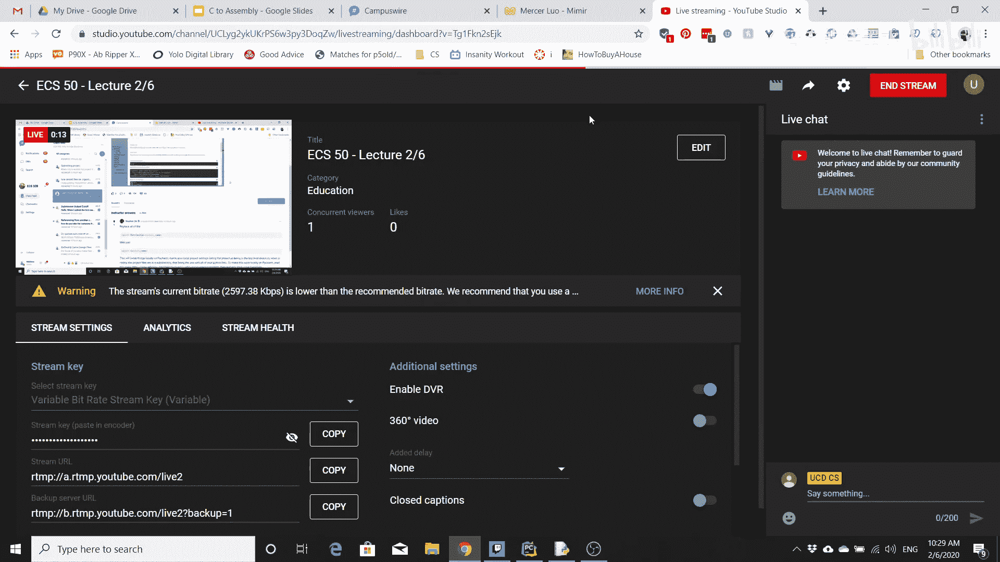
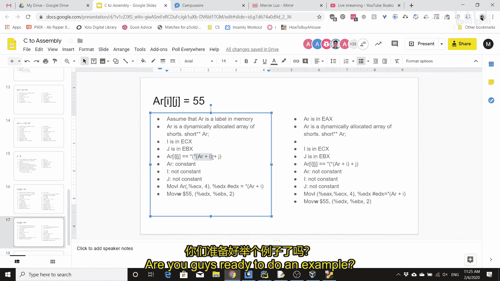
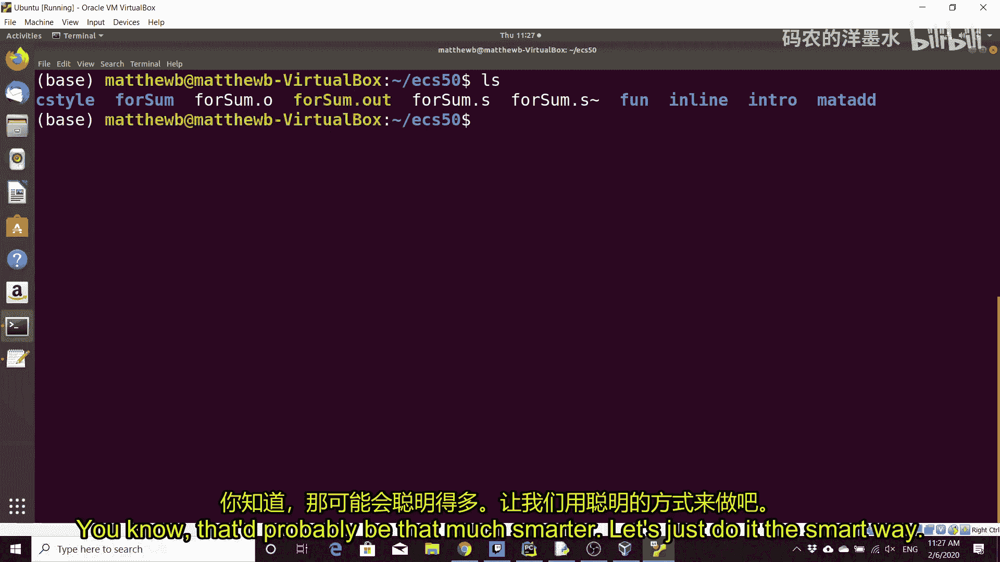
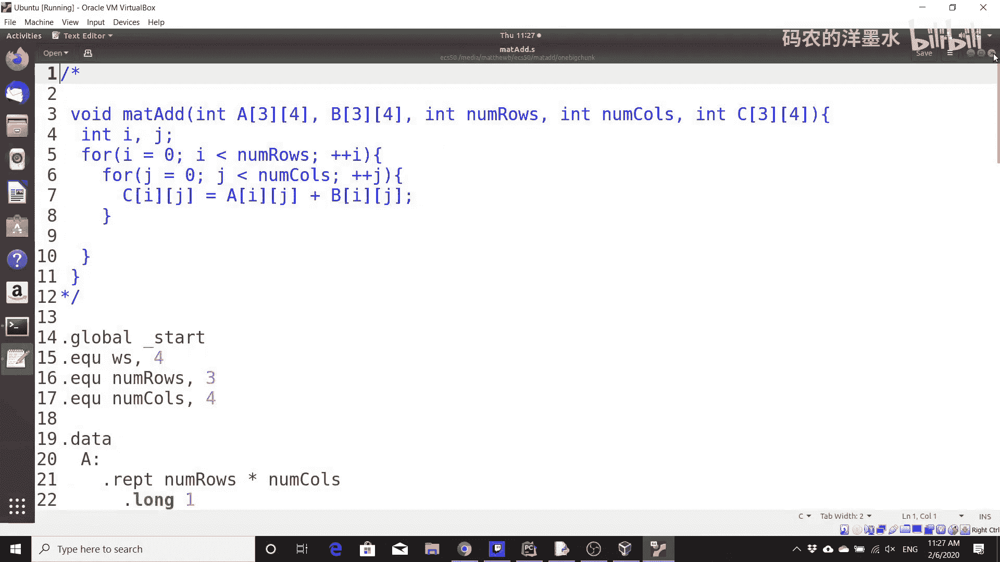
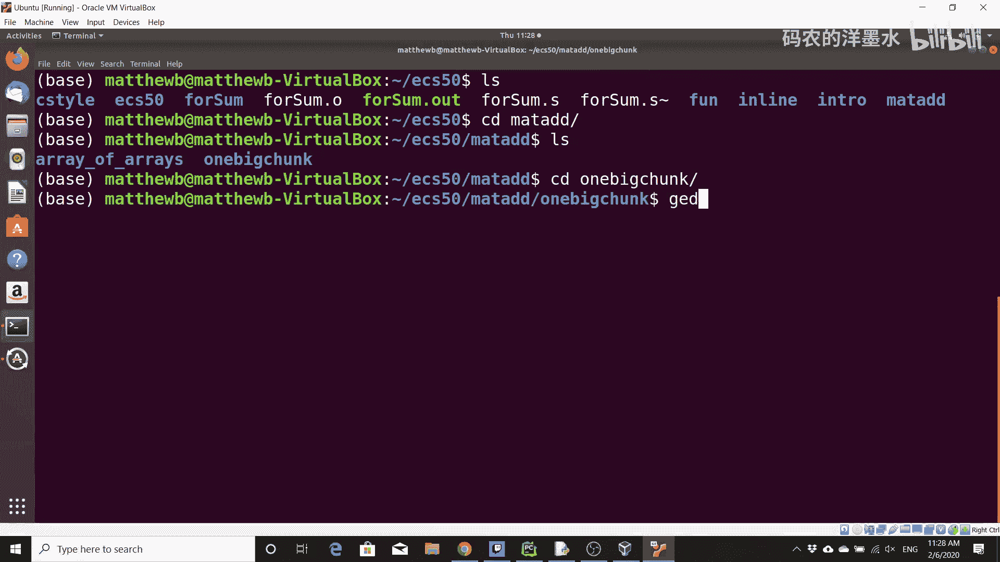
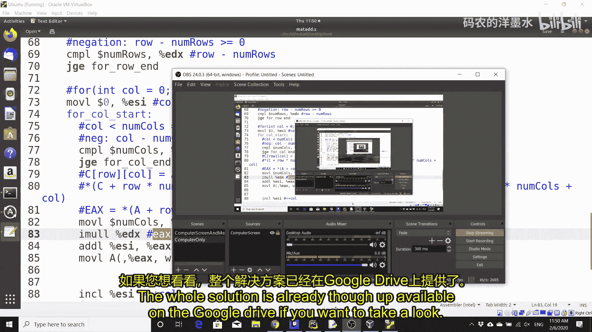

# 009：x86汇编中的高级数组索引 🧮




在本节课中，我们将学习如何在x86汇编语言中翻译和处理高级的数组索引操作。我们将重点关注C语言中常见的数组表达式如何转换为等价的汇编指令，特别是使用高级索引模式（Displacement + Offset + Index * Scale）。通过具体的例子，我们将掌握处理静态和动态数组、不同数据类型以及多维数组的方法。

## 课程公告与回顾 📢

上一节我们介绍了汇编语言的基础知识。本节开始前，有一些课程安排需要通知。

*   作业二已发布，今天课程结束后即可开始。请确保尽早开始。
*   作业二的C语言部分必须用C语言完成，不能使用C++。
*   第二章测验将在本周末开放，内容简短。
*   第三章（汇编部分）的测验预计在下周发布。
*   期中考试也即将到来。

现在，让我们回到核心内容。

## 高级索引模式详解 🔍

我们正在学习将常见的C语言表达式翻译成汇编代码。我们使用的高级索引模式格式为 `D(O, I, S)`，其效果是计算内存地址：`D + O + I * S`，并访问该地址的值。

其各部分含义如下：
*   **D (Displacement)**： 必须是一个常量表达式。
*   **O (Offset)**： 必须是一个寄存器。
*   **I (Index)**： 必须是一个寄存器。
*   **S (Scale)**： 可以是1、2、4或8。

如果你不提供D、O或I，它们将默认为0。如果不提供S，则默认为1。S的值实际上受你操作的数据类型大小影响：
*   操作字符（char）时，S应为 **1**。
*   操作短整型（short）时，S应为 **2**。
*   操作整型（int）或浮点型（float）时，S应为 **4**。
*   操作指针时（无论是什么类型的指针），在32位机器上，S也应为 **4**，因为所有指针的大小都是4字节（存储一个32位地址）。

接下来，我们将通过翻译一些常见的数组类型表达式来巩固理解。我们会分别演示当`AR`是数据段中的一个标签（静态地址）和当`AR`是一个寄存器中的值（动态地址）时的情况。

## 静态数组访问示例 📝

假设我们有一个短整型（short）数组 `AR`。在C语言中，表达式 `AR[7] = 55;` 等价于 `*(AR + 7) = 55;`。

在汇编中，如果`AR`是数据段的一个标签（即常量地址），那么`AR`和`7`都是常量。根据规则，常量必须放在位移（D）字段。此外，因为操作的是短整型（2字节），我们需要使用`movw`指令。

因此，正确的翻译是计算 `AR + 7 * 2` 的地址，并将55存入。汇编代码如下：
```assembly
movw $55, AR+14
```
这里，`14` 是 `7 * 2` 的结果，因为每个短整型占2字节。

再看一个取值操作：`AX = AR[3];`（假设AX用于存放16位值）。这需要从内存地址 `AR + 3 * 2` 处读取一个短整型到AX寄存器。
```assembly
movw AR+6, %ax
```

现在考虑一个涉及变量的例子：`AR[i+3] = 55;`，其中`AR`是字符（char）数组，`i`存储在`ECX`寄存器中。
表达式等价于 `*(AR + i + 3) = 55;`。`AR`和`3`是常量，`i`（ECX）是变量。
常量部分 `AR+3` 放入D字段。变量部分 `i` 应放入索引（I）字段，因为Scale为1（字符大小），乘1不影响结果，但为保持一致性我们通常使用I字段。使用`movb`指令操作字节。
```assembly
movb $55, AR+3(,%ecx,1)
```

## 动态地址与复合索引 🧩

当数组基地址存储在一个寄存器中时，情况有所不同。假设`AR`地址在`EAX`中，我们执行 `AR[i+3] = 55;`（`AR`为字符数组，`i`在`ECX`）。
此时，`AR`（即`EAX`）不是常量，只有`3`是常量。常量`3`放入D字段。基地址寄存器`EAX`应放入偏移（O）字段，索引`i`（ECX）放入索引（I）字段。
```assembly
movb $55, 3(%eax,%ecx,1)
```

对于更复杂的表达式，如 `AR[i+j+5]`（整型数组，`i`在ECX，`j`在EBX），我们需要先计算变量偏移之和 `i+j`，然后加上常量偏移。
这通常需要多条指令来完成：
```assembly
movl %ebx, %edx    # 将j复制到EDX
addl %ecx, %edx    # EDX = i + j
# 现在 EDX 中为变量偏移 (i+j)
movl $55, AR+20(,%edx,4) # AR + 5*4 + (i+j)*4， Scale=4对应整型
```
可以看到，一行C代码可能需要多行汇编来实现。

## 多维数组与乘法指令 ✖️

处理多维数组时，例如一个5x16的短整型静态数组 `AR[5][16]`，访问 `AR[i][j]` 需要计算偏移：`i * 16 + j`（行主序）。这引入了乘法运算。

x86的乘法指令 `imull` 有些特殊。当两个32位数相乘时，结果可能高达64位。指令格式为 `imull source`，其效果是将 `%eax` 与 `source` 相乘，结果的低32位存入 `%eax`，高32位存入 `%edx`。
因此，在使用`imull`前，通常需要把第一个操作数放入`%eax`，并且要注意`%edx`的值会被覆盖。

例如，计算 `i * 16`（i在ECX）：
```assembly
movl $16, %eax
imull %ecx        # 结果 i*16 在 %eax 中
addl %ebx, %eax   # %eax = i*16 + j (j在EBX)
# 现在可以用高级索引模式访问 AR[%eax*2]
movw $55, AR(,%eax,2)
```




## 动态分配的多维数组 🔄







如果`AR`是一个动态分配的多维数组（例如 `short **AR`），那么 `AR[i][j]` 的含义不同。它等价于 `*(*(AR + i) + j)`。
这需要分两步进行：
1.  首先，获取行指针：`AR[i]`，即 `*(AR + i)`。这里`AR`是指针的指针，所以加`i`是移动`i`个指针，Scale为4。
    ```assembly
    movl AR(,%ecx,4), %edx # %edx = AR[i]，即第i行的起始地址
    ```
2.  然后，在该行内访问列元素：`*(%edx + j)`。此时`%edx`是`short*`类型，加`j`是移动`j`个短整型，Scale为2。
    ```assembly
    movw $55, (%edx,%ebx,2)
    ```
理解数组在内存中的实际布局（连续块 vs 指针数组）对于正确翻译至关重要。

## 实战：矩阵加法编程 🖥️

最后，我们通过一个实战例子来综合运用：编写汇编代码实现两个矩阵的加法（`C = A + B`）。假设矩阵以静态一维数组形式存储。

解决问题的第一步总是先编写C代码，这有助于理清逻辑。矩阵加法的C代码核心是一个双重循环：
```c
for (row=0; row<num_rows; row++) {
    for (col=0; col<num_cols; col++) {
        C[row][col] = A[row][col] + B[row][col];
    }
}
```
由于我们的数组是连续存储的，`A[row][col]` 的实际地址是 `A + row*num_cols + col`（再乘以元素大小）。

翻译成汇编时，我们需要：
1.  为变量分配寄存器（例如，row用EDX，col用ESI，A用标签，B的地址加载到EBX，C的地址加载到ECX）。
2.  实现外层循环和内层循环，使用`cmp`和条件跳转指令（如`jge`）控制循环。
3.  在最内层，分别计算A、B、C中当前元素的地址。以计算A中元素地址并取值到EAX为例：
    ```assembly
    movl num_cols, %eax   # 将列数放入EAX
    imull %edx            # EAX = row * num_cols, 注意这会破坏EDX！
    addl %esi, %eax       # EAX = row*num_cols + col
    movl A(,%eax,4), %eax # EAX = A[row][col]， Scale=4对应整型
    ```
    **注意**：`imull`会覆盖`EDX`寄存器，而`EDX`正存储着`row`的值！因此，在乘法之前，必须将`row`的值保存到其他安全的地方（例如另一个寄存器或内存中）。这展示了在汇编编程中管理寄存器冲突的重要性。

完整的解决方案需要仔细处理所有这些细节，包括寄存器的保存与恢复、循环的正确跳转以及最终结果的存储。

## 总结 📚

本节课中，我们一起深入学习了x86汇编语言中高级数组索引的翻译方法。

我们掌握了高级索引模式 `D(O,I,S)` 的用法，理解了位移、偏移、索引和比例因子各字段的规则。我们通过大量例子，实践了如何将静态数组、动态数组以及不同数据类型的C语言访问语句转换为汇编指令。我们还探讨了处理多维数组（包括静态连续存储和动态指针数组）时的不同策略，并介绍了必要的乘法指令 `imull`。最后，我们以一个矩阵加法的实战例子，展示了如何将复杂的C语言逻辑分解并系统地翻译成汇编代码，其中特别需要注意寄存器分配和冲突避免。




记住，编写汇编代码的关键在于耐心地将复杂问题分解为小步骤，并清晰理解每个操作的数据类型和内存布局。