# 010：高级汇编示例

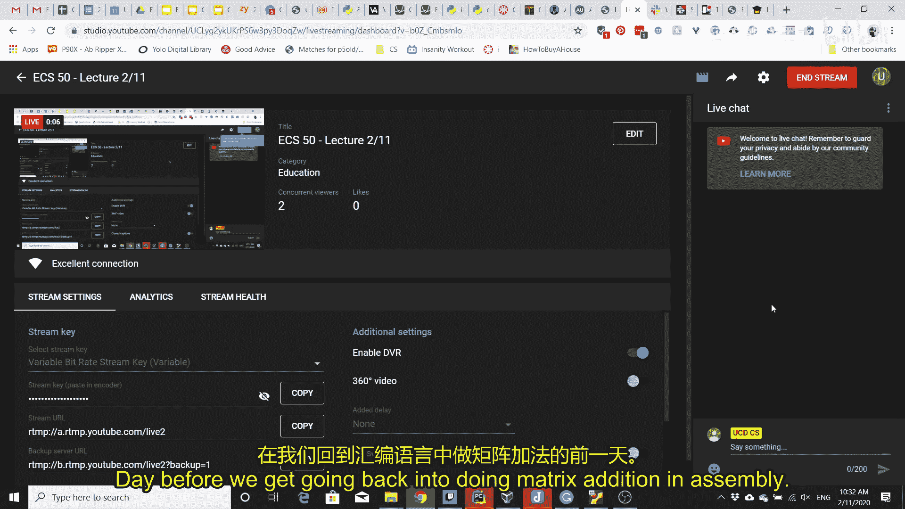

在本节课中，我们将深入学习高级汇编编程，特别是如何将复杂的C语言表达式（如矩阵加法）翻译成汇编代码。我们将重点探讨高级寻址模式的应用、寄存器的管理以及如何将大问题分解为可管理的小步骤。

## 高级寻址模式回顾

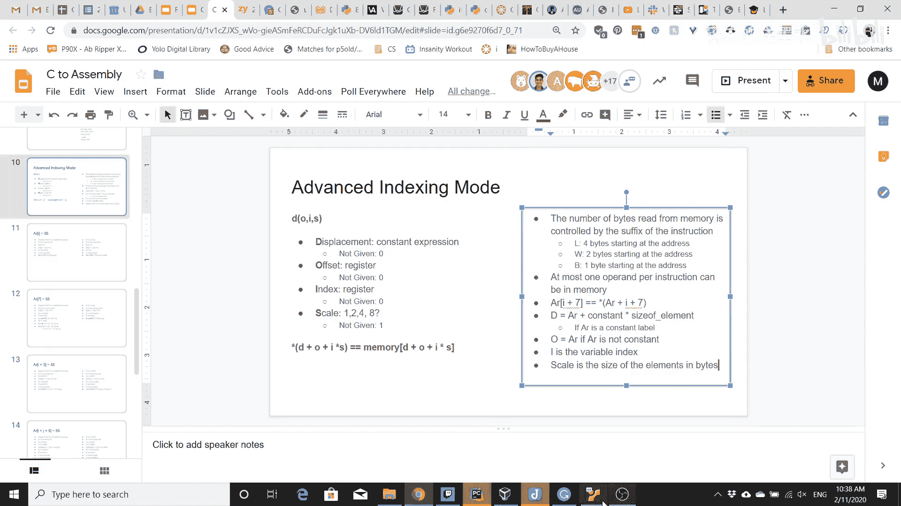

上一节我们介绍了汇编的基础指令，本节中我们来看看高级寻址模式，这是处理数组和复杂数据结构的关键。

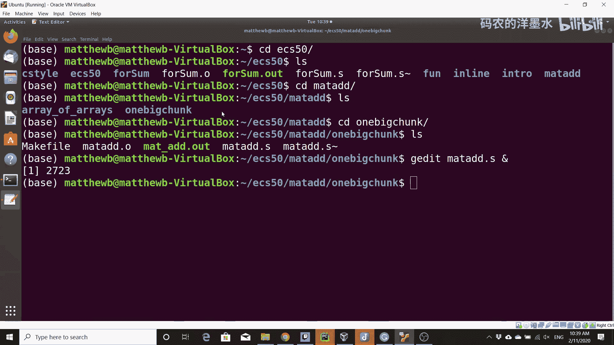

高级寻址模式遵循以下形式：`位移(偏移, 索引, 比例因子)`。其中：
*   **位移** 必须是一个常量表达式。
*   **偏移** 和 **索引** 是寄存器。
*   **比例因子** 只能是 1、2、4（在32位模式下可能还有8）。

它计算的内存地址公式为：`地址 = 位移 + 偏移 + (索引 * 比例因子)`。

这种模式完美匹配C语言中的数组访问。例如，C代码 `array[i + 7]` 等价于 `*(array + i + 7)`。在汇编中：
*   如果 `array` 是一个内存标签（常量地址），它进入**位移**字段。
*   如果 `array` 的值存储在一个寄存器中，它进入**偏移**字段。
*   变量索引 `i` 进入**索引**字段。
*   数组元素的大小（以字节为单位）作为**比例因子**。

内存是按字节寻址的，因此通过这种指令格式能访问的最小单位是单个字节。要操作单个比特，需要使用位运算指令。

以下是关于移位指令的重要说明：
*   变量移位量必须放在 `%cl` 寄存器中。
*   常量移位量可以直接指定。
*   参考指令表：`SAR`（算术右移）、`SHR`（逻辑右移）、`SHL`（左移）。

## 矩阵加法：单一大数组实现

现在，我们应用这些概念来翻译一个具体的C语言任务：矩阵加法。假设矩阵在内存中存储为单一大数组（行主序）。

我们的目标是翻译这行C代码：
```c
c[i][j] = a[i][j] + b[i][j];
```
由于是单一大数组，它等价于：
```c
c[i * num_columns + j] = a[i * num_columns + j] + b[i * num_columns + j];
```

我们首先进行规划，将寄存器用途和关键常量定义清楚：
```assembly
# 寄存器规划
# %eax: 行索引 i
# %ebx: 列索引 j
# %ecx: 矩阵 c 的基地址
# %edx: 矩阵 a 的基地址
# %esi, %edi: 临时用途

.equ WORD_SIZE, 4        # 整数大小为4字节
.equ NUM_ROWS, 3
.equ NUM_COLUMNS, 4
```

面对这样一个长表达式，我们的策略是将其分解。计算主要分为三部分：获取 `a[i][j]`、获取 `b[i][j]`、存储结果到 `c[i][j]`。

**第一步：计算 `a[i * num_columns + j]` 并存到 `%eax`**

以下是实现步骤：
1.  计算 `i * num_columns`，结果存入 `%eax`。注意 `mul` 指令会覆盖 `%edx`。
2.  加上列索引 `j` (`%ebx`)。
3.  使用高级寻址模式获取 `a` 矩阵在该偏移处的值。因为 `a` 是标签，放入位移字段；计算出的偏移在 `%eax` 中，作为索引；比例因子为 `WORD_SIZE` (4)。
4.  将取出的值移动到 `%eax`。

在第一步中，我们发现 `mul` 指令会破坏 `%edx` 寄存器，而 `%edx` 当前保存着行索引 `i`，我们需要保存它。我们选择在数据段中预留空间：
```assembly
row: .long 0   # 为变量 row 预留4字节空间，初始化为0
```
然后，在乘法前保存，在计算后恢复：
```assembly
movl %edx, row          # 保存行索引 i 到内存
# ... 执行乘法和其他计算 ...
movl row, %edx          # 从内存恢复行索引 i 到 %edx
```
一个重要的优化是，表达式 `i * num_columns + j` 在计算 `a`, `b`, `c` 的地址时都会被用到。我们可以只计算一次并复用。因此，我们将这个公共偏移值计算出来，存放到一个临时寄存器（例如 `%edx`）中，而不是在每次访问时都重新计算。

**第二步：计算 `a[i][j] + b[i][j]`**

现在 `%eax` 中已经是 `a[i][j]` 的值。我们需要加上 `b[i][j]`。
1.  使用高级寻址模式获取 `b[i][j]`。注意，在我们的规划中，`b` 的基地址在 `%ebx` 寄存器中。因此，在寻址模式中，`%ebx` 进入**偏移**字段；公共偏移值在 `%edx` 中，作为**索引**；比例因子仍为4。
2.  使用 `addl` 指令将 `b[i][j]` 加到 `%eax` 中。现在 `%eax` 中就是和。

**第三步：将结果存储到 `c[i][j]`**

最后，我们需要将 `%eax` 中的和存入 `c` 矩阵的对应位置。
1.  `c` 的基地址在 `%ecx` 寄存器中。
2.  使用高级寻址模式：偏移字段为 `%ecx`，索引字段为 `%edx`（公共偏移），比例因子为4。目的地是内存地址。
3.  使用 `movl %eax, ...` 指令完成存储。

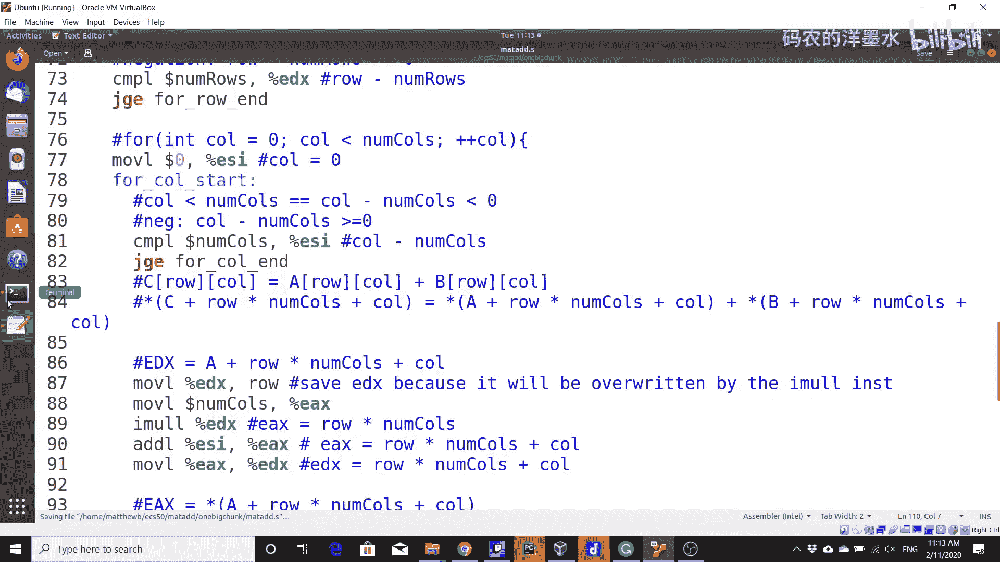

**一个常见的错误**
初学者可能会写成：
```assembly
movl (%ecx, %edx, WORD_SIZE), %edi # %edi = c[i][j]
addl %eax, %edi                    # %edi = a[i][j] + b[i][j]
```
这行代码是错误的，因为它只是改变了寄存器 `%edi` 中的值，并没有改变内存中 `c[i][j]` 位置的值。`%edi` 只是 `c[i][j]` 值的一个副本，两者是独立的存储位置。

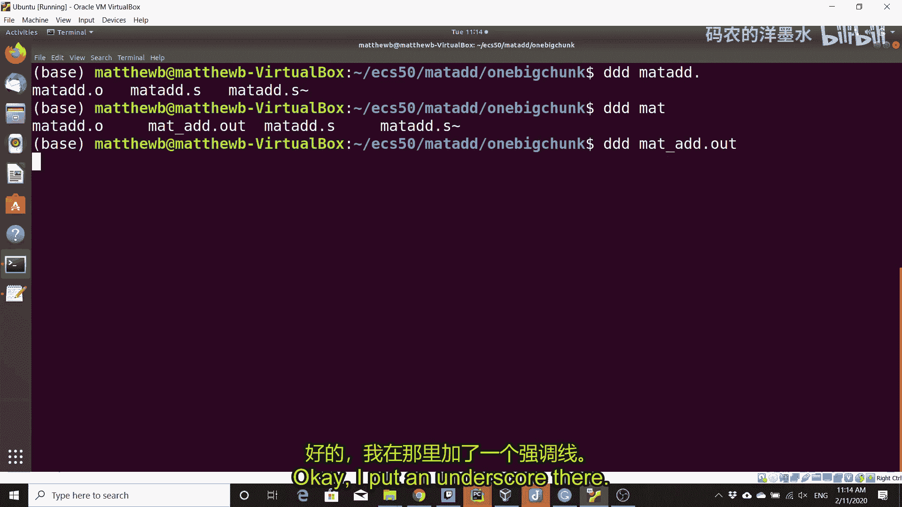

## 矩阵加法：数组的数组实现

现在，考虑另一种矩阵存储方式：数组的数组（即每行是一个独立的数组，有一个指针数组指向这些行）。C代码的参数和内存布局会不同，但循环结构相似。

关键区别在于地址计算。对于 `a[i][j]`，现在需要两次解引用：
1.  首先根据 `a`（指针数组的地址）和索引 `i`，找到第 `i` 行的地址。这对应 `a[i]`。
2.  然后根据找到的行地址和索引 `j`，找到具体元素 `a[i][j]`。

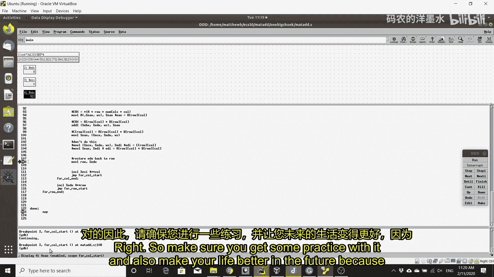

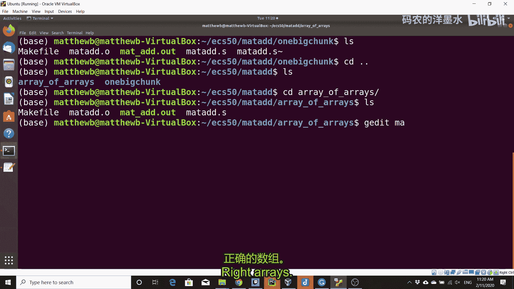

因此，`a[i][j]` 的汇编计算步骤如下：
1.  获取行指针：`movl a(,%eax,4), %ecx`。这里 `a` 是标签（位移），`%eax` 是行索引 `i`（索引），比例因子4是因为每个指针是4字节。
2.  获取元素：`movl (%ecx, %ebx, 4), %ecx`。这里 `%ecx` 是第一步得到的行地址（偏移），`%ebx` 是列索引 `j`（索引），比例因子4是因为每个整数是4字节。

计算 `b[i][j]` 和存储到 `c[i][j]` 的逻辑类似，都需要进行两级寻址。通过清晰的注释和分步计算，可以有效地管理这种复杂性。

## 函数（子程序）概念介绍

为了模块化代码，我们需要使用函数（在汇编中常称为子程序）。

一个简单的例子是计算C风格字符串的长度。C代码如下：
```c
int len = 0;
while (str[len] != '\0') {
    len++;
}
return len;
```

在汇编中实现函数，需要定义调用约定（Calling Convention），即规定：
1.  **参数如何传递**：通过寄存器（如 `%ecx`）还是通过特定内存位置？
2.  **返回值放在哪里**：通过寄存器（如 `%edx`）还是内存？
3.  **寄存器的保存责任**：哪些寄存器由调用者（Caller）保存，哪些由被调用者（Callee）保存？这是为了避免函数覆盖掉调用者还需要的数据。

例如，我们可以定义 `strlen_reg` 函数：
*   调用前，调用者应将字符串地址放入 `%ecx`。
*   函数执行后，调用者应从 `%edx` 获取长度返回值。
*   如果调用者需要保护 `%edx` 的原始值，它应在调用前自行保存。

函数的基本结构是：
```assembly
strlen_reg:
    # 函数体开始
    # 可以在这里保存需要保护的寄存器（被调用者保存）
    # ... 计算长度的代码 ...
    # 结果放入 %edx
    # 恢复之前保存的寄存器
    ret                     # 返回到调用处，注意 ret 不返回值，只改变指令指针

_start:
    # ...
    movl $my_string, %ecx   # 按照约定设置参数
    call strlen_reg         # 调用函数
    # 现在 %edx 中是字符串长度
    # ...
```

遵循一致的调用约定至关重要，就像遵守交通规则一样，能确保程序各部分正确协作。

## 调试与工具使用

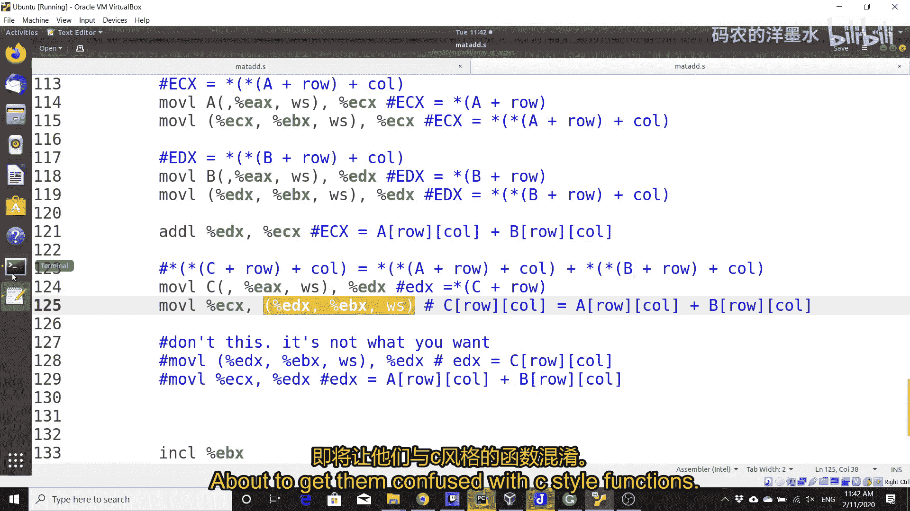

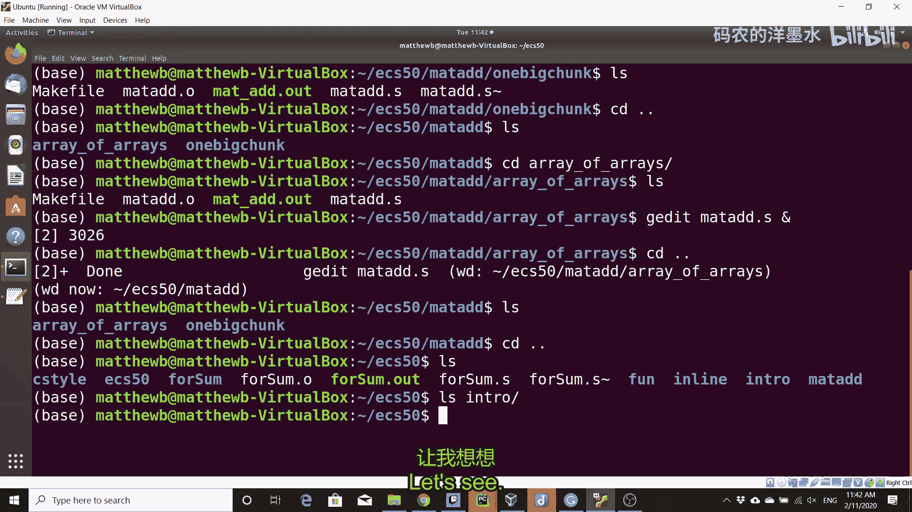

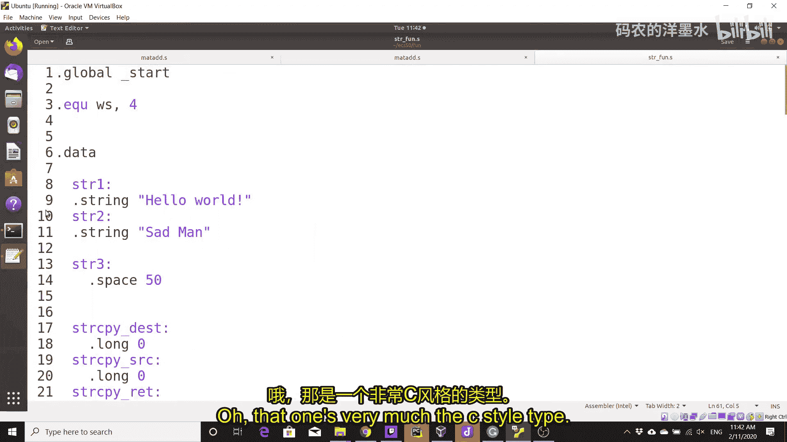

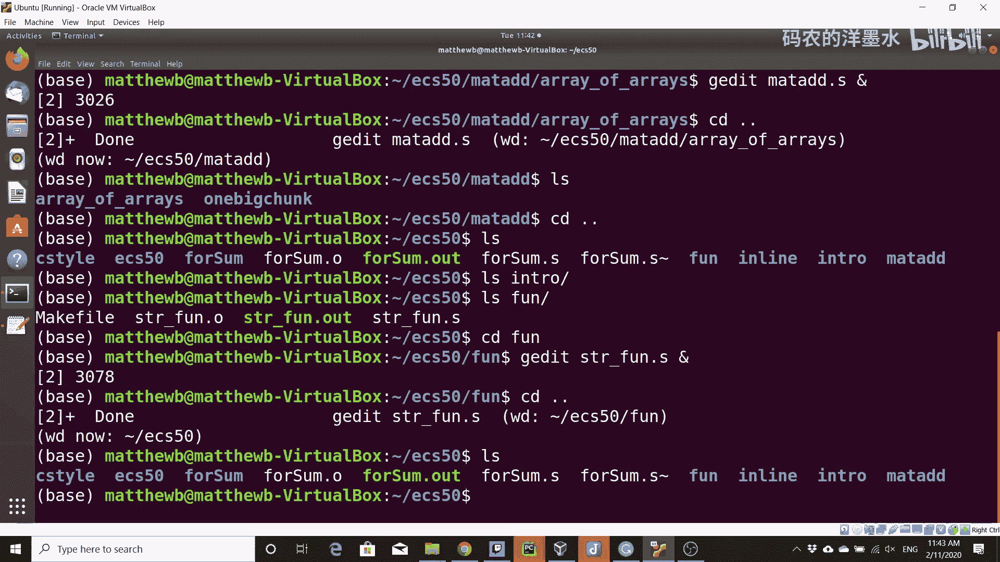

编写汇编代码时，调试器（如GDB/DDD）是必不可少的工具。因为程序可能无法直接运行，需要在调试器中逐步执行，检查寄存器和内存的变化。

使用 `make` 工具可以自动化汇编和链接过程。一个典型的 `Makefile` 规则如下：
```makefile
add.o: add.s
    as --gstabs -32 -o add.o add.s

add.out: add.o
    ld -m elf_i386 -o add.out add.o
```
*   `.o` 文件是目标文件（已汇编但未链接）。
*   `.out` 文件是可执行文件（已链接）。调试时是针对可执行文件进行的。

在调试器中，可以设置断点、单步执行、并查看内存内容。例如，在DDD中可以使用 `graph display` 命令以特定格式显示内存，如将 `c` 的地址作为整数数组来查看矩阵加法的结果。

## 总结

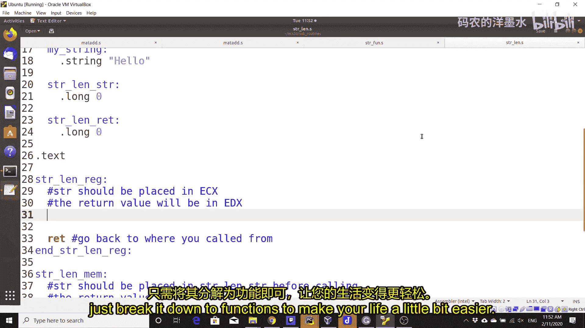

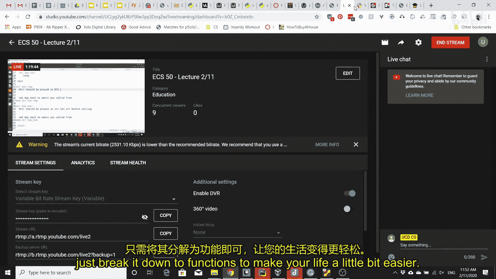

本节课中我们一起学习了高级汇编编程的核心技术。我们深入探讨了高级寻址模式，并实践了如何将复杂的C语言矩阵加法运算分解、翻译成汇编指令。我们比较了单一大数组和数组的数组两种内存布局下的代码差异。我们还引入了函数（子程序）的基本概念，包括调用约定的重要性。最后，我们强调了使用调试器和自动化构建工具对于汇编开发的关键作用。掌握这些技能，将使你能够理解和控制更底层的程序行为。