# 012：GCC调用约定与栈

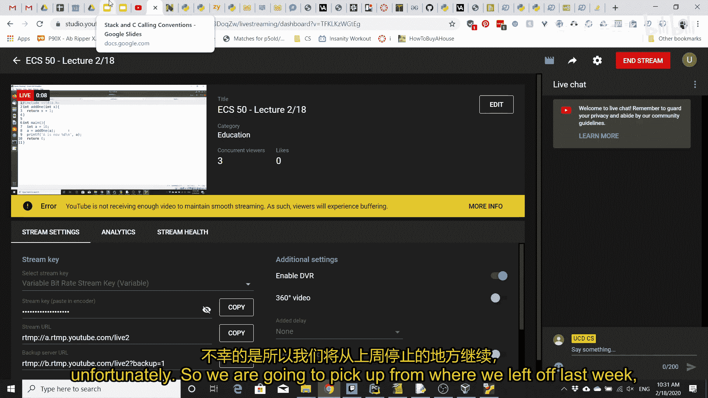

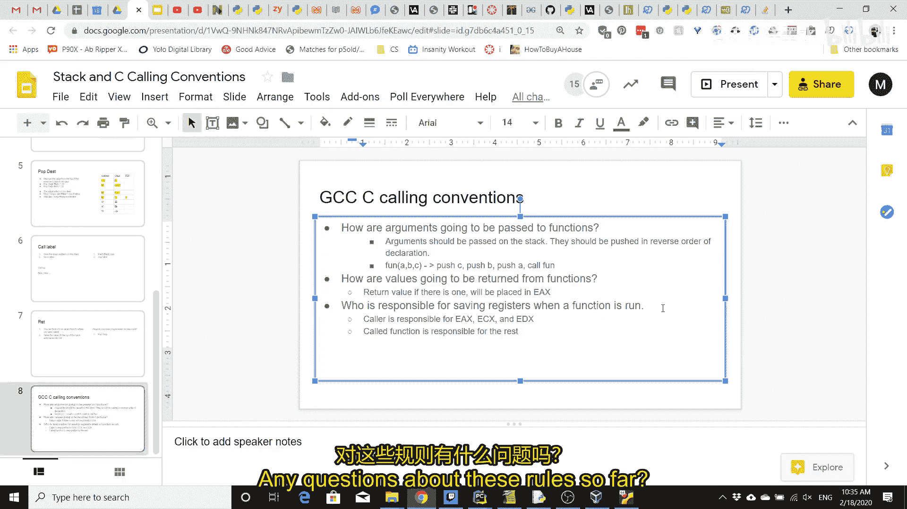


在本节课中，我们将要学习GCC调用约定以及栈在函数调用过程中的具体应用。我们将了解参数如何传递、返回值如何返回，以及寄存器的保存责任如何划分。

## 概述

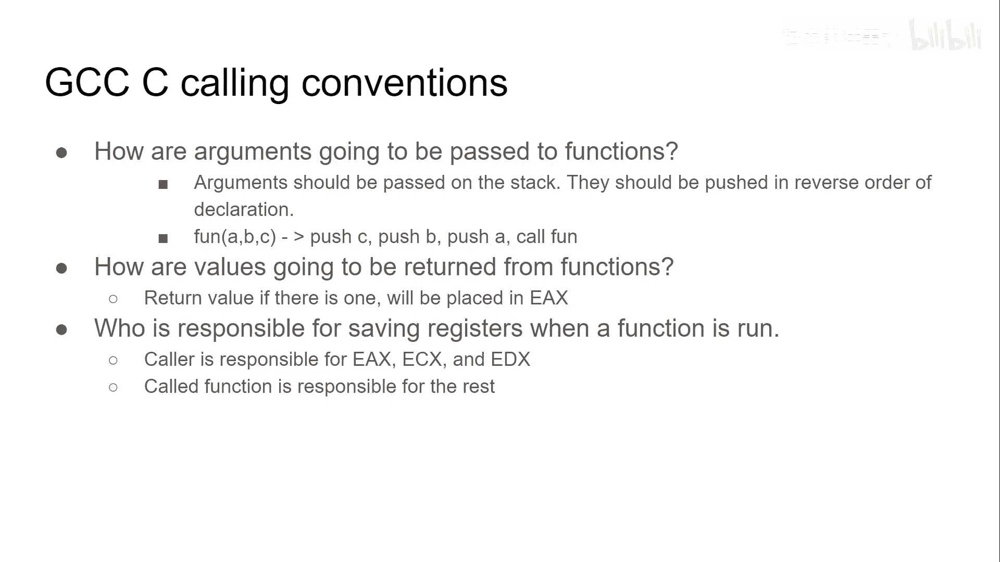


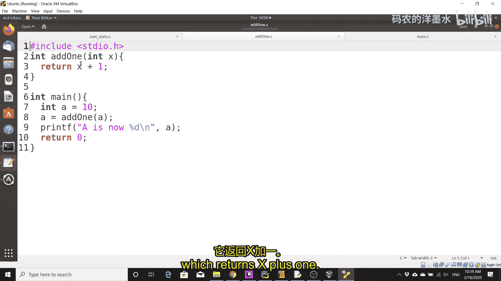

上一节我们介绍了栈的基本概念和操作。本节中，我们来看看GCC调用约定，它定义了函数调用时的一系列规则，确保不同代码模块（如C代码和汇编代码）能够协同工作。

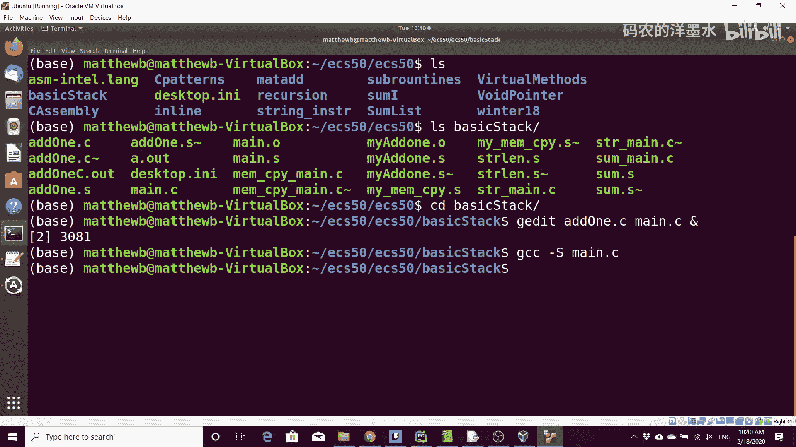

## GCC调用约定规则

GCC调用约定主要规定了以下几件事：

1.  参数如何传递给函数。
2.  值如何从函数返回。
3.  当函数运行时，谁负责保存寄存器的值。

以下是具体的规则：

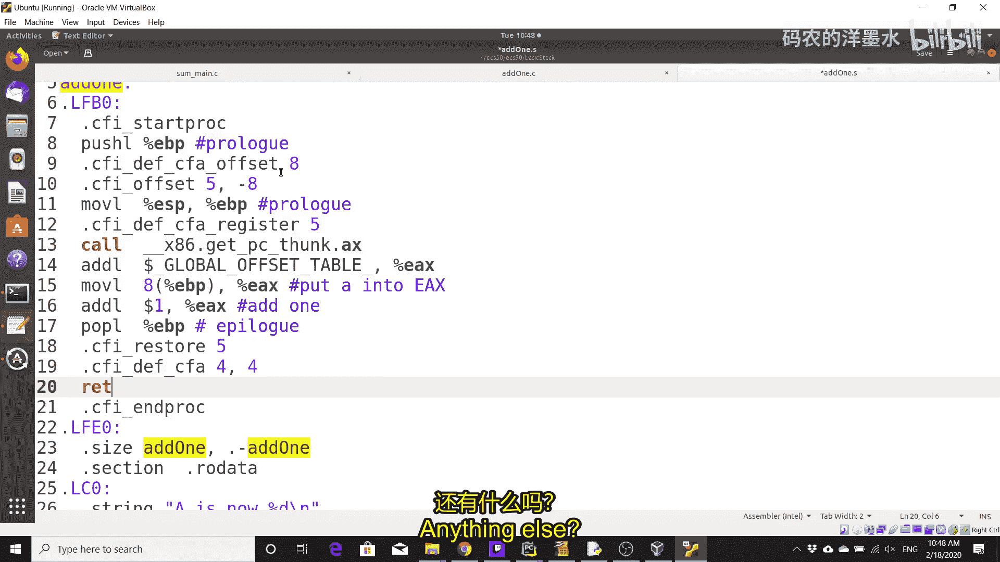

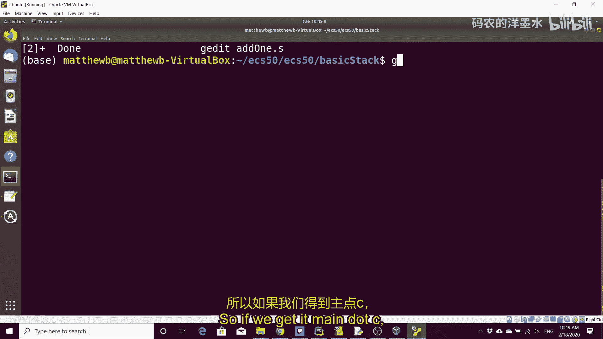

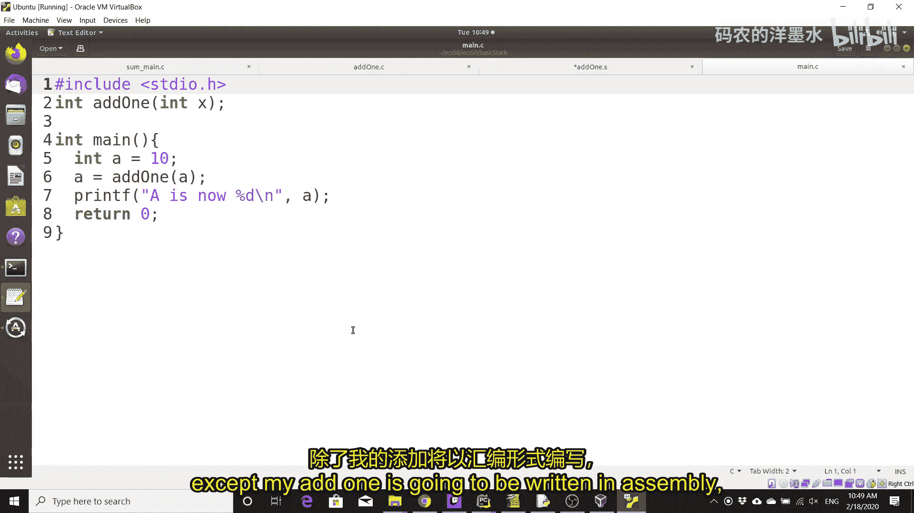

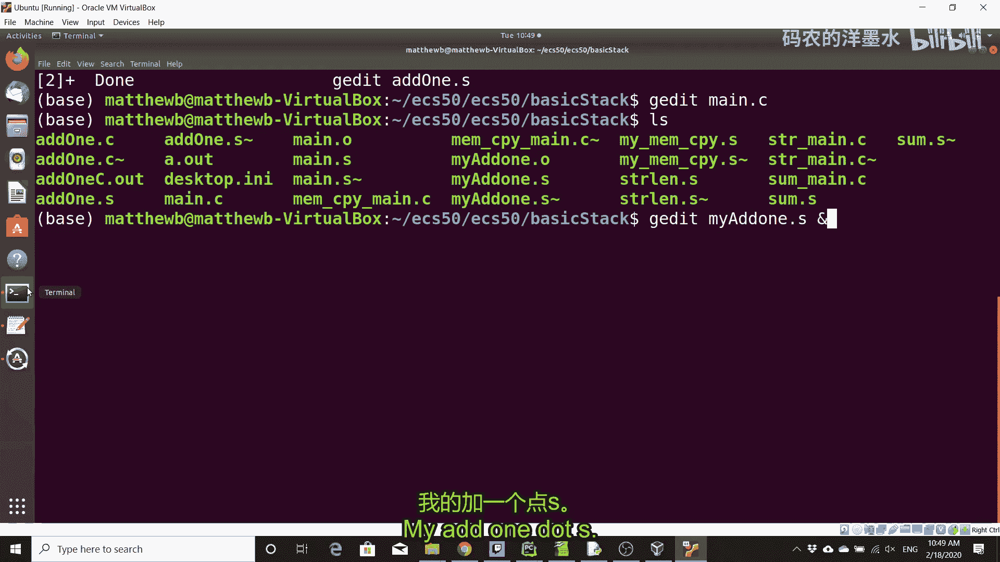

*   **参数传递**：参数应通过**栈**来传递。并且，它们应以**声明顺序的逆序**被压入栈中。
    例如，对于函数 `func(a, b, c)`，调用前的汇编代码应为：
    ```assembly
    push c
    push b
    push a
    call func
    ```
*   **返回值**：如果函数有返回值，该值应存放在 **`EAX`** 寄存器中。这也解释了为什么C语言函数通常只能返回一个值，因为只有一个 `EAX` 寄存器。
*   **寄存器保存责任**：
    *   **调用者** 负责保存 `EAX`、`ECX` 和 `EDX` 寄存器的值（如果这些值在调用后还需要）。
    *   **被调用者** 负责保存所有其他它打算使用的寄存器（如 `EBX`、`ESI`、`EDI`、`EBP` 等）。

这些规则就像交通规则，统一标准后，不同部分编写的代码才能正确交互。

## 函数调用示例分析

让我们通过一个简单的C函数 `add1(x)` 来观察这些规则如何应用。该函数返回 `x + 1`。

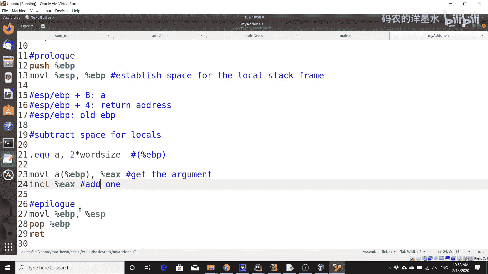

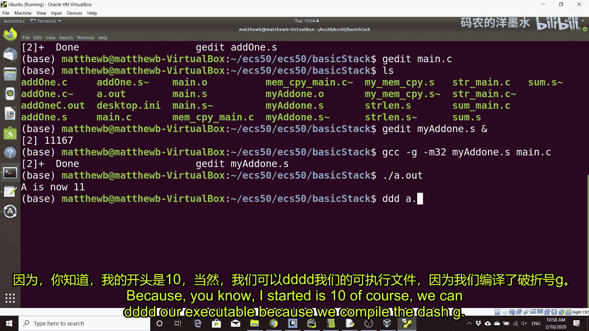

使用 `gcc -S` 命令可以生成C代码对应的汇编文件。观察 `main` 函数中调用 `add1` 的部分，可以看到参数 `a`（值为10）在 `call` 指令前被压入了栈。调用结束后，栈上的参数被清理。

为了编写能被C代码调用的汇编函数，我们必须遵循相同的约定。

## 汇编函数的结构：序言与尾声

为了使汇编函数易于编写和维护，并正确处理栈帧，我们引入**序言**和**尾声**。

**序言**在函数开始时执行，主要完成以下工作：
1.  保存旧的栈帧基指针：`push %ebp`
2.  建立新的栈帧基指针：`mov %esp, %ebp`
3.  为局部变量分配栈空间：`sub $[字节数], %esp`
4.  保存需要使用的非易失寄存器（如 `%ebx`, `%esi`, `%edi`）：`push %ebx`

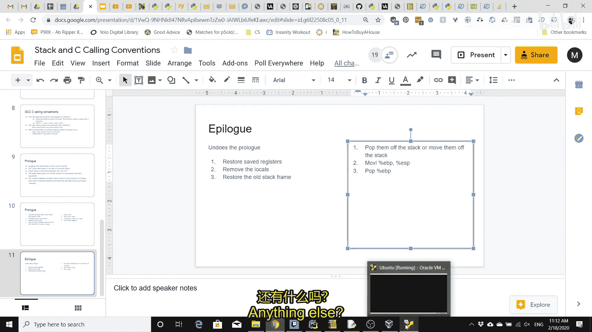

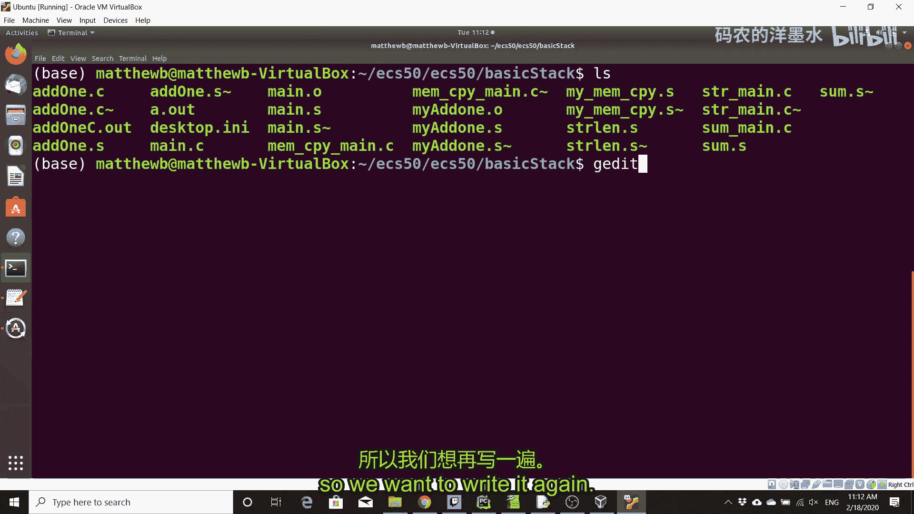

使用栈帧基指针 `%ebp` 的好处是，它为参数和局部变量提供了固定的偏移量参考点，即使栈指针 `%esp` 在函数执行期间因其他调用而变动，我们也能轻松定位它们。

**尾声**在函数返回前执行，其步骤与序言相反，用于恢复现场：
1.  恢复保存的非易失寄存器：`pop %edi` (等)
2.  释放局部变量空间（将栈指针移回帧基指针处）：`mov %ebp, %esp`
3.  恢复旧的栈帧基指针：`pop %ebp`
4.  返回：`ret`

## 实践：编写 `strlen` 函数

现在，我们应用所学知识，用汇编编写一个遵循GCC调用约定的 `strlen` 函数。

首先，我们写出C语言版本的 `strlen` 作为蓝图。然后，将其翻译成汇编代码，并确保包含完整的序言和尾声。

在汇编函数中，我们通过 `%ebp` 加固定偏移来访问参数（例如，第一个参数在 `8(%ebp)`）。我们选择使用 `%ecx` 寄存器存储字符串指针，因为调用者不负责保存它，这可以减少我们的保存工作。

循环部分比较每个字符是否为结束符 `\0`，并使用 `%eax` 寄存器作为长度计数器，这很方便，因为返回值正是通过 `%eax` 传递的。

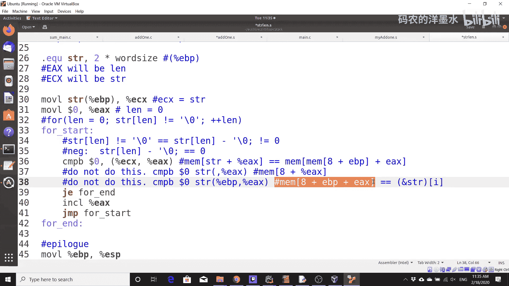

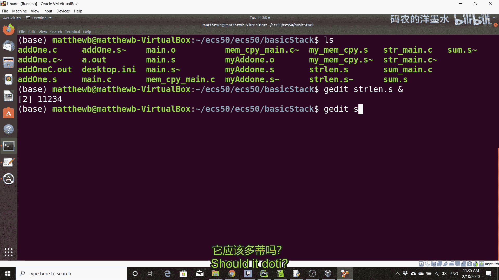

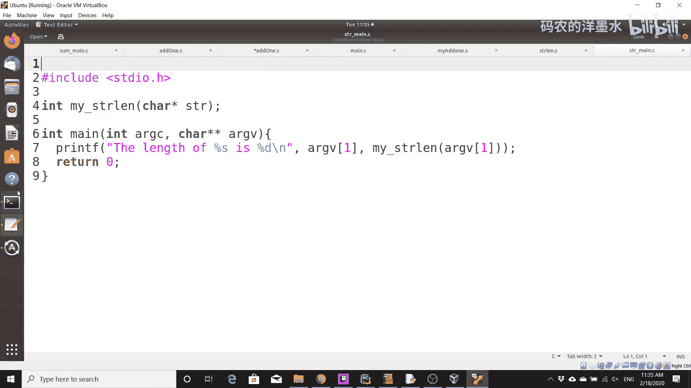

**一个常见错误**：在访问内存时，务必注意寻址方式。例如，`mov 8(%ebp), %ecx` 是将第一个参数（地址）加载到 `%ecx`，而 `mov (%ecx, %eax, 1), %dl` 是访问该地址加上偏移量处的字符。混淆两者会导致错误。

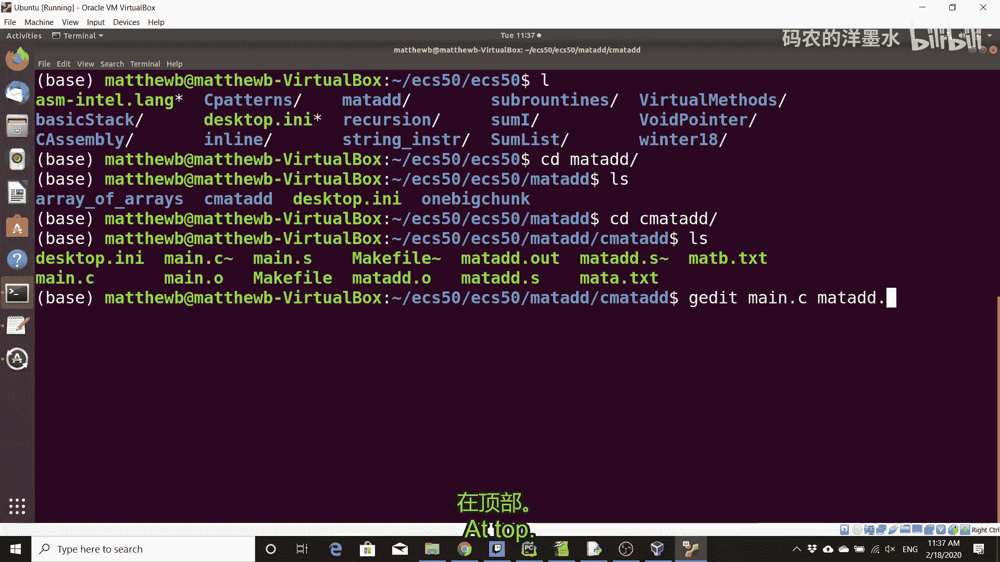

## 进阶示例：矩阵加法与 `malloc` 调用

上一个例子展示了如何编写一个被调用的函数。现在，我们看一个更复杂的例子：一个用汇编编写的矩阵加法函数，它内部需要调用C标准库函数 `malloc`。

这演示了如何**调用**其他函数。步骤同样遵循GCC约定：
1.  将参数以逆序压栈。
2.  使用 `call malloc`。
3.  函数返回后，返回值在 `%eax` 中。
4.  **调用者**负责清理栈上的参数（例如 `add $4, %esp`）。

在我们的矩阵加法函数中，序言部分需要为局部变量（如循环计数器 `i`, `j` 和结果矩阵指针 `c`）分配空间。通过 `.equ` 指令为这些变量在栈帧上定义有意义的符号名（如 `I = -4(%ebp)`），可以极大提高代码的可读性和可维护性。

## 总结

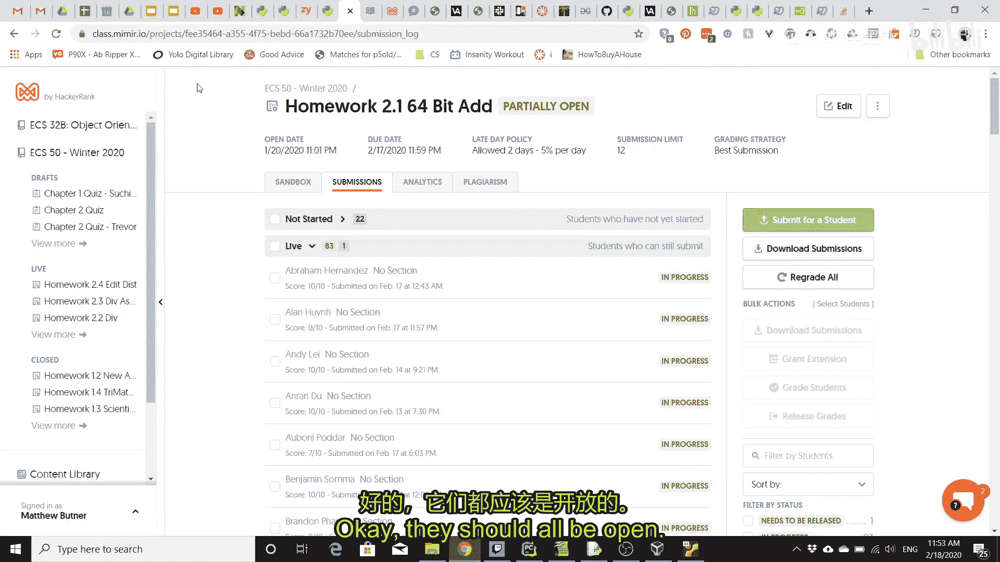

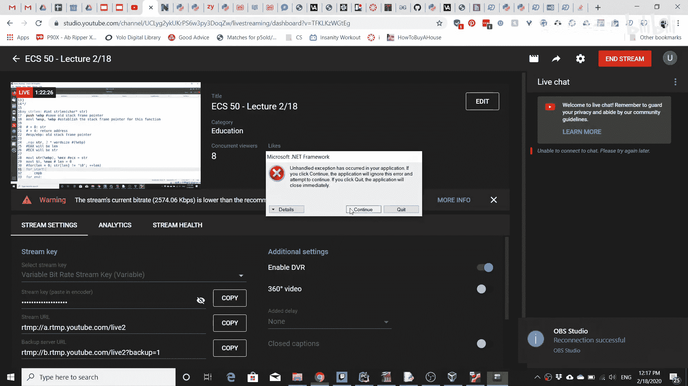

本节课中我们一起学习了GCC调用约定的核心规则，包括参数传递、返回值存放和寄存器保存责任。我们深入探讨了汇编函数中序言和尾声的重要性，它们通过建立稳定的栈帧，简化了对参数和局部变量的访问。最后，我们通过 `strlen` 和矩阵加法的实例，实践了如何编写符合规范的、能与C代码互操作的汇编函数，以及如何在汇编中调用C库函数。掌握这些知识是进行混合编程和深入理解程序运行机制的关键。