# 013：GCC调用约定与递归


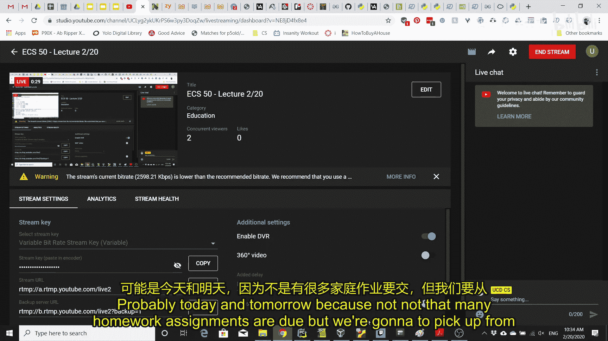

在本节课中，我们将学习GCC调用约定的具体应用，并通过一个矩阵加法的例子来实践。随后，我们将探讨如何将递归函数（以斐波那契数列为例）翻译成汇编语言，并在这个过程中加深对调用约定的理解。

## 课程概述与公告

首先是一些课程公告。下一次测验已经发布，题目数量很少。期中考试即将发布，内容将涵盖第一章和第二章的测验内容，不会有太大变化。预计下周发布关于汇编内容的第三次测验。之后可能还会有一次关于课程所有内容的复习性测验作为期末项目。

鉴于接下来几天预计出勤率和答疑时间会减少，如果大家有需要长时间讨论的问题，现在是一个很好的时机。

## 回顾GCC调用约定

在开始新内容之前，我们先回顾一下GCC调用约定的三条核心规则。这些规则确保了汇编代码与C代码能够正确交互。

1.  **参数传递**：参数通过栈传递，并且以相反的顺序压入。例如，如果参数顺序是`A, B, C`，则压栈顺序为`C, B, A`。
2.  **返回值**：返回值存放在`EAX`寄存器中。
3.  **寄存器保存责任**：
    *   **调用者（Caller）** 负责保存`EAX`、`ECX`和`EDX`寄存器的值（如果它们的内容在调用后还需要）。
    *   **被调用者（Callee）** 负责保存所有其他寄存器的值（如`EBX`、`ESI`、`EDI`、`EBP`等）。

遵守这些规则，就能编写出可以被C代码调用的汇编函数，也能在汇编代码中调用C库函数。

上一节我们介绍了调用约定的基本规则，本节我们将通过具体例子来看看如何应用这些规则。

## 实践：矩阵加法函数

我们将一个C语言的矩阵加法函数翻译成汇编语言。这个函数接收两个矩阵`A`和`B`，以及它们的行数(`numRows`)和列数(`numCols`)，然后动态分配内存给结果矩阵`C`，并计算`C[i][j] = A[i][j] + B[i][j]`。

### 函数框架与局部变量

首先，每个C风格函数都需要一个**序言（Prologue）**来建立栈帧。

```assembly
pushl %ebp
movl %esp, %ebp
subl $LOCAL_VAR_SPACE, %esp # 为局部变量分配空间
```

我们需要为局部变量（如循环计数器`i`、`j`）以及需要保存的寄存器（如`EBX`、`ESI`、`EDI`）在栈上分配空间。可以通过`.EQU`伪指令为这些位置定义易于理解的标签。

```assembly
.equ numRows, 8(%ebp)      # 参数 numRows 在 EBP+8
.equ numCols, 12(%ebp)     # 参数 numCols 在 EBP+12
.equ A, 16(%ebp)           # 参数 A (指针) 在 EBP+16
.equ B, 20(%ebp)           # 参数 B (指针) 在 EBP+20
.equ C, -4(%ebp)           # 局部变量 C (指针) 在 EBP-4
.equ i, -8(%ebp)           # 局部变量 i 在 EBP-8
.equ old_EBX, -12(%ebp)    # 保存的 EBX 在 EBP-12
.equ old_ESI, -16(%ebp)    # 保存的 ESI 在 EBP-16
.equ old_EDI, -20(%ebp)    # 保存的 EDI 在 EBP-20
```

在序言中，我们需要分配足够的空间并保存那些被调用者需要负责的寄存器。

```assembly
# 序言
pushl %ebp
movl %esp, %ebp
subl $20, %esp              # 为5个局部变量分配空间 (每个4字节)
movl %ebx, old_EBX(%ebp)   # 保存 EBX
movl %esi, old_ESI(%ebp)   # 保存 ESI
movl %edi, old_EDI(%ebp)   # 保存 EDI
```

### 外层循环初始化

翻译外层循环 `for (i = 0; i < numRows; i++)`。我们将`i`存储在内存中，并将`numRows`加载到寄存器（例如`EBX`）中以加速比较。

```assembly
movl $0, i(%ebp)           # i = 0
movl numRows(%ebp), %ebx   # EBX = numRows
outer_loop_start:
    movl i(%ebp), %ecx     # ECX = i
    cmpl %ebx, %ecx        # 比较 i 和 numRows
    jge outer_loop_end     # 如果 i >= numRows，跳出循环
    # ... 循环体 ...
    incl i(%ebp)           # i++
    jmp outer_loop_start
outer_loop_end:
```

### 动态内存分配与调用约定

在循环体内，我们需要为每一行分配内存：`C[i] = (int *)malloc(numCols * sizeof(int));`。

这涉及到调用C标准库函数`malloc`。根据调用约定，我们需要：
1.  将参数（`numCols * sizeof(int)`）压栈。
2.  调用`malloc`。
3.  清理栈上的参数（`addl $4, %esp`）。
4.  处理返回值（在`EAX`中）。

在调用`malloc`之前，我们必须注意：`malloc`可能会覆盖`EAX`、`ECX`、`EDX`。如果`ECX`中存有我们关心的值（比如当前的`i`），调用者（我们）有责任保存它。

```assembly
# 计算参数：numCols * 4 (因为sizeof(int)=4)
movl numCols(%ebp), %edx   # EDX = numCols
sall $2, %edx              # EDX = numCols * 4

# 保存调用者负责的寄存器（ECX 存有 i）
movl %ecx, i(%ebp)         # 将 i 保存回内存

# 调用 malloc
pushl %edx                 # 压入参数
call malloc
addl $4, %esp              # 清理栈

# 恢复 i
movl i(%ebp), %ecx         # ECX = i

# 现在 EAX 中是 malloc 返回的指针
# 需要将其赋值给 C[i]
# 首先，获取 C 的地址
movl C(%ebp), %edx         # EDX = C (C本身的地址)
# 然后计算 C[i] 的地址: EDX + i*4
leal (%edx, %ecx, 4), %edx # EDX = &C[i]
# 最后，将 malloc 的返回值存入该地址
movl %eax, (%edx)          # C[i] = malloc返回值
```

**关键点**：注意`C[i]`的赋值。`C`是一个`int**`，`C[i]`是一个`int*`。我们不能直接写`movl %eax, C(%ebp, %ecx, 4)`，因为`C(%ebp)`是变量`C`本身的地址，而不是它指向的内容。我们必须先加载`C`的值（一个地址），然后基于这个地址进行计算。

### 内层循环与矩阵元素相加

内层循环 `for (j = 0; j < numCols; j++)` 和核心计算 `C[i][j] = A[i][j] + B[i][j]` 的翻译遵循类似原则。我们需要小心地计算`A[i][j]`和`B[i][j]`的地址，并处理寄存器不足的问题（可能需要使用`ESI`、`EDI`并提前保存）。

```assembly
# 假设 j 使用 EDX 寄存器
movl $0, %edx              # j = 0
inner_loop_start:
    cmpl numCols(%ebp), %edx
    jge inner_loop_end

    # 计算 A[i][j] 的地址并加载其值到 ESI
    movl A(%ebp), %esi     # ESI = A
    movl (%esi, %ecx, 4), %esi # ESI = A[i] (行地址)
    movl (%esi, %edx, 4), %esi # ESI = A[i][j]

    # 计算 B[i][j] 的地址并加载其值，同时加到 ESI
    movl B(%ebp), %edi     # EDI = B
    movl (%edi, %ecx, 4), %edi # EDI = B[i]
    addl (%edi, %edx, 4), %esi # ESI = A[i][j] + B[i][j]

    # 计算 C[i][j] 的地址并存入结果
    movl C(%ebp), %edi     # EDI = C
    movl (%edi, %ecx, 4), %edi # EDI = C[i]
    movl %esi, (%edi, %edx, 4) # C[i][j] = ESI

    incl %edx              # j++
    jmp inner_loop_start
inner_loop_end:
```

### 收尾工作与尾声

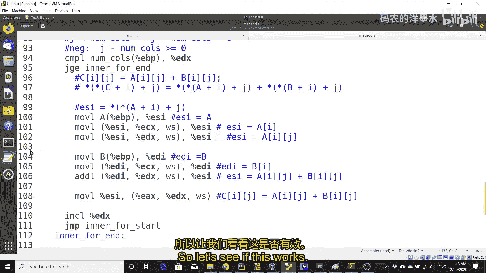

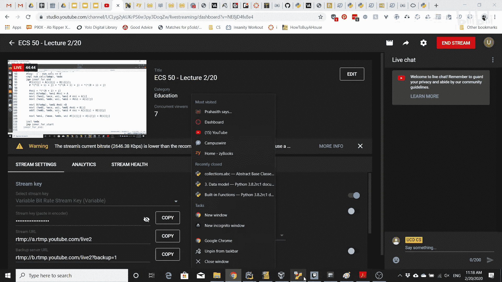

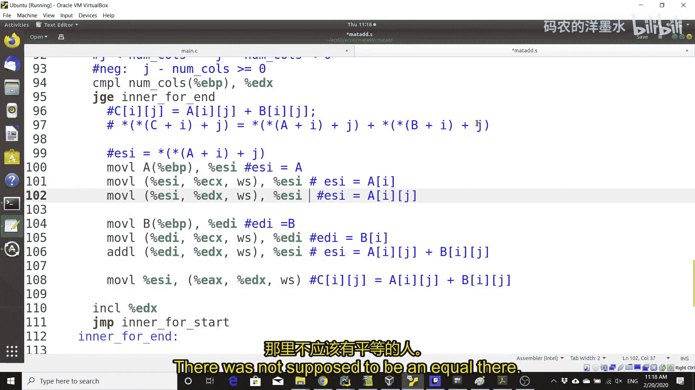

函数最后需要设置返回值（如果需要），然后执行**尾声（Epilogue）**来恢复栈帧和保存的寄存器。

```assembly
# 设置返回值，例如返回矩阵C
movl C(%ebp), %eax

# 尾声
movl old_EDI(%ebp), %edi   # 恢复 EDI
movl old_ESI(%ebp), %esi   # 恢复 ESI
movl old_EBX(%ebp), %ebx   # 恢复 EBX
movl %ebp, %esp            # 清理局部变量空间
popl %ebp                  # 恢复旧的 EBP
ret                        # 返回
```

## 递归函数示例：斐波那契数列

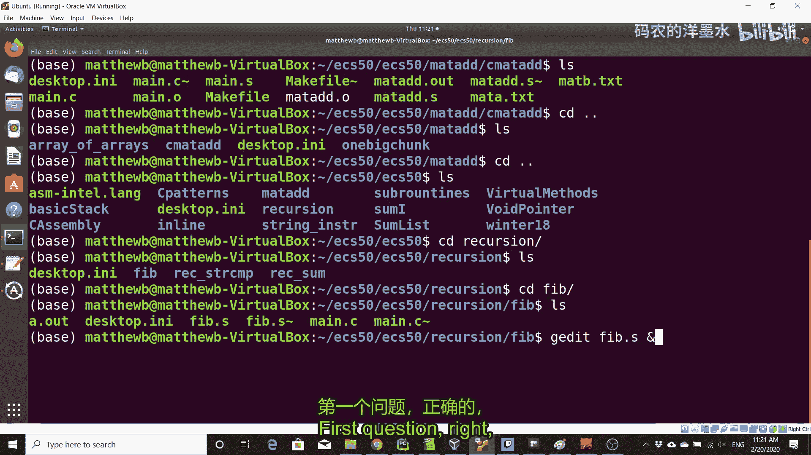

现在，我们来看一个递归函数的例子：斐波那契数列 `fib(n)`。C代码如下：

```c
int fib(int n) {
    if (n == 0 || n == 1) {
        return 1;
    } else {
        return fib(n-1) + fib(n-2);
    }
}
```

### 翻译中的挑战与调用约定

翻译递归函数时，调用约定尤为重要，因为函数会调用自身。最常见的错误是忘记在调用前保存调用者负责的寄存器（`EAX`、`ECX`、`EDX`）。

**错误示例**：
```assembly
# 假设 ECX 存有 n
decl %ecx           # ECX = n-1
pushl %ecx
call fib            # 调用 fib(n-1)
# 问题：fib 调用可能覆盖了 ECX，我们丢失了 n 的值！
# 接下来无法计算 n-2 并调用 fib(n-2)
```

**正确做法**：我们需要在调用前，将需要保存的值（如当前的`n`，或`fib(n-1)`的中间结果）存放到安全的地方——要么是被调用者负责的寄存器（需先保存），要么是栈上的局部变量空间。

```assembly
# 序言
pushl %ebp
movl %esp, %ebp
subl $4, %esp           # 为局部变量分配空间
.equ n, 8(%ebp)
.equ temp, -4(%ebp)     # 用于保存中间结果

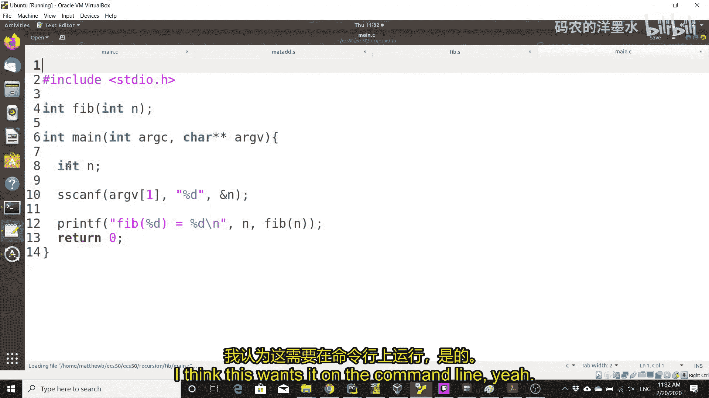

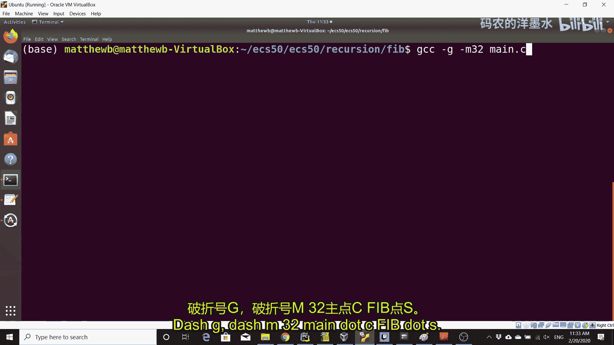

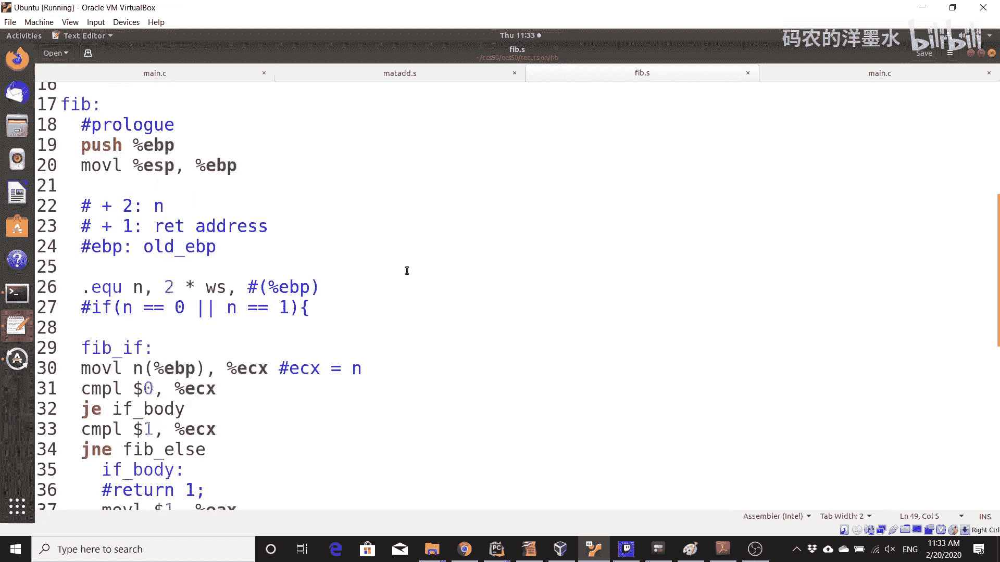

# 基础情况判断
movl n(%ebp), %ecx
cmpl $0, %ecx
je base_case
cmpl $1, %ecx
je base_case

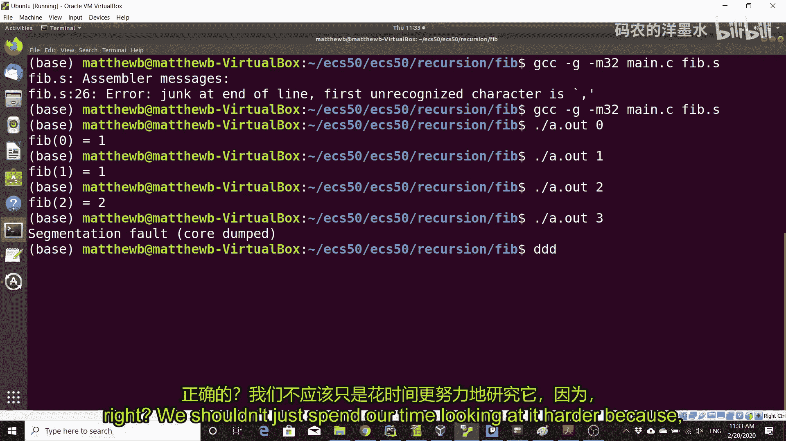

# 递归情况：计算 fib(n-1)
movl n(%ebp), %ecx
decl %ecx               # ECX = n-1
pushl %ecx              # 参数压栈
call fib                # 调用 fib(n-1)
addl $4, %esp           # 清理栈
movl %eax, temp(%ebp)   # 将结果 fib(n-1) 保存到局部变量

# 计算 fib(n-2)
movl n(%ebp), %ecx
subl $2, %ecx           # ECX = n-2
pushl %ecx              # 参数压栈
call fib                # 调用 fib(n-2)
addl $4, %esp           # 清理栈

# 求和并返回
addl temp(%ebp), %eax   # EAX = fib(n-1) + fib(n-2)
jmp epilogue

base_case:
movl $1, %eax           # 返回 1

epilogue:
movl %ebp, %esp
popl %ebp
ret
```

### 新指令：LEA（加载有效地址）

在翻译过程中，我们经常需要计算内存地址而不进行实际访问。`LEA`（Load Effective Address）指令正是用于此目的。它的格式是`leal source, destination`，其中`source`是一个标准的内存寻址模式，`destination`是一个寄存器。

`LEA`计算`source`操作数指定的地址，并将这个地址（而不是该地址处的值）存入`destination`寄存器。

**示例**：
*   `movl 8(%ebp), %eax`：将内存地址`EBP+8`处的**值**加载到`EAX`。
*   `leal 8(%ebp), %eax`：将内存地址`EBP+8`这个**地址本身**（即一个数值）加载到`EAX`。这等价于`movl %ebp, %eax`加上`addl $8, %eax`，但更简洁。

这在计算数组元素地址或获取局部变量/参数的地址时非常有用。

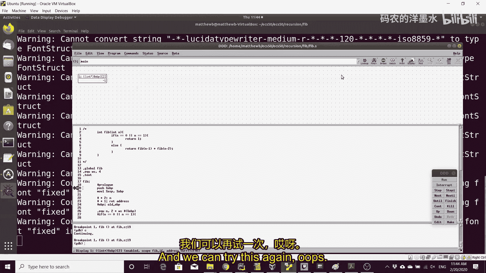

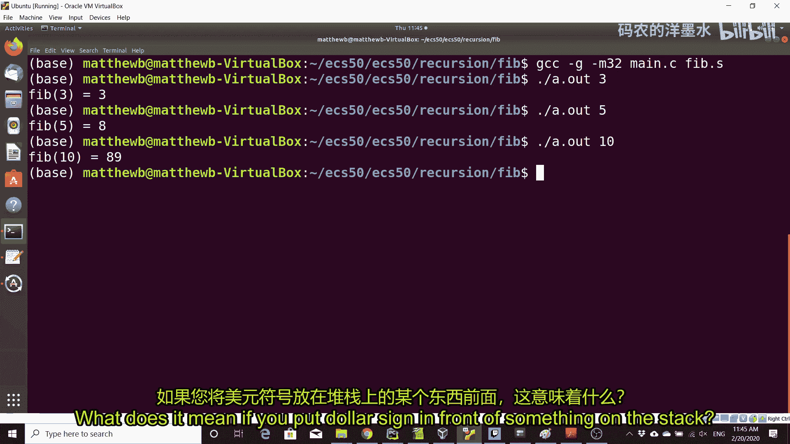

## 总结与调试建议

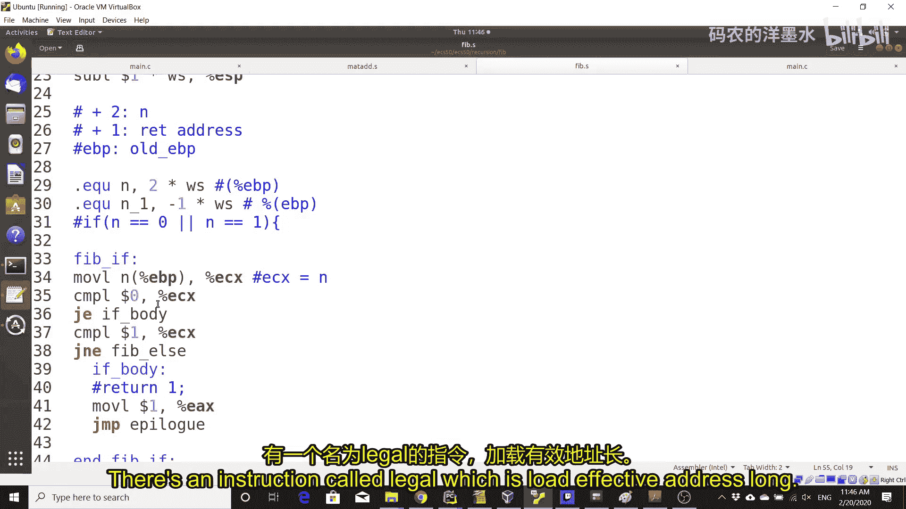

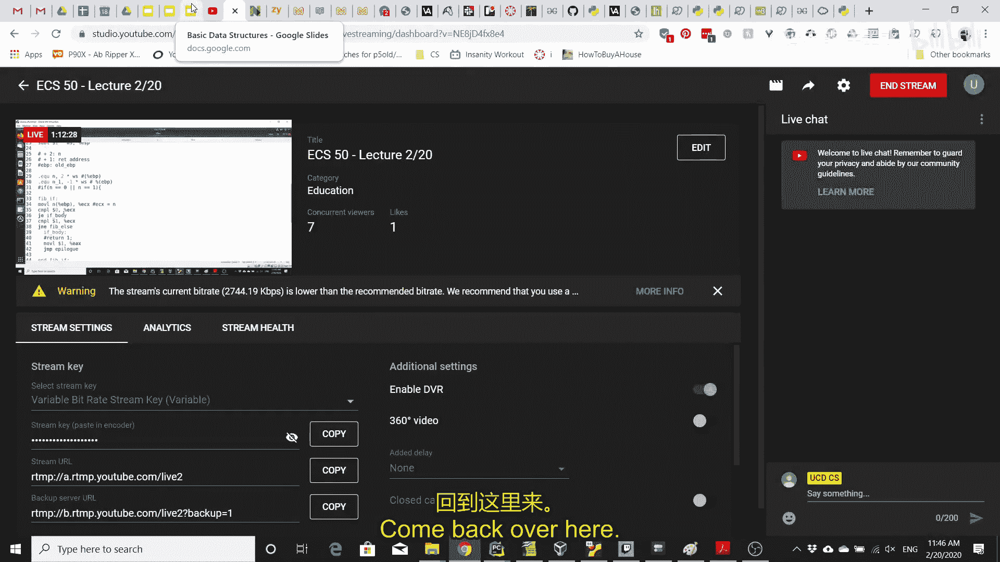

本节课中，我们一起学习了如何将复杂的C函数（包括循环和动态内存分配）以及递归函数翻译成遵循GCC调用约定的汇编代码。关键点包括：
1.  严格遵守调用约定中关于参数传递、返回值和寄存器保存责任的规则。
2.  在调用函数（尤其是可能覆盖`EAX`、`ECX`、`EDX`的函数）前，如果这些寄存器中有重要数据，调用者必须负责保存它们。
3.  递归翻译需要格外小心，因为函数会调用自身，必须妥善管理每一层递归的上下文。
4.  合理使用栈空间来存储局部变量和中间结果。
5.  利用`LEA`指令高效地计算内存地址。

**调试是至关重要的**。当代码不按预期运行时，不要只是盯着代码看，要使用调试器（如GDB）。调试器允许你：
*   单步执行汇编指令。
*   检查寄存器和内存中的值。
*   在发生段错误时，查看是哪个地址访问出了问题。
*   观察函数调用过程中栈的变化。

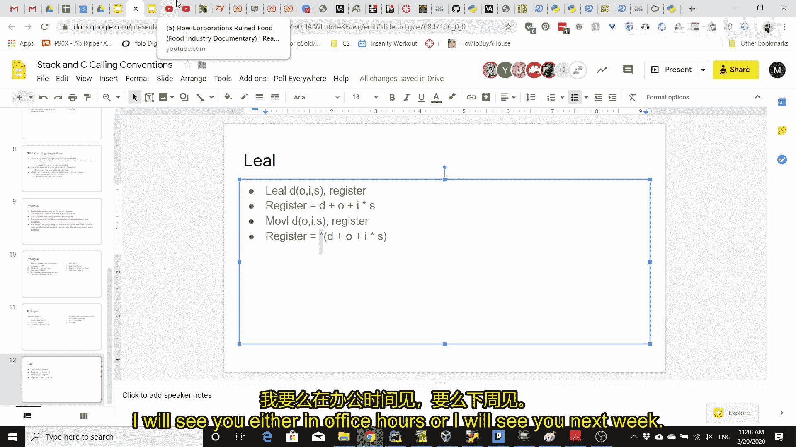

通过调试器，你可以直观地看到调用约定是否被正确遵守，数据流是否如你所想，从而快速定位并修复问题。掌握调试技巧对编写和理解汇编代码有极大帮助。