# 014：递归与栈 📚

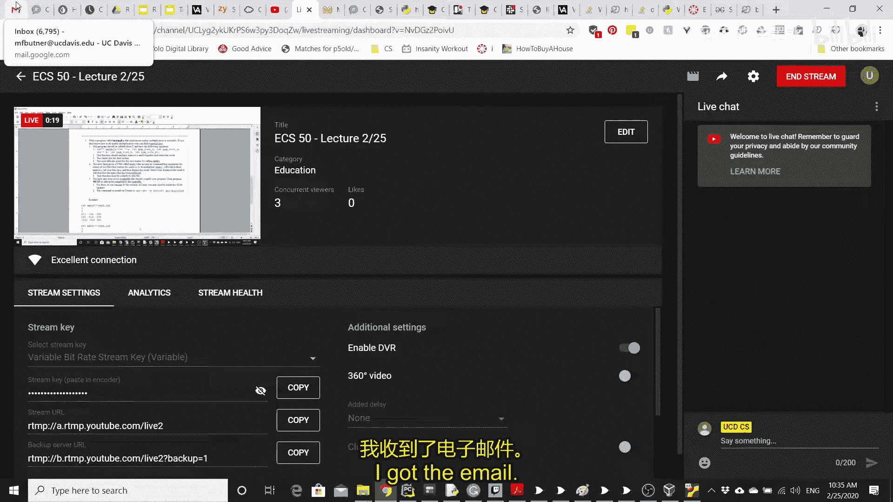

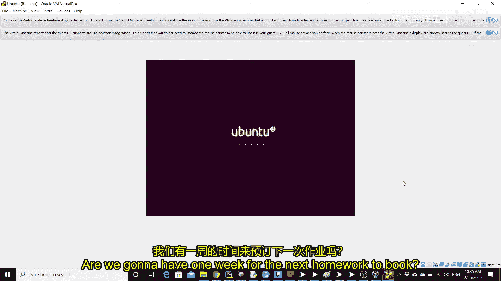

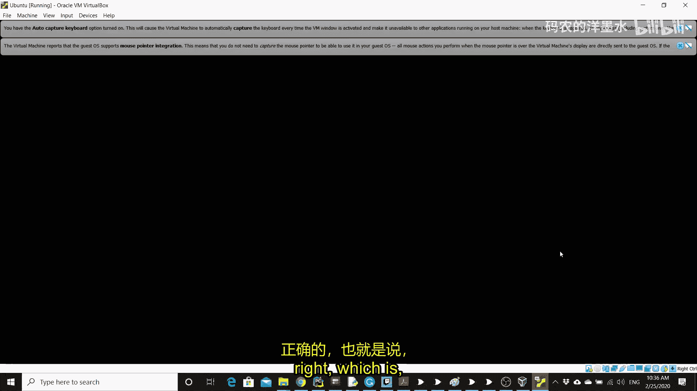


在本节课中，我们将学习如何将递归函数转换为汇编语言，并深入理解栈帧在函数调用过程中的作用。我们将通过一个计算数组和的递归函数示例，来演示栈帧的创建、使用和销毁过程。

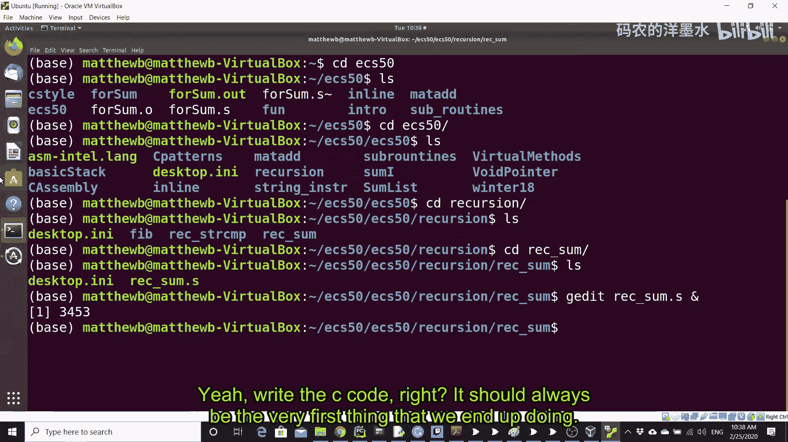

---

## 概述

上一节我们介绍了函数调用约定和栈的基本概念。本节中，我们将通过一个具体的递归函数示例，来看看栈帧是如何在递归调用中被创建和管理的。我们将编写一个递归求和的C函数，并将其手动翻译成汇编代码，同时通过一个可视化的栈帧示例来加深理解。

---

## 递归求和函数示例

首先，我们需要编写一个递归函数来计算整数数组的和。以下是该函数的C语言实现：

```c
int rec_sum(int *nums, int len) {
    if (len == 0) {
        return 0;
    } else {
        return nums[0] + rec_sum(nums + 1, len - 1);
    }
}
```

这个函数的工作原理是：如果数组长度为0，则直接返回0（基本情况）。否则，返回数组第一个元素与剩余元素递归求和的结果。

---

## 将C代码翻译为汇编

将C函数翻译为汇编代码需要遵循几个标准步骤：编写函数标签和全局声明、设置栈帧（序言）、翻译函数逻辑、最后清理栈帧（尾声）。

### 1. 全局声明与标签

首先，在`.text`节中定义函数标签，并使用`.global`指令使其可被外部文件调用。同时，定义字长常量。

```assembly
.global rec_sum
.text

rec_sum:
    .EQU WORD_SIZE, 4
```

### 2. 函数序言（Prologue）

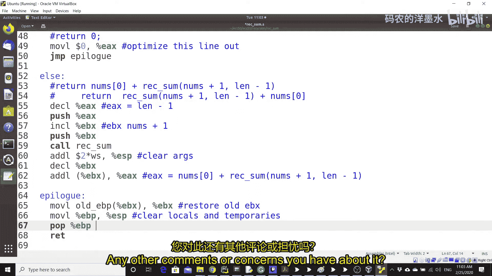

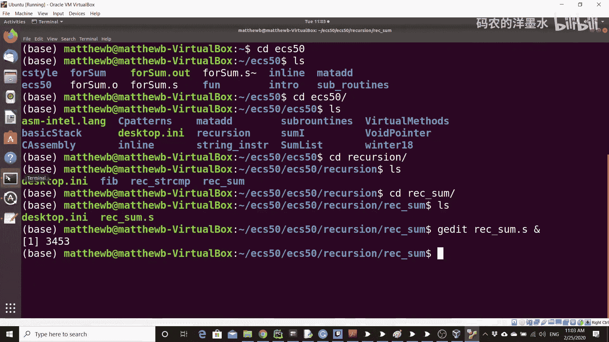

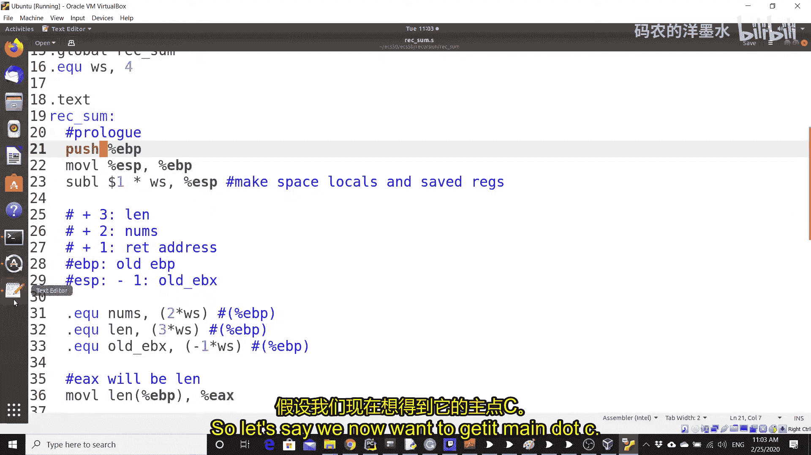

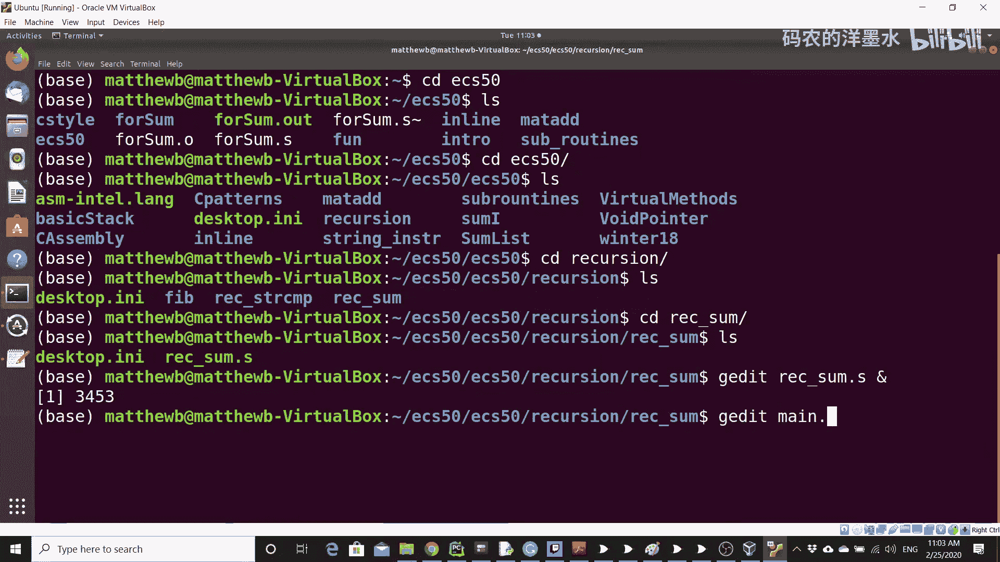

序言负责建立新的栈帧。这包括保存旧的基指针（EBP）、设置新的基指针，以及为局部变量和保存的寄存器分配空间。

```assembly
    push %ebp
    mov %esp, %ebp
    sub $1 * WORD_SIZE, %esp  ; 为保存EBX预留空间
```

接下来，我们使用`.EQU`指令为参数定义偏移量，以便通过EBP访问它们。

```assembly
    .EQU nums, 2 * WORD_SIZE
    .EQU len,  3 * WORD_SIZE
    .EQU old_ebx, -1 * WORD_SIZE
```

### 3. 翻译函数逻辑

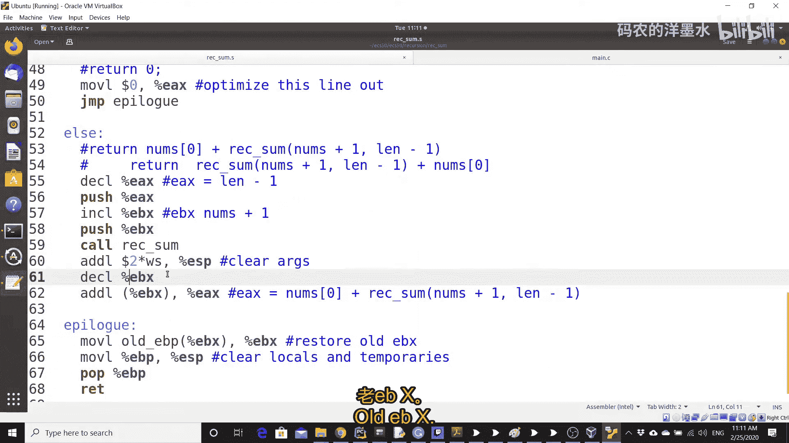

现在，我们开始翻译C代码的逻辑。首先，将参数`len`加载到寄存器中，并与0进行比较以处理基本情况。

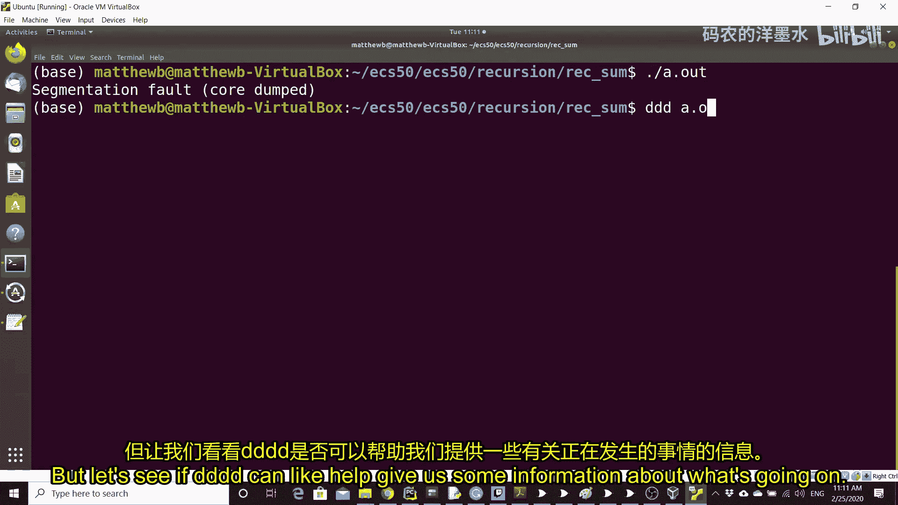

```assembly
    mov len(%ebp), %eax
    cmp $0, %eax
    jne else_case
    ; 基本情况：len == 0
    mov $0, %eax
    jmp epilogue
```

如果`len`不为0，则进入递归情况。我们需要保存`nums`指针，因为它会被使用多次，并且需要在一个函数调用中存活。

```assembly
else_case:
    mov nums(%ebp), %ebx      ; 将nums存入EBX
    mov %ebx, old_ebx(%ebp)   ; 保存旧的EBX值
```

接下来，准备递归调用的参数。参数需要按从右到左的顺序压栈。

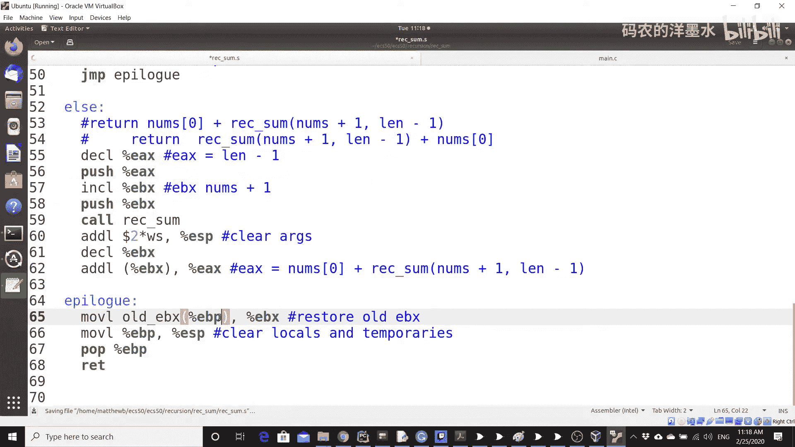

```assembly
    ; 计算 len - 1
    dec %eax
    push %eax                 ; 压入 len - 1
    ; 计算 nums + 1 (指针算术，移动4字节)
    lea WORD_SIZE(%ebx), %ecx
    push %ecx                 ; 压入 nums + 1
    call rec_sum              ; 递归调用
    add $2 * WORD_SIZE, %esp  ; 清理参数
```

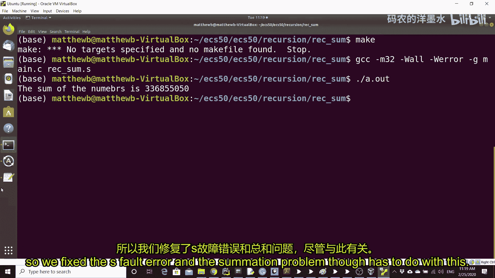

递归调用返回后，结果在`%eax`中。我们需要加上`nums[0]`。

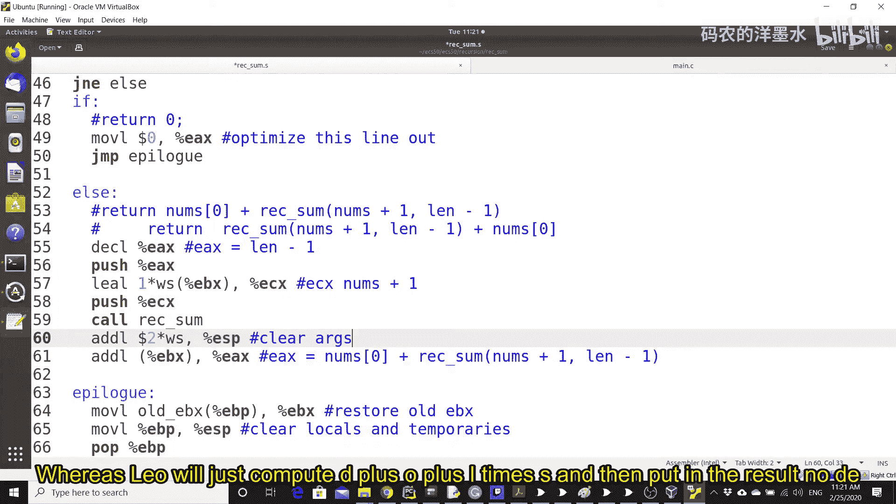

```assembly
    mov (%ebx), %edx          ; 获取 nums[0]
    add %edx, %eax            ; 加到结果上
```

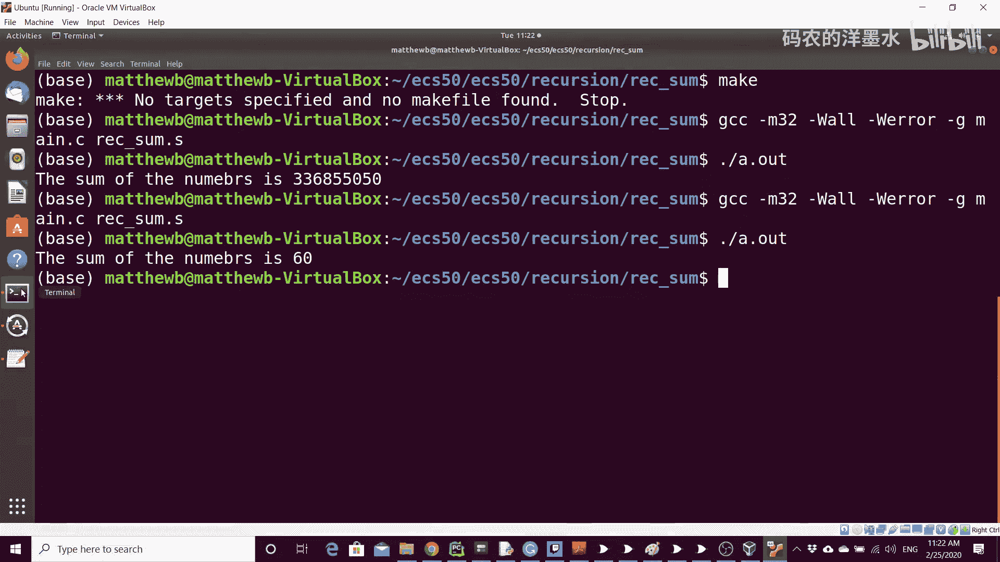

### 4. 函数尾声（Epilogue）

尾声负责恢复栈帧并返回。这包括恢复保存的寄存器、将栈指针移回基指针位置、弹出旧的基指针，最后执行`ret`指令。

```assembly
epilogue:
    mov old_ebx(%ebp), %ebx   ; 恢复EBX
    mov %ebp, %esp            ; 恢复栈指针
    pop %ebp                  ; 恢复旧的基指针
    ret
```

---

## 栈帧可视化示例

为了更直观地理解栈帧在嵌套函数调用中的变化，我们来看一个示例。假设有三个函数：`foo`、`goo`和`woo`。

以下是调用过程中栈帧的变化步骤：

1.  **调用`foo`时**：参数`A`、`B`、`C`和返回地址被压栈。`foo`的序言保存旧的EBP，设置新EBP，并为局部变量`D`、`E`、`F`及保存的寄存器`EBX`、`ESI`分配空间。
2.  **`foo`调用`goo`时**：`foo`将参数压栈（顺序为`F`、`E`、`B`、`A`），然后调用`goo`。`goo`的序言建立自己的栈帧，包含其参数、局部变量和保存的寄存器。
3.  **`goo`调用`woo`时**：过程类似，`woo`建立自己的栈帧。
4.  **函数返回时**：每个函数的尾声按相反顺序工作。`woo`的尾声恢复其栈帧并返回到`goo`。`goo`恢复其栈帧并返回到`foo`。最后，`foo`恢复其栈帧并返回到调用者（如`main`）。

关键点在于，每个栈帧通过保存的EBP值链接到其调用者的栈帧，这形成了调用链，使得调试器可以进行回溯（backtrace）。

---

## 从汇编中调用C函数

要使汇编函数能被C代码调用，只需确保它遵循GCC调用约定。例如，可以在一个C文件中这样声明和调用`rec_sum`：

```c
#include <stdio.h>

// 函数声明
int rec_sum(int *nums, int len);

int main() {
    int nums[] = {10, 20, 30};
    int length = 3;
    int total = rec_sum(nums, length); // 像普通C函数一样调用
    printf("The sum is %d\n", total);
    return 0;
}
```

编译时，将C文件和汇编文件一起链接即可：

```bash
gcc -m32 -Wall -Werror main.c rec_sum.s -o program
```

---

## 总结

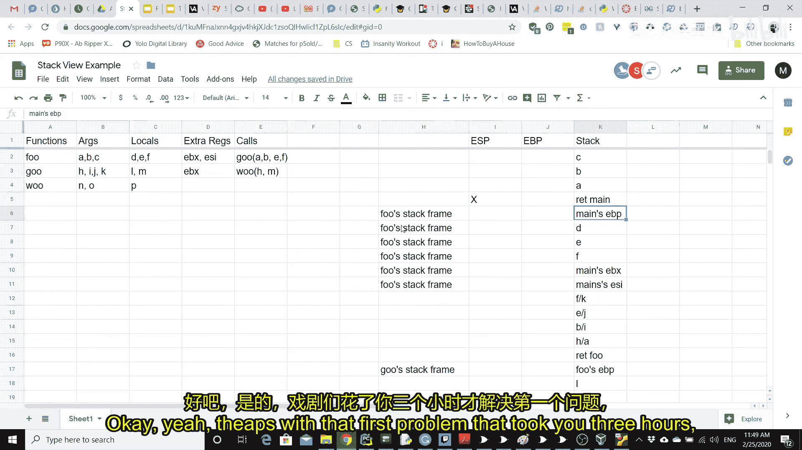

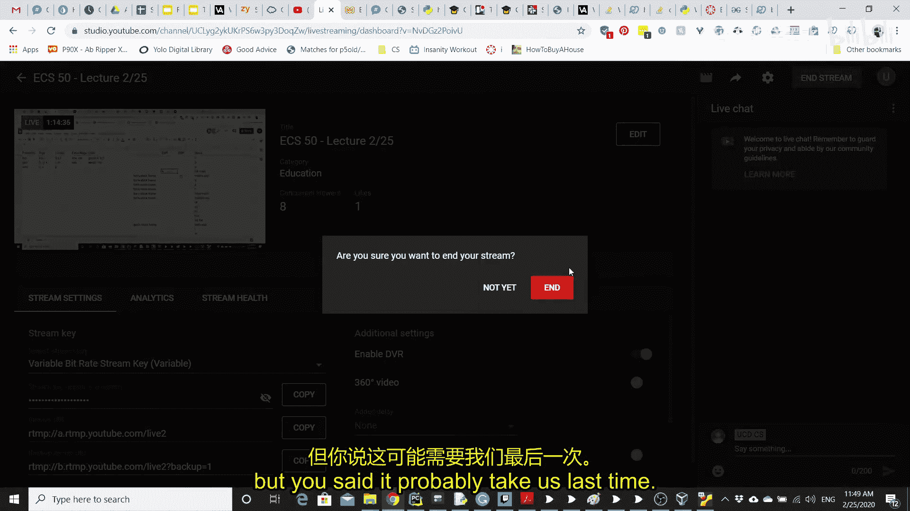

本节课中我们一起学习了递归函数在汇编层面的实现。我们通过一个递归求和的例子，详细演练了如何将C代码翻译成汇编，包括处理栈帧的序言和尾声、管理参数与局部变量、以及进行正确的递归调用。此外，我们还通过一个栈帧可视化的示例，深入理解了函数调用链中栈帧的动态创建和销毁过程。理解这些概念对于编写和调试底层代码至关重要。