# 016：内联汇编与字符串指令

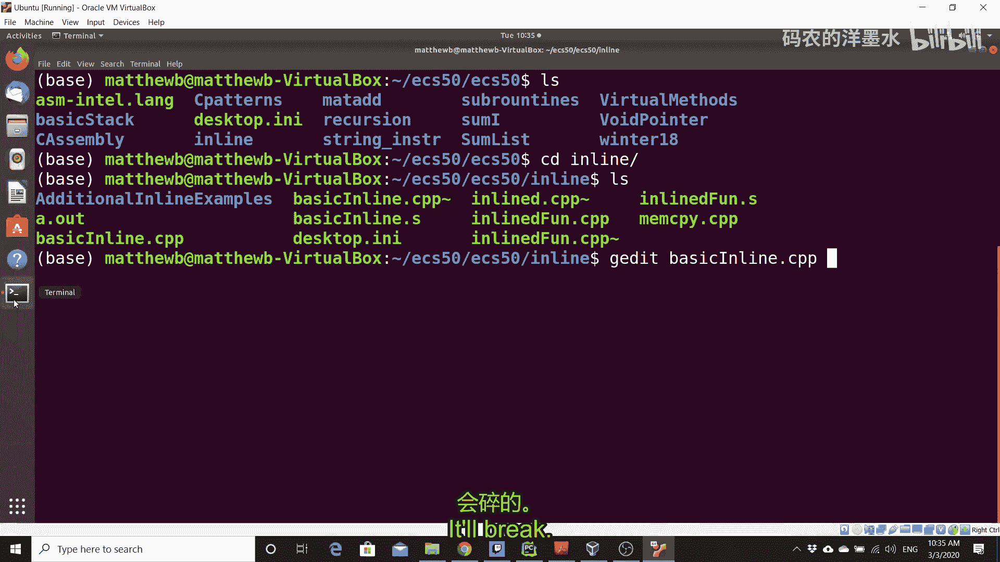

在本节课中，我们将学习内联汇编的进阶知识，特别是“早期破坏”修饰符的作用，并介绍一些特殊的汇编字符串指令。最后，我们将探讨操作系统如何加载和运行程序。

## 内联汇编格式回顾

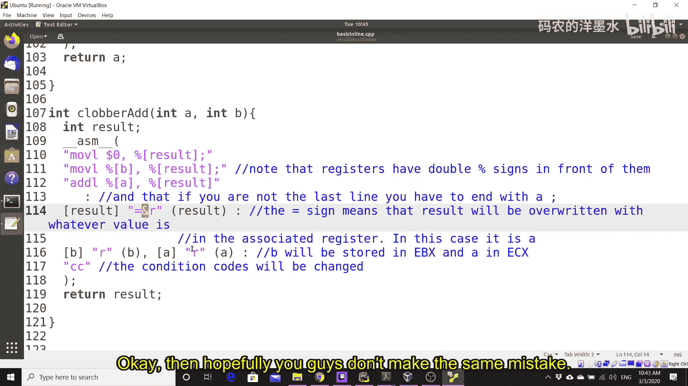

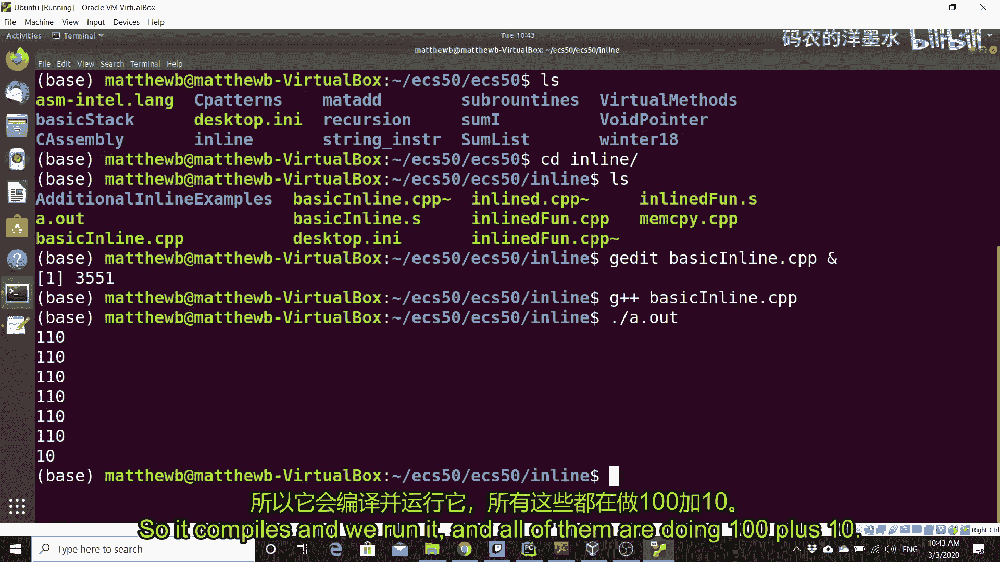

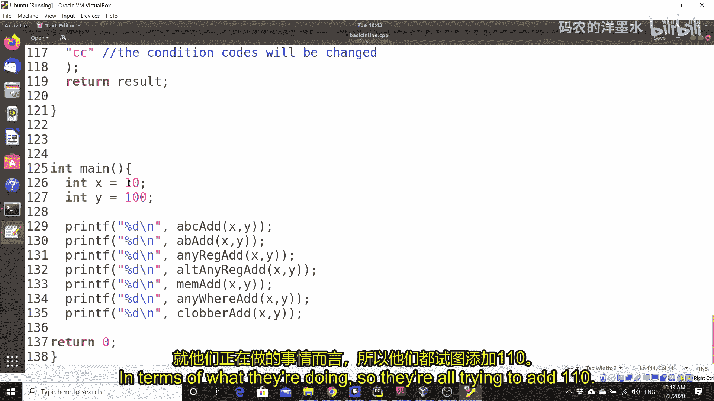

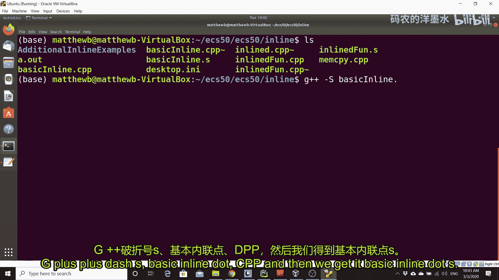

上一节我们介绍了内联汇编的基本格式。本节中，我们来看看一个关键但容易混淆的修饰符：`&`（早期破坏）。

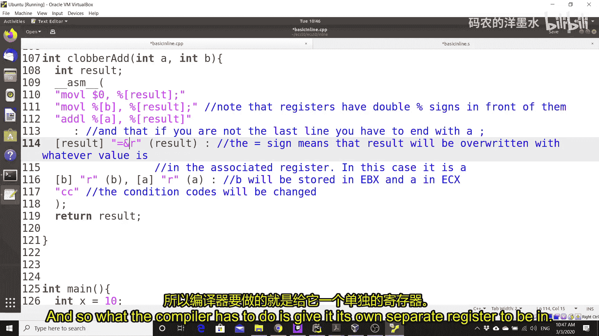

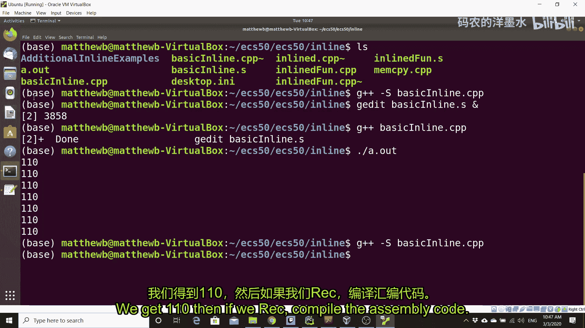

内联汇编的基本结构如下：
```c
__asm__ (
    "汇编指令"
    : 输出操作数列表
    : 输入操作数列表
    : 破坏列表
);
```
编译器默认假设：在**使用完所有输入操作数之前**，你不会向任何**输出操作数**写入数据。这个假设允许编译器进行“寄存器共享”优化，即将输入和输出映射到同一个物理寄存器。

## 早期破坏修饰符 (&)

当你的汇编代码违反了上述假设，即**在完成所有输入操作数的使用之前，就向某个输出操作数写入了数据**，你必须使用 `&` 修饰符来标记该输出操作数为“早期破坏”。

以下是判断何时使用 `&` 的方法：
1.  查看你的汇编指令。
2.  找到你**首次写入**某个输出操作数的那一行。
3.  检查在这行代码**之后**，你是否还**使用**了任何输入操作数。
4.  如果答案是“是”，那么这个输出操作数必须标记为 `&`。

让我们通过一个例子来理解。考虑以下有问题的内联汇编函数：
```c
int add(int a, int b) {
    int result;
    __asm__ (
        "movl $0, %[res]  \n\t" // 过早地向‘result’写入
        "movl %[b], %[res]\n\t"
        "addl %[a], %[res]"
        : [res] "=r"(result) // 未标记 &，但应该标记
        : [a] "r"(a), [b] "r"(b)
    );
    return result;
}
```
在这段代码中，第一条指令 `movl $0, %[res]` 就向输出操作数 `result` 写入了数据。然而，在这之后，代码仍然在使用输入操作数 `a` 和 `b`。这违反了编译器的假设。如果不标记 `&`，编译器可能会将 `result` 和某个输入（例如 `a`）分配到同一个寄存器（如 `EAX`），导致 `a` 的值在第一条指令就被意外覆盖，函数返回错误结果。

正确的写法是使用 `&` 修饰符：
```c
int add(int a, int b) {
    int result;
    __asm__ (
        "movl $0, %[res]  \n\t"
        "movl %[b], %[res]\n\t"
        "addl %[a], %[res]"
        : [res] "=&r"(result) // 使用 & 修饰符
        : [a] "r"(a), [b] "r"(b)
    );
    return result;
}
```
标记 `&` 后，编译器会为 `result` 分配一个独立的、不与任何输入共享的寄存器，从而避免冲突。

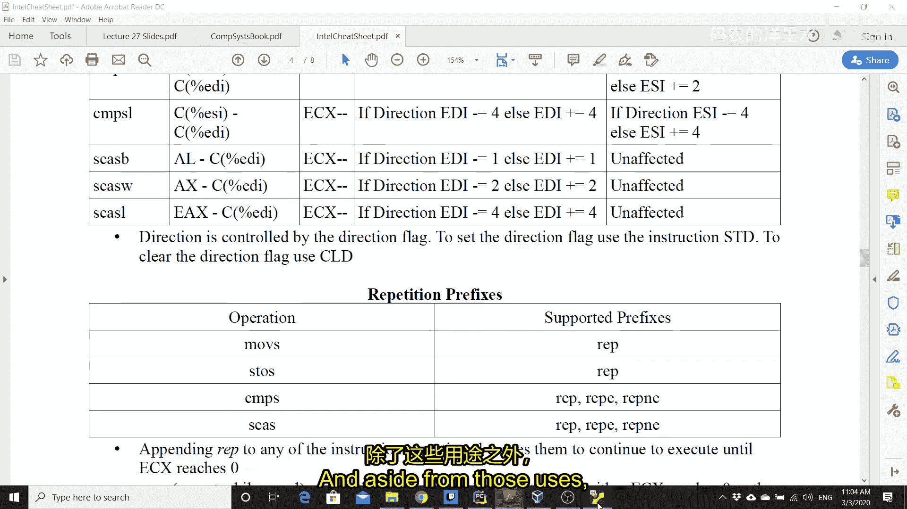

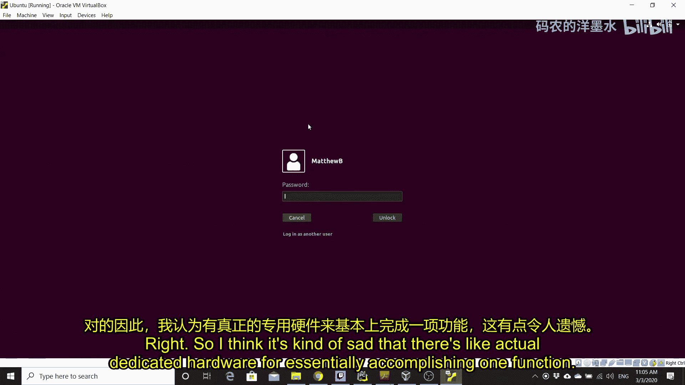

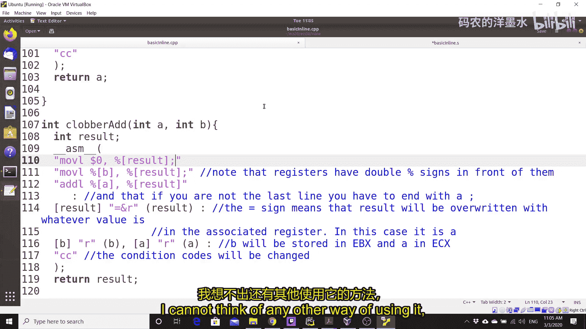

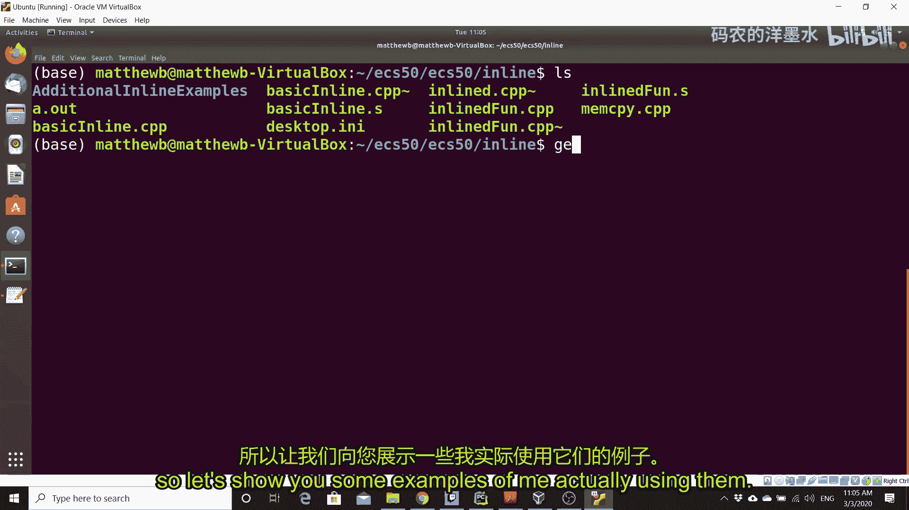

## 字符串指令

除了通用指令，x86汇编还提供了一些专门用于处理内存数据块（如数组或字符串）的“字符串指令”。编译器通常不会自动生成这些指令，因此它们是通过内联汇编使用的好例子。

主要的字符串指令有三个：
*   **`MOVS`**：将数据从源内存位置复制到目标内存位置。
*   **`STOS`**：将 `EAX` 寄存器中的值存储到目标内存位置。
*   **`CMPS`**：比较两个内存位置的数据。
*   **`SCAS`**：将 `EAX` 寄存器中的值与目标内存位置的数据进行比较。


这些指令通常与重复前缀一起使用，以自动处理整个数据块：
*   **`REP`**：重复执行指令，直到 `ECX` 寄存器减为0。
*   **`REPE`/`REPZ`**：当相等/为零时重复。
*   **`REPNE`/`REPNZ`**：当不相等/不为零时重复。

指令执行后，会根据方向标志 `DF` 自动递增或递减 `ESI`（源索引）和/或 `EDI`（目标索引）寄存器。`CLD` 指令清除 `DF`（向前移动），`STD` 指令设置 `DF`（向后移动）。

以下是这些指令的潜在用途：
*   `REP MOVS`：实现类似 C 库函数 `memcpy` 的功能，复制内存块。
*   `REP STOS`：实现类似 C 库函数 `memset` 的功能，用特定值填充内存块。
*   `REPE CMPS`：比较两个内存块是否完全相同。
*   `REPNE SCAS`：在内存块中搜索特定值。

## 操作系统与程序加载

现在，让我们将视角从具体的指令提升到整个系统。操作系统本身就是一个大型、复杂的程序，它负责管理计算机的硬件和软件资源。

操作系统的主要职责包括：
*   **文件系统管理**：将文件路径映射到硬盘上的物理位置。
*   **内存管理**：为每个程序分配和隔离内存空间，使其仿佛独享整个内存。
*   **进程管理**：在多个运行的程序（进程）之间调度 CPU 时间。
*   **I/O 设备管理**：控制对键盘、显示器等设备的访问。

当你输入 `./a.out` 运行程序时，背后发生了一系列步骤：
1.  **Shell 请求**：Shell 程序调用 `execve` 系统调用，请求操作系统运行 `a.out`。
2.  **控制权转移**：CPU 控制权从 Shell 转移到操作系统内核。
3.  **定位程序**：操作系统在硬盘上找到 `a.out` 文件。
4.  **读取信息**：读取 `a.out` 的文件头，了解其大小、代码段和数据段位置等信息。
5.  **分配内存**：在内存的空闲区域中，找到足够大的空间来容纳 `a.out`。
6.  **加载程序**：将 `a.out` 的代码和数据从硬盘复制到分配的内存中。
7.  **设置环境**：保存操作系统自身的状态（寄存器值），清零通用寄存器（出于安全考虑），将栈指针 `ESP` 设置为新程序的栈起始地址。
8.  **跳转执行**：最后，跳转到 `a.out` 的入口点（如 `_start`），程序开始运行。

一个有趣的问题是：如果操作系统是负责加载程序的程序，那么**操作系统自身是如何被加载的**？这通过“引导加载程序”解决：
1.  计算机启动时，CPU 从固定的内存地址（如 `0xFFFF0`）开始执行，这里存放着存储在只读存储器中的**引导加载程序**。
2.  引导加载程序非常小，它的任务是从硬盘的**第一个扇区**读取数据到内存。
3.  硬盘的第一个扇区存放着操作系统的**内核引导程序**。
4.  CPU 跳转到这个引导程序，由它负责将操作系统的其余部分从硬盘加载到内存，最终完成整个操作系统的启动。这个过程被称为“自举”。

## 总结

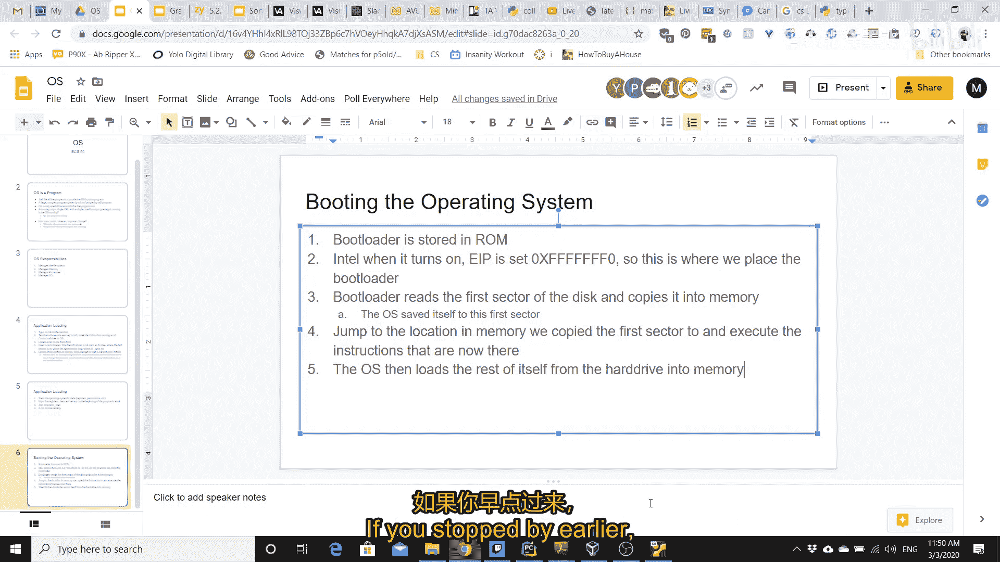

本节课中我们一起学习了：
1.  内联汇编中 **`&`（早期破坏）修饰符** 的用途和重要性，它用于告知编译器某个输出操作数会在使用完所有输入之前被写入，从而避免寄存器共享导致的错误。
2.  一组特殊的 **x86 字符串指令**（`MOVS`， `STOS`， `CMPS`， `SCAS`）及其重复前缀，它们能高效地处理内存块操作，是内联汇编的典型应用场景。
3.  操作系统作为资源管理者的角色，以及它如何通过一系列步骤（查找、分配、加载、设置、跳转）来**加载和运行一个用户程序**。
4.  操作系统自身启动的“自举”过程，依赖于存储在固件中的**引导加载程序**。