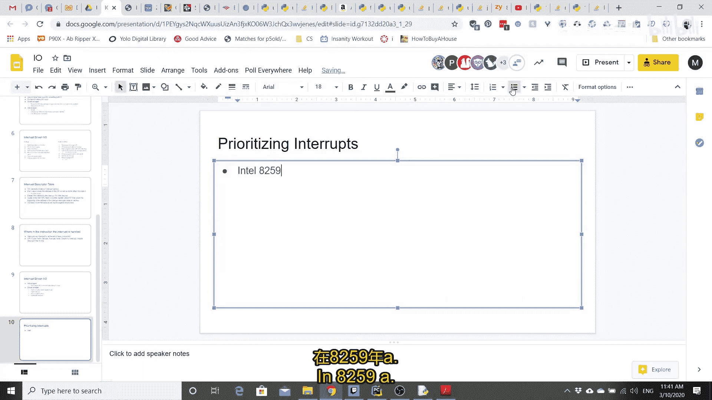

# 018：IO与内存系统


在本节课中，我们将学习计算机的输入/输出系统与内存系统是如何协同工作的。我们将探讨两种主要的IO访问方式，并深入了解中断驱动IO的工作原理。

## IO映射与内存映射IO

上一节我们介绍了内存系统的基本访问方式。本节中我们来看看CPU如何与各种IO设备进行通信。IO设备遍布系统各处，通过其端口（类似于ID，如0、1、2、3等）进行访问。

有两种主要方式可以与它们通信。

### IO映射IO

在IO映射系统中，内存地址和IO设备拥有**独立的地址空间**。这意味着读取IO地址2和读取内存地址2是两个不同的操作。

为了支持这种方式，CPU需要不同的指令来指定是访问IO设备还是内存。为此设计的指令是 `in`（用于读取）和 `out`（用于写入）。访问内存则使用 `mov` 或其他指令。

### 内存映射IO

在内存映射IO系统中，IO设备与内存**共享同一个地址空间**，但会保留一部分地址空间专门用于IO设备。

例如，前100个地址可能预留给IO设备，此后的地址才映射到真实内存。因此，整个系统只有一个统一的地址空间。

与IO映射不同，在内存映射IO中，访问IO设备与访问内存使用**相同的指令**，即 `mov`。对CPU而言，访问地址1（可能是一个IO设备）和访问地址5（可能是内存）在指令层面没有区别。

以下是内存映射IO的简单示意图：
```
地址空间：
0: [IO设备]
1: [IO设备]
2: [IO设备]
3: [内存]
4: [内存]
5: [内存]
...
```

内存映射IO的优点是编程简单，可以用C语言指针直接操作IO地址。但它的缺点是会占用一部分本可用于内存的地址。不过，IO设备数量通常远少于内存地址总数，因此这个损失很小。

Intel处理器实际使用的是IO映射系统。

## 与IO设备交互：轮询

现在，让我们看一个具体的例子：如何从键盘读取一个字符。

在Intel系统中，键盘数据端口位于地址 `0x60`，状态端口位于 `0x64`。状态端口的第4位（bit 4）指示是否有键被按下（1表示有，0表示无）。读取字符后，需要将状态端口的第5位（bit 5）**短暂置1再置0**，以告知键盘字符已被读取。

那么，读取字符的算法是什么？

核心思路是持续询问键盘：“你有输入吗？” 直到得到肯定答复，然后读取数据并通知键盘。

以下是实现该算法的高级步骤：
1.  读取状态端口 (`0x64`)。
2.  检查第4位是否为1。
3.  如果不是1，返回步骤1（循环等待）。
4.  如果是1，从数据端口 (`0x60`) 读取字符。
5.  将状态端口的第5位置1，然后置0，以确认读取。

这种方法称为**轮询**或**忙等待IO**。CPU反复询问IO设备是否有输入，一旦有输入就进行处理。

轮询的优点是实现简单，全部可以用软件完成，并且响应延迟低。但它的主要缺点是**浪费CPU时间**，因为大多数时候输入并不可用，CPU却在空转。

## 中断驱动IO

轮询效率低下，就像不停地打电话问“你在吗？”。更好的方式是让设备在需要时主动通知CPU，这引出了中断驱动IO。

想象你在等一个重要电话（比如面试）。你不会一直拿着电话问“你在吗？”，而是会先做其他事（比如看视频）。当电话铃响（中断发生），你暂停视频，接听电话，通话结束后再继续看视频。

计算机中的中断流程与此类似：
1.  **程序P正在运行**。
2.  **IO设备产生中断**（硬件行为）。
3.  **保存程序状态**：CPU自动将当前程序的EIP（指令指针）、EFLAGS（标志寄存器）和CS（代码段寄存器）压入栈中（硬件行为）。
4.  **询问中断ID**：CPU向IO设备发送中断确认信号，询问“是谁中断了我？”（硬件行为）。
5.  **获取中断ID**：IO设备返回其唯一的中断标识号（硬件行为）。
6.  **执行中断服务程序**：CPU根据中断ID，查询一个由操作系统维护的**中断描述符表**，找到对应的**中断服务程序**地址并跳转执行（此时开始运行操作系统代码）。
7.  **服务中断**：ISR处理IO设备的请求（例如，从键盘读取数据）。
8.  **恢复程序**：ISR执行完毕，通过一条特殊指令 `iret`（中断返回）恢复之前保存的程序状态，CPU从被打断的地方继续执行程序P。

中断描述符表是中断系统的核心。操作系统在启动时设置此表，其中每个条目（称为中断向量）包含对应中断服务程序的地址和一些控制信息。

### 中断与上下文切换

中断机制也是实现多任务（上下文切换）的基础。当时钟定时器产生中断时，操作系统可以利用这个时机：
1.  保存当前运行进程A的所有寄存器状态（包括已由硬件保存的EIP等）到进程A的进程控制块中。
2.  从进程B的进程控制块中恢复进程B的所有寄存器状态。
3.  关键的一步：将进程B的EIP、CS、EFLAGS值**写回到当前栈**中原来保存进程A状态的位置。
4.  执行 `iret` 指令。该指令会从栈中弹出EIP、CS、EFLAGS并加载到CPU寄存器。由于栈中现在已是进程B的状态，CPU便会开始执行进程B。

### 中断的硬件与软件分工

中断机制需要硬件和操作系统软件紧密配合：
*   **硬件（CPU/IO设备）负责**：产生中断信号、自动保存基本程序状态、响应中断确认、提供中断ID、根据ID跳转到ISR。
*   **软件（操作系统）负责**：设置中断描述符表、编写所有中断服务程序、在ISR中处理具体的IO请求、最后执行 `iret` 返回。

### 中断的优缺点




中断驱动IO的优点非常明显：
*   **高效利用CPU**：CPU在等待IO时可以执行其他任务，不必空转。
*   **可响应多设备**：能同时处理多个IO设备的异步请求。

但它也有一些代价：
*   **指令执行变慢**：CPU需要在**每条指令执行完毕后**检查是否有中断 pending，这略微增加了每个指令周期的长度。
*   **系统更复杂**：需要硬件支持中断机制，操作系统也需要更复杂的管理。
*   **响应延迟**：由于必须完成当前指令才能响应中断，响应速度不如轮询（但通常可接受）。

### 多中断与优先级

当多个中断同时发生，或一个中断正在处理时另一个中断发生，该怎么办？系统需要中断优先级管理。例如，Intel 8259A可编程中断控制器芯片可以配置不同中断的优先级。处理策略可以是：
1.  **禁止中断**：在关键ISR开始时关闭中断，处理完后再打开，确保不被干扰。
2.  **嵌套中断**：允许高优先级中断打断低优先级的ISR。
3.  **忽略直至完成**：当前ISR处理完再响应新中断。

## 总结


本节课中我们一起学习了计算机IO系统的关键概念。
我们比较了**IO映射**和**内存映射**两种IO访问方式，了解了**轮询（忙等待）** 这种简单但低效的IO处理方式。
随后，我们深入探讨了**中断驱动IO**的完整工作流程，包括中断的发生、程序状态的保存与恢复、中断描述符表的作用，以及中断如何成为实现**多任务上下文切换**的基石。
我们还分析了中断机制的硬件/软件分工及其优缺点。理解这些底层机制，有助于我们更好地理解操作系统和应用程序如何与硬件交互。