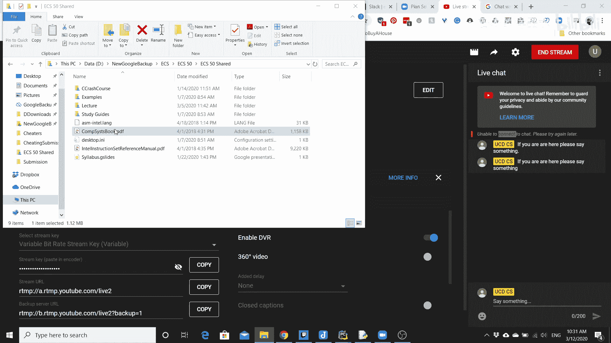
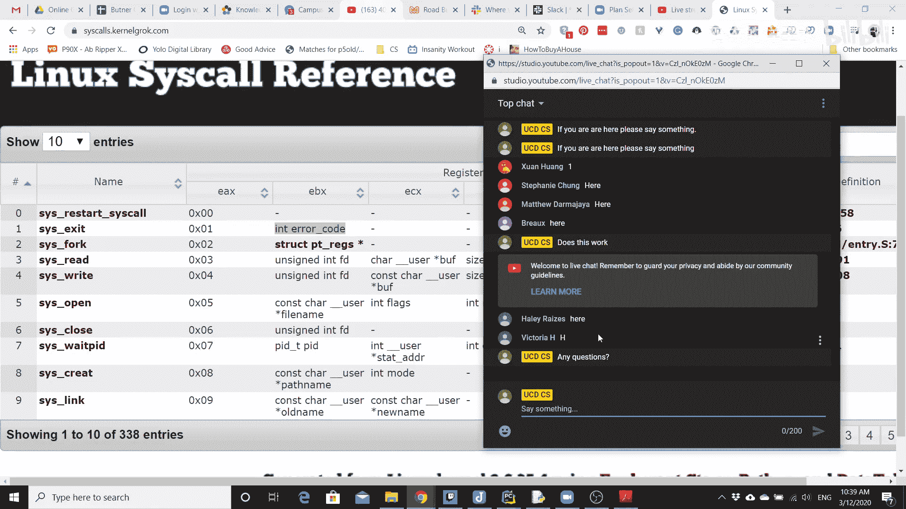
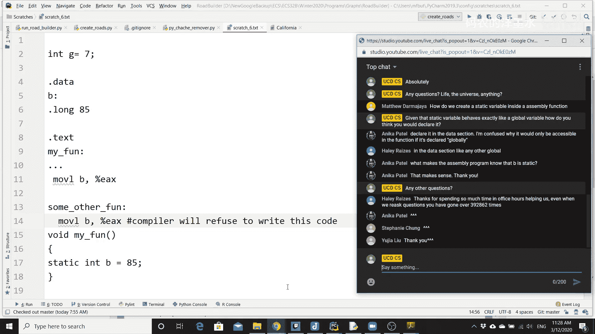
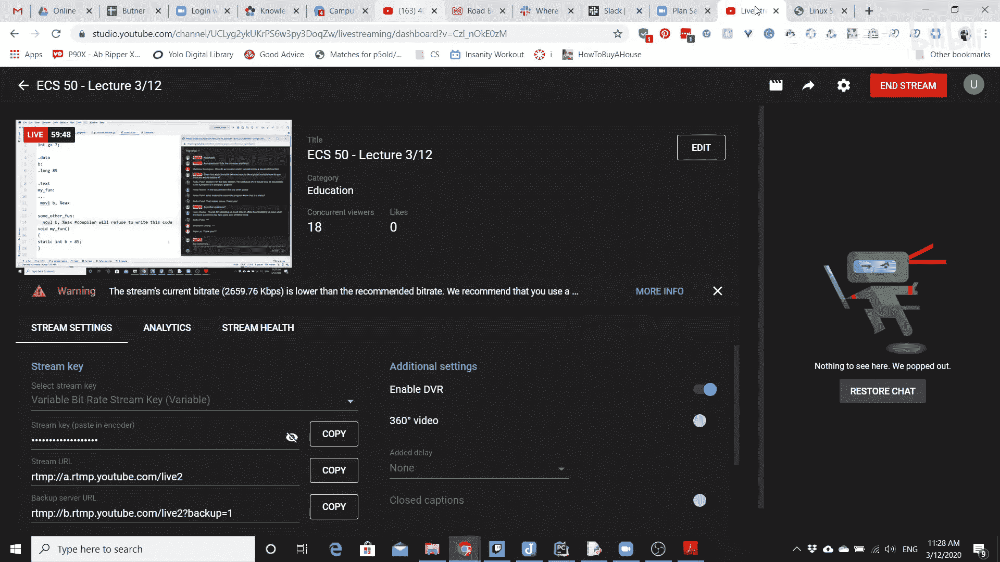

# 019：IO设备与内存映射 📚





在本节课中，我们将要学习系统调用的实现原理、汇编指令的二进制编码格式，以及可变长度指令集与固定长度指令集的区别。我们将通过具体的例子来理解这些核心概念。

## 概述

上一节我们介绍了中断系统在上下文切换中的应用。本节中，我们来看看中断如何用于实现系统调用，并深入探讨汇编指令在计算机内部的二进制表示形式。




## 系统调用与中断

程序在运行时无法直接访问IO设备，必须通过操作系统。如果操作系统仅提供一系列函数供用户调用，会存在安全隐患，因为用户可能执行非预期的操作。此外，用户程序在用户模式下没有权限使用如 `in` 和 `out` 这样的指令。

因此，系统调用通过**软件中断**实现。在Intel架构中，使用 `int` 指令触发中断，并指定中断ID。例如，`int $0x80` 用于触发系统调用。

系统调用需要传递参数。由于操作系统和用户程序使用不同的栈，参数通过寄存器传递。

以下是系统调用的参数传递规范：
*   第一个参数（系统调用ID）放入 `EAX` 寄存器。
*   其余参数依次放入 `EBX`, `ECX`, `EDX` 等寄存器。

例如，执行 `exit(5)` 系统调用的汇编代码如下：
```assembly
movl $1, %eax   # 系统调用ID 1 代表 exit
movl $5, %ebx   # 参数 5 放入 EBX
int  $0x80      # 触发系统调用
```
再例如，执行 `open("bob.txt", 7, mode)` 系统调用的汇编代码如下：
```assembly
movl $5, %eax        # 系统调用ID 5 代表 open
movl $bob, %ebx      # 文件名指针放入 EBX
movl $7, %ecx        # 标志参数放入 ECX
movl $mode, %edx     # 模式参数放入 EDX
int  $0x80
```

由于参数通过寄存器传递，系统调用在参数数量上存在限制。如果需要传递超过寄存器数量的参数，可以将多个参数打包成一个**结构体**，然后传递该结构体的指针。

## 汇编指令的二进制编码

我们一直在编写汇编代码，但汇编指令在计算机内部实际由二进制位表示。

每条指令的第一部分是**操作码**，它唯一标识了要执行的操作。例如，特定的位模式代表“将一个寄存器的值移动到另一个寄存器”。

寄存器也需要用二进制编码。例如：
*   `EAX` 编码为 `000`
*   `EBX` 编码为 `011`
*   `ECX` 编码为 `001`
*   `EDX` 编码为 `010`

因此，指令 `movl %eax, %ebx` 的二进制编码包含：操作码（代表mov）、源寄存器编码（000代表EAX）、目的寄存器编码（011代表EBX）。

使用 `as -a` 命令可以让汇编器输出机器码。例如，指令 `movl $4, %eax` 的编码包含操作码 `B8` 和紧随其后的4字节立即数 `04 00 00 00`（小端序）。

由于一切最终都是二进制位，我们甚至可以直接用 `.byte` 伪指令写入操作码。例如，`dec %eax` 对应单字节 `0x48`，因此 `.byte 0x48` 与 `dec %eax` 在二进制层面完全等价。

## 指令集架构：可变长度 vs 固定长度

Intel 使用**可变长度指令集**。指令格式复杂，包含可选的前缀、操作码、ModR/M字节、位移量和立即数字段。指令长度可以是1、2、4、8甚至更多字节。

解码可变长度指令更复杂，因为处理器需要先确定当前指令的长度，才能找到下一条指令的地址。

另一种设计是**固定长度指令集**，例如 MIPS 架构。每条指令都是4字节长。

以下是两种架构的对比：
*   **可变长度指令集** 优势：可以节省内存空间，让常用指令更短。
*   **固定长度指令集** 优势：硬件解码更简单、更快，易于设计。

这是一种典型的时空权衡。早期计算机内存昂贵，节省空间很重要。现代计算机内存充裕，更倾向于用空间换取更快的解码速度。

## 静态变量

静态变量在行为上类似于全局变量，在程序的整个生命周期内只有一份实例。它与全局变量的唯一区别在于**作用域**：静态变量只在定义它的函数内部可访问。

在汇编层面，静态变量和全局变量一样，通常被分配在 `.data` 节。编译器在编译C源代码时，知道某个变量是静态的，因此只会生成在定义该变量的函数内部访问它的汇编代码，并拒绝在其他函数中生成访问该变量的代码。

## 总结





本节课中我们一起学习了系统调用如何通过中断机制实现，以及参数如何通过寄存器传递。我们探讨了汇编指令在硬件层面的二进制编码原理，并对比了可变长度与固定长度指令集架构的优缺点。最后，我们了解了静态变量在底层的工作原理。理解这些硬件与软件的交互细节，有助于我们编写更高效、更可靠的代码。