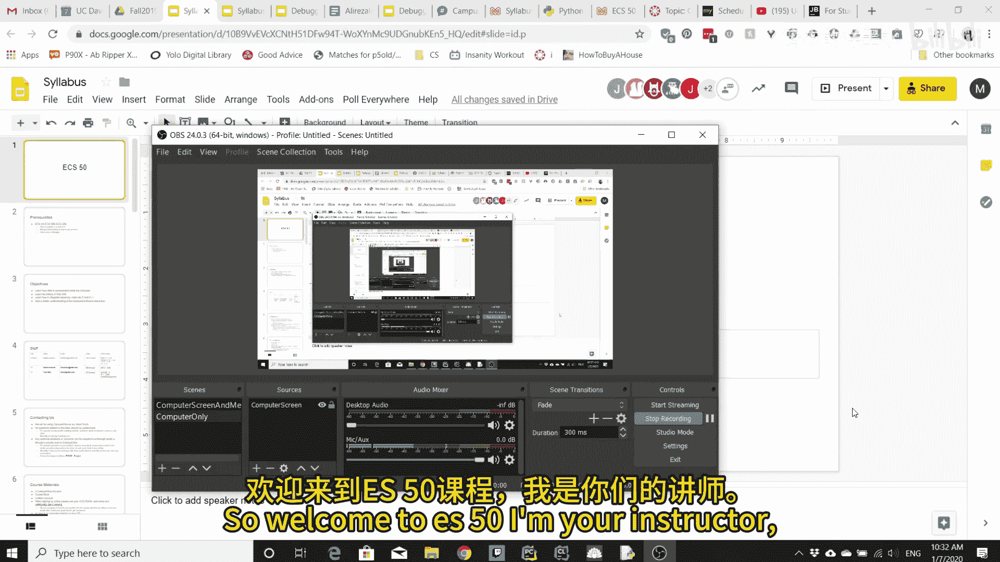
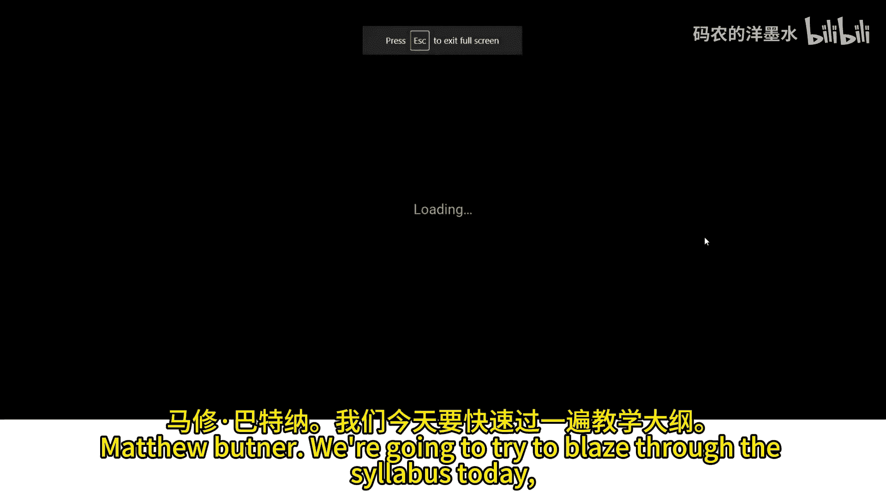
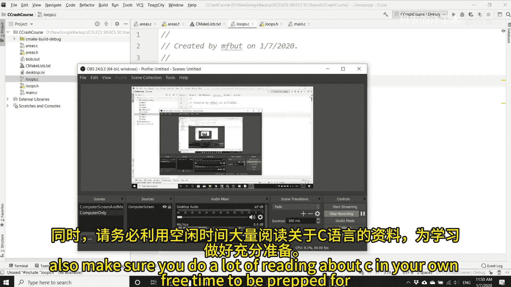

# 【全集】加州大学戴维斯分校 C语言与汇编语言 中英字幕 1080P p01 Lecture 1 - C语言编程速成 -BV1xefZBHEas_p1-

Hello， everyone。 is this on？Hello， knows well。Let me see about this， doesn't sound like the mics on。

 right？没问题。Okay， I'll just have to talk a little bit louder than for right now。

 because we need to get rolling。So welcome to EC S 50。 I'm your instructor， Matthew Butner。

 We're going to try to blaze through the syllabus today， and then depending on what we need。

 we'll either try to do a crash course on C or we'll actually get into the real lecture topics。

So the prerequisites of this class are either ECS 40， ECS 36 B or ECS 32B。

 how many of you guys are here from 32B？Okay， decent chunk of you。

 my best recommendation to make this class flow a lot easier would actually be to take 34 first。

Before you take ECS 50 because in 34 you're gonna to cover C and C plus+ which we're gonna be utilizing at both the front end and the last end of the class so that'll make it a lot easier。

 which should probably review some C stuff to begin with but if you decide to stick around in the class you're gonna have to basically teach yourself most of C I put some links on canvas for my old course where we did see so you can go through those or find some website online to help you learn it I would also recommend stopping a lot by office hours at the beginning to get assistance with topics that you might be struggling with that are related to C so you can understand how to do things or if you need like help on accomplishing certain goals it'll make your life flow a lot smoother if you ignore this advice like're gonna be terrible because don't expect to get it all from class because we just don't have enough time。

Stop me if I'm going too fast or you have a question because otherwise I'm just going to keep on raming through things。

So here we're going learn how to represent data and how data is represented inside the computer。

 we're going learn how to program an X86 assembly， not really because we want to be programming an assembly because to be honest。

 it really sucks a lot but to get a better understanding of how the computer actually works we're going to learn though how to integrate this assembly code into our C and C++ code and also gain a better understanding of how the hardware and the software and your computer interact and who's responsible for what and what does what when。

So here's our staff， there's myself and we have two Ts one of our Ts is here this morning So Chea she has our office hours on Monday Friday22330 so stop by there if you need help I have office hours every day but they're shared between your course and my other course but you guys have priority times on Monday。

 Wednesday Friday from 1215 to 130 and on Tuesday， Thursday from 12 to 115 so today right after class will be there if you have questions I'm gonna to ask when you come to office hours that if I'm not there because sometimes I get held up answering questions after class to write like ECS 30 ECS50 on the whiteboard and then put your name there as you arrive and then just a brief topic of what you want to talk about you could be something like homework1 or C code or something like very simple couple words about what you want to discuss。

Sound good。Okay。So we'll be using campus wirere for our class forum。

 most of you should have already been enrolled unless you joined the class very recently。

 this is how we're going to primarily communicate throughout the quarter with you。

 don't expect to see any more posts on campus wirere unless they're super duper important all questions related that the class should go there and only private matter should be direct messages to us on there or given as private messages or private questions or if you email us basically if there's something that could only ever concern you and you alone in affect no one else in the entire world。

Those are the things for like the private communication this just helps us by。

Keeping like questions that might affect a lot of people public so that we don't have to keep answering them over and over and over and over and over again。

So good questions to directly email us about would be like there's a death in the family or you gotten a car accident or you know。

 your house burnt down， something like you know stopping you from performing in the class。

 bad things to ask， how do I get sea lion set up， how do I install a virtual machine。

 how do I you know do homework one， those are all terrible questions because probably more than just you have those questions？

If you do email us， make sure you include E S 50 in the title followed by the subject。

 teach two classes。 So it's always kind of weird like when youre like。

 I have questions about homework  one。 I'm like。What homework one。

 this class or that class Now take a look up and see which class you're actually in。

 so make sure that you let me know which class you're coming from。

So here's what you're going to need to get for this class。

 you're going to need to get a Can wirere account， a coursebook， a MIme accounts。

 and when you sign up for anything online make sure that use your UCD email and your name as it appears on canvas because we use that information when we're transferring your grades from those websites back to Can because it's not automated and if you're using like I'm super hot guy at Yahoo。

com I have no idea who you are in the class and your grade's not gonna to get transferred over so make sure you use your UCD email and your name as it appears on canvas you're also going to need access to computer running A Linux environment。

Again， sign up using new email clock here， it does use markdown if you want to use markdown to make sure that your code shows up a lot nicer on there when you ask questions I also ask that if you have questions related to like some snippet of code that you actually copy and paste that code there instead of giving me screenshots of it because if you give me screenshots and you want me to like say hey。

 what's wrong with this code I'm like hey， you need to fix this line it's really hard with the screenshot because I can't make edits to it easy but if you copy and paste your code。

 well then I can copy and paste your code back and then make the correction to show you what's going wrong。

If you are joining late， the course code is 2321。If you are asking questions on Can wire。

 I ask that you go through these three steps first Google your question it's full of so many answers in case you didn't know that already and you'll probably find that someone's asked your question there already it's also really good to get used to using Google because there's a lot of stuff you don't know and there's lot of stuff I don't know and all of it comes down to just finding that information so the more you practice now the better you'll be doing it better you'll be doing it when you get to your job if you can't find your answer on Google search for your question on Canva wire and then if somebody's answered it great to get your answer right away you don't have to wait for us to reply to you and then if no one has asked the question then feel free to ask and we'll get back to you on it。

Our book is an electronic PDF， it's written by Professor Matl， which is another instructor here。

There's the link。It's really good。 It's actually like one of my favorite books that I read in the class。

 He does a really good job at writing them。We're also going to be using Mimeir again using UCD email and your name is appears on canvas this is where we're gonna be doing your homework assignments and quizzes or your quizzes might appear on canvas I'll let you know how if we figured out that out a little bit this will allow us to give you feedback automatically when you submit your homework assignments like what test case you're passing what test cases you're failing so you essentially know what grade you're gonna be getting every time you submit if you're happy with that grade great you'll probably get that grade unless you cheat it if you're unhappy with that grade keep on working on it and you will eventually get the grade that you want it's very possible for everyone to get 100% in the class and I'd be very happy if you all do its just a matter of putting in the work to get it so if you're not happy with your grade keep putting in more work and you'll be able to raise your grade I don't curve in the class so。

Don't expect the curve。If you need refund， you can get it that way。 Any questions so far。Okay。

So there are a couple ways you can get access to the Linux operating system you can go to the CSF computers which are in the basement of camper Hall。

 you can access them either remotely or in person， you can install a virtual machine on your computer such as virtual blocks which is what I'll be using in the class you can also dual group you can also use the Mime IDE as well and program on there and you'll have access to。

The Linux environment there， it's not sufficient enough just to have like a Mac。

 even though they're very closely related when we get to the assembly code。

 because the assembly code that we write is just a little bit different for Mac than it would be you would write for Linux and so the code won't run。

On your Mac machine。So make sure you do have access to that Linux environment。是。Yeah。

 so if we were to just。就。IfGo into the CSIF for peers， that would be a。Yes。

 if you just go to the CSF computers，'s they have everything that you need。Firsts Canvas。

 we also have Google Drives， I posted links this morning to be able to access it。

 you'll see all the lecture slides there as well as all of the examples that we end up doing in class。

For programming and C and C++， I recommend that you use C lion， you're free though。

 to use whatever you feel like as your editor of choice when you're programming。

 but it's free to use， you can get a free student license from Jetbrains and there's a couple of videos I have up online for you to get it set up if you need help with that。

So grading homework is worth 40%， quizzes are worth 20%， midterms are worth 20%。

 and your file is worth 20%。You can also earn up to 2% extra credit in the class just by participating if you're active on campus wire。

 you can get 1% if you reach level one and if you reach level two。

 you'll get an extra 1% credit so if you're active and asking questions and helping each other out。

Free extra credit on the table for you。Homework it's generally due about every two weeks。

 it's due at 1155 pm of the day specified。I would generally expect homework assignments to take between 10 and 20 hours if you took 36 B with me it's a lot less in this class so expect the break assignments aren't too complicated the majority of the time is actually spent in debugging because you'll make mistakes in translating the assembly code and like every line of C code corresponds to about four or five lines of assembly code so its just a lot of opportunities to make mistakes and since there are no more variables and there are no more functions it's just really hard it's just a lot harder to debug and you have to pay a lot more attention to things that are going on so。

Be aware of that。On each of the assignments， I'll tell you how long it took me and hopefully you'll figure out whatever your time multiplier for my time is。

 how long it's going to take you to do。Any questions so far？

Okay you'll submit your homework on Mimeir。 can generally have 10 to 15 submissions。

 This is just to encourage you to test on your own machine。

 You should definitely be doing that before you submit probably shouldn't be just be like。

 oh hey you know my code is I think it's working Test out first before you one the test cases that are available on Mimeir you can work in groups of up to two if you're working in a group you don't get any additional assignments so let's say there were 10 submissions overall for that assignment and you joined a group you wouldn't get 20 submissions for the group there would be 10 submissions for the group So if you've already submitted individually three times and your partners already submitted maybe say individually three times as well and you joined together as a group it only leaves you with four submissions So they're shared between you So again。

Don't waste your submissions， test on your own machine。

I'd also recommend that if you're getting like。Buggs that are occurring on your own machine。

 but aren't occurring or bugs that are occurring on Mi。

 but aren't occurring on your own machine that you get your code up onto the Mime IDdeE and run it there because it'll be running in the same environment and so you'll be able to trigger the same bugs there as when you submit for your homework don't just be like。

 hey it works on my computer and not there so I should get credit。

If you're willing to give me your computer， okay。But， you know， you're never going to tell a client。

 well， it works on my machine。Well it doesn't work on their machine right。

 they're paying you to get this to work。 they're paying you for the product right So you got to get it working on everybody's machine。

 that's because C and C++ unfortunately have things that have undefined behavior unlike languages like Python and Java。

So totally possible to get 100% of the class， just apply yourself。嗯。

I guess I should actually change this。Homework is accepted up to two days late。And。

There's a 5% penalty。For late day。should also mention this class doesn't have the academic technology services recording。

So I'll try to record the lectures and put them up on YouTube afterwards so that you guys can watch them there if you need to catch up I'm trying to figure out how to get the YouTube streaming stuff to work consistently。

 so I'll try to stream it if I ever figure out how to get that to work。

And then it will be like upload an archive on YouTube for you to watch later。

There's a quiz about every two weeks， if the quizzes are on Canva you'll have three attempts per quiz。

 if the quizzes are on Mimeer， you'll have an unlimited number of attempts because Mimeer doesn't support giving you a fixed number of attempts yet。

So。We'll see how that goes。 You need to do your quizzes independently。

 and your exam questions are very likely to be similar to your quiz questions。

 So if you got the quizzes down， should be really good for doing the。Midterms and finals。

There will be two midterms， they'll be online， they'll be like quizzes but bigger and combined so if we've done quizzes one two3。

 probably expect the midterm to cover quizzes one， two。

3 same similar questions maybe a little bit harder， maybe very similar。

Maybe a couple new topics for what we have covered in between then。But it shouldn't be too hard。

 You can definitely come in and ask questions in office hours if you're struggling and get help then as well。

There will be final， it'll also be online and then。

It'll probably do like the very last week of finals week to give you the maximum amount of time to submit。

Quzzes won't be timed。 generally you'll have like a week to do them。

 and as long as you get it finish within the week， you'll be good。Cing。

 I should just say don't do it， if you are caught cheating。

 I'm going to give you a zero on the assignment and depending on how flaggrant your cheating was。

 I might give you a zero in the class。So don't do that。

 it's pretty easy to catch you when you're cheating because there are automated tools that make it very easy to spot code that's similar。

So don't do it please read the SJA code of Amic conductduct too because it kind of gives you like a full list of things that are cheating and things that aren't or things that are cheating there might be some surprising ones there like it's actually possible to plagiarize from yourself which I thought was always really weird but apparently you can get in trouble for that so watch out。

So here's some examples of cheating， obviously plagiarizing your copying code。

 searching for solutions online， also if you're like of the mindset that I'm going to search for a solution online just to see how it's done and have get an idea of how to do it。

 that's really bad because once you see the solution。

 you can't unsee the solution and you glad won't if you weren't able to come up with something to solve the problem。

You now aren't going to be able to come up with something to solve the problem anyway。

 because you'll be stuck with the solution that you've seen， right。

 there might also be particular homework assignments where there's really one solution more or less for how to do it with maybe some tiny variation。

 So again， if you see the solution， you're not gonna to be able to come up with anything different。

The other thing is there's a big difference from being able to solve a problem versus being able to understand someone's solution and you've probably recognized that if someone's like here's a solution and you're like。

 oh yeah that totally makes sense I got that that makes sense versus figuring out how to derive your solution yourself。

 it's a completely different process and you're depriving yourself of a lot of learning if you're searching for those answers online。

Looking for obtaining past exams and homework questions。

 hiring someone do your work that's definitely happened before in the past。You。

 you get a couple hundred dollars for homework assignments。 Its kind of weird。

 But that's happened asking someone online， like on something like。Stack overflow like hey。

 how do I solve my homework problem right or some forum that's definitely cheating。

 receiving or prevent code from someone outside your group。

 receiving or preiding assistance on work that's supposed to be completed individually also cheating we don't probably have in class exams but if we did have any class exams you're not allowed to sit next to somebody that you know this is mainly protect you because if you both have the same weird answer and you're both sitting next to each other it looks like cheating But then you're like。

 hey we both studied some weird wrong way and you're doing it completely wrong and that's what we had the same weird answer。

Well， if you were sitting on opposite sentence as a class， I'm inclined to believe that， right。

 But if you're sitting right next to each other， would'd be like， that's cheating。So don't do that。

 It's also just a good way to protect yourself in other classes as well。

 not to sit next to your friends。Some things that aren't cheating。

 you can definitely search for pseudocode algorithms online。

 just like try to get an idea of like how do things work？

That's fine discussing high levell concepts with any of the other students in the class。

 that's perfectly cool doing examples that are similar to the homework together。

 no problem asking for like how does a function work， like how does scanF work， how does printf work。

 how does you know those stir copy work， those functions are completely fine to ask or asking what some error message means。

No problem with that I'm happy for you guys to collaborate with each other and I want you to you know discuss and interact because a lot of learning happens there。

 but I don't want you guys to stop learning because of it or like one person does the answer and then everybody has the answer。

Because that doesn't help you at all。Yeah。Is it like。

Is it cheating if you know one person does all the work in the group。嗯。So for groups。

 I would say that the best way to have a good group experience because they can be really good。

 but they can also be really bad is only form a group with somebody else if they're at the same skill level as you。

 because if you're better than them， you'll end up doing all of the work and your partner does nothing。

If you're worse than them， they'll do all the work and you'll do nothing and you won't learn anything。

 So you're paying a lot of money just to come here and sit， which is， you know。

 probably a waste of it。 You also need to be able to meet up on a regular basis。

 And the only times you guys should be programming is when you're sitting side by side with each other。

 You shouldn't be doing any independent programming because then someone's not learning something There may be multiple problems。

 And if you're like I'll do problem one， you do problem two Well concepts and problem one probably aren't covered in problem two and concepts covered in problem two aren't covered in problem one。

 So you'll be lacking in a certain area if you're not doing it together。

The main benefits from having that partner are for having someone to discuss ideas with。

 having someone to review your code for potential bugs for someone to be able to spot errors that might be there or give you possible alternative considerations for how to do something。

Basically， having someone to talk to you is the best benefit of the partner。

 And if you're not doing it， it's just not worthwhile。

 If you do find that you are in a partnership that's not working out。

 you can totally leave it right even if you're in the same you know you say you start the assignment for homework one and you're like're gonna be partners and like halfway through it。

 you're like man， you suck and you aren't doing anything's it's okay to leave I would just say。

 you know probably don't leave like the day before it's due because that's being a huge jerk to them if you're just like。

 hey， you know， actually did all the work and I know we're partners but you didn't do anything so bye。

You know， if you want to get out， get out early， that's fine and you can switch different groups between homework assignments。

 it's also going to be very possible to do all the homework assignments by yourselfselves。

 you're not required to work in a group。So only being one if it's beneficial to you。

 and if it as soon as it stops being beneficial， get out of the relationship。

Doesn't answer the question？Any other questions， yeah？I to help you with the bird。I was student。嗯。

Does asking someone to help you with a bug count as cheating。

 definitely not if you ask the TAs or myself if you're asking somebody else。Probably not。

 but again you're exposing a lot of code to them， which they may or may not end up copying probably the person that you're showing your code to is you're swimming farther along than you already done and that's why they're able to fix the problem So I would say probably not getting help on that we'll be talking about the bugging and discussion if you haven't already been there but you really do want to practice using debuger and figuring out what your own problems are though I will definitely admit there are a lot of nuances and really subtle bugs you can create in C andC+ plus because of pointers and memory。

Anything else？Yeah。So if you want to succeed in this class， oh， that one's for the other course。

 you can definitely take four classes if you're doing this one。

Just start early on your homework assignments as soon as you get them， just read them。

 the homework assignments for homework one are posted， you're not able to do them yet。

So if you're like， I have no idea how to do this， that's fine， but at least read through them。

 get thinking about them， have them on your mind just so that they can be there in the back burner and you can kind of like be evaluating what you want to do you know。

 like you're washing dishes， be thinking about it right， you're cooking dinner。

 be thinking about it bike right home， thinking about it right just have it on your mind because if you're able to spend that downtime thinking on it like when you're not really doing anything else。

 it'll save you you know， time later on。Also starting early gives you time to take breaks。

 which is really necessary to be successful because there may be times where you just need to like step away from the computer instead of trying to keep punching holes to the wall right there can be points where you're just blocked and you just need a good night's sleep to get past it and if you start early。

 you have the time for that you might also find that you get breakthroughs just when you step away from the code on that bike right home in the shower while you're washing dishes know whatever you're doing something else sometimes the inspiration comes to you then not when you're just staring really。

 really， really hard at the code because again you kind of reach that deadlock it also gives you time to come to office hours。

 ask questions and get help I would also recommend for office hours when you come come earliest possible discuss the high levell ideas。

 discuss the concepts， discuss your plans with us because if you're discussing those things and you're going down a bad route。

AndThen we'll probably be able to prevent you from doing that and wasting tons of time there， right。

 or we might be able to ask you to consider other things based on your solution that you may not have already considered that might change how you end up doing things。

And the earlier you come office us hours is， the better it's going to be for you。

Just interact with us， ask questions in class， ask questions to each other。

 ask questions on the class forum， interact because a lot of learning goes on there。

 just be proactive with everything。And if you ever start to do worse than you would like to do in this class。

 get a hold of us of immediately come to extra office hours， start doing something to make a change。

 A lot of us can be really stubborn when things start to go wrong and you'd be like it's just a one-off thing right you know it's not really going to matter right I'll be able to pick myself up and just push harder and be able to get through it but if there's something that's prevented you from doing well in the previous homework assignment。

Those topics tend to compound on topic of each other and they used the next homework assignment and on the next homework assignment。

 So if you're weak and you're struggling on something， you're probably gonna continue to be weak。

 and that's going to keep affecting you on every homework assignment。

 probably making you do worse and worse and worse and worse。 And even you're like。

 well I'll just spend extra time learning that thing by my own all myself right odds are you probably won't。

 But even if you do there's something that's still blocking you from doing it。

 So you probably need an additional person。 And so getting that help。

Will save you a lot in the long run。 And the earlier you come to us。

 letting us know that you need help， the more that we can do for you。 If you come to us。

 like at the end of the quarter and you' be like， hey， I'm failing your class。 What can I do。

Take it again next quarter。I guess right， I can't do anything at that point， but you know。

 if you're like struggling in the middle of a homework assignment。

 we can help you figure out why you're struggling on that and help you improve before it's due。Right。

 or again， the earlier you come， the more we can help you out， the more we can do for you。

 And I really do want to see you succeed。 But a lot of that burden for just seeking the help lies on you。

 And I'd rather not see you go into like some death spiral with your grade。Sound good。

Any questions before we start talking about sea。O。So let's talk about C。A little bit。

And probably not enough for you to be proficient at it。But again。

 if you're seeing something that's what the hell is that， this doesn't make any sense。

 just stop me and ask questions， the smart students。😡。

Are the students that ask questions in the class， right because then they're able to continue learning。

 right If you don't ask questions， you don't learn， because questions are like your best commodity。

 they're the thing that enables you to learn， right？

 You think about all of science and how it's done， Ask questions is how we ended up getting to answers。

 Why did the Apple fall。 Why did the apple fall with this rate。 What is this thing composed of right。

 The questions are what leads you to your answers。 So you got to ask questions in the back。嗯，最抛。不清。

Sure， absolutely。This one。Anything else？Yeah。我。The codes and lecture slides will be posted online and they're already there again。

 that class Google Drive， it'll get updated as soon as I make changes which is why I use it。所以。

Anything else？嗯。So I guess we should switch to。C。I don't want I want to see executable。是是是是。嗯。

So C is a aesthetically compiled language， which means it takes a compiler to run through your source code to then produce an executable。

 which is then run This is in contrast to something like Python， which is an interpreted language。

 which as the interpreter runs， reads through your code， it starts executing it。

So one of the first things that I recommend to you is to turn on warnings。So over here。

 M myC make list dot TXt， I'm going to。Wait。For it to add some warnings。Oops。

So first you're going to list the name of yourre executable right now my name is Crash Course。

 see Crash Course， private， you'll want turn on all warnings， turn on the extra warnings。

And then treat warnings as errors。 warnings are things that aren't syntactically invalid in C。

 but probably signify that you've made a mistake。So you should definitely treat them as errors because they're probably wrong。

 an error is something that prevents the compiler from compiling。Um， you know。

 an example of this from real life would be， you know， you can tell your girlfriend， I hate you。

 right？That's totally semantically correct， but probably going to lead to a lot of bad things happening in your relationship。

versus you can't say something syntactically incorrect in English and how it makes sense。

 like dog green blue， yeah。And that makes sense， right？So there's difference。 So over here in Maine。

There's int Ay。Chard， double star。Are you funny about this。Okay。

 it's complaining because I haven't used it yet。 so maybe willll。Comment that out。

So comments can be written in two different ways One is。I guess you're not going to like that。

 are you？We'll just comment it all out right now。Comments have be written one of two ways。

 slash star and then everything up until that line。The closing star cllash is a comment。

 so multiline comment。And then single line。Comment， start with two slashes。

C kind of goes with a philosophy that you should only pay for what you use。

 So a lot of stuff isn't built in。 For example， printing is not built in like it is in Python the print。

The print function is actually contained inside STo。h。

 so if you want to be able to use that function that's in that library。

 you have to include it so pound include STIO。h right here。What Pound includelude really does。

 it just means copy and paste， so it's going to copy and paste everything from ST。h into this file。

 which try to hopefully talk about header files if you have time。

So here you can see our print statement， it says print hellello world。

 strings or enclos in double quotes and see， you can't use single quotes for a string。

So have to use the doubles。And then the return zero has to correspond to our return value over here in mainine and it says I will return zero when you return zero from mainine it means you successfully completed if you return anything beside zero。

 it means something went wrong with the program。Program specific。关系。

Can you said it so that the certain thing of those wrong it returns were and then how do you know what the structure。

 oh， it says positive？Yeah， yeah， and then like generally the return code would be used utilized by other programs if they were running your program to see if it's successfully completed。

Any questions so far？So you can see in C++ since perstheally typed， once you declare a variable。

 you have to declare it with its type and once you declare it to be of that type。

 its type cannot change so your basic types are integers for integral numbers。

 so integer number equals 35。Number is equal to35。 We also have characters。

So letter their enclosed inside single quotes。B。Doubles are for real numbers。So，35。27。Now， over here。

 if we want to print out some values， it's print F。

 and then we use a format string to specify how we want things to be printed。

 so you might say number is percent D is for integers。

And then we put number here to be that the violes should be printed out。Then you might say printf。

Letter is percent C。And real number。Is。Pcent Llf。So over here we have a letter and then real number。

So you can do multiple variables printed out in a single line。

 you have to have enough placeholders for them， so the number of placeholders that you have in your format string need to be equal to the number of things you want to be displayed if there's a mismatch。

 your programs probably going to have some comments。Probably going to have some problems。

And then I should also say that every statement needs to end with a semicolon for those of you that come from Python。

 this will probably be the biggest mistake when I first wrote learn C。

 I forgot a semicolon on the end of every single line that I wrote my first program every single one of them we're all messing it so just remember to go put it back in there。

And if you run it， you'll see the values get printed out。

 Yeah So those percent and then it's a placeholder。 And then it just does it in that order of。Yeah。

 it's it's in the order。 So I can't do real number first then letter。

 So they get filled in in the order that you go through them。Everyone。

So no the placeholders are specific， percent D stands for decimal number。

Percent C is for a character， percent LF is a long float， which is double。Yeah。You first。

So if you want to do a string， strings are a lot more complicated in see。

 but if you want just a basic string， the way that you declare it is this array of characters。

 so you might have char， stir。Equals。Hi， class。So over here in the square bracket。

 you put the size of how many character space you want to make available。

 but because I'm sign it directly to a string constant。

 I can leave that out and the compiler will figure out how many characters are here。

 So here it's and a make space for 1，2，3，4，5，6，7，8。9ine characters， actually。

Because the way that the string is represented。Is actually as an array of characters。

 so I'll make a shorter one， so stir two。Is equal to。Single character。Hi。Mll character。

 so a string in C。A string in C is in。Aray of characters。Heracters。That ends with the。No character。

That null character is the slash0。That makes sense。

 so one of the biggest mistakes that people make when working with sea strings is to forget to put the old character on the end。

By default， when you write a string literal like we're doing right here。

 it automatically has the null excuse an nu character。

 but if you're like dynamically creating a string or forming it from other strings。

 make sure your strings always end with an null character。Yeah。

Just going back to the present saying these of those types of。Teach。

So the percent D for decimal is for the integral numbers。

So you do want to do percent D with integers， maybe your question might be like ws if I do percent D。

 but I put in a float or put in a double there， right？和群之。So if the types don't match。

 you're gonna to get some funny output。 and it's actually going gonna cause the。

Compilr to display it differently。So if we go ahead and try this。So print F。This is a string。

 Strs represent percent S。And then you can say， you know。Stir。嗯。And。So is percent S。St 2。

So if we try doing something。You know， interesting like。Let's say we make this something like 72。

 So print F。Yeah。The number as a character is percent C。And then we throw a number here。

And then we go ahead and we run this code。I forgot to put a slash in there。

 but you can see that number as a character， if you interpret it that way。

 is actually considered to be equal to the character H。

So this has to do with something we'll cover later on and just that they have the same bit patterns。

So that's why it's showing H。Yeah。😊，The null character does count as part of the size of the array。

 so if we have something like the string that contains catt CT。

 we actually need four characters worth of space to be able to hold that the C， the A。

 the T and the null character。Any other questions？Okay， so these ares that I've showed you right now。

 they are statically allocated arrays， which means their size cannot change so in Python you're used to be it used to be able to add elements to a list and remove elements from a list。

Or like change the list size， you can't change it this string over here。

 this is an array of three characters， it will always be an array of three characters。

 it will never be a array of more than three characters。So it's size is fixed at compile time， right？

It cannot be made bigger or smaller。Some other things that we might want to see are how to make some functions。

So functions are pretty easy， it's return type。Function name。Arg1 type。A one name。A two type。

Ag2 name。keep on going until you have enough arguments to get your life done。And then we close it up。

 curly brackets。And then we have the functions body。So。上个人。

So let's say we wanted to write a program that could calculate the areas of。Shapes like squares。

 rectangles and trapezoids。So I want to make two new files over here。

So create a new C C++ source file。We want a C file， C files， and in dot C。

 I would like an associated header with this and I'll show you why in a moment。

And then here we might just call this like areas。Functions just like in Python。

 can either return one or zero things， you can't return multiple things from a function。Yeah。

So over here， if you think about a trapezoid。If you think about it， this trapezoid， right。

 It's made up of。Two triangles， right？And they。Rectangle。Make sense。

So we're going to write our function that way when we do the area for the trapezoid。So first， though。

 we might start for like area of a rectangle， So the first thing should be you know， get。Correct。

Area。What should my return type be？You pretty much have like fort。3 choices。

 Do you want it to be an integer， a character or a double。Double right should be a real number。

 What parameters do we need to be able to figure out the area of a rectangle。Double width， right。

 like double height。So then how do we compute the area of the rectangle？Right。

 just width times height。Again， you can have longer function bodies than this。

 and this is the value that we're going to get back from the function。

Indentation doesn't mean anything in C or C++， it just makes reading things a lot easier。

 so still use your good Python indentation， even though it has no effect on the C code。Now。

 how might we define the area of a triangle。没理你。嗯。The base and。Right。If you think about it。

 a triangle is blank a rectangle。HaHalf， right。 So we could just say return， get wreck area， right。

 pass in base and height and then。Divide by 2。In。C， there is no double divide operator。

 There's also no exponential operator， like there is in Python。

 The type of the division that's done is based on the type of the variables that are involved。

 double。And like so double arithmetic， anything is always going to give you back a double at the end of the day。

But if you do integer， arithmetic integer， you're going to get。🤧。Another integer。So。

 some interesting results from that are。You might say printf。

Something like3 divide by four is equal to percent D。3 divide by four。

 So what do we expect our answer to be here？With three divided by four？It zero。

Because the numbers are all integer numbers。So we get zero。Right， if we wanted to do double division。

We got to make sure our numbers that are involved in the operation are。

Doubles and then change our type over here。So you get 0。75 like you were expecting， Oregon。

 if we have three divide by four。4。0 again， double integer goes into the double realm of arithmetic。

Or。阿不。Integer again， we're going to be in the double ramel byrithmetic。

 So anything involving doubles puts you into a double。Right。

 but you can also do some things like this。We may have int。You know， x is equal to 3。0 divide by。4。0。

And then， print。Percent x is equal to。 What should my format specifier here be。Percent what？So。See。S。

第。Oh我。Okay， that's right。So if we look over here， compiler is not happy with it。

Because x' is type is。Integer， right， So we need to be displaying a。Integer， right？

I can make it stop complaining and it'll let me do this。

So if I get rid of treating the warnings as errors。It'll let me do it， but again。

 I don't recommend that you remove this flag。Yeah。And again。

 now we're attempting to interpret that integer's bits as a double。

 which can cause some really weird things， but it just so happens that the representations for zero are the same in both。

 so we get zero。So we put this back in so we don't make mistakes。And we turn this back to percent D。

 and again we're going to get。Oh， x is equal to。present0。And we'll get 0。

 The reason for this is because the type of this expression， it is double。

 but it's going to be stored into a。Integer， so in this conversion。

 the compiler will implicitly convert the value of the expression on the right hand side to the type of the variable on the left hand side。

 So we'll end up converting our float into an integer and then storing that result in our integer X。

 so we will get 0。75。 but 0。75 convert into an integer is。0， so we end up with zero here。Yeah。毎本し。

Sa7%。呃。And then you say like three point， I want you to say three。

So three over four they're both integers， so you'll end up with a。Integer。

So so when you do the three divide by four， if theyre both integers， you end up with zero。

 so it just so happens that a doubles representation of0 and an integer's representation of0 are the same。

 so you would see 0。0 pointed out。But again， generally the types here aren't quite what you quite right。

 so as long as they have the W error option turned on， it won't let me compile。

Treat the warnings as errors because' it's like saying， hey。

 you're doing something weird that you probably didn't intend to do right， watch out for this。

 But I said， okay， make anything that might be a mistake in error so that I can't compile so I have to address it。

Correctly。Yeah。Okay。So we have the area of our triangle。 Now。

 let's say we want to get the area of our traps are there any other questions。

OkayAnd so what do we need for the trapezoid to be able to figure out its area？We need the height。

 we need the base， but we also need the length of the short side， right。

 so we need the length of the short side， length of the long side as well as its height to be able to figure out everything。

So double。longside。Double short side。Double height。So again， we said that our trapezoid right。

 it's made of a rectangle as well as two triangles。 So how much is our rectangle， how big is it。

What are the dimensions of our rectangle？Yeah， it's they're going to be short side long。

 and it'll be height tall。 So you might say something like double。Red area equals gis。Reect area。

And then here we might say we want to pass in short side and height。

So here you're running into one of the nuances of C。

 which C is what's called a top down one pass compiler。 So that means when it runs through your code。

 it starts at the top of your code。It goes to the bottom of your code， top down。

 and it goes through it once。Because of this design， C has to know about things before you use them。

So here， when we get to this line， where we call gitre area。

 if we start from the top and we work our way down， have you seen gitrech area before。No。

 compiler hasn't either。 So it's like what the heck is this。 I don't know how to do this。

 Is this right， I this wrong？😡，So in order to resolve this problem， there are two solutions。

 solution number one is we take this function and we put it below this function。

Because when you get to that point， you'll have already know that's defined。

This probably doesn't sound like an ideal solution because there might be a lot of dependencies on your code。

 right， and it's really restrictive to have to write your code in a certain order。

So probably don't want to go with that。So these guys here are called function definitions because they could tell the compiler what to do。

 There's also something called a declaration。 So this is a definition。Definition。

And also a definition of the function because they can the compiler what to do。

 If you just want to tell the compiler something that exists。

 you give it something called a declaration。 A declaration is everything that's the function is made up of。

 except for its body。So if I want to say that， hey， compiler， this function exists。啊。I say it exists。

And that's it。 The compiler doesn't know enough to how to run it at this point。

 but it's going to be like， okay， this exists。 I'm fine with it。 I know what arguments it takes。

 I know what its name is， I know what it's going to return。

 so I know how to use it and you're also going to promise me that later on you will provide a definition。

So right now， when it sees gitre， it's like， oh， gitreed area is something that's going to exist and it looks like this。

 So when you go to use it， you're like， hey， I'm using it correctly， right， I gave it two doubles。

 I got back a double。 Everything looks fine here， even though I'm not quite sure what code I should run。

And as we go down in time， it's like， oh， get wrecked area。 Okay， this is what I should do。

 So now I know what I should do when I call this function。 I know what its definition is， yeah。可意事。

就管你说。It doesn't run a second time， so the declaration just tells the compiler this thing exists。

So I'm not running this code， I'm just saying， hey， compiler。

 there's a function called Git direct area， it takes two doubles and returns to double。The end。

 right， And given a declaration， the compiler has enough information to know how to call the function。

 but doesn't have enough information to be able to actually run the function because it hasn't seen the definition yet。

Any other questions here？One other thing that i left off of is in。C plus plus。

 all of your code has to be inside of functions。You can't just write arbitrary for the most part。

 pieces of code outside of functions， it all has to be inside of function。

 The function that your program begins at is main and there can only be a single main function per program。

上根。Can only be one main， just like a highlander， There can be only one。

 That's where your program always starts。The reason the weather can only be one is because if there was two mains。

 the compiler wouldn't know where your code should actually begin。

 and essentially all your code has to go inside of functions。

Some exceptions you can see if things that don't have to go inside of functions are the includes。

Deeclarations don't have to。 And then obviously， like the outside of your definition doesn't go inside a function body。

 So one recommendation that I have to you when you're writing your programs is that you put all the declarations。

At the top of your code。So we're also going to put a declaration for a trap area。

As well as for try area at the top of my program。Ys。Not here。Top of my file。

So now the compiler knows about all of them so I can call them in any order that I feel like。

Mhiuchch is probably a nice convenience and definitely worth a little bit of effort to put it there at the top of the program。

Any questions so far？出。Yeah。😊，In+， there was like an automatic thing where you could put it in an H file We're going to get to the header files in a moment。

So we got our rectangle area。Our triangle area is get Tri area。

So how wide is our base going to be for this little triangle？It's going to be the long slide。

 minus the short side， but then it's split among two triangles so that I' by two。嗯。

So our vase is long side。Minus short side。Prenheses， any extra parentheses here。Divided by 2。

0 just to make sure that we always do that double division。

And then our height is just going to be height。So now we got the area of a triangle。

So our total area is the area of the rectangle， plus two times the。2。

0 times the triangle area because we have two triangles。Does this make sense？Any questions？嗯。Okay。

 so now let's say back here in Maine。We create another function。

If your function doesn't return anything， its return type is void。So Fd。R。Trap area。

So what you might do is this little function might ask the user for numbers， we'll read them in。

 call the function， Life will go on。There is。The function for input is called scanf。

But I'll show you that one second。 So one thing you can also do is you can declare multiple variables on the same line by putting commas between them。

 So here we might have something like alongside。Short side。And then height。

Notice that I haven't given them any values。If you。

 this is perfectly fine in C and also in C plus plus。

 because the compiler knows the type of the variable。 so it knows how big to make it。

But when you declare a variable this way， since I didn't give it an initial value。

 its value is undefined。What undefined means is I don't know。

 it's whatever the compiler happened to put here。😡，It could be anything。

So one of the key things that you have to make sure when you're working with your programs is that every variable is at least initialized before use。

Because if it's uninitialized， you're gonna get some weird behavior。

 which you might try printing them out right now。 So print F， you know， percent LF。Percent LF。S LF。

And then put in long side， short side， and height。Now， the compiler is going to complain at me。

 which it should rightfully do。These variables were not initialized yet。

Which is something that the compiler will definitely cause probably some weird issues later on。

So over here， i'll take this off just to show you。It happened。Where the compiler will still warn me。

But it'll let me do it。Right， again， this is like， you know。

 the gun will now let you tell you that you hate your girlfriend。Which is probably not the best idea。

So we're in it call run Tra area， which probably is not the best name。

 So I'll show you a cool thing inside of sea lion。 If you click a variable or function name。

 you can right click on it， say refactor。四。Or is it rename？And then you can rename this variable。

 which is I wanted to re it run cha area。And it will also go change it in every place that's relevant。

So I don't have to go to every single one manually and change it and probably forget to change some it only changed that one it also works in specific context。

 so like if I decided to rename long side over here to be something else like L。

 it's not going go change the one outside of this function， only the one inside this function。

So it's a lot smarter than just fine replace。Yeah。It will change it in other trials as well。

if it soll say we'll see in a moment that if I start using that function from another file and because that is that one that I'm trying to rename。

 yes， it would rename the ones of the other files too。But like。I guess I'm saying if。

I have something like X here。And I have an int X here。And you， I say something like printf。Again。

 like x equals percent d。X。卡吗。If I decide to rename this variable X。

 it's not going to rename this variable down here。So like， if I decide to rename this guy。

 which the shortcut on my computer is shift at 6， if I rename it to why。

Rename code uses it'll change only this one。 it's smart about it。

 It's only really changing that variable that we're actually talking about。

So here it happens that my compiler decided to make those variables be equal to zero。

But other compilers might just leave them as random garbage。

This is really comes back to bite you if you forget to initialize the index for a loop variable and now you're going through your array indexing your I so if you say like int I。

 then you say like for I you know， then you do your whole four loop for int I I less than the length of your array plus plus I。

You know。So if I forget this。This causes a lot of undefined behavior。

My computer might decide to make I be equal to 0。 And on my computer， it runs。 and I'm happy。

 I then go submitit on mime。 The mimeir compilely decides to leave it as random garbage because you didn't say what it should be。

 right， And the C standards don't say what it should be。 You then maybe it says it to 500000。

 The code then runs。 Well， my array only has three elements。

 So I go to access element 500000 And I get a segmentation full and my code breaks。😊。

And that's how you get those behaviors where code works on one machine。

 but not another because of these undefined rules for compiler behavior that aren't specified by the C standards。

Does make sense。Any questions。You'll probably want to go back and rewatch today's lecture。Would be。

 my guess。So anyway。Over here。Or you might ask the user to enter some value。 So print F。

Enter the length of。The alongside。Now， to read variables， it's scanf to read from user input。 Again。

 you give a format string。 So the type of the thing that I'm trying to read is a。嗯。Soi in LF， right。

 because I'm trying to read an integer or a real number。But I don't just say long side here。

 what the scanF wants is it wants the address of that variable to put it into。So we put an ampersand。

 The ampersand is the address of operator。 It says， give me the address of this variable。

 Where in memory does it live at。And then scan enough will go to that location of memory and put the value in there。

Let's go make sure we make less errors。 So turn that back on。

And then we might say something like enter the length of the。Shorhirt side。

And then we put this into short side。And then we might say， enter the height。

And then we're going to put it into。So again， scanf wants addresses。

 Give me the address of the variable that you want to put the value into。Again。

 we'll probably talk about memory and addresses a lot more。Thursday。

So now we might have our new variable。Double。Trrap area。Is equal to get。Trap area。

And then we'll pass in。we。呃。What we say we want to pass in？Long side， short side height。Again。

 you can see that the compiler is unhappy。Because it has no idea what trap area is。Right。

 because if we look through this file， have you seen any mention of it。有。

So in order to resolve this problem， there's something called header files。So in the header files。

 which are our dot H files right here， we're going to put our function declarations。

In the header files， you put the definitions。In the C files， the source files。So。

Deeclarations in the dot H。And you'll put your definitions。In the dot C P or the dot C。

 the source file。So we'll move these guys over to here。

And you want to put them inside this little structure that we have over here。

 This is called the header guard。And it basically prevents circular inclusions because I said earlier。

 it included just copy and paste。 And so if you keep copy and pasting the code in the cycle。

 like a includes B and B includes a。Then they'll infinitely copy each other forever。

But what this says is it tells the compiler if this symbol has not been defined。

 so if crash course areas under Sc has not been defined。Define the symbol。

 crash course areas under sc。If the symbol， however， is already defined。

 the compiler will skip this entire section of code to the matching end if。

So if the symbol is defined， this condition won't hold true， we skip the code。If this condition。

Sos just say if the condition does not hold true yet， we skip the code。

 if the condition does hold true， we haven't seen defined the symbol before。

 we will run the code and we will put the declarations over here。So now if we look back at areas。c。

 we're going to see that again， our complaints went away because in areas。c， we included。Areas do H。

 again， copy and paste。So we copy and pasted this code to the top of our file。

 and so it now knows about all of these declarations of these functions so it knows how they should be called and what their signature should be。

So if I want to be able to use them in another file， I just have to include it in that file。

 so pound include。Areas dot h。So you can see here from these two lines of code that system files。

 you enclose them in triangular brackets。User defined files you include in quotation marks。

System files， triangular brackets。The liquiddation marks。嗯。Are going to be。For user defined files。

 yeah。发但是 I could。So first while。他的一术。开始。So how do I change the name of my files or like how do I know which one is which？

都ちも开ま。那我说。call every another。So this file right here is areas。c。This file is areas。h。

If you want to change the name of a file inside of sea lion。You just right click on the file name。

干嘛阿爸。And then say。Refactor， rename and then change it If you're just working in your file browser。

 you just。Change its name and its name will then be changed。Any other questions？Yeah。😊。

Refactor it will also kind of do the smart refactoring where it changes your definition。

For your inquiry。Oh， so like， let's say I'm over here in Maine， right。 And over here。

 I have get trap area。Let's say。I change its name to bett trap area， really。哎，那边这个方案为。

So if I change the name of the file and I use the refactoring。

 it will change all of the includes and it should also， I believe， but I can't quite remember。

 change the name of the header guard because it's important that each headergar be unique。

Because if they are not unique， then you'll see the symbol is already defined。

 and then you won't run the code that you intended to run。This is why in general。

 the names of theers， the header guards， the symbols here are like the names of the files because the files have to be unique。

Any other questions？pregnantg was。Question is， can we usegma once pragma once isn't supported everywhere？

But if it works on Mimemi， I'm okay with you doing it。

This is just the more generalized version of pragma once。Any other questions？So then finally。

 out here， you might say print F。The area of the trapezoid。Is percent Llf。Slash N。

 So one thing that you can do here is you can say something like percent point2。

 So you're can do like point something that says display at most or display always two decimal places instead of allowing the compiler to choose how many things should be displayed。

And then I would like to display trap area。So then down here。

 we're going to go ahead and run trap area。哎。So now it's going to ask me to enter the length of the long side。

 maybe it's 10， enter the length of the short side， maybe it's 2。43， enter the height， it's 3。2154。

And the area of my trapezoid is 19。98， which is， you amazing and everything， but again。

 you can see the decimal points are limited to B2。Even if I do something where there shouldn't be decimal points。

I actually， I don't know。you。1010，10。And it'll still display that small points because they said percent point two。

Any questions before we continue to bulldoze our way through the sea syntax。Yeah。

The makeless not text。related to our main。So the CMake list。txt。

They are commands to a program called CMake， which tells you how the program should be built。

So over here， I'm saying the minimum version of CMake that I require is version 3。15。

The name of my project is crash course or sea crash course， and it's going to be written in C。

My standard that I'm going to be running with is the C 2011 standards。

Here I'm saying create an executable。Its name is Crash courseur。

And I'm going to create it from the following files， main。c， areas。c and areas。 H。

I'm also telling that I would like when I compile my program。

 I would also like to add in these extra flags right here to the compiler。

So if we was building this from the command line。Which you totally can do。

So here you can see that there are my files。So the compiler， its name is GCC。

Dash g turns on the symbol remains per the symbol tables this will allow you to debug your code later on。

Dash wall， dash W error， dash W extra。All the flags that we had before。Dash O。

 the name of the exe capableable I want to create， maybe I want to create meeicable is Bob。

Whatever it can be name executable， something sensibleible， but I'm going to call mine Bob。

 and then you would list the names of the C files only。Not the H files， only the C files。

 so main dot C。Areas dot see。And then if I list again， here's my executable， Bobb that out。

And if then I then type dot slash Bob dot out。It's going to go on it。Exact program that we have here。

 so three， four， five。There's our area。The CMake， though， makes things a lot more convenient。

 I think， especially as the projects grow in size， we won't be doing like really any big projects in this class。

 So if you're using sea line， the CMake file that it generates for you。关反。Any other questions？Oh man。

 I still got 13 minutes。 Where you going。No wait， no we end on the hour， right？No， wait。

 what time do we end， We end at 12， right？150， so yeah，10 before。 So I got three more minutes。

 I'm totally going to use all of them。Okay， so some things you probably want to see are loops。

 how the heck do I do that？So we'll make a new C plus plus file to kind of。呃。Loops。

So there are two types of loops in pipe see， there's a wild loop and a for loop。 But essentially。

 there's really only one type of loop。 So here we might have something like void。A while loop。

There's actually three types of loops， I forgot to do a while。嗯。So here。

 there are no element based loops in C， so we have to declare in a variable to do our indexing。

 so you might say like int index is equal to zero。And then it's while parentheses are required。

 say I is less than iters。Where I call the index。There's less of the number of iterations。

You then do curly brackets and then code that you want to run。 So maybe I want to print something。

 So I'll pound include STDot H。S TD， you know。It's C， S。 O， gosh。 it。 Oh gosh。

 I'm so used to being Python。No wait， it's STA at age。是。Anyway， well， let's stop complaining。

 ignore that for right now。 So then we might say print F。Percent D。系。

Did I forget to add it to my Cm list， I that why it's complaining？Anyway。

 so you might say print F percent D slash N。Index， and then we have to make sure that we do plus plus index plus plus index is basically equivalent to index plus equals one。

So just add one to the index and we'll print things out。Oh。

 it's because it changes to a C+ plus file。Refactor。Rename。OK。

I'll see you guys in office hours if you have questions。Stop by if you don't understand C。

 also make sure you do a lot of reading about C and your own free time to be prepped for the class。

我。