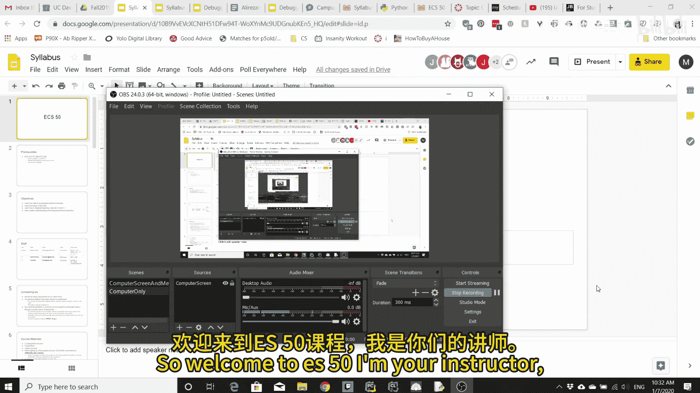
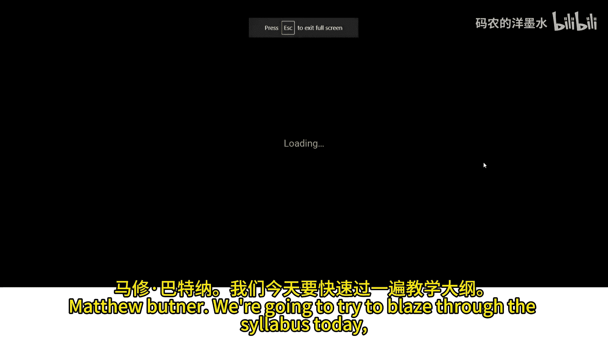
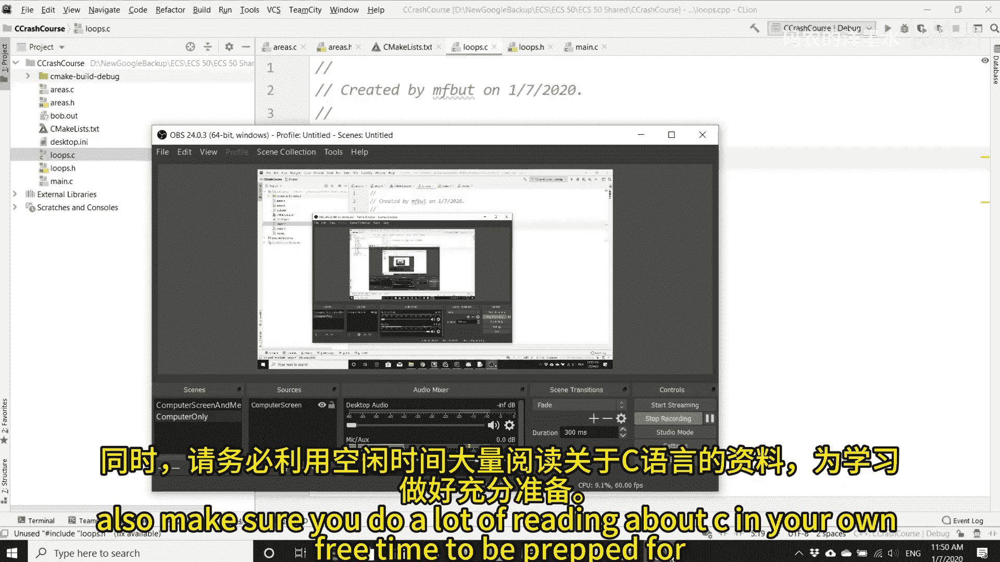

# ECS 50：1：C语言编程速成 🚀





在本节课中，我们将学习C语言的基础知识，包括程序结构、数据类型、变量、函数、输入输出以及如何组织代码文件。这些是后续学习汇编语言和计算机系统原理的重要基础。

## 概述

C语言是一种编译型语言，它允许我们直接与计算机硬件进行交互。本节课将快速介绍C语言的核心语法和编程概念，帮助你为后续更深入的学习做好准备。

## 课程内容

### 程序结构与编译

C程序需要一个`main`函数作为入口点。程序通过编译器（如GCC）将源代码转换为可执行文件。建议在编译时开启所有警告选项，以帮助发现潜在错误。

**编译命令示例：**
```bash
gcc -g -Wall -Werror -Wextra -o my_program main.c areas.c
```

### 基本数据类型与变量

C语言是静态类型语言，变量在声明时必须指定类型，且类型不可更改。基本数据类型包括整数（`int`）、字符（`char`）和浮点数（`double`）。

**变量声明与初始化示例：**
```c
int number = 35;
char letter = 'B';
double real_number = 35.27;
```
**重要提示：** 使用变量前务必初始化，否则其值是未定义的，可能导致程序行为异常。

### 输入与输出

使用`printf`函数进行格式化输出，使用`scanf`函数读取用户输入。`scanf`需要传入变量的地址（使用`&`操作符）。

**输入输出示例：**
```c
printf("Number is %d\n", number);
scanf("%lf", &real_number); // 读取一个double类型值
```

### 字符串

C语言中的字符串是字符数组，以空字符（`\0`）结尾。字符串字面量（如`"Hello"`）会自动包含结尾的空字符。

**字符串声明示例：**
```c
char str[] = "Hi class"; // 编译器自动计算大小，包含\0
```
**注意：** 手动构建字符串时，必须确保数组有足够空间并正确添加结尾的`\0`。

### 函数

函数由返回类型、函数名、参数列表和函数体组成。C语言采用“自上而下、单遍编译”的方式，因此函数需要先声明后使用（或定义在使用之前）。

**函数声明与定义示例：**
```c
// 函数声明（通常在头文件或文件顶部）
double get_rect_area(double width, double height);

// 函数定义
double get_rect_area(double width, double height) {
    return width * height;
}
```

### 代码组织：头文件与源文件

为了更好的代码组织和复用，通常将函数声明放在头文件（`.h`）中，将函数定义放在源文件（`.c`）中。使用头文件保护符防止重复包含。

**头文件示例 (`areas.h`):**
```c
#ifndef CRASH_COURSE_AREAS_H
#define CRASH_COURSE_AREAS_H

// 函数声明
double get_rect_area(double width, double height);
double get_tri_area(double base, double height);
double get_trap_area(double long_side, double short_side, double height);

#endif
```

**源文件示例 (`areas.c`):**
```c
#include "areas.h"

// 函数定义
double get_rect_area(double width, double height) {
    return width * height;
}
// ... 其他函数定义
```

**主程序示例 (`main.c`):**
```c
#include <stdio.h>
#include "areas.h"

int main() {
    // 使用头文件中声明的函数
    double area = get_rect_area(5.0, 3.0);
    printf("Area: %lf\n", area);
    return 0;
}
```

### 控制流：循环

C语言支持`while`循环和`for`循环，用于重复执行代码块。

**while循环示例：**
```c
int index = 0;
while (index < 10) {
    printf("%d\n", index);
    index++;
}
```

**for循环示例：**
```c
for (int i = 0; i < 10; i++) {
    printf("%d\n", i);
}
```

## 总结



本节课我们一起学习了C语言编程的速成知识。我们了解了C程序的基本结构、如何编译程序、各种数据类型和变量的用法、如何进行输入输出操作、字符串的本质、如何定义和使用函数，以及如何通过头文件和源文件来组织代码。最后，我们还简单介绍了控制程序流程的循环结构。掌握这些基础知识是理解后续计算机系统与汇编语言课程的关键。请务必花时间练习和巩固这些概念。