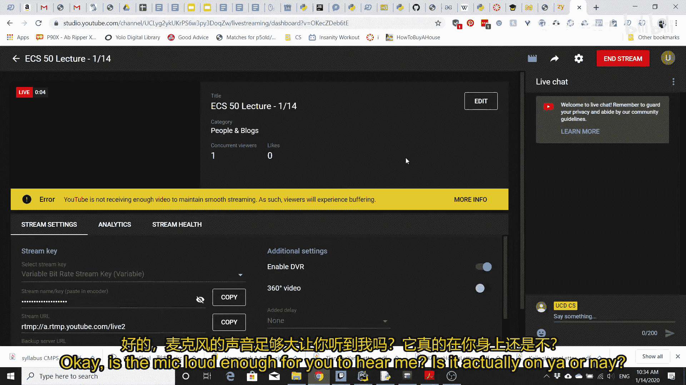
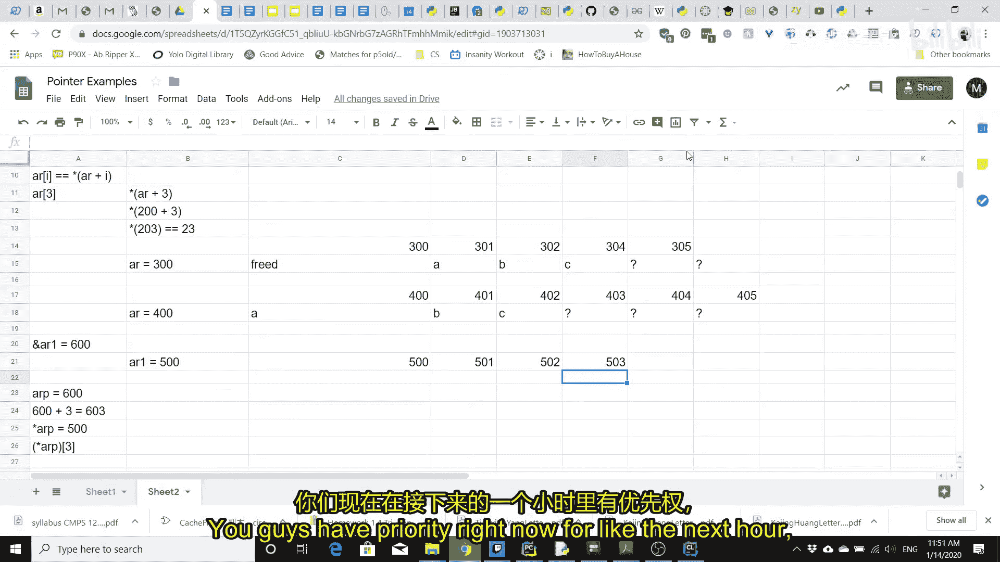

# 【全集】加州大学戴维斯分校 C语言与汇编语言 中英字幕 1080P p02 Lecture 2 - 指针与动态内存分配 -BV1xefZBHEas_p2-

Okay， is the mic loud enough for you to hear me Is it actually on Yea or nay。

Sort of。Okay。So we're gonna pick up from where we left off last week。

 sorry for not be able to make office hours I was sick and just couldn't make it。

 didn't feel good enough to be here So we're gonna to review pointers today。

 hopefully finish up with C and then move into the actual course content some of you guys are confused about the current assignment being in C++ you get C is a subset of C++ so if you want to write pure C code for the assignment you absolutely can though if you want to use C++ that's fine and you'll probably find that there are some things in C++ that makes some task a little bit easier for example。

 there's a string class in C++ that makes you know building strings a lot easier than if you try to work with AC string which is again an array of characters that ends with an old character I've also seen a few of you guys stop by office hours for help on the homework it's great that you guys have questions and I'm happy to see that you're working on them but like I said in my announcement when the assignments were up。

We haven't covered enough for you to be able to do them so if you look at the assignments you're like I have no idea what to do that's normal because we haven't covered those topics yet if you do want to review those assignments and look through them to see what we're gonna be doing perfect if you want to be able to do them read chapter one in the book and read through the slides about information representation and you'll know enough to be able to complete them but if you haven't done those two things yet I would say probably don't ask me questions about how to do the homework because I have to give you like an entire lecture to be able to do an assignment sound good。

Yeah， Mira， timing wise are these。due next Monday I have to change the due dates because I wasn't expecting to have to do this here so they'll be pushed back to be a reasonable date for what I do。

So we shouldn't start until you let I mean， yeah， if you want to start ahead， that's fine。

 But if you're coming to office hours for help like I have no idea like why the representation of like 3。

75 is 1。111 times like two to the whatever。I can't like really like you know cover that in a succinct amount of time and the content that you need is in the book。

But we're going to pick up from pointers so what does the ampersand serial symbol mean so when you see ampersand。

Variable， what are we doing here？Right，This is the address of Var。What's the type of the expression？

So assuming， you know， if Var was of type T， what's the type of ampersandbar？So if var's type is T。

 Ampersand var， its type is。Yeah。So if we had this， right， Tv。

We do ampers sandbar over here with's the type of the expression。T star， it's a pointer to T， right。

 what do pointers hold？对。Addresses right and so if the ampersand operator is the address of a variable right you should expect to get an address right and addresses are held in pointers so we would expect whatever vs type is we should expect to get a pointer to that type Does that make sense。

How many ampers sands can you put in the front of a variable？One， right。

 because you can't ask for the address and address， it's nonsense。When you do type star， right？

What does this mean？Right， you know， if we have some type T， right， we have like， you know。T star X。

What does that mean？Right， create。A pointer to T right， so again， if you read it backwards。

X is a pointer to a T right， where t could be some type like in， so if t was in。

 x is a pointer to a integer。What does star variable mean？Yes。Dreence。

 and what does de reference mean？我意思呢。It says go to the address where variable is at。

And get the value that's there， right？Go to the address that。Variable is pointing to。

And get the value that is there。Right？Again， if variables type is so over here we have something like。

T star variable。 What's the type of this expression star variable？

It's just tea right so you can think about the ampers sand right if we have some hints over here。

Right。This adds one star。Two vs tight。Right， in terms of like typing， So whatever vars type is。

 Ampersand vr is one more star than that， right， or again。

 when you put a star in front of a variable， right。You remove。A star。From variables。系。

Right so the number of stars you put in front of the variable is the number of stars that you remove from its type and one of the things that you can try to do to make sure that you're doing things correctly is that the types line up。

 the type on the left hand side should be equal to the type on the right hand side and if they are lining up。

 you probably did it right， though there are definitely still ways to screw that up。Yeah。😊，Co是。No。

Okay。Any questions so far？Okay， so let's say we made some declarations over here right。

 so here we have like int X， Y Z。Or maybe we should probably do something like， you know。

 a equals five。B equals 10。Z equals 43。Right， this is going to create three variables a。B and C。

 right， who have the values 5， 10 and 43 and again addresses completely made up， so maybe 100 to 17。

And， you know。3，13。Those are their addresses， so if we did ampersand A。What do we get？Oh。100， right。

 it's the address of a and again， when you're working with pointers。

 putting these tables down will be really， really helpful for you to understand what it is that you're doing and what memory looks like。

So we can also， yes， this is Ampersand A， it is indeed 100， but we can also declare other things。

Like maybe we have like an integer pointer P1 is equal to the address of a When we do this right。

 we create a brand new variable P1。Its value is going to be equal to。

100 and it might be at address 125。If I do this， int star star P2 is equal to the address of P1。

What this do？Here's P2， what value does it have？那真是。125 and maybe our address over here is to23。

The cool so far。Right， we might now also have like another pointer integer。

P3 is equal to the address of B， and so over here we have p3， what values does it have？Yes。217。

 and it's going to be at the trust 569。Right， notice that the types on the left hand side。

 they match the types on the right hand side right。

 we said that we put ampersand in front of a variable。 we add one star to that things type。

 So if here ace type is。And so Ampersand A's type is。嗯。In star。

 And what do we have on the left for P1 type。In star， right， they line up over here， we have P1。

 What's P1's type， Well， it's in star。 So Ampersand P1， its type is。In star star right and P2s type。

 they line up right same thing here， the address of B right it's going to be in star and P3 is also in an address star right How many stars can you put in front of a variable。

Well， I mean like when you declare a type right， you can yes， do any number of stars。

 but after that variable is didn declared， how many times can you dereference a variable。

 I should say？Yes。How many times could I dere a？St。How many times could I dereverend say yeah？

It's the number of stars of type pass， so how many times do I dere a？Zero times because。A， right？

 How many stars does the type have0， So you cannot dereence it， right， P1。

 How many times could we dereence it。One because it has one star P2。

Two times right P3 one time right and again if we want to go like even crazier。

 we can do something like instar star star， you know P4 is equal to the address of say P2 and then over here we have P4 it has what value in it。

2。223， and maybe it's at 619。I this making sense so far？So when I dereence， say， P1。

What am I going to get？然就是。This says get the value that P1 points to so we go to P1， where does P1。2？

What address？100， right， the value that P1 stores isn't addressed。

 So we're going to go to address 100 and then we're going to get the value that's there， which is。5。

if I do star P2。What am I going to get？我上们去。So we look at P2， right？And this says go to where P2。 to。

 what address do we point to？125， so go to address 125， get the value that's there so that's address。

100。If we do star star P2。It's5， right。 But again， if we do the work。

 the first part right here says go to where P2 points do。 So we go to where P2 points do address 125。

 And then we get the value that's there。 So the first part of this expression star P2。

 it's 100 right。 So then when we have star 100， it says go to address 100 and get the value that's there。

 which is。😊，five。😡，Any questions here？Okay。So now we could do something like this。

 What happens if we did star P2 is equal to let's say。P1。Plus 117。What's going to happen here？Right。

 so。So what's in P1？关好了。100， right， That's 100，100 plus 117 is。

217 right so if we break down this expression we now have star ps2 is equal to 217。

 so what does this expression here say to do？Go to where P2 points to。

 go to address 125 and change the value that's there too。217， so this gets updated。Right。

 to become 217。And so now if I do star P1。What do I get？Right。

 this says go to where P1 is  pointing2， where's P1 point2。217， get the value that's there。It's 10。

 right？So in doing this line， what do we make happen？We made。P1。2。B。Right。Any questions here？Okay。

 so if you guys are all cool with that， let's talk about what you can do with pointers besides what pointers are。

So the first thing that you can use pointers for is to modify the value of a。

Perarameter that gets passed to a function， right。 And so our rule of thumb here is。

If you want to be。Able to change。A variable。Of type X。Itops。Com on。Type X in a function。

You must pass at least a。Pointer to x's。系。Or 002 x。So if we want to be able to change an integer。

 our function needs to accept a。And at your pointer， if we want to be able to change a character。

Charac point， if we're going to be able to change a double。Double pointer。

 if we want to be able to change an integer pointer。Integer pointer pointer， right。

 one more star than its type。1。Fish。好。嗯。Com on。So。Let's say over here。

 I wanted to write a function that swaps to variables。

 Let's say we want to be able to swap to integer， right， So over here。

 you might have something like void run swap。And then down here。

 I might have int a who's equal to 10 and B equal to5。And be equal to 5。 And essentially。

 we want to be able to say。喂。Sure， doesn't really matter。 has some values。

 so we want to be able to swap A and B， right。And then， you know， after we do this， we'd hope that。

 you know， a should be equal to six and B should be equal to 10。Right， so over here。

 what should the signature of my swap function look like？First， does it return anything？No。

 so its return type should be。Fd， his name is swap and we want to be able to swap two things X and Y。

 what are the things whose values you want to change？Antegers， right？

So if we want to be able to change integers。What should our function accept？Andteger pointers， right。

 so these should be。Enter your pointers right because down here。

 the things we want to change in this function are ins so our function needs Inger pointers right。

 And as long as you're thinking through this step， you'll be fine with the pointers right。

 do I want to change that argument right and the function if your answer is yes。

 make sure your function， except a pointer to it and you'll be absolutely perfectly fine If you don't want to change it except whatever its type is。

Because C does what's called call by value， so you end up with a copy of the element。

 so what code should we put here？De reference extra variable。So int temp is equal to star x。

 so we save a copy of the value of the variable。哦。S actually。startwise。

Star x probably needs to be equal to star Y。Then star y is equal to。Temp。

 if we do this star y equals temp ahead of time right。

 then we'll have lost the original value and again I'll show you like a visualization of this in one second and now over here right our function it wants pointers to the variables that it wants to swap so what should we pass in here。

The address of。A and the address of。B。So let's see this in action and again。

 if you're working with pointers， Python Tutor， fantastic website。

 but you know just go to the C version。So over here we have our swap function。

And what I'm going to do is I'm going to write it incorrectly the first time。

And then we'll write it correctly this second time。Right。So over here。

 a lot of times people might make this mistake。Int X， in Y， X。X， Y， Y， no ampersand， no ampersand。

So let's visualize our execution。And we give it a moment because it takes time。W。Okay， here we go。

So over here， notice we're in main we have A and B， their values get initialized on this line。

 so we have a' is equal to 10 and B is equal to 6。 so now when we call this function。

 C uses something called call by value so you create whenever you pass a variable to a function。

 you actually pass a copy of its value， so we create two brand new variables。

 X and Y as well as our new variable temp。So now notice what's changing in the code So here right tempemp ends up equaling to 10 X is going to end up equaling to。

X is going to end up equaling2。Yes。6。And then y equals temp， right y equals temp。

 so y is going to become。1en so now notice what have we changed here？X and Y。

 what did we want to change？A and B， right now our function ends and our local variables get deleted and we go back into main and what we had didn't get edited at all didn't get changed。

So if we swap this back to what we had before。Correct answer。Star。Sorry。Sorry。Star。

And percent and percent。And we visualize our execution Oh yeah， that's not going to work。

And hopefully this goes faster than last time。可是。Oh yeah， integer pointers， my bad。Yeah。

 I don't know why it's busy or if it's just because I'm trying to stream this at the same time I'm using this。

 and that's why it's slow。So over here， right？Again， we create A and B， their values we created。

 but now we're not going to be passing copies of A and B。

 We're going to be passing the address of A and B。 So over here we have X and Y， and they now point。

To A and B。 So when I do this line， temp equals star x， right？呃。Whose type is incorrect。

Because it should be an integer， right， the type on the left should match the type on the right because we moved one star from X。

 its type is int， so temps type should be int as well。So stepping through again。

So over here they're pointers， so this line says tempemp should get whatever x points to x is currently pointing to。

A， right x is pointing to a， so T should get whatever x points to。

 so it's going to get the 10 Now over here we're saying go to where x points2 and change its value to wherever。

Y points do， so we go to where x points do， which is the a and change it to the value that y points to。

 the6， so a ends up changing to B。6ix， then we say go to wherever y points to and change its value to believe whatever temp is equal to。

 so we go to where y points to， that's B and change its value to be equal to 10。

We now finish X and Y get deleted。And we end up returning zero。 I mean。

 we end up completely function， but the values have been swapped。Does this make sense？

Any questions here？About this first use of pointers。嗯。Does anybody need an additional example？Okay。

 just have one person come to office hours。We'll do more examples。

So let's talk about a couple of other things。So。There are four sections of memory。Right？

And let's make this big like the other one was big。Everybody gets 14 fonts。

 so everybody in the back can read it。So there are four types of memory。 There is the text section。

 There is the。Data section。 There is the stack。And there is the heat， right？

So each of these has different stuff that's stored there。 So what's。Stored there。And。

It also has a lifetime， how long does it last？So the text section of memory。

 what it stores are your program's instructions。The actual things that say to add， subtract。

 multiply， divide， et cetera， move values around。How long do you think this section of memory lasts？

Okay题。Well， not forever， but as long as the program is running。Right。

So it's going as long as the programs running， right。

 the text section of your program is going to exist and the instructions will stay in memory。

 as soon as your program finishes memory， that text section will get cleared to make way for other things that need to use memory。

There's the data section， this is where global and static variables are stored at。

And these also you know， blast for the lifetime。Of the program。

So they'll last just as long as the data section exists so as long as the program's running。

 the static variables and your global variables are going to exist。The stack。

This is where your local variables。And arguments。And how long do they last for？Any guesses？Ch。Right。

 they last。You know， until the function ends。A slightly more technical definition is until they go out of scope。

But if you just say until the function ends， I'm happy with that。Then there's the heap。

 this is for dynamically。Created memory。Right， so sometimes this stack section it's referred to as automatic。

Memory。Because。Space。Gets created。When you need it， right， when do these variables get created？

Wendy call the function， right？And。Function call。And they get deleted。When。You don't need it。

The function ends。Then there's dynamically allocated memory， it lasts until you say to delete it。

And this is what our next topic will be about in a moment， how do we create space here？Right。

It lasts until you say delete it， so this is sometimes referred to as programmer managed memory。

Because you create it。You delete it。It's up to you， it's your responsibility。

Right before we go into this， I want to show you one thing。Os。So here is our little function。

So over here we might have like Enteger point or P is equal to fun。And then， you know。We might say。

 you know， int A is equal to star P。What do you expect P's value to be after doing line 26？

And let me go put this over into the Python tutor so that。We can。See it。Happening。

So what do you expect to happen here？Yeah。Yeah。So we expect that A will be set to 10 and let's see what happens。

Oh， gosh。嗯。Okay， so over here， right， we are going to create。

P and A they're already going to be created。 So over here we call our function。

 so we create a brand new function X， right？Then we say return x's address， maybe x's address is 100。

 so this function ends up returning。100， right， but then how long does X last for？

Until the function ends。Ope。It got deleted and you now have a pointer to something that's been。

Destroyed。And so when you attempt to do this assignment， what happens is undefined。

 I don't know what's going to happen， different compilers will do different things and you'll end up with different values。

So one key takeaway point is never return pointers to things that are on the stack。Right。

Because if you return a pointer to something that's on the stack， right。

 a local variable or an argument， it will not exist after the function ends。

 And so you'll end up with a pointer to something that no longer exists and terrible， horrible。

 no good， very bad things happen。 And debugging these as a nightmare。 It's very painful。

 So don't do this。 Sound good。是。So finally， let's talk about heap， how do you make memory there？

I guess I want a dot C file。So the functions that you need to be able to do dynamic memory allocation。

 they are inside of STD Lib。HSo if you want to use these functions。

 they're going to have to include it and there's three main functions here。There's Malik。There's Kak。

There's realic。I guess there's a fourth one， which is free。So Malik and Kak。

They both dynamically allocate space。You also have free。Which。Releases dynamically。Allocated space。

You releases you know， deletes。So one key thing that you need to have here is that。Every， you know。

Maik。Slash calic。Needs to be paired with a。Free。Somewhere along the way。

So what I'm saying here is if you make 10 calls to Malick， you're going to need 10 calls to free。

If you make 17 calls to Malick， you're going to need 17 calls to free。

 they're not going to be right next to each other because you're probably not going to create the space and then immediately delete it。

 you'll create the space， use the space， finish using the space， delete the space。What is this not。

We'll show you in one second。And my question where does free come from？Where in this space is anyway？

So this space， yes， it's in your Ram。And it's on the heap section of your program。 And then reallic。

 it resizes dynamically。Allocated space So if you make space for say 10 things with Malick and later on find out that you need 20。

 you can use Realc to resize that space to make it bigger。

 or if you find out that you allocate space for 100 elements。

 but you realize that now I only need 20， you can use realoc to shrink that 100 space down to 20 elements。

Makes sense。So over here we might have a function called integer pointer。Make array using Malek。

And then here we might ask for an int nu elements。And so what this function is going to do is it's going to make an array of integers。

 numb elements big。So the way that this works is you would do something like integer pointer AR is equal to Malik and then inside Malik。

 you specify how many bytes worth of space that you want。How many bytes？

Do you want and I'm really going to emphasize bytes right here， what's our goal。

 what do we want to make？Again， what was the goal of this function？Make an array ofs。

 make an array of how many ingers。A numb right， So if I say numb elements here。

This makes numb elements what？😡，Once。Does it make numb elements integers？No。

 it makes numb elements bytes， so to make the appropriate amount of space you have to multiply by how big each thing is and if you want to know how big something is use size of and size of will tell you the size of a a variables type in bytes so here you could say times size of we want to multiply the size of a。

Int， so you can say size of int， and this will now allocate that many elements。

But it's really important to remember to multiply by the size because if you don't multiply by the size。

 you probably won't have enough space。😡，Right。An alternative way of specifying the statement so that you never get the wrong type here is instead of saying size of int。

Another thing that you can do instead。Is you can say size of。Oh gosh， come on。Star。

 whatever's on the left hand side of equal sign， because what size of is going to give you。

 it's going to give you the size of the type of this expression， right。Size of。Expression。

Gives you the size in bytes。Of expressions。サイプ？So what is the type of this expression？😡。

An inger right， and the way that you can figure out that is AR's type is。Integer pointer， right？

 And so if you put a star in front of A R， gosh， you remove one star from its type。Oop。

 one star from its type。 So if you remove a star from its type， you end up with。

And and so you'll always be right。You'll never get this wrong。

As long as it's one more star than what's on the left hand side。

And then here we would just say return AR。Does this make sense？Now this space that mallet creates。

The space created。By Malik is uninitialized。So the space that's created here is values are undefined。

 I don't know what they are， there's garbage there， but you have the space to put things。😡。

Sound good。Now what Malick is going to give you back is。Maec。Returns。

A pointer to the first element in the array。This ends up working because the elements will all be right next to each other。

 So if back here。I asked Malik for， say， five elements， right？ I did something like integer pointer。

 A R is equal to Malik five times the size of an int。Here。😊。

What it's going to do is is it going to create space for five elements， zero，1，2，3，4 and five。

 right the values that are in them， I don't know。I don't know， I don't know， I don't know。

 I don't know， and I don't know。Their random garbage。 This space， though， will be created in memory。

 So maybe this first element， it's at location 200。 So where is the second element going to be at。2。

01， and。2 and 203 and 204 and 205 When you dynamically allocate space with a single called a mallic。

 the elements will be next to each other。Right。So here's a little secret。

 When you do something like this， A R at I， this is equivalent to doing star A R plus I。Right。

 and so what Maluk is going to return back over here is the 200。 So over here， we have Ar。

 and its value is going to be equal to。去。200， right？

 It has the address of the first element in this space that you allocated。

 So now when I do something like this， A R at， say，3。This again， translates to the。Star AR plus3 so。

Whats I'm just going to put some random numbers in here so that we can actually say something。

 So maybe this is 9， negative 8， 65， 23。74，99， right， there's a random garbage there。

But I'm just playing some value so that we can work with it。 So when we do star A R plus 3。

 how does this translate。Right， so what's the value of AR。AR's value is。200， right？ So this is。

Star 200 plus 3。 Well what's 200 plus 3？200 in。3。So this expression says to do what？是想在这。Yeah。

 D referenceference address 203， Dreence 203 means what？

Go to location 203 in memory and get the value that's there， which is。23， right， This is if we。

This is like the address， the index， and then the value。

Right so this ends up being equal to in our example。23。That makes sense。Any questions here， yeah？1，2。

3，4，5。 Sure， I made a mistake there。Any other questions？Yeah。Okay。So now let's say over here。

 I want to make an array using Callic。And again， into elements。

The difference between Malik and Kc is Kc takes two arguments。

 The first argument is the number of things that you want。

The second argument is how big is each thing I would always recommend using calic over Malik because you'll never forget to put in the of the size of the thing if you' using in caic because it requires two arguments so integer pointer AR is equal to ca。

The number of elements。Size of。Star A。Return AR。Makes sense。

This requires two arguments instead of one， so you won't ever forget to multiply。

But I show you Malik because it exists and people use it。So I would say always use calic。

 calic will also initialize all of the bytes that you allocate to be zero。

 so the array will be filled with zeros with calic whereas Maloc is uninitialized。嗯。

Any questions about Kick？So over here we might do something like integer pointer A1 equals make array with Malic and we might ask for seven things。

 so this is going to make us an array of seven big and we could do something you know。

 like4 equals zero I less than7 plus plus I A1 at I you know， is equal to I plus。23， right。

 you can fill it in， put the values there。If we want to make our array using CalLc。

You know it's going to be the same thing integer pointer AR2 is equal to make array cac。

 and then again you could ask for something like eight。

And then you could do whatever it is that you felt like with them， right， so you know， fill them in。

With maybe like I times two。RightSo the values can get filled in。

 we can print them out later on if we want， but let's say that we finally finish。Right。

 with the space and we're done with it， we have to make sure to release it， so you say free。AR1。

Free AR2。 It doesn't matter how much space that you allocate。Right。

 free will be able to take care of it right It's just the number of calls to Malic and Klic have to be equal to the number of calls to free at the end of your program right。

 so in these two function calls， each one of them made one called the Mal， one called the Callic。

 so we need to free it when we're done。If we forget to free it。

 we have what's called a memory leak and this memory cannot be reclaimed right an example of probably where you've experienced this before is how many of you guys have ever played a video game and the longer you've had it open。

 the slower and slower and slower and slower and slower it's gotten until you finally had to close it。

That's someone probably left the memory leak in the code and so what kept happening is the program kept asking for more and more and more and more and more memory。

 but it never let go of the memory when it was done with it and your computer has a finite amount of resources on it so there was less and less and less sport to run with and so it performed worse and worse and worse until you finally had to go kill the program and like started over again。

Any questions about free？Yeah。😊，So after you free it， the memory gets delocated right。

 and you shouldn't be trying to use it。 So at this point。

 trying to like dereence A1 or AR2 is undefined behavior。 and I don't know what's going to happen。

But the space has been released and you no longer have ownership over it。

 so you shouldn't try to use it。I's a another question， yeah。

free only work on memory point to a memory created in the E or。For some reason， I wanted to。

So you can only free things that you've dynamically allocated using Malic， Calc and relic right。

 you cannot just free some variable on the stack， attempting to do so as undefined behavior and I don't know what's going to happen。

 but you'll probably crash your program。Yeah， so could you please explain why it is better to use。

You it's better to use Malc instead of cac because it better to use calic instead of malk because it's really easy to forget to do that。

Now did I make enough space？No， does it look like I made enough space？Yes， right？

But I forgot to multiply by the size of， whereas with Calc， right， since it requires two parameters。

If I forget to do one。The compilerrs going to be like。

 that's not how you call Calc and complain at me and it won't compile and you'll be like， oh whoopsy。

 I forgot to put that in there and then you put it back and you'll be good。

If there's one other question， maybe， yeah。然后说。Oh， sorry， K。that's what was。あ下。

It should be I less than  seven because remember use zero based indexing if there's eight things if there's seven things。

 it's zero，1，2，3，4，5，6。Oh， oh for here， sure， if I wanted to fill them all in， absolutely。

 I would need eight here。You had a question？Yeah， so we free it after we done with using。Yeah。

 you free it when you're done using it and your question might be。

When am I done using day my answer is it depends on your program right when you no longer need it。

 it should be fairly obvious to you。😡，Deed that。Does that make sense？Okay， finally， there's reallic。

 reallic is used to resize an array。So over here， right， we might have， you know， void I guess， yeah。

 resize array。And so here's something interesting。 We're going need to take an integer double pointer and you'll see why in one second。

 So here's our integer double pointer A， even though we're resizing only a single dimensional array。

 the way that realallic works is you say， what is it that you want to relic。 Well。

 I want to reallic star A。And then you say。What its new size should be in bys， new size and bytes。😡。

Again。So don't forget to multiply by the size up。So over here， AR， new size。

So over here we say what our new size and byte should be。

 so we'll say something like new size times the size of。And then again。

 you could always put star of whatever's here on the left hand side， so star star AR。

So this will resize RRA。If new size。Is bigger。Space is added at the end。So if， for example。

 we had like one， two， three， four。One，2，3， right， and we resize to be。Say six。

We're going to still have the one， the two and the three there， but then we're going to have。

 I don't know， I don't know， I don't know。Right。The space gets added at the end。If。

New size is smaller。Then space。Is removed from the right。So again， if I originally had one， two。

 three and I resize or， one， two， three， four， five， and I resize down to two。

I'm going to just be left with one， two。三个。Now。There's a couple of interesting things that you can do with Realic。

If you resize to zero。It is the same as calling free。So if you resize down to zero elements。

 you'll free it。Right？And。If you resize null。It behaves like Malick。

Nll isn't something that we've discussed so far， but null is sort of equivalent to Python's none。

And what null means is this pointer does not point to anything。😡。

So null means this pointer currently。但是。Point to something。But null can only be used for pointers。

You cannot say something like int X equals null or double y equals null。

It's for pointers only this pointer currently does not point to something。

Dereferencing null will always crash your program。With something called a。Sa fourth。A safe fault。

Simply means you are trying to access memory that you don't。Have permission to access。Yeah。

 so you you to now makes a way value to。No， not if you so if the new size enol。

 if you do something like this， let's say we have like integer pointer AR2 is equal to reallic。No。

10 times the size of。Star AR2。This is the same thing。As doing。In aure pointer， A2 is equal to。Maik。

10 times the size of AR2。So if you attempt to realallic the null pointer。

 it behaves like Malick and it will just create space。So when you readalc space in memory。

 it's possible that Realc might need to move where your array is at。

So what might happen is we currently have our value like one， two， three over here。Right。So one， two。

 three， right and again， let's say we want to resize the six。Resizing。Two，6， big。It may be that one。

 two， three right right now， the memory right next to it is like in use。Right。

So we might have it we're again， like one， two， three if we pop back over to。

Poiner examples right again， here's our array， maybe it's at like， no， address 300。301，302， right。

 And then here were our values， maybe just their A， B， and C， right。And we want to reality。

 but over here at 304。And 305。It's already in use by something else。😡，Right？

Since we want a resize to become bigger。Right， but this area in memory is already in use。

 Realc might have to go move your array somewhere else for there's enough space to fit it。😡。

So right now we might have like， you know， AR is equal to 300 because that's where our array begins at。

But after we do the reallic， we might need to move those values。

 So maybe we now go over to address 400401，402，403。40，4，4，05。

Right and now we end up with ABC question mark， question mark， question mark。

 but we have six elements now， and now AR is going to be equal to 400 because Riak had to go move where our array is at。

It'll only do this if it has to， but you never know when it's going to have to。

 So it's always really important that whatever you wealc， oops。Whatever you reallic over here。

 you make sure to reassign to whatever reallic returns。

Because if you didn't do the assignment and Realck moved it， okay， great。

 here's your array and address 400， and if you had forgotten to do the assignment。

 AR would still be 300 and this memory would now have been freed。

Because realalc had to move it and it would go and release the old space of memory。

 but now when you went to go dereference your array。

 you're going to get some segmentation fault probably because that memory is no longer in use right。

 this is， you know。Each of these guys would become freed， freed。Freed when we did the movement。

 but if you hadn't updated AR， AR is still going to point to here and then dereferencing AR to X elements will cause problems。

Any other questions？So now you might ask， well， why did I have to accept one more pointer than what I wanted here？

The answer here is if we go to resize our array。Think about this。

 let's say we want to resize R and we want to resize array2 to fit 20 elements。In our function。

Do we want to change AR2？😡，Think about this。We took this parameter over here AR。😡。

Did we say it's equal to something？Yes， we said it was equal to something。No， we did not。

There's an equal sign right here。So yes， we would try to assign it， right？

I want to change AR in that function， I'm trying to say AR is equal to something right because if I was doing this outside of the function。

 I would just say AR2 is equal to relic， right？20， right。Reallic AR2 size of。You know。Star A2， right？

Here is AR2 being assigned to something。😡，Yes。No。Is definitely being assigned to something right you can see the equal sign right there。

 it's not trick question。So do we want to be able to change AR2 in our function？😡，Yes。No。

We do want to change it right， if we want to be able to change a variable inside of a function。

 right， what do we have to pass that function？A pointer to it， right， what's AR2's type？

Integer pointer right， so if I want to be able to change an integer pointer。

 my function must accept a。Integer pointer， pointer， and that's why I ended up with two stars。

Up here。Because I'm trying to change it。Yeah。Does that make sense？嗯，是 you say你 ever。

It changed the value of AR it can， right， if we go back to for example， if this space was not in use。

 right， if it was， you know， free and free， right， What would have happened is we would have ended up with ABC。

 right， Our original value and then we would have had， you know。

 our new values that popped up over here。就一个家。够干。So here， right， it's not always guaranteed。

To be changed。But it can be changed right， so if it doesn't move it。

 it will just end up returning back 300 again。It has to stars and。Yeah， because look。

I'm assigning right if I want to be able to change AR。

 I need to receive at least a pointer to whatever AR's type is I want to be able to change A2 so in order to change A2 my function has to accept a pointer to its type so we would need a star star。

 which we get within。Ampersand， right to add an additional star there。Does makes sense。Any questions？

Yeah。Okay。Let's do something fun then。All right， actual practical applications。

 so probably one of your favorite functions from Python with lists is aend right。

 add an element to the end。That doesn't exist。And C。 So let's go write our own aend function。Now。

 in terms of problem solving， right， you really want to think about what it is that you want to do right。

 So here we have a pen。And。What should our parameters be？An array， right？

 Do you want to append to an array of integers， an array of characters， an array of doubles？Sure。

 I mean， like， does it really matter？No right， so we have our array over here。

 so like integer pointer AR， and what else do we need to know about it？If we're doing aend。

We need to know its size， right？And。Probably the value that we want to put there， right。

 so we want to append。Some value to our array。What should a return type be？嗯，好虑。Right， I mean。

 we can leave it up。For debate later on， right， but you know。

 so right now we have a known return type。So when we think about what we need to do here to make the append happen。

What happens with an append？Not in terms of code。😡，What happens。

The add something to the end right so if I originally started with something like one， two。

 three and I want to append4 right we're going to end up with one。

 two and then four in order to add that four there， what do I have to do first？

We have to resize the array so that it can fit this new element。

 then I can go put it in so first right you know resize the array to fit the element。And then， we。

Add it at the end。So how do I do the resizing？We use reallic right again we're assuming that this space has been dynamically allocated if you try to reallook a statically allocated array。

 again， undefined behavior because it wasn't created using Maloc or realallic or Kc So over here right we have AR is equal to。

😊，Realic， what do I want to resize？AR， how big do I want it to be？Length plus one。But again。

 this is going to give us length plus one what right now？Bs， but we want length plus one。

Lengngth plus one。Integers， right so we need to multiply by these size of。Again， star AR or again。

 if you want to write in bug do the same things， but you're never going to get wrong if you do star whatever's in the left hand side So right we've made the space。

And now we need to go put the element in， so how do I put the element in there？He。AR at。So right。

 at this point in time， oops， this should be one， two， three， four at this point in time。

 what's length？Three， right， and but if we look at indices。This is index。0ero，1，2。

 and we want to add it at index。3， so what should our index be， given that our original length was。

Aray at length is equal to。那有。Do we' need to do anything else？So our array got bigger， right。

 but when we returned back from this call， what's length going to be？Right。When we start in right。

 in our example， a raised length was。3， so the value of， you know， the race length was 3。

 We resize it to be 4。 But what's1 right now，3， So shouldn't we probably。Make that bigger。Right。

 to let the user know that it's bigger instead of them having to manually increment it every single time。

Right， so I could do like L plus equals one。Now， are there any problems with my code？Yeah。😊。

I don't know， but should the。And就。嗯hm。😊，Notice we wanted to change the value of our parameter and we want that change to show up where we called it right。

 I want to change length which is an integer。 so my function is going to have to accept a。

Enage your pointer， one more star than what it is。 So， yes， this had a star missing。

 And now this needs a star here。 and then we need a star here。 and then we need a star here。

Same thing with what。ARAR， right， notice， we're also changing AR。 Hey， look， AR equals。

 Do you want that change to show up outside。Yeah， so our function has to accept a。

Pointter to the array， if a race type is integer star， our function needs to accept。Star， star。

Over here， which means we need to go add some extra stars， so add a star here， add a star here。

 add a star here， add a star here。And again， we don't need to return anything， so it's void。

 but I will let you know about a subtle error。The square brackets。

They have higher precedentnce than the de reference operator， right， So in this operation right now。

 first， we're going to do something like this soupops here。We're going to。Oh， gosh。Come on。

 Sur it with parentheses。 Thank you。 We're first going to go lend past array and get the element that's there and then de referenceence a second time。

 Now， does that make sense to what we want to do。Again， a drawing of this would probably help。

 but I don't really much time。So again， in our example over here。When we call aend， right？

So we might say， you know， I want to append。Ype。Extract into variable。Place all occurrences， AR1。

Like。So over here we might say like I want to append。43 to the address of A1。

 and it's the address of A1 L long。This will go add the value there to the end。Now。

 in this statement， right？We might have， here's A R1 right， It currently has some values。

 These values might be at address， you know，300， or I don't know 500501。5，02。And so on， right。

 there's elements that are in there。So AR1， what value does it have in it？😡。

500 right AR1 though is also a variable， let's say in our example that the address of AR1。

 because it's a variable it lives somewhere in memory is equal to 600 sound good。

So if we look at this expression here right， we're saying take whatever AR is。

 but notice this is a pointer to it， so I'm going to rename this guy ARP， so ARP。

 its value is equal to 600 right so now we do 600 plus our length right？

So you do 600 plus your length。Let's just say our length is 3600 plus three。

 right is going to be equal to。603。Right， 603。Do we have。

 And then we're going go to address 603 and then de referenceence it a second time。 Now。

 do you see 603 showing up anywhere in our example， No， right。

 So that's the problem of what's going on。 right， First。

 what we would like to do is do something like this。 If we do star ARP。Star ARP is equal to what？

Right， so remember address of A1 is 600， AR1s at 600。 so if you de referenceence ARP。

 you're going to go to address 600 and get the value that's there， which is。500， right。

So if we did star ARP， right at 3。Star ARP is 500，500 plus 3 gives you。Hive 503。

 which is where our elements supposed to be at。So， to fix this。And do it correctly。Parrenheses。

Otherwise you'll get a lot of very fun and hard to debug errors。

So watch out for that because there's a lot of subtletiess as to things that you can screw up。

We'll do one more thing quickly。 Let's say we wanted to make a matrix。 So integer。let's do double。

Pointter， pointer， make matrix。 And then here we have inum rows。Interum calls。Right。

 so the way that this ends up working is here's my。Double， oh my goodness。 We can do this。

 Dole pointer pointer。 Matt， it's going to be equal to cac。

Numb row times the size of or no size of here， size of。Oh my goodness， star Matt。

This will make space for our row pointers。Then。For I equals 0， I less than the number of rows。Mat。

And I。Is equal to cac。This should be nu rows。N calls。Times the size of。Star Matt and I。And then。

 we could。Return。Max， so this will make a two dimensional array。And if you're going to delete it。

 so avoid delete Matt。That's Inum Earth， so we're going to delete a double star star mat intoum rows。

Inum calls。What we need to do is kind of do the deleting in reverse so。For i equals zero。

 i less than nu rows。Free。Matath at I。Free mat。And that will delete it。

 One thing I should note is that when you delete this space， this does not change Matt at all。

 notice Matt， its value hasn't been assigned to anything。

 So it's still pointing to that old deleted space free will not set you to be equal to null。

So just watch out for that。 So Matt's value is some portion to some unallocated portion of memory。😊。

We'll probably actually get into what we're really supposed to talk about on。Thursday。

 if you do have questions though about pointers or anything we're going through。

 stop by office hours whenever you guys have priority right now for like the next hour and 15 minutes。

We。Let me just stop this。

Yes。