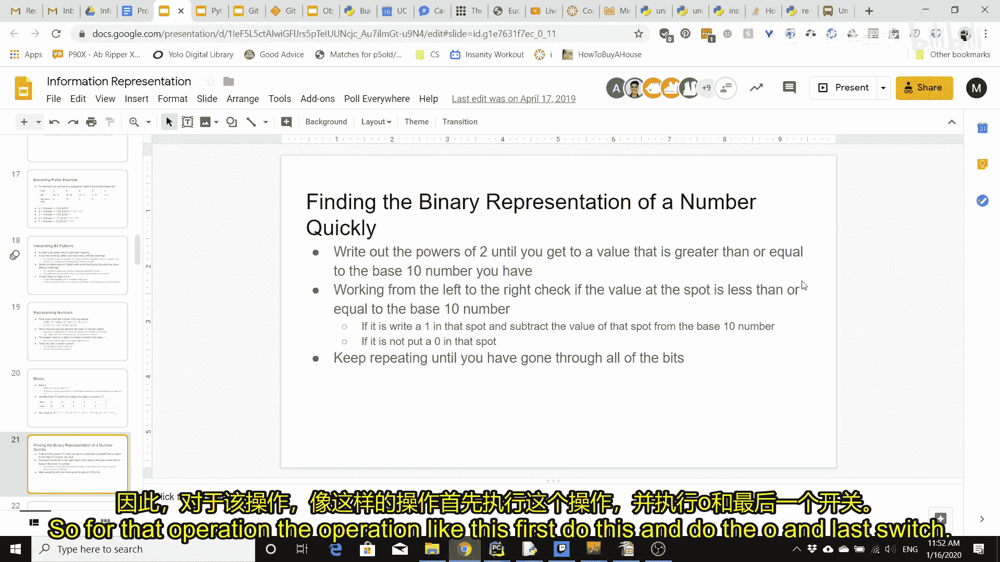
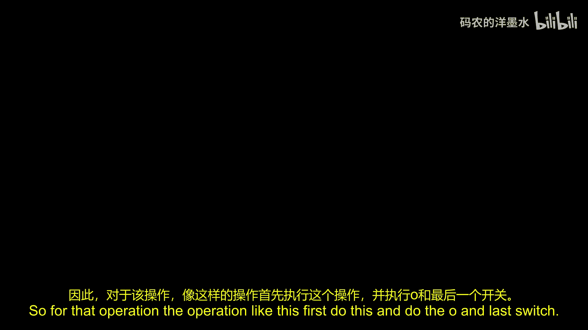
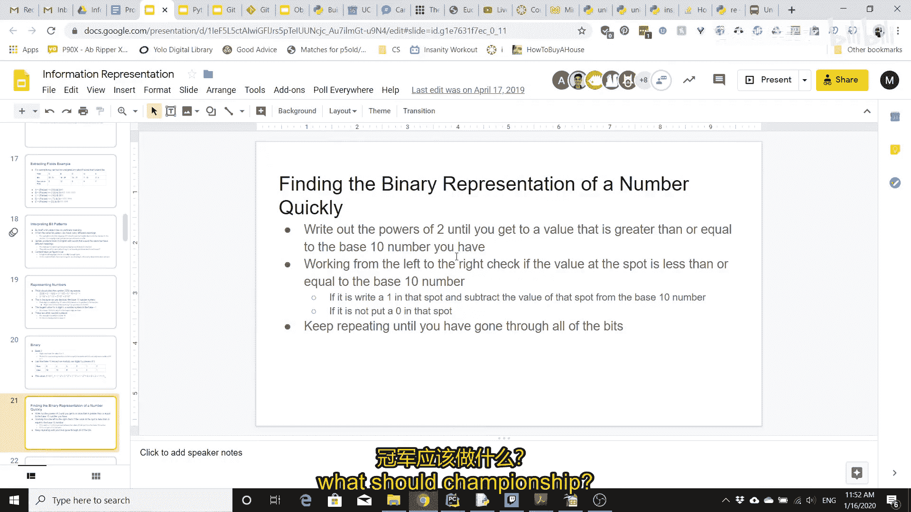

# 【全集】加州大学戴维斯分校 C语言与汇编语言 中英字幕 1080P p03 Lecture 3 - 二进制与位运算 -BV1xefZBHEas_p3-

So again， if you guys are still having trouble with。Pointers， that's perfectly normal。

 That's perfectly okay。 Normally， it would be a topic we'd spend like two weeks on if we were just dedicating a class to see。

 So if you're still a little bit lost， that's fine。

 Just make sure that you stop by office hours to get help and work out what's going on。

The other thing is， we're actually going to start on。The real lecture material。

 so hopefully we'll get you enough to know how to do your homework assignments Yeah。ます。

Your quiz will end up appearing once we've covered enough material for you to be able to do it。

 The Ts were working on translating。The questions to appear on Mimeir， they've mostly done it。

 but it might be in a couple more days before it shows up。Yeah。

So like the homework one is probably going to be moved back at least two weeks， I think。

Probably has to be like week and a half to two weeks to before it'll be due because we just haven't covered the material yet。

Yeah，Yeah， I mean， all the homeworks are going to have to be delayed because it's taking us longer to get to the material。

Yeah， for the due day on the Mi do know。Yeah， I know I haven't changed a due date a mimeir。

 but I promise you it'll change you will have sufficient time to complete the assignment。

 don't worry about it。Okay， so right now this is the big takeaway that I want you to get from this class。

 or at least one of the big ones is that everything inside your computer is represented with bits there's absolutely no exception to this so your integers。

 your shirts， your doubles， your floats， all ins。Your text files， your video games， your music。

 your videos。You know， everything inside your computer， it's all represented using bits。

A bit is simply shorthand notation for binary digit and binary digits since the base two just binary means two can either have the value zero or one a group of eight bits is called a byte and a group of four bits is called a nibble because a nibble is a small byte right someone's been really cute when theyre the naming convention there。

Right， so since everything is represented with bits and that's all that we have to work with inside the computer。

 we have to figure out how are we going to represent our ideas inside the computer with bits so we have to come up with some mapping from our high levelve ideas to some bit string representation。

And every unique idea that you have has to have a unique pattern represented。

 at least in some unique context。So if you have S unique states you want to represent。

 you need the ceiling of log 2 of S bits， and if you have B bits。

 you can represent two to the B unique things。So to give you an idea of this。

 let's say we have old McDonald and he has a farm and on the farm he has a pig， a duck， a cow。

 a chicken， a dog and a cat， right pig duck， cow chicken。

 dog cat That's six things So if we apply our formula from previously to figure out how many bits we need to represent each of our animals we would do log 2 of6 which is going to be 2。

53 take the seedling of that right which means always go up to the next integer above this value if you're below an integer value and so we're going to get3 So you would need three bits to be able to represent the animals on old McDonald's farm。

And so we have to come up with some mapping to how we might want to represent each animal and actually assign that bit pattern。

So over here we might say 000 means pig 001 means duck， 010 is a cow， 011 is a chicken。

 100 is a dog and 101 is a cat right we're going to have eight possible representations though。

 so two of them aren't going to end up being used。Any questions so far yeah。

So we're using so over here we have six states like six unique things right which requires three bits with three bits though。

 you're going to have two to the three unique things that you can represent eight。

So if we only had four bits， we wouldn't be able to represent enough information， right。

 multiple or two bits， we'd only be able to represent four things。

And so we won't be able to represent each one uniquely。Right。But with six bits。

 we can with three bits， we can represent eight things。But we only need to represent six。

 so two of the patterns end up going unused。Does this make sense so far？嗯，你给我不来说不到我。

If you have S unique states， you need the ceiling of log2 of S bits。Like how is that derived？

It's kind of derived from the inverse of the bottom function to the B right if you have one bit zero or one。

 how many bits can or how many unique things could you represent？窗完。Two right if you had two bits。

 you represent four things， three bits， you could represent eight things， four bits 16。

 five bits 32 right so if we want to do the inverse and go back right the inverse of exponentiation is logarithms。

 so log two to go backwards。Yes。Any other questions？

So over here we have another mapping right so we said that 00 has no meaning 001 is chicken。

 010 is a cow，011 is a duck， 100 is a dog，101 has no meaning and pig and cat are down there at the bottom。

 which of these mappings is better。Mapping number one。Or mapping number two。Mappy number one。

Mapping number two。For those of you that say mapping number one is better。

 why do you say it's better？其于。Okay， so it's continuous and how does that help you？

But this isn't in an array right These are just the bit patterns that we're going to be using to represent the objects right。

 So yes， if we had some sequence of like pigs right， we'd have 00000，0，000 right have three pigs。

Right。But if we had like over here， we wanted to do three pigs， 11，0，110，110， three pigs。

Is one of those better than the other one？I would say the first one is because the two highest ones have。

So you're not going to the moment you get to one of no meaning you。Well， again。

 if we have these elements that have no meaning in our program。

 should those ever show up in our program if our program's written correctly？No right。

 so it shouldn't really matter this is kind of the idea of like what we're doing right here is basically doing enums if you guys have worked with those before。

嗯。But I would say there's really no one that's better than the other。

 they're both kind of equally valid in this case。But when we go to pick mappings。

 the mappings that we pick， they are completely arbitrary or whatever we kind of feel like at the moment。

But when we do pick mappings， we want to kind of choose ones that are going to work well with our hardware and maybe work well if we have to do some other work well in our program。

 so we generally try to pick mappings that have regular patterns to them。

As well as ones that are easy to represent in the hardware。

 if we have to implement that stuff inside the hardware。

 sometimes we'll have patterns that don't map to anything super normal and if we have these patterns。

 they probably shouldn't show up in our program at all because they have no meaning in our problem。

If they are showing up， it means you screwed up。And you should go fix that。Any questions so far？

So let's say we wanted to do a problem。Let's say we wanted to figure out how many bits we need to represent a special clock。

 let's say our clock only has hours on it right， so the hours one through 12。

But we can tell time to the nearest quarter hour。Also。

 there's a window in our building so we can look outside to see whether it's night or day。

How many bits would we need to represent this particular situation？All right。

 let's pop that up somewhere。So we can write that down。嗯。Okay， no。You have。A clock with only。

The hours on it。But you can tell time to the nearest。Quarter hour。

You can also see outside to tell whether it is light or not。How many bits？Do you need。To represent。

This situation。So to figure this problem out， what do we need to。

 before we can figure out how many bits we need， what do we need to know first？How many states。

 so how many states are there？Well。How many hours are on the clock？12 so there's at least 12 hours。

 right， but for each of those hours， we can tell time to the nearest quarter hours。

 so how many hours are there or how many quarter hours are there per hour。4， right。

 so that's 12 times four possibilities， right。You have like， you know， 1 o'clock， 115， 130， 145。

 and like two o'clock， so four per quarter hour。Right。Times。The day or night am or PMm2。

So this is going to give you 12 times four times 2， which is。96 right。

 so now you would need to do like log two of 96。我去服要不 up。Idle and say from that imports log。Right。

 log of 96 base 2 is。6。58， and so we have to take the ceiling of that， which is going to be。

7even bits。Yeah。5 number。就所。Because there's。A lot of different possibilities right， for example。

 let's say you could have a car that could appear in three different colors。And four different sizes。

How many different types of cars are there， Is it 3 plus 4，7？

No it's three times four which would give you 12 unique cars right and so in that example we had cars that could have three colors and or four different sizes right。

 how many bits will we need to represent this car or be able to represent a car？un你鬼。Like log2 of 12。

 which is going to then you take the ceiling bat so you actually would need four bits to make that happen。

Any questions？What happens if we try using fewer bits than what we have other than what we need right so in our example we said that we needed three bits to do the problem at Old McDonald's farm。

What happens if we only had four bits？Insert。谁不。So here's your bits， here's your animals。

So over here， right， we have0， zero。0ero，1，1，0，1，1。And then again， we have like dog， cat。Pig。

Checkake in。What else do we have？Duck and a cow。Right， so we have to put duck and cow somewhere。

 So maybe we put a。Duck here。And we put cow here。So if we see 00 in the  zero0 pattern in our program。

 what does that mean？啊。We。You can tell whether it's light or not。

You can also see whether it's light or not， like is it light outside， is it am or PMm？Yeah， well。

 I mean I mean it shows up on the same but like that clock might say 12 am or 12 p。m。

 but when you look at that clock right if you look at it and you're like， oh。

 it's 12 and you look outside right and you see that it's light outside is it 12 amm or 12 p。m。

12 PMm right， so you know that it's different than 12 a when it was dark outside。

 so it's a different state。Because again， it wasn't say necessarily to represent the quag。

 it to represent the situation。I didn't know if it meant that information。How。法一经规法。

Same we able to tell A European PM。Yeah， and we can tell it's looking outside。

 but we want to see like how many bits do we need to encode each of these situations？

So if we saw zero zero here， what would that mean if we saw some animal in this example that was encoded as zero zero。

 what would that mean？嗯。や吗。Is it a dog and a cow。 So this animal is both a dog and cow。

Or would it mean it's a dog or a cow？我。So it's both a dog and a cow。It's either a dog or a cow。

It's gonna be the ore situation right because if you come come by your dog， you're like dog。

 I give you this bit pattern00， you go up to the cow you're like bit pattern00。

 you go up to the next cow00， you go up to the next dog00 right and but when you go back through and you read it you're like well this thing is zero0 but that's what I'm labeling as either I'm labeling either dogs or cows as00 so I couldn't tell which one it was it's either one of these two things and that's what happens if you don't have enough bits it's either this or that but I can't tell you which one it is。

Specifically。So let's talk about variable sizes in 32 B C， an integer is going to be four bytes big。

 a short is two bytes big， a character is one by big。

 a float is four bytes big and a double is eight bytes big don't ever use these hardcoed constants in your program。

 always use size of。When you're working with these things so that your program will be like or crossplform compatible without you having to make any changes because if you go and you compile that program on a 64 bit machine。

 it might actually have integers as eight bys big， but you don't have to rewrite your code because you use size of and then the compiler took care of the fact of what the size of that thing was。

 but we'll use these numbers here and examples kind of going forward。

So let's talk about some of the operations that you can do with bits。

 the common bitwise operators are and or not XOR， left shift， arithmetic right shift。

 and logical right shift。So when we're working with bit patterns。

 we're going to say one represents true and zero represents false。

 so not a is tillde a is the opposite of a， It essentially means flip the bits of a everywhere you had a zero。

 you're not going to have a1 everywhere you had a1。

 you're not going have a zero A and B is only true if both A and B are true。

 So you need a one in both spots for them to be true A or B is true if either A is true or B is true or if both of them are true and A X or B is true if exactly one of them is true。

The operations are really similar to their logical equivalents。

 but the operations are performed on bits and they're not performed on single elements like logical values。

Like logical and and logical or。So again， you guys have probably seen this truth table。

Before many times describing how not and or an exOR work。And again。

 they're just the definitions from previously， so here not a， everywhere A had a zero， not a is1。

 everywhere A was1， not a is zero， A and B is only true if they're both true， so both false。

 one of thems false， one of thems false， oh they're both true， so true here， false for the rest。

A or B is true。 If either A or B is true。 A or B is both false here。 So false， B is true。 A is true。

 both true。 So true， true true。 And then A， X or B is only true。 If exactly one of them is true。

 So 0 or one， exactly one true，1 or 0， exactly one true。 both true， false。No truth， false。

You guys have all seen this before， right？Hopefully。

So here's some examples of doing some bit wise operators， here's a， it's 1100， and here's B。

 it's 1010。So over here， if we do not a everywhere you had an A， you now or everywhere you had a one。

 you now have a zero， everywhere you had a zero， you know how a one。 the bits get flipped。A and B。

 notice it's being done on each spot。 So true and true is true， true， false， false， false， true。

 false， and then false， false， false。 So again， it's doing the ending and the oring and the xoring all on the bit level。

 not in terms of like a logical constant， like this thing is true and this thing is false。

 it's working on each of the individual bits。Any questions here？So let's talk about shifting。

 shifting moves all the bits in the specified direction， so if you left shift A by N。

 all the bits move n to the left。Any bits that were on the far left。

 they get pushed out and thrown away so they don't have the spots to fit anymore。

 and then zeros are brought in to refill in the missing bits。

This can be interpreted as multiplying a by 2 to the n。

 but it does not always mean you are multiplying a by 2 to the n。 Sometimes usually it as a shortcut。

 sometimes you really just mean I want to move the bits over。

The reason why this can be interpreted as a times to the n is if you think it back to base 10。

 if you multiply a base 10 number by 10 to the n， what do you do？So if I multiply a number by 100。

 what do I do？You add two zeros if you multiply a number by 1000。是。Add three zeros。

 but here since we're in base two with our numbers， when you move them to the left and you add zeros。

 you multiply by  two to the n instead of 10 to the n。

There is a logical right shift is you move the bits from a to the right by n again bits that can't fit in get discarded and zeros are brought to fill in the missing bits and then the arithmetic right shift also move the bits to the right by n bits that can't fit or discarded but instead of bringing in zeros every single time you bring in the most significant bit so if the most significant bit was zeros all the bits that you have to fill in get filled in with zeros if you have to fill but if the most significant bit was one the bits that you would fill in would be ones instead。

Notice here that logical right shift and arithmetic right shift， they're written identically。Right。

There's no difference between how you write them。But how are you going to specify whether you want a logical right shift versus an arithmetic rate shift？

Because how do I say which what I want？The right shift， which one ends up being done。

 depends on the type of a variable。So if the thing that we're trying to shift is an unsigned variable。

 like an unsigned int or an unsigned short or unsigned chart。

It will do a logical right shift and you'll bring in zeros。

But other thing that you're working with is a signed variable like int， char or short。

 if you write shift it， you will do an arithmetic right shift。Does that make sense？

The type of shifting that you do。Is going to be based on the type of the variable if you write shift and int。

You'll do an arithmetic right shift if you write shift an unsigned int。

 you'll do a logical right shift， so be careful with that that you do the one that you intend to be doing。

So here's some examples。So let's say we want to shift a to the right by 3。

 So all of our bits move to the right by 3。 So you can see that this one move 1，2，3。え。He moved one。

 two， three， so we should have a one there and now we're going to the left。

So everybody moves to the left by three， right， So we're going to。

Since there's no space to fit these three bits。They get discarded because if you move them to the left by three。

 where are they going to go？Well， they don't have anywhere to go， so they get thrown away。

So our new most significant bit is going to become this bit right here， so we're going to have one，0。

0，01， but we're going to have three blank spots left over。

So then we bring in three zeros to fill on that spot。

Or if we take things and shift them to the right by or to shift them to the left by four， right。

 there's no space for any of these bits。Right， so we're left with these bits of front 001。

 and then we bring in four zeros to fill in the blank spots。Any questions on the left shift so far？嗯。

Does anybody want to see a more detailed example the bits moving over？Okay。

 it's just really hard to type it out。So let's say。downown here， right， here's our bits。

Let's make a table。So let's say that we want to left shift by three， right？

If we take this bit right here that's at position zero and we move it to the left by three。

 where' is it going to end up at？This bit right here at position zero。

 if we move it to the left by three， it's going to end up at position three。

 so this zero moves over to here。If we take this one at position one and we move it to left by three。

 where' does it to end up at four， so we're going to end up with the one here。This guy。

 if we shook the him to the left by three， where would he end up at？Seven。

 but do we have a spot seven to put him， No， so he gets thrown away。This three。

 if he moved him to the left by three， he'd end up at six， but do we have a spot six。 No。

 so he get thrown away， the two， if we moved him three to the left， he would end up at position。Five。

 right， so he'd get thrown away because we don't have position five。

Now we have these three blank spots， and so we bring in zeros to fill them in， so 0，0，0。嗯。

Does that make sense？Does anybody want to see another example？With right shift。

 the bits move in the opposite direction。So let's say we were doing a logical right shift by two。

 right？If we shift this guy to the right by two， where does he end the pet？Negative two。

 do we have a spot for that no if we shifted him to the right by two。

 he'd end up at negative one and we don't have a negative one spot so we could turn away。

We take this zero and we move him to the right by two， he's going to end up at position zero。

 so he moved over to zero。This three， if you can move him to the right by two ends of that position。

One， so zero goes there。And then finally， this one is at position four。

 if we move him to the right by two， he ends up that position two， right。

 we just do sub traction to figure out the new spot。 Now， if we're doing a logical right shift。

 what do we bring in。Zeros， so we'd end up with zero， zero。

Now let's say instead of doing a logical right shift， we had instead done an arithmetic right shift。

 what would we get？We would get one at both these spots because the most significant bit is a。One。

 right， if you do an arithmetic write shift， you bring in the most significant fit。

But now let's say that this bit over here had been a zero， well， this guy needs to change to a0。

But what bits would we shift in here if we were doing。

 maybe we'll make this a little bit more interesting， turn this to a1。So he ends up here。Now。

 if we did an arithmetic write shift， what we ran here？So zeros， right， because again。

 the most significant bit is zero。Any questions on the shifting？Yeah。There is no logical left shift。

 I mean， or you can say the logical left shift and the arithmetic left shift。

 they are equivalent to each other。Right so you always bring in zeros at the end。Yes。

Every the the sun。So we're not talking about how numbers are represented yet。

 but we will get into the point about how signed numbers and unsigned numbers are represented in a minute。

Any other questions？Yeah。So let's talk about what you can use each of these operators for。

So a bit wise and it can be used for two different things。

 it can be used to check if a bit is a zero or1 and it can also be used to check if a bit or also to change the values of a bit to zero。

So you guys may have heard this before， but let me just double check。

Do you guys know what is considered to be false in programming？What's false zero。

 so if the value is zero， it's considered to be false， what's considered to be true？Not zero。

Not0 is true。 So if you evaluate some if expression， and if you say if 5。

Will we go inside the if statement？I mean， it seems like a stupid thing to write。

 but if you did write F5， would that if statement be executed？Yes， because it's not zero。

So watch out for that mistake。So to check to see if a。

 I guess we should also back up a little bit here。What's a。Or zero。嗯ello。It's a。A or one is。1。

A and0 is。0，0， a and one is。A。A x or 0 is。A， a X or one is。It's not a。It'sThe opposite， right。

 Because if a is 0，0， x or1 is。1。But if a was 1，1 x or 1 is。Zero， right。

 so you end up with the opposite of what you have。So notice。

What we can kind of do with each of these operators。We can use the or operator to change bits to one。

 If you want to change a specific bit to one， what would you put at that spot？

If you wanted to change a bit to a1。You can use the ore operator， right？So， let's。

Show that happening。嗯。So let's say that I wanted to change bits two and4 to one。

What operator would I do， What operator would I use。We would use or because if we look at or。

 we can force things to become。One， so if I want to change bits2 and 4 to a1， I would put a。1 here。

A one here。Let me， just do one thing。Right so our operator。Will be an or。

We can put one here and what should we put in the other spots？0ero。And if I or this all together。对。

It' stop there。If I order this all together， this spot's going to end up being。A or 0 is。Ay。

 so this spot's going to end up with。A 5， A 4 is going to end up being。One。

 a three is going to end up being。3。1。A1， a zero。RightSo if you want to change bits to be one， right。

 you ore it with one of the positions that you want to become one and zeros in every single other spot。

Does this make sense so far？Right？If we did have this variable A over here and I wanted to write this in C code。

 I would do something like a or equals because I want to change A right， if you want to write binary。

 it's0 B， and I want 01，01，00， and that would change those bits of a over to B1。Bs 2 and4。

Any questions here？What happens if we wanted to just be able to change bit I？2， one。

Is there any generalized statement that we can make？Yeah。嗯。Yes。

No when I thought I had made available。So what happens if we just started out with one here？

This ones at position zero。The green。Right， but we want to get our one to what position？I。

So how can I move my one to position I？Left shift it by I right。

 because if I wanted to get to position three， I can I want to move that one， three to the left。

 If I want to get to position5， we would5 to the left position  four，4 to the left。So down here。

 I would do a or equals。What do we want to move to the left？One， and we want to move it to the left。

Hi。Does that make sense？Because if we take this bit and we move it to the left， say by two。

That one moves from here。And then we have to fill this in with zero。

 So now I have a one at position 2。 And that's just gonna to make a one be at that spot。

Any questions here？他 about个。3人。是。There'll be zeros there because we originally started out with。One。

 right？And so if we move these bits， say two to the left right there's gonna to be zeros over here right。

 there's all zeros in front of it， so the only space that's going to end up being nonzero is the spot that we move it to so if I want to move it to position two right this one moves two to the left。

The one ends up here。And then we get zeros to fill in for the bottom and we had zeros before it。

 so there'll be zeros in front of it still。Any other questions here， yeah？呃，第三。那先。Correct。

 shift and then or right， because I have to compute this expression first。

And then I'll do the or equals。行行行玩具。I mean， this changes this expression right here as written。

Is the C code that you would write or C+ plug that you would write to change B i201？

What happens if we want to change bits I and J of？A to one。What expression can we write here？Yeah。

If you want， so you could so you want to do it twice。

 you want to do a or equals one shifted to the left。

By I and then a or equals one shifted to the left by J。Guess， this will work。

Can we do it in a single line though？是。有的。Yeah， you can or them together， right。

 so we could take one shifted to the left by eye。And then or that with one shifted to the left by J。

RightBecause if you think about what happens in the oring， if we insert an extra line here。Right。

 if I wanted to， it's not there。Here。😊，If I want to get a one in position two， right， I took one。

 I shifted to the left to be at two。If I take if I want to also change bit four。

 I would take my one from here and move it to the left by。4， right？So we end up with a zero here。

 a zero here， zero here and zero here。If I then or those two things together。Right。

If I order these two lines here together， what do I get？Well I get。0，1，0，1，0，0， right。

 which is what we had at the beginning。And this is going to change both bits。

Two and four when we finally or it with a。Does this make sense？Yeah。

The one position4 not also get shipped to the left。 Have you shipped the whole。Nope， because again。

 we started with one right at position one， so it started here as being at position one。

And now move it to the left four。One， two， three， four。

 the one moves here and we get zeros to fill in those spots。It's an excitingchic iteration。

So this guy right here。This is one shifted to the left by two。

This is one shifted to the left by four。This is one shifted to the left by two or with one shifted to the left by four。

 or these two lines together， and then finally or the result with the A at the beginning。

Like if you ship one to the left by two and to by horse， that becomes the bit to the left by6。No。

 because again， we're shifting two separate things， right？

If you multiply a by five and multiply B by two， right？It's not changing the original， right。

 The reason a changes is because it's being assigned here or equals， right。

 This just computes some new value。 Or if I just did something like this like a or。

One shifted to the left by eye。Would this change A？No， right。

 because a is equal something just like if you did。A plus B， it doesn't change A， doesn't change B。

You're going to say it's equal to something if you want to change in value。Does that make sense？So。

Let's say if we want to change bits to zero。If we back up to this table up here。

Which operator looks like it would be useful for changing bits to zero？And right。

 because Anne's the only one where you end up with。

Zero at the end right so in spot where we want our bits to change to zero， what should we put there？

The bits that we want to change to zero， when we am them with our new value。

 what should we put at that spot， So we put a zero there or a one there if we want that bit to change to a zero zero zero。

 if we want to leave it alone， we put。Yeah。One right because again， if we want to change to a zero。

 we got to put a zero there to make it happen if we wanted it to stay the same we put a one there and it won't change。

So let's say we switch our operator over to be doing an end now。And let's say that again。

 we want to change bits。Two and4 of a to zero。 What should we end them with？

Change bits2 and 4 to zero。Zero here。Zero here and everywhere else should be。Once。

 and so now when we do our ending here。Right we're going to get A5 comes through。

 but now we're going to have zero for a this spot， a3 comes through， a comes or a2 becomes zero。

 and then a1 and A0 both come through。Does that make sense？Right so if I wanted to do this。

 it would be something like a right and equals zero B。1，0，1，0，1，1， that's then。0 B。

Assuming our number is only five bits big。Now， what happens if we want to be able to change bit I？

Of a20。こ。A and equals。What am I shifting？I mean， sir， I'll shift something to the left by eye。

 but what am I shifting？That would move all of A's bits to the left by。Iy， right。

So let's say what happens if we tried zero？So what's the representation for zero though。

 zero is all0，0，0，000。 So if I move that to the left by two what I'm going to end up with。0，0，0，0，0。

0，0。 And then if I end it， I'm going to end up with。Yes。0ero， right。 So this won't work。

 This will just be the same thing as。A is equal to zero。RightIf you attempt to do this。

 you'll just get a equals zero because this expression is always going to evaluate to be zero and you'll end up with when you add something with zero。

 you get zero。Does it matter right this bit right here is either one or a zero this bit over here is one or a0 this bit over here is one or a0 right it's whatever bits happen to be there beforehand because a lot of times you'll be working with something and you don't know what's there。

 but you know what you want to change and what you want to leave alone。So after using end。

 just assume some of them were create one and some of them were create。But so we know from back here。

That if we do a and one， we're going to get a and a and 0 is going to be 0。

 So in these spots where we put 0 down here。Right。We're going to force the result to be。Zero。Right。

 but these spots where we ended it with one in the spot。It makes it stay the same。

 so you'll end up with whatever you had before。So if a3 was one， you're going to get one， if a3 was0。

 you're going to get zero in that spot。So what happens if instead' of trying to shift zero。

 we had instead shifted。One， so again， let's say we're trying to set bit2。 Well。

 this would put a one。Add this spot right here and zeros everywhere else。 If we then did our and。

 what would we end up with？Again， if we ended A with this expression。Which bits would come through？

Only a2， right， and all the rest would be forced to zero， but we want a2 to be0。

And the rest to be what they were， right， So is this the pattern that we want？No， it's in reverse。

 right？ So how can I reverse my pattern， We can negate it， right， We can use not to flip the pattern。

So。That's what we'd end up doing would be。A。And equals。Not。1 shifted to the left by eye。Right。

That'll put。And our original， right， our original value will put a one here。 but then we'll flip。

 So we'll get1，1。1。0。One， one， and then if we ended our expression， original A with this expression。

 right， a2 becomes zero and the rest get left alone。Does that make sense？Yeah， so second0，0，0，1。

This line right here， this again， because we're trying to change bit2 in this example。

 this is one shifted to the left by two， which is where I。是我。这。Yes。嗯。So again， we're saying that I。

Right。In our example， I is equal to two。O。So when we shift one to the left by I。

 it's going to move it to the left by two。嗯哼，国家这。To is like。3。

It'll be a6 B string at the end in general， though， it depends on the size of your variable。

 So if we're working with integers here and a was an integer， we'd actually have 32 B。

 If we're working with a short， it would be 16 Bs。 If We're working with a single character。

 It would be 8 bit。So yeah， if you don't specify a bit， it's assumed to be zero， right leading。

which is why doing something like this is a little bit dangerous because again。

 if we were working with an integer right， and we really only wanted to change bits two and four to zero。

 this would be wrong。Right， because we've said 0，0，0，0，0，0，0，0 all the way in front to make up 32。

This would only affect the lower six bits， but we'd want to leave the remaining ones what they were supposed to actually be right。

 but this answer over here would work correctly for changing bit2。

Because it's going to make sure all the bits， but bit two are one， and only bit two is zero。

So this guy right here is much， much safer to be using and what you should be using。嗯哼。😊，实行律此。这不来。

Make it。金融记录。0，0，1 one。So what am I shifting， am I shifting A？呃。Yeah。No， I'm shifting one。

Let's get to is there。B am shifting the one right， what if bit two was already zero。

 Well how did you know it was zero？Right， I mean， might like like， I mean。

 like if you already knew it was zero， yes， you could skip doing this because it's already zero。

 but if you don't know what it is and you want to make sure that it ends up being zero after the operation。

This is what you would do。Yeah。What happens if we wanted it to change？Oops， caps locks。

Change bits I and J of a to 0。Again， we're still going to do a and equals， but A and equals what？1。

Not soups。Not not one what。So like this。我啊。Or that lid。9。Yeah， not one shifted to the left by J。

Totally work。Or as an alternative， another way of doing you can say a and equals the negation。Right。

Of one shifted to the left by I or with one shifted to the left by J。

Both will give you the same effect。basically put the ones in the spots that I want。

And then flip them to zero， with the second one's saying to make sure that zeros end up there。嗯。

Everyone cool so far about changing bits to ones and zeros？

So now let's see if I wanted to check if a bit is a one or a zero。Right。

Which operators up here look like they might be helpful for checking to see if a bit is a1 or a zero。

嗯。And seems like it's going to be useful， right， because if we want that bit to pass through right to be able to check it。

 what should we put in that spot？A one right， because we want to come through。

 if we don't want it to come through， we put a zero， right？So let's say we're over here now。

And let's say we want to check。If bit three is a one or a zero。

So we would put a one at position three。And we would put zeros。Everywhere else。Right。

 when we do this and we're going to end up with A3 here and what everywhere else， zeros。

Because we ended them with zeros。So how will I know if a3 is a1 or a0？Because again。

 now the only bit that we have coming through right now right is A3。

so so we did do an end right we ended it with this bit pattern。

 these other bit patterns the secondary bit patterns we've been working with。

 they're kind of referred to as masks because they can either be used to mask off a variable or to mask on a variable。

Turn on or off。Or again， just look at something。So again， we get A3 coming through here。

 let's say if A3 was zero， what would our expression be？It would be all zero。

 And before we talked about what's considered to be true and what's considered to be false。

 So that came through as being all zeros， Would this be considered true or false。False， right。

 But if a3 was a one， this expression down here。What would its value be？Not 0。

 So it be considered to be。True。So what you could do here is do something like if we wanted to check to see a bit three specifically。

 was a one or0， we could say if A and0， B，10，0，0。It is a one。Else。It is a zero。Does that make sense？

Because again， if this value here。If a3 is0， the expression will evaluate to be0。

 which is considered to be false and will enter the else statement we won' enter the of statement。

But if a 3 is one， the expression will not be 0。 So it'll be considered to be true。

 And we will go into the if statement。 And yeah， it's a one。

 And you can do something based on whether it's a one or not。 Yeah。Well， I mean。

 like A3 is important。Because we know which bit we wanted to check because we know what bit pattern to write。

Right， if the bit pattern was say bit one， my bit pattern would have to change to be。That。

So the bit pattern matters to check the correct bit。要你这全部这怎么办。Well again。

 if we don't specify the leading values， they default to zero， so I don't need to specify them here。

 the one where you kind of need to be careful about is accidentally changing bits to zero you didn't intend to with an。

So let's say we wanted to be able to generalize and we want to be able to check if bit I is a1 or a zero。

From going from this expression always checks what bit。The bit index3。

 right now we want to be able to generalize to be able to do the bit at index I so which part of this expression needs to change。

If instead of checking three， we want to be able to check bit I。The thing after the amand， right。

 the bit patterns。 So we know it's going to be something very similar。Toops to what we have here。But。

 we know that。This part right here needs to change。And how have we been doing bit I this entire time？

😡，Not n equals changes， right， but we don't want to do it n equals， we don't want to change a。Right。

 but how have we been doing bit I。Every single time up until here， right， bit I， right， bit I。Bit I。

 how we you always specified bit I？唔系。One shifted to the left by I right？ So again。

 you're just combining what we've just talked about together to change bit I to be one shifted to the left by I。

 And you notice as I keep doing parentheses around these shifts， it's because of order of operations。

 The shifts have lower precedentnce than the ands and the or's， but I want to do the shift first。

Otherwise， if I left the off apprenhees， I would end a with one。

 and then I would shift a to the right or to the left my eye。So let's let you check bit I。

So you can do homework too now。Homework 1。2， the alphabet question， yeah。说车哪有给。

So if you want to check bit I， right， we need to have a one in eye spot and what everywhere else。

Zeros， right。 So again， if I want to check bit3， right， I'm going to start with one。Oops one。

Over here， let's say I now move this bit pattern， right， because this is one， this is just， you know。

 one。If I move one to the left by three， what do I get？0，0，1，0，0，0。 Hey， look。

 that's the pattern that we had before。RightBut we want to check bit3。

 so if we want to check bit3 right we take one and we move it to the left by I in this case three。

 and then we can end it again with the original and you'll end up with just a3 coming through and again if a3 is zero。

 the entire expression will be zero and zero is considered to be false。If a3 is not0， it's 1。

 this expression will be non zero， so it'll be considered to be true。Yeah。😊，い？他是。我想给你说明。It true one。

So， so if there's at least one one in the bit pattern， it's considered to be true， right。

 because at that point it's not zero。There is is。Yeah。

 we're going to talk about like numbers in a couple minutes I guess， and see how they're represented。

 but like the bit representation for zero is00，0，0，00000， it's all zeros right and everything else。

Has at least one one in it， so that's why all the other values are considered to be true。Yeah，分说。

hope you。Yeah，Because generally like if you want to check bit I。

 you kind of know what I is right or again， if I was a parameter and the user wants to be able to check bit I。

😡，This expression is gonna work right， If the user wanted to check bit 3， I becomes 3。

 The user wanted to check bit 7。 I becomes 7。 The user want to check bit 2。 I is 2， right。

 This allows you to check any bit where I is the bit you want to check。Yeah。Now finally。

 what would happen if in our check， we ended it with something that had multiple ones in it？

What would you be able to say？Right's we had a one here and a one here， right。

 This would give us a one。Here， so if both a 3 and a 1 are 0。

 you know that this expression will evaluate to be 0。 And so you would know that both bits are。Zero。

 right？But if a 3 was one， right。You'd enter the if statement。Yeah。If a1 was1。

 you would enter the if statement， so you end up entering the if statement 1。

When either one of them is true right or at least one of them is true right so if you're doing some check like this。

You're ending it with ones in multiple spots。 You're like。

 I want to see if any one of these bits is one， but you don't necessarily care which one is。

 which one is one。 If you want to be specifically check bit A 3 or specifically check bit A 1。

 you have to do them separately。 Check bit A 3。Then check A1。No way around that。So。Or the。

Exclusive or？What do you think exclusive or can be used to do？Yeah。嗯mm。😊，When问来下。Compared line of。

结付完毕。Yes， you could use exclusive or to check if things are the same， right。

 but you might also just use equal equal。Right。Give you the same effect。这个。Yeah。

 so XOR can be used to flip bits。In your bit string， right， if you want the bit to stay the same。

 what should you put there？Zero， if you want the bit to flip。Put it on。

 So every bit you want to flip， put onces， every bit you want to leave alone， put zeros。

 It's really uncommon common to just want to flip bits。 But if for whatever reason。

 you just want to toggle it and make it the opposite of what it was。

Xorit with ones in the spot that you want to change and the logic for like， you know。

 being able to flip bit eye， what do you think it's going to be？是。

Right instead of doing and or or we're going to use。Exor， right？If we wanted to flip bit I。

 what would the expression be of a？A X or equals， don't get it confused with exponentiation。

 It's totally not。X or equals。Yeah。And if you wanted to flip multiple bits。Flip。Bits I and J of A。一。

😊，Thatttle flip bits I andJ。 So right， again， just put this is just saying。

 put the ones at the spots where you want to flip the things。That's simple。

So sometimes you might find you might have a single variable where you've packed multiple fields into it。

 and you need to be able to extract each of the individual fields。

The procedure here is fairly simple and you'll see some examples in the next slide。

 so we'll shift the variable containing the field to the right so that it' least significant bit of the field ends up index zero and then end it with a mass that has as many ones as there are bits in that field。

So here's our example， let's say we had an unsigned int， its name is packed， and inside pT。

 we put five other numbers。Right this is we would only do this if we were really。

 really hurting for space and the numbers that we had to represent were small。

 so I put five separate numbers inside of my variable。ABC，D，indy。Bits 0 through6 or E。

 bits 7 through5 our 7315 or D， 16 through 17 or C 18 through 29 our B and 30 or 30 through 31 are going to be a。

And the bottom tells you how many bits are actually there。

So the way that we can make this work is we need to move well。

Maybe I'll give you a smaller example to help you visualize， probably a good idea。

So here are our fields， A A A。BB。Case。C。C。And we'll insertarrow row above and here are their indices。

7，6，5，4，3，2，1，0。Let's say I wanted to get field C out of here， right。

So how could I get field C out of this spot？ What bitwise operators could I do so that I'm only left with C。

It。Do I want a？No， how can I get rid of A？And it was zero， right？Oops too many。

 but I do want to keep C， so what should I end it with？1，1，1， right。

 so after I do this insert row below。Insert column left。doing the end after I do this end。0，0，0，0，0。

C C， So I left with just C。 So C is going to be equal to if this whole thing is just called numb。

C would be equal to。Noumb。Ended with。0， B。那个。Or just one1 one。

Right because the preceding bits are assumed to be zero and it's annoying to have to type out four extra zeros if you don't have to。

Now， how can I get B？What would I want to end it with？Right， so we could do 0，0，0，1，1，0，0，0。

 And if I do this， I'm going to be left with B B here。And zeros in these spots now。

So after I get through， I'm going to end up with B， B 0，0，0， right， Let's say B was originally。

 this guy was one and this guy was 0， right， so B。Originally。Is 1，0， right？

 When I get this value out now， I'm going have 1，0，0，0，0。Right？Is that what I want？No。

 what do I want？I want just one0。 so how can I get that？Right shift， right。

 because if we push things to the right， we're going to move it over to be the spot that we wanted at。

So how much do I need to move it to the right buy？Three spaces right to get rid of the sea。

 so I like to do it in the other way around， so I like to take numb and shift it to the right by three and then we can end it with。

Yeah。If we shift it to the right。Right， first， we're going to end up with。

If we move everything to the right by three， right， we're going end up with zero，0， zero。诶。A， A， B。

 B， right， This would be a right shift。By 3。And then we're going to need to end it with。

Or what do I have to end it with？I want what here， zero，0， zero， do I want the A's？No。

 and do I want the bees？Yes。😊，So this will give us zero。Zero now。And then after the end。

 we end up with B。B， which is what we want。 So we move it to the right by three， and we end it with。

One，1， if we want to get C。What should we do？Com Matt see if we want to get A。What should we do？

Night shift numb by。5。And then end it with。客户的关。1，1，1， right。0 B。1，11， because if we rate shift by5。

We're going to end up with。A A A here。0， zero。And then we need to keep our bottom three most bits，1。

1。 And now we're going to end up with a。A， hey。So what's the general rule of thumb？

How much do I need to move something to the right buy？啊。

Because we need to generalize to be able to pick out any field。

why did I need to shift B to the right by two right by three？for last。

Becauseuse the last B' is in the third spot and we want it to end up at what spot zero， right。

 so we look at the lowest bit in the field right， and we rightshift it so it ends up at spot zero。

RightThen we had to end it by how many ones。他们。Yeah I mean how many Bs we had， how bigs the field。

 it's two big we had to and it with two ones Or if we look over here when we tried to get a a as lowest bit as that position five。

 so we had to rightshift it by five， how many bits are an A。Three。

 how many bits do we have to end it with， how many ones do we have to end it with？3， right。See。

 how much did we have to shift it to the right buy？Zero， so you know。

 if we want to kind of like make the pattern。Move it to the right by0。 doesn't change。

 And then we ended it with three ones， because there are。Three Cs。I this making sense？

So if we go back to our slightly larger example。If we're trying to get A。

 how far to the right do we have to move A by？B is his lowest bid at？好。Sent 30。

 so if they should hit to the right by。30， how many ones are there？

Or how many bits in the field are there two， so we had end it with two ones for B。

 how far to the right do we need to move it？18， because its lowest bid is acquisition， 18。

 then how many ones do we have to end it with？12， because there are 12 bits in the field。See。

 how far to the right do we need to move it，16， because its lowest bit is at 16。

 Then how many ones do we have to end it with2， because there are two bits in the field。

 D needs to be moved to the right by 7 because its lowest bit is at 7。

 And then we end it with 9 ones because there are 9 Bs here。 E， we move it to the right by 0， right。

Because it lowest bids that position zero。And then we end it with7 ones， because。We need seven ones。

 seven bits in the field。Does that make sense？And you can kind of do the inverse of this if you actually needed to pack the number together。

 like put， you had the separate fields and you wanted to shove them into one variable。

 you do the inverses with or's and left shifts。To put them in the spot you want to be at。嗯。

Any questions here？So you may ask where does this actually end up happening so you guys may or may not be aware。

 but every file in your system has permission bits， read， write and execute they are three bits。

010 right so you might need to be able to flip those bits or pull those bits out to figure out if you have read permission or write permission。

So one final note because I still got three minutes is a bit pattern by itself has no particular meaning。

If I give you some pattern 1011， it can have different meanss in different contexts。

 a good example of this is 101 in our example previously it meant cat cat。

 but it might also mean the number five or the number negative three or it could signify read and execute permissions on a file。

 but it depends on the context， a context from real life is something like the word right。

 what does write mean。为了。It could be a lot of things right， but if I say turn right here。

 what does right mean， you know， it's it's this direction over here， right， if I say you are right。

 it means。You're correct。If I say write that down， inscribe it on your paper。

 you know what write means from the context， right？Or you know， what about nine， what does nine mean？

It might mean no if we're speaking German， but right， it might also mean you know。

 nine numbers after zero right if we're talking in English and we're talking about numbers， so again。

 context matters a lot。Right in a high level language this is normally figured out through types right if I have some bit pattern that's supposed to represent an integer and then it represents negative3 right。

 the inte means that I want to consider it to be a sine number。

 but if I put that same bit pattern into an unsigned integer。

 it's going to be interpreted as five because I'm saying I want to interpret this these bits as an unsigned number with having no sness positive or negative。

At the machine level we kind of figure this out based off of what instructions if I'm like adding and stuff together。

 I'm probably meaning that this thing is going to be a number know if I'm checking to see like if this characters or if this bits are the null character I'm probably treating them like characters and not numbers so you can infer from the instructions as to what the type is。

 but again it's an inference and sometimes we kind of mix and match means together。

So next week we will talk about representing numbers， but you definitely know enough to do problem 1。

2 now if you want to start the alphabet problem if you just read a little bit ahead up to this slide。

 you'll be able to do problem number one。So that's the answer to problem number one。ホ物是ワ朋の吗。🎼我是威。

So the file needs to have a CPP extension。But C is a subset of C plus plus。

 So if you write pure C code， it'll still work。But if you want to use C+ plus conventions to make your life easier。

 go ahead。For xO。 So if I wanted to flip bits I and J， right， right。

 we said earlier that if we want to flip a bit， we need to put a one at that spot。 So if over here。

 here my bit，0，1，2，3，4，5， right， If I want to flip bits 4 and 2 I leave one here at local spot。

 So let's say I take one right， and I shift it to the left by four。 that's gonna be one here。 right。

 If I take one and I shift it to the left by two， that's gonna end up with a one here， right。

 if my more both of these values together。😊，I get ones at Vololto fonts and then I can do the bitwise Xor and put the bits of my value that I'm interested in changing。

So thank you。 So for the operation that。No， so for that operation， operation。

 like with first two days that do the or and last with Excel， right， Just for example， if。

 if you're doing this， a plus equals。

3 plus 7 like times 2， right we'll do the times 2 first total14。

 then add that three together to get 17， and then we'll add that into today。 right。

 This thing always happens at the very end。 Oh， yeah，😊，そうです。So， if I want to do the 1。3 ahead。

 what should I 1。3， can you remind that。

