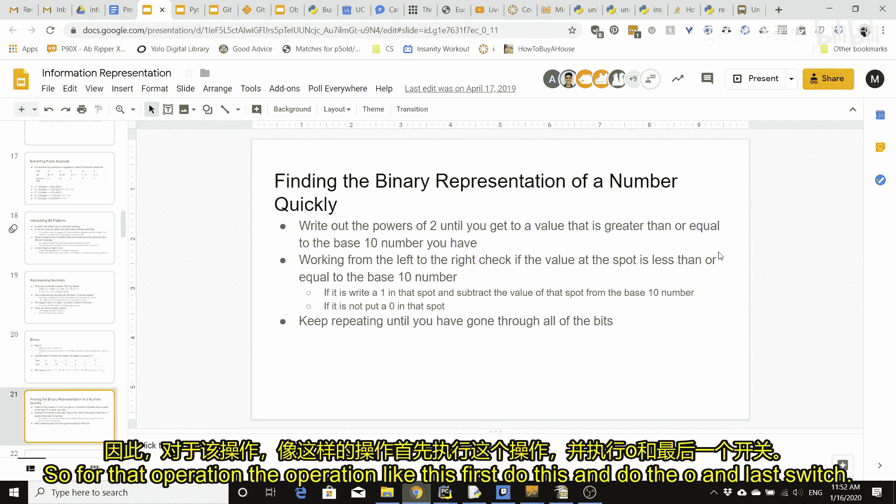
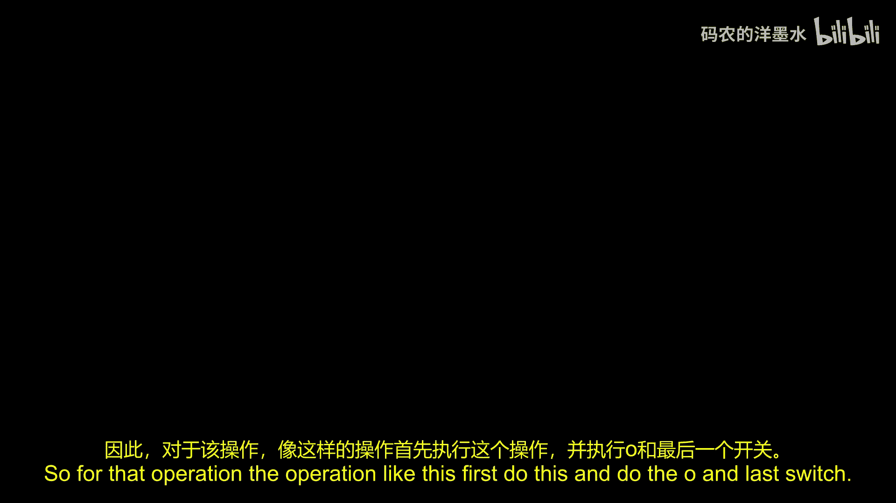
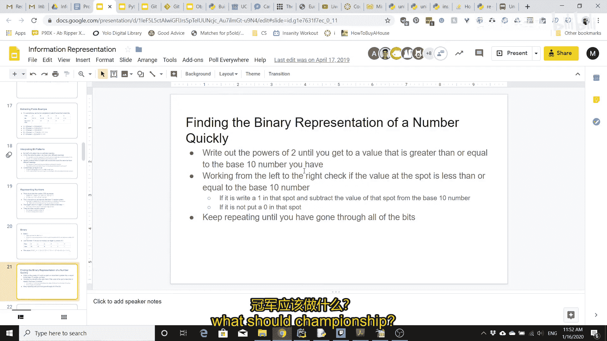

# C语言与汇编语言：03：二进制与位运算

在本节课中，我们将要学习计算机中信息表示的基础——二进制与位运算。我们将了解计算机如何使用比特表示一切数据，并学习如何通过位运算来操作这些比特。

## 概述：计算机中的比特表示

上一节我们介绍了指针等概念，本节中我们来看看计算机信息表示的基础。计算机内部的所有信息，无论是整数、文本、音乐还是视频，最终都使用比特来表示。比特是“二进制数字”的简称，其值只能是0或1。八个比特构成一个字节，四个比特构成一个半字节。

由于计算机只能处理比特，我们必须找到一种方法，将高级概念映射到特定的比特串上。每个独特的概念都需要一个独特的比特模式来表示。

## 比特数量的计算

为了表示一定数量的独特状态，我们需要计算所需的比特数。以下是相关的核心公式：

*   如果你有 **S** 个独特的状态需要表示，你至少需要 **ceil(log₂(S))** 个比特。
*   如果你有 **B** 个比特，你可以表示 **2ᴮ** 个独特的事物。

例如，老麦克唐纳的农场上有猪、鸭、牛、鸡、狗、猫六种动物。计算 `ceil(log₂(6)) ≈ ceil(2.58) = 3`，因此我们需要3个比特来唯一标识每种动物。我们可以建立如下映射：`000` 代表猪，`001` 代表鸭，`010` 代表牛，`011` 代表鸡，`100` 代表狗，`101` 代表猫。3比特可以表示8种状态，因此有两种模式未被使用。

## 比特映射的选择

当我们为状态选择比特映射时，这个选择通常是任意的。然而，我们倾向于选择那些在硬件上易于实现、在程序中便于处理的规则模式。如果某些比特模式在我们的问题中没有意义，那么在一个编写正确的程序中，它们就不应该出现。

## 位运算基础

现在我们已经了解了比特表示，本节中我们来看看如何操作这些比特。位运算允许我们在比特级别上检查和修改数据。常见的位运算符包括：与（`&`）、或（`|`）、非（`~`）、异或（`^`）、左移（`<<`）、算术右移（`>>`）和逻辑右移（`>>`，具体行为取决于操作数类型）。

在比特运算中，我们通常将1视为真（True），0视为假（False）。

以下是这些运算符的真值表定义：

*   **非（NOT）**：`~A`，翻转所有比特。
*   **与（AND）**：`A & B`，仅当两个对应比特都为1时结果为1。
*   **或（OR）**：`A | B`，当至少一个对应比特为1时结果为1。
*   **异或（XOR）**：`A ^ B`，当两个对应比特不同（一个为0，一个为1）时结果为1。

## 移位运算

移位运算将比特串中的所有比特向指定方向移动。以下是移位的规则：

*   **左移（`<<`）**：`A << n`。所有比特向左移动n位。左侧溢出的比特被丢弃，右侧空出的位用0填充。这通常可以解释为将 `A` 乘以 `2ⁿ`。
*   **右移（`>>`）**：具体行为取决于操作数的类型。
    *   对于**无符号**类型（如 `unsigned int`），执行**逻辑右移**：比特向右移动n位，右侧溢出的比特被丢弃，左侧空出的位用0填充。
    *   对于**有符号**类型（如 `int`），执行**算术右移**：比特向右移动n位，右侧溢出的比特被丢弃，左侧空出的位用**最高位（符号位）**的值填充（即，如果原符号位是0则填0，是1则填1）。

## 位运算的应用

了解了基本运算符后，我们来看看它们在实际编程中的具体应用。

### 设置比特位为1

要将变量 `a` 的第 `i` 位设置为1，可以使用或（`|`）运算。因为任何比特与1进行或运算，结果都是1。

以下是具体操作：
```c
a |= (1 << i); // 将变量a的第i位设置为1
```
如果要同时设置第 `i` 位和第 `j` 位，可以组合使用：
```c
a |= (1 << i) | (1 << j); // 将变量a的第i位和第j位同时设置为1
```

### 设置比特位为0

要将变量 `a` 的第 `i` 位设置为0，可以使用与（`&`）运算。因为任何比特与0进行与运算，结果都是0。我们需要一个掩码，该掩码在第 `i` 位为0，其他位为1。

以下是具体操作：
```c
a &= ~(1 << i); // 将变量a的第i位设置为0
```
同时清零多个位：
```c
a &= ~((1 << i) | (1 << j)); // 将变量a的第i位和第j位同时设置为0
```

### 检查比特位的值

要检查变量 `a` 的第 `i` 位是1还是0，可以使用与（`&`）运算。通过将 `a` 与一个只有第 `i` 位为1的掩码进行与运算，可以提取出该位的值。

以下是具体操作：
```c
if (a & (1 << i)) {
    // 第i位是1
} else {
    // 第i位是0
}
```
在C语言中，0被视为假（False），任何非零值（包括只有一位为1的结果）都被视为真（True）。

### 翻转比特位的值

要翻转（即取反）变量 `a` 的第 `i` 位，可以使用异或（`^`）运算。因为任何比特与1进行异或运算，结果都会翻转。

以下是具体操作：
```c
a ^= (1 << i); // 翻转变量a的第i位
```
同时翻转多个位：
```c
a ^= (1 << i) | (1 << j); // 翻转变量a的第i位和第j位
```

## 提取比特字段

有时，多个小的数据字段会被打包存储在一个变量中。为了提取某个特定字段，需要两个步骤：

1.  **右移**：将整个变量右移，直到目标字段的最低有效位移动到第0位。
2.  **与运算**：使用一个掩码进行与运算，该掩码的宽度等于目标字段的比特数（即对应位全为1），以屏蔽掉其他字段。

例如，一个32位无符号整数 `packed` 中存储了多个字段。要提取从第 `start_bit` 位开始、宽度为 `width` 比特的字段，可以这样做：
```c
unsigned int field = (packed >> start_bit) & ((1 << width) - 1);
```
其中，`((1 << width) - 1)` 会生成一个低 `width` 位全为1，其余位全为0的掩码。

## 比特模式与上下文

最后需要强调的是，一个比特模式本身没有固定的含义。它的含义完全取决于**上下文**。例如，比特模式 `101` 在不同的上下文中可能表示：
*   在之前的农场例子中，它可能代表“猫”。
*   如果被解释为无符号整数，它代表数字5。
*   如果被解释为有符号整数（使用二进制补码），它可能代表数字-3。
*   在文件权限中，它可能代表“读”和“执行”权限。

在高级语言中，**类型**系统帮助我们确定上下文。在机器层面，我们通过执行的指令来推断数据的类型。

## 总结








本节课中我们一起学习了计算机信息表示的基石——二进制与位运算。我们了解到计算机使用比特表示一切，并学习了如何计算表示特定状态所需的比特数。我们深入探讨了各种位运算符（与、或、非、异或、移位）的功能和真值表，并掌握了它们在编程中的实际应用，包括设置、清除、检查和翻转特定位，以及从打包数据中提取字段。最后，我们认识到比特模式的意义依赖于上下文，而类型系统或指令集决定了这种上下文。掌握这些知识是理解底层数据操作和进行高效编程的基础。