# 【全集】加州大学戴维斯分校 C语言与汇编语言 中英字幕 1080P p04 Lecture 4 - 浮点数与内存基础 -BV1xefZBHEas_p4-

Before we get started， do you guys have any questions。All right check。Anything else。

Just as a reminder， when you're getting to your homework problems in this class and in every other class and when you get to work。

 it's always really important when you first get started to not immediately jump into the code。

 but to take a step back and think about what the heck do I want to be doing to solve this problem in the first place？

My recommendation is to one say what it is that you want to do to do some examples， practice by hand。

 and solve some problems， make sure they're varied， make sure they're somewhat interesting。

 make sure they test edge cases if you can think about them right now。Then once you do some examples。

 step back from the whiteboard or your piece of paper， whatever that you're doing and ask yourself。

 what did I just do right what steps did I take to solve the problem and if your answer is like I just looked at it or I did it You need to think a little bit more because you can't tell the computer to just look at it or just do it right you have to give it a series of steps that it can follow to be able to complete the problem right when you're just looking at it。

 you're relying on your intuition of the problem to be able to get it done right and your amazing mental capacities of the human brain then computer lacks that。

 So just think about what is that you did and then go write those steps down right list of coherent steps to follow as to what you did keep the steps broad。

 keep them general and kind of forget that you know how to code right you shouldn't have any mention of types or lists or vectors or arrays or strings whatsoever at all right It should just be this is what I would like to do right Keep your steps general at the step is a rather large step。

Perfectly okay， just make that into another subprom that you have to repeat the process on all over again right and each of these major steps when you solve it will end up becoming a function when you write your code。

Once you have your list of steps down， go and reapply them to their problems。

 see if they work and do what the steps say， not what you want to do。

 right don't rely on your intuition at all， do each step as you've written it down。

After you done that and everything seems to be working out great， then go implement it。

 but now you have something that you actually want to do a series of steps。

 you can write intentful code， meaningful code instead of just trying things to see if they work right you have a plan。

 follow it and write your code so that it reads like the plan。

 use lots of functions to like hide the complexity and make thinking about the problem easier。

 you know rely on that abstraction。Once you find the gun implemented implemented， test it。

 see if it works。 I it doing what you expect it to do right And if it's not working。

 go run the debugger， see what's happening in your code。

 see what you know what's differing from your expectations versus what's supposed to be happening right and you have your list of steps that you've written down so you should know what should be going on each and every process you know every part along the way and then you know fix the bug repeat。

 rinse， recycle until you finally get the problem complete which is when we're taking in the very long number what type。

I like I was trying to make it into a bit set store as an unsign integer I mean。

 like so since you're accepting the arguments on the command line。

 they're going to be strings Avs and array of strings convert each string to its numeric representation Okay so make it into an unsigned and then the bitwise operations will work because you can't perform bitwise operations on a string because it's not the correct binary that you want to be working with but once you have it in the numeric form as an unsign integer it will be the binary that you're expecting to work with after this able to homework probably after Thursday you should be able to do all the homework。

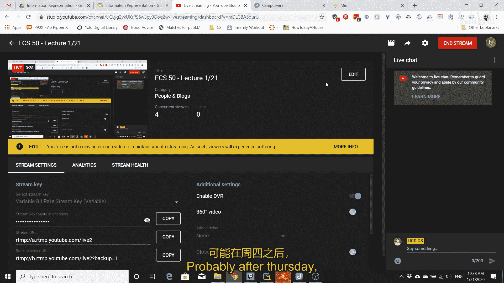

Anything else before we continue on？Again， stop by office hours， keep asking questions， they're good。

 they're great， they're going to help you learn。嗯。So right last time we left off we talked about how bit patterns could be used to represent different things right and a bit pattern by itself has no particular meaning right context helps us figure out what we're supposed to be doing right this is kind of also showing up in that new alphabet problem right the representation for the number eight is the same representation in our new alphabet for the letter D right they have the same bit string right but in different context they mean different things and you have to rely on that context to kind of figure out what's actually supposed to be going on。

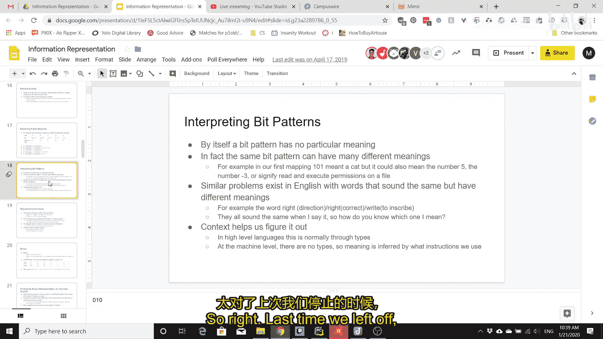

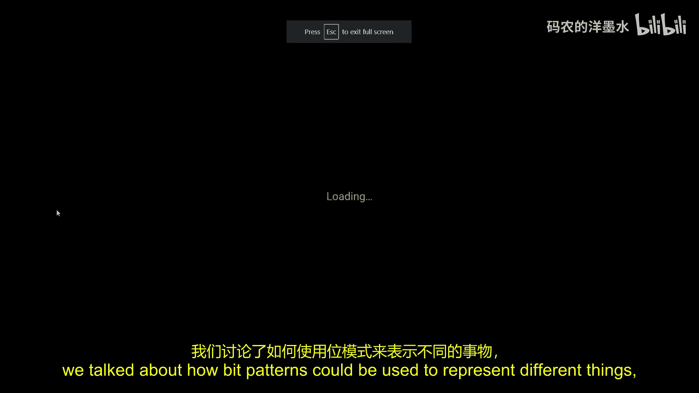

So let's talk about representing numbers right integer numbers to be precise right now so when we have the number 2356 right this is just shorthand notation for two times 1000 plus three times 100 plus5 times 10 plus6 times one even if we've kind of forgotten that you know way back when we learned in elementary school that's really what you're saying when you write a number like this right or another way of writing it it's two times 10 to the three plus three times 10 squared plus5 times 10 to the one plus6 times 10 to the zero right these bases are base 10 because we're the decimal number system then we probably use a decimal number system because we have 10 digits on our fingers right。

So we take each digit that we have and we multiply it by 10 to the n where n is its place in the number。

Right rightmost digit is the least significant digit， zero。

 leftmost digit is the most significant digit on the far left and as you move up the numbers increase by one。

When you're in a number system， the largest digit that each digit you can have for each spot is that base minus1。

 so since we're in base 10， we could have digits up to9 if we were in base 20。

 we could have digits up to 19 if we were in base three digits up to two。

 when we're in base two we have digits up to one。There are definitely some other number systems。

 ones that we kind of use a bit frequently when we're working with the computer， which is Hex。

 which is base 16， and there's binary， which is base two。

So base two again digits can either have the value  zero or1。

 again it's perfect for representing numbers in the computer system because bits can only have the value of a zero or1 when we're figuring out what number that we have。

 it's just like the base 10 number except we multiply by powers of two instead of by powers of 10。

So if here's our5，4，3，2，1， zero play， so it's ones，2s fours，8，16， 32s。 so if we had one01，1 right。

 that's one times2 to the zero plus one times two to the one plus0 times two squared plus one times two to the three。

 right？Just multiply and power， so that's 8 plus0 plus 2 plus  one。

 which is equivalent to the value of 11 in base 10。 Any questions so far。是。

Should be fairly straightforward。So let's say we want to have the task of finding the binary representation of a number quickly it's fairly easy to do with base two so you just write out the powers of two until you get to a value that's greater than or equal to that base 10 number that you want to represent working from left to right check if the value at that spot is less than or equal to the base 10 number if it is you'll write one in that spot and then you'll subtract out whatever the value of that number is from that position if not put a zero there and continue on your me way and you get all the way to the end。

So let's say， for example， we wanted to convert 72 right to binary。

So we keep out writing powers of two until we get to a power of two that's greater than or equal to 72。

 so we have our ones， twos， fours， 8， 16s， 32， 64s， 128。

 so we stop at 128 because it's the first number that's greater than or equal to2 or greater than equal to 72 so are there any 128 in 72。

No， so we put a 0 there。 And again with binary， since we only have a digit of 0，1。

 it's either yes or no， right， just checking if it's less than equal to。 So are there any 64s in 72。

Yeah， one， right， so you say okay， I have 72。And let me open up iddle here。

So here is our number right， it's 72 and now since we decided to put a one in that spot。

 number minus equals 64 oops， no equals 72 nu minus equals 64 so now our number ends up being 8 right after this subtraction after we put 164 there。

So are there any 32s and eight， No， any 16s in eight， no， any8s in eight， Yes， one。

 So we subtract out our。8， and we end up with0。 So are there any fours in0， No， any twos in0， No。

 any ones in0。 No， we've gone through all the bits。 So we're done。

 And this is our binary representation for 72。😊，Any questions here？Okay。嗯。

Let's say you want to convert the value 59。Into binary。Right。Go ahead and try that out。

I'll give you a minute being able to work through it shouldn't take too long。Yeah。嗯。Okay， so again。

 if we're following the process， the first thing that we would do is we'd write out powers of two until we get to a number that's greater than or equal to 59。

 so we go ones， twos， fours， 8， 16s， 32s， 64s。And at that point， we can stop。

So are there any 64s and 59？No， are there any 32s and 59？Yes， so we would write a one in the 32 spot。

Let's see， so then we do like nu minus equals 32。Right。

This is going to give us 27 so we have a one in the 32 spot。Are there any 16s and 27？Yes。

 so we do nu minus equals 16。Which is going to leave us with 11， are there any8s and 11？Yes。

 so now minus equals8。W just's going to leave us with three， are there any fours in three？No。

 are there any twos？And three， yep， so nu minus equals2。And then we need to。 So we're left with one。

 and there's a one and one， so。Then wetract out the one。So if we look at this value。

 this value is going to be well， we have one1 no twos， do we have any fours， No。

 we didn't have any fours， do we have any8s， Yeah， we had an8， Do we had any 16s， Yeah， we had a 16。

 We had a 32。Which is oops off by something。Or I miss a one？Well， one would only bring me up to 58。

熟下呗。Which digit am I missing？On theThe third。10。So one， one， oh gosh。

 let's just do it with a table because I can actually see that。So。We have ones， twos， fours。

 oops the other way around， right？And that's begin sheet。Yeah。Ones， twos。Fours。Eids。16s。32s。64s。

 right？So。There was 132。We had 116， we had  one，8。No fours， right， They didn't have any force。

 believe。So 1，1，0，1，1。我。 zero， one，1， there we go， 59。So we got the correct value。

Are there any questions about figuring out how to convert from a decimal number to a base2 number？

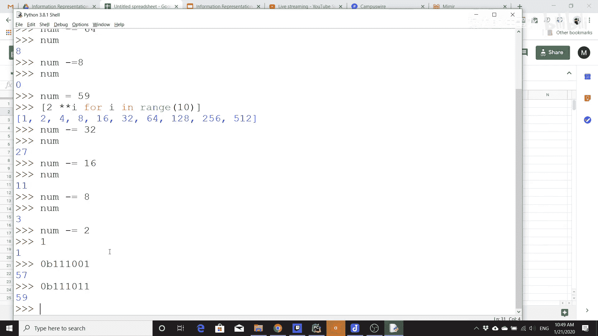

Should be fairly straightforward。

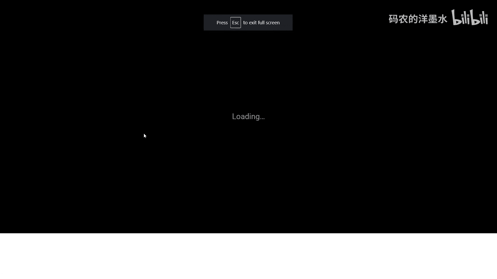

So then what happens if you wanted to go from a binary number back to the base 10 number？Yeah。

 same thing over place to。No， right。 Remember， the value of the number。

 it's going to be each spot multiplied by the power of two， right， So if we had something like。嗯。

This。What would this number be？And what works is to say。

 what should this binary numbers base 10 value be？64 plus。8 plus 4 plus one， right。

 So64 plus 8 plus 4 plus1。77。Unless that didn't work 6。Yeah，77。Right， 64 plus8 plus four plus one。

So again， fairly easy to get back to the base 10 value。

 just multiply each number by the corresponding power of two to the spot that it's at。

 just like when you're doing a base 10 number。But use base two， not base 10。So hex is base 16。

 since our digits can take on the values between 10 digits can go all the way up to 15。

 the digits 10 through 15 will be represented by the letters A through F so that there's only a single digit per spot like a single character to represent a single digit。

 this kind of gets confused the reason that we have this is because if we had a value like this。

is that supposed to be one digit？10， or is it supposed to be a one。Followed by a zero right。

 it would be ambiguous if we used multiple know characters for a single digit。

 which is why we have the letters A through F to represent 10 through 15。

 So this is actually going to be 16 because it's 116 followed by01s。Right if I want 10。B A。

 I have 10 ones。So when we write our hex digits， especially when we're writing in the computer。

 we're going to prefix them them with OX to say that they're representing the hex digit as opposed to representing a decimal number。

 so when you do OX12， right it's 116 followed by two1s。

 which is going to be 18 base 10 and not 12 and decimal because we put the OX in front of it。

We like to use hex as programmers because it's really easy to convert from hex to binary and vice versa。

 and this allows us to write really long binary strings in about a quarter of the amount of space。

This is because every hex digit is' worth four bits。 Why do you think a hex digit is worth four bits？

116 right and 16 is two to the。4。So every hex digit ends up being worth four bits。

 so if we want to convert a binary string to hex， you start from the right and you group bits of four of the binary at a time together。

If you go all the way through in the final leftmost group it's missing some bits like there's only like three or two at the final leftmost group。

 just put two zeros in front of it and then you're end up with four without changing its value。

Then for each group of four convert it into its corresponding hex digit。

 find the decimal equivalent value and then I generally go to hex so if this was our binary string。

 we're going to break it up into groups of four so 1110，10，11 or 1010。

1011 and01 this group is a little bit short so we add two extra zeros to the front of it to pat it out so it ends up having four bits in it then we convert each group of four into its corresponding hex digit。

Here， what's the decimal value of this group of four bits？Yeah。It's one， right， because we have one1。

 so that's represented as one and hex。What's the decimal value of this group of four bits？

So remember， this guy right here is a one， a2， a4， and an8。 So we have how many8s。1，8 plus 1。

2 plus 1，1， which is。11， right， but we said the digits a and a through or 10 through 15 represented by a through F。

 so which digit would we use for 11？B， right because a is 10 that makes B 11。 so we get be there。

 So here we have1，8， no fours，1，2， no zeros。 that's gonna to be10 which is a then we have8 plus 4 plus 2 which is going be 14 right and then again you can kind of like go up the letters right so a is 10 B is 11 C is 12 D is 13 and E is 14 so we would use E here。

And so the answer is one bay。Any questions on doing the conversion？The numbers to a letter。

How would the computer convert the numbers to a letter？

 So everything in the computer is represented with what。binary binary。

 So everything in the computer has is binary， right， So the difference is。

 how does it display it to you， right？ So when you see the pixels， you know。

 when you see that you have， you know， 10 here， right， you want to display a， right。

 So you turn on the pixels on the screen。 So they look like an a。😊。

I guess what I was trying to ask was。How do you like when you're trying to convert a binary like binary to decimal or decimal to binary。

 it's all just math。Whereas if you're trying to convert like you're trying to convert。This two hex。

 you're going to tell the computer somehow to display letters instead of numbers。 But again， like。

 how is it harder for the computer to turn the characters on the screen into a one or into a0 or to a two or to a3 than change it to the characters that represent an F right。

 Change those pixels to look like an F。How is it any different it's not I guess what I'm saying is how do you tell it to display？

It like， is with。上上诉。Do you just use ASI Ed or something like that？So like。

 if you found that the digit was 10。And you wanted to show it as hex。 You would say print a。Oh。

 so you just coded in like hard code， you put it in， or if you're working in C andC plus plus。

 you can do print F with percent X。So percent x means display the value of this， whatever as hex。

 so if you print like the integer 32 as hex， it'll show its value in hex， which would be 20，216。Okay。

 so youve heartcode it is what you're saying。I mean。

 are you talking about how do I as a programmer write it。

 Are you talking about how does the internal circuitry for like the circuitry。

 but how does the internal program for the terminal work to display it as that I'm saying you give us an assignment where we have to convert different bases to each other。

I'm pretty much in it for the stuff where there are no letters because then it's just simple math。

 but when you start adding letters in then you have to say like you have to basically do it。

 you have to hard code it for every possible No， so stop by office hours and we'll talk about that question because I thought you're asking something different here。

Any other questions？So let's say we want to go from Hex to binary for each hex digit。

 find its binary representation and you write it out。

Make sure they'll do that every time you write a single hex digit。

 you make sure that you write four bits for each hex digit because every hex digit is worth four bits that nibble right So if we wanted to convert two F1 B it's a binary。

 Well the binary representation of2 is 0，0，10。 F is 15。 So there's 1，8，1，4，1，2，1，1 in it。 So we get3。

1s，1 is again00，1 and a B， which is 11， it has 1，8， and after you take out the8。

 you're left with three， So no4 is a 2 and1。10，11， then you write it all out， 0，0，1，0，101，0，0，01，10。

11。Yeah。Interchange。In the hex notation， the computer will be happy with either lower or uppercase。

 so if I do like what's OXA？It's 10 if I'm ready to And when you're if you want to write like a hex constant in your your machine。

 you really you literally write OX。The bit string and it'll or the hex string。

 it'll give you that numeric value or you know， that bit string value that you're looking for。

 just like you're seeing me do right here in Python or again， if you want to get like a binary value。

 it's 0 B1，1，0，1，1，0，0，0，1，01。And you can write that NC and N C++ as well and it works。

Go homework is like lower。这事间咱们。Well， I mean they're both like A is both going to be treated as 10 right。

 and are you talking about for the change of base one？Yeah，Yeah， so if you want it to be consistent。

 the easy ways to make all of your letters uppercase or lowercase when you're doing your internal conversions。

 and then you only have to work with one of them。Right。So。What's going to be the binary value？Of。

Let's see。Of O X， say，1，3。4，5。AC。What's that guy's binary value going to look like？So again。

 if we break it apart。We just have to translate each and every individual。Character that we have。

So one is going to be equal to。0，0，0，1。Well， you should display that when I want you to do 0001。

Right。3 is。这是我。It's going to be 0，011。Right。1，2，1，1 to get three，4 is going to be。全。0，1，0，0。

 which is one， four，5。就就。Right， one，4， one，1。A。A is 10， right？ So are there any8 and 10。Yep。

 you have one， eight and after you take out that eight， right， you're left with two Sony fours。

Any twos， Yep， and then we're kind of at zero。 So there's a。 So C， C represents。Right， so a is。

 you know。That's 10， C。Is what's its decimal value first？12， right？

And then its binary value is going to be1， eight， one4。No twos， no ones。

So if you write these guys all out side by side， that gives you the binary value。Any questions here？

Yeah well。I thought I gave Ben a single value， maybe oh I deleted it， that's why I failed。Yeah。

Right what would be the hex value of 0010 oh go？0，0，1，0。1，1，0，1。1，1，1，1。Sure。1，0，0，0。

And then maybe we start with this guy， maybe he just leads with one one。Right so we have1，1，0，0，1，0。

1，1，0，1，1，1，1，1，00， yeah。咩。Absolutely。Well。Everything。Big enough， yeah。So。Again。

 you just break up each of the bits and the bit string into a group four and then translate each one。

 this is what value。It's1，8。Yeah。That's 15， 15 is represented using。F。1，1，0，1。 That's 1，8，1，4。

 which is 12 plus 1，1， which is 13。 So 13 is。第一。This guy is。2， and this guy is。Not 12。

Remember the zeros， right， we're missing some zeros， so we put the zeros at。In the front。

 right so the zeros would， I don't know why it's not let me write them in the front。

 the zeros would go in the front， so you get 0，0，11。Which is。😊，Three。

 so the answer that we have here is OX32 D F8。RightAnd so when you're working with like bit string constants。

 I highly recommend that you write them in their hex value as opposed to their decimal value because their decimal value。

 it's hard to figure out what you actually want， like if I asked you。

 if we were just using like the bit value of something like 23。

 do you guys have any idea in your head what it's supposed to look like？

Or any way to like conveniently get it。No， but if it's in hex， right。

 And you saw the value with something like O， X 2 A， right。It's not 23。

 but it'd be pretty easy to figure out what the bit string representation is supposed to be， right？

To a would be 0，0，1，0， then the a would be 1，0，1，0。 But it's less to write。

 And if you do have to figure out like what it actually is， writing it down is easy。

 This is a lot better than doing in binary， because sometimes some of the bit strings you have to write are like 23 or 25 Bs long or like 30 something bits long。

 right， If you're writing a bit string that's like 31 digits long。

 How likely are you to make a mistake in that。Pretty high right And then if anybody else goes to read it。

 it's just kind of like you glaze over because there's so many bits there trying to figure out what position they're at is hard。

 So hex makes it a convenient way to write binary in your programs。

So we talked about going from you know base 10 to hex， base or hex to decimal hex to binary。

 binary to hex， decimal to binary and binary back to decimal。

 how about just converting from one base to the other？This does show up every now and then。

 and guess what it shows over in your homework too。

So there's a really simple algorithm for doing this。 First。

 convert whatever base you're given into base 10。 The reason for doing this is that we suck at doing math and other bases。

 And if you're trying to do the math in some like base like 7， you are going to screw up。

 I promise you， no matter how good you are。 It's so easy to make mistakes because you've been ingrained to work in base 10。

 your entire life and breaking in those habits is really hard。 So first， convert to base 10。😊，Right。

 then what you want to do after you convert the after convert to base 10 is you divide that new。

Deimal value by the base that you want to convert to。

You keep dividing your new quotient by that new base until the quotient finally ends up being zero。

Then what you do is're going to write your remainders from bottom to top。

 left to right to get your new answer。And we'll show you what that means in a second。Again。

 what if their letters again， the letter， what does it represent a numeric value when you get a。

 it means。10 you're saying that the computer， if I divide a by 10 and C plus plus will be happy。 No。

 I mean， you can do it， but A's numeric value in the ASII chart is not 10。

It's like 60 something right if you look at the ASCI table。And you look at something like。Little a。

 its decimal value is 97 and big A， its value is 65。 Right， So how will that math work。So。

 so you now have a new sub problem。 Convert the letter into its corresponding numeric value， which。

 again， stop by office hours。 if you want to talk about that。

But it's just a new sub problemm that you have to deal with in the homework。

 but it's not that big of a deal， but yeah， stop by office a hours for that。

So let's say we want to convert 432 base5 to base7 again converting the base 10 is fairly easy。

 just multiply each digit by the current base times whatever its position of to its position whatever happens to be at so over here we have 432 base5。

 so that's four times 5 squared plus three times5 to the 1 plus2 times5 to the zero， which is 117。

Any questions on the converting to basease 10 part？

The next part is we keep doing our division until the quotient becomes zero。

 so first we divide 117 by 7 that's going to give you 16 with a remainder of5。

 then we do 16 divide by 7， that's 2 with a remainder of two then we take this two right here the quotient and we divide by 7 to get zero remainder two and so then we write our answer from the bottom to the top left to right so this is going to be 225 in base7。

How could we confirm that we did this correctly？Because 432 base5， it should be equal to 225 base7。

Right， but both of these should also be equal to。1，17 base 10。 So if we tried to figure out what's 2。

25。Right， base 7， we give that to base 10， we should get。117， right？And if we do this out。

 that's going to be two times7 squared， gosh， we can do this。Plus two times 7。2， the one plus。

5 times 7。To the 0。Which if we've done this right， is 117。 So we got the exact same value， right。

 it's just there are different ways of representing this。Does that make sense？

You you guys ready to do one on your own？Are any questions about the process first？Yeah。

 dividing by the base。 So anyway if you order based。The dividing by the base probably would work。

In the other base as well， as long as you did the math correctly in that base。

I just can't do it I literally cannot do the math in the other base that's why I always had the intermediatemediation step of convert to basease 10 or like when you're doing this like in the computer you have to get it to some representation that the computer can actually work on so that when you do division it actually divides it correctly that you want。

So。Let's say， we want to convert。354。Bace。I guess I have to do maybe like base eight， two base。

 anybody have other base you want to convert it to？Let's say base three。So go ahead， try it out。

See if you got it down。Yeah。So。Yeah。Yeah。嗯。That does do exp that way。Okay。

 so our first step is to do what？Convert to base 10。

 so the base 10 value here right is going to be three times8 to the second。Plus five times8。Plus，4。

 which is。236。Right so now we need to convert it to the new base。So when we convert to the new base。

How do we do that？First step is to。Through the division of 236 by。All right。

 so we do 236 divided by three。That gives us 78 and 236 with a remainder of three gives us two。

 right， so we're going to get。You know， the first step we're going get 78 with a remainder of。2。

The next step is to divide 78 by3。Which adds as 26。And its remainder is zero。

 so we get 26 remainder zero。Then we divide what by three？26， so 26 divide by three is。Cit again。

没问ます。8， right， for 24。Remainder。Two，8 divide by three is。切。2， with a remainder of。Two。

 two divide by three is。Zero with remainder of。Oops， not three， remainder of。2， right。

 This was right here。 This was 236 divide by 3。 This was a 78 divide by 3，26 divide by 3。

8 divide by 3 and two divide by 3。 So our equivalent answer in base 3 is going to be。Two， two，2。

 zero， two， base three， so we get two，2，2，0， two， base three。And again， if we want to check。

 we can do the multiplication back out and we should hopefully end up with 236。嗯。Right嗯。And。T，22， O2。

Phase 3 is。236。So we did it race， any questions on converting one base to another？

Could you use this technique to convert betweenal and convert between binary and decimal？Yes or no。

Yeah， you could， right， could you use this to convert from hex to binary？From binary to hex。

 absolutely， it's just that there are shortcuts for doing those。 And so if you're doing by hand。

 you probably want to use the shortcut。 so you don't have to do all the division because a lot of thinking。

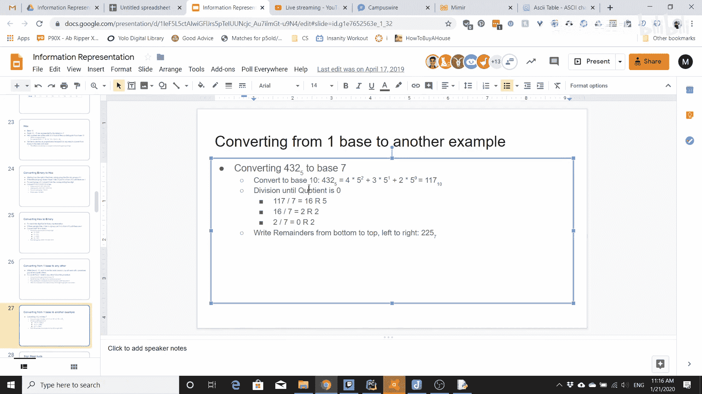

Or you know with the decimal or the binary to hex and the hex to binary， grouping them by four。

 then figuring out each individual element is a lot easier than repeatedly like dividing by  two or dividing by 16 over and over again。

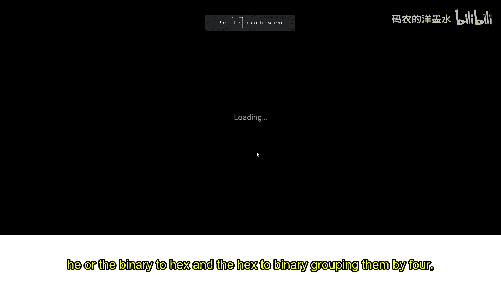

So up until now we've only been working with positive numbers。

 but a lot of times we deal with negative numbers in the machine。

 so one way that we might decide to deal with negative numbers is to have our whatever our bits be the sine bit and the remaining bits be the magnitude the value right so we might say the first bit is zero it means the number is going to be positive。

But if the first bit is one， it means the number is going to be negative。

 So here are your bit patterns， which again， they could be interpreted as unsigned numbers。

 You don't know until we try to give some meaning to them some interpretation。But over here， right。

 we have positive。0， positive。1， positive2， positive3。 We'll skip this one for a moment。

 That's negative one。 The one believed that one would be negative 2。

 and the one we that would be negative 3。This guy right here is negative zero。

If you follow along with the pattern， right， because one means negative and its value is。0。

Any questions here on Sine magnitude？对。Yeah。Again， if I asked you， what does the bit pattern 0。

1 and 0 mean， what does this bit pattern mean， what should your answer be？7。2。All issues today。

Whathi should this bit pattern be 101？5。Negative  one。Something else。

What are you missing to be able to answer the question？It。嗯。

We're missing context right so this bit pattern 101。

 it could mean five or it could mean negative one or it could mean something completely different。

 right？You if you got this question， the answer is， I don't know， tell me more。

Because you need more context because bits on their own， they have no meaning。

You have to be told how we're interpreting them。So while s magnitude might seem like the natural straightforward way of doing things。

 we don't use it in computers one of the reasons is because there are two representations of zero right we had positive zero and negative zero。

 but if you compare their bit patterns together， what do you get would they be equal to each other？

No， right， The bit patterns for positive 0 and a negative0 would be different。 So if youre just like。

 are the bits the same， the values are the same， we would get the wrong answer here doing that comparison。

 So you actually have to add in like some special hardware to make sure that it always converted to either be 0 or negative 0。

 depending on what you want to have happen。😊，Another thing。

 there's also another method which is To complement that actually makes the addition and subtract hardware a lot simpler and then simpler hardware saves money and also saves energy and saves time So we like going with that method。

 which is a twot complement the way that you can kind of think about the bit patterns for twot complement is if you have like an odometer in the car but you have the old one where you actually have to like wind it forward or wind it back right if you go one for if you start at zero and you go one forward。

 you would end up at。😊，1， right， If you go one forward from one， you should end up at。Two。

 if you go one forward from two， you'd end up at。3 as you advance， right， now。

 if you're at 0 and you go one backwards， logically， you should end up at。Negative  one。

 if you go backwards from negative  one， right， You should get negative 2。 backwards from negative 2。

 you should get negative 3。 But since our odometer can only represent positive numbers。

 when we want to backwards from 0， we actually get 9，9，9， right。If we wind backwards from there。

 we get 998， but we're going to interpret that pattern 999 in our system to mean negative one and 998 to mean negative two and just keep windining backwards。

So you can see this over here on the next slide， so again here's our bit patterns。Right。

 and here we're gonna start at 0。 So if you pop over the two complement column。

 if we go one forward from 0， we should get。1， if we go one backwards from 0。

 we should get negative 1，1 forward from 1， we should get2，1 backwards from negative2 or negative1。

 get negative 2 from 2 to3， from negative2 to negative 3 Now， this guy in the middle， right。

 We have a choice。 Should he， he either be negative 4 or positive 4 Here we've gone with negative 4。

 Why would we don want to go with negative 4 for this as opposed to positive four。

Look at the bit patterns。 What do you notice about all the positive numbers？Well。

 then they do use the bit， right， I mean， it's being used there， right。

 but they all start with zero and all the negative numbers start with。One。

 so if we wanted to keep up that kind of pattern， we'd want to put negative four there for it to make sense。

Yeah。you just or just。I0。Yeah this is a completely different representation。

 this is the two's complement representation， so one of the advantage of twos complement is there is no negative zero instead the bit pattern that was negative zero and sine magnitude and twos complement it actually represents negative four。

Any other questions？Yeah。诶。So again， here's seeing all of them side by side right。

 and you can see that in each of the number systems right， as long as the bits start with zero。

 right， they use the same representation for all positive numbers。But。Unsigned numbers。

 they don't represent negative numbers at all and the s magnitude and the two complement the different bit patterns right。

 they're using them differently to represent different。Negative numbers， right。1，1。

1 and sine magnitude is negative 3， but 111 and 2's complement is negative one， right？So again。

 if you're given some bits， you never know what they actually mean until you're given some context to interpret them in。

Any questions here？So let's talk about negating sine numbers。 So for sine magnitude， it's really。

 really easy。 You flip the sine bit， right， if we want to go from negative one to positive one。

 you just change the one in the sine bit to  zero， right。

 But if you want and then you have positive one， if you want to go from positive one to negative one。

 change the signine bit from 0 to one， right。😊，If you wanted to gate any number。

 and sign might go from 2 to negative2， you just flip the sign bit。Hopefully that makes sense。

For sine magnet or for two complement， it's a little bit more complicated first you flip all of the bits and then you add one and when I mean like add one。

 I literally mean you do arithmetic and binary adding one。Right。

 so if our starting power pattern was 1011， if we negate it in sine magnitude， it's 0011。 so again。

 they all have the same interpretation as when the first bit is or when the first bit is0。

 so what does this bit pattern represent if we're interpreting it to mean an integer number。Three。

 right？So what must this number have meant in sine magnitude？ItMust have been negative three， right？

In two's complements， we flipped the bits。0，1，0，0。Or so right we go from 1 to 0，0 to 1，1 to 1。

1 or from1 to 0，1 to 0。 So let flip the bits， and then we add one。 So one plus 0 is。

It's not trick a question。One， right， so one plus zero is one。Z plus one is。1。

1 plus one in base 2 is。完全。It's zero with a carry of one， right。

 because what happens when you're in the decimbel numbers。

 right and you like add six and eight together。 What happens？You get。4。With a carry of。One， right。

 because when you add six and eight together， you get 14， right。

 but you can't represent 14 with a single digit。So you get the four left over in your spot and then you get the carry of one right because you've reached you've reached your base right we've gone over our base。

 which is 10。The same thing happens in base two， whenever you get to two， right？

That just carries a one over into the next spot and you're left with zero because you took out two。

So here's our example of neing numbers。So for finding the decimal number of a signed binary number。

 first you find the positive representation of the number。

 we like to do this because the positive representations of the numbers are really easy to work with。

Right， so if the number was already positive， great， you're done。Flying the value。

 you just convert it to base 10， you're finished。But if the number was negative。

 you first have to negate your number to make it。Positive。

And then your answer is going to be negative， whatever that number happens to be。

Maybe I'm going the other way right so first over here we have negative 12 and we're writing that with five bits。

 So first we find positive 12 because it's really easy to find right so positive 12 is。😊，Right， no。

16s，1，8，1，4。No twos， no one， so that's 12。Then we need to figure out what the number is negated。

 so if we're doing sine magnitude， we just flip the sine bit。That's negative 12。

If it's two compliments。We flipped the bits。And add one。 So after flipping the bits。

 we're going to end up with 1，0，0，1，1。 notice each of the bits in those spots is flipped。

And then we add one。 So one plus one is。10。Carry one。Right， because it's like， you know。

6 plus 4 is 10， right， which would leave you with0 with a carry of one because you've reached the base exactly。

 So one plus  one would be0 with a carry of one。 So we get0 here。 We carry the one。

 So one plus one is。😊，0， we carry the one。 One plus 0 is。1， and then we have0 plus 0 plus one。

 So we get 1，0，1，0。 So that's how you'd represent negative 12。Using five bits。Any questions here？

Okay。Find negative 23 in seven bits。是。So our first step should be to do what。5。

Find the positive representation of that number， right？So over here。We have seven bits，1，2，3，4，5，6，7。

 so there are any 64s。NopeNope。Are there any 32s？In the16s。Yes。

 after you subtract out 16 from 23 you're left with。Should be about seven， right， so8s and seven。

And he fours and seven。Any twos and three？Any ones in one？Did that not do it right？

Like I'm missing some bits here。Some waiting zeros，1，2，3，4，5。Com on。

Oh I didn't want to do an equal sign there。Oh gosh， just let me edit the cell。Delets， Okay。

 there we go。M in insert mode， That's why you keep liking too。O。So。No 64s， no 32s，116， no 8s， a4。

2 and a1。 There we go， right so。This is。Positive。23。Now if we're working in s magnitude， right。

 we just have to negate the value， so what's this bit string negated？1，0，1，0，1，1，1。

We just flipped the sign fit。In two complement。Right the first step would be to。So flip bits。

So after we flip the bits， we end up getting， gosh， here we put that in there， we'd get 1，1，01，000。哎。

😊，Then add one。So now， over here。We would get plus zero， zero。Right。One down there。

Probably off by some number of zeroes。But it's not too bad。And then so over here， when we add one。

 we're going to end up with。1，1，0，1，0，0，1。And so that's negative 23 and 2's complement。Any questions？

And you could literally write a function right in C or C a++2 to get a number， right？

So if you had something like this。We wanted to define my negates。Of say X。What would you do。

 what would you write here？So you want to return negative x。

What are assuming we're working with two's complement numbers？Flip the bits。

 So how do you flip the bits？The till day。 So till the X。 So you flip the bits and then you。系。挨段。

As a function。 so pretty simple。Again， if you're working with two complement numbers。

 it won't work in Python。But it'll work in C and C++。Okay。😊，So if you want to go back the other way。

 so you have some binary， it's supposed to be representing a signed number。

 and you need to convert it into its decimal equivalent。First。

 if the binary pattern represents a negative number。

 write a negative sign to remember that the number is going to be negative， right。

Then we're going to flip the bits then we're going to negate the bit pattern right。

 because if we have a negative A after you negate it， you'll get。Positive A。

 positive A is really easy to represent， but if we just remember that it was negative。

 we write negative， whatever A's value happened to be， it's positive representation。

So negate the bit pattern so if the number is positive you don't have to do anything and then again remember that with negative numbers and both sine magnitude and two complement。

 they both start with one， but they start with ones because of different reasons in sine magnitude we use that first bit to be the s and one means negative but in twot complement it just happens that。

All of our negative numbers begin with one， a happy accent or hack happy circumstance。嗯。

Finds values unsign number write the decimal value after whatever you put down step one so let's say we want to convert 1011 the decimal right and we want to interpret this as say a negative number so the first thing we have to do is negate it if we're negating it in sine magnitude what do we do。

啊对。Cllip the first bit。 So this bit becomes 0。 and you're going to end up with 0，1，1，0，1，1 is。3。

 but our original number was negative。 So the right answer is negative 3。Right， with twos complement。

 we flip the bits。 So we go from 1 0，1，1 to 0，1，0，0。 Then we add 1，0，1，0，1。 That's 5， a 4 and a 5。

 But our number was originally negative。 So it must be negative 5。We saw everyone when you the game。

Again， negation is the same right if we're going from positive or negative or negative to positive。

 negation is the same for both of them right we said for s you just flip the bit right but for twos complement you always flip all the bits and then you add one。

Right， that's the。Method for intigation。If you give it a negative number。

 you get back a positive number， you give it a positive number， you get back a negative number。

Any questions here？It。Okay。😊，So let's move on to memory a little bit。

 so on most computers memory is byte addressable that simply means every byte in memory has an address。

 This means that the small like when you ask memory for some unit， you get back bys， I want byte3。

 I want byte 5， I want byte 1379 in memory right， you ask for bytes。

Each CPU though has a word size the CPU's word size is simply the largest unit that the internal circuitry can process and store So if you have a 32 bit CPU the largest numbers that it can add would be 32 Bs big the largest numbers that it can store 32 bits big right internally in the hardware itself right if you have a 64 bit CPU。

 the largest numbers you could subtract would be 64 bits big right and the largest numbers you can store internally would be 64 bits。

RightThe above two points lead to the issue of endingian this。

 which is about how to choose how our multiple byte words should be stored in memory。

And we have two different options。The first is little Indianian and in little Indianian we put the least significant byte first into memory so the least significant byte will end up at the lowest address and when you see some examples these will look backwards when you're reading the values。

 quotation marks there。Big IndianN you put the most significant byte first when you're putting the value into memory so the most significant byte end up at the lowest part of the address this is what's done on the internet and it will look forwards to you Intel uses a little IndianN。

Both choices are completely valid， right， really one's not much better than the other。

 you just got to make one and be consistent with it。So over here。

 let's say we want to store the value1 or 01，02，03，04 in memory right。

 so we said each hex digit represents how many bits。Each text digit represents how many bits。

Ax hex digit can go up to 15 right because it's base 16， but each hex digit represents how many bits。

 it's not 16 bits。4our bits， right，4 bits。 How many bits are in a bike？8。

 so when you look at a memory cell， a memory cell can hold a byte。

 so how many hex digits would you expect to appear there？嗯。Two， right。

 because memory is bite addressable， one bite big。H hex digit is only four bits big。

 so every entry and memory should have two hex digits to go all the way up to8 bits。

 even if some of those bits are zero。Right so let's say we want to store this value at address 100 memory if we were working with big ending machines。

 we would put our most significant byte first into memory， so 0102。

0304 right and notice our most significant byte of the word ends up at our lowest address 100。

If we're in little Indian， we'll put our least significant bite first into memory。

 and then the other ones coming after it。 Sorry， least significant bite is 0，4， So 0，4， then 0，3。

 then 0，2， then 0，1。😊，Yeah。Any questions？About little versus big。Right。

 this one looks backwards to us。Right， but it's only like an appearance。

 This is just how we're going to put the bites out into memory。And again。

 since you'd be working on a little Indian machine， when you read this word back out， right。

 if you're a little Indian， you read the word， right。

 this bite here would go into which spot of your word。Yeah。

The least significant portion of the word right so it knows how to read the value back out into memory and place it back into a word because it knows how to put it into memory in the first place。

Yes。And again， Big Indian， if it read this byte out here。

 it's going to put it in the most significant byte of the word when it reads it back into the CPU。不是。

嗯。No questions I'll go on。Okay， let's talk about floating point numbers。

When we have to represent really large numbers with lots of digits in them。

 we will use scientific notation right so instead of writing the number 10230000000000 right a much more shorthand notation for that would be the scientific notation。

 which is 1。023 times 10 to the 11。Organ， if we had 0。000250， that could be 2。

5 times 10 to the negative6。Floating point numbers utilize the same idea。

 but instead of using base 10， they use base2， so 1。0101 times to the4 would be 01101。

 which is 21 and base 10。Or if you had 1。01 times 2 to the negative  one， it's going to be 0。

101 again all in base2， which is 0。625 in base 10。Any questions here？So far。嗯。Okay。😊。

So our flow itself is made up of 32 bits split across three different fields。

The first bit is the sine field and if that bit field is zero， it means positive。

 it's one it's the negative。The exponent field is the next eight bits。

 the more bits here that we have， the wider the range of values that we can represent right we can represent really big numbers if we multiply it by a big exponent。

 very， very small numbers that we represent if we multiply it by a very negative exponent。

 but the more bits here， the bigger or smaller the value your exponent can be。

 so the wider the range of numbers you can represent。The Mantia， which see is the Mfield。

Is going to be the last 23 bits of the number。If feel like I skippped something， oh yeah。

 I did skip a slide， there we go。Sorry about that so in order to keep things uniform。

 we need to figure out where the decimal point should be placed if we have 1。

0010 times2 squared or 10。010 times2 the 1 or 0。10010 times 2 to3。

 they all represent the same number。So out of these numbers， which is the best one？嗯。Firstol。

So for the first one， why would you say the first one is the best one。Right， I mean， like。

 there's really not necessarily one that's better than the other。

 But there's like an infinite number of representations for just this one number， right。

 if we don't pick one form to represent it。 And if you had an infinite number of things。

 How many bits would you need， An infinite number， right， But your computer， I it infinite。No。

 it's right here in front of me。 must be a finite machine。 So we kind of need to settle on one。

 and we just have to pick some convention so that the designers of the floating point number system。

 they decided that all numbers should be written in the form one point the remainder of the Meissa。

Times to the exponent。So the one that we take would be the first one because it's always going to be one point something。

Right again， the Matisa， the more bits that we have here， the more precision that we have。

 the exponent， the more bits that we have here， the wider the range of numbers。

 so we have to pick some balance across our the bits that we use to figure out how we want to divvy them up between you know more precise representation。

 the Matissa and larger range of numbers， the exponent。

So the float itself it's 32 bits big and again we had to figure out how to divvy those bits up。

 there's the sign bit。 it's the first bit， bit 31， it's one bit big。

 they said to do 8 bits for the exponent， which are bits 30 through 23 and the menisa。

 which is 23 bits， which is 22 through0， That's the Mfield from the previous slide。

If you go to like a double， the double is basically like the same representation as the float。

 but they've just expanded the size of the field， so there's more bits for the exponent。

 there's more bits for the menessa。So 1。 m times2 to the E looks really nice in how a float is calculated。

 but that's not really how it works The exponent field is actually going to be treated as an unsigned number。

 but we still need to be represent numbers that have a negative exponent。So if we have eight bits。

 that means we can represent the values between zero and 255。

And but we want to split this range up so that half our numbers are negative and half the numbers are positive。

 so what we can do is we can subtract 127 from that number to give us about an even split of half positive numbers and half negative numbers this is referred to as the bias so the actual value of the floatinging point number that's stored is it's one point the remainder of the mansa times to the exponent minus 127。

Also， if you look back on the previous slide， I might have skipped it with the ansa。

 we don't store the leading one。Because all of our numbers begin with one point something， right？

 And if all your numbers are one point something， is there any point to having to sort that one。

If it's always there。Is there any point to actually physically storing it？No。

 you just remember that it's one point something。The one point that something is the mea。

So the actual value that we have stored in the float is it's one point mantea times two to the exponent minus 127。

 that's what's there。So let's say we want to convert a decimbel number to a float。

Here's your list of steps。 First， find the binary representation of your number。Second。

 multiply that number by 2 to the zero to to the zero is another form of。One， right。

 so I'm multiplying it by one， it's not changing the value。

Then we need to put the number in normal form right it needs to be in the form one point something so we move the decimal point so it ends up being one point something right。

 but because we don't want the value of the number to change right we have to multiply we have to either increase or decrease the exponent based on which direction we moved the decimal point to。

The value in the exponent field is going to be the exponent plus 127 right so whatever exponent that you have。

 add 127 to it to account for the bias of 127 that O be subtracted out。

If there are fewer than 23 bits in the Mentica field， we're going to add zeros not to the front。

 but to the end of the field。 Why do you think we add them to the end of the field and not the front。

Remember， our numbers are in the form one point something。So if you put zeros here。

 it would now be 1。00000000 M。 Is that the same thing as 1。 M。No， right。

 you actually made it a lot smaller。 but if we put the zeros at the end after the Matisa。

 it's going to be 1。 m00000000000， which is the same thing as 1。If the number is positive。

 make the sine bit zero if it's negative， make it one。

Put your sign xon to submit bits that you've calculated in the prior steps in the correct location in the float and you're finished。

So let's say we want to convert 6。25。 The first thing that we have to do is convert it to festivalimal。

 right， So 6。25。 Well， there's no ones， but there's a2 and there's a 4 in 6。25， right。

And if you think about the numbers to the left of the meimal point， right。

 they're like times two to the zero， times two to the1， times two to the two， times  two to the four。

 times  two to the eight。If you start going to the right of the decimal point。

 this guy right here is what？嗯。Think about in decimal field。

 what's the first place to the right of the decimal point when we're working with decimal numbers。

It's the tense place， then you have。Hundreds， then thousands， then 10 thousands and so on， right。

 But we think about them as powers of 10。Right， we have one10th。

 How can you represent one10th as a power of 10。10 to the negative one or hundreds。 That's 10 to the。

N have two， then thousands would be 10 to the negative three and so on， right， but again。

 we're in base  two。 So this spot right here is what。好你。Not 10。Two to the negative one。

 two to the negative one is。Oh。对。One over two is。One half。Right， then we have over here。

 we have to the negative you know， two to the negative two， which is。But fourth。

 then we'd have two in negative 3， which is。1，8， then 1，16th， then 1，32， then 1，64， then 1，60 or 1。

28，1 over 256 and so on， as you continue down the line， right， the same idea。 Right？

 So are there any halfps and 。25。Are there any quarters in 。5。 Yes， so we get the one there。

 So we start with our number， it's 110。01。 Is that in normal form。No， so what do we have to do？

Got to move the decimal point to the left and because I move it to the left to keep the number the same。

 I have to multiply it by。前面。We had to write two to the two， right， because we're base 2。

 right If we were base 10， right， we have to multiply it by it be 10 to the two。

So then our exponent field， right， it's going to be 2 plus 127， which is 129。

Which is this number in binary。And our antica field is everything after the decimal point。

 which is 1，0，0，1。 So when we write this out， we're going to have our sign bit， which is 0。😊。

Then our exponent。Then our mantia， but again， the Matissa is 23 bits big。

 but we've used four of them， so how many zeros do we need？

19 because 19 plus four is going to give you。23。 so this is the representation of 6。25。

So you kind of know enough now to be able to do the floating point homework like excitement。

 or if you know， you also like kind of like glance at the next slides。

You'll have enough to be able to do it we'll wrap that up on Thursday and then finish hopefully the rest of the slides as well。

あらそ。All of them， but the last one。And you30 you30 right now。然有。

question about the upper triangular yes， you a store like an intermediate solution in a two dimensional array and then print on the compressed version that No。

 you cannot at any point in time expand the matrix or it's compressed form no。

 but say I'm building I'm leaving the two matrix。 Yeah so you cannot create a copy of it。

 that I' I'm not doing that But when I'm multiplying numbers and creating like the sum Yeah you have to store those values ined in the compressed format。

 that's perfectly fine， right So if you have like say two，4 by four array。

 you're multiplying together You could have 10 space for the first array。

10 space for second array a 10 space for your result array but I should ever see you make 16 space for anything。

 I mean once you think about the translations to one dimensional array， I guess it。Sa。yeah。

 I mean that's the whole point is to get you to think about like how do we do that translation from 2D coordinates to 1D coordinates because the compiler does that for you all the time and so this is just you know you manually the it Okay good question so I'm the audience。

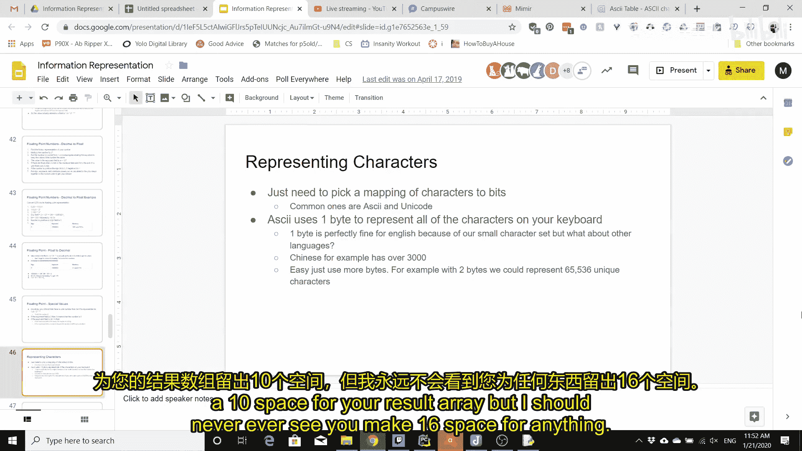

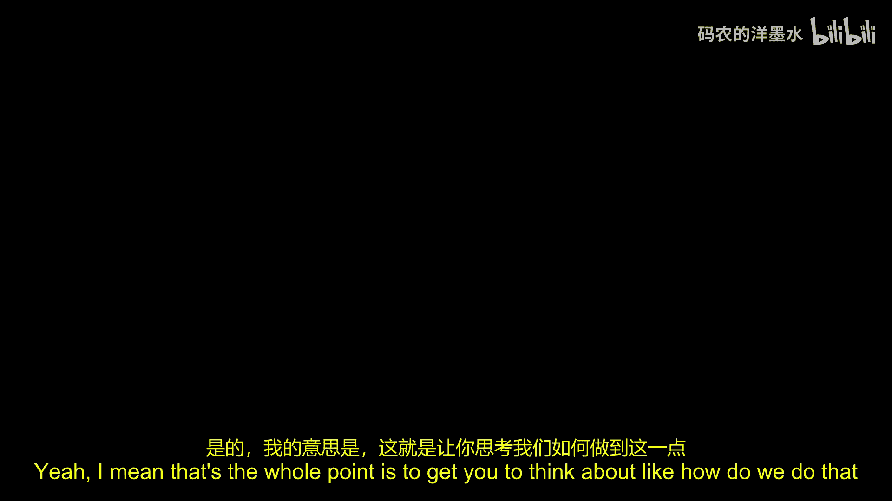

给我点。So do you want to audit the course。 So if you send me an email， I will add you。

Because I kind of need the whiteboard to explain。I sorry。No， no。

 I mean your question is not where everybody has that question。

So it's not like an abnormal question to have like how do I deal with the characters being in here？

Like every single。Or do I take to class？还几个。It helps to have the whiteboard there。And。I will be。我。

そその。Yeah。Yeah。

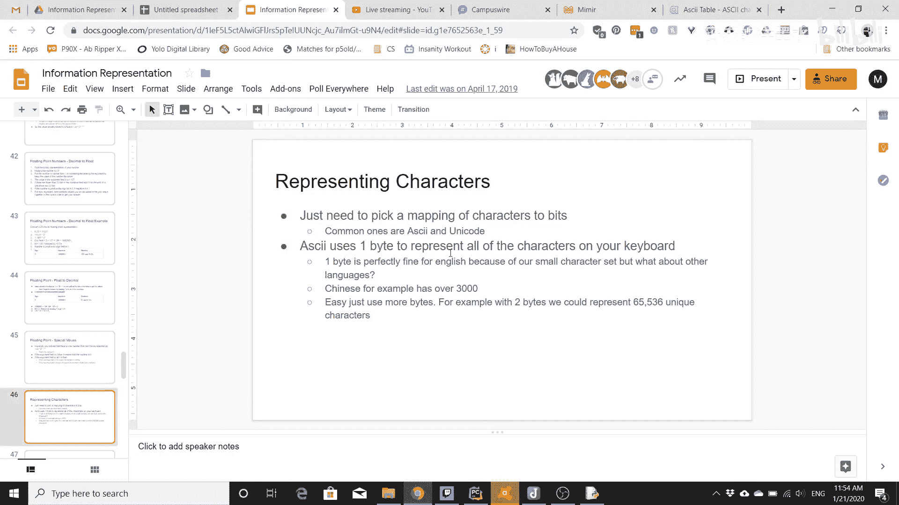

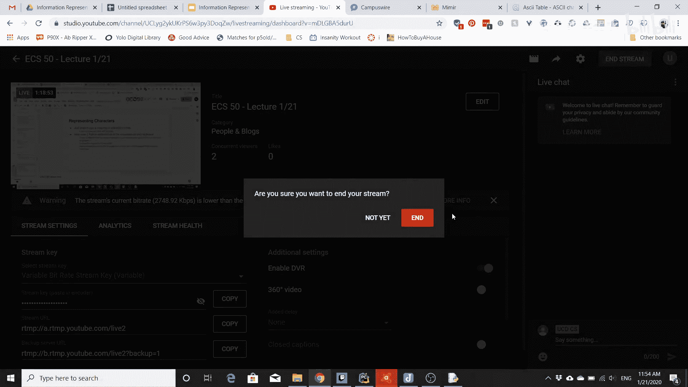