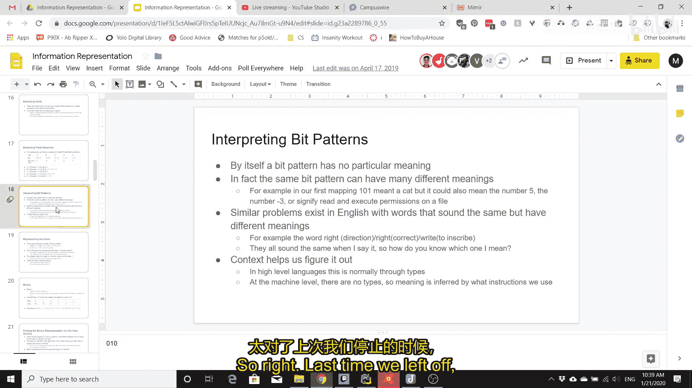
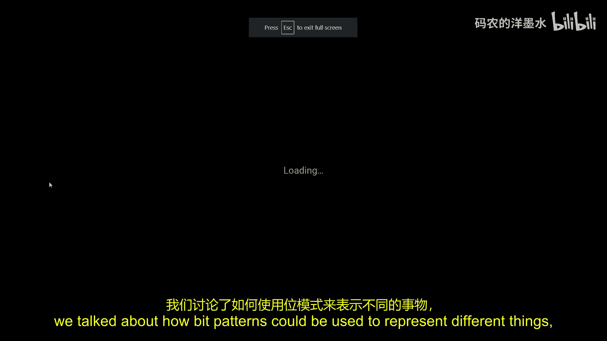
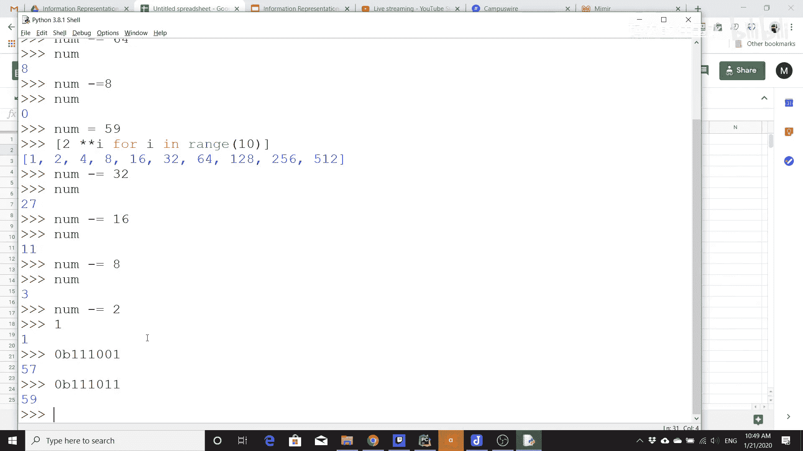
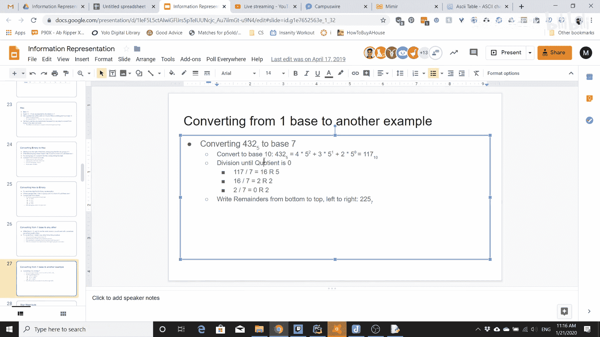
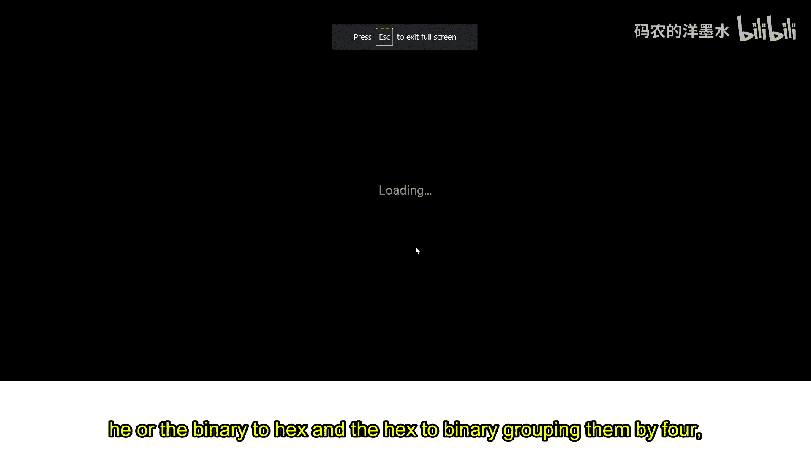
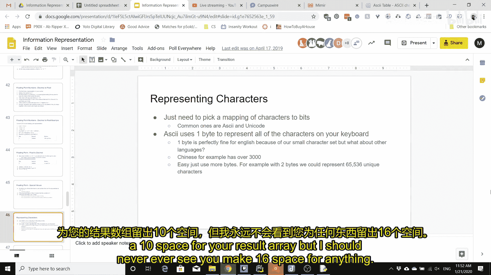
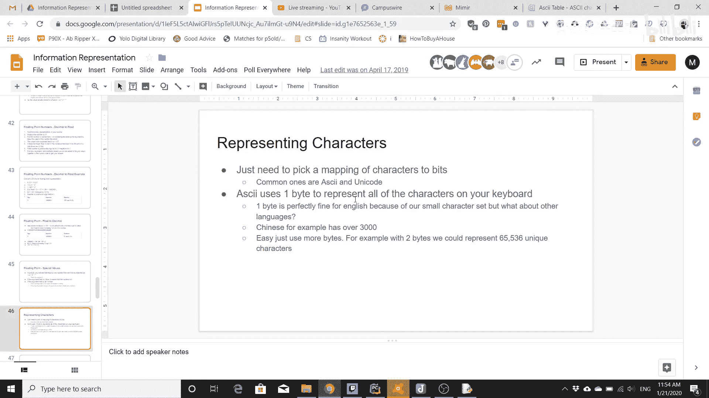

# C语言与汇编语言：04：浮点数与内存基础 🧮

在本节课中，我们将要学习计算机中数字的表示方法，特别是二进制、十六进制、有符号整数（原码与补码）以及浮点数的基本原理。我们还将探讨内存的组织方式，包括字节寻址和字节序（大端序与小端序）。

---


## 问题解决流程 📝





在开始编程解决任何问题之前，遵循一个清晰的流程至关重要。以下是推荐的步骤：

1.  **理解问题**：不要立即开始写代码。首先退一步思考，明确需要解决的问题是什么。
2.  **手动示例**：通过手动计算解决一些具体例子。确保例子具有多样性，并测试边界情况。
3.  **提炼步骤**：回顾你的手动计算过程，总结出解决该问题的一系列连贯步骤。这些步骤应该保持通用性，不涉及具体的编程概念（如类型、数组）。
4.  **验证步骤**：将你总结出的步骤重新应用到其他问题上，严格按照步骤执行，而不是依赖直觉。
5.  **实现代码**：现在你有了清晰的计划，可以开始编写代码。让代码的结构反映你的计划，使用函数来隐藏复杂性。
6.  **测试与调试**：测试你的代码。如果结果不符合预期，使用调试器检查代码执行过程，对比实际结果与你的步骤计划，找出并修复错误。

上一节我们介绍了系统化的问题解决流程，本节中我们来看看计算机如何表示不同类型的数据。

---

## 数字表示基础 🔢




一个比特模式本身没有特定含义，其意义取决于我们赋予它的上下文。例如，数字 `8` 的表示可能与某个新字母表中的字母 `D` 的表示完全相同，但根据上下文，它们代表不同的事物。

### 十进制与二进制

我们熟悉的十进制数 `2356` 实际上是以下形式的简写：
`2 * 10^3 + 3 * 10^2 + 5 * 10^1 + 6 * 10^0`

在二进制（基数为2）系统中，每个位只能是0或1。一个二进制数 `1011` 表示：
`1 * 2^0 + 0 * 2^1 + 1 * 2^2 + 1 * 2^3 = 1 + 0 + 4 + 8 = 13` (十进制)

**快速将十进制转换为二进制的方法**：
1.  列出2的幂（1, 2, 4, 8, 16, 32, 64...），直到找到第一个大于或等于目标数的值。
2.  从左到右检查每个幂值：如果该值小于等于当前剩余的数，则在该位置写1，并从剩余数中减去该值；否则写0。
3.  继续此过程直到处理完所有位。

**示例：将 72 转换为二进制**
1.  列出幂值：64, 32, 16, 8, 4, 2, 1 (128 > 72，停止)
2.  64 <= 72? 是，写1，剩余 72 - 64 = 8
3.  32 <= 8? 否，写0
4.  16 <= 8? 否，写0
5.  8 <= 8? 是，写1，剩余 8 - 8 = 0
6.  后续位（4,2,1）均写0
7.  结果：`01001000` (通常写作 `1001000`)

**将二进制转换回十进制**：将每个位乘以其对应的2的幂次，然后求和。

---

## 十六进制表示法 🔠

十六进制（基数为16）在编程中非常常用，因为它能简洁地表示二进制字符串。每个十六进制数字对应4个二进制位（一个“半字节”）。

*   **数字范围**：0-9, A(10), B(11), C(12), D(13), E(14), F(15)
*   **前缀**：在代码中，通常用 `0x` 前缀表示十六进制数（例如 `0x1A`）。
*   **转换**：
    *   **二进制转十六进制**：从右向左将二进制位每4位一组，将每组转换为对应的十六进制数字。
    *   **十六进制转二进制**：将每个十六进制数字扩展为4位二进制。

**示例：二进制 `0010 1101 1111 1000` 转十六进制**
1.  分组：`0010`, `1101`, `1111`, `1000`
2.  转换：`2`, `D`, `F`, `8`
3.  结果：`0x2DF8`

**示例：十六进制 `0xF1B` 转二进制**
1.  `F` -> `1111`, `1` -> `0001`, `B` -> `1011`
2.  结果：`111100011011`

---

## 任意进制转换 🔄



在不同进制间转换的通用算法如下：



1.  **转换为十进制**：将给定进制的数按位乘以其进制的幂次，转换为十进制数。这是因为我们更擅长十进制运算。
    *   公式：`(digit_n * base^n) + (digit_{n-1} * base^{n-1}) + ...`
2.  **除以目标基数**：将得到的十进制数不断除以目标基数，记录每次的余数，直到商为0。
3.  **逆序排列余数**：将记录的余数从最后一个到第一个排列，得到目标进制下的表示。

**示例：将 `432`（五进制）转换为七进制**
1.  转十进制：`4*5^2 + 3*5^1 + 2*5^0 = 100 + 15 + 2 = 117`
2.  除以7：
    *   `117 / 7 = 16 余 5`
    *   `16 / 7 = 2 余 2`
    *   `2 / 7 = 0 余 2`
3.  逆序余数：`2, 2, 5`
4.  结果：`225`（七进制）

---

## 有符号整数表示：原码与补码 ➖

计算机需要表示负数。有多种表示方法，最常见的是原码和补码。

### 原码
*   最高位为符号位：0表示正，1表示负。
*   其余位表示数值的绝对值。
*   **问题**：存在 `+0` (0000) 和 `-0` (1000) 两种零的表示，使得比较运算复杂。

### 补码
现代计算机普遍使用补码表示有符号整数。
*   **正数**：表示方式与原码和二进制相同。
*   **负数**：其补码表示通过对应正数“取反加一”得到。
*   **特点**：只有一种零的表示（全0），且加减法硬件实现更简单。
*   **范围**：对于n位，可表示 `-2^{n-1}` 到 `2^{n-1}-1`。

**补码取反（求负）操作**：
1.  按位取反（0变1，1变0）。
2.  将结果加1。

**C语言中求补码负值的函数示例**：
```c
int negate(int x) {
    return ~x + 1; // 按位取反后加1
}
```

**将补码二进制转换为十进制**：
1.  如果最高位是1（负数），先写下负号。
2.  对该数执行取反加一操作，得到其绝对值的二进制表示。
3.  将这个正二进制数转换为十进制。
4.  结合第1步的负号，得到最终值。

**示例：补码 `1011` (4位) 转十进制**
1.  是负数（最高位为1）。
2.  取反加一：`1011` -> `0100` -> `0101` (十进制5)。
3.  结果：`-5`。

---

## 内存基础与字节序 🧠

### 字节寻址
大多数计算机内存是**字节可寻址**的，意味着每个字节（8位）都有一个唯一的内存地址。CPU一次处理的数据单位称为**字长**（如32位、64位）。

### 字节序
当存储一个多字节的数据类型（如int）时，字节在内存中的排列顺序称为字节序。
*   **大端序**：最高有效字节存储在最低内存地址。看起来“自然”。
    *   例如，`0x01020304` 在地址100开始存储为：`01 02 03 04`
*   **小端序**：最低有效字节存储在最低内存地址。看起来“反向”。
    *   例如，`0x01020304` 在地址100开始存储为：`04 03 02 01`
*   **现状**：Intel处理器使用小端序。网络传输通常使用大端序。两者无优劣之分，但必须保持一致。

---

## 浮点数表示 🌊

浮点数使用类似于科学计数法（但基数为2）的形式来表示很大或很小的数，例如 `1.01 * 2^4`。

### IEEE 754 单精度浮点数格式（32位）
浮点数被分为三个字段：
1.  **符号位 S** (1位)：0代表正数，1代表负数。
2.  **指数域 E** (8位)：表示2的幂次。为了能表示负指数，实际存储的值是 **指数 + 127**（偏移量）。
3.  **尾数域 M** (23位)：存储小数点后的二进制部分。注意，规范化浮点数总是 `1.xxxx` 的形式，因此开头的 `1` 是隐含的，不存储。

**浮点数的值计算公式**：
`Value = (-1)^S * (1.M) * 2^(E - 127)`

### 将十进制小数转换为浮点表示
**示例：转换 6.25**
1.  **转换为二进制**：`6.25` (十进制) = `110.01` (二进制)
2.  **规范化**：移动小数点，使其成为 `1.xxxx` 形式：`1.1001 * 2^2`
3.  **确定各部分**：
    *   符号 S：正数，`S = 0`
    *   指数 E：`E = 2 + 127 = 129` (十进制) = `10000001` (二进制)
    *   尾数 M：取 `1.` 后面的部分 `1001`，并在右侧补零至23位：`10010000000000000000000`
4.  **组合**：`S | E | M` -> `0 | 10000001 | 10010000000000000000000`

---

## 总结 🎯

本节课中我们一起学习了计算机中数据表示的核心概念：
1.  **进制转换**：掌握了二进制、十六进制与十进制之间的转换方法，以及任意进制转换的通用算法。
2.  **有符号整数**：理解了原码和补码两种表示法，重点是补码的表示规则和取反操作。
3.  **内存与字节序**：了解了内存的字节寻址特性，以及大端序和小端序对多字节数据存储的影响。
4.  **浮点数**：初步认识了IEEE 754单精度浮点数的存储格式，包括符号位、指数域（带偏移）和尾数域（隐含前导1）。







理解这些底层表示是理解程序行为、进行位操作和调试复杂问题的基础。