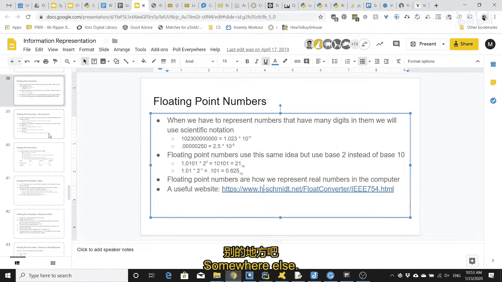
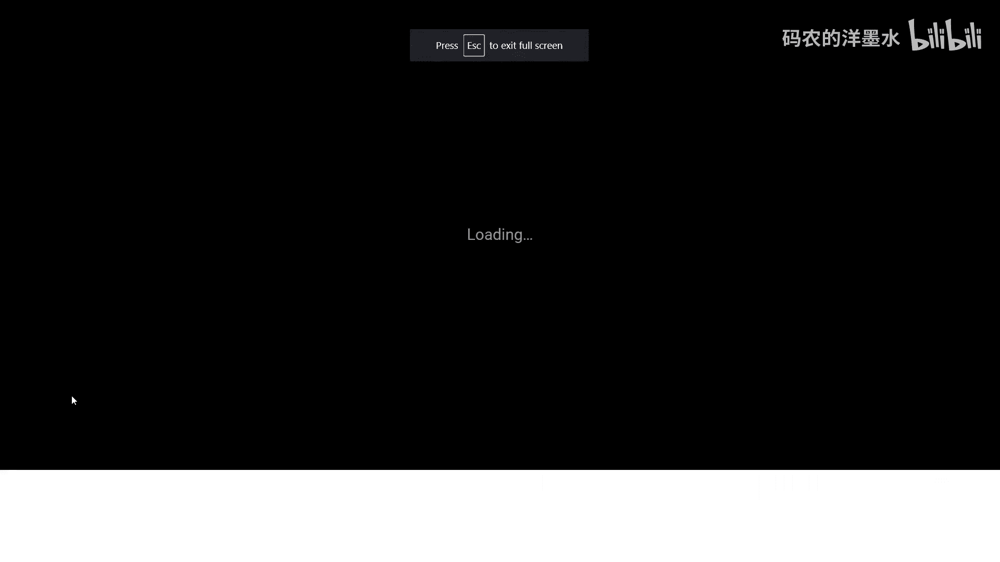
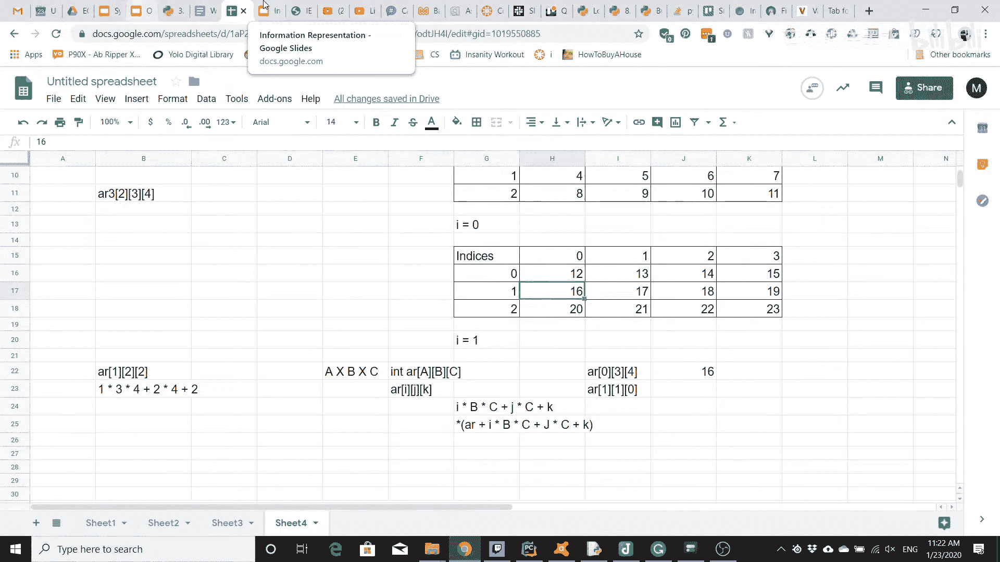
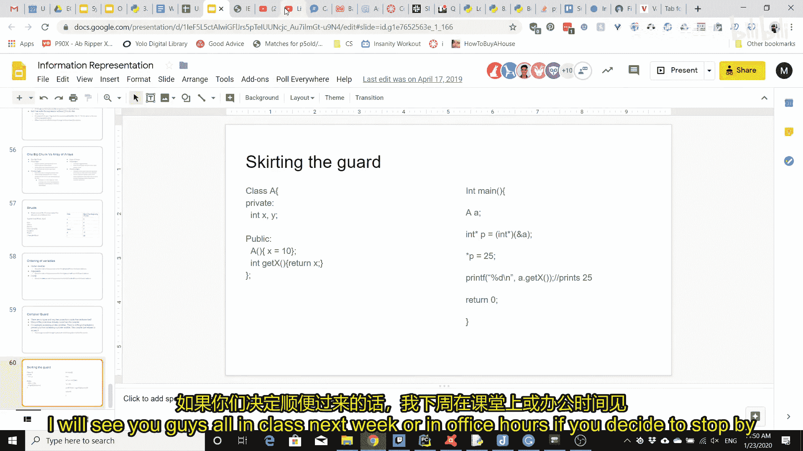
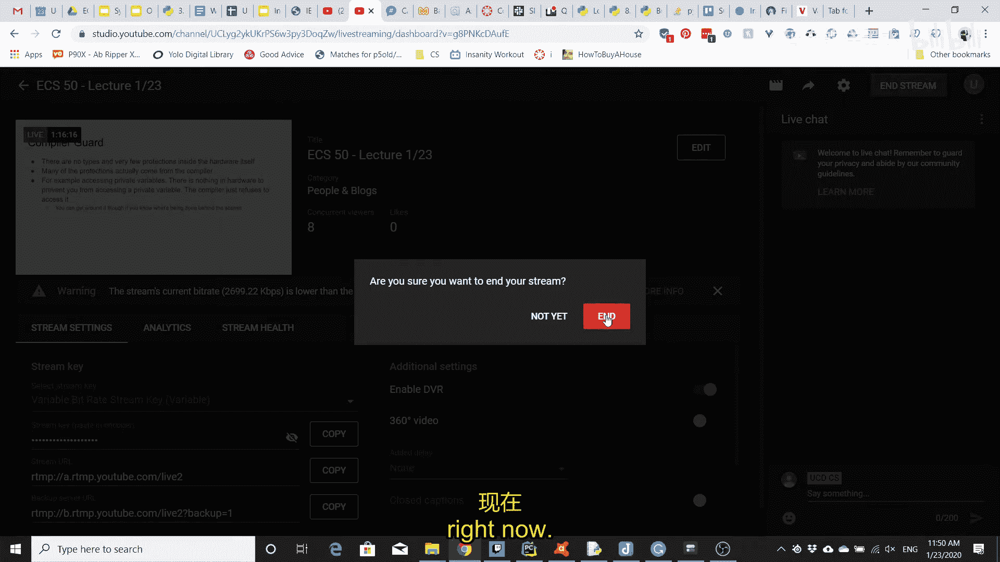

# 【全集】加州大学戴维斯分校 C语言与汇编语言 中英字幕 1080P p05 Lecture 5 - 内存与底层 -BV1xefZBHEas_p5-

Okay， so we're going to get started first I have a question for you。

 why doesn't this following question make sense？What is the binary to say。

 how can I get the binary representation of x？Yeah。

 question doesn make sense because it doesn't say what the A X is originally。No。

Could actually be anything depending on what you're doing。We'm not quite。

Why didn't this question make sense？Sorry。Because yes， x is already in binary。

 everything in the computer is represented with bits so everything is already in binary。

 so asking how can I get the binary representation of my variable doesn't really make sense because it already is in binary。

Probably the question that you're asking is how can I display the binary of x。

 which is a completely different thing and to display the binary of x。

 you just go through each bit and if that bits a1， you print out one and if it's a zero。

 you print out zero。Right， but you have to be able to look at each of the individual bits， right。

 which we talked about on last Thursday， right， Do you guys remember what operator you use to inspect a bit or inspect the bits of some variable to see the 01。

不是。Yeah。If not， go over the slides because it's totally there right。

 we talked about how to look at each of the individual bits of a variable right。

 you can use bitwise and and put a one in the spot that you're interested in looking at zeros everywhere else the result of the expression is true。

 it means that bit is one if it's not true， that bit has to be a zero。Okay。

We'll do one more question to make a couple more questions and make sure that you remember stuff from yesterday。

What does？0ero，1， I should say。10，1101。 What value does this represent？Okay。Oh yeah。

 sure I can make the pump bigger。嗯。嗯。Any thoughts any guesses？贵海。So I got 45。

 anybody agree with that？Well， I could say it might be 45。

But how do we know it's not a pig an old McDonald's farm or a cat right， or the color red？

Right with you're given just an arbitrary bit pattern， you cannot say what it represents， right。

 you need more information to be able to say what it represents。Now。

 let's say we wanted to interpret this bit pattern as an unsigned integer， right？We have one。0。1，1。0。

1， right， This is one。This is our one spot， our two spot， our four spot， our8 spot。

 our 16 spot and our 32 spot， so that's 32 plus 8， which is 40 plus another 4 plus5 so as an unsigned integer。

 it is indeed 45。Right。But what happens if we interpret this number to be a sine at magnitude number。

 what would its value be？那个问。It was sine magnitude right， we look at our most significant bit。

 it's a1。 What does that mean It's negative and then the rest of the bits are the magnitude。

 which is a plus 4，12 plus 113 so this would be negative 13。 What about in two's complement。嗯。

That's the how wanted it。Yeah。So we know the number is negative。

 but negative numbers are hard to work with。So what should we do？

But positive numbers are easy to work with， so we should。一后。

Neggate the number right if we negate the number and we know what its positive representation is and that's easy to figure out and we know the original number was negative。

 we can be negative the positive number and we're done so how do I negate a number into complement。

Flip the bits， right， So that would be 0，1，0，0，1，0， and then。And。😊，Oh， well。You said。

Do you want me begin with apostrophe if it's not？O on。So add one， right， which is 0，0，0，0，01。

So this ends up being。0，1，0，0。1，1。Right after we add this bit pattern。

One more blankk laying there to make it easier to see。 So this is the bottom foot。Then we added one。

0 plus1 is 1，1 plus 0 is 1，0 plus 0 is 0，0 plus0 is 0，1 plus 0 is 1 and 0 plus 0 0。

 so this number is 16，1819， but our original number was negative， so this pattern must represent。

Negative 19。Any questions here？嗯。Okay， next， your first quiz should be up over the weekend。So again。

 we were talking about floating point numbers last time。Right， remember our floating point numbers。

 they are。Represented using scientific notation， but that scientific notation is in base two right and all of our numbers have to have the form。

诶。One point mantia times 2 to the exponent minus 127。Right。

 so let's say we wanted to figure out what is。The floating point representation of let's say negative 19。

So we want to find the floating point。Representation。Of negative 19。So what should our first step be。

 step number one here？Find the binary of just 19 right。

 so we know that the binary of 19 is right here right this is the binary of 19。Is this guy over here。

 right？ The next step， right is to multiply。By 2，2 these0。So now over here。

 we're going to have this bit pattern， which is 01，0011， right times。2， to the zero。Question。

 isn't this just scientific floating sun。是。I mean， there's useful information here。

But this is how it you do it by hand。You know， when'm thing is like。Scientific planning assignment。

The way it's basically converting decimal numbers to their floating representation。 Well， again。

 like when you read the number in using scanf percent F。

 you already have it in the floating point representation， right？

You already have the binary of the float Okay right。

 you just have to display it in a different way than you would normally display it despite printing out the value and seeing though when I put in 65。

0 and I print it out I get 65。0 I want you to show me what the binary is for that problem Oh so that's not。

Not quite because right now we're taking some decimal number or just not just some decimal number。

 we're taking a number and figuring out what its binary or its fulling point representation is going to be。

So what's our next step after we multiply by two？To0。I think someone said something。

 but it's kind of hard to hear。So he said all of our numbers， right。

 they have to be in the form one point something times to the exponent。If we look back here。

 is this in the form one point something， no， so what do we have to do？Pt it in that form， right。

 It has to be one point something， right， so put it in normal form。Right。

 so when we get into normal form， it's going to be one point。Right，0，0，1，1。 right。

 I took my decimal point。 That's right here， and I move it。To the left by how much。By four。

 so now I have to multiply by two to the what to keep the value of the number the same。

By positive four， right because if you be able to play by negative four。

 you'd need to move it even more to the left。We're want to keep the number the same。

So we put it in normal form if we look back here。We know oops right over here。

 we know that 127 is going to be subtracted from our antia， so what should we do？

But if we subtract 127， and then when we compute the value again。

 we're going to subtract an additional 127， that woulds attract out 256。Right。

But what I want to end up with is after I do this subtraction， right。

 my number needs to be to the four。Add 127 to compensate from the fact that later on you're going to subtract 127。

So for the exponent。We need to add 127。So this is equal to4 plus 127， which is。131。

Now we can write out our 4 point number。In its representation， but in the three fields。

 there's three fields。 remember， there's the s field， there's the exponent field。

And then there's the menisa field。 How big is the signine field？

It's one bit big and since our number was negative 19， which should we put here。One， right？

Our exponent field is how big。How many bits。It's 8 bits right， so I'm going to be lazy。

 but you know and just write 131 in decimal right， but you'd actually have 131 in binary or if I don't want to be so lazy。

 I would say the bin of 131。 and there we go。 That should be 1，2，3，4，5，6，70。So over here。Right。

The binary。Of 131。And then we have Armantia， so what should Armanisa be？It should be 0011， right。

 we don't need to store the one point because it's always going to be one point something。

So this would be 0011， and then how big is the mantesa field？

So the entire float is how big in terms of bits。Yeah。Not 16， the entire float is 32 bits， right。

 you've used one bit for thesi and8 bits for the exponent。

 so how many bits do you have left over for the Matisa？23 right。

 so this whole field needs to be 23 bits big right， and I've used four bits so far。

 so how many more bits do I need。19， right， I'm going to have 19 zeros。

 Should I put those 19 zeros os。At the front。Should put them at the front or should I put them at the end？

At the end right because these values come after the decimal point and so you want the zeros to be at the end 1。

 x00000 is still 1。 x， but if you did 1。0000 x， that's not equivalent to 1。 x anymore。

 so then we have and 19 zeros。I'm not going to write that。嗯。Yes。😊。

That's just so it'll actually let me write the zero。

The quotation marks just there because Excel keeps getting rid of the zeros。If I don't do that。

Any questions here？Yeah。Yeah， what is the point that I think I might have forgotten， what is that 1。

7 Oh， the bias？So the 127 is the bias。 So the number in the exponent field it's interpreted as an unsigned integer right。

 but we still want to be able to represent negative powers right We want to be able to do like 1。

2 to the negative3 So what they decided to do is sense it's an unsigned field if you subtract it can have values up to 256 because 8 Bs if you subtract 127。

 it kind of splits it in half。 So if you wanted like a negative value。

 you'd put something like 125 when you do 125 minus 127 you get negative2 for the exponent。I know。

 it's weird， but that's what they went with。Any other questions？Yeah。

Is it clear on how to convert a decimal value to a floating point value？

Do you guys know how to go back the other direction？So let's say instead I gave you this right。

 you have this big old binary thing right here。Right。

 remember the value of the floating point number， it's one point mantia times2 to the exponent right。

 and then the sign bit。 So we look here right and we see our number is。Negative。

 so we know that we're going to have negative， right， And it's going to be negative one point。

 something， right， one point， the Matisa， the Matisa is。0，0，1，1， right？

Then that's going to be multiplied by2 to our exponent， which again， this value right here is 131。

- 127 and 131 minus 127 is。Okay。Four， right， because it was just going back right。

 so this ends up being just four here。And after you do that multiplication， right。

 the decimal point would move to be over here。 So you'd end up， you know。

 that's the same thing as negative 1，0，0，1，1。 And again， if we interpret this bit pattern right here。

 that's the binary of 19。 and we know that it's。Negative， so it must be negative 19。

 thats how you go back in the other direction。嗯。Given this representation of floating point numbers。

 what number might be hard to represent？그。I think it heard it。Zero， right。

 because can you write zero in the form one point something？No。

 so zero has a very spectral representation if the exponent field is zero。

 like literally the exponent field this is just all zero for its bits， it means the number is zero。

Right， 1% one then。So how do you represent one in like regular numbers that would just be one？

All zeros would not be。 No， but isn't something to the power of 01。But again。

 it's a special representation and like one thing that's going to be helpful is。

If you look at this website。So let's say we wanted to see what zero looks like。

 so you can see zero here。RightIt's literally all zeros， the bits are all zeros。

 let's say we want to represent one right， Well， you can represent one as one point something， right？

So when you represent it， it's the mantia is 0， right， But our exponent is 127。 So right you have 1。

0， right， times 2 to the。1，27， minus-1，27， which is0。 So you have one times2 to the 0， which is one。

So it's itss bit patterns won't be all zeros。 One thing that's also interesting is if we go over here in zero。

 if you have it where。The decimal field。Let's see。Because this shouldn't be。That's just sneak 0。

 So there are two representations of 0。 I generally believe that if you get like， impmp。

Or not a number， that's when the exponent field is zero， but the manta is non zero。

I think I had that oop。Somewhere else。

，So special values， if the exponent field is zero that it means that number is zero。

 if the exponent field is all one， that's what I's looking for， if the mana field is zero。

 then it means that number is infinity for thementa field is non zero。

 it means the number is not a number。So if we go back over here to our calculator and we change our exponent field。

TV。All once。It's infinity。RightIt's infinite。 And if I do here， it's negative infinity。Right。

But if the mansa field has a non zero bits。That's a one in part ofmenta， it's not a number。So again。

 that's some special representation for floating point numbers。

So basically everybody follows the rule except zero， infinity and not number。

They follow that same basic format。Any questions？So what about representing characters。

 how would you do that？嗯。I mean， with characters， there's really like no right way of going to do it。

 right， you just say this bit pattern represents this character and we're done with it。

RightThere might be certain things that you can do to make your life a little bit easier。

 but it's really just a sign sub arbitrary pattern to mean this representation common ones are ASI values and Unicode ASI use only a single byte to represent all the characters on your keyboard one byte ends up being fine for English because we have a very small character set but other languages like Chinese and Japanese they have a very large characters set and with only one byte8 bits you can only represent 256 characters but there are more than 256 characters in Chinese and Japanese so you just got to use more bits right so they use Unicode which is two bytes big so 16 bits so they have two to the 16 possible representations that you could do which is65536 unique characters within that character set which is more than enough to be able to cover these other languages。

One thing to point out， though， is let's say we do look at the ASCI table。Is again。

 they're just bits for our representations， but if you notice in the ASCI table。

 all of our uppercase letters are next to each other。

All of our lowercase and the1 numbers are next to each other and they have corresponding like binary patterns that are just like one more than the one that comes after it right so a right is it could be considered to have decimal value 97。

But B has decimal value 98。C has decimal value 99。So if we're over here in Python。

 if I ask for the ord。Of A， which just says give me its numeric representation in bits， right。

 because Python won't let me compare the characters directly together。If we compare this to 97。

It's going to return。True， right， because they happen to have the exact same bit pattern， right。

 the bit pattern for character A and the bit pattern for 97 for they identical。

 you can't tell the difference between the two right。

 and it's only the context that allows us to figure out which meaning we want to use。

 but this also allows us to do certain things where we could try to treat our characters like numbers。

So if a little8 has the value 97， if you do 97 plus two， you're going to get。99， right。

 which also happens to have the same character representation as。C， right？

So here we could do something like is the ord？Of a， right。Plus  two。

 is that equal to the binary representation of the ord of C？Yeah， sure， it is。Or you could do sure。

 which says take this。Nummeric value and give me back the corresponding character。 right。

 We could do something like the ord of a， which， again， just 97 plus 2。 And that's going to give us。

C now in C and C++ you don't have to do this whole ordature thing like C compiler is fine treating the characters as numbers。

 so in C you can just do something like C plus a or C plus2 and you're going to get two letters after C or a plus1 or a plus two and you get two letters after a。

What do you think you would get if you did something like this， C minus a？Again。

 assuming you're working in C。我自己。Two， right， because if you look back at the chart。C has 99。

 a has 97， 99 minus 97。Its2， right， This is might also be why， you know。

 you kind of get like this weird behavior when you compare strings like， is zebra。

 Is that less than Apple。What do you think iszebra less than Apple？True。😊，Mose。啊。😮。

If you're going to do it alphatically，ll it'll going to prepare the characters right individually。

 right， zebra is less than Apple。You might be like， why that makes no sense。Well。

 if we look over here， it compares each character one by one。😡，What's the numeric value for Z？90。

 what's the numeric value for a？97 is 90 less than 97 Yeah， so big Z comes before little A。

 which is you know， kind of explains why you do have that kind of weird case sensitive behavior when you're comparing strings。

Does make sense？And you can utilize like this edition and this arithmetic with characters to make a lot of your current homework assignment much easier than if you don't exploit this。

😊，Any questions before we continue on？Certain thing。

So arrays arrays are you know like we talked about basically Python lists。

 but in see there's two different ways to kind of make arrays。

 there's the static way and there's dynamic array， but when you request an array whether it be dynamic or static all of the elements will be next to each other in memory so if I do AR 10 it's going make space for 10 integers that first integer in that array。

 maybe it's at location 100。That means the second integer in the array has to be at location。

101 the second one， the second third one has to be at 102 and the fourth one at 104 and so on。

 they have to be next to each other in memory， otherwise things aren't going to work correctly。

 they won't be randomly scattered。So AR itself is actually going to be a pointer to the beginning of this space right。

 So when we're doing something like A at I square brackets。

 it's really just shorthand notation for AR plus I de referenced。Yeah。And we come back here。I know。

 maybe make a new sheet。And we make everything big。So when I do something like AR at5。

 this is going to make a new array of integers。Once I type an int there。Yeah。😊，You。Oh。

 I thought I did， I swearwo I changed at the 14。Maybe I have to click on all the fields and say change them all too。

14。So again， here we might have our addresses right in memory。 So we might have again， like 100，101。

102s。102103 right， we can just keep going。memory goes on and it may happen that this array begins at address 100。

 right？So over here， we might have， you know， array at zero， array at one， array at two。Aray at3。

And then array at 4。What value does array have？Yeah， the value of AR is 100。

 it's just a pointer to this beginning location in memory。So when I do something like AR at2， right。

 this is equivalent to star。AR plus2。So what's AR's value？It's 100，100 plus two is。It's 102。

 so go to location 102 and get the value that's there。

 So we're to location 102 and we get the value that's there， which would be the value of array2。

Does that make sense？And this little math of like doing the AR plus I would not work unless the elements were next to each other in memory。

So single dimensional arrays are fun and all， but let's get to the good stuff。

Which are multidimensional arrays。When we have multidimensional arrays。

 there are two different options that we can utilize One is one big chunk。

 So when we allocate our array of say three by four instead of what we could do is just make space for 12 elements or if we make space for a5 by four。

 make space for 20 elements or if we make space for something like a two by three by five let's two times three times2 times three times5。

 which is six times5 or 30 elements。You just make space for one single dimensional array。

 one fat chunk， and then we just have to do some math to be able to locate the elements。

This is what happens and see when you statically create arrays。

 so when you do do something like int AR34， it's actually allocating one single fat chunk of memory for it。

😊，Right the other possibility is an array of arrays， which we'll see in a moment。

 what we do is we create an array of pointers and then each of those pointers point to a row of our two dimensional array。

 this is what's done like in Python， this is what's done in Java。

 this is what's done in CNC plus plus when you dynamically allocate the space。

So with one big chunk we have a couple of options the first thing that we might decide to do is how should we lay it out。

 should we lay out our rows end to end row major or should we lay out our columns end to end column major row major is used by C and column major is used by R。

So over here if this was our row major matrix， which is a three by four， it right has values 0，1，2，3。

4，5，6，7，89，1011 and so when we're going to put them into memory we're going to do the first row then the second row in the third row so notice we have0。

1，2，3。Right our first row and what do we have in our array， 0，1，2，3， followed by the second row。

 4567， followed by the third row， 8，9， 1011， so you just stack them each row next to each other。

And that one big chunk of memory that you made。With column major we're going to lay our columns end to end so we'll have this column then this column then this column then this column and if you look at how the memory is laid out。

 it's 0，4，8，0，4，8，1，5，9，1，5，9，2，6，10，2610， and 3，7 and 11。

Any questions on row major or column major so far in our one big chunk scheme？Okay。😊。

So now right we have to figure out how we're supposed to do our mapping right。

 if we're over here in our one big chunk right， we still want to be able to do array at IJ to be able to access the element。

 to be able to figure out where it's at。So if we pop back over here to row major。

 if I do my array at12， I want to be able to pick out element six， this guy right here。

So we want to think about this， how can we come up with some equation that's going to represent the behavior that we want？

Right， so again， we have two indices。And maybe this will allow us to copy it easily into Excel。喂。

I did。Or maybe I should start that over here。We want to be able to access our array at IJ。

Or as a concrete example of right now， let's try to access RA at 1，2。

We know that when we access our array at1，2， we should get six， but how can we figure that out？

If we think about what's going on， every time we increment I， what does that cause us。

 so I is our row or is it our column index？It's the row index， right。

 So every time the row index increments by one。We have to move to the next row。

And we've laid out our rows end to end， so every time in this example。

 our row index increases by one， how many elements do we have to move past？那不。Well。

 number of columns right in this case。F， right， because if I want to move from row zero to row 1。

 right， I have to go past。F elements， because these four elements are next to each with my memory。

 If I want to go from row 1 to row 2， I have to go past these four elements。

 and it kept going on and the column size was fixed at 4。 I'd have to keep saying I need to move。

 you know， four elements at a time every time my row index goes up by one。Right。

But if we look at the elements within the row， right， they're next to each other in memory， right？

So every time our column index increases by one， if I want to go from 10 to 11。

 how much do I need to move in my one dimensional array？If I want to go from 10 to 11。

 how many elements do I need to move in or in my one dimensional array that I'm actually using to store the values？

One element， right， if I want to go from10 or from 11 to  one two， I need to move。需了解。From 1。

1 to one。Two， one element， if I want to move from one，2 to  one，3。One element， right？

So in this example， right， what equation could we use to convert our two dimensional index。

 which is what we want to use as programmers into the equivalent single dimensional index？Yeah。Right。

What's our single dimensional index going to be equal to？I times 4。Plus J， right。

 but we want to start at which element。We want to start at the beginning of our array， right？

And our array starts at， you know， it's AR。And I don't know why this won't ever let me go back。

AR plus i times4。Right plus J will actually move us to the right element。

 and then if we were dereencing。Is it literally impossible to write in front of this。

 is this like an insert mode？No。So this would be equivalent to doing AR by times 4 plus J and then dereencing it。

Or if we were looking for some single dimensional index that was equivalent， right K。

 our single dimensional index is equal to I times4 plus J。 as Res mentioned earlier。

 if we want to generalize， and our matrix is an M by n matrix， it's going to be I times n plus J。嗯。

Does that make sense？Any questions here？嗯。Okay， what about if we were doing column major？Right。

 if we were doing column major and we wanted to figure out our single dimensional index。

 notice that when our row increases by one， right？Are the elements in are a single dimensional array？

 How far apart are they when we move up by one row， If I go from row 0 to row 1。

How far a apart are these guys？One or from 48。1， or from one to5。One， theyre one apart。

 but when I move across columns， how many elements do I need to move？

Three elements are from here to here。Three elements or from here to here， oops。Also， three elements。

RightSo again， if we're using the same indices， I and J and our matrix again， M by N。

What's our equation going to end up being？If we were in column major。所他这是。J times M。Plus， I。

W which these are。On the next page。Any questions about either one of these equations？Now。

 in your computer， are you limited to only creating two dimensional noise？No right。

 you can create n dimensional or racethetally， so we need to be able to generalize how can we go from in the one big chunk method where we have some number of dimensions and let's see a little bit of an example of this first。

😊，So we can kind of get an idea of what we want to have happen。So over here， let's say that。

We probably need a lot more space to make this happen。You guys hold it down there。

Let's say that right now our new array， our AR3， it's a2 by3 by4。

So if you have a two by three by four， the way that you can kind of imagine this。

Is this is the array when I is equal to one。And this is the array when I is equal to2。

And now our numbers here， if we want to keep doing new values， would be something like 12， 13， 14，15。

16，17，1819。20，21，22 and 23。 And so if we。Keep this going。Out。

Got to go all the way up to 23 almost there。But he's a bit big。22。And we're more 23。

So this is what our。2 by。3 by four array would look like if it was laid out in memory。

 it'd be laid out as this really， really long array of 24 elements。

But it ends up being the first matrix and then the second matrix after it。Right。

 so let's say we were trying to come up with some formula to describe how we should access our single dimensional elements。

 right now we're trying to access right， array ats say， maybe one。2。Hello， two。

We want to access RA there now every time this first index increases。

 how many elements do we need to move？We need to move 12 elements， right？The size of this matrix。

 right Now， once we're in this matrix。Again， the rows are you going to be how many elements apart？

The rose will be。Four elements apart， right， because each row is laid end to end， right。

 it'll be this row， then this row， then this row。So if I want to move from one row to the next row。

 they are four elements apart when they don't memory and each of the elements within a single row is how far apart。

It's one element， right？ So let's say we wanted to access our array over here at I J。So in this case。

 right， what would our math be to get the corresponding single dimensional int？

Single dimensional array index。Yes。Given our concrete numbers over here。ARIt's going to be yeah。

 well， it's just just through the index just because it always is to be AR plus or single dimensional index de reference to get there。

One times not two。Because we said when we moved across one row， we needed to move how many elements。

12， how can we get 12 from these numbers？Three times four， right。

 because that's how big each of these matrices is。Three times 4。Okay at three times four。Plus， right。

 every time this index goes up by one， right， we needed to move one row。

 How many elements are there per row。Four， right， so it's going to be plus two times。4， right？

This two times that four。 Now we need to move We within the row。 So how far apart are the elements。

They're just one apart of piece so just plus two more。So this ends up being。Right，12 plus 8。

20 plus 2，22， right。 And if we look our array at 2。All right，1，22。

 it's 22 and if we go look at address 22， we have 22 there， so we're getting the right number。

What would our generalized formula be if our matrix is an A by B by C matrix， right？

 So I've declared it as A R a。Bye。B。Bye。C。And again， we want to access our array now at IJK。

My is so stupid that it does this， in't。AR。A。B。See。So this is going to be。

 what's the corresponding single dimensional index？I times。Times C plus。J times C plus。Okay。

Or if you look at it， right， we've taken each index that we have I and we multiplied it by the dimensions that came after it。

 right we took I， we multiplied it by B and C， we took J， we multiplied it by just C。 We took K。 Oh。

 there are no more dimensions that come after it so we don't multiply it by anything。

So when you generalize and you want to go row major to n dimensions。

The easiest way to think about it is it each index times the size of all the dimensions that come after it。

Each index times the size of all the dimensions that come after it。

 or if we're really looking for the equivalence of this guy right here。

 it's going to be like you guys said earlier。Star AR plus I times B times。C plus J times C plus。Okay。

I'm going to give you the corresponding element within that array。

If you notice how this definition is kind of defined， you can do some really stupid things。Right。

 what happens if this array at the top， we tried to index it at index，0， say。3，4。

What element will we access？So first， if you look at this。

 is this look like the indices are in bounds？Right，Remember， our array is a one。

 Our array is a2 by 3 by 4。 So 0， that's in bounds is index 3 in bounds。 No， it's four in bounds。No。

 right because you have to be one less so it should be two and three。

 but what element will you end up getting here if you did this？

Because we're going to do I times b times C， which is zero times 12 plus。J， J is。Three times。4our。

Plus。4， right， so we're going to to go to element position 16 in the array。So 16 in the array。

 it's 16， and if we back up here， 16 is actually equivalent to doing array at 100。But the same thing。

Because they end up at that same location and memory。Does that make sense？

Because you get 16 here and element 16 is that position， this should be i equals， not one。

 but i equals。0 here。 and I equals one here。Right， element 16 is that position one。It's not 001。1，0。

gets you to the same spot。对。And the computer will be happy with this and it will do it and it will not complain。

So again， like we were talking about。

Our mappings for n dimensional arrays， if you're a row major。

 it's each index times the size of all the dimensions that come after it， and then you sum that up。

So if our matrix array was D1 by D2 by D3， all the way up to DN。

 and then we had these indices I1 to IN， and the equivalent single dimensional pointer is going to be well index1 times all the dimensions that come after it。

 D2， D3， D4 all the way up to DN， they're going to have index 2 plus all the dimensions that come after it。

 D3， D4， D5， right？Plus， index  three times all the dimensions that come after it，4，5，6。

 all the way up to n。 And then you'd keep doing this until you finally got to the very last index。

 And that's just going to be that index plus that index。

 And it won't be multiplied by anything because there are no dimensions that come after it。

With column major， it's the reverse， it's each index times the size of all the dimensions that come before it。

Right， so again， if here were our indices that we had before， right it's index n times Dn-1。

 Dn -2 Dn-3， all the indices that came before it all the way up to D1 index n minus-1 will be multiplied by dimensions n -2 n -3 n-4 right all the way up to dimension1。

And so on dental line， you compute that summation to get the corresponding single dimensional address。

Any questions on these equations？So if you remember all the way back to week one。

 when we were talking about C and arrays， right， we said that when you declared a static array and you wanted to pass it to a function。

 you had to specify the size of all the dimensions， but which one。But the first one。

 why don't you have to specify the first dimension？But you have to specify the rest。

And C is row major。But you have to specify the size of all the dimensions except for the first one。

Why not the first one when you're trying to pass aesthetic array to a function？Yeah。

When you look at our equation here， is there any term that's missing？D1， which is the size of the。

First dimension， right？You don't need the size of the first dimension to compute your corresponding single dimensional index。

 So C's like you don't got to pass it， but C does need to know the size of every other dimension to be able to compute this equation。

And so that's why with a static array， you have to specify every dimension， but the first。

Any questions about that？嗯。Okay， we'll move on to arrays of arrays。

So when we have an array of arrays， it looks like this structure over here on the right hand side。

Right we have our first array， right， it's an array， but what is it an array of， it's an array of。

Poiners and each of these pointers points to an array of。Values。

 so you have in array of arrays or in Python， when you have a list of lists or a vector of vectors or whatever of whatever。

 right， you're using this type of structure。So if this is the two dimensional array that we're trying to。

To implement that we want to represent in the computer， right， we'd have to make three arrays。

Of pointers and each of those pointers within 。21 row。Of the elements。If you wanted to。

 you could also do it the other array around where you created like a number of column pointer arrays and they point。

 but most people don't like that notation because now the first dimension you can specify would no longer be the row。

 it'd be the column。So you have to write it backwards。

But you could do it that way if you really felt like it。

Or if you were clever and you wanted to do it with column major or like you know based on column arrays for whatever reason。

 you know， you make your own class and you hide it。Right behind some function when they access it。

 and then you do the conversions behind the scenes so they don't have to see it。

So let's say we want to access our array of arrays with no brackets right when we do array at IJ。

 right， it looks just like a one big chunk access， but it's not。

 it's actually different right because if we applied this same logic back here， would it work？

If I tried to access my array at one，2 under the old scheme， right。

 I would take one and multiply it by four to get4 and then add two to get6 So I go to location6 past AR。

 But if I go six past AR am I going to get anything I want。No right。

 so even though this notation is the same as one big chunk。

 what's going on behind the scenes is completely different how the compiler interprets that code and what assembly code it writes behind the scenes for you。

When we do this， right？When I want to access my array at 12， well。

 first I have to find this row pointer。Right， which is， you know。One element past the beginning。

Then I have to go follow this pointer。To this array and then go to location 2 into it， 0，1。

2 to get the element at12， so it requires two separate dereferences。

So when you're accessing this array， it's going to be AR plus I。De referenced。Plus， J。

Dereference that again， right， whereas if it was one big chunk we would have had this。

So all we have to do with array of arrays is chase down the pointers。

 so if you look at this expression， what doesn't appear？The dimensions right。

 the dimensions do not appear in this expression at all。

 which is why when you have dynamically allocated arrays and you're passing them as pointers to pointers。

 you don't have to specify you know at least in terms of the type what the dimensions are because the compiler doesn't need it to look up the element。

So again， if we want to do a little bit more of a concrete example。So over here。

 let's say I first allocate my array of pointers。 So here we have my pointers， and then there's。

Let's say that this array of pointers， this is where ARs at AR is going to actually be down here and he's going to need to point to the first element here。

 let's say this first set of elements ends up at location 100， so it needs to be 101 102。

Right we have our pointers over here and then we have our little arrays over here。

 so they have like the values， let's say A BCD in the first one and let's say this array begins at location 200-201202203。

Then we have our second array down here， maybe he's at location EbNs at 450 memory， so 450， 451， 452。

 453。And he might have E F G，H。And then， we finally have our。Last or right， it's down here。

 Maybe it's at location。50， so he's at 50， 51， 52， 53。IJKL。So over here。

 what pointer will we have to store in our array of pointers？

Where should this first element point to， So maybe we insert a column over here。

These are the addresses。Index。This would be like index zero， index one。And index 2。

So what value would I have to store in here？To be able to access the first row of my array。200。

 right， distort the point of the first element。What would I need to store as my second row pointer？是。

I want to be able to access this second row down here。I would need a store 450。

And to be able to access my third row， I would need to store。Just 50。Now AR itself。

 what value does AR have distort store in it？100。So now let's say I do decide that I want to do something like AR。

At one。wo。Right， the first thing when you're doing something like this is to rewrite the expression as to actually what's supposed to go on。

 So it's going to be star， right and then。We'll all have a start。AR plus one。Plus，2。So what's AR+1？

What's AR's value you start with AR's value is 100。So this just becomes。Come on。100 plus。Oh。

 my goodness。Plus one right， which is 101。 So now we have 101 here and then this de referenceence operator says to do what。

Go to location 101 and get the value that's there。 What's the value that's there。450。

 so this becomes star 450 plus。2。So now what's4 of D plus2？452， and then the dere says to do what？

Get the value that's there so then it ends up just becoming。G。And that's how we。

Chaase down the pointers to end up getting the value that we wanted。 right， We went to A at one。

 We went to element one in that position。Right to get the 450。And then again。

 these are like the indices up here is  zero，1，  two， and three for each of the arrays。0，1，2，3。0，1。2。

3， right， And this what gets us the element。 That's at location 1，2。 It is the G。

Does that make sense？But there was no mention of the dimensions at all。

 which is one of the advantages of using as of arraysse。Any questions here？这。Okay。

 so we have these two methods， we have an array of arrays， and we have our one big chunk。

What do you think the trade offs are for using each one。

 what advantages does an array of arrays have， what advantages does a one big chunk array have and what might be the disadvantages of them？

So give me an advantage of an array of arrays versus。

Or give me an advantage an array of a race has or give me an advantage that a。

An array of arrays has or give me advantage that a one big chunk array has。Well。

 I think a warm chunk array would probably take a about space。

A one big chunk array will take up less space。 Why， Because an array of arrays takes up a square。

 no matter how many。Guys in it don't exist Oh so you're saying that one big chunk is going to take up more space because less space I think。

One big chunk will take up less space because because it doesn't necessarily take up the dimension behind each other。

You are right that a one big chunk array will take up less space basically think for the wrong reasons really。

The one big chunker race， they do take up less space。

 but why I don't think it's for the reason you're st though。

Why would your one big chunk array take up less space？Good by。你的新份嫩。No。

 not because it has some limitations about how big it can be。是。Yeah。😊，AR is like。是个。应该就说了。And这个。

系别就咁样。Yeah right exactly so with an array of arrays。

 notice we have to have this array of pointers right。

 but with one big chunk that we have to have that array of pointers No。

 so there is some space overhead for doing an array of arrays method and as you go out and you have more dimensions。

 the overhead's going to increase a little bit as well right because you'll have like an array of arrays of arrays of arrays of arrays of values right which ends up being you might have quite a few more arrays for example。

😊，In this example， our array was a three by four。Right。

So how many extra pointers do they have to have？We had three extra pointers。

What happens if we had a three by four？By five array， how many extra pointers we have to have？Yeah。

So we have 12。So if we think about the first math， are we able to get rid of this first array of three things？

No， right， so we have an array of three pointers right from this dimension。so we have at least three。

From the first dimension right， but then each one of those arrays points to another array of four pointers right and how many arrays of four pointers do we have three of them right so get another three times。

4。Right so 12 plus three we're actually going to have 15 pointers for that dimension or for doing an array of arrays of arrays ass a three by four by5 right and as you go in more and more dimensions。

 it keeps kind of having to do have a little multiplicative property in terms of how many pointers you want to have so it does waste some space。

So that's one of the advantages of one big chunk Ray house。

Any other advantages one might have or the other？chunkYeah with one big chunk array right we only need about one pointer which is very nice right so there's a constant amount of fixed overhead for a one big chunk array right but with an array of arrays it grows like polynomial in terms of like the number of dimensions。

Anything else besides space？So in terms， yeah。For。に see个 size。Yeah， exactly right。

 with an array of arrays when you're writing a function， right。

 you do not need to specify as part of a type。What the dimensions have to be right so that means if I write a multiate or if I write a like matrix add function right that accepts an array of arrays。

 I only have to write one。because the code's going to be the same。

 but if I want to write multiple or a matrix edition， but I want to do itally。

 I have to do it for every different size of array that I want。Right， which is kind of。

Proy because the code you'd write would be 100% identical， except one of them would have， okay。

 this one has two elements per column。 This one has three elements per column。

 This one has four elements per column。 This one has five elements per column。

 This one has six elements per column， right， And you have to keep specifying for each different possible number of or for each possible size of the number of elements per row that you could have that value。

 which could be， you know， very tedious and probably not very beneficial。😊。

One of the other advantages of an array of arrays is you don't need to know the size of compile time but one big chunk you do because with one big chunk you declare it as array 5。

6 or array 7，8 or array 1，2， 25， 33，64 right you have to know the dimensions at the beginning right or at the very least the maximum dimensions The problem though is even if you like over allocate space statically using a static array。

You will be wasting space when the program's running because the user might not take advantage of all that space right。

 but if the user needs more space than that， well now you're hosed， you can't do it。Right。

 but with the dynamically allocated arrays， the array of arrays。

 you can make exactly as much space as you need and no more。

 So that's one advantage of an array of arrays。 array of arrays can also be ragged。

 which means the number of elements per row don't have to be the same， right。

 I can have one row could have five elements。 The next row could have 10 elements。

 The next row that could have three elements。 The next raptor that could have 20， right。

 because the dimensions don't show up in the equation。😊。

So it could have different number of elements per row， but with a one big chunk array。

 right if you had a different number of elements per row。

 your math all of a sudden breaks and so that's not allowed。

 so there always have to be the same number of elements per row in an array of arrays。

An advantage or in a one big chunk egg。Another advantage of a one big chunk array is that lookups tend to eat faster。

Because you just have to do some math and then you get the value。

Whereas when you're doing an array of arrays， you have to go to this pointer， then to this pointer。

 then to this pointer， then to this pointer， and finally end up the location that you want to be at it also does have like some cash performance penalties because the elements aren't next to each other in memory so they probably weren't preloaded。

The first time you access them， whereas one big chunk， everybody's next to each other in memory。

 so you do get better cash performance because of that。I think that's everything that I remember。

 at least。那。To all them。So now let's talk about， so I should say now。

 you know enough to do all the homework assignments。嗯。We've covered sufficient information。

So if you haven't started on them， totally be doing that。So strokes are essentially classes。And see。

And the way that they actually work in terms of how theyre represented memory is when you declare some struct。

 the elements in thestruct are just laid out next to each other in memory。

 so if we declare our array where we have declare array， declare struct， we have X。

 which is an integer， y which is a character， a short， which is S s is a short。

 we have an array of characters， we have a double and af floatat。

Those elements will just be laid out one right after the other in memory and when you declare your' struct。

 what you're going to end up with is just a pointer to the beginning of thestruct。

 so it's like an array where the elements are of mixed sizes。

 but that's fine because we know exactly how many elements are going to appear in this array and exactly what spots that particular type will appear at。

So over here， how many bytes big is a integer？是。Assuming a 32bit machine。

It's four bytes big right so here we have x， it's zero bytes past the beginning of the rig it starts right at the beginning。

 but since x takes up the first four bytes， the next element has to appear how far past the beginning。

Given that x is  four bytes big， our next element has to appear how many bytes pass the beating of thestruct。

4， right， Because X is taking up the first four。 And so if we look at why it starts at4。

 how big is a character。One byte big right so that character so the next value after y S。

 it's going to have to appear one byte after y right。

 but if y appears four bytes past the beginning that means s has to appear。

Fib bytes past the beginning， right， we have to go past x and y4 plus1，5 bytes in total。

A short is two bytes big， so our next element name has to appear。是。

4 for x plus one for y plus 2 for S。Seven， so name appears seven elements past the beginning。

Our array over here， how many bytes big is it name？😡，嗯。

It's 10 bytes big right because we have 10 character and each character is one byte big so 10 bytes past name we're going have our next element。

 which is D。 So we going up here at 17 our double is8 bytes big so8 bytes past D will have F so he'll end up at position 25 in the array and so when you're doing something like my struct or my class dot member it really is just saying oh go this mini bytes past the beginning of this object and then access the element that's there。

And you're done。Does that make sense？Any questions on that？So let's talk about how variables appear。

 so global variables they're stored in order of appearance， so if you have globals AB，CD。

 A will be at the lowest address， D would be at the highest address。

Arguments are also stored in order appearance。 So the first argument has the lowest address。

 So if we had arguments X， Y， Z， X would appear， then Y would appear， then Z would appear。

 but they'll be next to each other in memory。 and locals。

 they're actually stored in the reverse order of appearance。 So if we had locals ABC D。

 local D would appear before local C， which would appear before local B。

 which would appear before local A in terms of memory。

 So D would have the lowest address and A would have the highest address。U。

So let's talk about this about the compiler guarding you， right like protection levels。

 public and private。There are actually no types and there are very few protections inside the hardware itself。

 Most of the protections that you get for like why the compiler will like like you can't do this。

 The compiler will compile it It's just from the compiler The compiler could write that code for you but it refuses to right just like if you ask your mom for a cookie before dinner。

 Could she give you the cookie， Yes， but she refuses to do so。Right？For example。

 preventing access to private variables， there is nothing in the hardware that prevents you from accessing a private member variable。

 the compiler will just refuse to access it outside the class。

But if you know in memory where things appear at right and where the elements are actually supposed to。

 and you get the address of that variable。And then you dereence it。 Well， hey。

 you can totally access that private member。 I would never recommend doing it because if you're doing this。

 you actually have to know how all the objects are actually laid out in memory。

 which probably means you have access to the source code。 So， you know。

 you might as well modify the source code to make it public at that point。

 But I'll show you an example of that next week。😊，Right， so you can get around the card。

 So over here we have a， he is private integers X and Y。Here's public A， right。

 He's going to add a just x equals 10， get X。So over here right， we have a variable A。

 I type an integer pointer to be equal to A's address， so where is P pointing to in terms of a。

Given what we just talked about with Strs and classes。Where's P pointing at？

It's pointing to the beginning of A， what's at the beginning of A？X。So if I say star p equals 25。

 where's p。2？X， so what's it going to change x to？25， so you'll print out 25， even though x is。

Private。😊，Because I knew where in memory it was going to be at in terms of how the object was going to be constructed。

I will see you guys all in class next week or in office hours if you decide to stop by。没呢。😡。

好的好玩。You say that。

