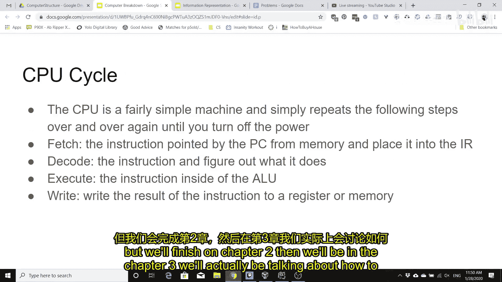
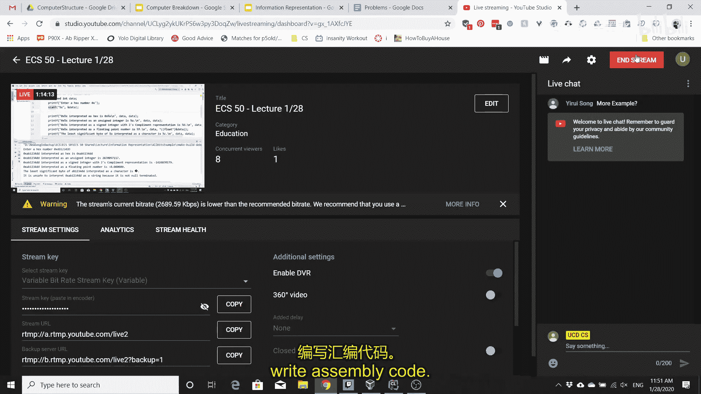

# 【全集】加州大学戴维斯分校 C语言与汇编语言 中英字幕 1080P p06 Lecture 6 - 硬件基础知识 -BV1xefZBHEas_p6-

Change bits to one you use。So here's or， here's and here's XO。

Which one looks like it might be useful for changing a bit to one？Or right。

 So if you want to change bits to one， use or if you want to change bits to 0， you use。

And if you want to change the value of a bit， you want to flip it， you would use。

IfYou would like to flip a bit， which bitwise opportunity do you use？Use XO， right？

This kind of chart here gives you an idea of how you can utilize them right If we or something with0。

 it stays the same。 If we or something with one， it becomes one because true or something is true。

 If we add something with0， it's going to become zero， If we add something with one。

 it's going to become itself right it won't change true and something is dependent on the other thing。

 but false and something's always going to be false。If you x or something with zero。

 it's going to be still whatever it is because false or false x or false is false。

And true X or false is true。If you do true x but if you x or something with true。

 it'll be the opposite because false x or true is true and true x or true is false。

 so you can flip bits with x or。Now lots of times you want to be able to work with the I bit， right。

 change the I bit， read the I bit， do something with bit I right where I is some variable amount。

The way that you can get this is by combining the bit shift operators with whatever it is that you want to change it to or change it to。

If we think about the bit pattern for one。What's the bit pattern for one？是。Right。

 the bit pattern for one is 0，0，0，0，0，0，0，0，0，0，0，1， right。So if I wanted to check bit0。

 one is fine because it's going to be at position zero， but if I wanted to check bit2 right。

 I'd have to move that one over into the second spot right into index one if I wanted to check the bit in index2。

 I'd have to again move it over to get to that spot so notice we have this original bit pattern1 and I moved over which direction left or right。

Left this one is again moving left right so if you want to get a one at position I。

 what can you write to make a one appear at position I where you may not know what I is ahead of time？

Yeah， you can just take the value one and。Left shifted I。

 and that's going to put a one at position I and zeros everywhere else。Does that make sense？Yeah。

 could you explain how。RightYeah。Well again， like if you had a string like a regular string and you wanted to go through each of the characters and then string。

 how would you do it you'd do a loop right youd to access array at I right。

 but here you want to access bit I and we'll talk about how we can look at what bit I is in just one second right but it's going to be using something like this because this is going to allow you to put the one in this spot that you're interested in right and zeros everywhere else。

So what would I do if I wanted to change bit I into a1， right， I have numb over here。

 and I want to change。Change。Bit。I of。A 2，1。 What would I write here。So take two things。

 what operator do we use to change things to one？Or right， So we know that we're going to have to。

Or something right， but we actually want a to change， so can I just write or will that change a？

We're going to have to do or equals right or a equals a or something right if you don't assign to it。

 it won't be modified now how can I make it so that changes bit I to01？

That's just going to change bit。0，2，01。 I want to change bit I。So if I want to change a bit to a1。

 should I put a1 at that position or a zero at that position？Come back up here。

 if I want to change right， we know we're using or， I want to change a bit to one。

 should I put a one at that position or a zero at that position？A one， right。

 because if you or something with zero， you're going to get itself。

So this is always going to change bit0， but I want to change bit I。So I need to get a1 at position。A。

 so how can I get a one position I？We left shifted by eye because if we take one and we shift it to left by eye。

 a one ends up that position。I， and you end up with zeros everywhere else。

 So this will have let you change bit I of a to one。

Do you guys need to see anybody want to see an example of how that's actually working？Sure。So。

Let's put in a table here， or maybe it'll still one of these ones。So what do you want your eye to be？

First。This is the values of the bits that we have here just represented as letters。啊。

Which bit do you want to change picking I between zero and seven？3， right。

 so let's say we want to change bit 3。Right。So this is our variable right here right。

 it's bits going across Now when we just start with one， well， one is the bit pattern 0，00，00001。

Right， well， now let's take one and we want to shift it to the left by I and I in this case is。3。

 so take one and shift it to the left by 3。 And we move this one over 1，2，3。

And we bring in zeros to fill it in， and we have。Ones。Everywhere else。Now when I do this or。

Or with one shifted to the left by three。Right。Focus on this row right here， A or0 is。Ay。

 B or zero is。C or zero is。C， D or 0 again， focus on this row right here。 D or 0 is。D，1， or E is。1。

Right，0 or F is F。Zero or G is G， zero or h is。H and notice we've now changed bit 3201 and you know assuming that we actually did the assignment here it says set var equal to what this value is。

 var will change to be ABC D1 FGH。Any questions here？嗯。Just bringing lots of questions about this。

I want to make sure we're clear on this。Okay， so what would you write to change。Bit。I of Vr。2。0。

Which operator are we going to use？B right， and since we want to change Var。

 it's going to have to be and。Equals， right。 Now， if we wanted to change something to a 0。

 do were want to put a 0 there or a one there。0 there， right。

 And we need ones over else because a and one is a， but 0 and a is 0。 So' going to force it to be 0。

 if we put a zero at that spot。 So how can I get a0 at position I。Yeah。Here。So we could try doing。

 let's say zero shifted to the left by eye。Now if we try doing this。so here's Var， this is zero。

 and again， let's say we're still trained to now change。Come on， get this line。Change bit 32 a0。Well。

This is 0。Zero shifted to the left by three is。0， and so var n equals with0 shifted to the left by3 is going to be。

0 or a is。0，0， or v is。0，0 or C is 0，0 or I mean， not0 or D，0 and D is 0。0 and E is 0。0 and F is 0。

0 and G is 0。 H and 0 is0， So this would change everything in here to just be all zeros if we try to do this right。

 because0 shifted to the left Any the amounts is going to be。Zero， I won't change。Right？

Let's say though， we had tried to do it with a one， right？So again， here's one。Here's one。

And now here's one over here。Right， but now when we end it， right。

 we end up keeping the E and everything else。Become zero， right， Is that what we want？嗯。

Wass that our goal？No， right？But is it somehow related to what our goal was？

It's the opposite of what we want。So how can I get the opposite bit pattern of what I have？Yeah。

 you negate it so till they。One shifted to the left by eye。

So if we take that's one shifted to the left by eye and if we insert a row below。

 if we do till day one shifted to the left by three， well it's the opposite of the row above， so 1，1。

1，1，1，1，0，1，1，1，1，1， and now if I and these guys together。有。If I end these together， right， one。

 you just focus in the bottom row，1 and A is a，1 and B is B，1 and C is C，1 and D is D，0 and E is0。

And then we're going to get F and1 is1 F or1 n G is G 1 and H is H。

 so ABC D0 FGH right and that will change bit3， So all we need to do is take a till day on our one shift to left by eye and end it and that will let us change bit I to a0。

Any questions？Now， what do you think？Flipping嗯。BitI is gonna be。

Right what operator would we use to flip the bit？We just mentioned it a little bit ago。

 which operator do we use to flip pits？Yeah。It's the XOR right。

 if we come back to the chart that we started with the beginning， notice that if I exO something。

 I can make it be the opposite of what it was。Right。😊，And again， it's only if I ex or it with one。

 it'll become the opposite of what it was。 If I exhort it with0， it'll stay as being what it was。

 So here， if I want to flip bit I of v， Well， I know I need to change var。

 So it's needed going to be in X or equals。And so what do I want to put at position I。

 Do I want a one there or a0 there。是。If I'd like to change the bit if I want to change bit I。

Do I need to put a one there or a zero there？A one there， right？

 So how can I get a one at position I。Just one shifted to the left by eye right。

 Like notice the pattern has almost been universal every single time， right。

 we just change the operator。And then for and， we had to negate the pattern。

But each one of them was always variable and equals x or equals you know。

 or or equals one shifted to the left by I。 and in the case of changing to zero。

 it was the opposite of that the same pattern， you know rinse and repeat every single time just。

Combining these two things together， getting a bit at some position， use left shift for that。

And then using the appropriate operator to modify， Do you guys have any questions here？

But changing bits。So one of the things you're probably interested in doing is looking at bits。

 figuring out if that bits value is a1 or a0。Now in programming。

 what's considered to be true and what's considered to be false。0ero is false， right？ What's true。

Everything else is true， right？Everything else is going to be true right so what we need to do is we need to get some expression that's going to leave us with either true or false right zero or non zero based on whether we have a one or a zero at that position right？

So you want to check。If bit I is a zero or one。Now。

 which of these operators seems like it's going to be the most useful？And or not， or exor。Right。

 and a good way of thinking about this。Is let's see an example。

 so let's say we wanted to check bit three， right？And what we should focus on is our end goal。

So we'll get rid of that right now。At our end goal。

 if we wanted to check to see if B 3 was a0 or a one。What would we want down here at the end？😡。

To be able to identify whether bit3 was a0 or a1， what would you want this expression to be here at the end？

Discuss with your partner。Take a minute， think about what would you like here at the end to be able to figure out if you have a one or a zero。

At position three， right， we want to check bit3。Is a zero or a1？我。Oh。是点。いさ。不上解。The enforce。这量情。I。

Okay， so let's get back together。 Let's break this down into two parts， right， Well， if bit 3 was a0。

 what would you like this final result to be。Yeah。We'd like it to be all zeros， right。

 because if bit。3。Was the zero， you'd like to know false， that's identifiable， right， it was not set。

Now， if you had。A one at B3， what would you like your bit pattern to look like？

RightBecause if so right now， right， if our bit pattern is all zeros， right？That's false， right。

 and it means the bit was not set to a1。Right， so if we want to be able to use some other value to represent it being set。

 we probably need it to be true right， so we need this pattern down at the bottom to be what？

What's our definition of true？Not zero， right， So we need a non zero bit pattern down here at the end。

 if we want it to be able to be true and we'll say true means we have a one。

 So what we we a decent bit pattern here be to be able to let us know that， yeah， E was you know， E。

 the bit at position 3 was one。一发生。Yeah， it'd be fantastic if we could get a one to show up here。

 right？But at the end of the day， right， whether we get a zero or a one here depends on what。

What the value of the bit is at position 3。 And so right now， what would be ideal to get would be。E。

 right， Because if E is 0， this bit pattern will be。0ero， false。 and we'll know that it's。E was 0。

 right， the position 3 was0。 If E is one， this value bit string will be non0 because E is1。

 And so we're going to know that what we have right here at position 3 was a one。

 So what could I do to make this bit pattern come about What operator seems like it's going to be useful and or or X or。

是。Who votes for or？Who votes brand？Who votes for Rexor？Yeah， I'm totally going to go with Anne too。

 right I just need to hear you guys say it。So we're going to want to take var and we're going to want to end it right and what would our bit pattern over here we want to end it with B。

 would you want at this spot？0， right，0，0，0，1，0，0。0。This is the bit pattern that we like to get。

 How can we take R1 and make it be equal to this bit pattern？Because here we have one。

So what do we have to do， We have to take one， and we have to move it to the left by。3， right。

 which was our I in this case， right？ Then you said we'd like to end them together。

 So var ended with。One shifted to the left by three will give us this result where we have 0000 E000 right。

 this will allow us to check to see if the bit is where or not do we want to change var here。No。

 we don't right， We just want to check it so there's not going to be and equals。

 it's just going to be and because we just want to produce this new pattern without changing the original。

So here， let's say we want to check if bit I is a1 or a0， what would you do？嗯。What do we do？Yeah。好啊。

Bye， yeah， right。And if this condition is true。What's that mean？

If that condition above evaluates the true， what does it mean about bit eye？Yeah。😊，Yeah。

 bit I is a one。Otherwise， that must mean bit I is。A zero。I mean。

 this allows you to check to see whether bit I is a1 or a0。 What's wrong with this。嗯。

Eals equals one or equals equals true。What's wrong with doing this equals equals one here？

I'll put parentheses here just so that we don't get confused。What's wrong with that statement？Yeah。

This是 why。The food is just not zero。嗯然我人这个。It could be something not， yeah， not in zero。

 but you it doesn't have to exactly be one， right， five is that zero。No， but it's true。

 but it's not one right， even if you think about this pattern down here， this value。

 if e was a1 would be 1000， what's that value there in terms as interpreted as an unsign number？Yeah。

 it's two to the three， right， which is。Eight， right， so is8 equal to one？No， but is this bit set？

Yes， so don't set it equals to one。It's not what you want to do。

One other thing that I wanted to point out that I've seen is。If somebody does this。嗯。

What are they doing？Oh， this is not oops， that gra word here。Pow does2 to the eye。Yes。Yes。I mean。

 some of you have done this in your code， right？Or something similar。

just it's not just one person I've seen through this is multiple。

 so someone here must know what they're doing。う。Yeah。

 you're trying to check to see if the I bit is one， right， but is that obvious？As obvious as this。

I wouldn't think so right this looks like you're doing exponentiation for some reason then ending the result right and yeah。

 you really will be checking bit I if that's a1 or a zero just like you were above。

 but this is also much more expensive to compute。😊，Versus just doing the shifting to the left， right。

 This is because if we think about something in base 10， right？If I have like  one， two， three， four。

 and I multiply this by100， what do you do？You just add three zeros right， you would just get one。

 two， three， four right you don't even have to think about it it's just like add three zeros and we're done。

Right， but if we couldn't， you know， move one to， if one， two， three， four。

 we couldn't add the zeros at the end， right？If we notice。If we shift this guide down a little bit。

What does this look like we're doing？With one， two， three， four。We multiply it by 10。

 what does it look like we're doing to one， two， three， four。Looks like we're left shifting it right。

 we're moving all the bits to the left by zero right because when you multiply by some when you multiply by the。

When you multiply the base to some power， right， you just add that many zeros。

 so if you multiply by 10 to the n， you just add n zeros。Right。

 which could also be interpreted as shifting something to the left by 10。 again。

 assuming we're working in base 10。 But in the computer， we work in base 2。

 So if you do something like a times 2 to the N， right， you know， a times。P to n。

 this is just a shifted to the left by n， assuming that a is an integer value right。

 does not hold for 4 point representations because they're weird。Right。

 but it's equivalent to shifting it to the left by end， whereas if you multiply something。

By the negative n， well that's equivalent， again， all integers here。

 that's equivalent to shifting it to the right。By N。Right and finally， if you do this， a mod。

P2 to the N。 Well， this is equivalent to a ended with。嗯。Cal to n。Minus1。And this whole and goes here。

So if you mod something by 2 to the n， it's equivalent to ending it by2 to the n minus1 a good way of thinking about this is let's say you mod something by eight。

 what are the possible values you get？0 through seven right now what's one or eight minus one？7even。

 right so。8 minus1 is seven。What's seven in binary？Zero B， right？One，1， one， right， three ones。

At the end。Now， if you think about it， if you only have three bits。

 what possibleteger unsigned integer values could you represent？If you have three bits， right。

 you can represent two to the B things。 So 0，1，2，3，4，5，6，7。 Oh， that's8， right。

So if you mod something by if you end it by 7， you're only going be able to have values between 0 and 7。

 which when you mod it by 8， you end up with values between 0 and 7。 Again。

 the same pattern would go up if you go up to higher powers of 2。 So if you mod something by 16。

 you can get values between 0 and 15， which you need 4 bits。For those values， the lower foremost。

 or if you go up to 32， right minus by 32，31 ishi or 31 will give you5 ones。So。

You should be cool there。So those are some interesting kind of side notes about exponentiation。

And powers of two， some base。 but again， if your intent is to manipulate the bits。Which is clearer？

The shifting。Or the exponentation， if all you're intending to do is actually move the bits。

The shifting right， now if you actually needed to do the exponentiation and you knew it was always going to be powers of two and you're working with integer numbers。

You could， as like， you know， an execution speed up， do a left or a right shift。Instead。

depending on whether you're multiplying by positive or negative powers of two。

 but in general I would say if you're doing exponentiation。

 it's probably just clear to do the exponent because that was your intent and it carries much you in your code。

I've also seen some things like this。干嘛。What's hard about reading this in terms of you as a reader？

Well， it's hard here。There is a lot of ones here。 Do you really want to be counting the number of ones here？

没。No， right， because like， if I was doing this， I'd probably be like， okay， space， that's for。 Oh。

 that's4。 That's 4。 That's 4。 That's 4。 That's 4，4。4our。4，4，4。four。4 and one。Right。

 but you can't write that in the C code。 It won't work。 But how many groups of four do we have here。

1，2，3，4，5，6，7，8，9，10，11，12，13，14 groups of ones， right。I'suming I didn't mess up in my accountinging。

Now each hex digit is worth how many bits。Not eight， a hex。

 a hex digit can have a value between zero and what？15。

 so how many bits would you need to represent the values between 0 and 15？F。

 so every hex digit's worth four bits right now which hex digit has the pattern 1111。F right。

 So if we were doing this and again， this is maybe not the best example， but var 0 X， right。

 we have1，2，34，5，6，7，8，9，10，11，12，1314。 Again， I would still say hard to read right。

 but it's a lot easier to read We also have this leftover one here with the representation of one。1。

 right？ So one。Which I'm going to argue is probably easier than reading， you know。

 we had four times 14 plus one ones， right whatever that happens to be。You know， 56， 57 ones。Right。

It's much easier。 Or again， like， let's say we wanted to have something like 201s。

 What's 21s look like if you write it as。Hex， what's 21s？So every F is worth how many ones。

Every F is worth four one， so if you wanted 20 ones， how many s would you put down？One， two， three。

 four， five， Okay， that's a lot easier than reading21s。

And so one of the advantages of using hex is that it gives us a very nice shorthand notation for writing very long binary strings。

 right they're going to be a quarter of the length。So if you're working with long binary strings。

 don't do zero B。It's really hard to read， right？Just use the hex notation instead。Yeah。

 so we are by。嗯。好下。What's the type of the literal OX and V？ハプ。

It's probably either like an integer or unsigned integer。But I'm not 100% sure。

 like if you really want to get specific with the types， there are prefix as you can add in the end。

Like you。So it's an unsigned it now， or you can be like， you know， unsigned long， unsigned long long。

And so if you look at the documentation for C， you can see like what the prefixes are for the literal notations to make sure that you get the right type。

what is the difference between so the difference between signed and unsigned is unsigned numbers can't have negative values。

But signed numbers can。Represent negative values。Right。Which is a good follow up。

 let's say we have B bits。What's the range of numbers I could represent as an unsigned number？

So if we had an unsigned number， what are the values that I could represent。

 our lowest value would be。Zero， and what would our highest value be？出。Yes。

So I'm hearing a lot of two to the Bs that's almost right if we have B bits。

 how many patterns can we represent？2。Yeah。欢。If we have B bits just in general。

 how many unique things can we represent the B bits，2 to the B， right。

 Notice if you said your maximum value was 2 to the B， that's already 2 to the B。Plus。

 one more for having the zero。 so we could go between。0 to2 to the B minus-1。

Does this work if I do control nope？Ctrol shift， plus。Okay。

 I don't remember what the format thing is to make it go。Superscripts。Control plus dot。

So that's two to the B。Minus1 would be the maximum value that you could represent。What about for？

Sine magnitude。So to help you kind of figure this out， let's say we had three bits， right， bits Xxx。

 right？This part right here is the magnitude， right， So we have two bits。 So with two bits。

What values could I represent if I only had two bits。If we have two bits， we can represent。

4 values that we start counting from。0， so we'd have 0，1，2，3， right。We would have positive。You know。

 up to positive 0 or positive 3。Down to negative three， if we had a one there。Right。

 so notice we're using half of our bits to represent。U。You know。

 half the bits or we lose half the values because one of our bits is a sign bit right we lose one bit for the same sign。

So that's going to take our values to be between。Negative2 to the B -1。2。2 to the b minus1。Again。

 if you think back to our example with。Three bits， right， Only these two bits give you magnitudes，0。

1，2，3， right， that's the max I get with two bits。And then I have positive， zero， positive  one。

 positive2， positive3， negative  one， negative2， negative 3。

 so negative2 to the B minus1 to2 to the b minus1。For two's compliment。

What would our range of values be？Yes。So。Oh， I messed up。 it should be two to the V minus1。

Minus1 there at the top because half the values are positive， half the values are negative， right？

For twos compliments。It ends up being negative2 to the B。To positive2 to the B minus1。

 so negative2 to the b minus12 positive2 to the B minus1 minus1。

 This is because the zero representation gets prolongeded in with a positive numbers。

 that's why there's one fewer positive numbers。Does that make sense？

And we'll do one other thing where you can mess with your friends if you want to， but no see。

 So let's say we have our int X， it's equal to negative 1。

What's the representation for negative one and binary？To's compliment。Right。

 so you can imagine like you're at zero， if you're at zero right in our odometer， you wind it back。

 you end up back one， you end up at9，99999，99， what's the equivalent of 99999。

In two complement or in binary， it's all once， one，1，1，1，1，1，1，1，1，1， one，1，1， one，1， one， one。Now。

Let's say we now have an unsigned in， why。And set it equal to negative 1。 Yes， this is fine。

 but the pattern that ends up in here is just going to be1，1，1，1，1，1，1，1，1，1，1，1，1，1，1，1。

And we interpret that as an unsigned number， what's 1，1，1，1，1，11？It's huge， right。

's the largest possible unsigned number you can get。Now let's say we did this。

X shifted to the right by  one is equal to y。Shift it to the right by one。Right。Friend， yes。Else。

Friends know。So how many think yes will be printeded？How many think no will be printed？

Talk to your friends。See what they think。See if we can come up with a reason。他就是。システ公司。会。开上嘅话。关理。

Yeah。这まさ。す。一下。粉色都是紫色。This making。一后这是。就是。这是。我前で。说。把。买。还是没有。So what are you guys's thoughts。

 how many of you guys are in the group that yes will be printed？

How many of the camp that know will be printed？For those of you that say no。Why not？I mean。

 sure if this was a test， you could just circle one and I don't know why you think it's one or the other but。

Yeah， so。So why is on site， right， after you shift your water， is just still on it you become as。

Y will still be unsigned and X will still be signed after the shift。Yeah。

The other thing is to think about is what does the computer use to represent everything？

Everything that can be represented with what？Yes。What does the computer use to represent everything？

01。 It uses bits， right， Everything on computer is represented with bits， right。

 So when the computer is doing this a quality test， what's it checking to see。Again。

 you're the computer， right？Everything you see is ones and zeros， right。

 Two things would be the same when what。Right。If their bit representation is the same right。

 if you have the same bit pattern， it's the same， that's why you can say like does a equal 64 like。

Letter A equals 64。 and the computer be like， yeah， they had the same representation， right。

 To the same thing。 There's no difference。Right， so we know that x and Y， right。

 they start out having the exact same bit pattern， right？

We then shift both of them to the right by one。After you shift x to the right by one。

 what are you going to end up with？So is it going to be this？

If we take y and we shift it to the right bio1， were we going to end up with。And binary。Again。

 I'm not writing all the ones。 You know， there's a lot of ones， but just， you know。

 you're saying somethings all ones all the way down。We shift y to the right by one， what we get。

So again， x and y， they both start with the same bit pattern， zero， you know 1，1，1，1，1，1，111。

 so you said when you take x and we shift it to right by one， we end up with 1，1，1，1，1，1，11。

We take y and we shift it to the right by one we're going to end up with。

How many think we're going to get lots of ones？身份。😊。

Does anybody have any different thoughts about what you might get？Yeah。再回去。name。

Are you bringing a leading zero？So you're saying when you writeshift， you bring in zeros。

T like if you ship things。な。一は。So how many types of right shifts are there？Two。

 what are the two types of rateshift？Arithmetic and logical， what does logical right shift bring in？

Yes。Brings in zeros， always， and arithmetic brings in。

Brings in the most significant bit right so now the question here is because there's two types and for left shifts right how many left shifts are there？

One， and you always bring in zeros so now we have to figure out these right shifts。

 are they doing arithmetic right shifts or they doing logical right shifts？

Because if they end up both doing the same shift， right？😡。

The answers have to be the same because they started with the exact same bit pattern。

 if they both do arithmetic write shifts， we're going to end up with 1111。

 if they both do logical write shifts， we're going end up with zero，1，1，111。And the question is。

 do they do the same right shift？Yeah。Yes， they both pulled through the same rate shift。No。

 they do different right shifts。Okay， for those of you that say different rate shifts。

 what type of rate shift will we do for x？For X， are we doing arithmetic？Are we doing logical？

So it seems like the consensus is arithmetic for why when we writeshift it， are we doing logical？

Are we doing arithmetic？Seems like the consensus for those of you that voted was logical。

 And so it will be logical。 So we end up with。0 B， and the way that you can tell is based off the type of the variable。

 S numbers do arithmetic write shifts。 unsigned numbers do logical write shifts。

So do those bit patterns match？No， so we're going to print it out。We're pretty no， right。

 because they're different。Now， if you really want to mess with your friends。Now will be printed out。

是。Yes。No。Yeah， yes， it's going to be printed out because there's only。One left shift， right。

 And you always bring in zero。 So they end up with the same bit pattern。

 Computer just checks the bit patterns。 right， It's not smart enough to do anything else。

And it'll find that the bit parents are the same like yeah。

 they're the same thing and it'll print out yes because you said do that。Does it make sense？

Any questions？あさ。The big pattern is to。If it's an unsigned integer， it's not using tos complement。

 it's using unsigned representation right tos complement is only if you want to represent signed numbers。

Yes。It just uses the unsigned binary integer representation。

 it doesn't use toth complement because two complement is only for representing signed numbers。

RightIf you want a sign number system use to complement， if you want unsigned。

 you use the unsigned representation。Right， this is why， you know， again， if we interpret this 1，1，1。

1，1 as an unsigned number， it's some massively large number。Right。If we， though。诶。

If we interpret it as a signed number， it's a negative one right。

 so again all comes out of interpretation。One interesting thing note is no matter how much we shift x to the right by。

 its value doesn't change。Right，It's always going to be1，1， one，1， one，1，1。

 no matter how much you move to the right thigh。Now。

 one final thing I want to point out after we've done all that review is again。

 everything in the Gi Peter， it really， really， really is only represented using bits and nothing else and again。

 the bits only have meaning that you give to them。So what we might try is we're going to enter a value in hex here for this program。

And。Then we're going to print it out in different ways， so we'll print it as a hex。

 as an unsigned number as a twos complement representation， as a floating point number。

 trying to interpret it the first byte as a character。

 try to print it out as a string if it's possible。So we'll put in this bit pattern。

So this bit pattern， again， I know you guys can work it out from the hex。But if we interpret it。

Again， hex is exactly what we entered in here if it's an integer number。Whatever that number is。5521。

731 as both an unsigned number and as a twos complement number， right？

That's because your leading bits are。In our example， right， there's zero。Right and if it's zero。

 it's positive。Right for two complement and all positive numbers have the same representation as their corresponding unsigned number。

 that's why you see the same printed out。It's also going to be interpreted as floating point zero because it just so happens that your exponent bits are zero with this number。

If we interpret the least significant byte， it's the character C， and if we interpret it as a string。

 it's cats now the interesting thing here is which of these is actually going to be the least significant by。

The0，0 or the4，3， given that my machine is an Intel machine。So。Yeah，4，3 is the least significant by。

 right， It wasn't really matter because that's what the number is。 If we stored it， though in memory。

 how would this integer be stored in memory。😊，Given that my machine is a little Indian。Yeah。

Would的 be。我。Right so it's going to be reverse order right because it's little Indian so you'd see 4。

3，41，540，0 with00 being the old character right stored in reverse order because Intel is little Indian it was big Indian in memory it'd be stored as00。

54，4143。So there's all different types of representations that you can give and meanings to these bits。

Right。This bit pattern， you know， let's say we have something like a B，1，2。3，4， TD。

This guy over here， right， He's some very， very large number as an unsigned number。

 Some big and negative number。 Apparently， I still haven't had all of my bits for whatever reason for the。

Exonent L happen to be zero for the representation I picked。Um。

 the least significant byte is some character we can't display and we can't interpret it as a string because it's not an old terminated。

Right， so there's lots of different possibilities for how these things can be represented right and interpreted。

 but again， it's all bits。I really want to drive that point home。 So again， if you're ever asking。

 you know， what's the binary， how do I get the binary representation of something。It's。

It's not a good question to ask， because。Everything in the computer is already bits， right。

 and don't have anything else， the computer can just display those bits to you in a different way。

Right in terms of like how it turns the pixels on on the screen to resemble things that look like letters to us。

Yeah。Any questions？Yeah， so if I， if I have any teacher and I want to print the binary。

 print in the binary form。 So what can I do。So so if you have the integer and you want to see what its binary looks like。

 well if you see the first bit is a one， what should you print？One， right， if it's 0。

 you should print。0， if the next bit is a one， you should print。1， if the next bit happened。

 though happen to be a0， should print0， right， So you need to go through each of the bits figuring out if they're a one or a0。

And then if it's a one print， one， if it's a zero。Print zero Yeah。

 you have to use the bit wise operators to look at each specific bit and depending on which whether you find a one or a0 there you print you literally print one or zero to the screen。

啊。Anything else？Os。Okay， so that's chapter one， we hope to have your quiz out tonight for you to get started working on that。

And let's move into chapter two， so if you haven't been reading chapter two， get on that。

Do you have been。Good， it shouldn't take us more than this week to finish Cha2， it's much， much。

 much shorter than chapter one。So inside your computer， there are two major parts。

 there's the hardware and there's the low level software。

The hardware are the things that actually execute the computer's commands or actually do the job so like your CPU it actually carries out the instructions。

 there's the memory it stores values， there's your hard drive。

 which is your permanent storage for storing stuff after your computer gets turned off right there's your ethernet card for connecting to the internet or your wfi card for connecting to the w-fi。

 you have your monitor， you have your keyboard， you have all the physical things that make up your computer。

We also have the lowlevel software that makes your computer run which sure gonna be things like the operating system it's doing things like managing the file system for you。

 it's making sure that processes get turned it's making sure that process get loaded into memory to be able to run and they also gonna execute various system calls on behalf of your program so when you actually say hey I'd like to print to the screen what actually happens you say hey operating system I'd like to print to the screen can you do that for me and the operating system is like sure I can do that for you and it prints to the screen on your behalf so that you don't accidentally like screw up the hardware that's there and mess things up。

These divisions also lead to some portability issues。

 so hardware issues programs compiled for one CPU will not run on another。

 so like a programs written for a MIPS CPU will not run on an Intel CPU or programs written for like a 64 bit Intel CPU won't run on a 32 B Intel CPU because they have different hardware systems。

Programs， though written for older versions of Intel will run on newer versions because Intel is designed to be upwards compatible。

 so your old 32 bit programs will still run on your 64 bit programs。

The other issue tends to be software so since your program is going to be making operating system calls。

 those calls are handled by the operating system and so we need to do something a little bit different depending on what machine we're running on for example。

 scanf will make a call to read on Linux systems so scanf internally will do that but if you have scanf and you're trying to run scanf on a Windows machine it's going to do Windows read or whatever its equivalent is right to actually read those characters from user user input。

 but the way that we invoke that read method it' going to be different。

They're not like the same operating system call and the operating system calls aren't invoked the same way in Windows that they are in Linux。

 so if you put the Linux operating system call to do us read and you tried to run that on a Windows machine。

It's probably going to crash the computer because either the system call will go through。

 but it does the wrong one or system calls are invoked in completely different ways on Windows machines and some other terrible thing happens and it just breaks down。

Right you probably noticed these divisions whenever you download a program off the internet。

 when you download programs off the internet， what do you notice about how they're versioned？Like。

 what choices do they give you。Right they generally offer like hey。

 do you want a 32 bit version or the 64 bit version right that's a hardware issue right the reason you only see like 32 bit version and 64 bit version and not MIps version and R version and Intel version and you know all these other types of versions of different hardware like CPU sets is because like Intel and Intel clones dominate the market so like AMD their machines they just are clones in some ways of the Intel architecture so they obey all the same instructions so since there really is like only like one chip set like one CPU out in the world that everybody's using。

 that's why you only see difference between like 32 B or 64 bit or if you go way back in the past like 16 bit versions。

What other distinctions do you see when you go to download programs off the internet？Yeah。

 do you want the Windows version or do you want the Mac version or do you want the Linux version right and the reason you have to get all these different versions is because they won't run on your computer otherwise for these stated portability issues right？

Because they're giving you the pre-compiled binary that should run on your own machine if they were nicely enough to give you the source code right you could just run your own compiler and turn it into an executable that would work for your own machine but as you guys probably know where anything compilers hard work and it's easy to make mistakes and you know your common user is not so savvy so that's why they release the precompiled binaries and also to protect their intellectual intellectual rights because they don't want to like let you know what it is they're actually doing because if you had their source code right you could just copy it and paste it somewhere else in the world and sell it as your version。

And they want to make the money， not you。Any questions so far？

So we're going to go through a hard or high level overview of the hardware components now。

 so the first is the CPU a lot of times this is referred to as the brains of the computer because it actually is going to execute the instructions of the program it's the part that's doing the adding。

 the subtracting the multiplying telling the other parts of the computer that it wants to move values from dislocation and memory to some other location and memory so it really is like the physical brain。

 the computer and that it thinks the thoughts right the thoughts still themselves or your program。

So it's the one that actually carries them out and makes sure that it happens。

There's the memory which is going to store your program's instructions and data while it's running。

There are various i devices your input and output devices。

 these are what allow the computer to interact with the outside world they generally display information to the user and they in terms of output and then they have some form of getting input to the user when you work with like a standard kind of。

Computer， like what are your IO devices？Now youd like your mouse， your keyboard。The monitor。Speakers。

 right， you might also have like the Ethernet card might be considered to be an i device or the wfi card to be able to connect to other devices。

 right， But there are also like other non traditionalition devices that still have like I devices。

Like， for example。Like the bank reader right you go to the ATM right there's the part where it like drags in your credit card there's a part that reads the credit card right you have a little like touchscreen display for you to interact with if you had some robot there might be a camera for it to be able to see it might have radar right it might have like motion sensors on it。

 it might have like you know I don't know what you want to call like tactile sensors to feel like when it' run into something right that would be like how it's getting its IO right getting information from the user and then it has some way of like interacting with the world as well like with the robot arm to like grab things right or like the wheels to drive it around。

And then there's a system bus and the system bus is just a bunch of wires that connects everything together right so that you can get information from your IO devices into the CPU or from the CPU into memory or from memory to the I devices。

 let's just allow stuff to be moved around inside the computer。

So memory there tend to be a few different types the first is RA which stands for random access memory The random doesn't mean the memory is random It just means that it takes about the same amount of time to access a random location and memory right so if you access location zero you access the end you access somewhere in between it's gonna to take roughly the same time right this would be something contrary to like a video cassette tape right where it's not a random amount of time to access any individual scene on the video cassette right if your favorite scene is in the middle of the tape you get to like fast forward through all the other stuff that's there until you finally get to the scene that you want to watch if any of you guys have ever actually you know you guys still used VHSs。

Okay， I grew up with that， but at least you know they exist， right。

 and you have to rewind them and fast forward them。So， you know。

 there was no like scene select on the DVD menu right。

 it just brings you straight there right if your favorite scene was in the middle。

 you had to like fast forward and then wait。Until it finally got to that spot and then you could like start playing and then go ahead and watch what was going on so that's something of a non-ran access device it's also volatile so when you turn off the power to your your machine you lose what's in RA right it goes away。

If you think about it， what's the most common like computer like diagnostic fix that you always receive from everybody。

 whenever you contact them for help？What do they always tell you to do？

Turn it off and turn it back on and so the reason they tell you to do this is because what's in RAM right is going to get cleared when you turn it off and then turn it back on。

And so what they're hoping is when you turn it off and you turn it back on and it restarts is that you don't end up getting back into that weird state where things broke because。

 you know， the states that are at the beginning of the you know， the devices。

Like run run execution they're probably very well tested right because you had to go through them every single time the thing booted up so they probably got most of the bugs out of the beginning。

 but you know the random kind of weird things in the middle maybe those didn't get tested so well and they didn't get all the bugs out and that's why you encountered your error So the hope is that know when you turn it off and you turn it back on you start in a well very wellknown state where everything we've already bug free and it's working and then you never end up doing that exact weird route that brought you to the bug again and that's why turning it off and turning it on fixes things right This is also why when you're working like on Microsoft word and you forget to save and all of a sudden the power goes off you lose what you were writing because when you're actually writing and you haven't saved all of the rights are going into memory not onto the hard drive because it's much faster to access memory than it is to access the hard drive So when power goes out since that stuff hasn't been written to the disk yet what's in memory gets。

And you lose the progress that you had。There's also read only memory， it's non volatileat。

 so when you turn it off， what's in here stays in here。

 this is where your system Bi livess and like the name read only memory implies you can basically only read from it。

It's kind of a lie because probably some of you guys know you've had to update your bios before。

 right， you to like flash your bios。And have those be updated。

 so there are other types of RAM like EE Prom， which is electronically erasable， programmable RAM。

And what that means is when you put normal voltage through your roM。

 you can only read through it and you can't change what's there。

But when you set a very high voltage through the EEProm， you can actually change its contents。

And set it to be something different so most of the time it's read only and occasionally you can change it that's why it's really important when you flash your bios that you don't accidentally lose power because it's being updated then and the bio is what actually kind of like start your computer up and running so if it gets screwed up in the middle of updating it's probably going to brick your computer。

And you won't be able to use it again， which is very sad。The final thing I should say here is that。

This is not your hard drive referring to memory in this class that's considered to be an IO device。

Some other external thing where we can put information to。Any questions of memory or anything else？

Yeah， what's like the most secure for。So like， what do you mean by like secure。

 like as a not tackleable？So for example， like what they use on the hard drive right。

 that's where your like actual the entire contents of all of your systems files are stored at like so everything that makes up your computer's data is actually placed on the hard drive and then when it's needed。

 it's brought into the brought into the Ram because the hard drive is very。

 very slow to access but the Ram is a lot faster so it'll just make a copy in Ram and to be able to work with it there quickly and then when you no longer need it。

 it'll go put it back onto the hard drive to be able to free up the space for other things。

 Now the way that like traditional hard drives work is their magnets。Right。

If you've taken like physics 9 C， you probably maybe remember that like a moving electrical current produces a magnetic field and a moving magnetic field produces an electrical current。

 So what they do is they'll spin the magnets， either like positive or negative in the hard drive。

 And so when they spin the platter depending on its orientation， either positive or negative。

 it'll produce like a one or a0 and that's they back out。

 They also have like other things like flash memory， which is if you have。Like a solid state drive。

 that's what that's made out of。And I'm not quite sure how it's actually built because I didn't really study that。

So there's the IO devices， again， they just allow you to interact with the computer。

There's lots of different things out there in the world that allow you to do this。

This is system bus it's like the roadway of the computer it doesn't actually store anything but allows you to get data from one spot to the other it's really just a bunch of wires if we want to think about though these sets of wires can be broken down into three subbues or three subgroups there's the control the address and the data bus the control bus is used to send control signals like I would like to read or I would like to write。

The address bus tells you where you like to read from or write to I want to read from address 10。

 I want to write to address 10 the database bus is the value that you actually want to read or write。

So if the control bus wants to do a read right， then the data bus is going to contain the value that it read from memory or from some other IO device after it's complete the request。

 if the control bus wants to do a right， then it's going to put whatever value you want to write to say。

The CPU wants to do right， it'll put so the control bus to be a right。

 it'll put the addresses to where it wants to write it to on the address bus。

 and then it'll put whatever data it wants to write into the data bus and then that information will be moved to the correct location。

So just a bunch of wires， it really is just a bunch of wires。

Do to send information across the computer。Rightside the computer。So let's talk about the CPU。

 the CPU is probably one of the more complex pieces of your computer。

 and it can be broken down into a couple of different parts。

The CPU has its own little internal bus to communicate with the various components that are inside of it。

It has the ALU， the ALU stands for the Arithmetic and logic Uni。

 and unsurprisingly it does arithmetic and logic。So this guy right here。

 he's the part that's responsible for doing the addition， the subtraction， the multiplication。

 the division， the ending， the oring， checking if this value was zero， checking at this value is9。

 it does those checks， but it doesn't actually store any values where the values are going to be stored are in what's called the CPUs data registers in this case they are things like EAX。

 EBX， EX and EDX， so when the ALU wants to do some operation it's going to read those values from one of its data registers A through D。

Compute whatever the result supposed to be， and then store the result back into one of the registers。

It could also though choose because we're working with Intel to read one of the values from memory or to write one of the values to memory。

There's the program counselor right here。Whi is also called the instruction pointer and an Intel lingo。

 it's EIP for the extended instruction pointer， it holds the address of the instruction that you're executing。

So if EIP had addressed 500 in it， we'd be doing the instruction that's at address 500 in memory。

ESP is the stack pointer。So the stack pointer keeps track of where your programs stack is at。

 the top of its stack。The memory address register when again when the CPU wants to do a read or a write。

 it'll set the memory address register to be where it wants to read from a write to and then the memory data register is if it's doing a right。

 it'll put the value that it wants to write in here if it's doing a read。

 the value that it ends up reading from memory will be placed here。

And all of these registers that you see here。These guys are all registers。The AU is not。

 It's just some combinational logic that does the arithmeticical logic。

 These guys are all going to be word size so。If we're doing it with a 32 bit Intel CPU。

 all of these guys would be 32 bits big。The only exception to this in terms of size is E flags this is your flags register and the flag register just stores various random bits of information about what has happened or in like what the permissions are and it's going to be as big as it needs to be to be able to fit everything So there will be bits here to figure out like was the result of the last operation a zero Was the result of the last operation did it cause a carry or did it cause an overflow are we in user mode or are we in like kernel mode that type of information is kept inside the Efl register。

And finally， there's one other register that's not actually showed here。

 it's the instruction register IR， and it stores the instruction that's being executed and again。

 PC stores the address of the instruction being executed。

 the instruction register stores the instruction itself that's actually being executed。

I think I talked about。Each of those things。And。We have a little bit more that we'll talk about on。

Thursday about the chapter two， but we'll finish on chapter two and then we'll be into chapter three and we'll actually be talking about how to write assembly code。

I want ask how to use the get。

