# 【全集】加州大学戴维斯分校 C语言与汇编语言 中英字幕 1080P p07 Lecture 7 - x86汇编基础 -BV1xefZBHEas_p7-

Long due date for the first homework assignment。 It was supposed to be Friday， not yesterday。

 So if you didn't get it turned in， make sure you get it turned in。

 I also forgot to set the late date penalties so you can turn in like up to two days late after Friday and you still receive credit。

 but you lose 5% each day。 So if you didn't turn in。Get that in。

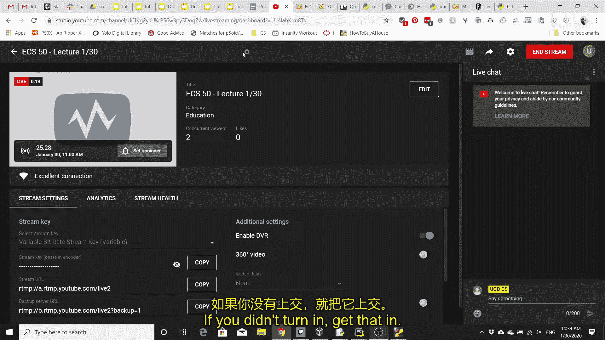

Any questions before we get started to lecture？Yeah。

So the homeworks now be Friday and Saturday Sunday。So correct。

 it's due on Friday and you can submit up until Sunday， but if you submit on Saturday。

 you lose 5% and then if you submit on Sunday， you lose another 10% for that assignment that you submit so minus 10% on Sunday。

别。我边个可。The quiz， oh yeah，quiz one is up， it's on the mirror。

You answer questions on it based on what's there。It looks something like this。

Make sure it don't show anything。One thing that I forgot to note is you were not allowed to use bin。

 Hex or int。In your solutions doing so is considered cheating So for example you'll be asked a question like you have a custom bag of M&ms each of your M&ms and your custom to bag can be one of 17 possible colors what's the minimum number of bits you would need to represent the colors contained within your bag so you would say you know figure out whatever your number is and then you would return whatever your answer So if you thought it was 53 right you'd put in 53 there is your answer say run test and you'll see whether you get the answer right or wrong right or wrong or not。

Right so we didn't use hex bin or ins here， so that passed。

 but our answer was wrong and there will be like different problems that you have to do like convert this binary string to hex。

And then show what the answer is supposed to be。Yeah， I think Trevor fixed most of those last night。

 I saw the post for it but it might just fixed that once students。I try but my using。Let's see。

what the number was。我子这个。按那玩色。开呢个。Well， five looked like it had something。

They all have test cases it looks like。Yeah， no， I appreciate that because there are some things to get messed up。

You can try each problem as many times as you feel like。就是。BeforeYes， before the date。Oh yeah。

 the like， thanks。one of the problems looks like it might have some issues already that I thought I fixed but didn't get fixed。

 but I'll take a look at that and see what's going on if I need fix it or not。

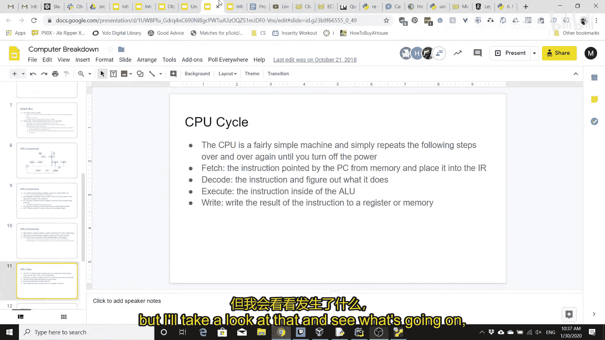

Okay， so last time we left off， we were talking about the CPU。

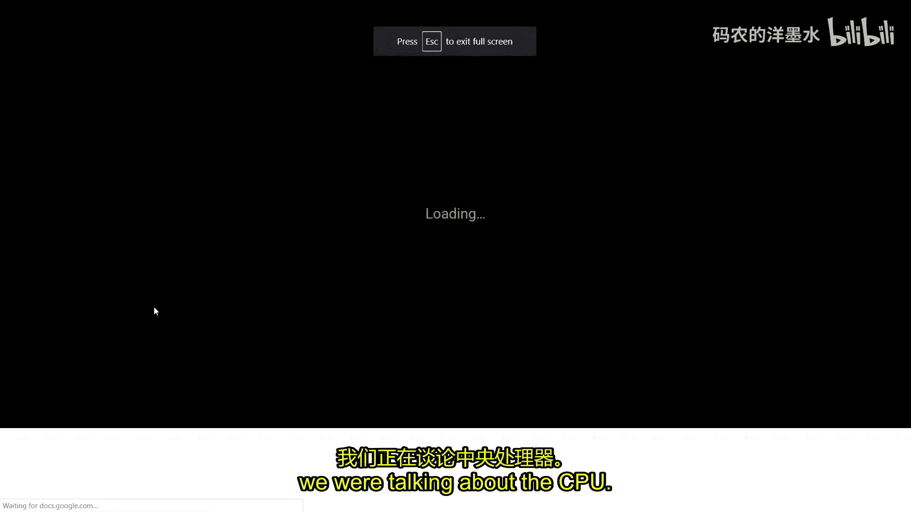

We talked about what it's made up of the various components that are inside there。

 there's the ALU which carries out the arithmetic logic。

 there's your data registers which temporarily hold values for you to operate on in the future you have your connections to the address bus and Data bus the PC keeps track of which instruction you're on it has the address of the instruction and memory you're working on the stack pointer points this hopA this program stack eFlas has various random bits of information about the current program that's running like whether the result of the last operation was zero or not or whether it overflow happened or not or whether it was a carrier or not or if you're in kernel mode or whether in your user mode。

So just random bits of state there and not shown here is the instruction register。

 which also has the actual instruction， whereas PC again has the address of the instructions。

So we might think that you know computers are pretty complicated machines and in some ways they are。

 but in some ways they're very dumb and very simple， but just really， really fast。So the CPU。

 what it does is it just follows this cycle over and over and over and over and over again until you finally turn it off。

So the first thing that it does is it fetches the instruction pointed by the PC from memory and places it into the instruction register。

 so the PC tells us what instruction we want to work on， so we go out into memory at that location。

 grab the instruction and pull it from memory into the instruction register inside the CPU so we fetch the instruction。

We then decode the instruction， figure out what it does， are we supposed to be adding， subtracting。

 multiplying， dividing， comparing two things together？Figure out what we're supposed to do。

 then we do that thing。We do the addition， the arithmetic， the logic。

 or we do like extraction multiplication division， whatever happens to be。

 and then we write the result back either to the register or memory and after we do that we go back to step one and we get our next instruction and then we do it all over again over and over and over and over again until finally you turn off your computer。

Any questions here？嗯。So sometimes it's useful to figure out the CPU speed or your computer speed and there are two different ways of measuring it。

 there's the CPU time which is the amount of time it takes for the amount of time the CPU actually spends working on your program and then there's the wall time which is just the actual amount of time it takes for your program to complete those two things are not necessarily the same because the CPU might not always be running your program。

 it might be taking turns running other programs that take time the CPU might also have to wait on other things like user input and while it's waiting for user input it's not executing your code because you're waiting for user to do something or it might have to wait for like request for different IO systems to give it information and while it's waiting for that information it's not running so it's not counted against your CPU time but it's going to take more physical wall time for it to complete。

If you want to figure out how long the CPU is going to take for your program。

 or at least a rough estimate is you take how many instructions you have in your program。

And you multiply them by the time it's going to take to carry out those instructions。

This can be broken down because each instruction takes some number of clock cycles。

 so we multiply it by the clock cycles per instruction。

 so you might have like your added instruction takes three clock cycles。

 so every ad you pay three clock cycles， but each clock cycle has the same amount of time。

 so you multiply it by the time per clock cycle。The clock cycle is generally what you see reported as the speed of your CPU so like 3。

2 gigahertz or 3。5 gigahertz or 2。7 gigahertz that's how fast your CPU is that's how many instructions it can do in one second so that means if you had a 3。

2 gigHtz machine you could do 3。2 times 10 to the nine cycles per second and so if each instructionally took one cycle。

 you could do 3。2 times 10 to9 cycles or 3。2 times 10 to9 instructions per clock cycle。

 assuming your computer wasn't waiting know do other things。

One of the problems though with trying to make CPUs faster is that if you try to decrease one parameter it makes the other one go up。

 so if you try to decrease the number of clock cycles per instruction。

 what generally means is that each clock cycle has to the clock cycles have to become longer to still get the amount of work done。

 but if you're able to take more clock cycles， you can generally shorten the length of a clock cycle。

 but it's like kind of like playing with the parameters and messing with them a little bit till you get it so you're actually going faster and not actually going slower。

Well time， again， you just time it， you just start your watch。

Wait for it to finish when it stops that's the wall time really this is like the best thing to consider when you're actually buying some new computer you'd like to run the applications on it that you're probably plenty on running and figure out how fast it's going right does it play the game that I want to play well right is it going to be able to process you know these really intensive like parallel programs really well that's what you're doing with it right。

And you know you don't want to spend more money on something than you need so if all you're doing is like word processing on your computer。

 you can probably buy something a lot cheaper because you don't need all of that extra speed and all that extra power that's provided by the more expensive machines。

Any questions？One possible way to increase the speed of your CPU is through parallelism parallelism is just doing multiple operations at the same time。

 there tend to be two different forms of parallelism the first is pipe lightinging which is if you break down the sequence of things into multiple stages and you do and each stage you're doing everything thing the common analogy that we give here is imagine doing laundry right when you do laundry you don't wash the first load。

Then dry it。Then fold it， then get your next load laundry， wash it， then dry it， then fold it。

 then the next load， wash it， dry it， fold it， right while you're washing one load， right。

 you're drawing drying the other load and folding the little laundry that just came out。

 And if you assume that each of those stages was roughly the same。

 you'd get about a three times speed up。To kind of visualize this。嗯。So。Right。

 with the slow way of washing， drying and folding。 right， we might have wash， dry， fold， wash， dry。

 fold， wash。Driry fold， wash。Dry fold。Right。And I guess youd probably actually start- that's going to take us about like 11 time units to complete。

 right， assuming each stage was the same。Right， and we were able to do one load of laundry。

 two loads of laundry， three loads of laundry， four loads of laundry。

 I guess I have to go up one more。But if we're doing this the intelligent way， right。

 we would do wash， right？And so we start washing and then during the next time unit。

 since we're done using the washing machine， right。

 we can start our new load of laundry and then we can start drying the old load of laundry that just finished out of the washing machine。

Then we get to the next one， we can have now wash。Dry and fold be at them at the same time。Wash， dry。

 fold。Then we're just going to have dry。Fold and then just fold。 And that was 1，2，3。

4 loads of laundry。But how much time did it take？I only sort like know four is units because or five is units。

 right？Compared to our 12ish units， so since we have three stages。

 we got about three times the speed up。we finished in about only。A third of the time， right。

 about four units。So that's one of the advantages of using pipeline and breaking things down right this is also what like Henry Ford kind of discovered when he started like the assembly line right you have multiple people doing this their own individual task at each certain stage and you get things done a lot faster。

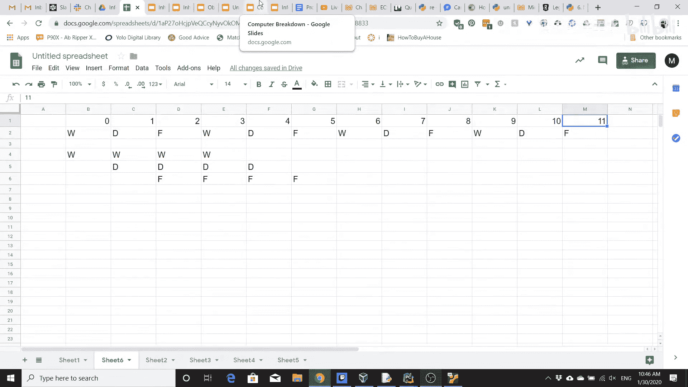

So the hardware system automatically does this for you so instead of washing laundry right we execute instructions。

 so while we're fetching one instruction， we'll be decoding the other instruction。

 we'll be executing some other instruction and writing the results of some other instruction that went along the way right so we can hopefully get like a four time speed up if we do it that way。

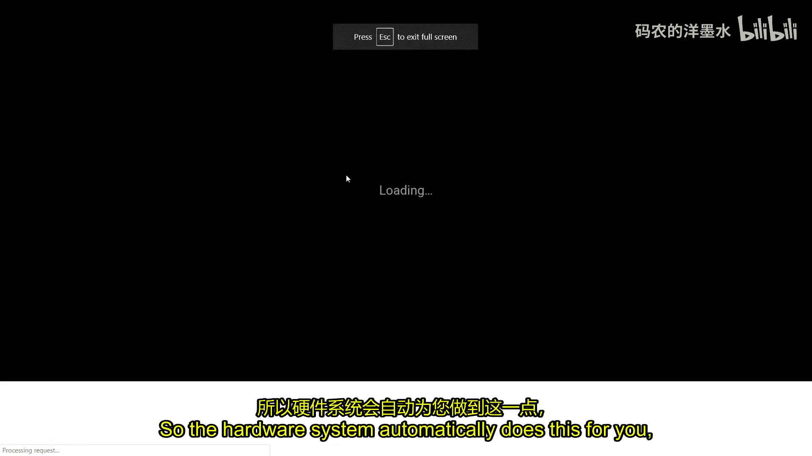

There are some practical limits to this like if you start making your pipelines really really long。

 you don't get like an end time speed up all the time because a lot of the times you end up not being able to do work every single clock cycle and each stage this is because of things like if statements right you don't always do the same work every single time so you might have to wait to figure out whether you do that going into the if statement or going to the elset statement to figure out。

What your next instruction should actually be， and so you have some delays that are showing up in there。

so you're going to get that worst performance if the pipeline isn't kept full。

So there are some practical things that make it so we can't have like 50 stage pipelines and half our computers go 50 times faster。

They tried， it didn't work well。The other type of parallelism is parallelism you write into your own machine。

 there's two major paradigms， which is message passing and shared memory and message passing processes explicitly send messages to each other and you might wait to hear for some message before you continue on with your next task or there shared memory where you guys。

 there's a shared area of memory where the processes will write into that area to communicate to each other。

This can be very challenging to do correctly and efficiently。

 but it's really important to consider if your data sets get very large because hopefully if you're able to have like end processes working on your computer at time。

 you'll get an end time speed up on it the problem is like you probably thought about like when you work on homework assignments with your friends right if you just keep adding more and more people as the process keep going faster and faster and faster。

No， what slows you down？If you keep adding more people to a group。解些。I mean。

 you're kind of on the right track about like introducing each other but there's that communication right。

 you might have to wait for your friend to finish doing something before you can finish working on your part of the project right。

 or vice versa or there might be some parts of time where you guys all have to stop working just to talk to each other to figure out what you want to do next。

So even though you might keep adding more and more people。

 you're to go more you're not going to be able to go faster and faster and faster because you probably spend more and more time communicating with each other right and so there isn't an overhead for that and that does actually show up in parallel programs where you do end up going you may have to like not be able to get that full times and speed up because you have to wait for the processes one to finish the task or for some other one to talk to for one process to talk to before you can move on。

The sad thing is also you have to write this and a lot of times when we we focus on algorithms。

 we assume that there's only one unit doing the work and so you can do like a lot of optimizations because you know that only one person at a time is working on it。

 but when you start splitting up tasks， you might have to use more naive and simple and more expensive algorithms and not be able to do those optimizations because the problem' has been broken up and not everyone can see everything at the whole time。

But there are some problems that are like really， really good for parallelization。

 they're called like embarrassingly parallel problems， for example。

Like matrixtrix edition is an example of an embarrassingly parallel problem because when you compute like CIJ right CIJ is equal to AIJ plus BIJ。

 there's no like communication that needs to go overhead for figuring out what the value is for one new cell right so if you split it in half or I'm going to do the top half you do the bottom half we don't have to talk to each other at all。

As soon as we figure out what part we're doing， or if you want to split it into thirds。

 rate go overhead， and so you should hopefully get that full three time speed up。

If you're interested in working on this， this is what the concurrent programming class all about。

Yeah you split it up into like end chunks to do work and a lot of times with monitoring computers you do have more than like one core or more than one processor in most of your machines nowadays so if you're able to exploit that and utilize it right you're able to solve problems faster。

And you guys might like be like， what's the point， my computer's already blazing fast？

That's because most of the problems that we have you do are simple problems， small problems right。

 we're not giving you a million elements to work on right or 2 million。

 but when you're somebody like Google or somebody like Facebook or Amazon right they deal with huge volumes of data so they want to be able to go as fast as they possibly can and a lot of times those transactions tend to be independent so they can exploit the parallelism of the problem to be able to not take forever to get stuff done。

Okay。Okay， any questions before we move on to assembly programming？

So I will let you know that if you go to the Google Drive。And you go into assembly。

You will find this Intel cheat sheet。This pretty much has like everything that I know about programming and assembly so like if you want a quick look up about stuff or what you need in this class。

 look here the book is also a really good source of information as well it's probably like one of the best things I've ever been able to find on assembly programming and so if you start looking online for help you're not going find anything really。

Or if you do， it'll be worse than what we've already given you。

 so if you're struggling with the assembly， make sure you come see us。

 make sure you check out the resources we've provided because unlike C or Python or Java。

 nobody really programs an assembly so there's not much not going to really find anything on stack overflow for help。

Or any role on Google for that matter？Yeah。So。Let's talk about our instruction setup。

So most of the instructions that are written in assembly have this form operation。Destination。Source。

So there's three components for each instruction， the op part tells you like what you're doing am I doing adding。

 am I doing subtracting， am I doing multiplying right， am I doing dividing。

Am I doing shifting to the right？These are all various instructions that you've seen。

The effect of these operations， though， are always going to be， for the most part。

 dust op equals source。So all of the operations for Intel are pretty much written in a two operaran form。

 so they're always going to be like plus equals times equals divide equals minus equals。

 there's never just going to be minus it's always minus equals or plus it's always going to be plus equals so when you write your code you have to pay attention to that。

And this is what's referred to as a two operaand machine。There are other languages like MIPS。

 MIPS is a three operaand machine。And their formats are something like operation， destination。

 source one， source two。And so with a MIPS machine， you'd see something like。

The destination is equal to source one。Op source2。But again， Intel has a two opera machine。

 So like adding， right， if we did add A B， this is equivalent to doing a plus equals。

B for subing a minus B。For B， this is going to be like a minus equals B。

Any questions about that so far？Yeah。It's just going to have to change like how you write your code a little bit when you get into assembly。

 given that everything's like plus equals or minus E。For the most part。

 there are some rare exceptions to this。あふ。Okay， so what can your possible operaans be right。

 these guys over here are your operas。So what are some options。

 one option for your opera end is Consts。So constants are prefixed。With dollar signs。

So if I did something like Mo out， Do sign four。And then I'll show you the other one to EAX。

 that would say put the value4 into register EAX。So constants have dollar signs in front of them。

If you forget to do the dollar sign in front of them。

 you're going to get segmentation faults in your code。

Because without the dollar signs without the dollar signs， it specifies in address and memory。

This guy right here says something like。Move the value4 into register EAX。Whereas if you did this。

 move L4 to EAX。It says move the value at location4 in memory into EAX。

So if you don't do the dollar sign。You are going to have the problem of。

Extraently accessing memory and reading from memory。

The registers that you have to work with are over here in the cheat sheet。So here are your registers。

 they're EAX， EVX， ECX， EDX， ESI， EDI， EVP and ESP。A through D， so EAX through EDX and ESI and EDI。

 these are all general purpose registers， so when you get to your first assembly programming assignment。

 feel free to use them for whatever you feel like。Those are the ones that you have access to though。

EBP for your first homework assignment。You can use it use the base point of your C code and we'll talk about what that means later。

 but if you're using it for standalone code， you can also use it as another general purpose register。

ESP， like we talked about earlier is a stack pointer。

 don't use this one as a general purpose register， it's going to mess you up。

Right because the stack pointer needs to point to the top of the stack and if you start putting other things into it。

 it's probably going to start breaking some other code so don't do that。

When you want to access a smaller portion of a register， you just leave off the E， right so the。

First for， A through D， there are smaller sub portions。

If you want to access the entire register to be something like EAX。

If you only want to access the lower 16 bits， that's AX。If you want to access the upper8 bits of AX。

 that's AH and the lower8 bits of AX， that's AL。So the division looks something like this。

So if here is our register。I guess。Let's see。 where's the merge thing？So this guy over here would be。

 we probably want to。So this right here might be something like AL。And then A H taken together。

These are Ax。And then， all four of them。Would be EAX。

So that's how it's broken down and you can do this with EAX， EX， EDX。EAX， E， B X， EX and EDX。

 you can't do this with E S I， EDI or EBP or ESB， only a through D。

I know it seems kind of weird and a lot of you guys are like， well。

 how do I access these bits up here？You can rightshift it。

And then put them into the lower portions and then access those bits if you really wanted to get the upper two Btes of memory or upper two Btes of the register。

 But for the most part， we're probably only going be working with EAX and sometimes we'll be working with A H and A for dealing with characters because characters are one by big while integers are。

4 bys big。Also， when you're working with your registers for your opera end registers。Our prefixed。

With percent。So if you actually want to reference EAX， it's going to be percent EAX。

 if you want to talk about DX， it's percent DX， if you want to talk about C， it's percent C right。

 but registers have to be prefixed with the percent sign for them。

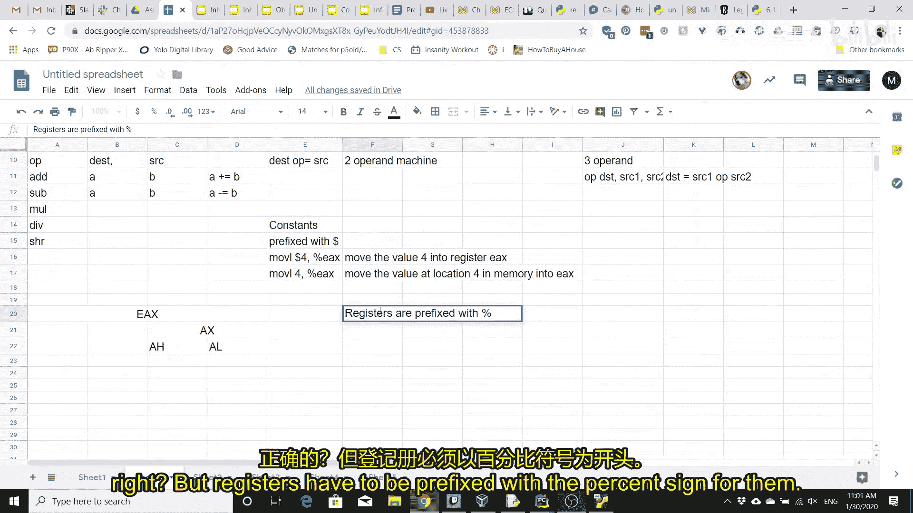

清嗯哼是我的。So a register is memory inside of the CPU， there's a very small amount。

 you can see there's only like six or seven registers。

 but that memory is very fast to access and it's inside the CPU， which also makes accessing it fast。

So if you're trying to look for like optimization and like improving your code at its efficiency。

 you want to do operations with things and registers as much as possible instead of having to go to memory because' going to memory is going to take longer。

So is it not of a container inside of。Sil again。I it。Yeah， registers do store data。

RightBut instead of being like your RA， your memory that you buy for Ram chips。

 it's inside of the CPU。So it's small， fast， internal memory inside of the CPU and a lot of times it's used to temporarily store the results。

Of computations while you're working on them， and then you write them back out to memory。好考。 I can。

So at this point in time， this is when you actually're going to need your Linux system because our codes not going to work anywhere else。

 so if you haven't gotten access to a Linux system，Now is the time， there's a question up front。

AMD will be fine because AMD is they've cloned the Intel instructions set。

 so Intel instructions work on AMD processors， even if the internal implementation is different。No。

 that's not what I want。For some。哦。Okay， that's what I want to go to。Yeah。Yeah。

 I'm going to one second。s it's some。No， I seating is some list。Does that seem big enough like this？

Aarger than that。We'll try this， Does that seem big enough？ok。

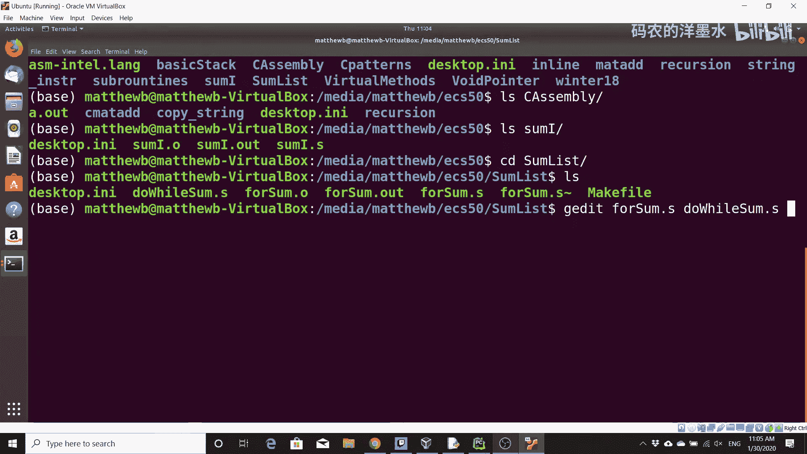

Oh， that's right。 I got to figure out how to turn。嗯。Yes。啊。

I'd forgotten where the option got moved for， for changing the highlighting。So anyway， for right now。

 we're going to have to look at it the ugly black and white， because I don't remember where the view。

Highlight mode， there we go。There you go， now you get it nice and pretty。So we're over here。

So this program， we're going to walk through to kind of give you a better idea of how the assembly code goes。

But here's our program that we're trying to build from C。

 and I recommend whenever you're writing your assembly programs for your homework assignments。

 you always write the C code first。The reason I recommend writing the C code first is that it's much easier to debug C than it is to debug assembly。

 When we get into assembly， we don't have variables anymore。Right they're all gone。

 We just have registers to work with and we have to keep track of a lot of things in our own mind and in our comments too。

 so remember what's what and where things are at and what that thing's supposed to be。

 whereas when you're working in the higher level language like C。

 even though C might not seem high level to some of you you're gonna still have the variables。

 you're still gonna have the functions， you're still gonna have access to like the debugger and there is still a debugger here as well that you can use。

But it's gonna to be so much easier to figure out the problem in C and then once you get the problem down you can then translate into assembly and I will show you steps later on that are just like here's the steps you follow to turn a for loop from C into assembly here's how you translate an if statement in C into assembly so it's going to make your life a lot easier if you follow along。

But this is our goal， a very， very simple program， and you're going to see that it's a lot more。

So first you're going to see some lines that start with dot。

 the dot are like preassembler directives that are similar to like the preprocessor directives in CNC++ they're going to be run before any of the other lines of code get executed。

Um， so like pound define or pound include， they're similar to those， but they start with dot。

There's dot global， dot Global means make this symbol visible to the linker。

And what that just means is it makes this symbol available outside of this file and you can access it from other files as well if you have a multi filele program。

Under start is basically main underscore start is where your program starts at。

 and so the linker needs to know where to begin execution of our program。

 so I need to make it global。The dot EQUs are the equivalent of pound defined in C。

 so I'm saying define the symbol word size to be equal to4， Def the symbol X to be equal to 10。

Right so now everywhere the assmbler sees the word word size。

 it's going to replace it with four so word size is four and has no difference it has no difference from four excellent is 10 everywhere the asssembler sees 1 excellent。

 it's just going to replace it with 10。Now here you can see me trying to be fancy。

 but I wouldn't recommend doing this is we could define a registers to be equal to some kind of like variable name。

 so now every time the asmbbller sees some it's going to replace it with EAX。

So I can kind of treat some like a variable and give it a name instead of always thinking about it as EAX。

The problem with doing this is it's possible to assign multiple registers to the same multiple variables to the same register So in the next line down I could say like dot EQ U I percent EAX now EAX is both I and sum but really there's just one register EAX So if I put something into I it's going change what's in sum if I put something into sum well that's EAX it's going to change what's in I right just allowing me to create this alias or the register but I wouldn't recommend doing it。

I should also mention back here， I don't think I made the point。

 but there is just one 32 bit constant or 32 bit field here for EAX， so if you change AH。

 you change AX and you change EAX。If you change AX， you change EAX and AH and AL， if you change EAX。

 you change AX and AH and AL because they're just sub portions of the same register。

 does that make sense？There's just one EAX register。

 but you can just talk about different parts of it Do I want to talk about these8 bits or these8 bits or these 16 bits or all 32 bits at once。

But they share that same location on your chip。When you change them， let's say then is shifted。

The offer。Does that also change the lower A？Right I mean， like， well。

 let's say like if you're shifting A， all the work is done inside of A。

 So if you did something like shift right percent， you know， shift right dollar sign 3% A。

 it will only change A。 the contents of A will be moved to the right by3 Bs。

 but you're not gonna to get anything from A H coming into A。

But it would modify them what like AX is and EAX was from doing that operation。

So there are two major sections and as you probably figured out comments are start with hashtags。

 you can also do multiline comments by doing slash star star slash。So there's two main sections。

 there's the data section and then there's the text section right you guys probably might have heard those names before at least vaguely sometime in the past the data section once again is where our global variables and our static variables are going to go and the text section is where our programs' instructions go。

So over here in my data section， I'm making something what's called a label and a label allows us to give symbolic names to addresses in memory。

So， once again。A symbol。Allows you to give symbolic。Names。To in address in memory。Right， so X right。

 it might be at location 100 and now every time I say x， it just gets substituted as 100。

 but I don't actually have to remember that x is 100 or what its actual address is。

 the link here will take care of that for me later on。

So over here I'm trying to create essentially our array。

 and you're seeing a new preprocesor directive， which is dot rep。So dot rep says repeat。

The code inside of the body up until end rep。ExcellN times。

 but constant the XN or the value here after dot rep， it has to be a constant。Right， and remember。

 excellent is just 10。So writing excellent here or writing 10 here， there's no difference。

 but this value has to be a constant。It cannot be some value of some registers， so you can't say EAX。

That's not going to work。So over here。What I'm trying to do is make space for RA and there are a couple of different ways that you can say to make space dot long is used to make four bytes worth of space and it gets initialized to this value on the right hand side when you're writing constants let me say that again when you are writing constants and only constants in assembly you can use the C style notation for the arithmetic so I can do five times two plus two to get 12 right I can do you know ands with three xors with seven minus 90 right the expression here can be as complicated as I want。

 but it can only be used to create constants and everything in here must be constant。嗯。

Does that make sense？Do you need to matter our assignment。

So here when you're working with the preprocessor directives， you do not use dollar signs。

 the dollar signs only show up in the instructions themselves。So preprocess directives。

 no dollar signs for the most part。When you're in the instruction itself。

 dollars signed to note the constant。Any other questions before we keep going？我还是。

Five times two plus two is I just picked the number。Right so I'm making an array of 10，12。Right。

 but I wanted to show you that you can do some crazy math stuff here in the sea style if you want to。

There are other ways of making space as well。So dot byte makes a byte。😡。

Dot word makes two bytes worth of space initialized a value， dot long。

 four bytes worth of space initialized to a value， dot float value。

 four bytes worth of space initialized to some floating point value。Dot string vow。

 you write some string， it will make the string null terminated。

 and it will allocate that much space that it needs to fit it。And then there's。Dot space N。

 which just makes space for n uninitialized bytes of memory。So if you do dot space 16。

 you'd make 16 bytes worth of space。So these are the basic ways of creating space in the data section。

And we're using int or dot longs for integers because integers are four bytes big。

So that's why thatt long comes into play。So dot text， this is the beginning of our program。

 where we're actually going to begin the execution and again。

 our programs always start at underscore start。Always start underscore start and there can only be one underscore start per program。

And again， the labels。Are followed with colon。 So X colon。Underscore start colon。

 the naming conventions for symbols are essentially the same things as the naming conventions for variables。

Alphanumeric strings that don't begin with numbers and can have underscores in them too。Over here。

 you're going to see me using some comments to help remind myself of what I'm doing for each register。

 so EX is going to hold the sum and ECX is going to hold the count。

I highly recommend you do this because again there are no variables。

 so if you don't leave comments to yourself about what you're planning on doing。

 you are going to forget when you come back the next day what register was playing the role of what variable from your seat code。

是。So the first thing that we do is we initialize our register。

 so we set sum and I both equal to zero。So here we have the move instruction and each of the instructions has a suffix and the suffix denotes the size L is for long。

 so these are four byte quantities that we're working with。

W stands for word and they're two byte quantities。And B is for bytes， a one byte quantity， right。

 so you prefix the instruction with how big is the thing that you want to work with。So over here。

 since EAX is a 4 by quantity， I'm going to use L， so set EAX equal to zero， so EX equal to zero。

 and again， registers prefix with percents， constants prefix with dollar signs。And move。

 just move the value。 So move。Source into destination。Right。Source desk。

So here we have our label for beginning our for loop and the weird thing。

 I guess about assembly in terms of the comparisons with Intel is all of your comparisons are going to be against zero。

Does that make sense？So whenever you have some comparison， it's always。

 is this thing greater than zero， is it less than zero， is it equal to zero？

But it's always zero on the right hand side of your comparison。So when we started with our code。

 right， it was， is I less than X， so do we have zero on the right hand side？

So I less the next lens is zero on the right hand side of that expression。No。

 so we're going to have to rearrange our expression so it ends up being compared against zero。

So what we do is we just subtract XN from both sides。I minus XN。

It's less than zero now zero is on the right hand side。The other thing is these jump instructions。

 they're taken when true。Right so if what this guy is saying is jump to the end of the for loop。

 if the result of the last instruction was greater than or equal to zero。So with while loops， right。

 you want to go inside the loop while the condition is true， right， like while the condition is true。

 you keep doing the code inside the for loop or the while loop。

But I like to invert the conditions and say get out of the loop if you're not supposed to be in there。

 so all of my loops that look like you know。This like wild some condition。Right。Do stuff。

I changed them to be this。While。True。If not condition。Break。Would you agree。

 those loops do the exact same thing？Besides that， we have to do stuff here。

Would you agree that both those two whiles would do the exact same work？

Are there any questions or confusions about that？So they are equivalent。

So I end up doing the exact same thing with my code when I'm writing it so over here right our original condition was I minus xn is that less than zero。

 so the opposite of this condition is it I minus Xn greater than or equal to zero。

So over here I'm going to compare L again， Do sign excellent， it's the constant against our I， ECX。

If ECX。Minus X。It's what's going to be computed here， but when you do the comparison instruction。

 it's one of the few instructions that doesn't store the result into the destination。

I think I put this backwards。Here。This should be。Source。And then dust。

And then these ones should be the other around B。Plus equals a。嗯あしござ。

So comparison is just comparing the values and the way that it compares the values is through subtraction。

 but it will not store the results of the subtraction into the destination register。

So here we do ECX minus xn right， I minus Xn， and if that result is greater than or equal to zero。

 go to the end of the for loop。Right， finish up。There are other types of comparisons like what do you think greater than is？

JG， for jump of beer then， what do you think less than is？JL， right。

 Ju of less than jumpump of less than or equal to。JLE， right。

 jump if less than or equal to for equal J E or J Z， jump of equal to or jump of0。

There's also ways of specifying signed versus unsigned comparisons。

Which if you look at the cheat sheet， it goes through that there。So here right。

 we have our comparisons so like we have jump if less than jump if greater than less than equal to greater than equal to。

 but there's also jump if below jump if below is like the less than comparison。

 but for unsigned numbers。嗯。Whereas jump of above is greater than for unsigned numbers。

To give you an idea of why we need two instructions。Answer the following question。

 which of these is bigger？So which value is larger， the top one or the bottom one？啊。

Top one is larger。Bottom one is larger。Why do you say the bottom one's larger？What's its value？It。

Well， if it's an unsigned number， what's its value？We have one plus two plus four plus8。15 and 15。

 is that greater than one plus two， three？Yes， but what happens if we interpret the number as signed numbers。

 the first number is still three， but the second number is negative one。

So which is bigger through your negative one。Three， right。

 so it depends on how you're interpreting the bits。Right。They could mean one or the other。

 it just depends on the context of your program。😡，Right， and that's why there's these。

Two types of comparison instructions。So if we were treating these numbers as being unsigned numbers。

 we would use below and above for less than and greater than when comparing unsigned numbers。

If we were treating them as signed numbers， we'd use less than or greater than JL， JG。

Does that make sense。Any questions so far。Don't worry。

 we'll get you writing assembly code in a minute。So over here this， so it says you know。

 if the negation of the condition holds， break out of the loop， go to the end of the for loop。

 and then we're going to be done。This line of code over here is an access of memory to read an array。

And the way that this expression works is that there is。F fields。D。

 O I and S displacement offset index scale and we will definitely talk about this a lot because everyone always gets confused here every year。

So what this does is it takes the displacement， adds the offset to it。

 then adds the index times to scale together， and then you go to that location of memory and get the value that's there。

Right， there are some constraints and again we'll talk about them in a little bit。

 but the displacement field needs to be a constant expression。

O and I both need to be registers and scale can be either 1，2，4 and maybe 8 on 32 bit machines。

 but8 definitely works on 64 B machines。 just never really had the need to try out 8。

We'll go through that one a lot more in detail， but if we think about our memory access back here。

That we're trying to emulate sum plus equals X at I。

 how can you rewrite X at I without using the square brackets？So some plus equals。

How can you write that expression without using square brackets？道。It's star X plus I， right？

So we want to go to the location of memory at x plus I， right， and down here。Well。

 what's this thing going to do， what's going to give us something at memory at D plus O plus I times S？

Now， if you don't give one of the fields， it's going to default to be zero。 So over here right。

 I have X。Plus，0。Plus， E X times the word size。 And if you remember， word size back here was four。

 And you're gonna to see me， do you like word size or W S on every single problem。

 So I don't have to keep remembering that it's4。嗯。Now one thing that we didn't have to do back here was just x plus I。

 right， but if x is over an array of integers， we want to move i integers past x。

And the compiler is nice enough for you when you're in C to take the size of the variable and multiply it by how big you want to move。

But when you're working in assembly， you have to do that yourself。So over here。

 I want to move I integers， each integer being four bytes big。

 so I have to do ECX times I or times word size to get the right amount of integers to move。

Because memory is always by addressable， so every address you generate in assembly is always going to be which byte do you want to start reading from？

So for us， over hoops。So for us over here， we need to make sure that we multipplly by four if we were dealing with shorts。

 this would have been two， if we were dealing with bytes。

 it would have been one so like chas would be one。But you have to be responsible for doing that multiplication yourself then。

So we get the value at X at I and we add it into EAX。So we do that edition， so EAX， right。

 which is our sum。Plus equals X and I。Then we increment ECX to go to the next iteration of our loop that's our I+ plus。

 so the reason you have plus plus or I or I+ plus is because there's an increment instruction。

 which increment just means add1。So I add one to ECX。

 and then I go back to the start of the for loop。Any questions？Before we run it yeah。These lines。

Find this。Yeah， I should be there。Yeah， so what if I think of instead seen before I write something。

So the question is， if I write C++ before I write C。

 will that be helpful it depends what construct you're using in C++ if you're doing things like with the vectors and maps and like really highle things it's not going to be worthwhile because now you're responsible for translating the vector code into assembly code right because that's the code that you wrote or if using maps you now have to implement the map code in the assembly code which is going to be pretty hard to do the reason I recommend C is because when C was written it was written by people that were programming a lot of assembly and so they kind of base their instructions to be very based the syntax of C where the translation between the C code and the assembly code is very easy right there almost needs to there's not a one to one correspondence but it's somewhat close。

For an operation。So it'll be more helpful if you do C and you do things like arrays and dynamically allocate memory if you have to do that because that's what you'll need to be doing in the assembly and it'll be a lot easier to do those things than to do C++ stuff。

嗯mm。😊，Yeah。😊，こいてオ myで。The O stands for offset， so displacement offset index scale。

 and again we'll get more into that one in a minute because that's something that we use a lot for accessing arrays and we will definitely delve into that syntax。

So let's try running our code。Which first means I probably need to save it。Oh， gosh。

I think I just save it a second time。2。

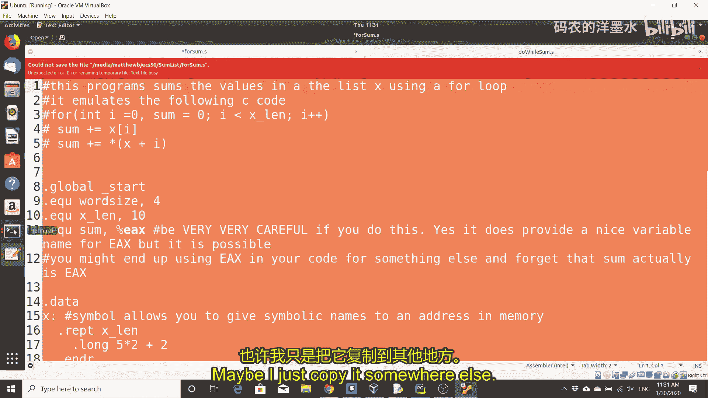

Maybe I just copy it somewhere else。🤧。嗯。

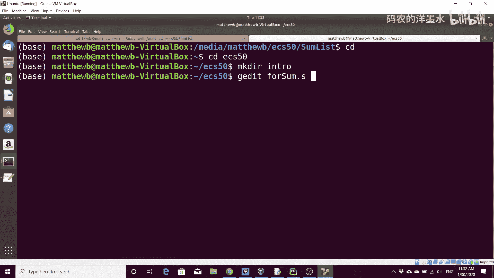

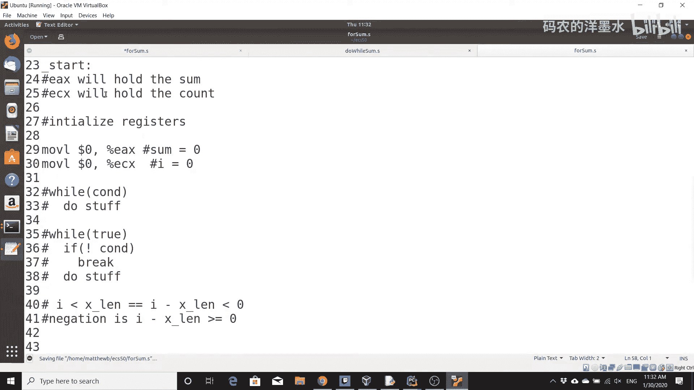

Okay， this one got saves。And so there's a two step process if you want to compile your assembly code。

 the first is to assemble it， so it's going to be AS， dash dash G stabs。Dash O。

 the name of the object file you want to create， so'm going to do 4 sum。0 and then the source file。

 for sum。 S assembly file start with dot S。So we've now created our partially compiled file。

 sorry let me put that back up there。We've now created our partially compiled file for some。O。

We now have to go run that through the linker。So it's going to be LD。Oh wait。

 I think I forgot something。Since we're doing 32 bit assembly， it's dash-32。

To do with the32bit compile。Because all of us are going to be on 64 bit machines。

 but we're going to want to do 32 bit compiles because we're doing 32 bit assembly。

 so dash dash 32 for the 32 bit compile。Then for the linking， it's LD。And then， it's dash M， F。

Underscore I 386。And then the name of your executo will dash O for some dot outs。

And then the object file fors。0。Hopefully I remembered that one， right？Good。😊。

This part here just says link for 32 but Intel architecture， Intel， know， I386。

So just remember that business for when you're doing it on your own machine。

Because I want you to get some fun errors now we have our executable。And let's re it。

And it's going to crash。So all the code that we're running right now。

 it will 100% crash every single time。So what we're going to do is we' going to the debugger。

So for those of you that have been avoiding the debugger。You now have to use a debugger。

 My preferred debugger is D DD， when I'm debugging assembly code。 So D DD。

 and then my executable for some dot out the dash dash G stamps is equivalent to like the dash G when you're compiling with Gcc or。

G plus+ and it will actually allow you to debug your code if you forget to do this when you go to debug your code there won't be any code for you to look at。

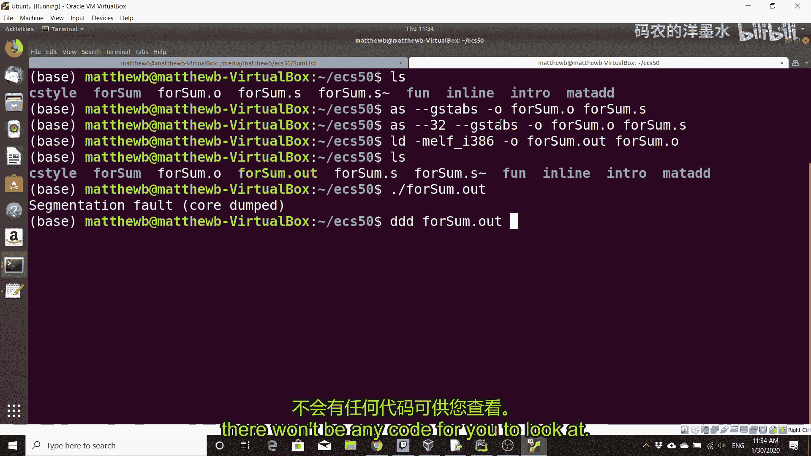

Yeah。Now， from what I can remember， I don't know how to make the text here any bigger。嗯。

So what zoom in？I don't know if it's going to let me zoom in， nope。Yeah。Cian。

You probably won't have it， but you can use you can if you don't have it。Oops， not this one。

If you don't have DD by default。

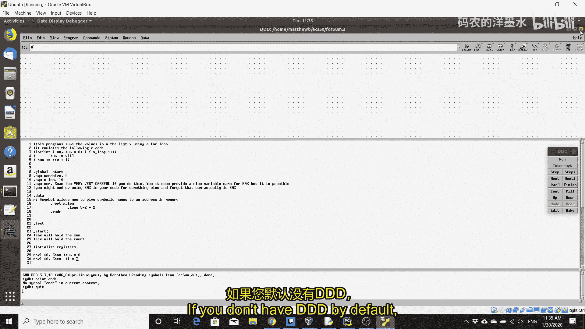

You can run pseudo oops here。You can run pseudo app。Dash get， install DD。

And this will install DDD on your machine， and I spelled pseudo wrong。 should be SU D O。

It'll ask you for your password。I tied to my password。And I already have it installed。

 something happened， but it'll sell it on your machine if you don't。So， DDD。

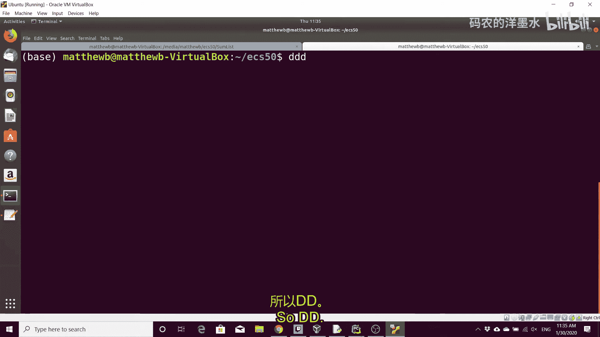

Our executable。B it in the background though。I don't know。

 we'll try seeing if this makes anything bigger。Okay on。I don't think that changed anything。

So sorry about it being tiny， but that's what're to have to deal with。

And I don't know how to zoom in。 Oh， I think I remember what I did。 I do view。Oh， that's fun。😀呵呵呵呵。😊。

Okay， I don't think I could actually use that。Because I can't see anything。Yeah。But anyway。

 in terms of commands for setting breakpoints and one thing I forgot to mention。Is that back here。

Right， there's this symbol。Down here， done。Don is not special。

 but you'll see it pretty much at the end of my programs just so that I know where I can set up breakpoint to be at the end of my program。

So underscore start， it's special， done is not special， it does nothing。The NOP stands for No opP。

 and it means don't do anything on this line of code， so do nothing。It's like pass and Python。

 do nothing here。No operation。Med DD。So what I'm going to do is when to break and instead set a break point。

 it's B and then underscore start to break point and underscore starts。

And then I will also set a breakpoint at done， so be done。

The other way that you can set break points here is you can right click。

On the line and then select set breakpoint and it'll set a breakpoint there。

To be able to display registers。There are capable ways of doing it。 So first。

 let's start our program。 So to start your program， just type R or run to make it start running。

And to see the registers， the registers in D and in G are prefix with dollar sign。

 so I'm going to say graph display， Do sign， EAX。And I can see what's in Reg EAX。

 I can also say graph display Do sign ECX to see what's in ECX。

The other way that you can see this is go to status Regs。

And it will show you what's in the registers。So over here， if we start stepping， which is S。

To step line code， you can see that we put zero and zero into ECX。

We now pop down all the way here to Or code and we're going to compare ECX with XLlen。

So after we subtract ECX from XN， will that result be greater than or equal to0。

 given that ECX is0 right now and Xn is 10， 0 minus 10 is negative 10。

 is that greater than or equal to 0？嗯。No， it's not， so we're not going to take the jump。

 we're going to go into our for loop。Now we need to do this edition。

 so let's say we actually want to be able to display this array。It's a bit complicated。

But I will show you the syntax。So here it's graph display。

And what we have to do is we have to do because like X has no type。

 we have to give it a type through casting。So that's going to look like this integer pointer。

And then the address of X。And then I can say I want to start Ed zero。

And then at 10 to see all of the elements。And that'll print out all the values。

If you look over the debugging slides that are available on the Google Drive。

 you'll see all of these commands there as well。So if you're not catching them at the moment。

 look there。If we want to just display ECX or display X at I。We can get rid of the at zero。

We're at 10 here and replace this with dollar sign DCX because that's our I。

 and now we can see what's our array of X O I。Now， if we keep stopping。We're to do our audit。

 so we should see that EX is going to change and EX should get 12。If we keep stepping。

 the jump will be taken so we go back to the tall， we do our comparison。

The condition won't hold true yet， so then we're going to add our。Next 12， and we get 24。

Then back around again。And then we don't take the jump and then we add our next 24 and so on and so forth as we keep going。

Now when we continue。We'll go all the way down to our next break point， continuous just C。

 or again you can use these buttons over here on the right hand side。

And we've reached the line of code for done。And we've gotten 120。

 which makes sense because 12 plus 12， 10 times is 120。

But now notice that even though we've reached done， our program hasn't stopped yet。

 so if we keep going。We go out of the bounds of our program and we keep executing code。

 and eventually we're going to do something that's causes the safe fault。

And it's going to break our code， which is why you can't。Run your code outside of debugger。Also。

 you can't use any print statements。😡，Because printing is really hard in assembly and you are more likely to screw up in calling print F than you are to get the call the print F right and most likely introduce more bugs into your code。

So you absolutely 100% have to use the debugger for your next homework assignment。

And probably all the homework assignments that are coming after this。

So if you're still struggling using thebuggger。Come to office hours， get help。

 we'll help you walk through it， but you're going to have to get good with it。

to be able to figure out what's going wrong with your programs。

Any questions before we get into our next set of topics talking about how to translate common blocks of C code into assembly？

AP about winning system。 So they bond using that。Cさ。

Operating systemSo all you need is access to a Linux operating system。 So if you connect to the CSIF。

 they're running Linux， and so you're good， you could also run your code on Mimeer right you don't have to install like like a virtual machine at all you can just open up the Mi IDdeE and do your programming in there。

And you'll be fine， right？If you want to dual boots or you want to install a virtual machine in your computer。

Go ahead and do that。 Some of the downsides about remotely connecting。

 though are you won't be able to use D。 You'll have to use G， and G is all。Text based。

 it's all terminal based， so debugging this program using GDP looks like this。

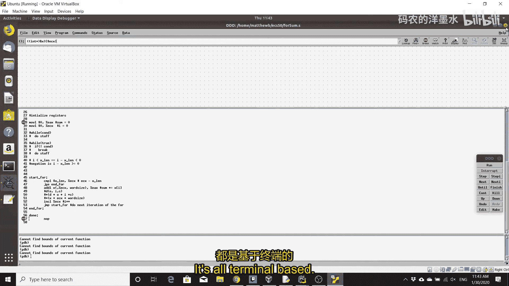

诶。GDB， and one thing that can make it a little bit easier is dash dash TUI for a terminal user interface。

 and then for some the out。And now you're going to have to like go through it using the terminalline so you can like use the up and down arrows to go through the code。

But you have to use all the command line。 There's no Gu interface。

 So I can say like break it underscore start。And it's going to set the breakpoint up here at underscore start wherever that happens to be at so you can see the breakpoint and if I say run right。

 it's going to bring me there and I can keep like stepping through it and I can see what line of code that I'm on。

But I find this a lot harder to work with than working with the DDD。

There is you can't use D on memory。 You can only use GDPb。Yeah。哪的款式怎。

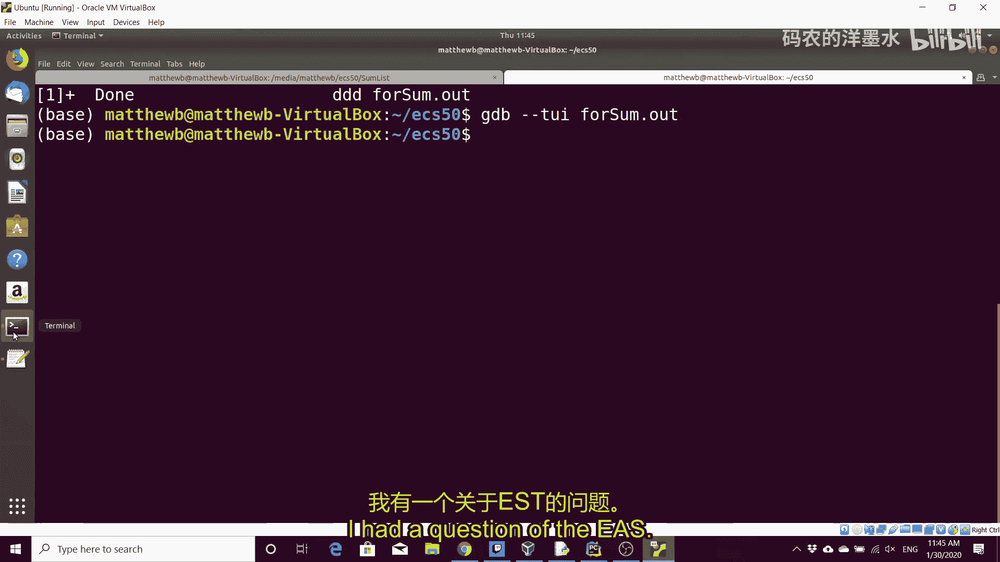

Yeah。Is there a reason use LED to variables and size to difference。

Staces are that you have story one in lower half。So your question is like。

 could I have like instead of using EAX and ECX， could I have used like AL and AH？So remember。

 A and AH are only one by big， but we have an array of integers。So injuries are going to require。

Four bytes， right which is going to lead to some issues if you're only using things that can only hold one byte。

But if we knew like our elements weren't going to become unrepresentable， I should say also the。

The advanced indexing mode like the array access requires full registers here。

 you can't use partial registers。Um， but if we had like an array of characters。

 we could have used something like， you know， AL instead of EAX。For AL instead of EAX。

 and then we would have used like add B instead of add L。Anything else？Okay。That's not what I want了。

So one of the more common things that you have to do is。Translate loops， let me make this bigger。

So over here， here's our C code。 It might be like while I is less than。Right， some value。

Do some code。Right。So if you're trying to write this。

 the way that I end up doing it is the first step that I do is I get the negation or first step。

 I would say。Would be to。Messed with the condition， so first condition must be compared against zero。

So that's going to change this to be i minus value less than zero。Right。

Then I get the negation of the condition。Which is going to be i minus value。

Less than or greater than or equal to zero。So the way that we then translate this would be something like this while start。

口文。So we have some label to mark the beginning of our while loop。

And then I compare against the negation of my condition。So over here in the translation。

 we're going to assume that。ECcX is I。And value is EAX。

Just so I can actually write you some legal code。So here。

 the first thing that I need to do is I minus value， so I'm going to do a comp L。

Assuming these were integers。And then we're going to have percent EAX percent。ECcX。

And it might look a little bit backwards， but remember， it's always dust。Op source。So over here。

 what this is going to be is ECX minus EAX is what gets computed。But in our example， ECX is。

ECX is I right， so we're going to do I minus EAX， which is value notice in our code we wanted to do I minus value。

Then the comparison for our condition is jump if greater than or equal to because we want to leave the loop if're greater than or equal to。

 and we go to the end of the loop。Then what we have down here is here's our code， right。

 whatever that happens to be。And then down here， we're going to have the end of the loop。

And notice there's a colon here。No colon here。The other thing to note is that these labels are not special。

 you don't have to name them while start， you don't have to name them and loop。

They can be whatever you feel like， but make them something sensible so that you can understand what's going on。

Any questions on this translation。So next week， we'll go through more common code translations。

 for loops， do while loops， if else。And then array accesses。

And your next homework assignment should probably be up over the weekend， too。It's assembly。

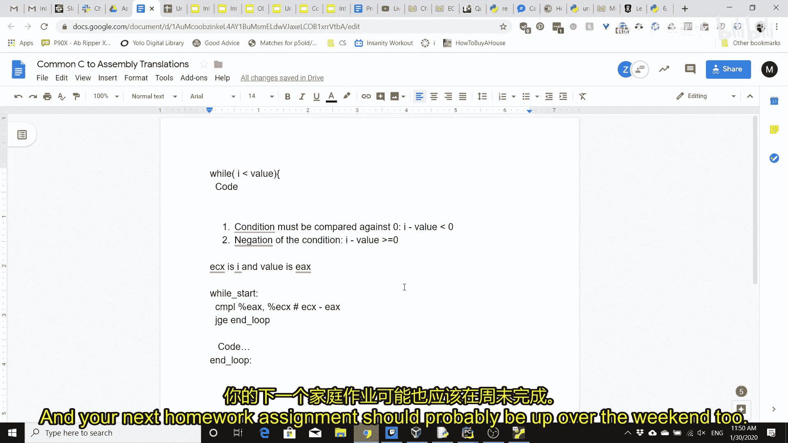

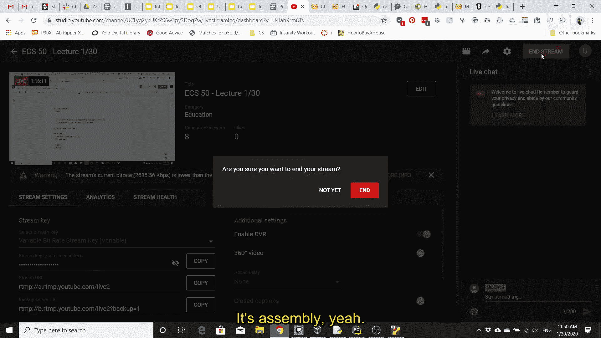