# C语言与汇编语言：7：x86汇编基础 🖥️

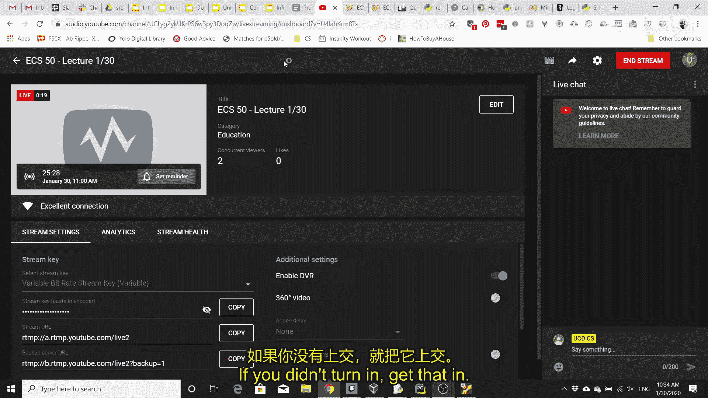

在本节课中，我们将学习x86汇编语言的基础知识，包括CPU的工作原理、指令格式、寄存器使用以及如何编写和调试一个简单的汇编程序。

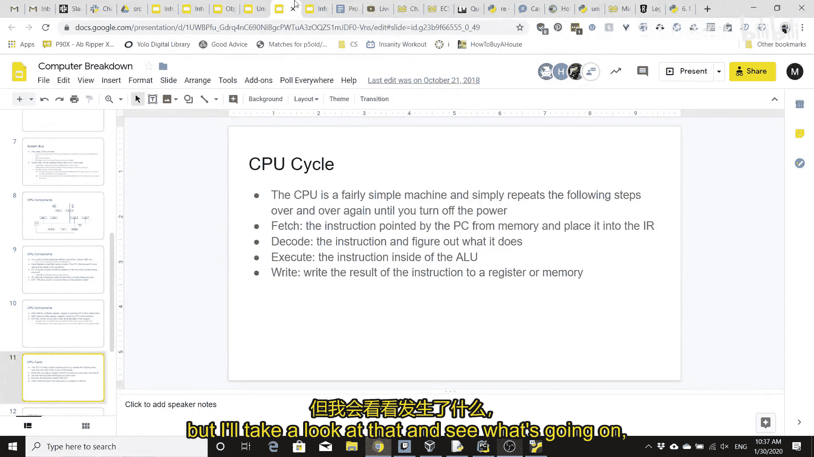


## 概述

上一节我们介绍了CPU的基本组成和工作周期。本节中，我们将深入x86汇编语言，学习其指令格式、操作数类型，并通过一个实际的例子来理解如何将C语言逻辑转换为汇编代码。

## CPU执行周期回顾

CPU通过一个简单的循环来执行程序，这个循环称为“取指-译码-执行-写回”周期。具体步骤如下：

1.  **取指**：从程序计数器（PC）指向的内存地址获取指令，放入指令寄存器。
2.  **译码**：解析指令，确定要执行的操作（如加法、减法）。
3.  **执行**：执行算术或逻辑运算。
4.  **写回**：将结果写回寄存器或内存。

然后，CPU返回步骤1，获取下一条指令，周而复始，直到程序结束。

## 衡量计算机速度

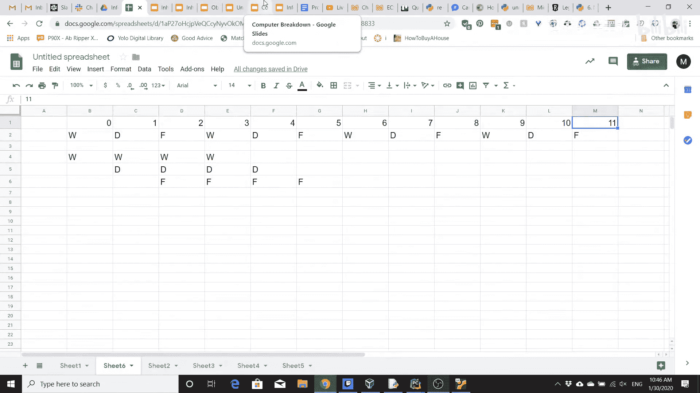

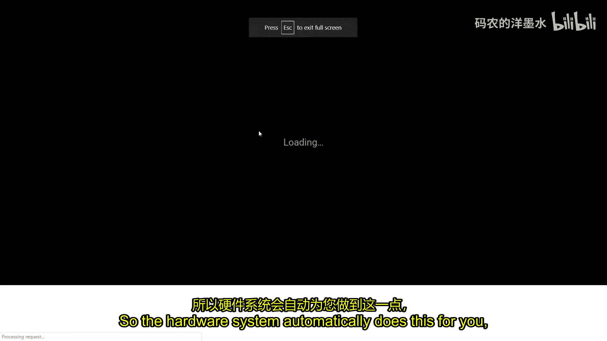

衡量计算机速度有两种主要方式：

*   **CPU时间**：CPU实际执行程序指令所花费的时间。
*   **墙上时间**：程序从开始到结束实际经过的物理时间。

这两个时间可能不同，因为CPU可能在等待用户输入或执行其他任务。估算CPU时间的一个简单公式是：
`总CPU时间 ≈ 指令数 × 每条指令时钟周期数 × 每个时钟周期时间`
CPU的主频（如3.2 GHz）表示每秒可以执行的时钟周期数。

## 提升速度：并行性

提升计算速度的一种重要方法是利用并行性，主要有两种形式：

*   **流水线**：将指令执行过程分解为多个阶段（如取指、译码、执行、写回），让不同指令的不同阶段同时进行，类似于工厂的装配线。
*   **多任务并行**：让多个处理器核心或线程同时处理不同的任务。这又分为：
    *   **消息传递**：进程间通过发送消息进行通信。
    *   **共享内存**：进程通过共享的内存区域进行通信。

编写高效的并行程序具有挑战性，因为进程间通信会带来开销。但某些问题（如矩阵加法）是“易并行”的，可以几乎线性地提升速度。

## x86汇编指令格式

现在，我们开始学习x86汇编语言。大多数x86指令遵循以下格式：
`操作码 目标操作数， 源操作数`
其效果通常是：`目标操作数 (操作符)= 源操作数`。例如，`add %eax, %ebx` 相当于 `%ebx += %eax`。x86是一种“双操作数”架构。

## 操作数类型

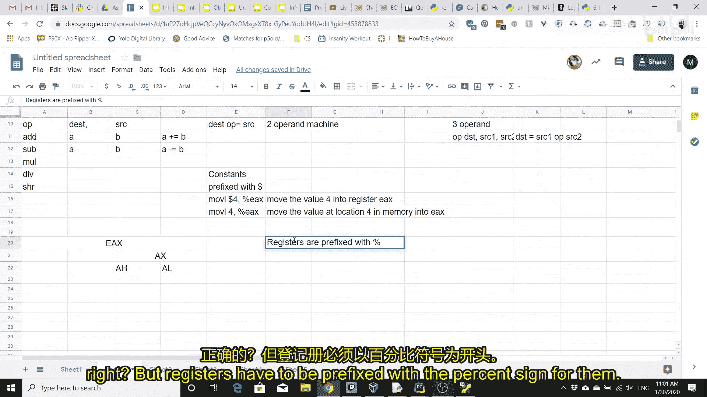

指令中的操作数可以是以下几种类型：

以下是常见的操作数类型及其表示方法：

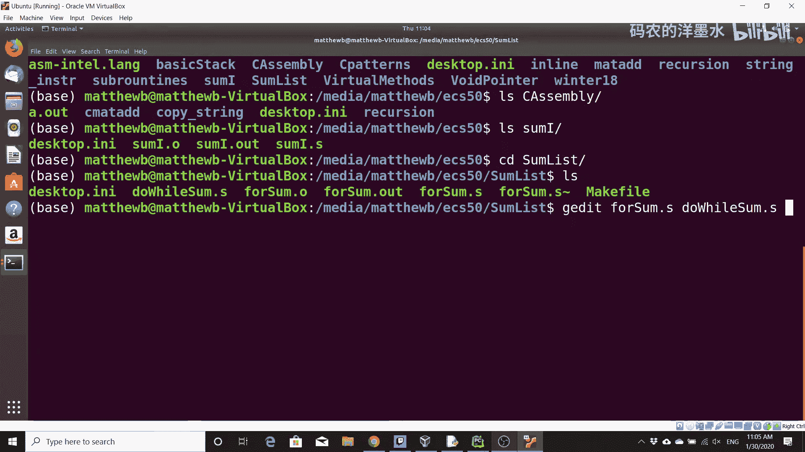

1.  **立即数（常量）**：以美元符号 `$` 开头。例如，`$4` 表示数值4。
    *   **重要**：忘记 `$` 会导致程序试图访问内存地址4的内容，通常会引起段错误。
2.  **寄存器**：以百分号 `%` 开头。例如，`%eax`、`%ebx`。
    *   寄存器是CPU内部的高速存储单元，用于临时存放数据和运算结果。
3.  **内存地址**：使用特定的寻址模式表示，例如 `(%eax)` 或 `4(%eax, %ebx, 2)`。

## 寄存器详解

x86架构有一组通用寄存器。以下是主要的32位寄存器及其部分功能：

*   **EAX, EBX, ECX, EDX**：通用寄存器，可用于各种计算。
*   **ESI, EDI**：通常用作源/目标索引寄存器。
*   **EBP**：基址指针，在C函数调用中用于定位栈帧。
*   **ESP**：栈指针，指向当前栈顶。**不要**将其用作通用寄存器。

对于EAX, EBX, ECX, EDX，还可以访问其低16位（AX, BX, CX, DX）以及AX的低8位（AL）和高8位（AH）。例如，EAX是一个32位寄存器，AX是其低16位，AL是AX的低8位，AH是AX的高8位。修改AL、AH或AX都会影响EAX的值。

## 编写第一个汇编程序

理论学习之后，我们通过一个实例来学习如何编写汇编程序。我们的目标是实现一个C语言函数：计算一个整数数组所有元素的和。

对应的C代码如下：
```c
int sum = 0;
for (int i = 0; i < 10; i++) {
    sum += array[i];
}
```

### 汇编程序结构

一个完整的汇编程序通常包含以下部分：

```assembly
# 数据段：用于定义全局变量和静态数据
.section .data
    array: .long 12, 12, 12, 12, 12, 12, 12, 12, 12, 12 # 定义一个包含10个整数的数组，每个初始值为12
    array_len = 10                                        # 定义数组长度的常量

# 代码段：存放程序指令
.section .text
.globl _start                                            # 声明_start为全局符号，链接器需要知道程序入口
_start:
    # 初始化寄存器：%eax 存放和(sum)，%ecx 存放计数器(i)
    movl $0, %eax   # sum = 0
    movl $0, %ecx   # i = 0

loop_start:
    # 循环条件判断：如果 i >= array_len，则跳转到循环结束
    cmpl $array_len, %ecx   # 比较 i 和 array_len (计算 %ecx - array_len)
    jge loop_end            # 如果 i - array_len >= 0 (即 i >= array_len)，则跳转

    # 循环体：sum += array[i]
    # 使用“基址+变址*比例因子”寻址模式访问数组
    # array(, %ecx, 4) 等价于 C 中的 &array[i]，因为每个整数占4字节
    addl array(, %ecx, 4), %eax  # %eax += array[i]

    # 更新计数器：i++
    incl %ecx                  # i = i + 1

    # 跳回循环开始
    jmp loop_start

loop_end:
    # 循环结束，程序逻辑完成
    # 在实际可执行程序中，这里需要调用系统退出，但本例中我们仅作演示
    nop                       # 无操作指令，用于设置断点

done:
    nop                       # 另一个标签，用于在调试器中标记程序结束点
```

### 关键指令解释

*   `.section .data / .text`：定义数据段和代码段。
*   `.globl _start`：使 `_start` 标签对链接器可见，作为程序入口。
*   `movl $0, %eax`：将立即数0移动到寄存器EAX。`l` 后缀表示操作长字（4字节）。
*   `cmpl A, B`：比较操作，计算 `B - A`，并根据结果设置标志位，但不保存结果。
*   `jge label`：条件跳转指令。如果上一次比较的结果是“大于或等于”，则跳转到 `label`。
*   `addl array(, %ecx, 4), %eax`：内存寻址。从地址 `array + %ecx * 4` 处读取一个长字（4字节），并将其值加到 `%eax` 中。
*   `incl %ecx`：递增指令，`%ecx` 的值加1。
*   `jmp label`：无条件跳转到 `label`。

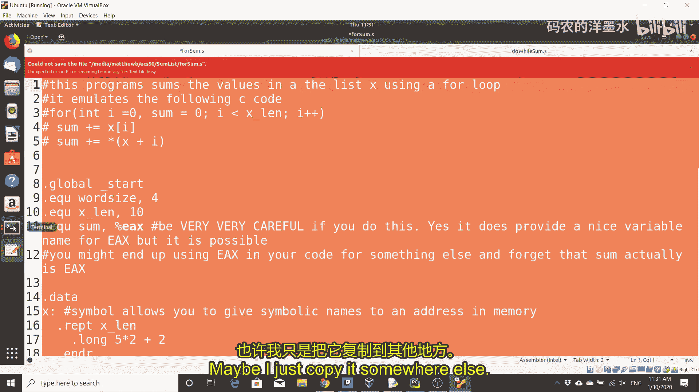

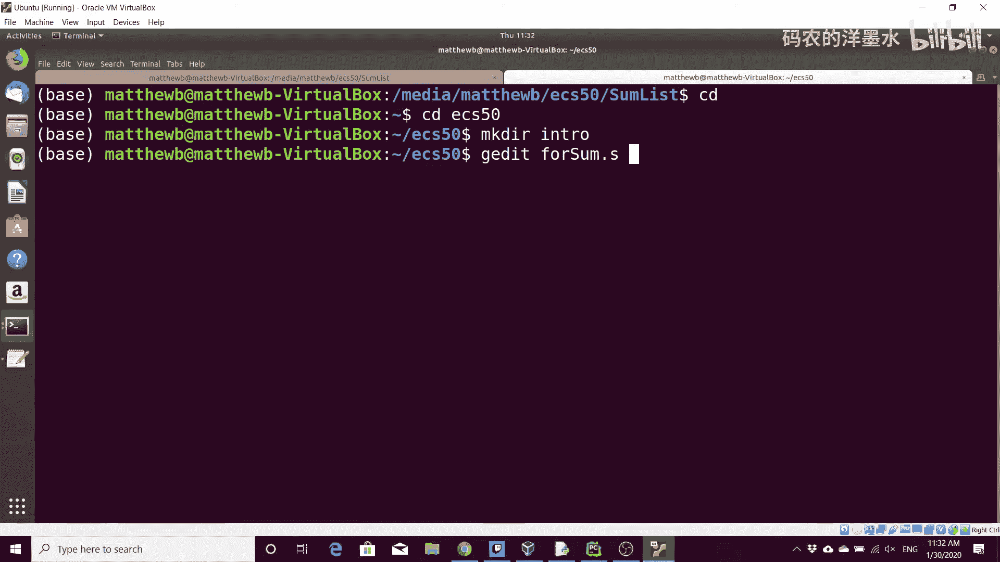

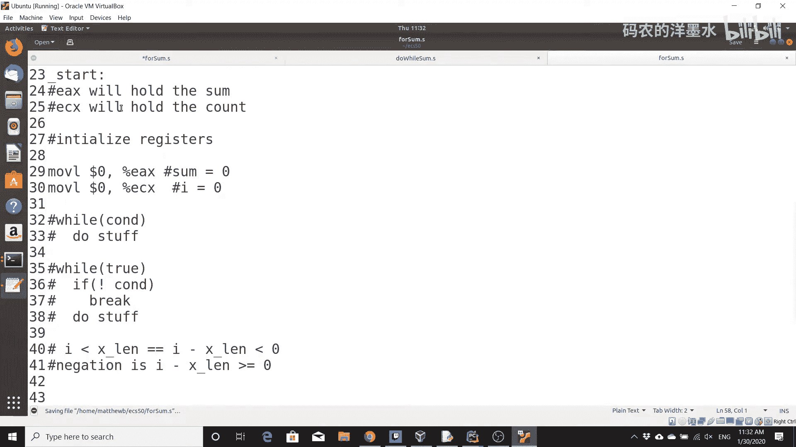

### 汇编、链接与调试

1.  **汇编**：使用 `as` 命令将汇编源代码（`.s`文件）转换为目标文件（`.o`文件）。
    ```bash
    as --gstabs -o sum.o sum.s
    ```
    `--gstabs` 参数用于生成调试信息。

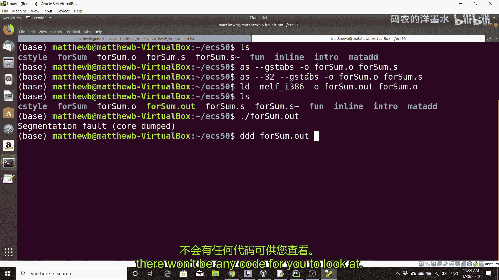

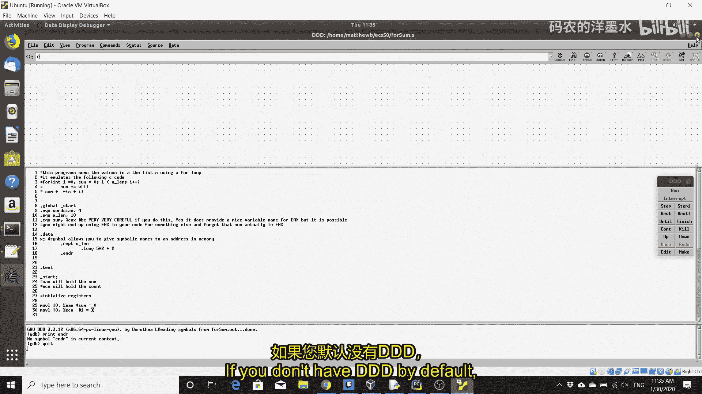

2.  **链接**：使用 `ld` 命令将目标文件链接成可执行文件。
    ```bash
    ld -m elf_i386 -o sum.out sum.o
    ```
    `-m elf_i386` 指定生成32位的可执行文件。

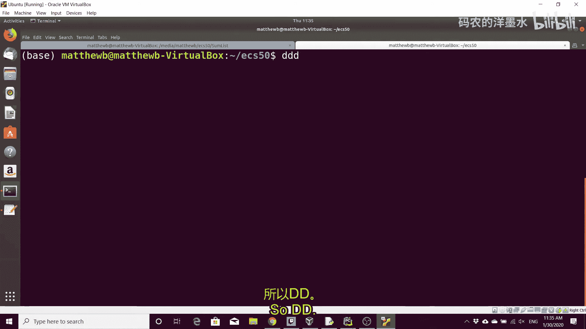

3.  **调试**：汇编程序没有直接的输出语句，必须使用调试器（如DDD或GDB）来观察寄存器值和程序状态。
    *   在DDD中，可以使用 `graph display $eax` 来监视EAX寄存器。
    *   使用 `break _start` 和 `break done` 设置断点。
    *   使用 `run` 运行，`step` 单步执行，`continue` 继续运行。

## 常见C结构到汇编的转换

最后，我们总结一个将C语言 `while` 循环转换为汇编的通用模式。

C语言代码：
```c
while (i < value) {
    // 循环体代码
}
```

转换步骤：

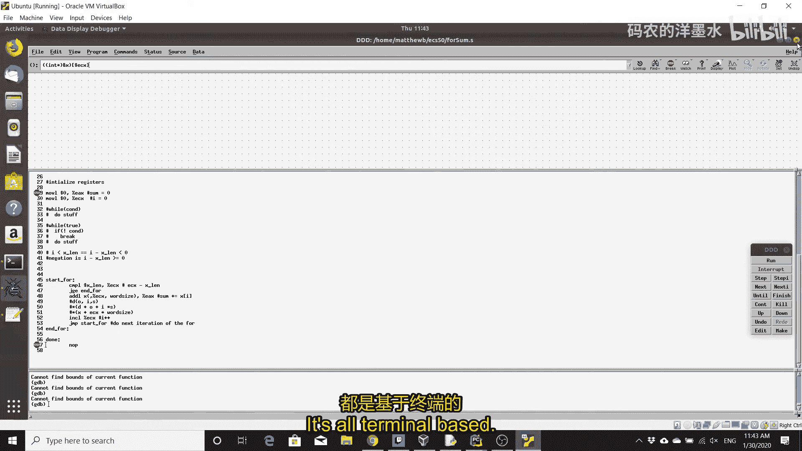

1.  将条件重写为与0比较：`i - value < 0`。
2.  取其反条件用于跳出循环：`i - value >= 0`。
3.  在汇编中，在循环开始处检查反条件，若成立则跳转到循环结束。

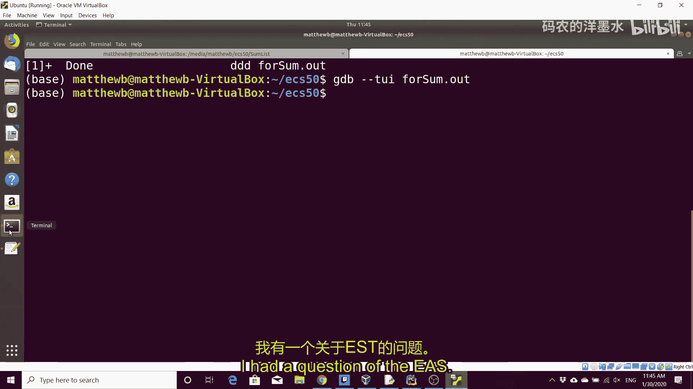

汇编代码框架：
```assembly
    # 假设 i 在 %ecx 中，value 在 %eax 中
loop_start:
    cmpl %eax, %ecx      # 计算 i - value
    jge loop_end         # 如果 i >= value (即 i-value >= 0)，跳出循环
    # ... 循环体代码 ...
    jmp loop_start       # 跳回循环开始
loop_end:
    # 循环结束后的代码
```

## 总结

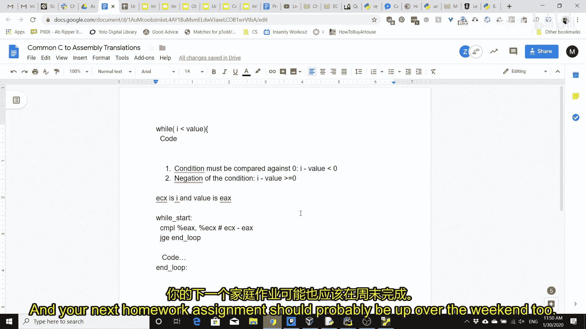

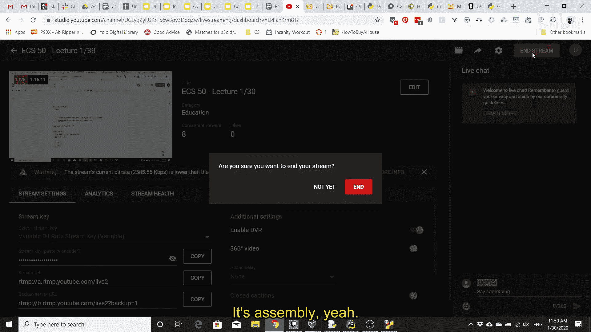

本节课我们一起学习了x86汇编语言的基础。我们回顾了CPU的工作周期，了解了并行计算的概念，重点掌握了x86汇编的指令格式、操作数类型和寄存器的使用方法。通过一个求数组和的完整示例，我们实践了汇编程序的编写、汇编、链接和调试流程。最后，我们学习了将C语言循环结构转换为汇编代码的基本模式。掌握这些基础知识是后续进行更复杂汇编编程和理解程序底层运行机制的关键。