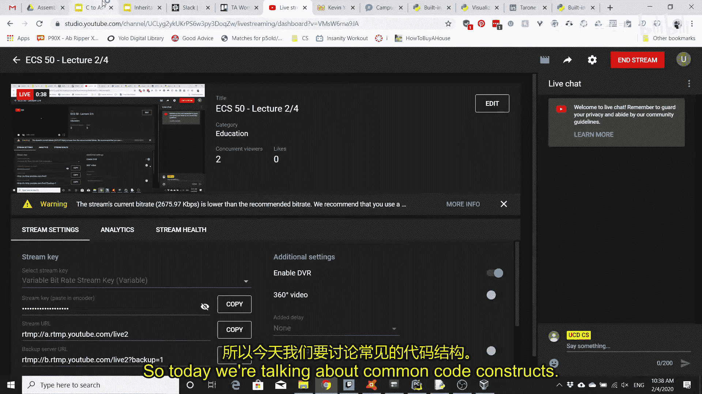
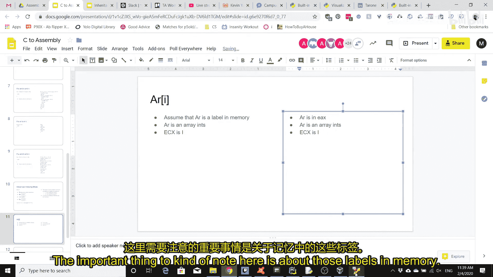
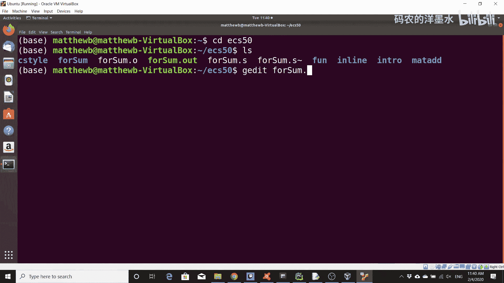
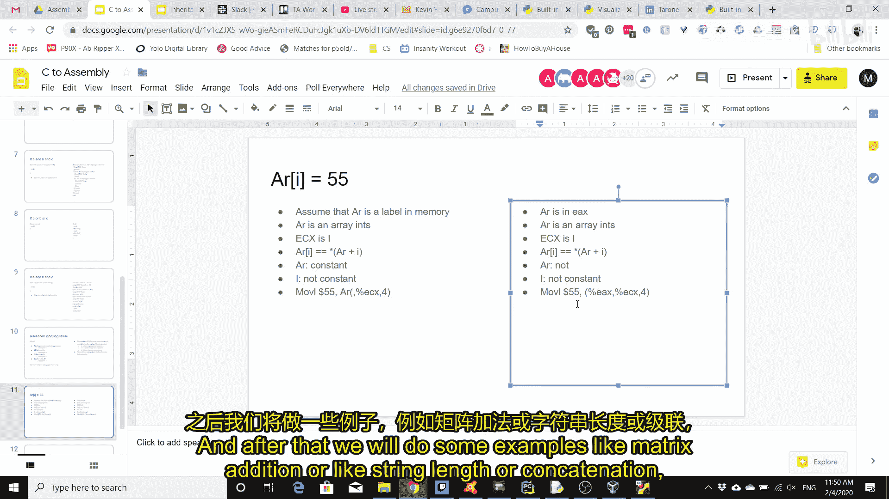
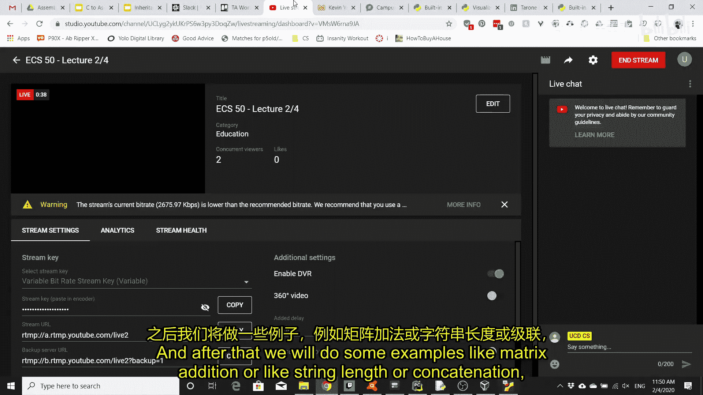

# 【全集】加州大学戴维斯分校 C语言与汇编语言 中英字幕 1080P p08 Lecture 8 - C语言到汇编语言基础 -BV1xefZBHEas_p8-

Guys know your quiz is up。 So if you get started， you're just answering the questions。 right。

 you don't have to come up programs to do it for the most part。 maybe like one you do or something。

 But most of them it' like it's like， you know， what's the binary representation of 68。 You know。

 Take a piece of paper。 Find the binary representation of 68。What is your answer？

Your next homework assignment will be out today or tomorrow for you working on。

 it's going to be assembly。The problems themselves， like in terms of like what you're doing。

 are not very complicated problems for the most part。They're pretty simple。

 but the struggle is going to be getting that working assembly code to solve the problem Also。

 don't forget you are going to have to run your code。In the debugger for it to be able to be run。

 otherwise it's always in a crash and you won't be able to get any output out of it。

So today we're talking about common code constructs so how to translate some common C constructs over to assembly right last time we talked about while loops。

 so if we had something like you know， while I is less than you know some value。

愿意。And then over here， we wanted to do something， you know， some code。

What would this look like in assembly code？So right now， we're going to。

To make answering this question possible。 Like， assume I is in。ECcX。And Val is in EAX。嗯。

So how would we translate this code？To assembly。Well。

 the first thing that we have to do is we have to create a label right。

 so here's our label while start。And then down here， we're going to have while in。Yeah。😊，对其实什么。Okay。

 sure， I mean， is it density be bigger or darker？Because if I make it like much bigger， I won't have。

Any more space to actually fit it on the slide， unfortunately。Sure。

 is that better or do you want to bold， okay？So。Right over here。

 we have whileow I is less than vow right， This zip code that we're trying to translate。

And so we have to figure out how to put that into assembly code。All of our comparisons in assembly。

What do they have to be against？Zero， right， so is I less than vowel， is that compared again zero？No。

 right。 So how can we rewrite I less than vow？As compared against  zero。Yeah。

 I minus vow is less than zero and again， normally when I'm translating the code。

I'm going to rewrite。The above as。While true。And then if basically like the negation of the condition if。

I is greater than or equal to vow。Break。Right， so I'm going to rewrite my for loop， so again。

 the negation of the condition， I'm going to break out of it if it's true。

 it's the same thing as the original loop。So this has to be， right？Degigation。

So how do we do the comparison between values， what instruction do we use？

Well it's the comp instruction and assuming there are long values like integer values， we use comp L。

 and then our source is going to be EAX， that's going to be vowal and then our destination is going to be ECX right this is going to do ECX and minus EAX which is equivalent to if I is an ECX and bows and EAX。

嗯。I minus。Now。And we'd like to leave the loop jump if greater than or equal to the end or while end。

And then here we have the other code that we'd like to take care of。

Any questions on this translation？So here right， here's we do the subtraction and these jump instructions。

 what they're actually doing the jump based off of its about it's based off the result of the last instruction that was run。

 so jump if greater than or equal to well if the last arithmetic instruction that we did。

This case like the comp， if that's greater than or equal to zero。

 the result of that last instruction， then go to while end。

 and then we also need to make sure that we go back to the top of loop， jump to while start。

Any questions here？Okay， what do you think a do while loop is going to look like， right？

 So normally we have something like do。Some code。While， right， like I is less than vowel。 and again。

 we're going to assume。I is in ECX。And Val is in YX。

So what's the difference between a do loop and a do while loop and a while loop？Yeah。对。

W would we check your position first。Correct， in a while loop we checked the condition at the top of the loop and at a do while loop we check the condition at the bottom of the loop。

So over here， right， we're still going to need these little labels to be able to jump to。

 so do while start， do while end。But where should we put the code section that we'd like to run Well。

 it needs to come first， right？And now our check is going to be down here。

So what would I like to do to compare I less than v right and again I less than v again。

 the comparisons have to be against zero， so I less than v。

 well that's going to be equivalent to I minus v less than zero。

So what instruction will I use to compare the values？What did we used last time？

We used to compare comp L， if we were comparing bytes。

 how would this instruction change like if we' were comparing characters？

Would it still be compel if we were comparing characters？

It would be comp B for comparing bytes because the character is one byte big if we wanted to compare。

 so if we're comparing bytes， it'd be comp B。If we were comparing shorts， which are two bytes big。

 it would be comp。W。For're comparing two by quantities and if we're comparing four by quantities。

 comp L。And we're working with four by quantities right now。So， over here。

What we want to do is we want to do I minus file。 So what should be write here。

 Who should come first， EAX or EX。Again， our goal is to do I minus v。So who comes first。

 Valal or I in this instruction？It's going to need to be EAX。Which is vowel。And then ECX。

 because the way the instructions work， it's always destination， the second one。Operation。

 the instruction source。 so second guy， I ECX。Instruction comp， which just does subtraction。

And then the value that I want to attract from it， EAX。Bow。Any questions here。

 I feel like I'm just losing everybody have no idea what's going on。So just help me out here。

 how can I help you？You're paying for me to be up here。Yeah。😊，So for the assembly board。

 I write code。Yeah， that's a comment。Yeah， the comments are either written as hashtags or slash star and then star slash。

 so everything between slash star and star slash will be a comment。Anything else？Yeah。😊。

So I for a good loss， sorry， and this is。to。You。Well， so the code is going to be the body right。

 and it won't be copy and pasted over right， You're going to have to translate those lines of code。

 right？There's there's no freebies， right， You're going to have to translate those lines of code。

 But like， what's going in the body of your。Your state or the body of your loop。Again。

 you're gonna to do it line by line and we'll talk about like you know， if you were doing adding。

 you'd use like add if you're doing sub tracking you use subtractto if we have like more complicated like expressions where it's like a plus B minus C。

 you know， times D， we're going to have to break it into little units and compute each little sub portion because we' only do like one operation at a time right if we did like we can't do a plus B plus C and then assign up to D。

Right。If we were trying to do this， like D is equal to a plus B plus C。

Right that was the code of your body that you want to translate for whatever reason and assume that EDX is D or D is EDX。

 A is ECX， B is EBX and C is ECX， how would you translate this to assembly？

We'll take two minutes and talk with people next to you and figure out what statement you'd come up with。

RightFor doing the summation again， A is EAX， B is EBX。

 C is EX and D is EDX and doing the translation， so take a moment， talk together。

 think what you want to do， write it down。Come back and get together afterwards， but yes。

 you will be using adding somewhere along the way。Yes。话。像在这是。我完们。私し。Yes。开始有他。案件。Oh。Thank。是不是这很。同记。I。

那个。还就。Okay， do we have any suggestions on how we can translate this line of code into assembly？Yeah。

😊，We thought that you could first set table to。I beach that。Correct， that's what you want to do。

 So how can we set D equal to a。How can we take the value from A and move it into D？不や知と。So we。

So we want to move the value， right， so to move the value we use move。So move L。

 well where do we want to move， we want to move EAX and where do we want to move it to I mean EAX and we want to move that to。

EDX right， This is going to be D is equal to a。 And when you're writing your assembly code。

 you put comments next to like almost every single line just so you have an idea of what's going on because it'll get really confusing really fast if you're not doing that。

 So great， we've put EAX into D and now you want to do your summation。 So how can we add B to D。

Yeah add L and we want to add what should our first thing be？EBX， and we wanted to add that too。

EDX right， so now right we have D plus equals B， or overall right we have D is equal to a plus B at this point。

Then how can we add C to that？ECcX2。EDX right， and this is going to be D plus equals C。

 or in total D is equal to a plus B plus C。Plus C to get the entire summation。

 so it has to be broken down to a couple of different lines。

 something can happen because you can only do one addd operation or one subtract operation or one multiply operation at a time。

Yeah。😊，Sin how to store there。Like how to get like a constant value in there。

 like the value five or something like that。出的这。I mean， you just saw。

Put the value of this register into that register it's the move if you wanted to put a constant value like say seven。

 move out dollar sign 7 to percent register name ECX that makes ECX equal to seven right if you're working with constants。

 remember they need to be prefixed with dollar signs。Okay。Any other questions here， yeah？会对开。

Thank year。I meanan， there really is no declaring variable。

 you just say I'm going to use this register for that。Period。

 and then you just treat it like the variable。But like I get you to E A X， like。他这些就。It doesn't。

Right， we just said this register will play this role in this program， right。And we， how did we know。

 right？ I mean， like always said like was like down here was like， you know， D is E D X， B A is。

 you know， EA X。YouThe best you can do is write comments。嗯。Where。

Like how did they originally get their values？Like again。

 if you wanted to put a constant value in them， for example， if a is supposed to be seven。

 move L dollar sign 72% EAX。Right， but like like are you saying like these are like user inputs。

 How do we get these values from the user if we wanted them like that。I just。It just。What you say。

What you at。ださ分。So here this is just some examples。 So we have A， B，CD， right。

 they're just made up variable names。 You can think of like they're all declared as integers。

 And so when you get to your assembly code， you're gonna to have some C code you want to translate。

 You're going to have variables and you're just going to be like this register is going to play this role。

Period right in my assembly code， I want this register to play the role of I。

 I want this register to play the role of number of rows。

 I want this register to play the role of number of columns。😡。

And then you just treat it like it is right so everywhere you see like number of rows show up。

 you replace it with whatever your register is that you're mapping it to。😡。

Just keep it consistent Yes， right， but all that responsibility is now on you to keep it consistent。

 the other thing that you're going to find is you only get like six registers a lot of times you have more than six variables。

And so we will talk about in a little bit like how to put things into memory so that you can free up registers to do some operation because like you don't need every single variable all the time。

 so you can transfer some variable out to memory， do something with what you want to do it with。

 you know do the operations on the registers and then when you need the thing。

 take it back for memory and put it into register to be able to use again。嗯。Okay， so for registers。

 like for EA。30 HX does not mean have。Register。When we have like6， you have a through D。E， IED I。

Right， and then like maybe the first homework assignment， you have EDP。

 so you could use maybe like seven。For the first summary assignment， but beyond that。

 you don't have anymore。Any other questions？Yeah， so for E D X， E A X and all other register。

 So do they have different function。They're just these registers are just general purpose registers you can use them for whatever you feel like there are some special instructions that utilize some specific registers and we'll show you those instructions later on but like for right now A is the same as D is the same as B for you when you're writing your programs right the only one that's kind of special right now is ESP which is the stack pointer don't mess with that one。

这是。Yeah。Also like EDI and ESI， you can't access the sub portions of the register。

 so you can't access like the two by quantity or a one bike quantity within the register like AX and AH and AL。

So over here we did our comparison， right， we did I and minus value， and then what should be check？

On the next line。We need to do some kind of jump right。

 so we want to do jump if less than or do we want to do jump if greater than or equal to the negation？

So remember if the jump is true， you're going to go wherever you want to go to。

So if this condition is true， what do we want to do？So like if I is less than vow。

 what should happen？Should go back to the。Top of the loop in， do it again。

 So if I is less than value， where should we go。Back to the start。 So this sounds like a less than。

 we do what to jump off less than。 So jump back to jump off less than to do while start。

If that condition is true， go back to the beginning and do it again。Any questions？Okay， what about？

4 loops， right， They look something like。You know4 inch I is equal to zero。

 I is less than vow plus plus I。Do some code。Yeah。Right， codes going to be somewhere in the middle。

Again， when I'm doing this translation， I kind of rewrite it。To be。哎。Right。

 which is is this is the negation。Of your condition。你。So again。

 I also do this type of loop where I negate the condition。So this first portion of code。

 this i equals zero， how many times does this part happen？嗯。It just only happens once。

 so we want to put it in our little for loop over here。YouNo。

 we want to do it right before the for loop， right？So how can we put the value zero into I。

 or I is ECX？Move out。Dollar sign 0，2。ECX， right， this is I equals0。And again。

 don't forget the dollar sign because dollar signs mean constant if you don't have the dollar sign there you're going to go into memory at location zero。

 which is the old pointer and try to get the value that's there and get a segmentation fault。

So don't forget that all our signs。Okay， so now after we've set i equal to zero。

 what do we do next in the C code？嗯。We set i equal to zero， so what happens next？Were we true。

 so we're going to go into the loop。And then。We have to do our comparison about whether we leave or not。

So。again， can we do I greater than or equal to v？So I greater than or equal to v， well that's again。

 once equivalent to I minus0 is greater than or equal to v。And so how can I do this abstracttraction？

I mean， I minus vow is greater than equals to zero high be。How can we do this subtraction？Compel。えし？

EAX。ECcX， right， once again， we have I。Mineus Val right there。And then what do we do next？

Jump up greater than equal to。The for end。Because this should look a lot like the while loop because while loops are just four loops with a little bit of extra time at the beginning in the end。

Now we would do our code body。Right， so we do the code。And then after we do the code， what do we do？

What happens next after we do this code body right here？Rightright， we gotta do the。Plus plus size。

 so how do we do plus plusci？I。We could add L。Dollar sign1 to ECX， or we can use increments。

Just ink L percent EX， this is like the plus plus I right again， you can write the at。

 you'll totally get the same effect。But here I just want to add one。 so I'm going to increment I。

 and then after I add one to I， what do I do？No。We restart the loop， so hows。

 how can I restart the loop？是。Jump to。WeReady when I jump to？We start， Yeah， that's it。Any questions？

So。Okay。Yeah。😊，is for jump today。job自。Well JGE isn't like strictly limited to jumping to the end and jump isn't strictly limited to jumping to the beginning right JGE is jump if greater than or equal to jump if the result of the last operation was true。

 right？And if I is greater than or equal to vow， what do we want to do？

We want to break right so we want to go to the end of the loop so JGE to the end of the loop right。

 but once we reach the end of the loop like normally right we complete the code body without breaking。

 where do we want to go to。We're going to go back to the start of the loop。

 so we'll jump unconditionally， always go back to the start of the loop。

 But if you want to jump somewhere else unconditionally， sure。

 jump and you're probably going to see some examples of when we're doing this with like if Elsif。

 Elsif， Els else kind of thing yeah。我外呢是国。た分さ。Whatever comes after your for loop。

There's not any more instructions。Well， I mean I'm assuming that you know we're just trying to translate like a little blocks。

 so a lot of times like if you had your this is how you like if you had like your for loop and then you do something else afterwards。

 you translate your for loop and then you after the for loop。

 you would then translate whatever code comes after the for loop。

Right so if this was the end of the program， like your program， you probably wouldn't have anything。

 but if if the next line of code says you know， add seven to like variable A。

 well then your next line of code is going to be adding seven to variable A。Anything else？

I want this。打点。Oh， what the heck happened here？There we go。So。If。Eif。

So let's assume that the code that we have here。As you know， something like。If I is less than， say10。

You know。Code one。Else if I is less than 20， right？Goode2。Else。Code 3。Right， again。

The conditions can obviously be more complicated if we need to。

 and if you we'll talk in a minute how you could do something like if this and this and that or if this or this or that。

But。How are we going to translate this and again， assume I is ECX？Maybe it should be like ECX is I。

So here we have our F1。And what should we do？你方面。With。Yeah。

 we have to compare I against 10 right so like I is less than 10 Now the question is do you want to use the positive version of the condition and then jump to the code or do you want to use the negation of the condition and jump around the code you would normally do？

20。How many of you guys want to do pause it， The code is true。 Ju somewhere else and execute it。

N neigation， jump around the code that you would normally do。IThink negation slightly wins。

 I personally think the negation is easier because the code shows up in that area。

 whereas like if it's true， you have to go jump up to the code that you want to run。

 go do it and then jump to the end of the the end of the ifL statement。

 which I think may a little bit harder， so our condition is I less than 10。

Which is equivalent to I minus10 less than 0。And then it's negation。

Is equal to i minus 10 greater than or equal to zero。

So the first thing that we need to do is the I minus 10 part and again I is ECX。

 so what do we do for that？Yeah。Just keep going with the patterns you've been doing the whole time。

So how do we do this subtraction， how do we do the I minus 10？Yeah， just compo。

 but we don't have it in EX right now now it's going to be。Is it just going to be 10？Dollar sign 10。

 right， we want the constant value Again， it's really easy to forget it because it's not syntactically invalid。

 but it's going to do a lot of weird stuff in your code。

So over here we have comp L10 with percent ECX。And again， we were going to work with the negation。

 so jump if greater than or equal to， well， if this condition fails， where do we go to？Yeah。

 we're going want to go to if2。But if the code succeeds， what do we want to do Well。

 I mean if we don't， if the negation isn't true， we actually want to do the code。

 so here would be code one。And then after we do code one， what do we want to do？

Where do we want to jump to？Yeah， so we want to jump to the end of the what？All， right。

 come to the end of the else。Right because you want to go to the very end of the else。

 its going to be the end of the if Elsif， Elsif Alt statement。Right， it'll make more sense。

 probably like when the whole things there。 So here we have if2。 And what do we want to do with if2。

 What we need to do， I less than 20， right， which is equivalent。2。😊，I minus。20。Less than zero。

 and then its negation is equal to I minus 20 greater than or equal to zero。So what should we do now？

Dollar sign 20 with。ECcX。Jump if greater than or equal to。I。Yeah， the alts， right， theelts start。

Then we can do our code， so we can do code2， and then after we do code2。

Jump to the end of the elsets。So now we have our elsets。Start right here。And here。

 if we're in the Altstar， right， we just do code three。And then here we have code3。

 and then here we have the end of the else。Does this make sense？

At least is like my preferred way of translating this type of expression。这一见。Are there any questions？

Any questions in the translation of if Els if？Else kind of statement？

What would have happened if we had forgotten this line of code？See。It's going to run all of them。

 right， Do you guys remember switch statements from C？Maybe。Roughly。

 maybe like remember the biggest mistakes with switch statements is to forget a break at the end of your case and if you forget the break。

 you automatically fall through into the next case and do it， that's how you make that happen。

 you leave just out the jump and you'll go to the next one。So。

For translating some of these other things， right， sometimes you end up with， you know。You know， if。

 you know， A and B and C。88888。How can you rewrite。Just in terms of like C code， so if we have oops。

What's another way of rewriting if A and B and C， where A and B and C are some conditions， right？

How could you rewrite this？Without using the and word in C。So how could you rewrite this expression？

Right。Without using the An statement。Again， in Python， N C， just how would you rewrite it。

 you can't use and at all yeah。You can nest the if statements， right， so you could do if A。If B。If。C。

😊，Right。Do stuff。Right so if A and B and C are all satisfied， but again。

 that's just writing like an if statement within an if statement within an if statement。

 and that's really how it gets translated when you're writing your assembly code。

 it's like if within if within if。Because remember。

 you stop evaluating as soon as the first one becomes false。Right so if this one was false。

 are youre going to go into the statement？No， so you skip all the rest of them。

Does anybody need to see translating nested if statements？I'd like to see that？Okay。So。Right， again。

 if a oops。A and B and C。So maybe our statement over here is if a is less than 20。

And B is greater than or equal to 13。And see。Its equal to9。We want to do something。Right。

 and let's assume again。For simplicity that。EAX is a。EBX is B。And ECX。Is C。

So what's your assembly code going to look like？Yeah， right， so here we're going to have like。

 you know， if one。And let me make it so it stops putting in those extra lean lines。

So here we have if our if statement one， and again， this is the。A less than 20 line。

 So how are you going to rewrite this in assembly， Do you want to do a less than 20。Well， no。

 that's a minus 10。Less than zero。 and its negation is。A。Minus 10， greater than or equal to。Zero。

 so what are we right here？10 with EAX and then。还叫。Jump up greater than or equal to。You know， like。

 you know。The end， right， No， if it fails， right， because these are nested。Right， remember。

If the first condition fails， do we want to do the second one， No。

 we want to go all the way down to here to the end。So jump if greater than or equal to the end。ok。

Because again， remember， we when we were translating this line of code。First， translate it to this。

Then once it's translated to this。Translate to assembly code。So。Now， we have if 2。

And our condition was originally B greater than or equal to 13。And it's negation when it。

 which is equal to B minus 13。Greater than or equal to zero。

 whose negation is thens kind of running in that room。

What's the negation compared against zero of this？All， so we be minus 13。Less than zero。

So what do we do here？Compampelll once again。Dollar sign 13 with。EBX and then。这些。To the end。Okay。

 now we have。Our third， if statement。If 3。And again， like these labels here aren't necessary。

 but you can still totally put them in just for readability to kind of understand what's going on right because unless we haven't referenced them at all。

 we haven't say jumped any of them， but I think it helps reading。是的 there。Okay。

 so final piece of code， right is this guy is supposed to be C equals equals9。

And so that negation and compared against zero is going to be equal to what？See，-9。It's not equal to。

0。So， here。It's probably a bit too much spacing。So comp L。Dollar sign nine with。ECX。Then jump。

Not equal to。编子。Great。And then down here， what do we do， what we do our code。嗯。here's the code。

 so then here you can finally do the code。And this would be something like， you know。If3 and。

If to end。If one， and。Don't forget the semicoons。And then just end。What。No。

But I think it makes it easier to read。So no or you can put them in his comments or whatever。

 but I think the indentation here like you know Python doesn't compile without correct indentation。

 assembly code is impossible to read without correct indentation right so still use your good indentense and your good coding style to make things understandable it becomes more and more important here because you have less and less to work with。

Any questions here？Yeah，长年。Cian。Oh。Because I messed up。Now it's 10。Sorry。Any other questions？Okay。

 now how would you translate？Something。Like， if a or B。Or C。You know， code。

So this now becomes if A or B or C。How would you rewrite this。Without easy ignore。要是。上せ。So again。

 not like， you know， how would you retranslate this， not into assembly code directly。

 but how would you translate this into equivalent C or equivalent Python code that did not use or？

So just like if A， if B， if C。Right， so if a。Code。😊，If B。Code。If。See， good。Like this？Cilian。Yeah。就是在。

行。Yeah， there would be some ways of optimizing it when you get to the assembly code， right， but is。

Is everybody happy with this， hes happy？Anybody unhappy？I'm still unhappy with this。

Because how many times does the code blocklock get run？

What's the maximum number of times the code blocklock could be run now？Three， in the first one。

 how many times could it be run at most？One， so how can we make sure that it only gets run exactly one time at most or at most one time？

Yes。Because if all three conditions are satisfied， we would go into each if statement。

I' was assuming， though， like we didn't want to like。

Because you can't break out of an if statement and we don't want to like return。

If we were like in a function because we may have other code that we'd like to do。啊。Yeah， elses。

 right， because if you want mutual mutual exclusivity。

 you only want one of them to be done Elss right， So if it was if。😊，Elsph。Elsif， right。

 only one of those happens。Right， and this kind of brings us back to the previous problem that we had before。

 whether whereas if， ElsF， ElsF， Elsif， and so on， so the translation is kind of just what we had before。

 but as was mentioned， we might be able to do a little bit better instead of having that code block repeated three times。

Right， we could just have it only show up once and again the the thing is。

In terms of how you would translate this。And again， assume， you know， A is EAX， B is E X， blah， blah。

 blah， and then maybe actually you want to copy this one。And now this is just Os here。

How would you translate this code？确定。嗯。Right so we could do like the verbatim translation that's going to require us to have three copies and paste of the same code。

 is there any way we could get around having to do that？嗯。There are at least two ways I can think of。

Yeah。😊，十分年す。s maybe not necessarily nested， right， But like here we kind of have like our if1 kind of block。

 I mean， it's sort of nested， but sort of not nested。 So like， here's like if1， right。

 which is again， like a is less than 10。Who was again once again equivalent to be like a minus 10 is less than  zero？

And whenever I actually do this， whenever I'm actually coding like assembly。

 I literally write this every single time because when I don't I screwed it up。

So if this condition is true， right， so again， compel， you know， dollar sign 10% EAX。Again。

 that's the a minus 10。If this condition is true， what should we do？

jump with less than to where what do we want to do？对见。But would not do the code right。

 so like code start。But if it fails， what should we do next？Well， if it fails。

 we want to check the next edition， right， so if two comes right afterwards。Right， so here。

 R F2 is B is greater than or equal to 13， right， which is again。Once again。

 equivalent to B minus 13 is less than  zero。Oh， no， no， still greater than equals2。

Not changing that。And then here we can do compo， dollar sign 13 with percent EBX。

And jump if greater than or equal to， right？The condition holds， we want to go to the code start。

But otherwise， if that condition fails， what do we want to do？If condition number three。

Which is the C equals equals9。Which is again equivalent to c minus 9 equals equals zero。

 so compel dollar sign9。Against percent ECS。Jump， if equal to。The code start。But if this guy fails。

 what do we want to do？Yeah， jump to code end。 and then down here we have code start。

And we do our code。And then here's the code end。And isn't assembly fun？

It was supposed to be something that was so simple。Any questions about this translation？

Right a lot of like working with assembly is figuring out how to like map your higher level constructs down to the low level things you have to work with。

We'll talk about functions a little bit later， but the thing that we have to do next。

Let's talk about array translations， so how do you index arrays？So to understand this。

 we have everybody's favorite， most confusing thing， the advanced index Dexing mode。

Here's what it looks like when you write it in assembly。Right， it's going to be D。O， I and S where D。

Is the displacement？可以。Displacement。And it needs to be a constant expression。Oh。Is for offset。

And it needs to be a register。I stands for indexex。And it also needs to be a register。

And S stands for scale。And it stands for and it can be either one， two， four， and maybe eight。

And 32 bit mode， I know8 definitely works in 64 bit I just never really have a reason to try eight out in 32。

嗯。So it literally can be  one，2，4， and maybe eight， it cannot be any other value。

Does that make sense？The effect of this operation is to do star D plus O plus。I。What。I times S。Right。

 you know， give me memory at location。D plus O plus I times S。

Give me the value of memory at that spot。Any questions so far about what it does？Okay。Now。

 the thing that I want to emphasize with displacement is it can be a constant expression。

Does not just have to be a constant so you can do three plus4 times 9 minus 27 times 83 right that's a constant expression because everything involved in that expression was constants and the computer can compute that for you so don't forget that。

In your translation now each of these values is optional and they have a default value if they're not given。

 so not given。It's going to be zero if it's not given。It's going to be zero。If this is not given。

Given。That probably better。Copy this if it's not given， it's going to be。Zero。

 and if this one is not given， it's going to be one。So it defaults to one， if not given。

The other thing that's important to remember is。This final little point over here。The amount。

 or should say， the number。Of bys red from memory。Is controlled。By the suffix of the instruction。

So if we did something like a move L from this address， right。

 it's going to read four bytes beginning at that address。If we did a move W。

 it's going to do two bys beginning to at that address。

 if we did a move B1 byte from that address so。L is。4 bys， starting。At the address。

W is going to be two bytes starting。At the address。And B will be one byte。Starting。At the address。

Also， one important thing to note is。At most， one operaand per instruction。Can be in memory。

So if you want to move something from memory to some other location in memory。

 you can do that in a single instruction。How would you go about doing that then if you can't move something from memory to some other location of memory in a single instruction？

Yes。Any thoughts？ if I wanted to move something from location 100 in memory to location in 200 in memory。

 I can't say Moel 100 comma 200 because we now have two operas that are in memory。

 location 100 and location 200。So how can I move something from memory in one location to something at memory at another location。

 how can I transfer the values that are there？Talk with your partner or someone your vibe for a moment。

 think about how you would do that。 How would you move something from one location to memory to another location of memory。

Right given that you cannot put two operaans that are in memory in a single instruction。

 so you can't sayMo out location 100 to location 200。Right。嗯。So any thoughts？How you would do that？お。

I mean， this is pointers， right？Notice there's a D reference right there。 This is pointers。Right。I。

Right， theres。 there is a little D reference there， though it might be a little bit hard to see。

 There is a star there。Again， there aren't any variables that are just addresses in memory now。

So the key here is to use more than one instruction。Move something from memory。

 location 100 into a register， say EAX， then take what's in your register， EAX。

 and move to location 200。RightEach of those instructions only had a single operated memory。

 but because I wanted to work with two things that were memory。

 it took me multiple instructions to be able to do that right so I' just going to break it down a little bit more。

So let's talk about how we can do some different types of translations。

Let's say we want to do array at I。So we're trying to access array at I。

And over in here on the left hand side， we're going to assume that AR is a label in memory。

And over here， we will assume that AR is in EX。The other thing that we're going to assume is。

What do you want AR AR。Is an array of what do you want to do for the first time？Aray of ints。 Ar of。

And ins shorts， fights。Okay， a array of ints， so again。AR is an array of ins both to them。

And then over here， we will assume that once again， ECX。Is I？

The important thing to kind of note here is about those labels in memory。

U。And kind of like， so。This label thing in memory always gets everybody confused。

Because it doesn't like quite j with what I seem to be saying。So。

So this was the example that we did last week， which you know feels like forever ago。

I know there was something over here your it's an review， right？Highlight mode。The similar work。

So over here， right， here was our little array that we were working with。X。Right。

Notice that when we are working with it over here， X appears in the displacement field， the D field。

 right， What did I say had to appear in the D field？A constant， right。

 And so you might ask yourself how the heck is X constant。That doesn't really make much sense。

And when you're referring to the label。You're referring to its location。So x。

 it's over here on line 15。 is x ever going to move from line 15？Sure it could。 But right。

 But when I go to compile it， it's always gonna be fixed at whatever line it's gonna be at。

 So in this case， it's always gonna be at line 15 in terms of like how that translates over to the like machine code that gets created from the assembly code。

 This means that X always refers to the same location and memory So again。

 X might be location referring to location 500 memory So X is the same thing as 500 right。

 but we just do not have to know where the linker is going to make space for this memory at or where like it gets compiled together where exactly a memory it's going to be at。

 We can just use the symbolic notation X to mean this location and memory where my array begins。😊。

Does that make sense， so the label is a constant， right？And that's why it can appear。

Here in the displacement field。Right， so again。嗯。Are we caught with that？Now。

 one thing to kind of think about is。What's the difference between these two lines。

 MoL x to percent EBX and a Mol dollar sign x to percent ECX？So again。

 let's assume that x denotes the location and memory 500。And again， here we have our array of values。

 it's an array of 12。😡，If we do this line of code， what value is EBX going to have？Yeah。

 EBX is going to be 12。What's ECX going to have？So be 500。 So when you think about like the labels。

 if you put a dollar sign in front of it， you're asking for the constant part of that address or the constant part of the label。

 which is its location and memory where it's at。 Or again， when we're using this notation here。

This is the advanced indexing mode， but we just didn't give any of these three things。Right。

 so we're going to memory at location X， right， same thing as like exit at0。

Whi is going to be the first thing in our array， the value 12。Whereas where I say dollar signine X。

 I want the constant part of the address I want to treat it as a constant。

 so it's its location of memory 500。Please write this down。

But dollar sign X is dollar sign does not mean the address of。Dollar sign is not a dress up。😡。

Dollar sign means constant， right。 And if you're asking for the constant part of a label。

 it's where it's located at in memory。There is an of operation like an address of instruction。

 and we will talk later about the address of instruction。

But a lot of people get confused thinking dollar sign means dress up。

 it does not mean that it just says constant。And constant part of a label is its location and memory。

So it will be an address。Were okay with that？Just really make sure you have that down before you start your coding because it's going to make you really confused otherwise。

Okay， so how can we translate this line of code given the following assumptions right。

 if AR is a label right， and we just said labels are constants。

 what field is it going to have to go into actually we should say step one is how can I rewrite this expression AR and I。

Without any brackets。Yes。It's star。AR。Plus， I。Does this look at all familiar？To this format。

Looks pretty dang similar， right， And that's why we're going to be using the advanced indexing mode to pick out the elements that we want。

So D plus O plus i times S。So over here， if we look at this expression on the left hand side。AR。

 is that a constant or a register。On the left hand side， again assuming that AR is a label。

Like you just saw with X， is AR a constant？Or is it like a non constant？嗯。Yeah。Constant。Not constant。

It is constant。Right， because again， labels are constants。

 They just tell you this location and memory， you can't move the label。 It's stuck there， right。

If this you know label refers to the location 500 memory。

 it always refers to the location 500 memory， it cannot change once the program gets started。

 so it is a constant。😡，What about I？Is that constant or non constant？Constant。Non constant， right。

 it's not constant。It's actually in a register you can see from our assumptions above。

So how do we translate this piece of code into assembly？Right， we have the D， V， O， V I， and the S。

And let's say that we're trying to do our statement over here is AR at I is equal to 55。

So they can give a full statement。So again， D has to be constant。

 so what part of our expression has to go here？AR， right， so AR goes here。What do we want to do so I。

 do we want to put it into O or do we want to put it into the I field？Sure。

 I'll put it into the eye field and it kind of just stays there， so that's going to be ECX。Now。

 do we need to put something in the O field？Again， we want to just do AR plus I right。

 Are we currently doing at least AR plus I？Yes， so nothing in the O field。Scale field。1，2，4， or 8。1。

2。4。8ight。So for those of you that say one， why do you pick one？新闻。Well， so here right。

 this is how you'd rewrite the expression， but here， right， we have an array of。Ins， right。

 So if our array begins at location 100， our first integer begins at location。

100 right like array at zero is at location 100 right and it's actually going to occupy bytes 10。

 101， 102 and 103 so your next integer in the array begins at location。104， right， So 104，5，6。

7 is your next one， right It's taking up four bys。 Our next guy would be at 10，8，10，9，1010，1，11。

 right， So every time we want to move a single integer， how many bys do we have to move。4 bys， right。

 So our skill needs to be。4， because we're accessing an individual bys and memory。

 So this is going to be four。And since we're doing A at I equals 55。

 we want to do a Move dollar sign 55 to AR at this location。Any questions here？Okay， quickly。

So over here。And we copy things over。 So over here on the right hand side is A R constant or non constant constant。

Non constanttant。It's not constant on the right hand side because AR is in EAX， right。

 you have to read the conditions first to answer the question， here it's an EAX。

 here it's a label in memory。So over here， AR is not constant。And again。

It's also not going to be not constant for I， so here Mol 55， can we put AR here anymore？No。

 where can we put it？In the offset field right because again。

 we still want to do AR plus I right we want to start at AR and then move I integers past the beginning if we put something in the O field。

 it's going to be O right plus I times S。And that will move you to the correct location。

 so AR shifted from being the label into a register。

 and so it moved from the displacement field to the offset field。Okay， we are out of time。

 we will continue talking about the advanced indexing mode on Thursday and after that we will do some examples like matrix addition or like string length or cattonation。

You know， stuff like that。

交房村。