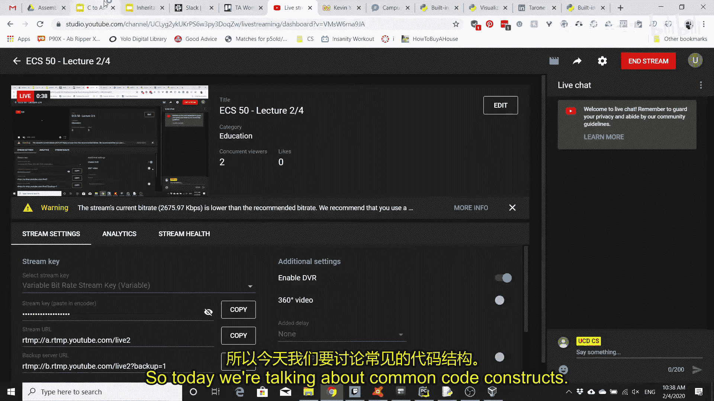
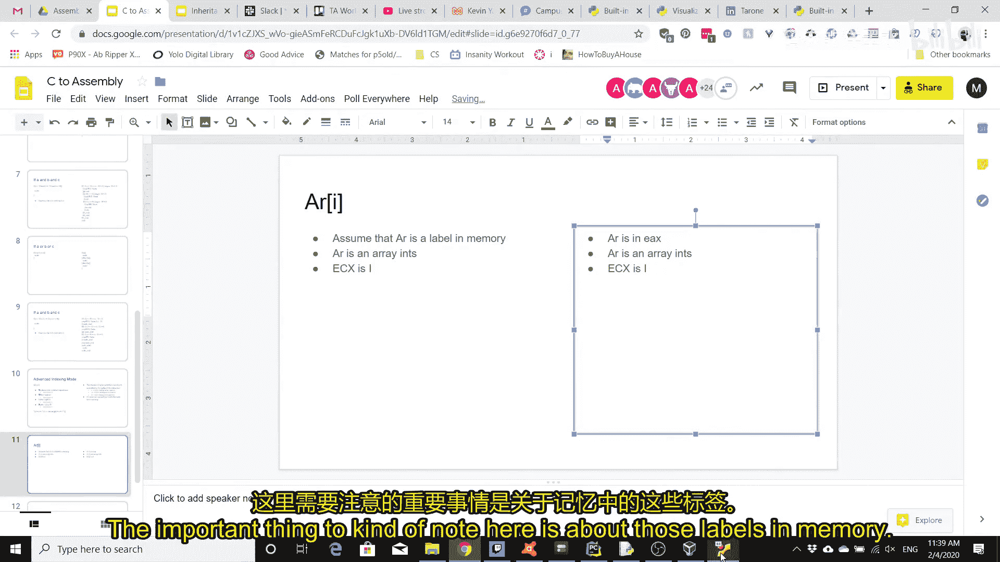
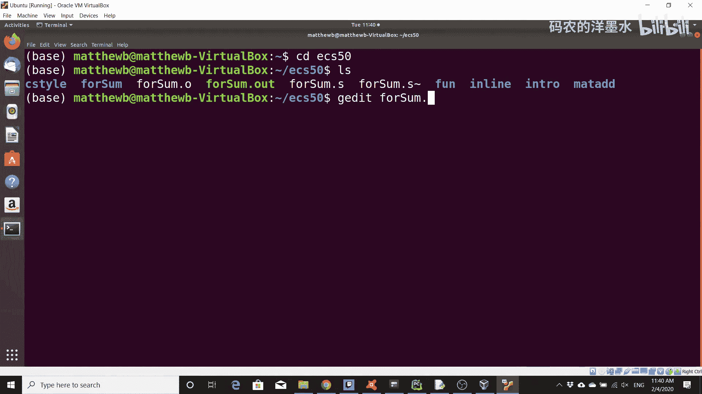
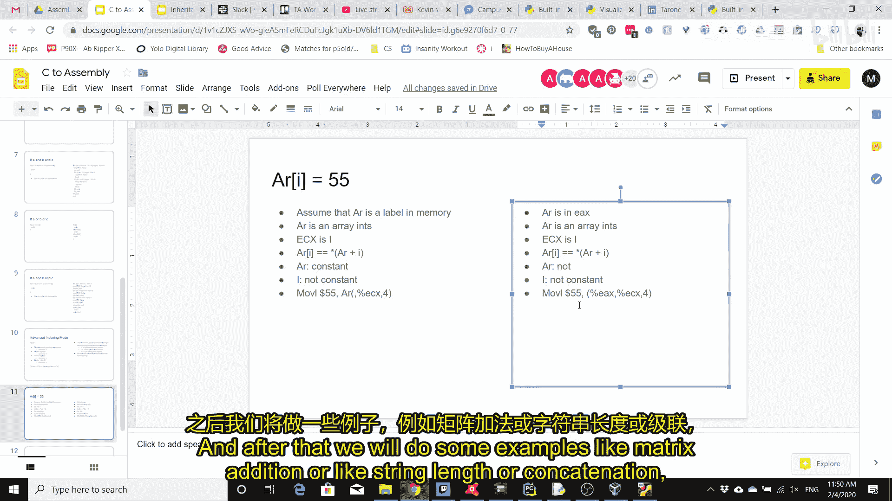
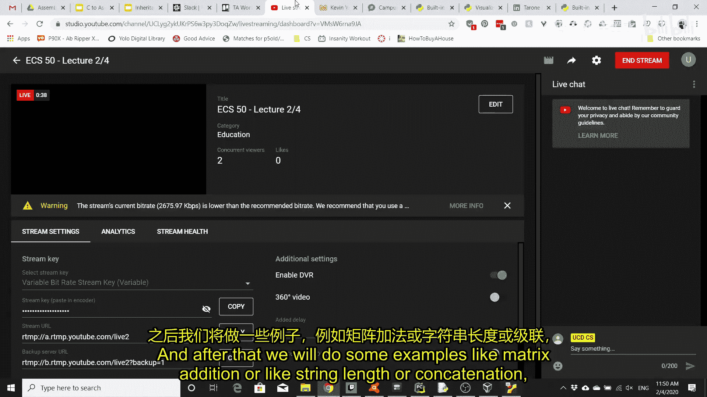

# C语言与汇编语言：08：C语言到汇编语言基础 🖥️



在本节课中，我们将学习如何将常见的C语言结构（如循环、条件判断和数组访问）翻译成汇编语言。我们将从基础的控制流结构开始，逐步深入到更复杂的表达式和内存访问模式。

## 概述 📋

上一节我们介绍了汇编语言的基本指令。本节中，我们来看看如何将C语言中的核心控制结构和数据操作转换为等价的汇编代码。理解这种转换是掌握底层编程的关键。

## 循环结构的翻译 🔄

### While循环

首先，我们来看如何翻译一个简单的`while`循环。假设我们有如下C代码：
```c
while (i < val) {
    // 一些代码
}
```
我们假设寄存器`ECX`存储变量`i`，寄存器`EAX`存储变量`val`。

在汇编中，所有比较操作最终都是与零进行比较。因此，我们需要将条件 `i < val` 重写为 `i - val < 0`。更常见的做法是使用其否定形式，并在条件为真时跳出循环。

以下是翻译步骤：
1.  创建一个循环开始的标签（例如 `while_start`）。
2.  在循环顶部，计算 `i - val` 并设置标志位。
3.  如果 `i >= val`（即否定条件成立），则跳转到循环结束的标签（`while_end`）。
4.  执行循环体内的代码。
5.  在循环体末尾，无条件跳转回循环开始标签（`while_start`）。
6.  定义循环结束标签（`while_end`）。

对应的汇编代码框架如下：
```assembly
while_start:
    cmpl %eax, %ecx      # 计算 i - val (ECX - EAX)
    jge while_end        # 如果 i >= val，跳转到循环结束
    # ... 循环体代码 ...
    jmp while_start      # 跳回循环开始
while_end:
```

### Do-While循环

`do-while`循环与`while`循环的主要区别在于条件检查在循环体之后进行。这意味着循环体至少会执行一次。

翻译一个`do-while`循环（`do { ... } while (i < val);`）的步骤如下：
1.  创建循环开始标签（`do_start`）。
2.  首先执行循环体代码。
3.  在循环体后，计算 `i - val`。
4.  如果 `i < val` 条件为真，则跳转回循环开始标签。

对应的汇编代码框架如下：
```assembly
do_start:
    # ... 循环体代码 ...
    cmpl %eax, %ecx      # 计算 i - val
    jl do_start          # 如果 i < val，跳回循环开始
```

### For循环

一个典型的`for`循环（`for (i=0; i<val; i++) { ... }`）可以看作是`while`循环的扩展，包含了初始化、条件检查和更新步骤。

翻译步骤如下：
1.  在循环开始前，执行初始化（将`i`设为0）。
2.  创建循环开始标签（`for_start`）。
3.  在标签后，进行条件检查（`i < val`）。如果否定条件成立（`i >= val`），则跳转到循环结束（`for_end`）。
4.  执行循环体代码。
5.  执行更新步骤（`i++`）。
6.  无条件跳转回循环开始标签。
7.  定义循环结束标签。

对应的汇编代码框架如下：
```assembly
    movl $0, %ecx        # i = 0
for_start:
    cmpl %eax, %ecx      # 比较 i 和 val
    jge for_end          # 如果 i >= val，跳转到结束
    # ... 循环体代码 ...
    incl %ecx            # i++
    jmp for_start        # 跳回循环开始
for_end:
```

## 条件判断的翻译 ⚖️

### If-Else If-Else 语句

翻译多分支的`if-else if-else`语句时，一种清晰的方法是使用条件的否定形式，并在条件失败时跳过相应的代码块。

以如下C代码为例：
```c
if (i < 10) {
    // code1
} else if (i < 20) {
    // code2
} else {
    // code3
}
```
假设`i`在`ECX`寄存器中。

翻译策略是：
1.  检查第一个条件（`i < 10`）。如果其否定形式（`i >= 10`）为真，则跳转到第二个条件（`if2`）的标签。
2.  执行第一个条件为真时的代码块（`code1`），然后无条件跳转到整个语句的结束标签（`if_end`）。
3.  定义第二个条件开始的标签（`if2`）。检查第二个条件（`i < 20`）。如果其否定形式（`i >= 20`）为真，则跳转到`else`块的开始标签（`else_start`）。
4.  执行第二个条件为真时的代码块（`code2`），然后无条件跳转到结束标签。
5.  定义`else`块开始标签（`else_start`），执行`code3`。
6.  定义整个条件语句的结束标签（`if_end`）。

对应的汇编代码框架如下：
```assembly
    cmpl $10, %ecx       # 比较 i 和 10
    jge if2              # 如果 i >= 10，跳转到 if2
    # ... code1 ...
    jmp if_end
if2:
    cmpl $20, %ecx       # 比较 i 和 20
    jge else_start       # 如果 i >= 20，跳转到 else
    # ... code2 ...
    jmp if_end
else_start:
    # ... code3 ...
if_end:
```

### 复合条件（AND 和 OR）

对于使用`&&`（AND）的复合条件，例如`if (a && b && c)`，可以将其转换为嵌套的`if`语句来翻译。

对于使用`||`（OR）的复合条件，例如`if (a || b || c)`，目标是如果任一条件为真就执行代码块，且只执行一次。可以通过串联条件检查来实现：如果第一个条件为真，则跳转到公共的代码块；否则检查第二个条件，以此类推。所有条件都失败时，才跳转到整个判断的结尾。

## 表达式与数据移动 🧮

在汇编中，复杂的表达式必须分解为单步操作。例如，对于C语句 `d = a + b + c;`，假设`a`在`EAX`，`b`在`EBX`，`c`在`ECX`，`d`在`EDX`。

翻译过程如下：
```assembly
    movl %eax, %edx      # d = a
    addl %ebx, %edx      # d = d + b (即 a + b)
    addl %ecx, %edx      # d = d + c (即 a + b + c)
```
**注意**：在汇编中，一条指令最多只能有一个操作数在内存中。因此，不能直接用一条指令将数据从一个内存地址移动到另一个内存地址，必须通过寄存器中转。

## 数组访问与高级寻址模式 🗂️

在汇编中访问数组元素，需要使用**高级寻址模式**，其通用格式为：
`D(O, I, S)`
其计算的内存地址为：`D + O + I * S`
*   **D (Displacement)**：位移量，必须是一个**常量**（常数或代表固定内存地址的标签）。
*   **O (Offset)**：基址偏移，必须是一个**寄存器**。
*   **I (Index)**：索引，必须是一个**寄存器**。
*   **S (Scale)**：比例因子，只能是1、2、4或8。



### 数组访问示例



假设有一个整型数组`ar`（`int ar[...];`），在C中访问`ar[i]`等价于 `*(ar + i)`。由于每个`int`占4字节，为了正确索引，需要将`i`乘以4。

**情况一：`ar`是内存中的标签（常量地址）**
```assembly
# 将55存入 ar[i]
# 假设 i 在 ECX 中
movl $55, ar(, %ecx, 4)  # ar 是常量标签，放入 D 字段；i 在 ECX，放入 I 字段；int大小为4
```

**情况二：`ar`的地址存储在寄存器`EAX`中（非常量）**
```assembly
# 将55存入 ar[i]
# 假设 ar 的地址在 EAX 中，i 在 ECX 中
movl $55, (%eax, %ecx, 4) # ar 的地址在寄存器中，放入 O 字段；D 字段为空(0)
```

**关键点**：
*   标签（如`ar`）代表一个固定的内存地址，是一个**常量**，可以放在寻址模式的`D`字段。
*   `$`符号在汇编中表示**常量**，而不是“取地址”。`$ar`表示标签`ar`代表的地址值本身这个常数。
*   指令后缀（`.l`, `.w`, `.b`）决定了从计算出的内存地址读取/写入多少字节。

## 总结 🎯

本节课我们一起学习了如何将C语言的基本结构翻译成汇编语言。
*   我们掌握了**循环结构**（`while`, `do-while`, `for`）的翻译模式，核心在于条件重写和标签跳转。
*   我们探讨了**条件判断**（`if-else-if`, 复合条件）的翻译方法，通常使用条件的否定形式来控制流程跳转。
*   我们理解了复杂**表达式**需要分解为单步的算术和移动指令。
*   最后，我们学习了关键的**高级寻址模式** `D(O, I, S)`，它是访问数组和结构体等内存数据的基础，需要特别注意常量、寄存器和数据大小的正确使用。





通过理解这些转换，你能够更深入地洞察高级语言如何在底层硬件上执行，并为编写和调试底层代码打下坚实基础。