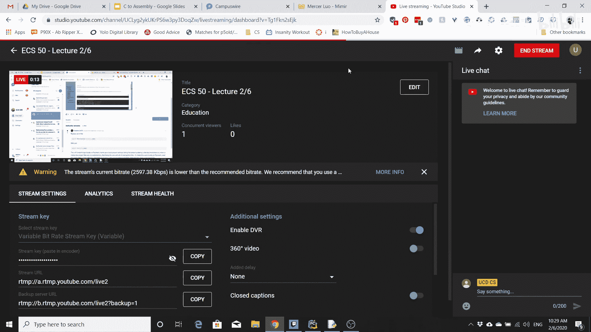
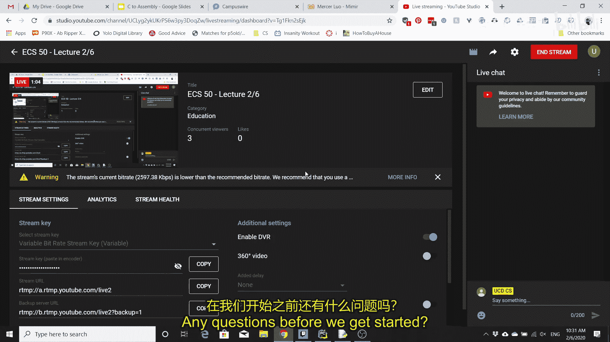
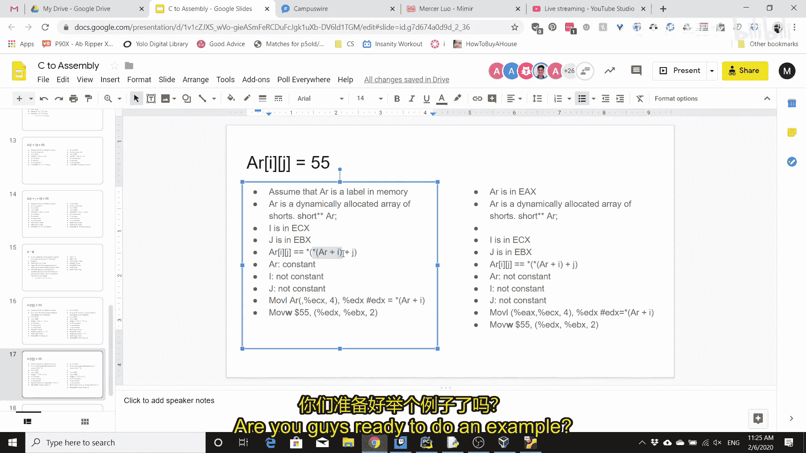
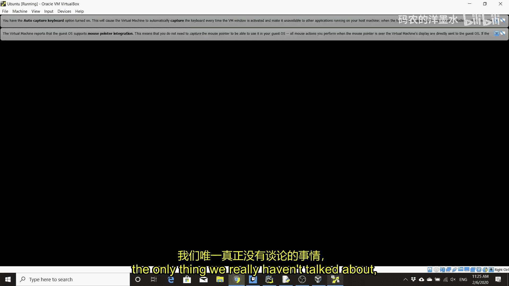
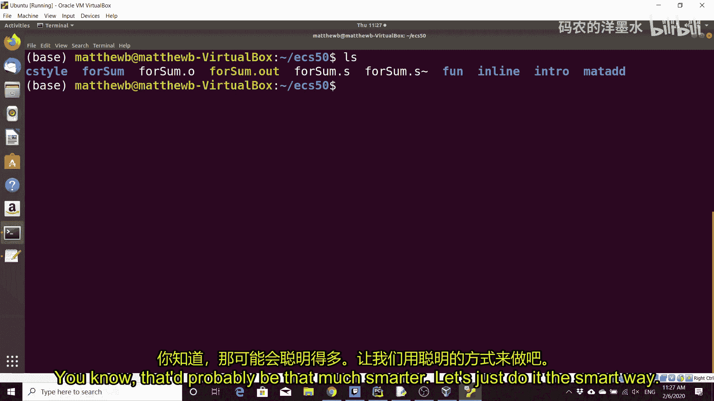
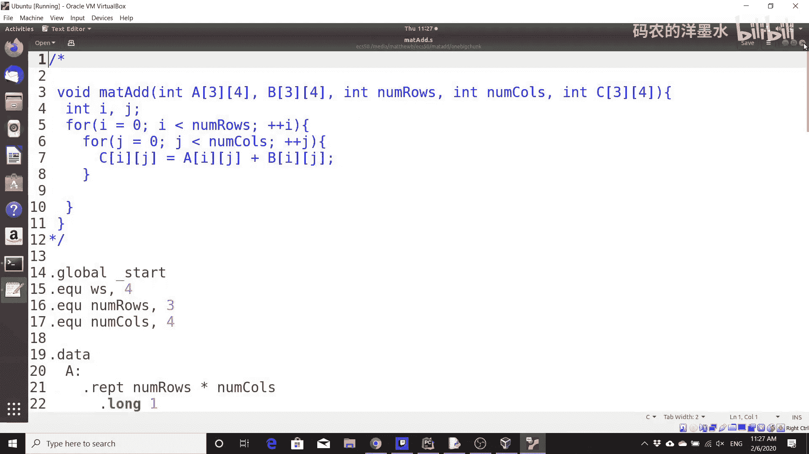
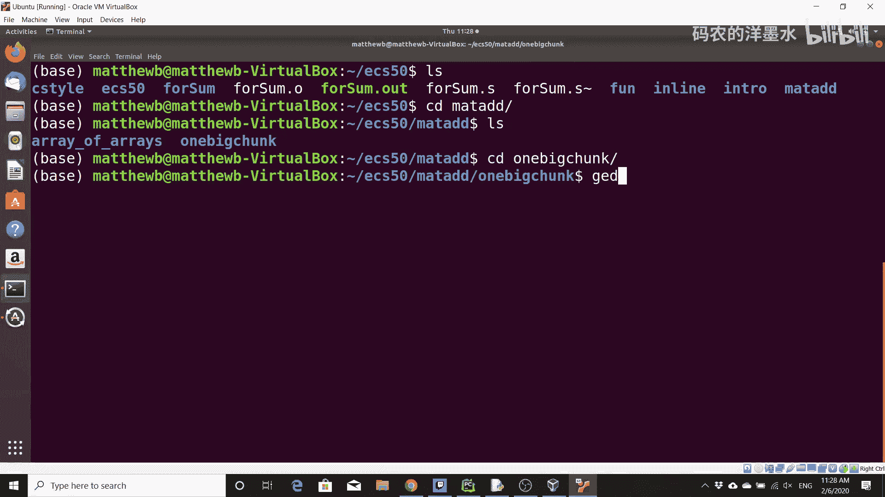
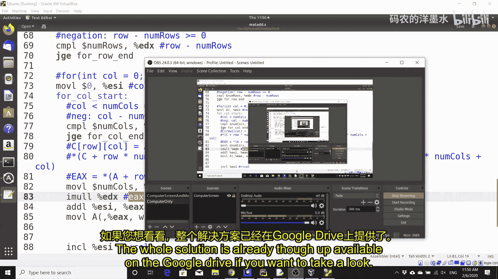

# 【全集】加州大学戴维斯分校 C语言与汇编语言 中英字幕 1080P p09 Lecture 9 - x86汇编中的高级数组索引 -BV1xefZBHEas_p9-

我作没业务然后然后还他对我。现在说，你所谓200到253。

的意见。し。我跟我就是。Okay， we're getting started in terms of announcements。

 your homework too is up and available for you to get started on after today。

 I think you should be able to do all of it so make sure you get started but you definitely can do the C problem the C problem has to be written in C You can't do it in C plus plus。

So be aware of that your chapter two quiz should be available over the weekend， it's really short。

 pretty simple， right， chapter or short and simple。

 so don't expect it to be as long as chapter one and then like the next chapter three well next quiz isn't really chapter three but like the assembly quiz probably will come out like the following week for you to work on and in the midterm fairly soon as well。

Any questions before we get started？

Okay， so。Right we were translating common C expressions over to assembly code。

 we were working with the advanced indexing mode when you use it again it looks like DOOIS and the effect of this expression is to get the memory at location D plus O plus I times S。

Oregon， it looks like de referenced D plus O plus I times Z， that location of memory。

The displacement， the D field has to be a constant expression， the offset has to be a register。

 index has to be a register and scale can be one，2， four and maybe  eight。嗯。😊。

If you don't give the displacement offset or index。

 they will default to zero if you don't provide them， if you don't give the scale it defaults to one。

 the scale is really affected by the size of the instructions you're working with so if you are working with characters。

 what would your scale be。One， if youre working with shorts， your scale would be。Two。

 and if you're working with integers。4， if you're working with floats。How many bytes big is a float？

F， so you would use。4， right， if you are working with an integer pointer。4。

 because a pointer is going to be four bytes big at stores an address and on a 32 machine。

 there's 32 bits for an address， so four bytes， if you were working with a character pointer。Four。

 if you're working with a short pointer。We're working with a double pointer。Four。

 if you're working with an integer， pointer， pointer， pointer， pointer pointer， pointer， pointer。

 pointer pointer。4our。All pointers of the same size is what I'm trying to get at there。

 so pay attention to that。And now we're just going to go ahead and work on translating some common things。

Common like array type expressions that you're going to see and we'll do one version with AR being a label in the data section and the other with AR being a register remember the labels in the data section they are constants they just refer to some constant location in memory we don't know exactly what that number is going to be and we don't really care to be honest but it's going to be some fixed location in memory right so that's why the labels can show up in the D field。

So。Let's copy this。Let's say we wanted to do AR at7。And again， what do you want array to be。

 Do you still want to be an array of ints？I mean， you know it's probably good to see some examples where it's different things just to see how it's different。

 there won't be much of a change， but let's say it's an array of shorts。And then again。

 it's an array of shorts。So again， our expression AR at7 is still going to be translated to star AR+7。

Now， in this expression， what parts are constant？And AR plus7 on the left hand side。

 assuming that AR is label。Yes。So is AR going to be constant？Yeah， it is because it's a label， right。

 what about seven？Is it constant？Yes， so since these are both constants。

 where do they have to appear in？They have to all be in the displacement field， right？

So here we're going to move L55 to where。Again， there's no ECX here in this problem。

Because we don't have a constant。Yes。So what are we going to put in the AR field。I mean。

 on the AR field in the displacement field， the D field， because again。

 you said AR is constant and seven is constant。So they both have to go into the displacement field you can put a constant expression there。

 so what do you want your expression to be？嗯。Discuss amongst your neighbor what you think should go into the displacement field。

What's your constant expression should be？啊。Okay。This。关。

So any thoughts what we should put into our displacement field？I don前。Yeah。Why not？You're very close。

But slightly， slightly wrong。It's not what you put is wrong， it that you forgot to put something。

Not a dollar sign， because if we do the dollar sign。

 it's going to be treating this expression as a constant and can you move a constant 55 to like the constant 107。

No， right， we want to move it into memory。14。Yeah， AR plus seven times two。

There's times two on the seven。Because we have an array of shorts and we want to move seven shorts and each short is two bytes big so we need to move seven The other thing is this is not going to be a move out anymore。

 but a move。W， because we want to move a2 byte quantity into memory， not a four byte quantity。

Does that make sense？So let's say down here on this next line， I wanted to do something like EAX。

Is equal to。A R。At 2， how would you translate that， shouldn't say EAX， should be AX2 by quantity。

What would that look like？So we need to do a move， what should our subs be？W。

 right because we're trying to get a word size quantity。

 where from memory do we want to start reading？Where in memory do we want to start reading from？不是说。

AR。Right， plus three times two。you know， just to make sure that we know where the times two is going。

 so you else。Around there。And we would like to put that value into。E。

How is this line different from this line？What's the effect of this line here in C code？Yeah。

 they will get the first and。昨间明。So you're saying that this line of code is equivalent to doing star or like EAX。

Oops is equal to star AR plus6。Do you guys agree？Any other alternatives what you think this might be？

Because it's not this。Yeah。😊，这是。The memory address。Okay。Well， in in terms of C code， right。

 you wouldn't plus six because it'd be like plus two because you want to move two shorts。

But it's either equivalent to。AR plus 2。AR plus3， my add， AR plus3， or if you want to look at it。

 it's the address of AR。At 3。Like because dollar sign means constant， right？

And the constant part of a label is where it's at in memory。

So this part over here is essentially doing AR+3 and C code because the compiler will take care of the size of the variables for you so no times two。

So just have to be careful with what you're doing and make sure you get the right thing if you're not seeing dollar signs。

 it means you're accessing something in memory。RightIf you're seeing dollar signs're working with a constant。

 and again， the constant part of a label is where it's located at in memory， the address。

So the constant part of a label is where it's located at。which would be its address because again。

 you know that labels have to be constant because we're using the label over here， oops。

 we're using the label over here in a displacement field。Right。This。Is nonsense， right？

 Move a constant into a constant。Like move five into seven， five equals seven。

 doesn't make any sense。Right but this says go to that location and memory and get the value that's there。

 but it's some constant location it's still able to appear in the displacement field。

So it'll go to that location and memory and put the value there。

If we go over here to the right hand side， is AR constant or not？Given that AR is an EAX。嗯。Yeah。

 it's not constant。Because it's in a register， registers can't be constant， there registers。

S of course， is still constant， so what's our expression going to look like over here？Yeah。Yes。

So you want seven parentheses。You' going to do AR。So come吗 come吗？So comma of N AR。Okay。

 so there are some problems here， the first is that AR， it's allable， right。

 but you can only put registers。In the offset and index fields。

 so we can't have AR showing up here Also AR is in EAX， so if you wanted to。

 you could do percent EAX because that's a register that has the same value as AR。

And that would be fine。But there's one other mistake here。Right， we need the two。Times， the seven。

Because again， we're still moving shorts and this move L still needs to become a move W。And this EA。

And that's still EX， but move W and here we can close this up and that'll be fine and you can either have the comment here or not。

Because I personally like wouldn't put the comma there because I wouldn't have to write it。

Because it's just going to add EAX the array。Right， so this is still AR， right， plus two times 7。

 AR plus2 times 7。A now seven times2。 However you want to look at it。

Any questions before we go to the next example， yeah？这交过去。Because it's an array of。

Shorts and shorts are two big，2 bytes big， and the W suffix means two bytes。All right。

 at the L Selvix is how many bytes？The L sx is how many bytes， four bytes， right。

 and we don't want to move four bytes because that would be moving two shorts。Instead of one。

 anything else？Yeah。Thank you summer。你此然我们。た。That's been putting two in the one。So like inside here。

 like doing comma2 here。The scale field。Again， you have to look at the advanced indexing mode and look at the expression that evaluates it's D plus O plus I times S。

notice the scale field is always multiplied by what's in the eye spot。Oops。The ice spot right here。

Okay。Right， so if we want to multiply I by two， then we have to have something in I and then the two would go in the scale field。

Yeah。Now let's say we can bind the two。The two things that we had。Last time。

 and let's say we want to do A R at I。Plus， 3 is equal to 55。

What do you want AR to be an array of what？So it's an array of characters。All。

 so AR at I plus3 again， it's translated to AR plus。Id plus three。AR， is it constant。Yes。

 because again on the left hand side it's still a label in memory， as long as it's a label in memory。

 it's always going to be constant， it will not change。

Because you might change what the value at that location is。But again。

 AR is referencing the location， location does not change， so the labels will always be constants。

So three is， of course， a constant。And we will say again， that I is in ECX， so is I constant？

Not constant， right？So when we go to write our expression now。It's going to be move， what？

Given that we're working with characters。嗯。Characters are how many bytes big。One。

 so it's going to be move B， right？We're still moving the value 55。Again。

 what parts of this expression are constant， Well， the AR is constant and V3 is constant so。AR。Right。

 is constant AR plus 3。 That's a constant expression。 What do I need to multiply the three by。One。

 right， I'm just putting it there so that you know it's kind of consistent pattern。

 but you could just write three， of course， because three times one is three。So now over here。

 which we put in our parentheses， do we want to use the offset field？

Or do you want to use the index field？Again， this is the expression that we're working to get。

I think these are two big things。So do we want to use the I field or do we want to use the O field？

Oh。i。😡，The rest of you want to use S。It was the only option， right。

 if you didn't vote for the first two。So again， think about what this expression is going to compute。

 we already have the D， which is the AR plus3。Do you want to use the O field or do you want to use the I field？

Oh。I。Andan， a lot of you guys are still wrong， still keeping picking the scale field。

You got to pick something， right？For those of you that are picking the offset field。

 why do you want to pick the offset field to put eye in？Right， ECX in。

RightBecause we know that if we ECX is I， it's a register right which means it has to go in the offset or the index because the scale can only have 1248 and ECX is not 1248 so it can't be scale right because ECX is just some arbitrary number it's in a register too。

 you can't put registers in the scale。Right。So over here。We have offset an index right。

 if we put it in offset it's just going to be what the value in the register is。

If we put it in the index， it's going to be multiplied by the scale。Right。😊。

What should we be using for our scale for this problem？One， right， so if we put it in the O。

 we're just going to get ourlf ECX and if we put it in I well it's going to be ECX times 1。

 so it doesn't really matter which one we pick。Because why does it not matter for this problem right now？

Because it's one， right， because we're working with characters。

 if we're working with anything besides characters。Where do we want to put it at？The eye field。

 right， so we should probably just be consistent and always use the eye field right to make sure it's lightinging up in the right spot。

so I will put it still in the eye field。So percent ECX， and then again。

 you can put the one there or not， it's optional， little default to one。

Any questions on the left hand side？Now， what about over here on the right hand side。

 so it's an array of Chars？Right。So over here。Is AR going to be constant？No， right， because AR is in。

EAX， and if it's an EAX can't be constant， it's a register。So it's not constant。

 well three is of course constant， what about I is it going to be constant？Now。And again。

 the reason I'm just asking you these questions is because if you ask yourself these questions。

 it's going to help you figure out where the things go， where to put them in。Right。

 so here we're still going to have a move B now， we're still moving 55。Now。

 what's my expression over here going to be？So we know that。

The only constant part we have is three constants have to go into what field。Displacement field。

 so it's going to be three or three times one。What do you want to put in the offset field？

Do you want to put。ECX， which is I， or do we want to put EAX， which is AR？

How many of you vote for EAX？ECX。For this particular problem， it does not matter which order we do。

 because our scale is。One， but if our scale was not one。

 what would we want to pick to put into the offset field？EAX， right， where you want to start at。

So percent EAX。Percent ECX is the only other register field that we have。

 and then again we can either put the one there or not as it matter。But again。

 if we were working with something besides characters， right。

 we'd wanted to have like you know something like times4， we want to multiply our index by four。

 we want to move eye integers or eye floats or we want to move eye words， eye shorts， right？

Here we want to move eye， characters or Btes。 So one would go there。Right。

 but you want to keep up the pattern， so hopefully you should be seeing that if we have our register or we at the beginning of our array and a register。

 that register just goes here。This part over here is going to be like your variable offset。

Whatever happens to be。 And this is like how big each thing is。

This expression over here is your constant offset。Right， how far do you want to move here。

So now I'll give you a real challenge。Yops。Let's say we want AR。Plus。Jy。Or plus AI plus J plus， say。

5。And we're going to assume again that I is an ECX and J is in EBX。

Discuss with the people next to you what you think the equivalent assembly expression is going to be to do this。

I'm going to go back to an array of integers。Orm be doing array flips。嗯。Integers。中。出有。喜欢。好。这什么意思？

あ picture。こ。是。거。Oh yeah。3。Of course。あ。す。几时。保案是。我有问题。Yeah。司。Yes。是想。What's。是有的。那去年。老。其实有办法。啊这。我是风结。周平面。

没有。Okay， any thoughts？About how we can translate this。你啲冇意死咯。

Of course you can use the names you feel like。这。So sure。

 how do we we can add INJ and put it into a new variable， how do we do that？あ可。Okay。Yeah。

 let's say we're going to use EDX。 it's available。对。So you want to move Wedge register EBX into EDX。

Okay， and then。Maybe maybe you don't want to move， you want to add。Right， ECX2。EDX， right。

 So now EDx is equal to。IPo J。你司。Yeah。嗯。O。It's an arrayn in now。第二装。No。Okay。で。Make that。

So you can't write。A registered times。A constant like that， right。

 we can do this type of thing because everybody over here is a constant expression。

But if you want to do multiplication with registers。

 you literally have to use the multiplication instruction， which we'll talk about a little bit later。

But we could do。Skill of four。And that work？So yeah， the trick with this one is just to add。

The I and the J together， right， You need to get into one single register that's sum about where your variable offset is at。

 And it's just the same as the other problem。Right and if you really wanted to。

 you could even done one more ad instruction where you could have added five to the summation。

And then not had the five times four on the outside。Holy works。Now again。

 over here on the left hand side， iss essentially going to be the exact same thing。

Except instead of AR， we're going to have。Y， X here。Any questions？About doing this？

The trick is used to need multiple instructions and quite often a single line of C is going to require multiple lines of assembly to produce。

哦。Okay。So now we got only two more left to do。俺到第单。What about？This。Discuss amongst yourselves。

How you would do AR at IJ equals 55。And again， we'll assume that。AR is an array。Or is a。2D array。

Of shorts。这咁な。好了。我。はてい。那你算。不。我。那说起。因为佢度晒咗啲啊。这个。Good question， right。

 how do we allocate this array is going to really affect our answer， right？

So let's assume that AR is a 2D， let's say a。5 by。Say 16 array of shorts。Declared statically。Like AR。

Our shorts。AR。5。16。So given this new information， how does this translate over？It's going to be what？

It's going to be AR plus。そ好。Plus J。We got to write that， right？啊。You don't use it。Right。

 it's that remember with。Statically allocated arrays， seeds that use row major or column major。

So C is a Roer color major。It's row major right and with row major。

 the way that you compute the summation is it's each index times the size of all the dimensions that come after it right so with the row major。

 you never use the first index and if it's called major it's each index times the size of all the dimensions that come before it so you never use the last dimension。

So。We got to do some multiplication now， right， which is a new instruction so。Let's pop that。

Up over here。So let's say we want to translate， you know， A times B。How do we do that？

So one of the things about multiplication is that if you multiply。To and。Bit numbers。Together。

 the results。Can be up to two times， and bits big。So if you multiply two five digit or five bit numbers together right。

 you can end up with 10 bits as the final result， or if you multiply to six bit numbers together you can end up with 12 bits as the result right if you multiply to 32 bit numbers together the result can be 64 bits big right which is bigger than what we can fit into a single register so the multiplication instructions is a little bit weird and it looks like this。

It's just I'O source。And the effect of this instruction is that EDX， colon EAX。

Is equal to source times EAX。So the way to read this is this is the concatenation， right。

 so this just means the upper 32 bits。Of the product。And up in EDX and the lower 32 bits。And up in。

EAX。So if you know your number is not going to actually be too big。

 you just ignore whatever is an EAX， I mean， you ignore whatever is an EDX because it's not going to have the result that you're looking for。

So let's say that what we want to do over here。Is let's say that A and B are going to be our result and we are are EAX。

 E BX， and we want to do something like。ECX is equal to EAX times EBX。Well， what you would do here？

I guess let's just set this up a little bit more， let's say that EAX needs to be equal to7 and EBX needs to be equal to 25。

So the first thing that we have to do is put the seven into EAX。

 so Movo dollar sign7 into percent EAX。What would happen if I didn't have this dollar sign here？

What would the instruction do？Go to memoryory at address7 and get the value that's there and put it into EAX。

Then Mo out Do sign 25 to EBX。And then what we would do would just be IO。Percent EBX。

And our resultss going to end up in EAX。And over here， we then just do move L percent。EAX，2% ECX。

Copy the result over。 But one of the things to really watch out for whenre using the instruction is that EDx。

Will always be changed to something else， will always be modified。So if you have something in it。

That you care about。Move it somewhere else。Before you multiply。Hopefully that makes sense。

And generally， that's somewhere else。Generally means put it in memory because your other registers are probably full。

Any questions here？Yeah。Explain why there's only one， but she has up eye。

There's only one register after the IMO instruction because that's how the instruction is formatted。

It's just one of those ones a little bit different。

And you're always going to multiply you know whatever you say there by EAX。Any other questions？Yeah。

😊，55 years。Because then it's time says。I mean， this because like this instruction right here。

This is its effect。That's what the instruction does。

 so notice that EAX is always part of the product that's being computed right one of the multiple cans。

 whatever they're called。And that's just how this form of the instruction works。Okay。Anything else？

就是。So fantastic， we know how to multiply now。So what's this look like？很慢的。哼。😊。

So sure we can do an imMO， imMO by what？We're going to get something DX first， though， right？It。

Move out， yeah， dollar sign 16 into EAX。 and then we can do our imO by。ECcX。Right。

 that's going to put into E。 This is going to make EA X be equal to。ECcX， which is I times 16。

Then we can do an addition， add O。Percent。EBX， 2%。EAX。And then we can do a move L。 right。

 We want to start at our AR。That's the constant part。Again， our register is going to be EAX。

 and what should our skill be？S our scale be？Two because we have an array of shorts。Yeah。

 I move out dollar sign 55。Move W， yeah， correct。Any questions here？

Like with the previous problem like the i plus J， we have to like compute the total like value of the index that we want to use and then put it in there。

Yeah。😊，So， with the I will。你。Yeah。ははな。How do you know ZX？Because it's always the AX。

It also changes EDX too， we are going to put the upper 32 bits there。

 but if our number only fits into 32 bits， the lower half， yeah。So EX will change too。

 but we need some results。Yeah， if we had something that we cared about in EAX， I mean， in EDX。

 we'd have to go move it somewhere else before we did the multiplication。So。If we pop back over here。

Let's do this side again， nothing's really changing over here。Except now again。

So now what do we end up doing？嗯。Is it going to be much different？Then last time。

 everything we've done before。There's one minor complication， what is that？Whats our small。

 minor complication that we have over here on the right hand side。What。No。What's an EAX right now？AR。

 but we need to do multiplication so。Somewhere else， right， so move out percent EAX to where。

Or we can't put into EDX because when we do the multiplication， what would happen to it？

We can't move EAX to EDX because it would be overwritten by the multiplication。Remember。

 we have two other registers， ESI and EDI that we can work with。

 either one of them will be fine to use。So I'll just move it over into say ESI。

And then I'll you know， pretty much everything else is going to be like the same down here。

After that one additional line of code。Except that this guy now needs to be move L instead of AR on the outside。

What are we going to put here？Yes， I， right？And we're not。Now final one。

 and then I'll actually go and we'll do some problem。I don't know why it keeps happening。Here。

And let me get this up and running so that that's ready to start as soon as we finish。Okay。

 let's say again we're still doing AR and IJ equals 55， it's still going to be an array of shorts。

But let's assume that AR is a dynamically。Allocated array of shorts。

Dynaically allocated rate of shorts， right？So you have something like。You know， short。Star， star， AR。

 and then。Assume the space was dynamically allocated later on。How is this going to change things？

How does this expression over here change？Discuss。Amongst yourselves。

 how does my expression over here change with the AR at IJ？

How could you rewrite that expression without using square brackets？Once you know the answer。

 you also get a free answer to one of your quiz problems too。喂。You wife。

 if you've already finished a quiz， you should already know the answer。Good。😊，你。Yes。好。Yeah。

 got to work。But again， it's important to like recognize that this expression means different things and different contents。

 depending on different contexts， depending on how it was allocated。

 and you're going to make sure that you translate it to the right assembly code to get the right effect。

Yeah。So we got a thought on how this should be rewritten。

Given that we have an array of arrays instead of one big chunk。All， parentheses， AR plus I。

De you referenced。Plus， J。De referenced。It's to do now。Okay。😊。

So when you're trying to translate this instruction， take it piece by piece。

Do we know how to do this？RightWe've totally done this。 let's take that part right there。

 How can we get dereenced AR plus I into some register。SoMo out， right， where do we want to move？

How can I get AR+ ID referenced into a register？It。We just did that one multiple times， more or less。

So。So which part of AR plus I constant is just AR， so where does AR have to go？

Into the displacement field， right？😊，Keeping things consistent， our index。

 which is I is going to be ECX。What's their scale going to be？But what's the type of。Right， this is。

Right。When we dereference this， what's the type of this expression？

What the type of star AR plus I with his expression。The type of this expression。It's a short pointer。

 right， a short star， right， so we need to move I short pointers， How big is a pointer？F， right。

 all pointers， regardless of what they point to， are four bytes big because they all store addresses。

This is something you to just be careful about here when you're doing things。

 you really have to know what the types are and what's really going on to be able to write the correct assembly code。

 where do you want to put this result at？Yeah。Sure， you can put it in EAX。

 but let's put it in say like EDX because it's not in use。Right。😊，So now this guy right here。

 EDX is equal to。This little expression right here。So now how can I do the rest of the expression？

Move out。Prenenthesy。What goes here。This guy right here is EDX， I need to do EDX。

Plus J de referenceenced。 How do I do ED X plus J dereenced or。Re'moving Do sign55。2。So again。

 in this expression right now， this is EDX， is EDX a constant？No， it's a register。

 so it can either go into the offset or the index field， which field do you want to put it into？

Offset， right， because where when I start that。Percent EDX。The J is the percent EBX。

And then our scale is。2。And our instruction should be。W because of shorts， right。

 because at this point， when we dereence it， we're moving past an array of shorts。

And each sort is two bytes big。Any questions？And so what's going to change over here on the right hand side？

哎。Well， it's essentially going to be the exact same thing once again。

 except instead of having AR on the outside。We're going to have EAX。On the inside。Any questions？Yeah。

😊，Why is the two here？And versus a four up here。So。

The two on the bottom is because it's a dynamically allocated array of shorts。我不。J to。Yeah。

 so this expression right here， AR plus I right， de reference it is a pointer。

 but its type is short star right， And so when you add some value to your short star pointer， right。

 you're saying move that many shorts。Pass the address and each shorts two bytes big。

 So we're going to have to multiply by two to move that many shorts。Yeah。Any other questions？Yeah。

阳工呃。Why did you use ES， I。Like and don channel。You can use。

EAX through EDX and ESI and EDI for the current homework assignment， you can also get away with EBP。

 but not pass the first homework assignment and don't mess with ESP except for when we start talking about how to mess with it。

え。😊，Because we will talk about how to mess with it。

 but like it involves a lot of stack operations like function calls。

And so we'll talk about those pretty soon too， and how to make them happen。

Are you guys ready to do an example？

Okay。Because like the only thing we really haven't talked about how to translate our function calls。

 the only thing。

This point in time。Classes， right we talked about in when we were doing the information representation and essentially like a class right or astruct。

It is essentially in array， but the elements are of different sizes。

 but because you know what elements are going to be in there and what their types are。

 you know how far past the beginning of the structure you need to move to access the correct element。

Take a look at the information representation slides about strs， if you still have questions。

 talk to me afterwards。Let's see。Okay， we can。Do that。I just want to steal some stuff。From。嗯。嗯。

I know， that'd probably be the much smarter。 Let's just do it the smart way。

对。

。

So the first thing that we're going to do for solving this problem is we want to do matrix edition。

 but we want to do matrix edition with arrays that are declared as one big chunk。Like above。

Every single time you start an assembly project or assembly homework。

 the very first thing that you should do。Is write the C code。

Because the C code is going to be a lot easier to write than the assembly code。

 also when you're debugging your C code， much easier to debug so you can get out all of the logic errors and all the mistakes you make there。

And then if there are still mistakes in your assembly code。

 it's because you mistranslated some of the assembly code， not because you have logic errors there。

So how do we write matrix position？So we want to add A and B and put the result into C。Yeah。

 for loop。4 inch row is equal to 0。 row is less than。Numb rose。Plus， plus row。Sure。

And if for loop 4 in call is equal to0。 call is less than numb calls。Plus post call。不清楚。嗯哼。😊。

All we have to translate。These three lines of code。Shouldn't be too bad， right。没有。Oh。I did。

 but it's okay because it's just a copy。Right。So over here， here's A， it's declared in memory。So。

Just has some values here to work with here's B it also has some values。

 the spaces will just help our visual distinction we also have some EQUs just to help us constants to serve for those variables so number roses three。

 nu columns is four。Word size， WS is also4。We've also made start global again so that a linker can find it so that we can compile the code。

And then over here we have C。It was dot space， nu rows， times dumb columns， times word size。

 right because that's its how much space there is allocated as one flat chunk。

You are free to make other things as we go along， so if you find out that we run out of space or we need something new。

 go ahead and say it。So now we have to translate。This line of code。Before you start。

 you might want to pick some registers to play the roles of certain variables。

So who do you want to be A？是。What register do you want to play the role of a？

Or right there's two options， we can either use a register or we can use the label。

 you want to use it registered， do you want to use the label？Register。Label。

I think label slightly wins out。 So let's say we'll use the label for a and we'll use a register for B to make everybody could be happy。

 right。😊，So what register do you want to play the role of B？E BX， sure， so B or E B X will be B。

 So how can we make E B X B B。Yes。嗯哼。B is equal to or EBX is equal to B。

Do you want this or do you want this？Dollar sign。No it always。

We actually do want the dollar sign if we leave off the dollar sign it's going to give us the first element。

 what's that memory at location B， so we'd actually get the value 100。Okay。

Who do you want to foresee， do you want that to be in a register or do you want to use the label？

Label。Register。Okay， I guess a lot of you guys want C to be in a register as well， okay。

 what register do you want to be C？ECX， sure， ECX will be C。

And we more or less repeat this exact same line of code， but we changed the B's to C's。Okay。

Who do you want to be row and who do you want to be called？All， rowe， call。

I will let you know there's not really， there's no wrong answer here。

 you're just going to pick someone， well I guess if you pick our register we're already using。

That's wrong because you can't put two things in one registered at the same time。

So as long as you just pick some register besides the ones that we're working with。

 you're totally cool。So who do you want to be rowe？What registered？EDX， sure， EDX。Will be row。

Who do you want to be calm？You have ESI， so you have EAX， ESI and EDI left。Pick from。木子。Sure。

 ESI will be called。So we're now doing this is our first line of code。

 so how can we make row be equal to zero。嗯 well。Doer sign zero into。So Ro， we said it's gonna be。

ED X， so E D X， this is why you need these commas here， right， commentsments here。

 because we're going to forget what the heck is what really。

 really quickly because I can't juggle all these variables in my head。

 So we're gonna keep looking back here。So great， row is zero。How do I do the next part？

It's what we covered on Tuesday。嗯。Right。You look at the slides。We go back to。For loop。It was。

We have four start， but how many four loops are we going to have for this problem too。

 but can they have the same label right， we can have like row start or outer four or something start right so we can call it you know a row start。

So over here we have rose start or you know。Four row starts， I don't know， what do you ever call it。

 Okay， then what's the next thing that we do？就是。All of our comparisons have to be against what？Z。

 is this comparison against zero？No right， so row less than nu rows， Well。

 that's equivalent to row minus nu rows。Less than 0。And it's negation。

Because I always work with the negations for the four loops is it row minus nu rows greater than or equal to zero。

Right， so what I have to do is I have to do this subtraction。 How can I do row minus N rows。

Compampel， right， Who goes first。And。Numb rows a row。Numb row is going to go first right。

 remember N rows back here it's an EQU N rows is just three。

 so what do we have to put in front of it。s。Dollar sign， it's a constant。Right。Again。

 if we look back up here， N rows， it's an EQU， N rows is just three。

So dollar sign three to get the constant and then on the right hand side。

 we're going to have our row， which we said row is going to be EDX。Okay， that was the subtraction。

And now what we do next？Jump up greater than equal to。Rrow end， right。

 and then down here for row end。Okay， now we need to do plus plus row。Yeah。

 we just need to increments so we can use increments。We want to increment EDX， which is a row。Yeah。

 we did it。Great， for loop number one down。Next line of code。我们一人找不做起。Oh yes。

 we do need the jump for start， my bad。J。F row， start。Now。Here's our next line of code。

And we going to translate， so what do we do？Right， well， what's the first thing that happens？那面是法院。

Call， we said call is ESI。Is this font big enough everyone to see does anybody need it bigger？Very。

 okay。Okay。Weve out dollar sign  zero2， oops， dollar sign0。2% ESi right as ESI is going to be called。

This over here is the call equals0 line。And this line over here was the row equals 0 line。Now。

 if we go inside here， our comparison has to be against zero， but it's not。So this guy， oh。

 we actually have our。Forourth call start。And then down here we have our four。Call end。是。

Whi this is going to be equal to call minus nu rows nu calls。Less than zero and it negation。

Is call minus number calls greater than equal to0。 So we have to do this subtraction。

 which is we're going to do。Compile dollar sign them calls with。Again， call is ESI。Right。

That's the call minus nu calls portion。And then。JGE2。Or call in， yeah。And then at the bottom。

 we need to。Wellll increment calm first。All， inco call， which is again， percent ESi。

 that's the plus plus call and then yes jump to。4 call start。Nice job。And now we just have。

One last little line of code to do。All we made to translate three lines of code can't complain too hard。

Sos three lines of code。If you rewrote this expression without square brackets。

 what's it going to look like？Yes。ま。Thirsty。对。あす。嗯子。So how is this array allocated。

 Is it one big chunk or is it an array of arrays。Yeah。So up here。

 does this declare an array of arrays or one big chunk？It's ra race。It's one big chunk。

It's one big chunk if you want to declare an array of arrays， you would see int star star。

Right if you're dynamically allocating array raises in star star， also， if you look at our arrays。

 like here's a。Does that look like an array of arrays or one big chunk？It's one big chunk。

 I just put the spaces there to help us visualize what's going on。

 So it's one big chunk right and we have to make sure that our translation here is one big chunk。

 not an array of array because if we do an array of array translation， it's going to break。

It won't work。So how is this if all three of these arrays are array of arrays translated？Yeah。

We just did it。And remember， our arrays are。Numb row by numb calls big。So， this is。Plus row times。

Nom calls。Plus。靠。Is equal to。This whole thing。But， a。For。Same thing。B。😊，耶。😊，Right。

That's what we're looking at translating。Right and so again。

 you guys are right it looks like a lot now what's the problem solving strategy hopefully you guys have been employing so far to make big problems。

 not so hard to deal with。you break them down into smaller problems right。

 we have how many smaller problems right here， at least the high level。3， right。The AR roll call。

The B row call。And the C roll call。Right so which one do you want to start with？Sure。

 let's start with a， right， Let's try doing this expression right here。 And this is again。

 hopefully what you guys are applying when you're doing your other like coding homework as well。

 and that you're breaking your pubs down to smaller parts。 just a little bit smaller。

 a little bit smaller， little bit smaller， little bit smaller， little bit smaller。

 little bit smaller， a little bit of work each level and eventually help you solve it instead of here's the whole thing。

 right， I wrote a 500 long line main statement or something I have gotten those as submissions。

 They're pretty intense to read。😊，7月。Seriously。It happens。Okay。

 so how do we translate this line of code？Right， so we have to compute this value。

 and we have to put it。Somewhere， where do you want your somewhere to be？Yes。Again。

 there aren't really wrong answers， you can pick whatever you feel like do where do you want to put？

This value act。其他是。We're currently not using EAX or EDI。Sure。

 so let's make sure that this thing ends up in EAX。Okay。What should I write， right。

 just we just did this more or less exact same problem。Right。

 so we can start by multiplying the road and numbcal， so move out dollar sign。Numb calls to。Where。

Yeah X。Okay， then。Yeah。W。Why do we want to move N rows to EVX？I mean， like this expression。

 does it involve numbers roses at all？I'm seeing it。Yeah。你道。不是。Yes。

Why do you want to put EDX into EAX？Well I put number of columns into EAX。

RightAnd we want to multiply。あ。So yeah， we can do an IO， IO by。Row， row is in。EDX。

so this is now EAX is equal to row times nu calls。Then do what。At o。Call is。E， I。Sue。EAX。

 so now EAX is equal to row times nu calls。Plus， call。And then。But， but a is a constant right。

 You kept it as a label。Right， but also we want to not only do the addition。

 but we also then want to go to memory at that location。Right， since we're doing a memory access。

 what？Are we going to be using？The advanced index Ne mode， right， the DOIS。

 the thing that we just spent all class talking about。So how do we do that？Yeah。Maybe。

 I did tell you。We spent on the class telling you。嗯。Right， move out。A， it's the constant。

 It's a label， right， comma。EAX， that's our variable offset， how big is each element？

For which I have in word size， and we want to put that into EAX right。

 So this is EAX has now been set to this entire expression。Now， before you go。

 remember when we do this multiplication asides affecting EAX what other registered did at effect。

EDX， so what just happened to Ro。Oh， it's gone， we just overwrote that。

Right so we have to go make sure to save that somewhere else。Which we do that next week。See you then。

The whole solution is already though up available on the Google Drive， if you want to take a look。放你。

好。

