# 【全集】加州大学戴维斯分校 C语言与汇编语言 中英字幕 1080P p10 Lecture 10 - 高级装配示例 -BV1xefZBHEas_p10-

Before we get going back into doing matrix position in assembly。

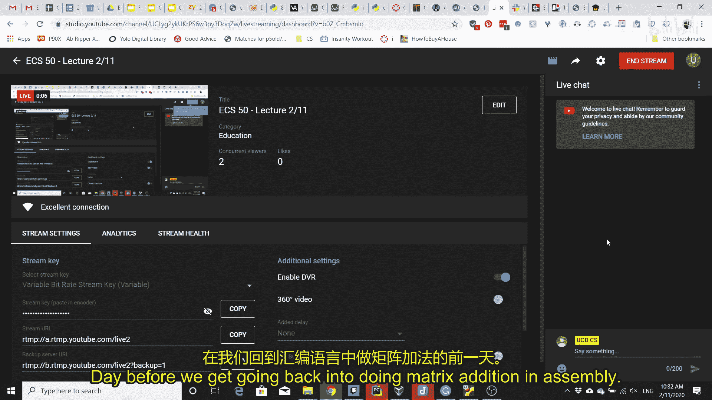

Yeah， I know you've gone over， but I really just don't。I understand that lonely。学生？

They can use define。Like what they do or what they are or how to use them。So。

Like the important thing to know when you're working with the assembly stuff。

 at least for the advanced indexing mode。Right as it looks for this form displacement offset index scale right displacement has to be some constant expression right offset an index or registers and scales either one。

2 or four and maybe 8 and 32 bit mode right and what it's going to compute is D plus O plus I times S so to compute that location of memory and it's going to go and access that spot if you look at how this kind of instruction is set up。

This fits perfectly in the form of doing an array access。Because when we're doing our array access。

 right， if we do something like array at I。Plus， constant。 So like， you know， plus 7。

If you write this expression without brackets， it's going to be star。AR。Plus， I plus 7。Now。

 if we look here at this expression。And we look back over here at this expression， oops。

When't you say like they're about the same thing？嗯。So， A R is。Not always， right。

 D is a constant expression and AR may or may not be constant depending on the context。Right？

So what ends up happening in terms of like doing your mapping？Is like the D field。

 it'll be equal to like the AR plus the constant。Times， you know。

 constant expression because there might be more than just plus seven， right。

 times the size of the elements。But only if。AR is a constant label。So if AR is a label。

 it's going to show up in the D field。Right。On。Exent。So if AR is held in a register。

 it's going to be placed into the O field right， because you want to start accessing memory from where AR is at。

 right whether that be a constant or whether it be some variable amount because it's held in a register。

AR is where you want to start at right， Then you want to move your constant and then the variable amount。

Oh， I mean， I。Is the variable index？And then scale。Is the size of the elements and bytes。这ま。

Not in bits and bys。You only have  one，2，4 and maybe8 right if we think about just like one integer。

 an integer is  four bys long or 32 Bs and 32 is not an option。确实。A喂快点。Can you get back to one？Yes。

 not like one bit， one bite you can't access individual bits by。Correct。

 you cannot access individual bytes using this format instruction。

 this format of instruction because memory is byte addressable。

 which means every address and memory has a byte， which means the smallest unit that you can access from memory is a single byte。

Into the registers， you can use bitwise。You're correct if we're working with bits and we're trying to find some particular you know bit in some variable right。

 you're going to be using the bitwise operators， but if we have an array of elements。

 we're going to be using you know standard square bracket notation to index or array。

 which we'll be translating to be using the advanced indexing mode。

Any other questions about advanced index mode tends to be the thing that everyone always hass trouble with every single year。

但是已经是他的是。W。For the shifting， check out the instructions on the cheat sheet shift right is there's two shift rights。

 there's SR shift athmetic right， and then SHR shift right for unsigned right shift and then the shift left is SHL shift left。

嗯。If you're doing a variable shift amount。😡，Notice like you want to shift by I。

 I has to be placed in C。So variable shift amounts have to be in C。

 it cannot not be in any other register。If you want to shift by constant amount。

 you can totally shift by constant amount， but if you're shifting by a variable amount。

 the variable amount that you want to shift has to be placed in C。

It's just how they set up the architecture for the Intel processor。Anything else？Yeah， yeah。

 we were like， that's where we left off， right last week， where we're doing our。Mattrix edition。

So we're going to go back there and do it， but you know we also like went over every possible form of indexing you could possibly do in all of the slides that are down here and they're all expanded out so refer back to them if you have questions but we're also going to be going through it again today as well。

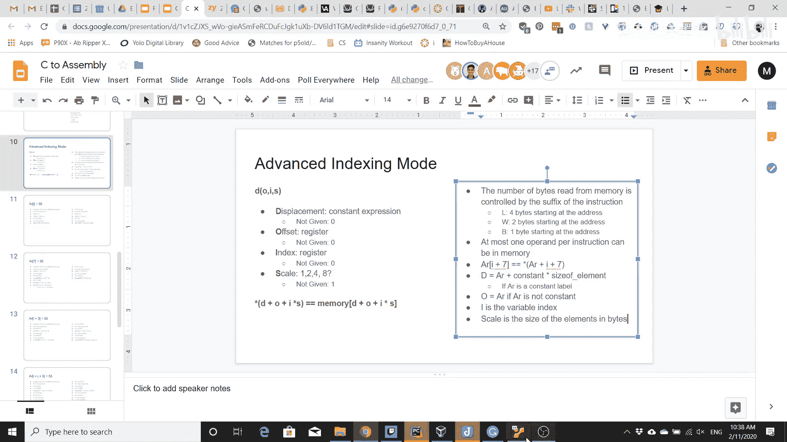

そにです。Some of you guys were having trouble getting the pretty highlighting and so what you can do is you can just make a dot S file and C lion and you know type type type in C lion and it'll be pretty。

 and'll do all the highlighting for you automatically and then you can just copy and paste that over to like Gedit or whatever your text editor is that you're using somewhere else to compile there。

嗯。

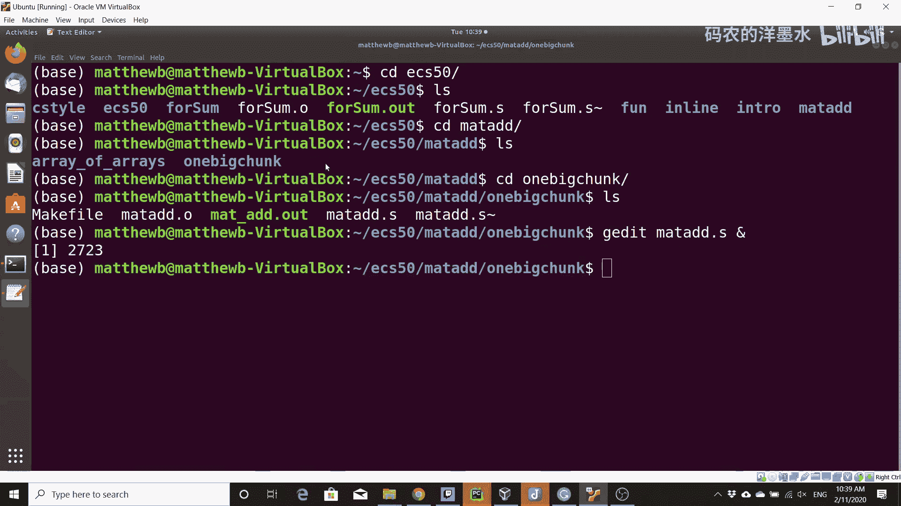

So if you remember， last time we left off， we were trained to translate。This one line of。C code。

 Yeah， on question， but I know you can move fairly quickly in on there where for me it takes time a while。

 I that because you're like SSH the CF for doing something special or do you have a fancy。

I'm just accessing on my own local machine I'm not connecting to the CSF at all Okay and you're virtual that Yes。

 I made sure to give it lots of memory and lots of processing power and I have a decent computer to help out to but yeah it is a heavy weight process when you're doing the virtual machinesF Yes you can just connect to the CSF and that'll work or if you're in Mimeer you can use the Mime IDdeE and do your work there but if you're connecting remotely you might be limited to only like the terminal based applications you won't have access to theuI ones。

So we're trying to translate this expression right here。

 right and since we are doing one big chunk in terms of how our arrays are laid out。

It translated to this equivalent expression over here。Right， very， very long。But again。

 like with everything you do as a computer scientist， when you're faced with big problems。

 what should you do？Break them down and break them down and break them down and break them down and break them down until they're finally small enough so there's something you can do so there are three major portions here getting C。

 getting A， getting B so we wanted to start with getting A right and we wanted to put that into EAX that's what you guys said that you wanted to do so we had to do a plus row time thumb columns。

Plus call， right， and if we look back up to our comments。

We decided that we wanted to use a as a label and memory， right。

 That was the choice that everyone decided to make。 That's perfectly fine。

So just remember A's label in memory， EBX is B， EX is C， EDX。So always do this otherwise。

 like you probably are like， now you're like， what the hell were we doing last week？

Or whenever it is that you have to come back， so good comments are extremely important when you're writing your assembly code。

So in doing this expression， we can break it down farther。

The first thing that we want to compute is row times nu columns。Right。

So over here we decided to move numb calls into EAX and then we did our multiplication remember when we do the multiplication。

 it's always your source right times the result or times EAX and the result is stored in EDX EAX with the upper half of the result being an EDX and the lower 32 bits being an EAX We know that our result only going to fit into 32 bits we don't really care about what goes into EDX。

 but don't forget it gets overwritten。When you're doing this operation， So we do our multiplication。

 right， So EAX ends up with row times nu columns because， again， EDx， if you look back。

It's the number of rows。All right， it's not the number of rows， it is row。Which row we're on。

 Then we wanted to add ESI to that。 Remember， if we scroll back up， ESI is going to be called。

What column on so then we add call to it， and then we use the advanced indexing mode right。

 referring back to the question made earlier， a is a label and memory so it goes into the displacement field。

We do not have any constant parts to this expression。

 so no other constant part of the expression is going to go into the displacement field because we don't have anything else。

WeSince we don't have our register in since our register or since the beginning of our array in a label and not a register。

 we're going to use the offset field as blank。The index field is going to be EAX because that's what we're trying to index RARA at。

And then word size， which is again， is four， goes into our scale because we are dealing with an array of integers。

Let me move that into EAX， so now EAX is equal to a at row call。Again。

 though we ran into one small problem that we briefly mentioned into the class。Is， again。

 this expression is going to change what's an Ex。 Now。

 do we have something in EDx that we care about。Yes， right。

 so if we do this expression as it is right now， we're going to lose whatever happens to be there。

Right， so what we can do is we're going to have to save that value somewhere and where can we save it at？

What are our options， where can we about one left EDI it looks like and we might need that for something else later on。

What are other options as to where we could put it right we could put it in memory。

 so let's say we wanted to put it into memory， how would we go about doing that？Well。

 the first thing that we have to do is figure out set aside some space in memory for this variable。

 so how can I make space for my variable up here？Yeah。Yeah。

 we have like a label called row and how much space do we want to make for row， how big is it？Right。

Row is an integer， how many bytes big is an integer on a 32 bit machine？It's four bytes。

 so how can I make four bytes by the space？We could do dot long and we can just give it some value zero。

Are there any other ways that we could create space for this besidest Long？Dot space followed by。4。

 we can do dot space4 any other ways that we could do this。RightSo another alternative。

 which we're not going to be doing right now would be like dot space for that would make space for four bytes。

What be some other options。What other directives do you know that make space？That it's not dot short。

 but dot word， right， So you could do like dot word，0， dot word，0。

 Every dot word makes space for how many bytes。Two， so if I put two of them next to each other。

 that makes space for。4。Probably we wouldn't want to do this way because it's a little confusing right we don't actually want two shorts here we just want one4 byte quantity but doing this and doing that and doing this will be equivalent the final way that you could do it is you could do dot byte four times dot byte。

 dot byte， dot byte dot byte dot byte again， probably not the most clearest of intentions。

 but again it makes four bytes worth of space。Yeah。😊，So if you do box space more than what's。しう。

I believe it defaults to zero if you don't specify a value。

I think the dot longs require an initial value。I'm not 100% sure， but I always do。

 and if you're not planning on using the initial value， does it matter what you make it？

I think you might be able to， if you like do like the amount of space and then comma and then。

What the value want to be， but each bitete。Would be initialized to that value。Right。

 not because even if you made like a four byte quantity and you said something like 10。

 you'd have the pattern 10 repeated four times one for each byte。Not for one element it' just。10。

Yeah。Um， but like if you go and you look up like like the a new asmbler。

 like the preprocessed directives。you search it up。

 you can find if it supports the option of specifying values for space。

 but normally when I'm making space， I don't care， and I just treat it as uninitialized I' like thought space。

 whatever， there's some space there。know what。Yeah generally like dot long is a little bit more like intentful than doing something like this and it better communicates how many things you want there if I do dot long one element。

 you're kind of assuming that I just wanted one unit there that's four bytes big versus doing dot space4 you're probably saying I want four。

 one byte elements。But again， you can treat them as one，4 byte element2 or two byte elements。

 but the intent is probably less clear there。So those are some options。

 so great we now have our label and memory for row。

 so how can we save it before we do our multiplication？questionest was。

 how can we save what's an EDX row？Out into memory at location， row， at that label。没。Yeah。

 it's going to be move out because we're going to move a value and we want to move what thing。EDX。

Right， and we want to move it too。Yeah， to Rob。So save EDX。Because。It will。Be overwritten。Rrison。Bye。

The冇。One thing that we can kind of also notice is in doing our expression here。You know。

The C at Ro call， A at Ro call， B at Ro call， is there any things that get reused？

And those expressions。Not even just row and call， it's a little bit more than just that。别想。Not E， B。

 X。Again， like if we look at these expressions like this expression。

 what does this expression have in common with this expression have in common with this expression。

 what parts are the same？他看有吗。Grow times some calls plus。Coll， right。

 so we could recompute this value for every single one。4。Compute it once。And then reuse it， right。

What would be the problem of reusing it right now。I。Yeah， we just overwrote it。Right， on line 90。

 we replace what's an EAX。The index。With。The value at a， right， So instead of putting this into a。

W about we decide to put it instead of an EAX？Given which registers do we currently have free at this point in time？

We have EDX is free and anything else。It's also like EDI would also be free too， right。

 it's not mentioned we just never used it， so do you want to use EDX or do you want to use EDI？EDX。

EDI。I think E D X wins again， there's， there's no benefit over picking one of the other。

 It' just got to pick one， right， So we're going to change this to be。嗯。Up here。

 we're going to change this thing to say EDx is going to be equal to。A plus row times numb call。

 right， That's our goal。And then over here， we can still make this happen。

Which happens here on this line。But now just to fix our code to make the above expression happen。

 we can just move out EAX to。EDX。Which means EDX is now equal to row times nu calls plus call。上根。

Any questions before we keep going？Okay， so great， we got EAX。Into this register。

 how can we add EVX to it？Let's say now we want to get EAX to be equal to a at row。

Call plus B at row。Call。Again， if we go back up here， we said that B is an EBX。Okay。Right。

 we can do this with much。Less work， because we've already computed。All of that。

So we already have that entire expression stored where。It's an idiotias， right？

So now how can I take B at row call and add it to EAX to compute the sum？Right， at O。

And we want to add out what， well， how do we get B？Essentially the same thing。

 but we said that B is an EBX not a label it's what you guys want to do so how does my advanced indexing mode change right。

 given that B is an EBX right it's not a constant。Are there any constant parts to this expression？No。

 so we wouldn't put anything in the D field。No， so the D field is empty。

Right since our our the start of our， it's not in a label， but it instead in a register。

What are we going to put into the offset field？EBX right at the beginning of our array。

Right now our variable index amount goes where。Into the next field， right， the index field。

 So that's EDx。 And then the size of each element is。4 right， which again， we made that EQ word size。

Just four。 and we want to add this to。Yes， fantastic。Any questions here？Yeah。

 would you like have done that in lines。俩起。But but EDX is just a an address right。

 So what would you want to add to EDX， You want to add EBX to it to compute the entire portion。查新的。

EDX does have row time some calls plus call， so you want to add EBX to that。自 want do。

Add out EBX to EDX。The problem that we have here is this variable amount。

 it hasn't been multiplied by the scale yet。Right， so this is in terms of would only be in terms of。

This is how many elements we want to move， but we haven't multiplied by the size of each element。

 If you add E B X to E D X， there's no way of now doing the multiplication by the correct scale to make that happen。

 so that you move over。 What you could do is you could first。Like multiply EDx by4。

 Just shift it to the left by two right， gets you the same effect and then add EDx to it。

 And then you can just have one element， and that would work。

 But the problem of doing that is we now want to use that same value for。C。

 which again would require us to like recompute it or res subtract out those things that we did。

 which is probably going to be more work than what we did here， but yes。

 there are definitely alternative ways of writing this with more lines。But I didn't want to。

Any other questions？Okay。Now， finally。We want to do C at IJ is equal to a and IJ row call is equal to A plus B at row call。

So how do we go about doing？This line。Lo sea code。Yeah。Well tell me what the same thing is。I mean。

 are we doing an addto here？We've computed this value， this value is stored in。

This value stored away。EX， so what do you want to add？

Given that you have this value and you want to put it here， do we need to do any addition？Okay move糊。

Move what where？To ECX。It this。那就哪一点。Well， yeah， because we want to definitely access memory， right？

But this is going to put the value there。Where will this put the result at？

So if we do the line as written， right， this is EAX is the sum。

 where will we place the sum if we do the line as written？Yeah。关系。

So I have the first location of ECX。How many are agree with that？

 any other proposed ideas as to where this will place it？是。对。哦过。Discuss amongst yourselves。

 Let's see what you think。Or did you have an answer， yeah？Yeah， that's what we're to end up doing。

 but my question right now is what does the line as written do， where do we place the summit？

Would it just。OverYeah， it just puts in an ECX because what's on the right hand side。

 what's in the destination？Thisation is ECX， so you're going to pick the value and put it into。ECX。

Right because that's what the destination is the other suggestion was like if you wanted to put it into like C at zero。

That would be C0 or C00。Right。But over here。Right， we need to do it at the advanced indexing mode。

 so as a suggested， ECX word size。Now quick question， is this line of code that we have right now。

 is it equivalent to these two lines of code？How many believe lines 100 and 101 done together are the same thing as line 103？

Does anybody think that they are a different？For those of you that think they're different。

 what does it do if not this？Not the same thing as La 03， What's it do？Instead。

Talk amongst yourselves for a minute。And see what you think if these lines are equivalent or not。

And they do the same thing。So discuss amongst yourselves as see what you think is going to happen。

 are they the same， and if they're not the same， what do they do？Okay。一个。Sittting again。Well。

 it's just because really low level and there's a lot going on and you know how I hate people writing gigantic functions in like C++ and everything else so they have the language like this tends to be one of those things where there's a lot going on at once。

and so it's hard to keep track of every little moving part。

 but it's also kind of hard to like break it apart into smaller chunks too because we're trying to do like one line of code in terms of a translation is So like these lines of code right here We're just this line of code that we're trying to translate right now。

So we were trying to translate C at row call equals8 row call plus be at row call。

 and it's taken us you know， something like 10 lines or something more to make happen。Yeah。

But I'll scroll back down。Get started， I think， I mean。

 you've been out for a couple days and I see you back if you get sick Okay， glad you're better。

It's a bad one。不然。做吧。单体工作。Okay， so you guys have had about a minute to discuss how many of you guys believe that these two or you。

 these two lines， 100 101 are equivalent to 103。How many of you believe they are something different？

For those of you that think they， they do something different。

 What do they do if they do not do the same thing as 103。Yeah。The two else。InCI。With the cycle over。

Oh。日常子能够在外。そ再。That is correct。Right。But are these lines of code the same and if they're not the same？

They're different。 What does。Line lines 100101 do versus what does line 103 do？嗯。

So let's break down line 100， what does line 100 do？This is going to make EDI equal to。Right。

 what this good？This is going to make EDI be equal to。See at roll call。And then this line of code。

 what does it do？好的。EDI is equal to。Okay。So that's what those two lines of code do。

 does that accomplish what we wanted to do？No， this one changes。EDI， this one changes。

What does this one change？Does not change ECX， it changes， see yet row call。Right。

 because we said go to memory at E X， which is， I believe you guys said it's C。At sea。

 And this is the row times call plus plusza。 This's going to get you the row call。 right。

 So this actually changes what's in memory at the location。 This changes。😊，EDI。This though。

 is one of the biggest mistakes that I see all the time because you're like， a， well。

 EDI is C at row column and so if I change EDI， change what is at C at row call。

What was wrong with that statement that I just made？Right。So again。

 I said the first line says EDI is C at row column and then line 101 says EDI is equal to A at row call plus B at row call。

What's wrong with what I said there？Sitting in。That get is also that。4年之。But is EDIC at Ro call？No。

 what is EdiI。Well， that's what ends up being， but like on line 100。

 is it true that EDI is C at Ro call？It's a copy of the value at C at row call right so in doing this line you make EdiI hold a copy of what's at C row call right You do not make EdiI become C row call。

 They are not the same thing They' are two different things one is in memory。

 One is inside your CPU right one's a register ones a memory location。

 you can copy what's in this register to some memory location or you can copy what's at some memory location into the register but you cannot make the memory location and the register be equal They are two different things right they' are two separate areas in your computer。

Right and since they're two physical different locations， they can never become one。Thing。

If that makes sense。So don't do this， it's really bad， but I promise you some of you still will。

Don't do this。Watch out， but I know I will still have to address this problem a couple of times。

 at least in office hours。So are we done？With translating that line of code。

Is there anything else that we need to do？嗯。No， we're completely done。Yes。

 we still have some loose s tie up。For those of you that think there's some loose ends。

 what do we still have left to do？我嗯。S again？Yeah， right。

 so this is the one line of code that we were translating。

 we've already translated the two four loops on Thursday。答应。Very。Save what is it。

 whose value do you want to save？I get to see It's not。Right。Wai， I mean。

 we're changing C at IJ right and I andJ will be different every time so we won't be like unless we screwed up。

 we won't be changing the same element multiple times。So we good？You forgot to do something。

Has to do with line 87。We saved this value out into memory。But， you know， down here。Hey。

 it looks like we're still treating EDX like it。Row， what is EDX row anymore？No。

 so what do we have to do？Put it back in， right， go take the value that we temporarily set aside memory and move it back into our register so that it's back to being row。

 we store。EDX back to row。So then over here， how can we do that？So should this be？Row。

 or should this be Do sign row？How many you think it should be dollar sign row？

How many think it should just be wrote？For those of you that think it should just be row。

 why do you think it should just be row？You must have some reason you believe this， right？

You must justify your answer to somebody like， why the hell did you do this？

Why do you think it should be row， I'm not saying you're wrong。

 I'm just saying why do you think it should be row and not dollar sign row？找你参。Correct。

 dollar sign makes it be a constant。 So we be putting the address of row into EDx。

 but we want to put。Row itself， the value that's there， right。

 This is just using the advanced indexing mode， but we only gave the displacement field the constant portion。

 the D part。 We did not give O I or S here because we don't need them。So fantastic， we're done。嗯。

Translate three lines of C code。Any questions？Yeah， this is horrible。

 is there not a better way to do this Well， I mean， that's what you have。

 that's why you write C code in the first place。Right。

 somebody wrote something that you't have to do this as's called the compiler。

Right it translates your higher level language down into the assembly code which then gets translated into the machine code Well the first compiler was written in assembly code。

 but then after they got their first first compiler working。

 every future compiler was written in the old compiler that's cool right so like if you're going from like Java 7。

 the Java 8， the Java 8 compiler was written in Java 7。😊，I mean， it works。 right produces Java code。

 You have to out。Work up your program。 So generally， it tends to be that each。

Like the first compiler had to be written in some other language besides the original because there was nothing to interpret or like compile the original。

 And then everyone after that， you just use your older compiler to produce your newer compiler I it the DT is written in C。

Yeah， because after they got the first one， their newer versions can be written in the old one。

 but again， they don't have to do it in C， but they could。

 or they could do it in C plus plus you know， just some language that works you can produce your compiler for your the new language But you know。

 assuming the language you write your compiler for you like。

 I wouldn't you want to write in that language。It's probablyably what it happens。

Any other questions before we keep going？Right， you know。

 this like assembly code has one of those issues that I don't like in terms of normal programming where you have a lot of code in one area and the problem's not terribly broken down。

 The hard part is with the assembly code it's kind of hard。To get around that。

 which is why I like to do the comments for which line of code that I'm translating， what I'm doing。

 so I try to use the comments to break down the sections as to what should happen instead of being able to have functions。

think that to accomplish that same problem solving strategy。But let's go see if this works。

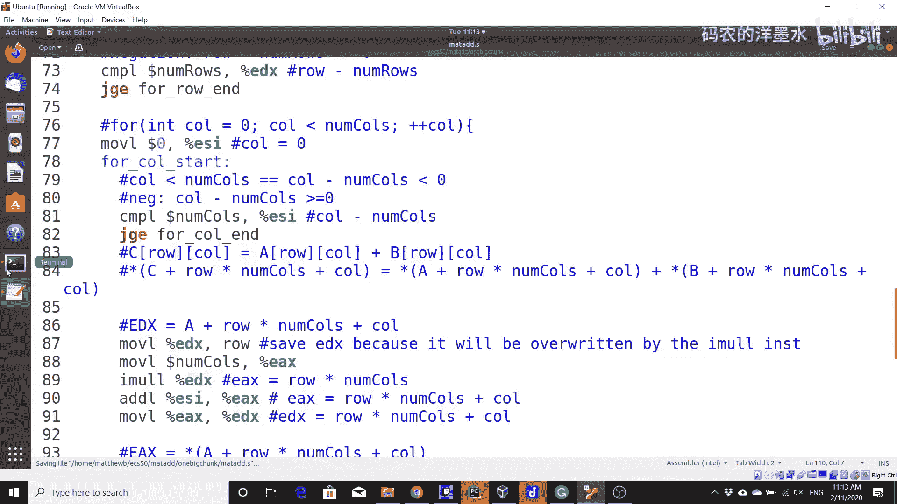

So great， we have our thing， how should I assemble it？What's our command to make that happen？

I know some of you know it because you've been doing your homework and you've gotten it to run。

What you make because but you， if you look at the make file。Great。

You're going to find the commands there。Right。To make the O file， which depends on matA。S。

 it's AS dash G stas， dash 32 o name of object file， add。0 in this case。

 then we're going to make that from addS to make the executable we're going to run the linker dash M specify the 32 bit linking o add dot out Matt add。

0 so yes， we can just run make and because I wrote that for you。A will run make， but again。

 you can just see the commands here， it's just ASS followed by LS。

Make sure you set the commands appropriately。And if we're going to debug it。

 we're going to be de debugging it in DDD， Matt and。Not out。 I it not。Okay， I couldn underscore that。

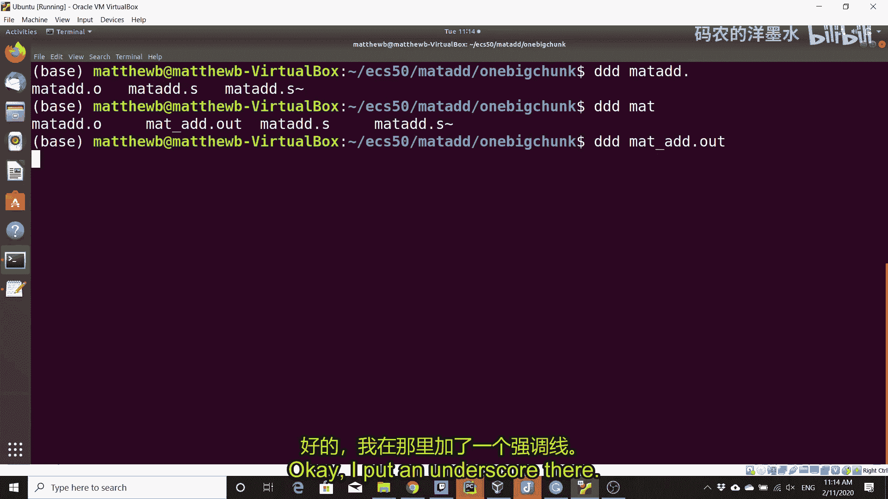

hoop。So over here， we can break at done。And then I can run it。

Something probably didn't quite happen right， oh I don't have a lot of code there's why I can't show anything。

Wellold on let's make one small change so when you're doing your homework assignment make sure you have a line of code after you're done label so we're going to have no op here and then make sure there's a blank line afterwards otherwise your output on GDP won't match mine。

So where we run this with make。Or run DVDD again。We'll break it done。And then we'll run our code。

Great， we got down there and if we want to see our values。

 it's graph display and now we have to do some fancy casting so integer pointer。😊，The address of C。

 so we're going to treat C like it's a pointer to an array of inteers because that's how it's going to behave。

 right？We are then interested in seeing the elements starting at zero。And then at， well。

 we want to see 12 elements， so three times 4， which is 12。And。😊，Press enter enterra。

We have all of our numbers for our results。And so what we'd have to do is go back and compare them with the values that we have here with whether that makes sense。

 right？Like 10 plus 100 is going to be。110。Right or 42 plus 1200 is 1242。

 So everybody seems to be in the right order。 They seem to have the right values。

Do you want to go through it a little bit slower to see it be computed。

 Any or do you want to quote this。Okay， we can go through it a little bit slower。

 so break underscore start。Now， I got to be in the box。And then we can run again， and so again。

 it's probably going to be useful to see the values that we have。In our registers。

 So we probably want to see something like， well， what's E D X， which is going to be row and ES I。

 which's going to be column。 So graph display， dollar sign， E D X。And graph display ESI。

 which is column。Right， so we start going through our program。 We do the comparison， right，0。

 We should still be in bounds because of the 3 by 4。We do our comparison。

 so now we're doing the part we're actually computing the values。So we probably， again。

 we already have EDX showing up， so hopefully we should end up computing zero。

 but it looks like we might also want to see what's in EAX so we can graph display dollar sign EAX。

And after we do this line， hopefully it should have the first value from the array。It does。

 it has 10 in it。Right now we should add the first value from B to it， which was 100。

 so we should get。110， Great， we got 110。 Now we should go put this value into location 0 in the array。

It's there。Right， the one tends there。We reset row back to being zero， we increment ESI。

 go to the next round， and we're now computing the second element。

So we should get the second element from the array， which is going to be。20 and if we scroll back up。

 the second element is 20 and the next element should be 200， so we get 20。

And I reading the right thing？We add the 200 to get 220。We then transfer that value to the array。

 It's there， and we can keep going around and around and around and around and around。

 seeing each of the elements being added right， You could probably even do something like I want to break at line 108。

And then just continue， and you can see the values getting filled in one at a time as we keep。

Stopping there。Yeah。😊，That's。该。So a dot out file is a fully compiled， ready to run executable。

 so it's an actual executable file。 A dot O file is a partially compiled file that hasn't been linked together yet to produce an executable。

 so it's a partial， partially compiled file that you cannot run directly yet。So the20 separate。

So right now we're debugging the out file， you only debug executables。

You don't debug partially compiled files because they're not runable。Any other questions？Again。

 you guys are going to have to get used to using the debugger。

 Your code will not run outside the debugger。 so make sure you get in practice with it。

 it also make your life better in the future because you' actually know how to use one。

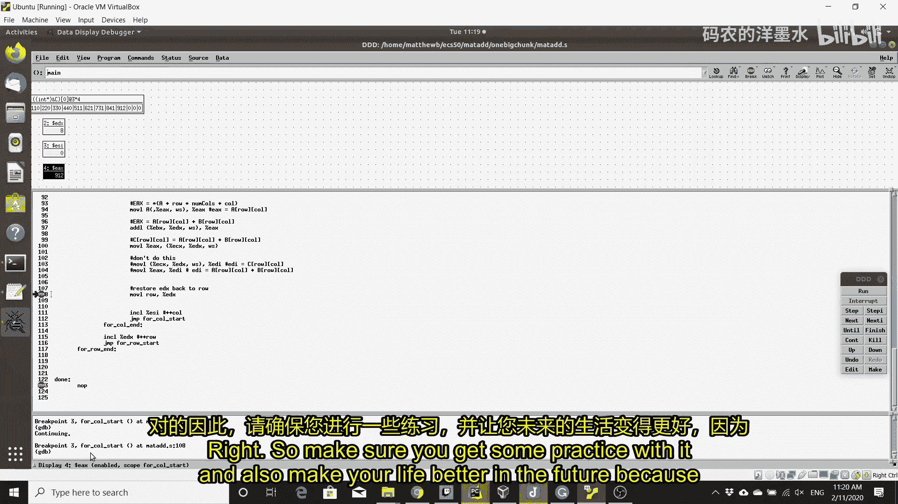

So great， we finished that。😊，Now， what would happen if instead of having an array of arrays， I mean。

 an array arrays we had instead of having one big chunk we had an array of arrays。

 how would we change our code？So。Al raise。

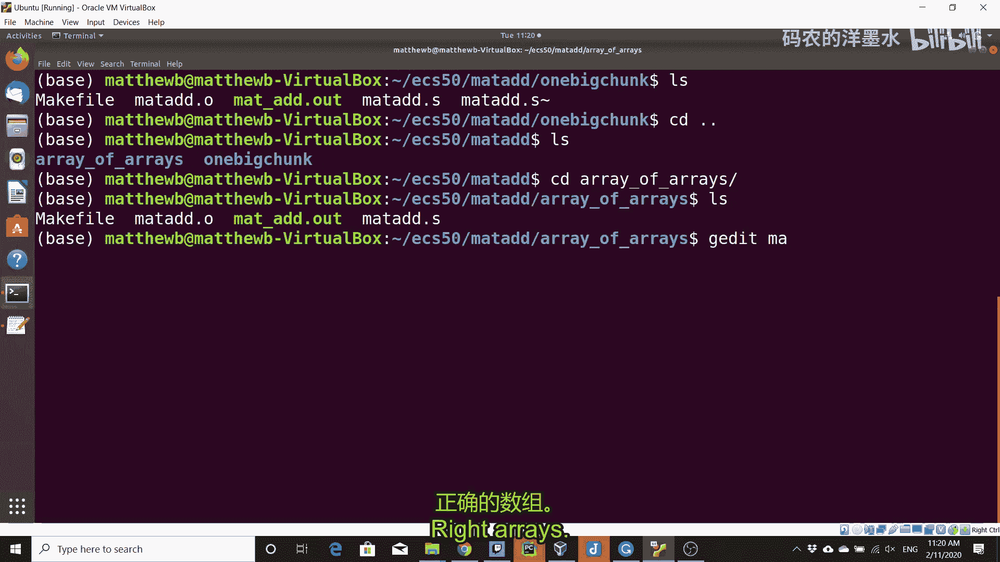

And so if we go over here。Again， first we'd start with our C code。

How does that look different than our other code。Right， here's version 1。 This is what we just did。

How is that different from？Version  two。Hey， here's version two。In version one。

 we're playing spot the difference。What's different between the two？嗯。Again， back to version2。Yeah。😊。

The arguments。没有。Yeah， right， that's the difference right the rest of the code you would write identically except the parameters are going to be changed right here we're saying I would like one big chunk arrays that always have four elements per row。

Here I sing， I want an array of a。Right number of and nu columns that passed in。

 so in terms of translating this code， what's going to be different between version 1 and version 2？

In terms of what we write here in the assembly code。Yeah。Or arrays and raves。不要。S are concert。No。

 I mean， it depends on how you do it。 So like here is how we have things set up。

So I did not dynamically allocate it because I don't want to get into function calls yet。

 but over here right， here's my array， a， well it has three elements right。

 because it's going to again be a  three by four and each of those is the address of each of the rows。

啊。Right and then here' is B。 it has the address of B's rows。And then C has the address of CRs。

Right and I move some of these things around to show you that doesn't matter。

 but I can also kind of like putting them next to each other because it helps readability if you put them as we had them before。

 but I just want to show you that we can move different parts around and it won't matter because we have our array of arrays and we have pointers to those spots so each individual row can kind of like be wherever the hell we feel like in the data memory but the contents of an individual row must be next to each other they must be at sequential memory。

😊，Right。So do you think the four loops are going to be translated in differentlyfferently？No， right。

 they like the same thing。But what about this line code？Line 6。

We do translations for array of array accesses the same way we do one big chunks。Hopefully。

 your answer is no， and you did your quiz。And you put no and you did the right answer for each one in quiz one。

They are access differently。So I'm going to leave a lot of what's here already here。

And let me change my visibility so that the highlighting is nice。Highlight mode is as similar， not C。

So again， here we have like our outer for loop， so EAX is going to be row， EBX is going to be call。

 and EX and EDX will use for temporary things。So， this is。不同。Translating。The inside。

So we want to translate。This line of code。 So again， every single time you see those square brackets。

 you should be like， I'm going to。Rewrite that。Without square brackets。

 so what's this line without square brackets？Just like we did the prior version without square brackets when we' were doing the translation。

嗯。Think back to your quiz。 You have already done this。 You know what to do。No。好了。Yeah。

 Ive got to follow all the pointers right， so what does following all the pointers look like what's the。

一个。Yeah， yeah， yeah， that's totally what it's going to be。Plus， call， right。

 and in this entire thing。See you referenced。So that's what we have to do。And then the same thing。

 you know， yeah， it's going to be equal to。诶。Plus。B。

 but it's really important to know how these expressions are written without the square brackets so you do the correct translation right if you did one big chunk translation for how the memory is actually laid out。

 it's totally going to crash because that's not how it's set up。you want to treat it。

As memories actually that out。So which part do you want to do first？

Remember EAX is row and EBX is call and everything else。You don't know about， I mean。

 it's up to use to what you want to do with it。嗯。嗯。So again， we have this one gigantic， really big。

 huge line， what should we do？Break it down again。 That should always be your first kind of idea。

 You want to specify what to do， like with the minimal possible detail， right。

 So we're going to just do。This part right here。This is the line of code that we want to translate。

 Do you want to put this somewhere。Again， EAX and EBX are currently in use， everything else is free。

嗯。EAX and EBX are in use， so probably don't want to reuse one of them because you'll lose what you have。

You pick any other register besides those two。 It doesn't matter which one you choose。

 You just got to pick one。So which register do you want to use？Sure， EX。

We're going to make ECX equal to this。And again， if you break it down。

How can you break this problem down to be something a little bit smaller than what it was before？

Right，We can do this part right here。How can I get that into ECX。

 how can I make ECX be equal to this？Notice， you see。A dereference operator。

Because you need to dereference and access memory， what should be using。Yeah。😊。

The advanced indexing mode， right as soon as you access memory， like advanced indexing mode。

 I have to use that because it's the only thing that lets you access memory。So， in this expression。A。

 is it a constant or not？A is a constant。A is not a constant。Most of you vote that it is a constant。

 so it's a constant， what field does it have to go into？喂。😊，The displacement field， right， so moveel。

A， right。 And since a is a constant， are we going to， And it's the beginning of our array。

 Are we going to have anything in the offset field， no。What is our variable index。Row and row。

 I believe we said， is held in YX。So what am I to put in my index field？EAX。

 and how big is each element？What are the type of our elements？Yes。有。

What are the type of our elements？I mean， I will agree that they are four bytes big。

 but if we think about like you know what the type is back from the C code。

What is the type of the elements of A？A did your pointers。Right， again。

 it's just one of those things that you have to be really careful and really。

 really detail oriented as to what you're doing， otherwise you're going to end up with some bad assembly because it's not going to work。

So it's going to be an integer pointer。 I just want to like， you know。

 harp on that so you know what you're doing and why it's going before here So where it size that for and we want to put that into。

What comments say we want to do？What is。Right and notice we didn't write the code first。

 we wrote the。Comt first， right start with what your goal is。Backtrack to make it happen。

 but know what you want to do first before you go and try and do it。 Otherwise。

 you're gonna have a very miserable life because you will accidentally do something that you didn't intend or intend to do or you'll have no idea what to do。

 and you'll just do something because I must write code。 It's important。 I get greeted on this。

 And then you'll put some garbage code down and it's not gonna work。Right， so be intentful。

So now how can I finish this and make ECX be equal to the entire expression？How can I finish this up？

嗯。Remember， this value is held where。ECcX， right？好的。Not add L because again。我。We're dereencing。

 right？So again， if we break it down， where do we want to start。

 where do we want to start in memory at， where should like the beginning of R be？嗯。

This is the beginning of our array。 right， we've already gotten here。

 We've gone to this particular row， and we need to move column elements into it。 So again。

 if be thinking about this as our A field， right， is this constant or variable。Yeah。Constant。

Variable。Okay， everyone else。 what was my third option I didn't pick？Because again。

 you have to identify as one of， is it constant？Or a variable。

So let's break this down when we did this part right here was a constant。Yes。Was row constant。No。

 so a constant plus a variable will make。What。Variable that's going to be a variable amount right because a variable I don't know what this is at this point in time plus some constant is so well。

 it's that much constant bigger but I don't exactly know what it's supposed to be right so this part here is a variable amount so what field is it going to go into given this is where we want to start reading from。

放到。The offset field， right， So moveel， we want to start reading from。ECcX， right。

 how far past ECX star a plus road do we want to go？Call and calls in EBX， So we put。

And then what should our skill be？Word size 4， right， But why this time。

 Because the elements here are。Yeah， they're integers， right， so that makes sense。Great。

 we've now accomplished this one line or part of this one line of code， we got ECX。

To be equal to a at Ro call。嗯。How can we add， you know。

Be it roll call to that or what do you want to do next。

 what's your next little sub goal to accomplish here？Sure， we can copy and paste it。

 but we want to do it with。We don't want to do this with any， we we want to do it with。对。Sure。

 and do we want to put that into。EC，x。No， because we already have something in there that we care about。

 Where do we want to put this into again， Currently， A through C are in use。

Sure EDX right it's not really a big deal。 So here we have EDX。

 and so this line of code should change to。They should change too。B， okay， and this should change to。

D， and this should change to。D， and these should change to D's。啊。

And this right here should change too。起。It shouldn't change should question and this one should change too。

Sure， EDX。Now， where do you want to put the sum of these two things into？Right because you're right。

 you have A at row call。 you got a B at row call。 We got to add those two things together。

And store them somewhere， so where do you want to put the summation？嗯。也下。Well， I mean。

 so we have either ESI or EDI， those are totally available， but also ECX and EDX are available。

Because we don't need those anymore， we have the values。

Right that we needed so we could if we could sum them so we could do addL， just say like percent EDX。

percent ecx。And this is going to make。ECX B equal to A at row call plus B at row call。

As an alternative， we could have saved this additional line if we had changed this from a Mo out to an addO and from this EDX to ECX。

Right， this could have been add Bet row call to ECX to get the summation there。 right。

 We could have saved ourselves one panlet of code。Now we have to do。Put the C at row call。

 make it be equal to there， so how do we do that？Guys are going to want to hurry because I still want to show you functions or at least how to kind of get to them。

 which will help you out in your homework assignment。So again。

 like what we're trying to accomplish is。This little portion right here。

 or maybe this line depending on how you want to think about it。So。Yess。

So the first thing that we can do is move out， what？See， right。Past。EX， word size 2。Okay。Maybe EDx。

 because EDx was freed up。 We don't need it anymore。 We have the sum right。

 So this is EDx is equal to。Essentially C at row。Or again， this guy right here。And then。

And what do we do next？This is EDX is C at row。Yeah。Okay。然我。是。You're going to put it where。So。Sure。嘿。

😊，And then。We already have the sum。でなってまし。Yeah， you just made it again。The one I said not to make。还有。

You just did it， right， But you caught it， which is good， right， Because if you did this。

Would that do？All right， obviously。This would do EDX is equal to。Yes。But what did that change？是。

What did we change here？We changed DDX。 Do we want to change EDx？No。

 we wanted to change with the memory， but again， a very easy mistake to make right because we're like。

  oh， I'm going to keep following that pattern。Right， but no， not quite right。Don't do this again。

Don't do this。It's not what you want。Okay， what can we do instead？Oh。

 I should comment these out because we don't want to do them。嗯。We want to take our value。

 right the sum， what's the sum in。ECcX， and we want to move it to。You know， C at row call， right。

 We already have C at row。 And， yes， we can use the advanced indexing mode once again to say go transfer it to this location and memory。

 right， There better be a location of memory on the right hand side。

 If we want to put our value in to memory。😊，Right， so what's our first parameter going to be？Yeah。😊。

This will make C at row call。Be equal to go on。Be equal， too。A at roll call plus B at roll call。

Because notice this expression over here on the right hand side， what is it？

It's the location and memory of see at Ro call， right？And so I want to put the sum at。

See at row call so I wrote the code that says take the value of a you know a at roll call。

 let's be at roll call and put it at see it row call because that was what I wanted to have happen so see at row call but appear on the right hand side not a copy of the value that's there。

EDX， which is what we got before。Any questions？So you definitely know enough to do like the first three problems。

For your homework assignment， the next one， you're probably going to want to see some functions。

 So how can we accomplish those Funs are actually pretty easy。

 but what we're going to refer to them as sub routines for right now。

Not to get them confused with C style functions。

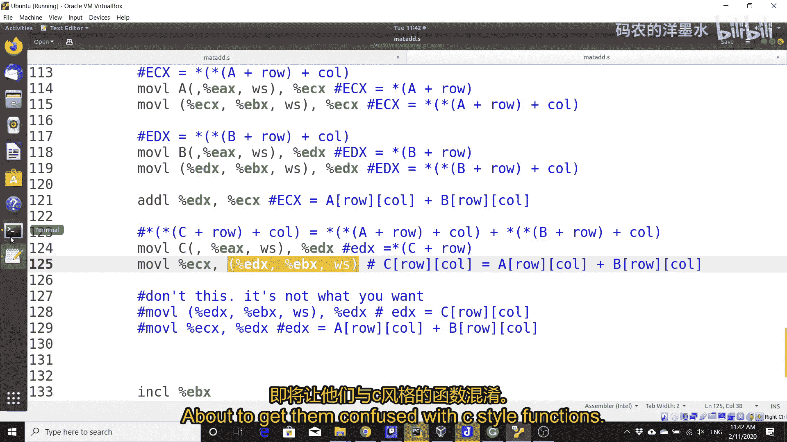

And only got a couple of minutes， so I'm going to go a little bit fast。So。Let's see。

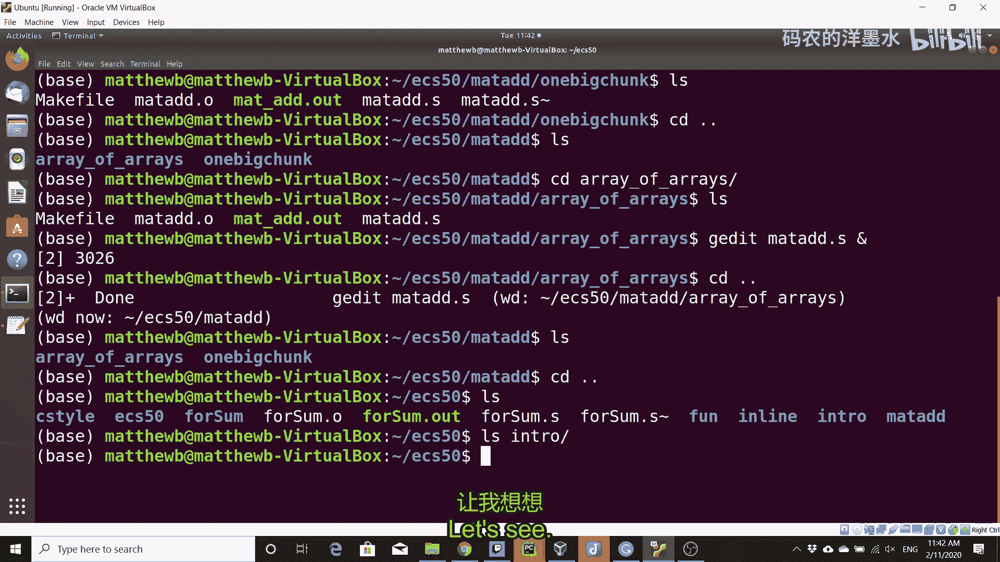

有。是。BD of fun。J it stir fun。That one's like very much the C style type。

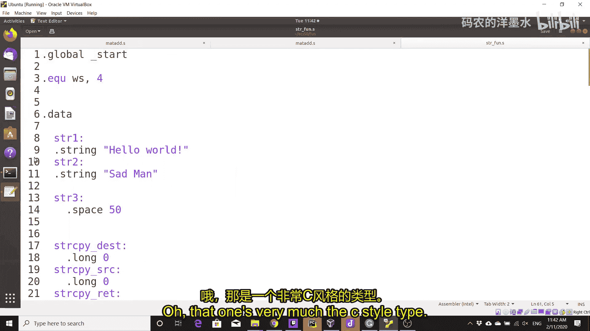

Yeah。Stop the when I was anymore。

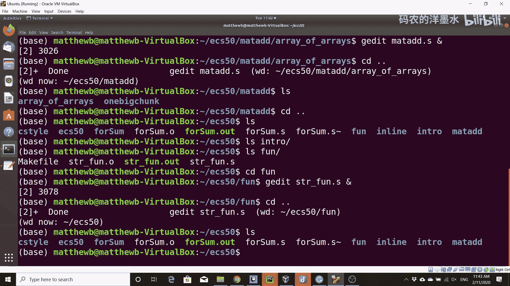

嗯。😊，Well， we'll just make a new directory and we'll go through that。

 So we're going to make a directory called。W I want to call it， all it sub routineines。And if you。

Are working。At the books totally talks about this。 So let's say we wanted to write a function that calculates the length of some string。

 right， First thing to do is write it in。See code。So what's the C code that's going to find you the length of a C string？

I'm just doing other things， I'm just waiting for you guys to start talking。错。

So what defines a C string， what makes a C string AC string？Some ray of characters that。

Ends with an old character， so if you want to figure out how long your string is。

 what do you need to find？The old character， right？So over here。

 we might have something like int L is equal to zero， right， So then for。

So we already have one equals 0 there， right， We want to keep going for how long。

So we want to keep going while stir at L does not equal to。The whole character。Right， plus， plus1。

Well， is there anything we actually need to do in the body of our function？哎。No。

 right because we're just counting， so I'm just supposed to send my call on there we do nothing or you know you can write it as my body is empty。

And then we can just return。L right now the things here that make functions somewhat interesting is we have to specify how do you want to pass your values。

 how do you want to get the values into your function。Right。

 and the way that you first start your function is。You make its name， which is just a label。

 and I recommend doing your functions above the underscore start because you won't accidentally run them when you don't intend to because again。

 if it's below underscore start， you just keep going lines beneath underscore start and if you enter your function you just start doing it。

RightThat'll also put like an end of Stlin under here， but it doesn't actually do anything。

It's just a nice little marker。When you're done with your function and you want to go back to where you recall from it's just RE。

 right？Just go back to where you were called from。Notice。

 I didn't say anything about what when I say what REett did。

What didn't I say it the RE instruction did that you're used to seeing with the return keyword？

The value， RET does not return values。It goes back to where you were called from。Right。

 so now what we have to do is we have to define some rules。

 some conventions for how wed like our function to be used right。

 we're kind of describing how you need to get the values in and where you should look for the return value。

 so how might you decide to pass values to your function。What are some options you have？

you could pass the values through registers right， so you might say that before you call my function。

 right？Stir。Should be。Placed in， what register do you want to choose？Sure， E X， right。

 You pick a register。 You're your own boss now。 You make the rules， right。

 But you guys gotta make sure that you should probably be consistent with your rules in terms of applying them because that uniformity will make running your functions easier。

 But you just have to say what's supposed to happen， right。

 So we're gonna say before you call my function， I expect that you put stir into E X， right。

What would be some other options besides placing the value into a register？You put it in memory。

 right？So we might call this one like Stirland Regdge。And Stland Regdge。

Over here we have thet data section。And then we might have another version that's called。Sirland。Mem。

 right， depending on how you want it to be passed。So you might say that。Stir should be placed in。

Stirwin。Stir。Before calling。Right and then so down over here in the data section。

 we'll just create a label called Stlin。Stir。How big should this space be， given that our function？

this is an argument。Yeah， it's not long because the type of stir is a。Character pointer， right。

 it's a pointer， all pointers are four bytes big。So for returning a value。

 how could you return a value， what might be a way of doing it？Soで。Put another register， right。

 So you might say。The return value will be in。Sure， EDX， right？Now here， again。

 another optional way of saying is like the return value will be in。Stirwin rat。

And then down over here， we have。Let's put zero here。Stirwin。Right。All right， it's also。

 it's an in it's 4 byte it's big。 So when you want to call the function， you say call function name。

Stir when rich。 So if over here in the data section， I have my string。Dot string， I think it is。

 And then。You know。Hello， right？If I want to call Stirland Redge。

 what should I do before I do the call？Was it say I should do if I wanted it to work right？Right。

We have my string。And we should， you know， better make sure that we put my string into ACX， right。

 so we'd have something likeMoville dollar sign My string into percent ECX。Now I do the call。

 where should I look for the answer after the call completes？What did we say EDX。

 So you just look in EDX， right and then。On Thursday。

 we'll put the rest of the code in here to make it actually happen， right。

 but you just set up some rules for how things should work and make sure you follow them。

The important thing is。Before I do this call， if I have something in EDX that I care about。

 what should I do？😡，そです。这个。Save it somewhere else， right， because we know that this function。

It's going to overwrite EDX right and it might also use some other registers as well and those other registers we have a choice。

 either the caller can save them， my function can save them or the function the function that calls me can save them like what they've been doing right now or the call the function that's called can choose to save those other registers and you just have to make a choice about whose responsibility that is and follow through on it right we drive on the right hand side of the road in America so you better drive on the right hand side of the road other than bad things happen right follow those conventions。

We'll finish this on Thursday and' definitely be able to do the last problem。You mean。

 you don't know how to do it now， just break it down to functions to make your life a little bit easier。

Yeah。

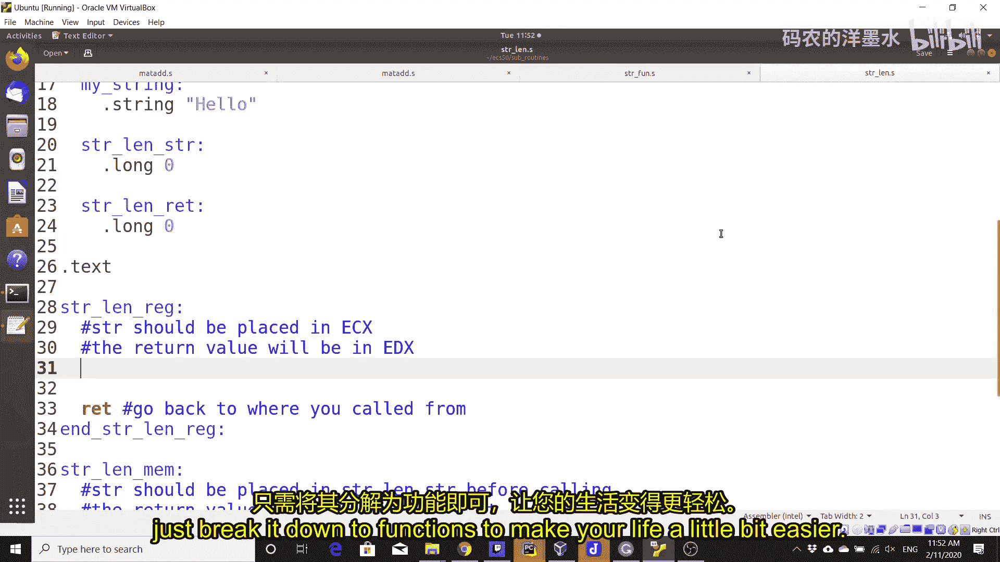

事 want发。

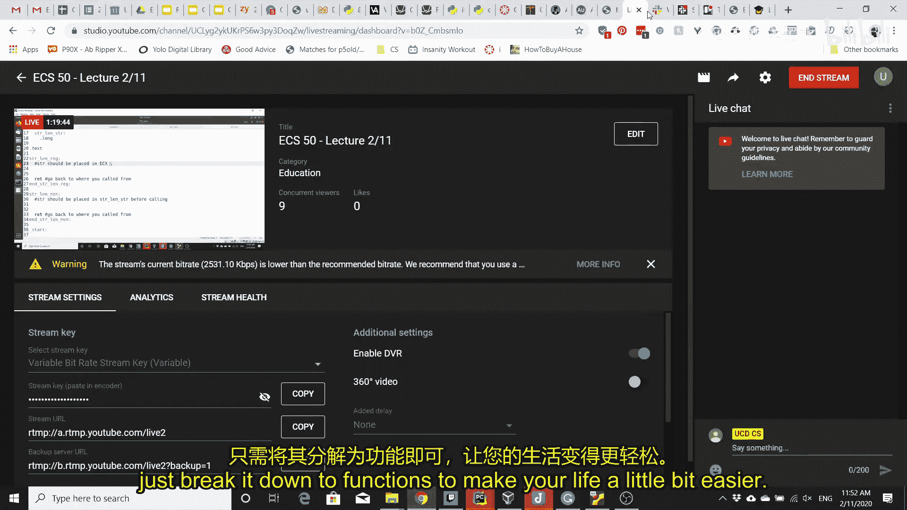