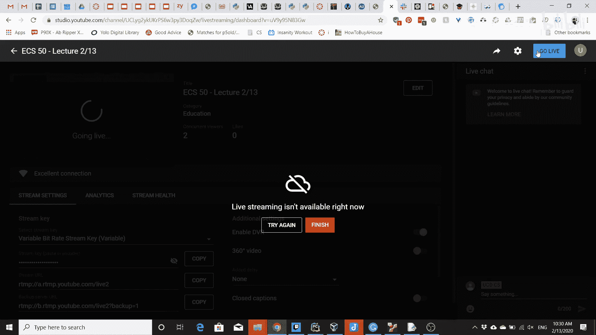
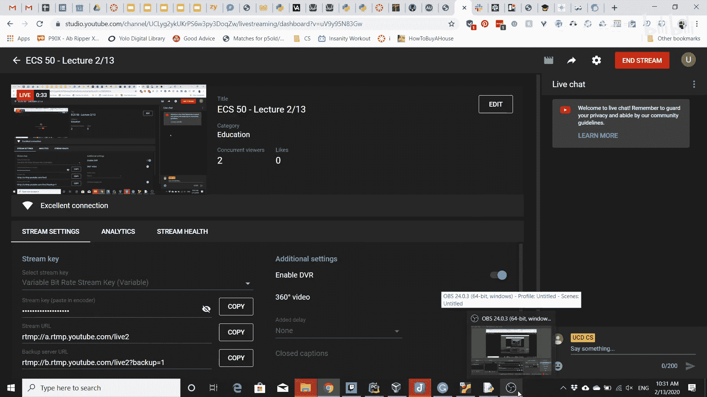
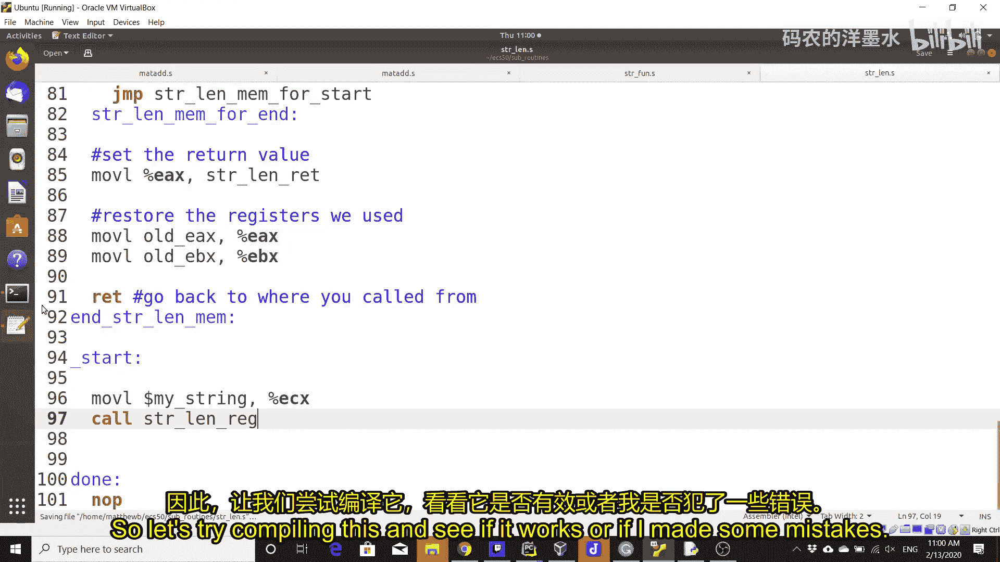
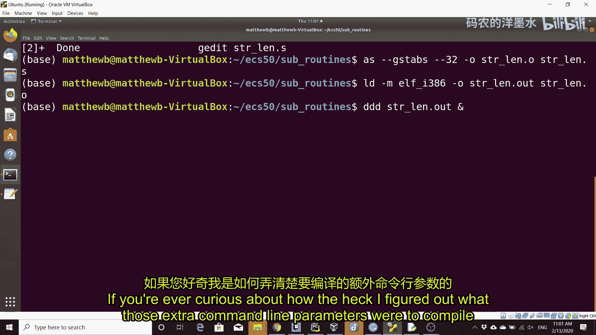
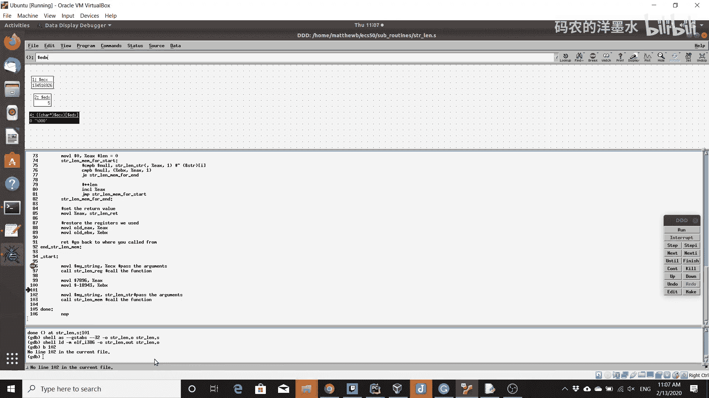
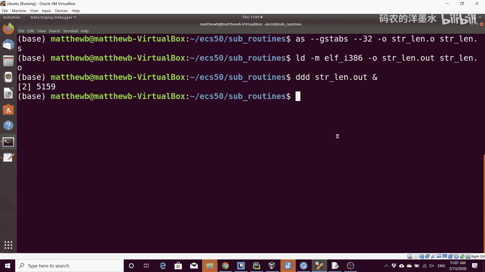
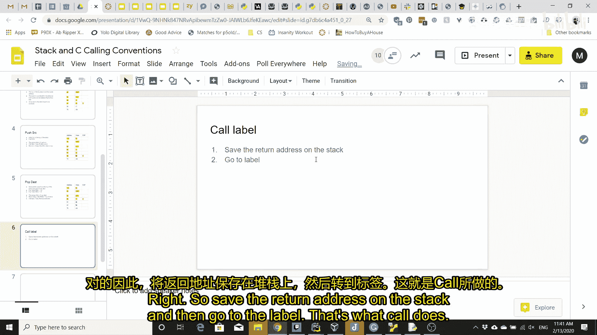
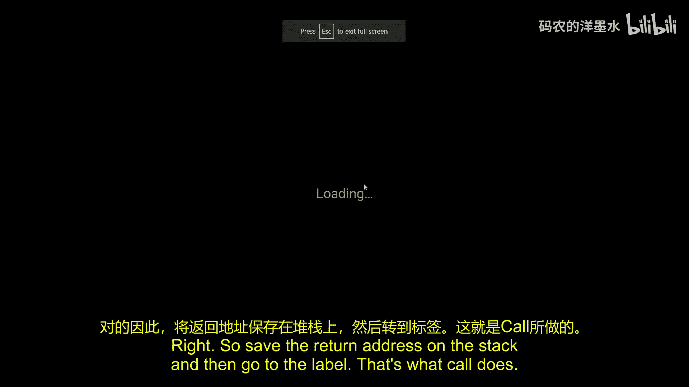
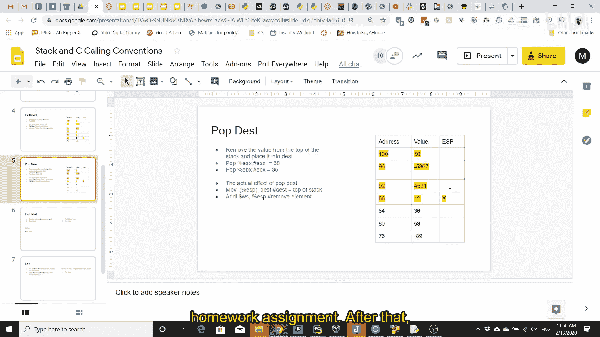
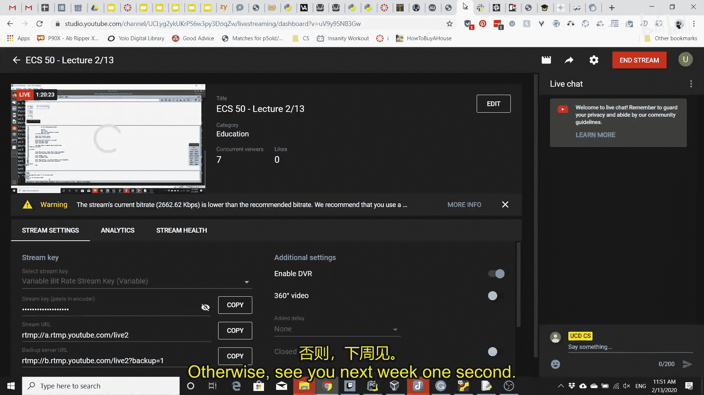

# 【全集】加州大学戴维斯分校 C语言与汇编语言 中英字幕 1080P p11 Lecture 11 - 字符串、函数与栈入门 -BV1xefZBHEas_p11-

Yes。

Do you guys have any questions？Yeah。你方是那个。当。The assembly code example should all be up there。

So like if you just go to like the examples folder on the Google Drive。Everything should be there。

It might not be like our exact version， but versions that we've done previously in the course because our exact version isn't there because the Git doesn't behave nicely with the Google Drive。

And doesn't like to say the files there。But there should be some versions up there already for you to look at。

Anything else？

Okay， so last time we left off， we were trying to find the length of a string。

 but we wanted this to be done through like a function。

 which is going to be a subroutine for right now and we'll talk about what makes functions a little bit different from subroutines hopefully today as well。

So when we were writing our subroutines， we had to figure out two things or actually three things。

 thing number one， how should we pass values to our subroutines？Thing number two。

 how should we return values from our subroutines？Thing number three。

 who's responsible for saving the registers that I happen to use inside the separatepper team。

So what were our options for passing values to a subroutine？这边应该。Yeah。

 so we can either put it into register or put it into memory right。

 to passing it and the same thing for returning， either put into a register or put into memory。

 but just let whoever is going to know who's ever going to use your function。

 know how to use your function， and then if they use it right， everything should work out fine。

The other thing that we need to consider though， is our function right or our subroutine。

 it might use other registers besides the ones that are used to pass in arguments right。

 or to return arguments。So whose responsibility should it be to save those registers， for example。

 if my register just happens to use EBX， but EBX isn't an argument or a return register。

 who should have to save that register's value？Well。

 what are our options who could potentially save that register's value？That's what you can say。

 but it isn't memory。But who should save it， not where should we save it， because yes。

 it will be saved a memory。17。The subroutine could save it， or。The function。

 or the subroutine that calls the subroutine， right， so either the color could save it。

Or the cold subroutine could save it。It's up to you， but you know。

 if you decide not to save some registers， let whoever know that's calling you that your stuff。

 these registers also need to be saved as well。So this was the code that we need yeah。

You say that you。皆さ。In。Correct， right， so like either before we do the call right。

 if this function was planning on using like EBX， we could say EBx because we know that subine is going to overwride it。

Or we could not tell the caller that we're going to overwrite the subroutine or not tell the caller that we will overwrite EBX。

 but instead save EBX before we do anything with it， overwrite EBX and use it as what we want。

 and then before we return restore it back to its old value so to the color it looks like nothing changed。

Does that make sense？So let's go with option number one， the or the called subrent should save it。

But this is the code that we need to translate。Just got more or less one line of code here。So。😊。

How do I translate？This line of code。Yeah。So the Sterlin red subroutine。

 we're accepting our parameters through registers and we'll return them through registers and for the memory one we're accepting our parameters from memory and we're returning the answers in memory。

They're doing the exact same thing， but the implementation details are different。

So they're both solving the same problem， but how they're doing is going to be a tiny bit different。

It's just pretty much how do you accept and return parameters is the only difference。Yeah。

Merify the difference between next sub routine team。So。

Basically like subroutines are functions for the most part。

 it's just that if you want to write C style functions， there's a couple of rules you have to follow。

 but other than that it's the same thing。So how can we translate this Atlantic code？Right。

 we've done four loops。Hopefully you've done some for loops also in your homework assignment。

How do we translate four leaps？ What do we have to do first？

I think there should have been a line of code that we need to do first， which is L is equal to zero。

 as's the first one actually。Ohoops。Or maybe we can just put that here。So how do we translate this？

错 you。或者说。Remember that we're going to be returning the L right。

 And so the return value we said because it' is going to be placed in EDX。

 So what register should we choose to use for L。Yeah， the EDX， so Moel dollar sign 02。EDX， right。

 this is L is equal to zero。What do we do after this？Start the for loop。

 so how do I start the for loop？Okay， what label do you want to use？Start formRight。

 so one kind of like risky thing about just using like start4 right is that， you know。

 we're going to have another for loop over here， but the labels kind of have to be unique。Right。

 so you might call this one something like Stlin Reg for start。I know it's a long name。

But then we can also have the。En label as well。And spell it correctly。Or end。Okay。

 so we have our labels now。I'll let you know that like the null character， it's just zero。

Because next we have to do our if statement。 or at least the condition portion of the code。

So when we're doing a comparison， all of our comparisons have to be against。Zero， but hey。

 guess what， this one already is against zero。Right。Because the null character is zero。

 so how do we do this？行。Well， so like so we might have like the negation。

 so we we want to do like stir then is not equal to like the。The mole character， right。

 but we still need to do kind of like some operation on this。To actually compute it。

So the next thing that we would do would be like Stlin， you know， minus the null character。

 which again， is just zero。Is it not equal to？Zero。Right。And then the negation。I it should be equals。

Zero， right？So the first thing I need to do is the comparison。

 the stir at La minus the null character， again， null character is just zero。

Right I guess if we want to be like extra fancy， we can do that dot EQ U null is0。

We can say null if we want to instead。So how do I do this？Here。We use the F。So should we use okay。

 CMPL？Not no。协议上这个。Yeah， because we're comparing characters right， so it should be B， right？

We'm going to account B， what should be our first thing。It would be So the the， I mean。

 the is not constant So we use for。Yes we are。 So we be present PC inside the。And then， it will be。

Lonard person， EDX。Proma one。Okay， and what do you want to compare this against？

should have been C the dollars you come on。Yeah， exactly right。 And so we called a nule， right？

From back here。right， this is zero。U， I guess I should also mention。

 like if you guys are doing your homework and you see some things like you can't like derandomize memory。

 you can safely ignore that。It'll still work。Anyway。So we do our comparison。

And then what should we do？Jump， jump， what？个们。Jump of equal to。どす。Right， get out the loop。

And then we need to do our plus plus land。Which is just。Increment。Yes， and yeah we're done。

That was it because it's all the things that got to do the before that there's no body。

Any questions here？And again。What does the RET keyword do？这。Yeah。😊，業がて。Oh yeah， thank you。Jump to。

To start。Go back to next iteration。Correct， but what does the RE instruction do？这个。

Takes you back to not necessarily main， but wherever you were called from， right， remember。

 the rent instruction by itself does not return a value， right。

How did we return a value from our sub routine？Now， he just put into a register right。

 and whoever called us， they should look an EDX after they finished calling us for the answer。

Does that make sense？Yeah。So what happens if we do this， But now。

 instead of a stir being placed in Ex and their return value being an EDx， we want to put them into。

These locations。What's going to change here？Again， we still have just this one line of code to translate。

But now again， the only difference from what we did before and what we did now was that the arguments are passed in a different spot。

And the return value will be passed。In a different way， right。

 it's going to be passed through memory for both of these things instead being passed through registers。

And we already made those labels back up here。So。Yeah。This。I can't quite do that。Right。

 the other you'll like， let's say we did just do， as was suggested。And we just。Switch it up。Right。

 so everywhere you see ECX， you want to replace it with Stir Lster。对。

So you want to take this out of here。And take this and put it in the front， like so。Like that。

And then you want to change this， oh， well， that's now a label in memoryory2， so Stling R。

I guess goes here now。Well， but again， this is a variable amount， right， L keeps changing。

 it's not a constant。And then you want to change this to be。That， and then。

I guess we need some labels here， don't we？Did I copy everything？Not quite。Will this work？Yeah。

I guess this one should be。Will this work？Yes， it will work。No， it won't。It won't quite work。

 there's definitely some stuff that's wrong with it。Right， for example。

 I think was kind of already mentioned out what can go into the offset field。

 what's allowed to be here？Registers， is that a register？It's a constant， right？

So that's definitely not going to work so we're going to have to still use some registers in our solution The other thing to think about too when you're writing your assembly code is that it's much faster to access registers than it is to access memory so as much as possible you'd like to work with things in the registers and then move them out to memory when you have to or move them in from memory when you have to so constantly having access memory like every single time。

Like here。That's a bad idea。Because you have to keep doing it over and over and over and over again instead of justtyping in a register where you keep updating it and then move it to the end。

So we're still going to need to use some registers， right？What registers do you want to use？完。

Can we keep the length in the register， Yeah sure， which register do you want to put it into？Well。

 again， yes and no。No， they're both free and not free because。It depends right now。

 we're in the situation of， we want to use some registers。

 but we now have to come up with some conventions。 Should our caller save these registers or should we be forced to save these registers before using them。

And for right now we're going to go with we should be responsible for saving those registers so any registers we want to use。

 we're going to have to go save them out to memory first before we utilize them。三个。

So what registers do you want to use for Lnn？Anyone will do， you' just got a pick one。So sure。

 EAX will be L right， and we will also actually are going to need store two because even if we replace this now with EAX here。

是完。This with EAX， this is still wrong。Do you know why？Or I should say。

 what is the equivalent line of C that this code translates into？Discuss amongst yourselves。Line 61。

 it's wrong。 It doesn't do what we want。 What does it actually do。

 What's the equivalent line of C code that this is actually implementing， discuss。嗯。嗯。对。是。对。都好都负责出。

你的公司。Although the line little0 just。Yeah， I didn't switch that one up yet。For。这是原。ちと。时间。就し。What。いしです。

So do we have an idea of what this is actually doing in C？Okay。Any thoughts？

As to what this line of code actually does because it's not doing stir at L。

This line right here is doing something along the lines of the address。Of stirir。I ish。

Because remember stir when stir， right， it's going to hold the value stir， what is stir？

It's a pointer， right？So stir lens stir， right， it must be whole， it's a pointer。

's it's the address and the area of memory that holds the pointer。

 So it's like a pointer to a pointer。Right， so that's what's wrong here。

 the thing why it's not quite exactly at I is because we're only going like one by past that pointer。

So instead of going over to our actual string that we're going to pass in my string and then going through the characters that are here。

 we're going to go up to my string and then start going down this way。It's fun。

So be careful with that， make sure you do the right thing。And again。

 once we switch it to do what we want to do。嗯。Yops。Right， don't do that one。

We are going to be using EVX for stirR。And then we're more or less done， except again。

 these registers aren't or these registers we're assuming are currently in use。

 so we have to save them。 so how can we save EAX and E BX， given that。

I have old EAX and old DBX labels now。🤧，Mo out。Register comm later。Yeah， EA X2， oh， EAX move L。

EVX to old Evx， right。Save the current values of the registers。Now we need to go load them in。

So how can I make EAX be equal to？问。How can we do that？So we need to move out。What into EX？呃， yeah。

Dollar sign zero。Right this is the EAX， oh which we already had that down here。

 So I guess we're fine there。 How can we make， I should guess we should change this line to make EBX equal to stir。

So what should we put here？Stterling。Stir， right， go to that location memory。

 copy the value that's there， copy the pointer。Yeah。

 so you're using the label the first current state。Registers。

So we're saving the value of EA X and EBx because we need to use these registers。

 and these are the values of whatever happened to be in them before we were called。

I don't know exactly what's there， but there's something there， probably maybe。

Let's make sure I save that first。So we saved the old values。We make EBX be equal to stir， right。

 we set L equal to zero， we do our whole rig role。But what do we have to do before we return？Yeah。不服。

First thing with do is set the return value， right。

 because the return value is not where it's supposed to be。 The return value needs to be placed into。

Stirland R。So my return value is EA X， souval percent EAX to。Stirland。Rat， great， that's set。

 and now we need to restore。The registers we used。So put them back to what they used to be。

How can we do that？I。这边。Now， like move all old EAX into。Yeahx move out old EbX into two。EVX。

Any questions so far， yeah？老 time。さ。So again， dollar sign is constant and if you put a dollar sign in for them the label。

 the constant for the label is it's where it's located at memory。

 so it's like essentially the address of that thing。Whereas if you don't put the dollar sign there。

 it's going to be using the advanced indexing mode。

 but we will only be getting the displacement field right So again if you think about like the dollar sign as being constant。

Does this make any sense？就是还有的是。At that address。 Well， I mean。

 like currently kind of what this line of code is saying to do is E。

The address of old EAX is equal to EAX if you have that。Does that make any sense？Again。

 like if your variable x is that address 100， when you do ampersand X， you just get the value 100。

 so now you're trying to say something like 100 is equal to five。Or 100 is assigned the value 5。

 just because this does mean the address of this variable。

 if you say the address of the variable is equal to something different。

 it's nonsense because you can't physically move that value by doing this statement。

RightThe other thing to thing about is this is a constant right So we're trying to say set some constant equals to some value。

 set7 is assigned five。Doesn't make any sense to do something like that， right。

 which is if we go backwards counter， which is why we would't have dollar signs there。So again。

 you have to be really careful with what the dollar sign really means。

 It means treat this thing as a constant right， The constant part is where it's located at memory。

 so you're literally trying to edit the address so that address is no longer a address 100 It's now addressed5 or whatever happens to be in EAX。

希望。Yes vision。Oh yeah， totallyy。When you need the address of the variable。For example， with pointers。

If you did something like this。So let's say。We don't want to do that anymore。

 so let's say we did something like this Mo out dollar sign old EAX。Into ECX。

What is the equivalent Lion Sea code here？Yes， right， where should we think about it。

 this is something like treating ECX like in and Jeb pointser。ECcX。

 right so you can hold an address and now if we did something like this。Moveval。

Percent ECX into say percent EDX。That's doing something like EDX is equal to star ECX。

You dereenced it。So yeah， I mean， there are totally times where it makes sense to do something like that。

But you might not want to do it all the way， you will see an example in one moment where we do pass the address of something in。

And we do it legitimately。Any other questions， yeah？稍等。你都是。

So EVX is going to be like a cha pointer right， but remember string itself。

 the cha pointer was point what。Stir， which is the character pointer was placed into Stirland St。

 so at Stirland St， there is a pointer to the string。OK坐谢对。Well because a pointer is in。Right。

 so we were accepting the address in the first place， right。

 So if for're saying that St lens stir should be， you know。

 you should play stir into St lens St before calling me， you need to place。And address there right。

 where does this thing happen to be at in memory， where is the string at and again。

 you'll see an example in one moment of us actually calling the function and things happening。

Any questions？And again， for the calling， hey， look。

 when we want to do the first version with Sterlin Redge， what do we put to ECX？We put in my string。

 right， But notice dollar sign my string， right？A pointer to where the string actually starts at。

 its address。Is there any answers？Both of the questions you just had， at least a small example。

 right， And then we call our function。And then our answer should be in。EDX。

So let's try compiling this and see if it works or if I made some mistakes。

So remember AS， dash dash， G stabs， dash dash 32。Dash oyster， when。Sorry about that。t o Stwin。t S。

And then linking LD。DashM Llf underscore。I，3，86。Dash o Stland out from Stland。o。Okay， great。

 so now we can run this in DDD。If you're ever curious about how the heck I figured out what those extra command line parameters were to compile in 32 bit mode were。

 I had to go look at the documentation for the asssembbllerers and the linker to figure that out。

 so do some googling。

And then I found answers。So let's set a break point at say， our call， which is on。96。

 so break it oops。96。Let's go on our program。So fantastic we're down here and so we do our next。

 so if we look at ECX graph。Display dollar sign， dollar sign， ECX， it's zero， right， After this。

 we get some crazy huge number， which makes sense because it's an address and addresses our crazy huge numbers。

And then we go into our program， so we move zero and EDX， so we'd probably like to see EDX。

 so graph display dollar sign， EDX， that's there。Oops， I don't want to do that a second time。

On display。So next。So now we need to do this comp beat。

 what would be really nice to see right now in doing the comparison。

What would be really nice to see the value of what like string at eye is， like ECX at EDX。

And you can totally see that， so we'll do graph display。And again。

 I'm going to do some creative castings， so cha pointser。So E X， what is it。

 It's a character pointer， right， That's what's stored in there。

And we'd like to see our character pointer at what index？EDX。Hey， it's the H。

So I just cast it to make this displays of the race going to work at the cast back in the types。

Of the registers or labels then be able to access them。So if we go through， we had H。

It's not the empty character， so we'll add one to our length。Es not， El's not， El's not， Os not。

Here's our nu character。And we're out of here， so we go back and what do we have in EDX。 Well。

 that's the length。Any questions？You want to see the other version where it calls it with the。

Arguments in the registers so first things first， we'll put some values into EAX and EBX just to show you that they don't get changed。

Civil move out dollar sign，700 and blah， blah， blah into。E A X， M move， something。Into EVX。

So now we need to do the call to our new guy， right， so we need to call Stwin。MM。

 but before we can call Sterling Mem， what do we have to do？Ex。You we have to pass the arguments。

 right， This guy right here is。past the arguments。Call the function。So here we need to。

 this is again， calling the function。And then we need to。Pass the argument still。

 So how can I pass the arguments now， I need to moveel dollar sign my string into where。Oh。

 what does our documentation say that we should do？The string should be placed into。Sir Le Stt。

 so I should go put this into。Stirland St。Right we go and put it into memory and then after we're done。

 the result is going to be in memory at the location， so we'll see that happening at Sterlin Re。Ss。

Come back。Wu。哦。Gosh。Stir1。Dt O， Stland dot S。So you can like run commands from the shell here by just typing shell first then the command。

So LD dash O。Or dash， dash， dash M。Underscore I 386。Dash O Stling。out。Stirling。Stirland。

And then here we can say source， reload source since we've recompiled it。

We need to get that new stuff in there。And then we're also going to set a break point on。Why呢。Say 1。

02。Did not reload。

Maybe that doesn't work。Does that works。

Break on 103。Break on。Yeah。Three should be fine。So if we run our code， if we print or graph display。

Dollar sign， EAX。That's sum of value。Graph display， dollar sign。

 E B X is the grid value put in there。 if we do it with。E DX， it should have。Five in it。

 which is the value that we computed before。And then we're also going to want to graph display。

Stirland rats。Okay， apparently I need to give it a casting to make it be happy。So cast it。

To an integer。Which direction？嗯。To the right， slightly。Oh my goodness。It's just barely being cut off。

 isn't it？I didn't fix anything， did it？There， and then。Like， so。ok。

There we are now let's go and we'll call our function。

 so we pop into our function so we save our old values。And then we're going to want to look at EBX。

 So EBX gets some funny address just like before。We're going to put our length in there。 and again。

 we could do the command to display the characters。Which was graph。WhatYeah， is it possible to。Now。

Because again， the GB or DD， it's running your code and so if your code is not runable。

 it cannot run it。Thar pointer Do sign， E， V， X。Dollar sign E。

So again there we have our H and we're going through and we're getting our letters again and everything's fantastic。

Great， that's five。 so now we're going to put EAX into Sterling Ret。Film。It's there。

 and then we're going to put the old value of EAX back in there。

 put the old value of EVX back in there， and then we go back to a recult from and look。

 we can still run red to test5， which is exactly what we wanted。Given our current setup。

 what types of functions could we not implement？喂。No， voider fine， right。

 we just don't have a return value so the calling function is not going to look in a register for the return result。

And if it's void in terms of no arguments， but we're just not going to put anything in there。

Before we call it， right？好的。嗯。IfYou could do a callback function if you wanted to。

 You just pass in the function in there， if you want to。See how that happens。

 all you do is you put like the address of the function into EAX or some other register and then say call the register instead of call the actual label。

So that's fine。What's everyone's favorite type of function？Recursive functions。Right。

The problem right now is we couldn't do recursive functions because we do not know how many times we would call ourselves and every time we'd call ourselves we would need to like get new values which probably would overwrite the old values so there's no way of like storing that information as we go down for the number of times that we're called so we couldn't do any recursive functions at the moment with a setup but we're about to talk about the stack just a tiny bit more so we'll get into what it is that you need to know。

So let's pop back over here。で。No。Yeah。So let's talk about the stack in Intel， right？You guys。

Are familiar with the basic concept of a stack。 You've covered that in your data structures and algorithms course。

 or you've seen it somewhere。 Is anybody unfamiliar with what a stack is never seen it before。 Okay。

 then we'll definitely talk about it。 So a stack。Just in general。

 then we'll get back to this second tell。So a stack has first in last out behavior。First in。

 last out。In terms of how it's behaved， so the first element added。Is the last element。Removed。

The way to kind of think about this is。No， that， that one。To get rid of my picture。Yeah。

It's like a stack of plates。That first plate that you put on。at the bottom。

 it's the last one that you take off or as you add plates on top。

Those ones will be taken off before the plates that already existed。Beautiful picture。

The few operations that you can perform around a snack are push。Elements。

Which means add an element to the top of the stack。怕。Which removes and returns the topmost elements。

Of the stack。And then there's like peak。Buthi is just look at the topmost element。

Any questions on how stacks we have？So。Sack an intel。So for the stack in Intel。The top。Of the stack。

Is pointed to。By ESP so ESP is the extended stack pointer and it always points to the top of the stack wherever ESP is pointing to that is considered to be the what's the wherever it's point to that's what's considered to be the top of the stack this is why I said don't use ESP as a general purpose register because if you start changing ESP to some just like random value like seven the computer now thinks the top of the stack is seven。

 which is probably not where the top of the stack begins at in memory。Right。

What is considered the weird thing about the Intel stack is that the。Intel。Stack grows。Toward 0。

Which means the top of the stack。Is that the lowest address？And the stag itself。

To be wherever ESP points。And all addresses higher than that。是。It not need to be that big。

So over here right we might have like our address。Here's their value。 And then over here。

 we're going to have ESP。So over here once this it'll look a little bit prettier in a second trust me just have to knock some things off normally it would be something I do on the board but things don't get recorded so that's why we're doing it here So we might have like our address is 100。

And then one other thing that we should also say is。All L， are all。Accessses to the stack。

Have to be word size。So when you're accessing things kind of like when you're pushing or popping off the dock。

 they have to be in multiples of four for a 32 bit。 So we had something like 1001 or 96。94。

 92 because I can count。88。84。80。76。 And again， we might have some values here。 Here's the value 50。

 Here's the value negative， something， something， something， something something。More things。

And let's say ESP right now was right here。In our example。First question is， what value does ESP？

That one got funny really fast。How's it that shrinking the table？Maybe they get funny。Okay。

That's time it worked so first question is what value does ESP have right now？He boring认。Yeah。

 it has 84， right， because it's pointing to the top of the stack。

Which element is considered to be on the top of the stack？

36 in which what is considered to be the entire stack right now？7 be601。Not 76 to 84。

So notice this point right here is considered to be wherever ESP points and all addresses higher than that。

Right， 80 and 76。They're lower than its current value of 84。 So actually。

 these elements up here are considered to be what's part of the stack。Yeah， Mira。

 what is what do you put on the stack， Like， I get into your addresses， but。

Why do they get edit in the stack？我我 they不放个。Like what's the point of the stack？

like I guess I know what you a stack is in three in move the land of these but this seems to be much more specific stack Yes。

 so this is like your function call stack right because if you remember when we talked about memory at the beginning of the class。

 theres four sections， text data stack and heap right you've already seen how to do two of them in assembly the text and the data right text dot data。

Now the stack is the third section of memory that we're talking about right now。

 and that's where your local variables and arguments go， right？

It's where it's your automatic memory and so that's what we're working with right here because the things that'll be saved on the stack will be locals and arguments as well as the return address that we want to go back to。

嗯。So any questions so far。Okay。So let's talk about some of our stack instructions。

The first stack instruction that you've already seen is call。so call label。

So over here with calling on our label。This does two things。 The first thing that it does is it。

Pushes， I just say， it saves。The return， well， actually， let's do them in a different order。

There is push。Value。And what push value does is it。Ads。You know， value to the top of the stack。Yeah。

Yeah， I knew you would do that。哦，O。No， go back to being normal size。ok。All， so push value。

Adds value to the top of the stack。So let's say we did something like push。

Dollar sign58 to the top of the stack。 What's going to have to happen here to make that push happen。

So everything has to move， so the first thing has to happen with ESP， what happens with ESP。嗯。

It's not for question， right？So we want to add 58 to the top of the stack， right？

So we don't want to change this 36 to a 58， but we want to put the 58 on top of the 36。

So how can I push that value， what's going to need to happen over here？ButBut again。

 I can't move things in memory， right below location 84， there's always going to be location。80。

 right？So if I want to push 58， where is that 58 going to have to go to？

It's going to have to go down to 80 right， so our 58 is going to have to go here。

And then what needs to happen to the snack pointer？Okay。Not increments。Scraments， right。

 because we needed to move from 84 to 80。So it goes down。对了。And we've now。Added。

58 to the top of our set。Yeah， just completely overwrites what's there。 So we went from having。

47 there and it not being considered part of the stack。

To having 58 and it being considered part of the stack。Does that make sense？Any questions so far。

I guess this should probably be more generalized as like push source。

Add source the top source can be a register or can be a location of memory。

or a constant like we just did。Does anybody else need to see any other examples yeah？Pall for source。

 Does the automatically。Yes， right so you don't have to do it yourself right。

 but so like when we push source if we think about the implementation of push short push。Hush。

 source。If you had to push the source， right， but you were not allowed to use the push instruction。

 how would you rewrite push？How would you write， how would you write push？Without using push， right。

 implement push using other assembly instructions。嗯。What had to happen here？

 What were your two steps。 What did you do。Change。我必须。Yeah， but is it always going to be location 80？

But the rest of the top of the stock isnt。ESP， right， That's always ESP， right， So we took。

The stack pointer from here。Right？We took it from。Here， right， and we moved it down to。Here。

 how can we make it move down？我。空。Subtract how much。还我。

On a 32bit machine pushing will always be a subtraction of four， it'll always be a word size。Now。

 if you're doing a push in like a 64 bit machine， we'd be adding eight bytes worth of space every single time。

If it was on a 16 bit of machine， we'd only be doing two bytes for the space。

 so it depends on the word size of the machine for Intel， right？

So the first thing that we need to do would be sub out。Yeah， like dollar sign word size from。Yeah。

 from ESP， right？This is going to make space。And then。Right so right we moved the ESP down here。

 so ESP is on line 80 and now we need to put the 58th there at that location。嗯。Move out。嗯。Yeah。

 dollar sign 582。the SP。Are we happy with this？What。Dollar sign ESP is what you said？

We can't put dollar signs in front of registers， we can put percent signs though。

 that's how denote that they're registers， dollar signs only in front of constants。嗯。

Put everything in front of it。気持になっ。Oh if if we just had ESP instead percent ESP。

 it would be looking for a label with the name ESP。Of course， we don't have one yeah。

Are we happy with this with a D reference ESP， right？Because right now we're saying ESP change to 58。

 right， which would make this top of our stack be。58 right it's actually going to change its address to be somewhere way。

 way down there right， but what we actually want to do is we want to go put 58 at the location that ESP points to。

So。Hrenheses。The ESP to make that happen。Go to where ESP points to， what address does ESP points to。

 it apoints to address 80， go to address 80 and put the value 58 there。Does this make sense？诶呃。Cush。

Sour and if we wanted to generalize it， the 58 turns to source， so move source。

Whatever source happens to be there。嗯。Yeah， if we wanted to like sing for value， that was terrible。

Would it just be like the same？So you want to save like the values that are below ESP。Well。

 like when we push5 gate， we change it like。下单。嗯哼。😊，And to see that。

So normally like the elements that are considered below like are added addresses below the top of the stack。

 they're considered just be garbage because this is where the stacks going to grow into right so this is like available memory to be used by the stack later on when it needs it。

 but if there are values that happy to be there， they were from old calls。

 but they're no longer valid they're no longer good， it's just garbage stuff there。

I normal text instruction。 they don't like it。So correct。

 the stack and the text are stored in different locations in memory。Yeah。So。

So that is the only kind of thing。What do you mean by nothing？

Because every location and memory has something。The value might be undefined， it's something。

 but I don't know what it is。😡，But there will be something there。Thank。Yeah， totally right。

 if you don't initialize the memory it's whatever happened to be there from last time。Right。

 or whatever like the computer decided to randomize it to， is just something there。

 I don't know what because I never said what it should be， right， if I do like int X。

 and then I print out X， what value I get or I don't know， right。

 We didn't say what X is supposed to be， but it's gonna be something。Does that make sense？I mean。

 generally， like your other question， like what does nothing mean a lot of times zero is considered to be nothing。

 So yeah， you would like zero everything out to say that there's nothing there， but。

I'm not sure if that's a question。好审开。S， how does it know when something that's stored is meaningful of something？

嗯有。Okay， so the operating system is the one that manages the memory accesses。

 so every time your program asks for memory， the operating system is the thing that gives it the memory and so it keeps track of in tables like what memory isn't currently in use and what memory is not and so the operating system lets tells you like you're almost full。

Right because it started out with like everything being empty and then as people ask for it。

 it's like okay here's some memory for you， here's some more memory for you。

 here's some memory for the other guy and then when they were done with it it's like okay I'm gonna to take that memory back and market is being unused right but if people keep asking for more and more memory and they never let go of any of it then you get you run out of memory because it's all being used up。

Any other questions？ok。😊，Let's talk then about。Pop。

So let's say we want to do pop into some destination。

I guess this one should have been something like ads's source。The top of the stack and then pop dust。

We'll remove the value from the top of the stack。And place it into dust。So here。

You might do something like pop。Percent EAX。What do you think's going to happen？We do pop EX。

Given our current example。So remember EX has some value。

 but remember P doesn't say what P says is take the value on the top of this stack and place it into the destination。

 take the value off the top of the stack and put it into EAX。

 so after we do this instruction EAX is going to become what value。You said 80， you said。58。

 right I just 50 the first time， it'll become 58 because what values is on the top of the stack？58。

 so we're going to take that value off the top of the stack and we're going to put into EAX right。

 so EAX is going to be equal to 58 from doing this。

But now how do we remove the element from the stack？Right， so we need to take ESP and move it where。

Yep， great， we took it off the stack。Because again， this stock is considered to be what？完了。

The stack is considered to be wherever ESP points and all addresses higher than that if I take ESP and move it up to 84。

Is 80 greater than or equal to 84。 No， so that's not part of this stack anymore。but that value yes。

 is still like hanging around there right because we're not going to waste our time clearing it out right but when we need to use it again and we push something back on top of it。

 we'll just overwrite what happens to be there。So this would be like EAX is equal to 58。😊，Oops，ops。

 I guess the numb locker turned off 58。 and if we did something like pop EBX， what would happen now？

EBX is going to be equal to 36 and then what happens to ESP。It goes up to 88。

 and then if we clear out the highlighting。Those guys are no longer considered to be part of the stack。

 but they were at the beginning。So how could you implement the effect of P destination using other assembly instructions？

What are we going to accomplish here？How do we do it？G月。Okay， so move out percent ESP， right。

 take the rights to the top of the stack and。Put it through the destination， right。

 Where destination has to be， right， we're generalizing right， So dust equals top stack。

Now you need to second step is remove the element。我问。Yeah， word size4 to ESP。Remove elements。

There's a question over here。及原分说。Because again， if we don't dereference ESP， it says， take what。

 sorry。哎呀。There is that better？So if we don't deefence ESP， right。

 it says take what ESP is and copy its value into destination， right？

Where we were down here at the beginning， right， ESP， its value was 80 right。

 so if we didn't do the parentheses， we'd end up with 80 and EAX instead of 58。Oh yeah， sorry。

This makes sense？Now， what about peaking？What would you do to peak？

Look at the top element of the stack。If you just wanted to the top。 the first line Yeah。

 just do this first line， right， do the move， right， If instead of peeking at the first element。

 you wanted to peek up the element that came before it。You want to look at the second。

 the topmost element。我 risk like yes we。Not quite because again。

 what does this stack kind of look like， what' does it look similar to？I's an array， right。So here。

 right， this element， if we go pop back up here， this guy right here is the stack at position。0。

 this is the stack of position， one at2 at3 at 4 at 5lah blah bh bh blah， blah， blah。

 right all the way up。So if I wanted to access the second element， right。

 we'd basically be doing like ESP at。One， right， so all we'd have to do if we wanted that effect to have happen over here was we do something like。

4 in the front。Right word size in the front， and that would give you the second element。

 or if you wanted the third element。You would do eight， right？

Basically the index times four times the size of the element will' get you which one you want past the first。

 and there will be times where you need to do that。

And we start getting to the functions and how they're implemented。Yeah。Okay。Now。

Let's talk about call。Label。So what call label does。

So first question for you guys is what's the difference between calling and jumping？Right。

Because we have call label， and we have jump label， right？Both of those things do what？

They take you somewhere， right？But the difference between them is when you call something。

 you're able to。Return later on right and so if we want to return later on。

 wherever we happen to be called from， what are we going to have to do？Store what？男这个。

Store the address of where to go back to， right？So the address of where you're called from。

 so when we do call label， we have to do two things。First。Save the return address。

Where should we save the return address at？Where might be a good place to put the address on top too。

On the snack， right， so save the address right on the snack。Right， and then。

After we save the address， we have to go there， right， go to label。

So save the return address in the stack and then go to the label， that's what call does。

It's a pretty simple function， save where I want to come back from， save where I want to go back to。

 and then go to the place that I want to go to。Right so how might we rewrite this in terms of assembly code？

r the assembly equivalent of this。Right so we can assume that we're doing something like this。

 we want to translate the following line of code， right？Call fun， right， And then down here。

 you might have something like， you know， next。Instruction， and then， you know。

 we do whatever that line of code that comes after the call。

So how could we translate that and do the same thing？But using。Other assembly instructions。It起欢。So。

Fun is some label somewhere else， right that's the function that you're trying to go run。

So step number one， how can you save something onto the stack？You push it， right。

 and what exactly do we want to push？So were going to push， push what？

So what does it say that we want to save here， It says that we would like to save。

Do we want to save where fun is at or do we want to save something else？多。对全是都。

We want to because we want to save the address of where we're supposed to go back to。

 right after fun completes。Where should we come back to？是因。The next instruction。

 so what should we save on the stack？So we're going to push。Yeah。

 it does need to have the dollar sign there。RightBecause what would happen if we just did push next instruction instead of push dollar sign next instruction？

Yeah， we would save the instruction itself on the stack instead of saving where the instruction is at。

Does that make sense？Save the actual instruction， like if this next。

 the next instruction was something like add five to somewhere。

 we' would actually store the instruction add five onto the stack instead of saying， oh。

 the address of this instruction。Step number two， go to the label。How do you go to a label？Yeah。

 jump， jump label。E done。Yeah。That's all that's all called does， saves the return address。

You go to the new place you want to go to。But it's a little convenience function。

 so you have to keep writing that all the time。Any questions here about what called us？Okay。

What about？Rt。So what does RET cause you to do？是。Yeah。

 it was being overturned back to where you were called。Sort of， it's not quite technically happens。

You know。You can think of it as。That's not actually what it does， right？

A return call should always be paired with a return instruction should always be paired with what other instruction。

A call and what did the call instruction do？我认思。We put something onto the top of the stack， right。

 where we wanted to go back to。 So if we're going to return。What should we do？

Take the thing that we put onto the stack。And go to that location of memory， right？

So remember the instruction that the register that keeps track of what instruction that you're currently doing is EIP。

 so we want to take what's on the top of the stack and put it where。Into EIP。

 because if we put the address into EIP， that's going to cause us to go to that location memory and begin execution there。

Right。So what it really does is it takes the value。Off the top of the stack。And places it into EIP。

Normally， you don't have， like， I used to say this。

 like when you're doing your real assembly programming， you do not have access to EIP directly。

 You cannot say put something to EIP。 but over here， we will assume。You have programmatic。

Access to EIP。So what' does this say that you can actually treat it like any other register that you've been working with so far？

How can you implement。Return using other assembly instructions， assuming you did have access to EIP。

 what would you do？So you want， so what do we like， if we look at number two。

 what's it say that we want to do？Take the value at the top of the stack and place it into。A。

 do we know of any other instructions that take things off the tile of the stack and put it where we say to put them？

Specifically off the top of the stack。Pop， right， remember。

 pop takes the value off the top of the stack and puts into the destination。

So what could we put here to do the equivalent？So I'm going to take the value off the top of the stack and put it somewhere so let's pop and we want to pop that into。

EIP。That's all red does。😡，So if the value on the top of the stack。

Is not where you want to return to what's going to happen？If， for example。

 the value 13 was on the top of the stack and we did a RE， what's going to happen？

We're going to go to location 13 in memory。And start execution there。

Or locate if the value 500 on the top of this stack。

You'll pop the value at the top of the snack 500 and place it into EIP and then begin execution at location500 right So when you do your RE。

 what much you better make sure of。You have access。No no you don't。

 you don't need access the IP right because you'll be using RE to go， you know。

 to RE but when you rent， you better make sure that your return address is the thing on the top of the stack。

Because if it's not， you're going to go to some other random location and memory and start execution there。

This can actually be exploited into something called a buffer overflow attack right you can declare arrays。

 say， for example， the on the stack right， if you just say like int 100，You know， in AR 100。

 you know， square brackets 100， that's going to make 100 integers on top of the stack。

You then might decide to read those values from the user。

 but maybe you don't limit how much they entered， a good example of this is more with like strings。

 you declare some space for a string on the stack。And then you do something like scanf。

Or you use like gett S。And it will just keep reading as much as was entered。

 but because you don't have enough space on the stack， you just overwrite， overwrite， overwrite。

 overwrite， and if an attacker is good enough， they can overwrite the portion of the stack that has the return address with where they want to go back to instead of where you want to go back to and so when all of a sudden your function returns boom you go to where the attacker said to go to instead of where you were supposed to go to。

Does that make sense？What happens？So back here， if， for example。

 like there was some buffer overflow attack and this was supposed to be our return address 12。

The attacker could overflow the buffer so that 12 gets overwritten with 500 and now when you pop。

 and now when you pop when you return， you go to a location 500 memory and start executing the code that's there。

So this can actually be exploited by attackers， which is why you should always make sure that you don't use something like GiS or like scan A with percent S into an array where you haven't。

 you know checked that you don't read more than what you're supposed to get。

Also this can happen with things like stir coffee if you don't instead instead of using stir end copy。

 you stir copy and just copy more than what should be there。

 you can actually overwrite what's on the top of the stack and then when you return。

 go to some bad place and memory and do stuff there。So。Tuesday， enjoy your long weekend。

 we will go over the sea calling conventions and hopefully you'll be ready at that point to start your next homework assignment after that。

See in office hours if you're coming。Otherwise， see you next week。

🎼はです。Yeah， one second。