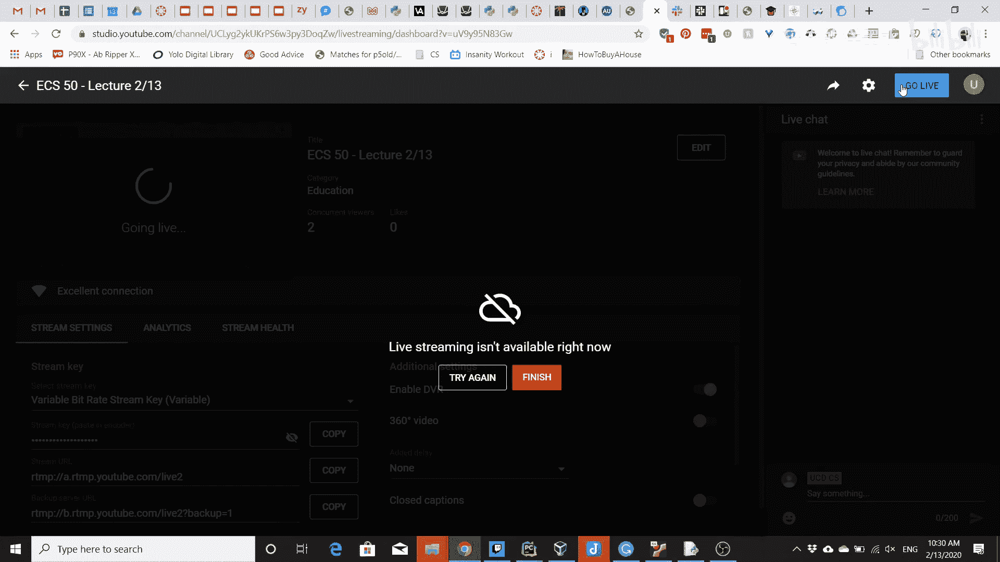
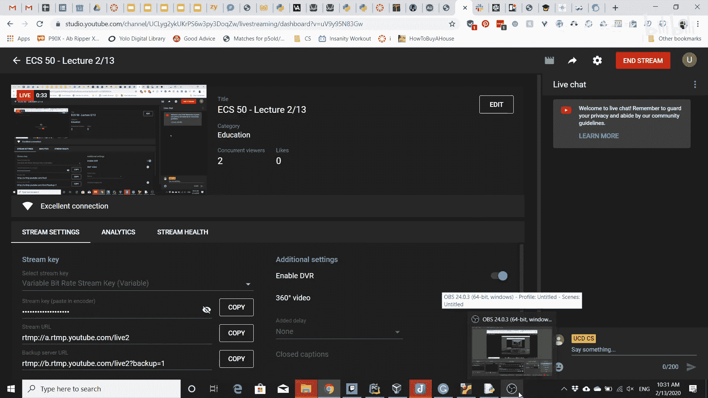
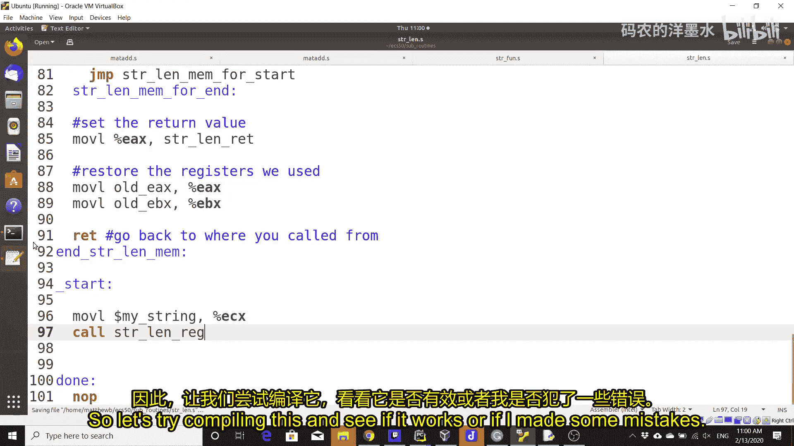
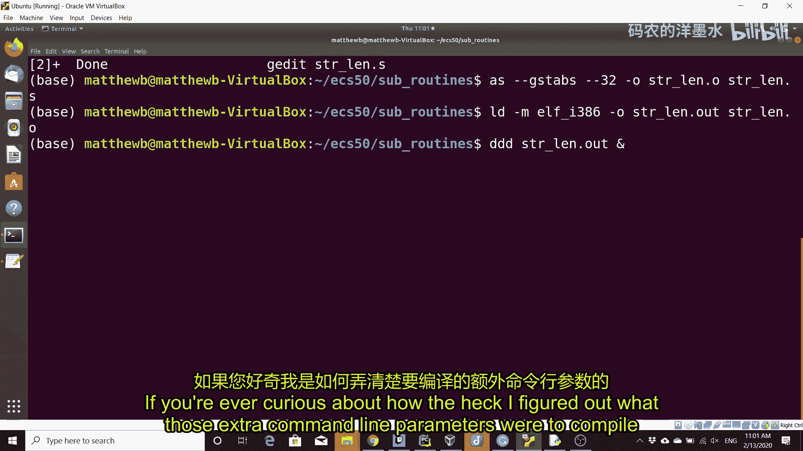
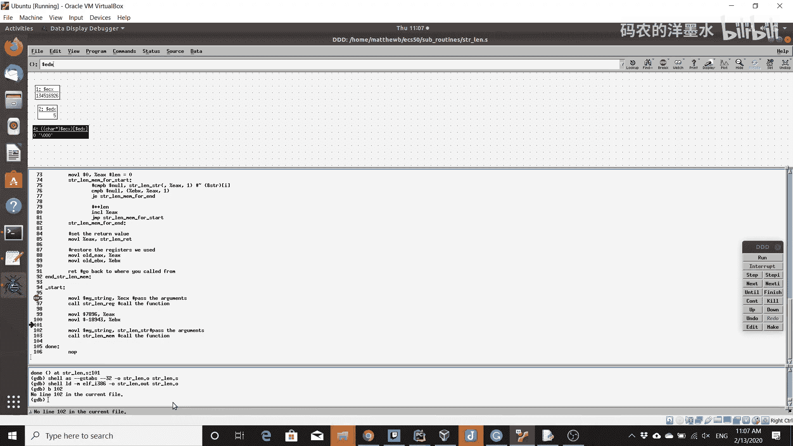
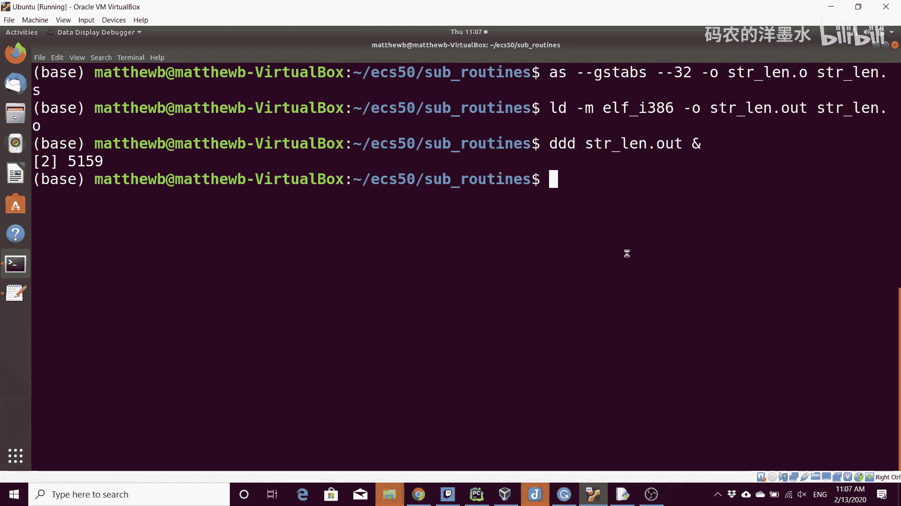
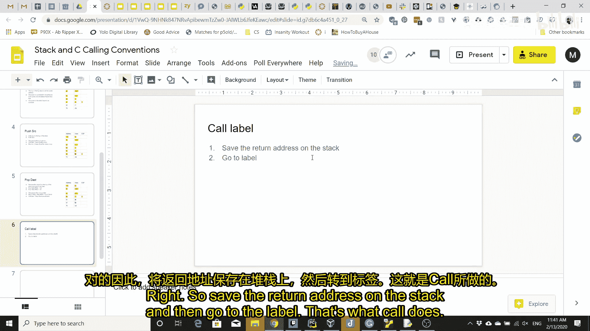
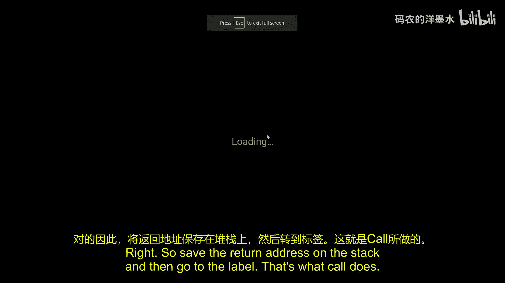
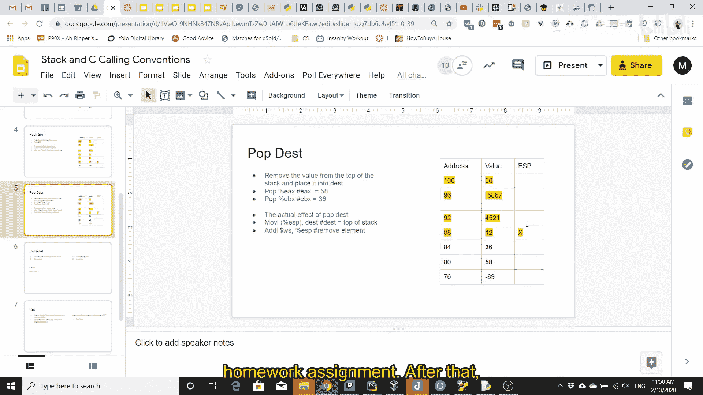
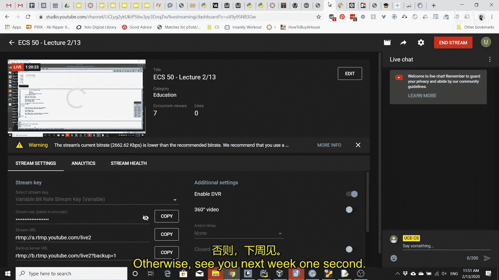

# C语言与汇编语言：11：字符串、函数与栈入门





在本节课中，我们将要学习如何将计算字符串长度的C语言函数翻译成汇编语言子程序，并探讨如何通过寄存器和内存传递参数与返回值。同时，我们将初步了解栈（Stack）这一关键数据结构在汇编语言中的工作原理，包括其基本操作和指令。

## 子程序参数传递与寄存器保存

上一节我们介绍了子程序的基本概念。本节中我们来看看在编写子程序时需要考虑的三个核心问题。

1.  如何向子程序传递值？
2.  如何从子程序返回值？
3.  谁负责保存子程序内部使用的寄存器？

对于前两个问题，我们可以选择通过**寄存器**或**内存**来传递参数和返回值。关键在于，调用者必须知道如何正确使用你的函数。

对于第三个问题，有两种选择：调用者（caller）保存，或被调用者（callee）保存。通常，我们倾向于让被调用者负责保存它将要使用的寄存器。这意味着，在子程序开始执行时，先将这些寄存器的旧值保存到内存中，在使用完寄存器后，再恢复其旧值。这样对于调用者来说，这些寄存器的值就像从未被改变过一样。

## 字符串长度计算：寄存器传参版本

现在，我们来看一个具体的例子：将计算字符串长度的C语言函数翻译成汇编子程序。首先，我们实现通过寄存器传递参数的版本。

以下是该子程序的核心C代码逻辑：
```c
int l = 0;
for (; str[l] != '\0'; l++);
return l;
```
在汇编实现中，我们约定字符串指针通过`ECX`寄存器传入，长度结果通过`EDX`寄存器返回。

以下是实现该逻辑的汇编代码步骤：
1.  初始化长度计数器`L`为0：`movl $0, %edx`
2.  设置循环开始标签，例如`strlen_reg_for_start`。
3.  在循环中，比较当前字符与空字符（`\0`，值为0）：`cmpb (%ecx, %edx, 1), $0`
4.  如果相等（即遇到字符串结尾），则跳转到循环结束标签，例如`strlen_reg_for_end`：`je strlen_reg_for_end`
5.  如果不相等，则增加长度计数器：`incl %edx`
6.  跳转回循环开始标签，继续下一轮迭代：`jmp strlen_reg_for_start`
7.  在循环结束标签后，使用`ret`指令返回。注意，`ret`本身不返回值，它只是跳转回调用处。返回值已经存放在约定的`EDX`寄存器中。





## 字符串长度计算：内存传参版本

接下来，我们看看如何修改上述子程序，使其通过内存位置来传递参数和接收返回值。





在这个版本中，调用者需要先将字符串地址存入一个特定的内存标签（例如`str_len_str`），然后调用子程序。子程序计算出的长度需要存回另一个特定的内存标签（例如`str_len_ret`）。

虽然参数和返回值的位置变了，但核心计算逻辑不变。我们仍然需要在子程序内部使用寄存器进行计算。关键在于，我们需要在子程序开始时，将我们要使用的寄存器（例如`EAX`用于长度`L`，`EBX`用于字符串指针）的旧值保存到内存中，然后在返回前，先将结果存入`str_len_ret`，再恢复那些寄存器的旧值。

以下是需要注意的步骤：
*   不能直接用内存标签进行索引访问（如`str_len_str(%edx, 1)`），因为偏移量必须是常量。必须先将指针加载到寄存器中。
*   应尽量减少对内存的直接访问，因为访问寄存器比访问内存快得多。通常的策略是：从内存加载数据到寄存器，在寄存器中完成计算，最后将结果存回内存。

## 栈（Stack）的基本概念

为了支持更复杂的函数特性（如递归），我们需要引入栈的概念。栈是一种“后进先出”（LIFO）的数据结构。

栈支持两个基本操作：
*   **压栈（Push）**：将元素添加到栈顶。
*   **出栈（Pop）**：移除并返回栈顶的元素。

在Intel汇编中，栈由栈指针寄存器`ESP`管理。`ESP`始终指向栈的**顶部**。需要注意的是，Intel架构中的栈是**向低地址方向增长**的。这意味着栈顶的地址是最低的。

所有对栈的访问（如压栈、出栈）都必须是**字长**（word-sized）的。在32位系统中，就是4字节。

## 栈操作指令与函数调用

汇编语言提供了与栈操作相关的指令。

`push source`指令将源操作数压入栈顶。其等效操作可以分解为：
1.  扩展栈空间：`subl $4, %esp` （`ESP`减小4）
2.  存入数据：`movl source, (%esp)`

`pop dest`指令将栈顶元素弹出并存入目标位置。其等效操作可以分解为：
1.  取出数据：`movl (%esp), dest`
2.  收缩栈空间：`addl $4, %esp` （`ESP`增加4）





函数调用指令`call label`与跳转指令`jmp label`的关键区别在于，`call`会保存返回地址。它实际上执行两个步骤：
1.  将下一条指令的地址（返回地址）压入栈中：`pushl $next_instruction`
2.  跳转到目标标签：`jmp label`

函数返回指令`ret`则与`call`配对使用。它执行的操作是：
1.  将栈顶的值（应该是之前保存的返回地址）弹出到指令指针`EIP`中：`popl %eip`
这会导致程序从调用后的下一条指令继续执行。

理解栈和返回地址的机制非常重要。如果栈上的返回地址被意外覆盖（例如，由于缓冲区溢出漏洞），`ret`指令将跳转到一个错误的地址，这可能导致程序崩溃或被恶意利用（例如，缓冲区溢出攻击）。

## 总结





本节课中我们一起学习了如何实现汇编语言子程序来模拟C语言函数，重点探讨了通过寄存器和内存传递参数与返回值的两种方式及其实现细节。我们还引入了栈这一核心概念，了解了其在内存中的生长方向，学习了`push`、`pop`、`call`、`ret`等关键指令的工作原理。理解这些内容是后续学习更复杂的函数调用约定和实现递归函数的基础。