# 【全集】加州大学戴维斯分校 C语言与汇编语言 中英字幕 1080P p12 Lecture 12 - GCC调用约定与栈 -BV1xefZBHEas_p12-

ItsOurs to be really busy today。If you're coming like they have been。

They don't expect that to change for the rest of the quarter， unfortunately。

So we are going to pick up from where we left off last week， right。

 we were talking about the stack right， what's the definition of the stack in Intel。

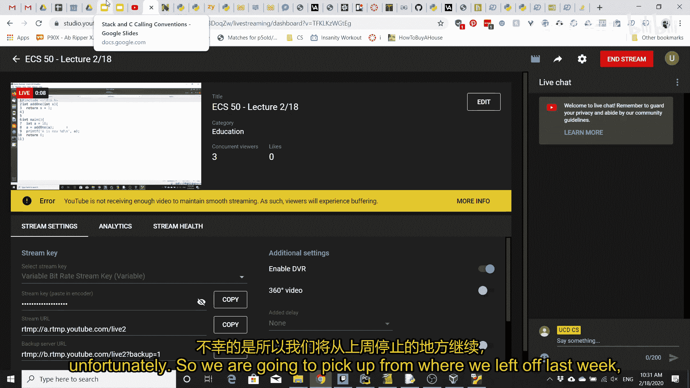

Forver what points do the stack pointer and。他家。Everything that addresses higher than it right that's the stack pointer we talked about the operations that you reform push pop call return that all involve the stack pointer and today we're going to get into the GCC calling conventions so the calling conventions have to do with a few main things。

Those are。How are。Arguments going to be passed。To functions。You probably change this to be。Not one。

How are unitss going to be passed through functions？嗯。

How are values going to be returned from functions？Octions。And who is responsible？

For saving registers。When a function is run。Those were all things that we started talking about last week right when we were writing our own suboutines。

 we had to figure out how we're going to get our arguments in。

 how we're going to get our return values back out。

And who should be responsible for saving some of the registers because there's only one set of registers for the entire computer to work on。

So how are arguments going be pass to functions will the GCC calling convention state that arguments。

Should。Passt on the stack。And they should be pushed。In reverse order of declaration。

So this means if we have some function like fun， ABC。Right， that we want to call。

What this is going to translate into。Is going to be push a， I mean， push C， then push。B， then push A。

 then call fun。So we're going to push the arguments in the reverse order declaration。 So C， B。

 then A， and then we'll call the function。Howower values can be returned from functions。Return value。

If there is one。Will be placed in EAX。And this is kind of why functions can only return one thing because there's only one EAX register that's why you're not allowed to return multiple things for a function。

And then who is responsible for saving registers when a function is run？The call is responsible。

I can spell it。For EAX。ECX and EDX。Cold function is。Responsible。For the rest。

Right so when you call a function， right， if you have anything in EAX， EX ReadDX。

 you have to make sure that you save those things first before you do the call。

 because the called function is going to assume that those registers are available to use and we'll just directly overwrite them because they assume that you save them。

Right。TheThe call function that is responsible for saving the other registers。

 if it decides to use them like EBX， ESI， EDI， EBP， etc。All so it's responsible for those ones。

Any questions about these rules so far？

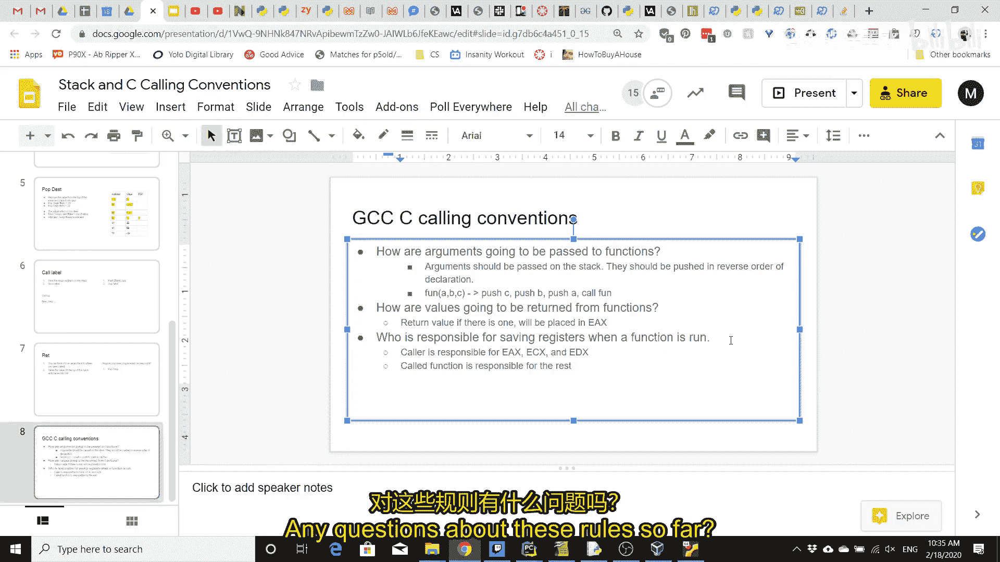

Yeah。

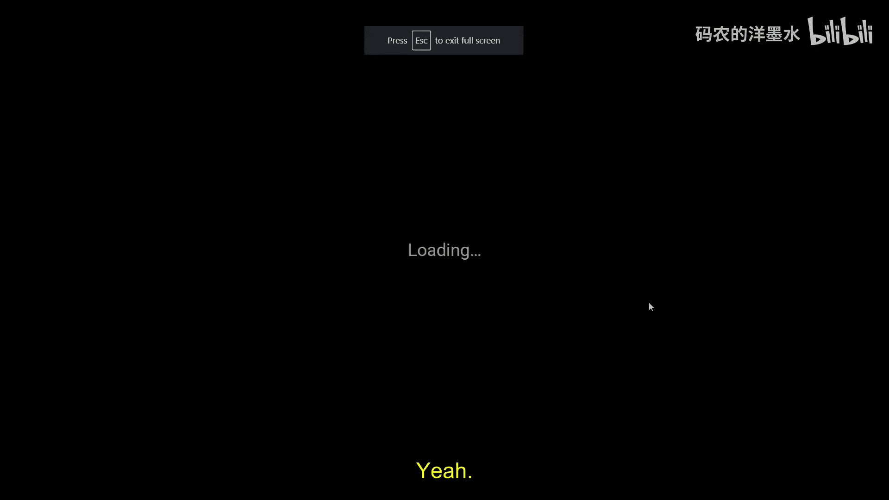

And we place it， Yeah， that cause like。So like these rules here are like setting off standards right just like in the US we decide that we want to drive on the right hand side of the road where have other countries like the UK decide they want to drive on the left hand side of the road right we just have to establish some conventions so that we can work together it's not necessarily that one method is better than the others just we got to pick one and if everybody follows those rules it's going to go a lot smoother than if everyone's doing their own thing right if some people are driving on the right hand side of the road and some people are driving the left hand side of the road it's going to be absolute chaos right we won't be able to work well together。

So these are the rules that we're going to define and we want to follow if we want to have our assembly code callable from C。

 or if we decide to invoke C code from assembly。We just have to know what the rules are。

 what are the conventions of the land？Any other questions？Yeah。😊，iss this like somewhere。Right。一。

It's under like a lecture， under assembly。Any other questions？Yeah。

 do you have to pop them on stack after you order the function？So you since you did not。

The called function or the caller， the function that it's doing the calling。

 it's responsible for removing the arguments once it's done， right。

 You can't even like remove the arguments。 It's going to be impossible for you as the called function。

 You just can't do that。Right， but like one analogy that I kind of give here is about using those other registers like EBX ESI EDI right is like you want to throw a party but when your parents are going away for the weekend but they're like no you can't throw a party right so what you do is you take pictures of what the rooms in your house look like to save them right so we need to make sure that we save our registers first。

and then once we save our registers we can hold our wild party right and then before our parents get back before we return。

 we can restore those rooms， right， restore the values in the registers to be what they were before and when our parents get back it looked like nothing ever happened。

Right but the other registers like EAX， EX and EDX we can kind of treat those as being like really messy rooms right and so if they're messy when your parents left right they're messy when they get back they won't notice right even if the mess is a little bit different than what's in there now your parents will fix those when they get back if they have to。

Why do you think that like since we remember like there are six main registerers， ACD， EBX， ESI， EDI？

Why do you think the caller is responsible for saving half and the collie is responsible for saving half？

if they wanted to use all of them。Yeah。Why not just always have the callers。

 save all of them or always have the colleague save all of them？Yeah。😊，If you say that。

How should I freeze it up。Music。One potential downside right of having the caller save all of the registers would be that the called function may not use all of them right and if the called function doesn't use all of them。

 you did extra work that you didn't have to do right I'm not quite sure why they didn't have the col save all of them though because if it was a colleague doing something it could you know always save all of those things and be fine though technically the one that it wouldn't be able to ever save would be EAX right because EX is the return value would totally always have to be the caller's responsibility for saving that because if I were supposed to return something in EX I got to put something in EAX right it's always gonna overwrite it。

🤧Yeah。Any questions before we keep going？

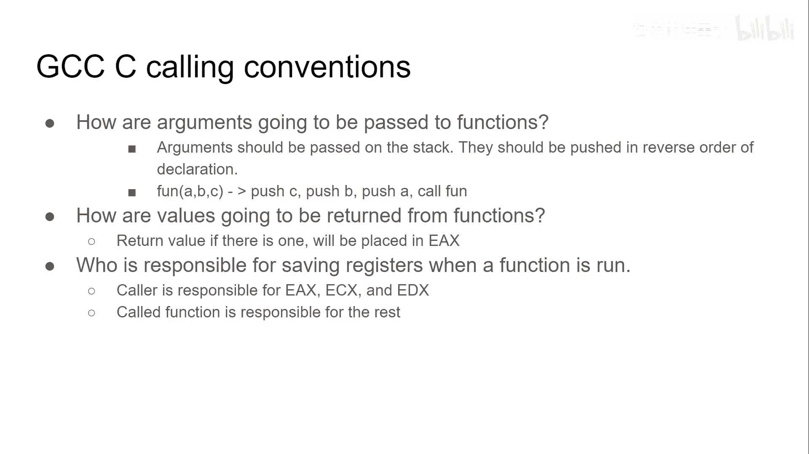

O。😊，So let's see some examples。

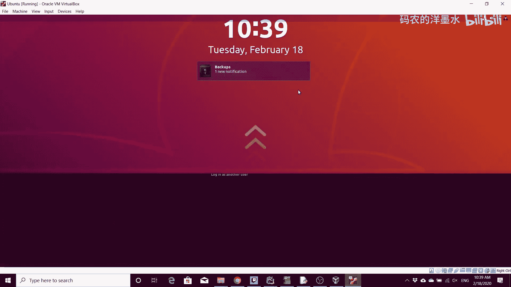

So over here right we have a nice little simple main function right all it does is it calls our one function add1。

 which returns x plus1。

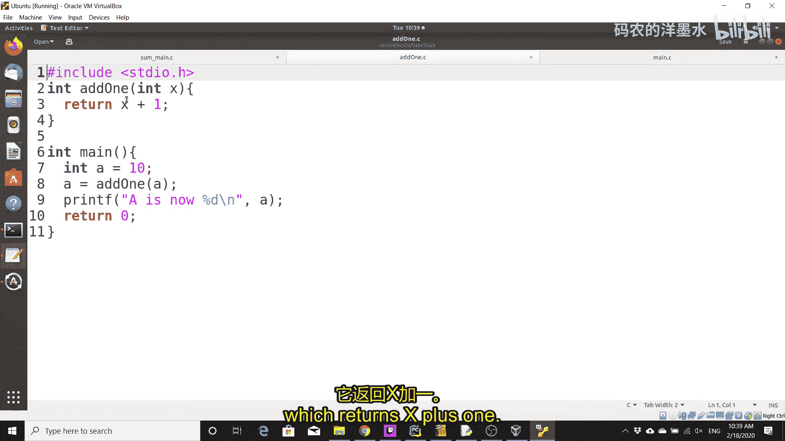

Now， when you can compile your code， you can throw an extra flag called dashash S。

And what that tells the compiler to do is to give you the assembly code for that file。

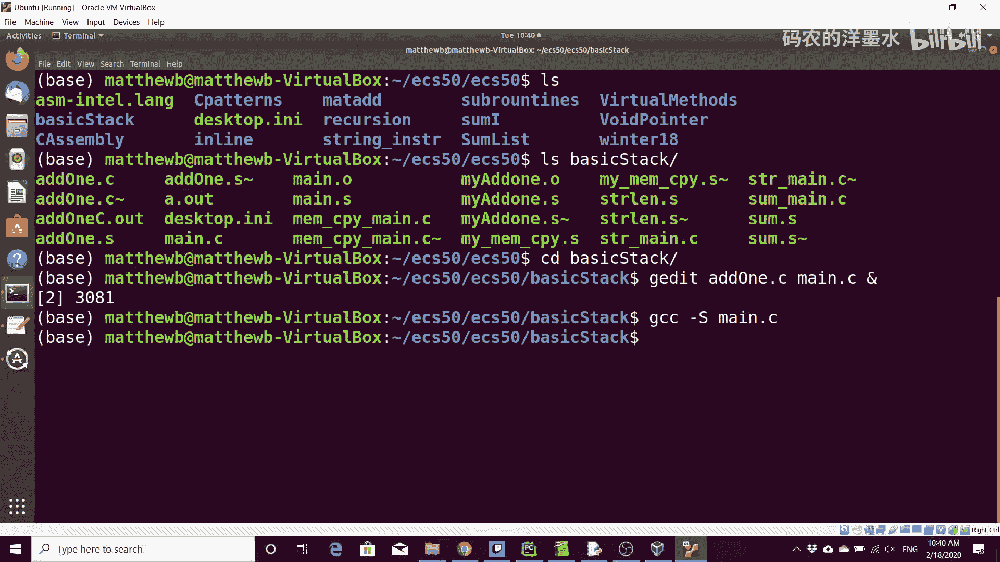

All， so Jeit main dot S。And this will be the assembly code that the compiler wrote。Right。

 because if you think about what the compiler's job is。

 it's to get your source code into code that the computer can run and while the computer cannot directly run assembly code。

 right the assembly code has to be translated into an executable first。U。

Having it translate into this is gonna be a little bit easier for the compiler。

 and then you can just run your other functions that you know work like AsS and LD on top of this Now don't be like。

 oh man， my homework's really easy now just do this the whole time It's super obvious when you do this if you try to submit it for your answers and we do watch for this So don't try to turn this in as your homework solution because we'll know I'm meant to send you SJA and that really blows。

😊，Right， yeah， can we can use this to get ideas for our homework or see the general like scope of that stuff or is that also？

I mean， I still wouldn't because once you see the answer。

 how are you going to figure out how to do anything else right。

 the other thing is is a machine wrote this and so it's going to look terrible to read and be really confusing and do other instructions we never even talked about So it's gonna to make it like a lot harder to do the translation。

Right。So one thing to notice， right， when it's doing a function call。The function has a label。

 it's mean。And the name of the function is the of the label of the name of the function。

hich is Y and C functions have to have unique names。

Because their names get translated into their labels。Now if we look down over here。

For the next occurrence。Where are you。I'm looking for the wrong thing。But that's main。

 I wanted to look for add one。So here's us calling the function and we call the function。

 we just call。But we said our arguments， they have to be what placed on the stack。

Right before the call。So if we look over here back to main。c， we know that a is 10。

And so we look over here， oh look， here's the constant 10。This must be where A is at， right？

This must be the variable A。We move negative4 into EAX， move EAX into EDI。

 so it's doing some weird things。嗯。Do maybe I have to hold on one second。

This is compiling for 64 bit mode。Do you want to compile for 32 bit mode？Add dash M。32。So。

There we go。Wait， I know you did call add one。 Where did you go。There's Ma， blah， blah， blah， push。

 push， push， call， blah， blah， blah。Call print F。 call add one。Why is the that one up there。Oh。

 compiled the wrong one。Id1 do sees the one I want to compile， my bad。Yeah。Oh， come on。Here we go。

 so here you can see here's our function right， add one。

And then if we go back to where we called it from right here。

You can see that here's where we're putting the value 10 onto the stack and again。

 we'll go over this a little bit。Actually， right here。 So this is a。Right here。

And what did we put onto the stack right before we called it？Put a onto this stack before the call。

So here was a。We put a onto the stack right， we pushed the argument negative 12 past EVP again we'll talk about that type of writing in a little bit。

 but that's a right there， and then we call the function。This line right here。

 as was asked about earlier， remove a from the stack。After the call is complete。

And if we go over to where add1 is at。It's doing some stuff right now。

 like this line right here is part of the prologue， which we'll talk about in a minute。

This part is the prologue， which again we'll talk about in a minute。

 so we push some more stuff on the stack。Again， some more weird。Specific things。

 but here we're going to put。A into EAX。We're taking it off the snack。Do the add one。

This guy right here is going to be the epilogue， which again we'll talk about in a minute。

 and then we return back to where we were called from。So if we follow these conventions。

 we can make it where we can write our own assembly code that behaves in the exact same way where it can be called from the C code as long as we keep obeying the rules。

But any questions before we jump over to like a more human readable version that wasn't produced by the compiler？

Yeah。😊，超。So here's the thing right， there never， ever was anything besides assembly code。Right。

 just like everything's always been in binary， even your numbers 10 and 15， theirre own binary。

 everything essentially becomes assembly code at the end of the day because it's the only language the computer actually knows how to run and it can't run directly assembly it understands the machine code。

 but there's a one to one correspondence before every assembly instruction to a machine instruction right we just don't have to keep writing like the binary for ad as 01110。

 we can just write a instead， But as you guys have seen with your homework when you write a single one of C code that might become multiple lines of assembly in your translation。

Right so here we're just understanding how the compiler produces C code so if we want to integrate our purely written assembly code into some C program。

 we can do so like because ideally you know you write assembly code as little as possible because it sucks writing assembly code and takes forever generally like the only times you're gonna to be writing assembly code are there's some special instructions in the chip architecture that the C compiler won't normally use so you have to write assembly code right you might try to be getting really really highly optimized code and you think you can do a better job optimizing the compiler。

There are also some times where you do need like direct access to the registers and in that like。

 for example， like when you're doing stuff with operating systems。

 there's a couple occasions where you need direct access to what's actually there and so again you'd have to write assembly code but our ideas should be to minimize the amount of assembly code that we have to write and only do it when we have to。

Right， so that's how we're talking about how to integrate things together。 two questions。 First。

 how I don't know if this we also go this class， but how does the computer get the op codes to be into binary。

How does it get the op codes into binary。 So how does like translate like add one like add L to binary So the asmbler knows what the appropriate binary is it's。

 it's a1 to1 translation。 So there is a specific translation for like add to like 1，1，0，1， whatever。

 right， And so every time you see now， add when you're going to the file。

 the computer is gonna be like， okay， add as when translate to the appropriate binary As for like how to write the binary。

 right， you can just put it like into a byte like， you know， set the bits to 0，1，0，1，0。

 like you want to or， you know， just write it in hex because you're lazy and then just write that to a file。

😊，Alsosome。Anything else？

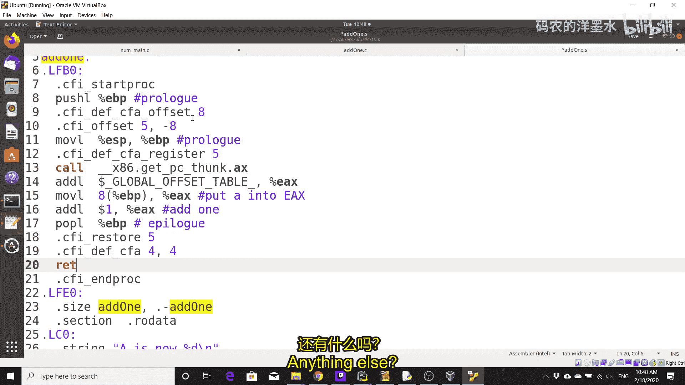

。This is like chapterer6 in the book if you're reading along at home， so here's another example。

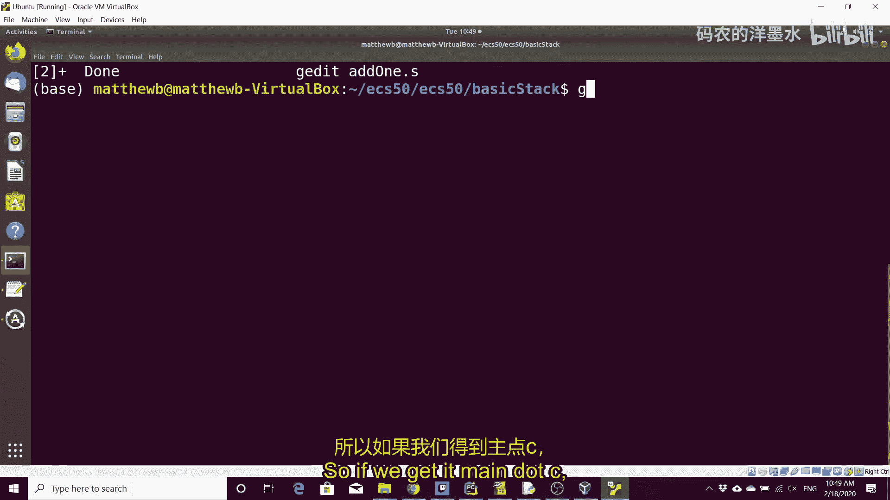

If we jet at main dot C。So here's main， which is exactly the same main as before。

 except my add one is going to be written in assembly。

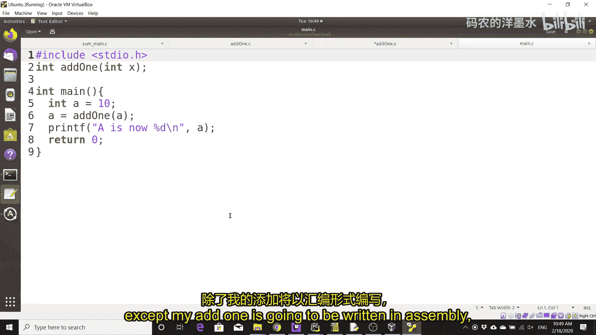

so there's the a function add one over here。特。My add one do S。

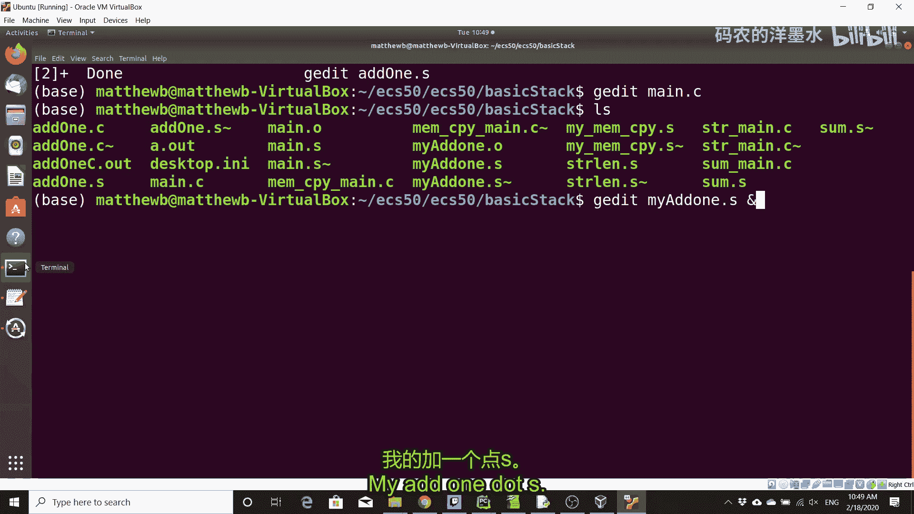

So here's my assembly code。That essentially does the same thing。

 but it's written by a human being has comments much easier to understand。So again。

 the dot Global Directive makes this symbol visible outside this file。

 so since we want to use the function add one outside of this file。

 we want to use it back over here in Maine。I have to make add one global。Does that make sense？

So again， if you want the symbol to be used outside the file make it global。

 it needs to be used in Maine， therefore add one must be global right we have our word size and then we just have our text section so over here is add one right and so that we know that when we're called what's going to happen is the arguments are going to be pushed onto the stack right？

So right before we were run right， they did call right our function right， call add one。

 So the very topmost thing on the stack， which if we update this probably。

The very topmost thing in the stack when we run this is the return address。Agreed。

Because we talked about what call does， do you guys remember what call does when we say call label？

Where does it save the return address， it saves it onmni snack right so since we just did call our function name。

 the very topmost thing on the stack must be the return address because that's what got saved from the call instruction right but we also know our arguments have to be passed on the stack。

So above the stack， right， we have ESP plus4， remember everything is a word size on the stack。

 and this is going to be a。So four bytes past ESP is going to be a， right， or one element。

We will have the A on the stock because right before the compiler called us， right， it pushed in。

So a has to be on the stack again， we're following the conventions。

So the first thing is the prologue and I'll give you guys a breakdown in a second。

But the prologue over here， what this guy does right here is he establishes the local stock frame。

Like these two lines right here。They establish。Space for the global stack frame。

And then we'll make space for locals， which again， we'll talk about that in a minute。

 but after we do this notice that we just did a push right so here we have ESP。

ESP would now be pointing to our old EBP， and then at ESP。Plus，4， we would have。Our return address。

And now at ESP plus8。We're going to have a。But notice on this line after we did the push。

 we made ESP be equal to EBP right we copied the value over here。

 so ESP and EBP are both going to be pointing。To the same locations。

So you're going to see me using EBP a lot。We don't have any space for locals。

 so one trick that I do to help make my programming life easier is I make EQs to help me remember where the variables are going to be at。

 where my local variables are going to be at， and where my parameters are going to be at my arguments。

Right， so A， right， it's going to be two words past EBP。And hey， look， two words past EP is。A。

 if you believe my drawing。Right as to what got pushed on to the stack。

One of the whole points of doing the prologue is， like it says there to establish the local stock frame。

What the local stock frame does is it gives you a constant offset to both your parameters and your arguments。

Throughout the duration of our function， ESP is likely going to be changing as we call other functions。

 add more arguments to the stack or remove vocals from the stack right we'll be taking those off so ESP is going to be constantly fluctuating throughout the entire runtime error function。

This can be really annoying to work with because you now have to deal with every time you've added more stuff onto the stack well where are new where are my local variables and where are my arguments going to be at right at the beginning we might have had it where a was four bytes past ESP right after we did the prologue it's now eight bytes past the ESP if we go call some other function and that might end up being 12 bytes past ESP or if I make space for three more locals it's not going to be like 12 more bytes past ESP and again having to constantly update that as a programmer and keep track in my mind where the heck these things are at is a lot of extra brain work and I totally did that the first time I took this class。

And it's doable， but it's a lot of extra work。 And you have to write a ton more comments to keep track of where things are at。

Whereas after you do the prologue EBP will give you a constant offset to where your local variables and where your arguments are at first to local variable。

 which you say your first argument is always going to be two bytes past EBP the next one would be three then four then five then six all of these would be words past EBP so that's why I'm able to do this little label right here of saying a is two words past EBP and again you'll see me doing this later on in the future。

So over here I need to get a right， so I move A past EDP， but remember A it's an EQU。

 what's A's actual value？Okay。It's just eight right， a is8， There is no difference from a and8。

 but it can be really tempting to do this。Right。And it's technically legal right because it's a constant right and you're going to put a constant in the displacement field。

That totally works， and you'll get some nice se faults as soon as you try to run this line。

So make sure that when you're using your EQs for your locals， they're always in terms of percent EBP。

 percent EBP， percent EBP， otherwise life will be bad。

Then we add one to EAX and then we do our epilogue。

 the whole point of the epilogue is to undo what the prologue did。

 so we move EBP back into ESP and we pop EBP， then we can return。Any questions here。

 besides they prologue that log， which we're definitely about to talk about。A lot more。Yeah。😊，How。

Fine with when。I bring the line key。How do you poorly align？去。

How do I correlate a line to a memory address？How is it saved on the stack？喂。

I didn't know where that went。So how does it know where the next line of memory is at？

Or where the next instructionss at for the return address。

 so the way that this works is remember that there's a register called EIP and it holds the address of the current instruction。

Right so if you know the address of your current instruction， which is call at this point in time。

 if you know how big the call instruction is。The return address has to be at your current address plus your size。

RightThat'll be the start of the next instruction， so you just add whatever EIP plus your current size is。

To EIP and push that onto the stack。First place is kind。你关し。Oh。

 like where does the program actually start out from？我他次。Firstly get placed。

So we will talk about that later， but the operating system。

 it's the job of taking the program from the file system and putting into memory and so what the operating system will do is it'll find a place in memory big enough to fit the program。

 copy it there， and then when it's about to start the program。

 it'll set EIP equal to the address of the first instruction。

 whatever that happens to be where it copied that and you pick up from there there's more complexity that goes on besides just that if that's the basic gist of what happens。

Any questions so far， other questions？

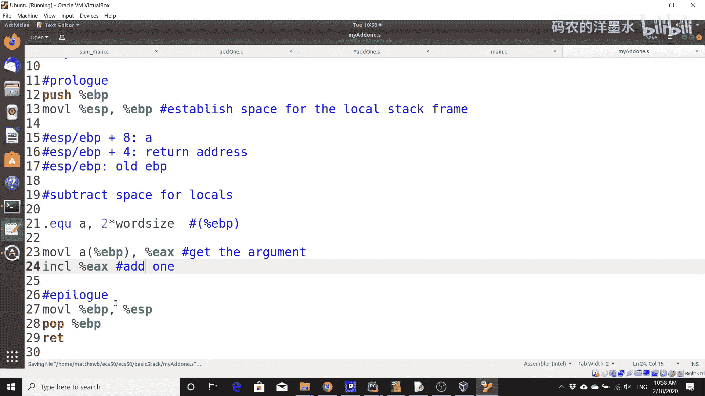

So now let's say I want to compile my program together。 Well， it's just GCC dash G dash M。32。

 and then my add one。t S and Ma。c。Yay， it got next to eatable。 It's going to be named A do out。

And if I run， a on out。A is now 11。President， you know I3 is 10。

 and of course we can DDD our executable because we can power the dash G。

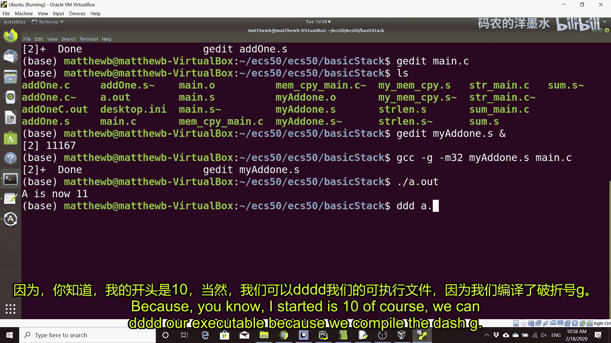

And so what I can do is I can say maybe let's set a breakpoint on line six。

And then we go ahead and we run it。And now we're here and we step into our function and hey， look。

 I'm in my assembly code。But remember， it was all the code anyway， right？

It's just how you want to think about it， right， And we grab our arguments， if we look at。

P dollar sign， EAX。It has the value 11， right， which is 10 plus one。 And now when we return。

 we go back to the C code。Right， clockque over here。

And let's talk about the prologue and doing the prologue。Again， it's optional。

 you're free to do whatever the heck you feel like。

 but if you want to make your assembly coding for like the next homework assignment a lot easier。

 do the prologue， trust me， it makes it so much simpler to work with if you do this。

But what's the point of the prologue？Well the point of the prologue is to establish the stack frame。

I don't know where that's coming from。I'm muted， so it's not me。😡，不是这样子。

So establish the stack frame for the current function。Right。What the stack frame does。

Is the stack frame。Gives you a。Fixed。Location for accessing。Locals and arguments， right。EP。

Keeps changing。Jinging。Throughout the run time of your function。

So it makes it really hard to keep accessing。Locals。And as。Through it because it keeps changing。

 right？Having this variable offset is going to be much harder to figure out where your arguments are going to be at because it keeps changing right right now a might be8 bytes past ESP a little bit later on in the program it might be 15 bytes or 16 bytes past ESP later on it might be 20 then it might go back to being4 so can you do it through ESP yes。

But you know have to deal with this constantly shifting thing， which makes your life much。

 much harder to do。Yeah。So let's talk about how to do the prologue。So step number one。

Is to save the old stack frame。Stack frames are tracked。By EBP。

 so do use EVP instead of using it as a general purpose register。

 use it as the stack frame base pointer， BPP base pointer。So you saved the old stack frame。

Which we'll show about in the next one。 step two is to establish。The new stack frame。

Step 3 is to make space for locals。And step 4 is to save any other registers aside from EAX。ECx。

And EDX you found using。Notice it goes ACD， not ABC。It's a little bit weird。

 but that's what they decide to do。 I don't know why。But it's ACD。

So those are the things that we have to do to make happen。

So if we go and I split this into two things， step number one over here is save the old stack frame right and stack frames are tracked by EBP。

 so how can I save the old stack frame？Where should I save it at？

What are my options as to where I could save it？嗯。You could save it in memory， right， either。

On the stack or in global memory， or we can place it into a register。Of those three choices。

 global memory， stack memory， or a register， which one probably is going to make the most sense。嗯。

Probably not registers right because we have such a small number of them right we also have to be able to deal with in the future recursive functions too。

hi we couldn't handle before。So the best place to save it is going to be on stack。

 so how can I save EDP on stack？Push， push what。Just push EVP right。

 if you want to save it on the stack， you push it。So you push ABP。

The next step is to establish the new stack frame， so we need to make our stack frame point to the beginning of our stack or our stack frame pointer BP point to the beginning of our stack。

 which will just be MoL percent ESP to percent EBP this will establish the new stack frame。

 we'll set it to the beginning of where we want。Now we need to make space for the locals。

I guess I should have also mentioned。That the。It's not the stack， stack frame。The stack frame。

Is everything between EBP and ESP。So we have done step two now we need to make space for the locals。

 how can I make space for my local variables？First question， where is space for local variables made？

Yeah。Space for local variables is made on。The stack， right？So how can I make space on the stack？Yeah。

 you need to move ESP down right， so how can you move ESP down。

 let's say I have you know N local variable or N local variables。

Assuming that they are all board size， how can I make space for end locals and the staff。

How can I move ESP down？Yeah， you move down n times word size and now you know how much to move it down now how do we move it down？

I mean you have all the right answers so far。Well， we don't want to push， push， push， push， push。

 push， push， right？Yes， subtract。Because if we subtract from ESP， it'll move it down。

makes it smaller。So here we'll do subow dollar sign， nu locals， whatever that happens to be。

Times word size。From percent ESP， that'll make space for your local variables。Step number 4。

That's to save any other registers aside from EA X， E X and E D X you plan on using。

How can you make space for them？Where should you make space for them？Again， where are your options。

 Where could you make space for these variables。probablyably want to make space for them on the stack right because everything we've been working with has been dealing with the snack right so we should contact Ss it's always going to be the stack here for everything we're making space right now how can I make space for them and save those values。

😊，Onto the stack。Yeah， we push them right， you I know， push。Those registers。

So if we needed to save something like EBX and EDI， push EBX， push EDI。Right。Simple as that。

Any questions about the prologue before we move on to the epilogue。Again。

 we'll see this play out in a minute。So the point of the epilogue is that it。And does the prologue。

ques up after it。So here's what we have to do。Step number one。Restore saved Regs。Step number two。

Re the locals。Step number three。Restore the stack frame。

Because if you look back here as to like what we did in the first place。

The first step was we saved the old stack frame right， established a new one。

 made space for the locals and then saved the other registers。

 notice the epilogue it does it in reverse， restore the save registers。Remove the locals。

 restore the old stack frame， right， it's backwards。One， two， three， right four here。Going backwards。

 321 in terms of what happened。So how can I restore my Sa registers？Yeah， pop， we can like pop。

The oops。There should be numbers， pop them off the stack。Or move them off the stack。

 I'll show you both ways。 essentially the same。 Step number two is we need to remove the locals。

 So here's a really cool trick that you can do。 This is just move out。😊，Percent E， BP，2% ESP。

Because remember， EVP， where does it currently points to。

 it points to the beginning of our stack frame。Right。

 and the stack frame is everything between ESP and EBP。 So we want to remove all the space。

 Here's EBP。 Here's ESP。 take ESP and put it back up here。 Now there's nothing left。

Right we could add the same amount that we subtracted， but we could be lazy just say hey， right。

 here's the beginning of my stack frame， make ESP point back to the beginning of the stack frame。

Does it equal to each other？And then restore the old stack frame。 Well。

 previously we had to push it onto the stack， so now we have to take it off， so we'll pop。Tend EBP。

 pop it off the top of the stack because currently ESP is pointing to both EBP。Any questions？

Before we do an example。Or two。Yeah。好是。So the question is， how is this different from last week？

In terms of the functions you were writing， your functions probably weren't obeying those three rules that we talked about earlier right so even though they were functions。

 the C compiler wouldn't call them correctly and you wouldn't be able to call C functions correctly。

And that's about it， it's just knowing how to work together。Anything else？

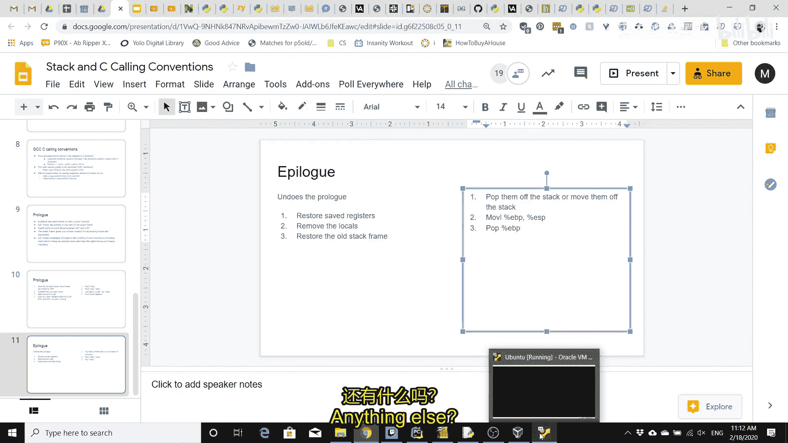

So let's say we wanted to write string length again， right， we wrote it before。

 let's see we want to write it again， but we want to do it C style。

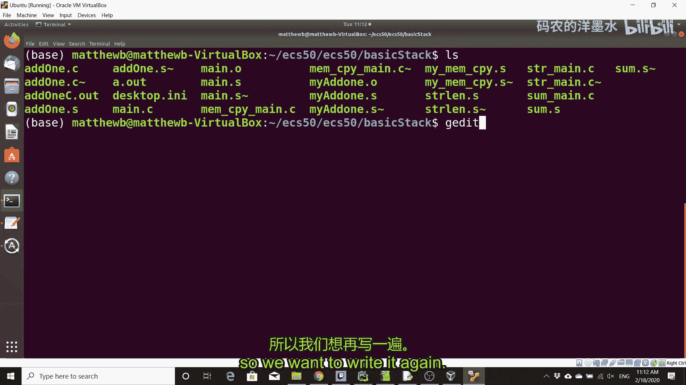

Make it look pretty。You。Highlight mode。Asmbler。And again， right， last time we already did this。对。

RightWe wrote this in C or we wrote the C code for this previously， which again。

 you should always do that as your first step。But again， remember。We have something like in Sterlin。

 con cha star string。And last time， right， we had something like inn。41 is equal to zero。

 char or stir。At Ly。Doesn't equal the nu character。Right， return oops or plus plus land。

We don't do anything in the body， and then we return one。So again， we want to do the translation。

 but we want to follow the rules of the assembly code right or the C calling conventions and so the very first thing that you're always going to have in every single one of these functions is that prologue right so again our prologue is first we need to save the old stack frame pointer push percent EBP。

Save old stack frame pointer。Then we need to establish our stack frame pointer。

 Mo percent ESP 2 percent EBP。Establish。The stack frame。Pointter。For。This function。

And we'll see later on if we have any local variables。And we might we might not。

 and again we might have other registers， but we kind of have to decide what we should be using them for。

Right what's really always useful for me personally is to kind of like print out what the stack looks like when you come into the function。

 so after we do these lines of code right the very topmost thing is going to be the old stack frame pointer。

This is where ESP and EBP are going to be at at the moment。Yeah，Where。How最 cause the。全都。

EBP is not where you called the subroutine from right The stack frame pointers are to keep track of like what's your part of the stack for this function。

Right but your code， the text section， is not on the stack。Does that make sense。嗯。外。

What was the old value that was in there？So like when you were called。So when you recalled， right。

 what was in EBP was the stack frame pointer for the function that called you。

So if Maine calls Stlin， right， EBP has Maines stack frame pointer in it。Right。

 but if Maine called Fo called Stirlin， at the point in time when we're running Stlin， right。

 EVP at the beginning， right before we know did line 18， it had F's stack frame pointer in it。Right。

So EBP， when you are first called before you establish your stack frame。

 it's going to have the stack frame of the stack frame pointer of the prior function that called you。

Right， or if we really want to think about it， it doesn't really matter what's in there， right。

 because if we want to use EBP， we have to save it because it's not one of A， C and D。Right。

 the caller saved those other three that had something that I cared about。

 but we're responsible for saving all the other ones。

 So if you want to use EBP where you got to save it regardless of what's in it。

Because we have to restore it back before we leave。

 right I got to make sure that we take a picture of what that room looks like so that we can set it back to what it looks like after we have our party。

 but before our parents get back。不。So we have the old stack screen pointer。

 what's going to be above that at plus four？Yeah。what。It's going to be the return address， right。

 because right before we did our push， what happened， Well， there was a call of our function。

Right and so when our function was called， the return address got saved onto the stack so at plus4 past ESPEBP right now。

 we would have our return address。What about it plus eight？What's there？Sir， right。

 it's our first argument。So then down here。I'm going to do dot EQU。Stir as。Two times word size。Past。

Percent， EP。So like one useful thing， if you do use the stack frame point like you know。

 the stack frames is your first argument is always going to be two words past DP。

 which will always be there and it will never be anywhere else。

 the second argument will be three words。The third argument， four words， the fourth argument。

 five words。And so on and so forth。So。We know that we are going to want to use L as probably what register。

When。What will be then？What register should we pick to be L？没。EX， Y EX。就是我看。

The return values in EAX right so it's going to simplify things if we decide to put things into EAX right。

 who do you want to be stir？Say what where register？So what would be a downside of picking ESI？

We could use it， but what would be a downside of using it right now？这会。那航分。Not quite。No， I mean。

 you can totally look at because we're going to be putting a stir into it stirs at pointer right so you're not going to have the issue of trying to access a small smaller portion of the register because we're going to be using the whole address the entire time。

Yeah。😊，不江测。不是。The downside would be we have to save it right。

 because we know the caller saved A C and D， so we should probably use A C and D up first before we use any of the other ones because otherwise we'll be doing extra work that we could have avoided doing。

So let's say ECX。Will be stir。So how can we do ECX is equal to STR？这。And amount of eight， right。

 which is equivalent to what label we have。8。二。Yeah， ABP， right。

 you're always going to want to access your locals and your arguments from EBP。

 you're not going to want to access them any other way。Right， but remember。

 we already made this nice EQU so that we don't have to keep remembering where the hexster is at。

 it's already the eight。So we can just say stir past percent EBP into ACX。

I do not have to think about it anymore once I got that label established。

which is one of the nice things about one using EBP and two using those EQUs the EQUs are not a necessity by find them to make life a lot easier when you're programming。

Yes， you are。ESP and EBP are not interchangeable at the moment they happen to be。

 but if we had had any local variables， no。Right or if we had started doing some function calls inside of this function。

 no， because ESP' is going to move down as you start putting more arguments onto the stackt to make that call。

So how can we then make？L equal to zero。嗯。Yep， that's line equals zero。

 right then we have our little for loop。So for start。And again， the labels all do need to be unique。

 I know the compilers not gonna be using these ones。

 but if I was using some other symbols with other people。

 we would probably have to make some rules about how we name things so that we don't have these name conflicts going on。

 There are some other things， tricks with the asmbler where the asmbler can create anonymous labels for you。

 But we're not gonna get into that because again， our goal is not to program in assembly。

So first step in our for loop。We've already done the L equals zero parts。So then how can。

 what do I need to do next？Not comp L， but comp。B， right， Remember their strengths。

RightWe you want to compare characters， we want to compare the characters。

 not four characters at once。RightOtherwise we're never probably going to finish the other thing is right if we think about this。

All， this guy right here is equivalent to。Minus the null character。Not equal to。0。

And then the negation。R B。Equals equals 0。So we want to do a comp B， again。

 the old character is just dollar sign zero， it has the numeric value0， now how can we get stir at L？

Percent ECX。Remember ECX， that's going to give you。Stir。看吗？YX， and then our scale should be。1， right。

 or not specified， right， That will do the comparison。 then jump if equal to the。For end。

And then we just have in percent EAX。Jump to for start right That wraps up the for loop。

And then down here， we need to have the epilogue。Right， this part up here was the。Prologue。

Now the epilogue， what we have to do， well， if we look back。We need to pop， to pop them。 P the saved。

Registers off the stack or move them off the stack。

 we didn't have any saved registers so we can skip that step for right now。

 and then we just need to do lines two and three。So move Val% EBP 2% ESP notice that that's just going to move ESP to point back to EBP again。

 nothing's really changing here， this example because we don't have any local variables。

 but you'll see examples in a little bit where we do have some locals。And then we do pop percent EBP。

 right， notice after we do the pop percent EBP， that's going to take the value of the old stack frame pointer and put it into EBP。

 And then it's going to move ESP back up here。 Why is it really important that ESP end up on this line right before we do the RE。

Why is it important that ESP be pointing to the return address before we do the RET？

Because that's like the next step。Because you want to go back to where you came from right， Remember。

 REt just says pop the value off the top of the stack and put it into EIP， right。

 So when we do the RE。 Wed better make sure that ESP is pointing at the return address。

 Otherwise some weird stuff's gonna happen in our code and it's not going to work。And， we're done。

 this is now a star lung function that's callable from C。Now quick question。

 is this La code right here？Is this line of code equivalent to comp V dollar sign zero？Stir。

Coma for EAX。Our line 36 and line 37 equivalent。Yes， they're the same。No， they're different。

For those of you that say， no， they are different， how are they different？Yeah。When7 this。T changing。

So以。Is ECX changing at all？No， it's not。So for those of you that say it's different。

 how is it different， what is this？What's the effect that you're getting instead？It's the same。

It's different。Okay， for those of you that say it's different。Tell me， how is it different， right？

 If I'm like， here's a red shirt and here's a blue shirt and I ask you are this Sam I'll say， no。

 one's red， one's blue。 right， gotta have some justification。

 If you're telling me that they are different， how are they different。

Because if you can't explain why they're different， right， we had some colorblind person in here。

 they might say they are indeed the same shirt。And they could not explain why they're different because they're not able to see the different shades。

You是其。Thank。Yeah， stir is just。8。Right， so this effect right here is the stir EAX is just。

Essentially， memory at 8。Plus， ECX。Right， whereas this line right here is memory。At stir plus。ECcX。

Which is much different。So don't do this no matter how much you're tempted to。Do not do this。

Even though I know some of you really want to。Now， what happens though， if instead of saying this？

I had said。This。Are they the same？Yes， they are the same。No， they are different。

Discuss amongst yourselves for a minute as to whether you either think they are the same or you think they are different。

 if you think they're different， tell the person sitting next to you why you think they're different。

What's the effect of doing those lines。嗯。Yeah。换的。这我你。Use。也1下。そうです。唔该点。Is what？Line 37。Yes。

 it's supposed to be plus EIS。Okay， they are the same。They are different。

For those of you that pick difference。Please explain to me why they are different。嗯。Yes。Okay， again。

 like the way to help figure out for yourselves where they are the same or they are different is to kind of just plug and chug into the equations as to what's going to happen right。

 If we think about this point in time right， ECX， if we think about its value。

 it's going to be8 plus EDP， right？That's ECX。So this guy right here is its memory right at eight plus。

E BX or EBP plus E X。Because this expression right here，8 plus EBP。

Would you agree that that's what's held in EX？Right， now let's see， right。

 so we're going to do I guess this is not actually true。This is Mem。At 8 plus EBP。Plus EAX。

 and then go to that final location of memory， right， access memory at this location，8 plus EBP。

 that's what's placed into EX， whereas if we do this。This is going to be memory at STR。

 which is8 plus EBP。Plus， EA X。Are those things the same？No， they're not。 right。

 This line of code is essentially equivalent to give me the address of stir。And then。At I。

RightBecause EBP plus8， that's where string lives at。That's where it's out on the stack。

So that's why 8 plus EVP is the address of stir and then add EAX to it。 That's I， right， L。

 and then de referenceence the entire quantity square brackets。嗯。So don't do this one either。

I know you're tempted。But it's going to be wrong。You get the code to follow through as to what each thing is doing to get an understanding of what you actually want to intend to happen and code。

When you actually got to put into the assembly。So don't do either of those two things。 no。

 no matter how tempting they are and how right they look， they're wrong。 right。

 This one has an extra D reference on it。Aessing the element here。Because of。Right。

That access memory right here to copy into ECX。And then this would be another memory access。But here。

 this would only be a single memory access。Which is what we want？

Those are just common mistakes they see all the time， and I don't want you to make them。

I'll probably see some of you in office hours that have still made them anyway。Because it happens。

Any other questions before we move on to some new examples？

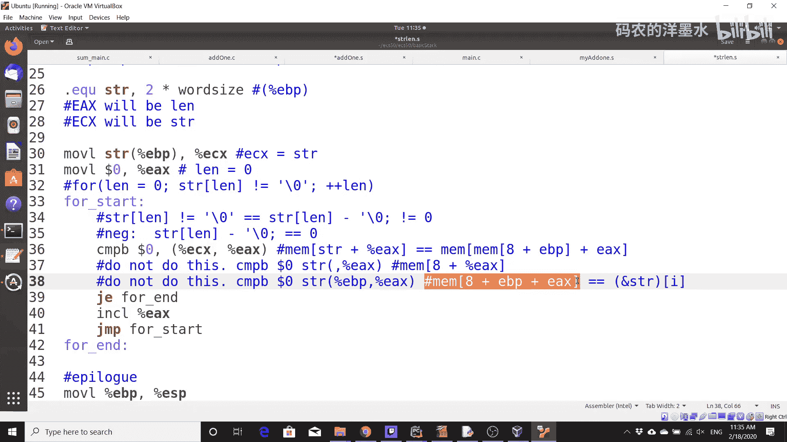

Do we want to see if it works？Jullt。

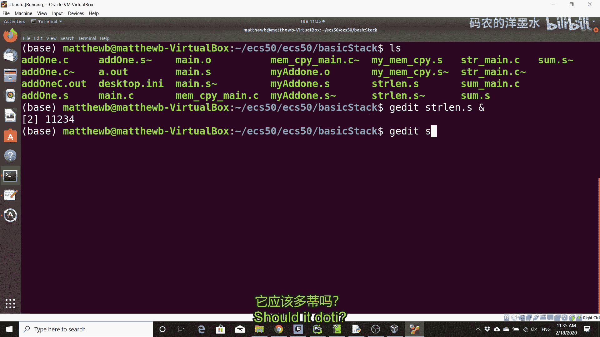

That see。So over here， we're going to take an argument on the command line and then find a string length。

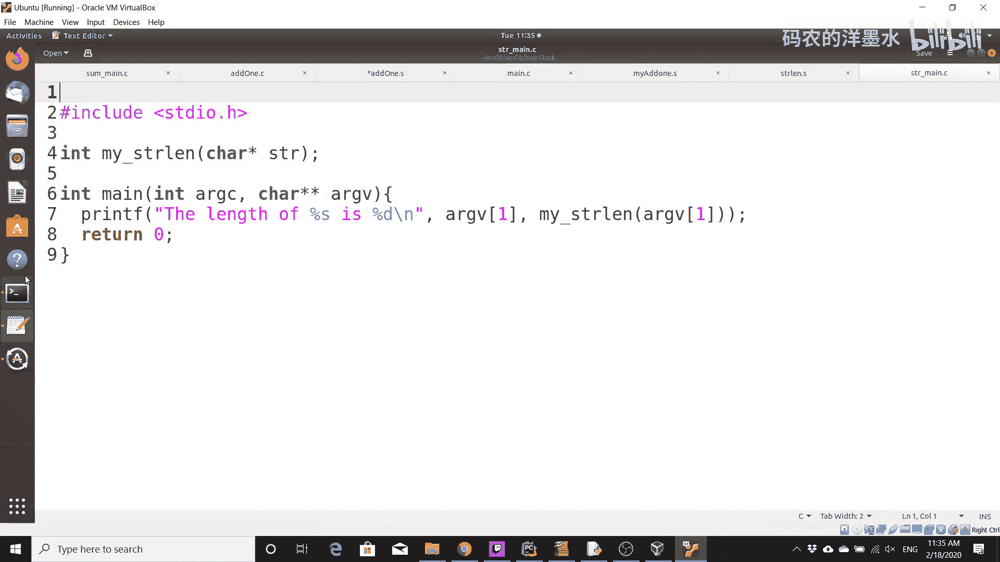

So we'll compile these functions together， Gcc dash G， M32， and then Stmaine do C。Ator Ly。Thatice。

And then if we run it。With say hello。The length of hell is five。😊，And it's very exciting。

And our code worked。Right。And that's not because we had four characters there。

Any questions before we use some more examples？Going once。Coin twice。Don't worry。

 we'll get into some recursion pretty soon。Because I know you guys love that。CdN Matt。没。See。

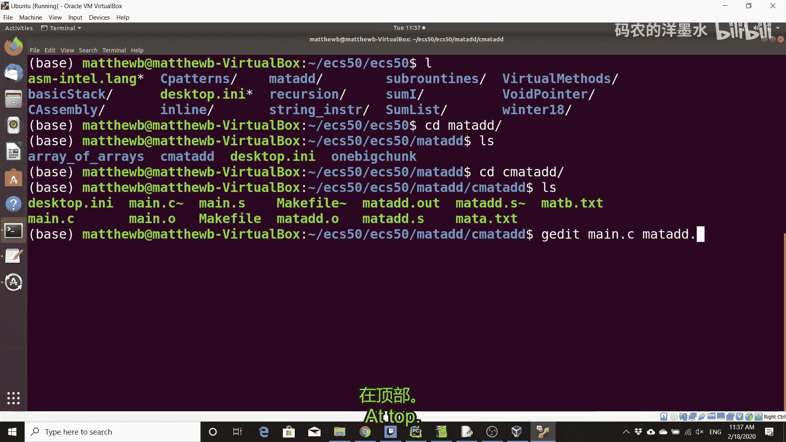

Let's close up all of these old ones。So here is our main function。

 We want to write a add function with this signature， right。

 which we have done once before in our lives。Right。Where we're going to take in two arrays。

 right to dynamically allocate array of arrays， number rows and nu columns。

 and then we're actually going to give back。Return the new array that we made right。

 whereas before we just modified the one that we were given。So what should our first step be？啊。

Step Numerono。What has Step Numerro Uno always been？没。Write the C code， right， or again。

 like step number zero should always be solve the problem， right？First step。

 solve the problem in English or whatever language you feel like doing， solve the problem， right？😡。

But here we've already solved the problem doing matrixization。

 everybody knows how to do it so we can skip ahead to implement it in C because once we get to implemented in C。

 then itll be easier to translate into assembly instead of jumping straight into the assembly we have to have a plan right。

 always make your plan。So we'll get rid of。The old answer。Yep， is that long？

Right so here's matrixtri edition， we've done it before right here we have I and J right here we have C we have to run Malik。

 that's going to be fun and we'll actually run Malik this time because we know how to call C code right calling C code is calling like any other assembly function。

 push the arguments， call a function you're done。😊，Right。We have the global mat at at the top。

 We have our EQ of word size， but everything over here is essentially the same。

 except we added two more lines of code， the Malik here and the Malik here。 Also。

 this fourth line right here， the third line is return C。Right？Any questions about the C code？Okay。

So as Haley mentioned earlier， step number two is to do the prologue。

So what's the prologue look like？Fushy B， right。Move out。Percent。ESP in 2% EBP， right？

Make space for the locals。 How many locals do we have here？What are four local variables？A， B。

 nu rows and them columns。 Those are arguments。 They're not local variables。I J， and。すま。

C right C is also local variable， so let's make space for them。

 even if we don't end up using the space later on it'll be it's not going to hurt us so much to do with subtraction。

 but if we find that we need that space， we'll be really glad that we made it so over here。

Subbo dollar sign， well， how many local variables do we have？

Three times the word size from percent ESP， right make space for locals。Now。

 if we find out later on that we are going to need some。呃。Extra registers。

 we can do that like if we need EBX or ESI or EDI， we can come back and add those in later on。

 it won't be much of a challenge it's not going to affect the rest of our code because we're using these stack frame pointers。

If we had not been using the stack frame pointers and we decided that we needed to go back and add those things in。

 it would screw up the rest of our code and have to go reread it all。Which is again。

 why I recommend that you do this。The next thing I'm to do is my EQU section， so do EQU。

 let's first though think about what the stack looks like。

 what's going to be on the top of the stack where EBP is at。

All you should say you'll say before we do the sub L， right？And we've done line 22。

 what's the stack look like？Where EBP is at。Not the return address because we did this push。Right。

 we have the old stack frame pointer。And then above that at plus four， right？

We are going to have the return address。And then at plus 8， we will have。What next？

Which of these is going to come next A B， nu rows or nu columns。诶y。😊。

So this is going to be a and then at。Plus12， we're gonna have。B， and then at plus。16。

 we're going to have。And'm rose。And then at plus 20， we'll have them calls。

After doing this subtraction right we're going to have ESP is going to be moved down a little bit right so we're going to have space for one local space for another local and then space for our third local because we' subtracted three things off here's where ESP is currently going to be at it's going to be down here。

Right， but we're doing everything from EBP。 So this is going to be at -4。Minus8。And then again。

 minus 12。Who do you want to put here？唔。Iy， right， sure， and then here。J。

 and then here we can have C。So we made space for all of us。So now we can do our dot EQs， so do EQUa。

 right， it's two times word size passed。Percent EBP。Then we have B， which is going to be3。

Then we're going to have C， which is not C， now rows。Which is going to be four。

And then we're going to have numb calls。Which is going to be 5。And then we're going to have I。

 which is going to be at negative one。J at negative2。And then， C。At negative 3。

And I don't have to remember this anymore， right you do it once to get it set up and you can keep rolling with it from now on out。

Okay。Line number。six。Translate。So here we need to call Malik with me rows times the size of an integer pointer。

So how can I do that？Because up until now we've been the function that's been called now we need to call a function if we want to call a function。

 what do we have to do？Push the arguments onto the stack。

Call the function right if we have anything in A C or D that we care about。

 make sure that we say that first we don't have anything at the moment in A or D。

 we haven't used them for anything。So we don't have anything to save。

 so now we just have to get our argument onto the stack number rows times the size of an enter your pointer。

So how can we do that？Yes。Let's start with step number one， how can we get numb rows into to say EAX？

Right， break it down， EAX is equal to number rows。Move out。Numberos。

EBP right it always easy to be percent EBP， that's why we have these commas here。

 comments here to say that it should always be past EBP。Right， into EAX。Now。

 how can I make EAX be equal to N rows？Times the size of。And an injured。Pointer。

How big is an inger pointer， how many bytes big？4 bys big， right。So if I want it's four byte big。

 so we you need to multiply it by four， is there an alternative way of saying multiply by four that doesn't involve the multiply instruction？

Shift it to the F by T right， so shift left dollar sign2 percent AX。

Now we need to get that onto the stack， so how do we get that onto the stack？Push EX。

And then how do I call my function？Call。When方 can you try to go。O，好 back。Great。😊。

The function has completed。Where's the return result at？EX， right， we need to put that value where。

C经。So move out into。Move E X into。See past。EVP， great， we did it。

 and now we had that leftover argument on the stack， so how can we clear it off？被告。We could pop it。

 but that's going to require us to overwrite a register if we just want to clear it right if subtracting makes more space。

 adding remove space so we can just do add O right dollar sign one times word size because we only added one argument to ESP。

We are the argument to milk。Yeah。No是。Where？高端就。Oh， yes， thank you。Any questions about that？Yeah。

这呢真好看。Why does that。Because what have we just put on top of the stack？Yes。Which had what。S。

I 45 will tell you what's an EAX in the comments as we do them。Yeah。当时。What I'm 45 right here。

 EAX is equal to number rows times the size of an inger pointer。So that was we push EAX。

 so what must be on top of the stack？Numb rows times the size of an integer pointer。 right。

 That's the argument to Mal。Right， if you just keep pushing， pushing， pushing， pushing， pushing。

 right， eventually， you'd run out a stack space。 So it's a good idea after you do some function calls。

Right， after function call completes to remove the arguments from the stack。

 so don't have to deal with it anymore。 How big is is that。I don't know。Deeccently sized。

But like generally， you would only kind of have to have like。

It would be unlikely for this to really ever cause a problem because the epilogue will wipe it out once your functions is done。

 but I always just think it's a good idea to like kind of clean up the stack as you go along so that you don't make mistakes。

But it'd be very unlikely for you to push so many things in a single function that you ran on of stackspace。

So see。Yes。😊，Right， right， you can treat the stack like it's say array。

And so you already know how to print out arrays， right， but now your array just starts at EP。

And boom， you can see all the stuff that you want to see。Or you can pick out a particular element。

 but you just have to know wheres at on the stack。Anything else before I let you go？Okay。

 see in office hours then if you decide to come， remember the line's going to be pretty long。

 unfortunately because the other class has homework due too。Which is why it's going to be crazy。

 So I think they's still trying to wrap that up。How。这个。probably tomorrow。呃。

Because like until we had just talked about what we talked about today。

 you didn't know enough to do it。USo it'll probably be out tonight or tomorrow。

 but I still have to like wrap up the other classes homework too got to give them one more problem we can submit Yeah。

 but it's is it。ょとです。对的。Is it only one of them accidentally closed I'm left with。

About 50 and he said， which one I saw course？WhatI swear， I said， what was it do， Oh。

 I just know like submit again the button is like So the due date was the 17。 it what yesterday。

And then I swear， I went through here， and。Let's see。还告。Sa？おましい。3。4。For some reason。

 even though I thought I set the release dates。I submitting it two days late。 I didn't do it。

But I'm doing that right now。 Okay， so save。 So you should be able to do it again now。 Yeah。

 I will just go to the office。Yeah。Well like like chapterquis。Soon。

 I know I've forgotten to release them。But they should be soon before zz the homework three should be out like this week。

 probably a couple days right thank。嗯。对。I don't know。 I， I've overheard you guys。

 but I don't know if it's the right thing， but like I was wondering if you could。

Open up submissions for late credit， it's wondering right now Oh okay。

 I thought I thought I had already done it， but apparently I didn't set it in there。

They should all be open Okay， thank you。嗯。

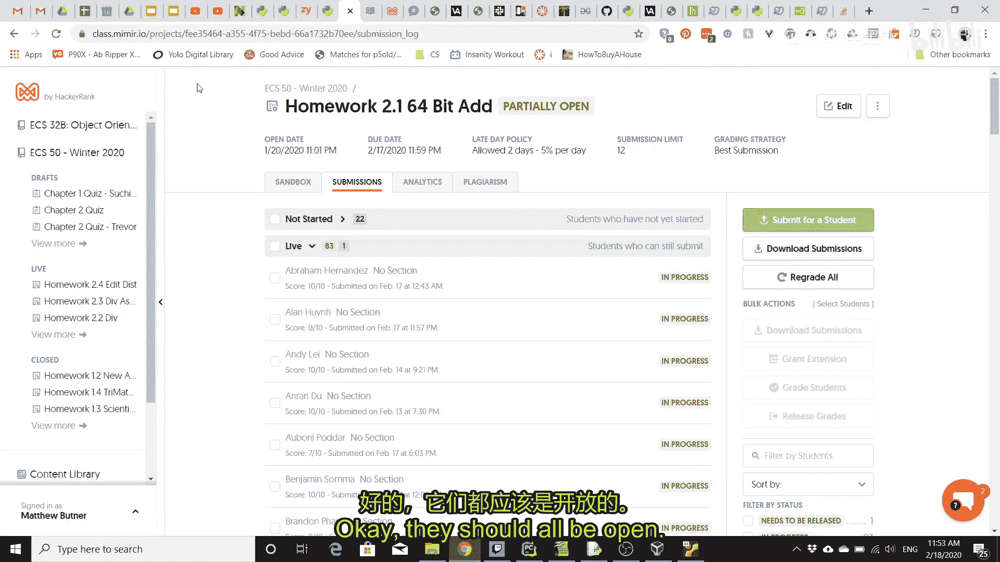

Go by。回家。I mean。

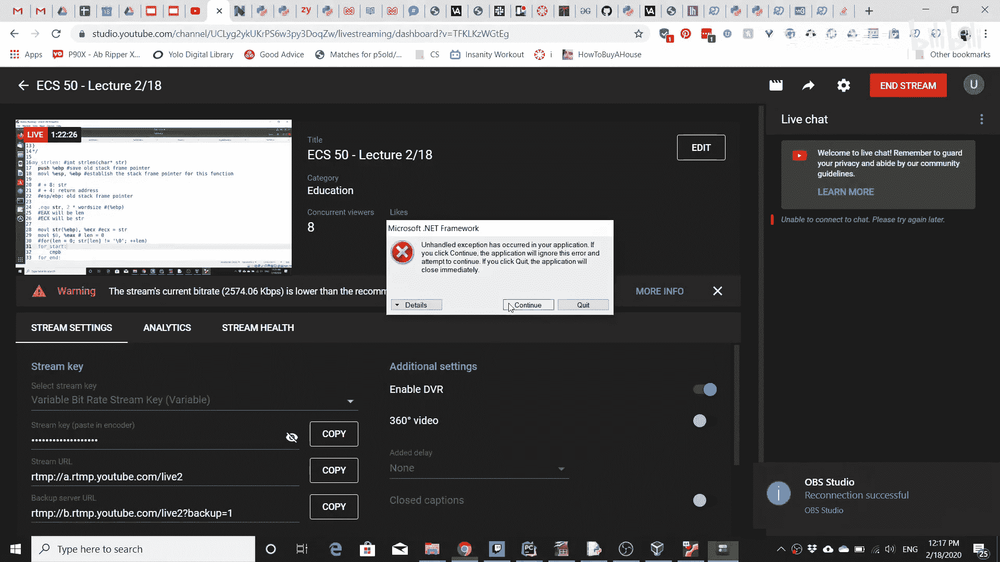

啥。