# 【全集】加州大学戴维斯分校 C语言与汇编语言 中英字幕 1080P p13 Lecture 13 - GCC调用约定与递归 -BV1xefZBHEas_p13-

Okay， so we're gonna to get started in terms of announcements your next quizz is up。

 it's very short only a couple questions but you know get started on it anyway。

 your midterm should be out very soon， it's basically the chapter one and Chapt two quizzes all over again so don't expect too much different we'll hopefully have quiz three out next week which will be about the assembly stuff。

And then you'll probably have like one more quiz in the final。Project。

 which basically be like a review everything we done in class I expect today and especially tomorrow to be a lot less attendance and office hours。

 So if there's something you've been wanting to ask that you think is supposed to take a while be a great time to come would be。

😊，Probably today and tomorrow because not that many homework assignments are due。

But we're going to pick up from where we left off， but before we do， do you guys have any questions？

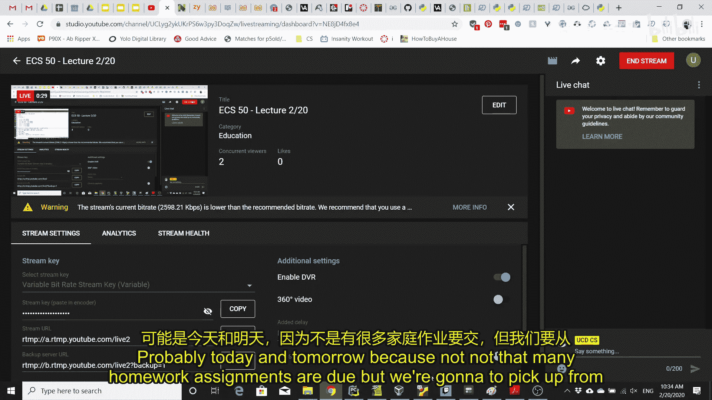

Yeah， is the final going to be like to make？The final is going to be like a midterm。

 it's going to be like a series of questions that you answer because cannot think of like a good like because most of this the stuff that we cover after assembly。

 it's not really like testable with the program so。They don't do a program。Yeah。Anything else？

So again， what were our three rules？The three rules for the GCCCC calling conventions。Forer。

The return value should be placed in the AX。There are three things we we had to deal with how do we pass parameters。

 how do we return values， and who's responsible for saving what registers？29。

So the values are passed on the stack right， and you push them in reverse order of appearance。

 so if you had ABC， you'd push CBA。And then the final thing has to do with who's responsible over saving what registers。

 the caller saves which ones EAX， EX and EDX and the called register or the called functions responsible for all of the other ones right so those are the three rules that we have to obey that makes your code callable from C if you want to call C functions in your code。

 you also obey those three rules。Right last time we left off。

 we had finished doing this line where we allocated space for our RA using for C。

 at least for the rows of C， but now we have to go through and do the four loops。

So we did this line right here and now we have to go do this line over here。Right。

 which you guys have probably。Done quite a bit already。So。How do we do this。Sure。So over here。

 we might say I will be or what's going to be I。We'll register。Which one Sure， ECAC， that's fine。

 right？So over here， how do we start the translation？If I is ECX。2。Percent ECx， right。

 This is I equals0。 Then we have outer for start。Al right， outer for end。Right。

 which is equivalent to。I minus nu。Less than zero， and in's synation。Is I minus number rows。

Greater than or equal to。0ero。是。So how do we do this part？So nu row， right， Remember。

 is four words past E BP。This is what are stacked。Look like。

 so here's currently where EBP is at because we did the prologue， so we have one， two， three。

 four to get on rows， four elements past EBP。So we can either compare it directly with the value in memory or we could put it into a register。

What are the advantages and disadvantages of each approach？Yes。嗯。They't I using。

So if we put it in register， we use it on the register so that's a downside。

 but the upside is that it's in a register right and registers are faster to access than memory right the downside of Levi in memories we have to go to memory every single time we want to do this comparison。

 which is going to be slower than if we had it in a register。So what do you want to do。

 do you want to put into register or do you want to leave it in memory？Register。Memory。

Re seems to win out， so who do you want to be numberros？Which what。So sure， you can pick EBX。

 but if you choose to use EBX， what are you going to have to do？What。

Well you have to save its value right and then make sure to restore it at the end， right。

 So let's say we want EBx to be numerous。 That's perfectly fine。

And it'll give us a good practice using these registers， but in general。

 right you'd want to use AC and D up first before you go and start using the other ones you have to save right because it's going to be a little bit more work to get them set up。

诶。forgot， you could visit me time as long as like。这别员都。Very little easy。Right。So so here's yeah。

 so you're correct， right， We could use EAX for whatever we wanted and then just at the end。

 make sure that it got set to the return value right and pretty much no variable is going to be important at the end except。

The return value right so if you wanted to that'd be fine。

 but so what we could do over here is we could do one more EQU if we wanted to。

So you could do like dot EQU and this one might be like old EBX。

 and it's going to be negative four times word size past。Percent EVP。

 But the thing to be careful about here is， remember， these E Qs do not make any space， right。

 If we want to make more space。Make space for locals。And saved Reg。

If we want to make sure that we save them， this is the thing that actually makes the space。

 so don't forget to change that。Right so now I've made more space that we have space for our old EBX value to be saved at。

 right， So now how can I save the old EBX value。不道。We will。Yeah。EX 2。等一点。这是个是。You could。

 but I'm just making it so it has a more uniform interface。 So yes， if we wanted to。

 we could just do push EVx and that would have the same effect without the subtraction。

 but I'm doing it this way right now and totally it could be just replaced if you didn't subtract and you pushed you'd be fine。

 but let's say we're doing it this way what we put here。我呢个。Yeah， old Evx。There send AP。

just keep following that pattern， right because we've already established where these locations are going to be at。

So great， we've saved， will be EBX， right and if EBx is going to be nu rows。

We might also have something like up here。Move out。Nowumb， rows。Past percent EBP to percent EBx。

 This is EBx is equal to N rows。so EBx is an on rows， so now how do we do this line down here？嗯。

Coello。Yeah， that's I Ns。And then。😊，er for and， yeah。And then at the bottom。

 we need to make sure that we do our plus+ I。So plus plus side， that's gonna be。In goal， right。

ECcX and then go back into the next iteration， so jump to outer for start。

Any questions about the translation of Atlantic code？Oops not here。嗯。Oh wait， no， oops， got confused。

No semi in there。And then these guys should have all be indented so I stopped getting confused。

And this should be not I but J。If I copied the wrong one， that's why I got the wrong thing。

So get to through do this line first。so。How do we translate this line code？Yeah。因为你真口码了。

I called Malick。Runs Malick。It's in the C standard libraries。Again， we're not writing Malick。

 we're calling the C mallic function right remember Malick creates space dynamically。

So we're just calling the function。不意思。Yeah， we did。push them right onto the stack。Line53。So again。

 according to the GCCCC calling conventions， how do functions accept the arguments？

On the stack right and they're pushed in reverse sortative appearance， there's only one argument。

 so we push the one thing and then called the function。

So the same rules that we follow right now in writing our code are the same rules that the C code is going to follow when you call it。

 so we're all following the same rules now that's we can call each other。Yeah。When you do this。

 you write it and as fine when you it。Well， this is a Dons file， right assembly。是讲苏。都な。

So the linker takes care of the linking about making sure the symbols are resolved。

 which is now like when you compile your code， you're going to compile with GCC。

 including the assembly files instead of using like the AS and the LD。

 and then GCC will handle that for you。所要跟你。See like legacy sea function。But again。

 like switching to using print statements is going to be like a pain in the butt if you you're like oh great。

 I can finally do print de bucking again right because to do the print statement。

 you have to push all of the arguments to print in the correct order and then call print F。

And hopefully you didn't screw that up。Right？Versus again， just the debugger。

 you can just look at things。And hopefully you guys have been， or I guess ask。

 have you guys been like realizing how much more valuable that the bugger is than before this class？

Becae a much more useful tool for you to help you solve problems。Hopefully， because it's a really。

 really useful tool because you can see what's actually happening。😊，And when things break。

 you can ask the debugger to display what is actually going on if I site fault on this line where I'm accessing memory。

 I can pin out like what's this register or that register as it involved with it and see which one has the。

 the weird value and then figure out then how did they get the weird value。And again。

 as you get more and more practice using the debugger， the better and better you'll get。Yeah。

In I'd always。Um。It's probably how they translate the C code into assembly is a bit different。

 we will show you some G plus plus code in a little bit。

 but the G plus plus compiler does something called name mangling， which will modify the。

The modify the names， the labels based on the parameters that the function receives。

 and so it will no longer just be your function name。

 it's like your function name concateated with a whole bunch of weird stuff。

So it would just make it like a lot harder for us to actually integrate into the assembly code。

Our integrate R simply code in the C code we're using G++ over GCC。嗯。Okay。

 so we have to translate this line of code。What do we do？Well， well， yeah。

 so we need to get numb calls time， size of int。Into a register， how do we do that？

Where's numb calls at？RightIt's going to be numb calls past AVP because we said it up at the beginning I don't have to keep thinking right so when you're trying to grab an argument from the stack here in class。

 it's just the name of the variable because we made the label for it。Percent EBP。

 that's always going to get for you so we can move out numb calls past percent EBP to what register。

What。So sure you can use EDX， it's currently not in use。

Right we still don't have we haven't used a or A or D in terms of what's there。

 so this will be like EDX is equal to nu calls。Now， how can I multiply it？By the size of an ninja。

we can just do a shift left by two because an integer is4 bytes big， so we want to multiply by four。

 so shift left by2 percent EDX。This will make EDX be equal to this expression。

 So great now we have the argument that we want to pass to Malik， how do we pass it to Malick？

Push it， so push for EDX， and then how do we call Malick？Call Meec。

 now there's something we have to be slightly worried about at this point in time。Right。

Something just happened。Because of the rules， right， we called this function mallic。

 What assumptions does this function make？对。The return value is going to be an EX right。

 arguments will be passed in the stack。Right and if you were using EAX， EX or EX。

 you cared about them， you will have saved those values。

 so do we have anything in A C or D that we care about？是。What。ECcX says I right。

 so if we do this function call， ECX might be overwritten。Because again。

 it's following those same rules， just like we overwrte ECX。

 it's just going to overwrite EX if it decides to use it， so since we know this is going to happen。

 what should we do with what we have in ECX。Save it， right？So right before we do the call。

 we might do something like。呃。De dependsds on how you want to do this。

 So you might say something like save nu rows。That number else say ae， right？So， Mo out。

Percent ECX right to I past percent EBP。Right， we saved it。You put it down into memory。

We now do our function call。Aile dollar sign1 times word size， 2% ESP。Clear the yard。

Moveval I passed percent EBP back into EDX。Restore。ECcX。Restore ECX back to I。

And then how can we do this last part？Number C was declared as integer star star。有啲考思。喂。

Do we have C in a variable？Well， we don't have C in a register。

 but we do have C in a variable it's C pass percent EBP。Right， we did that back here。

So right previously EAX had C passed EBP， but no longer because it got overwritten。

Right by the function call that we just did the out。

That's fine because we already made sure to save it。So。How do I do this？The force。

 right you're accessing memory， so you are going to be using lead grants index nexting mode。Okay。

 move out EAX2。不行。It。This。Are we happy with this？我说。Everyone else happy？我的数。

EAX is the return value from the function call。 right， So it's whatever malick returned。

 So right now， after we do call Malic， EA X has。The result of the function call， right。

 because return values are going to be placed in。Yes。

So you just did one of the things that I told you on Tuesday not to do。I don't remember if I。

 they might have been in some other file， I think， where he said not to do them。

 but you did exactly one of those things。Right so this does not do C at I is equal to the return value of the mallet call right you got the return value of the mallet call correct。

 but it's not placed in the correct location。What does this line of C code actually translate or this line of simply code actually translate back to C code to？

嗯。So EBP plus C is equal to what？Yes。😀は。😊，I can agree with that。please scroll。Yeah。

So so C is negative 12 and negative 12 plus EBP， I agree is a number。

 but it's a number that represents what。Yeah。The address of。The address of C， right。

 so we know that C plus EBP。that's equal to the address of C。Right。

 so we know that this part over here is going to then add like I to it。Right。

 so this is equivalent to like the address of C that's Ex times word sites is I。

And then we take this entire expression and we dereence it。So this。

Is going to be equivalent to the address of C。At I。啊。So get C's address and then go I past it。

But over here， if we look at how this piece of code is translated up here。This is。Star C plus I。

So it's star C plus I， the same thing as star ampersand C plus I。No， they're not。

 They're two different things。But again， it's a very， very easy mistake to make。she said， I said。

 don't do it。Yesterday。But it says， okay， it's good to see it again。

 so how can we do it the correct way？嗯。So first we have to get C into a register。

 how can we get C into a register？Move out。C past EVP。Again。

 right now we have both EAX and EDX or know EDX is the only one that's free right now。

 so we're going to probably put it into EDX。Because EAX has the return result。

This is EDX is equal to C。And then how does this Atlantic code change。And now he did the right way。

Right， because EDX is C， right， C plus。I。Entire thing be referenced。

Which is what we wanted to see plus I be referenced。Any questions？Yeah。😊，For convention sake。

 should we do it this but all the time。So like we see it too registered。To不。Basically。

 like with what I have right now， there is no other way of doing this right。

 It's not just convention， There's no way of trying to write re like trying to let will allow you to write the equivalent expression。

 the way that we started out with。Right， you're going to have to get C first to then be able to go I pass C。

 There's no way of short cutting that。Yeah。When you say see but I， is that what。

Your value that stores in。Yes。So if if like if the value at C was like the address。

 like if C held the address 100 and then I was five。

 we'd basically like 100 plus five times four if we wanted to go to bytes， so 120。Anything else？

So sort to see。What we put in C right， we put previously we put into C at that location of memory。

 right， we put whatever malet gave us back before when we first called it。

So I don't know exactly what the value is in the C， it's just whatever Malli gave me。

I mean we can make up an example number right， we could say that mallet gave me back 1000 so then C has 1000 in it。

But if we actually go on it， I don't know what's going to give me。Any other questions？Okay。Now。

Here we go。How do we do this？Yeah安全。Two matrices。Numbers。Well， I mean。

 it's like asking like when when you call a function， right。

 someone's going to make sure they made the matrices first。

And then called your function with some numbers in it right， so maybe someone did like one， two。

 three， four， 10， 20， 30，40， right？Well， I mean， like think about if you wrote some function that found the width like the area of a rectangle right except the length and the width。

 does your function ever control what the length and the width are？

Would it make sense trying to set them to something？我嘅咩。They're going to be done in the C file。

 so back over here in main。c。What we'll do is we'll read the command line files。

As to where the matrices are stored at， we will read them in from their files， we'll add them。

 then we'll print them， but the values are going to be passed from the C code。

But like normally that kind of question like it doesn't matter where they come from right。

 it wouldn't matter if they came from C code or C+ plus code or assembly code or however they got there right because we're saying if you want to pass me these values they're going to be passed on the stack Soever calls me right。

 better make sure those values are on the stack if they want me to work correctly。I咩 if自己。

I'm not going to right， but like even like if I did put some labels up there in the data section。

 they would not matter because that's global memory for something else right when I call my function。

 the arguments have to be passed on the stack so I would never refer to it in the first place even if you put things in the data section。

through like your next homework assignment， you're not allowed to use the data section。

 you've got to stack。Yeah。Any other questions？Okay， this line of code， how do we translate it？

Currently， registers that we have in use are EDX。Um。And EAX， I guess， are both Ns sort of。

Though EAX currently has C at I。Right， so after we do this。

E A X is equal to essentially whatever C at I is。More or less。

 maybe maybe should do like about equal。They had the same value after we do these lines of code。

Down over here。And EDX is equal to C。So。You don't necessarily need C anymore。

Be happy without that because later on。If we look at our C code。

 we're going to need to do something C at J。 And if we already have C I。

 do we need J or do we need C。No， right。 So we can free up EA X or not EX。

 We can free up ED X if we want to at this point in time。

And then we also can still use in the future ESI， EDI。And then we're out of registers。So。

What register do you want to pick for J？What。EX， EDX， sure。

 so we might say up here that EDX will be J。So again， Mo out dollar signs， zero，2% EDX。Right。

 that's j is equal to zero enter four start。Inner for end。

So let's say this time we decide to leave numb calls in memory。Probably not the best idea。

 but let's just do it for right now， what's this line code going to look like？So， right。

 going do a compel with。Well， who's J， that's EDX？And how can we get numb calls。Noun calls， pass。

 leap me。Right， jump if greater than or equal to inner。For end。我托给说。不个。Yeah， cut that backwards。

Good catch。 And then now we're down here。 So in percent。Wait。Yeah， EDX。

And then jump to enter four start。So fantastic， we translated this line of code。

We just have two left。And then we can maybe write some recursive code。

You guys have done this line of code before。How do we do it now？Right。

 the first thing would probably be to rewrite this expression without the square brackets。

 so without square brackets， this is。Again， given they're declared like this up top。All。

 this is going to be something like， you know。C plus I， you know， plus， I always had to like。

 do it going like backwards。Star parenthe。诶。Star， right？Is equal to。A and B。

So how could we break this problem down？Yeah， you did right。

 so it shouldn't be hard so I don't know why I'm not sure why you guys are also quiet because we have done this before。

 right？Right， let's say we probably want to get AIJ somewhere， right？So how are we going to get？AI J。

Where do you want to put that into？Currently， the registers that are available。

 but we'd have to make free would be ESI and EDI。Cause we've used A， B C and D。Yes。Sure。

 so let's say we wanted to use ESI。So then back here， you could do something like。Save old Ei。

 And then here we could do push。First end ESI。But then down here， I'm going to make again。

 another EQU。To be old ESI just for later on。And it'll be negative five。Okay。

 so great ESI is available for you to use now。So what do you want to put into ESI？I is in ECX。

So Is and ECX。So we're trying to get ESI equal to this。So move out， the first part。

 what are we to get into ESI to be with？Again。Break the expression down。

 where do you have to get first in order to compute this entire thing？We have to get A right。

 so how can we get A into ESI？Ba飞。Again， it's really nice not to have to keep remembering exactly where those things are at。

 but again if you had been using ESP you might have had to keep updating these things。

 so this is ESI is equal to a。Then what are you going to make ESI equal to？念。So move out。

What the ESI？Okay。Now。Okay。Great。😊，We got that now。What are you learning next？是对。So same thing。

 but we probably want to get it into some other register。

 maybe at least partially we here and a have to because we can't dis sumation until we get the value。

So we probably need another register， we probably need EDI。And again。

 it's pretty normal to like run out of registers， you only have a small amount。

So if we wanted to save old EDI。Push percent Edi。And then make one more little label over here。

So here we want to make E D I equal to。You know， B at I， J， maybe at least B at I。

So how can you make EDI equal to B？How can we do this？Move out。EBP2。EI。And then。

Then we can do add percent EDI。Percent ECX word size choose maybe say percent EI。

 And now that's going to make a or ES I。Is going to be equal to our summation。喂。This one。等我那么。啊他们。这付。

Oh， yeah， afterwards， I'm like all the commas were there。So great。 So we've saved it。

 Now we need to do。😊，We need to move the value there。So move out。E， S I， too。Well， C at I is an EAX。

そいな。But's see it I already in EAX。Oops， I messed up this one， three EDX。So8%。D X word size。

C and Ij is equal to A at Ij plus B at Ij。Okayy。😊，Any questions？Yeah。I。是。

So like why is this one an addL instead of a move out？

So like what I could do is I could have moved into EDI， BIJ and then done on the next instruction。

 add L like EDI to ESI， but that requires me to write one more instruction and I'm lazy。Yeah。

 give mind two steps。Okay。So great， we finished translating this line of code。

Now we kind of just have to make this happen。How can we make that happen？嗯。

Where do we put return values at？So we're going to have to move something into。DAX。

 what do we want to put DAX？All right， so this will set the return value。

And now we need to do the epilogue。The epilogue undoes the prologue。

 right so we have all those registers that we saved。We need to now like I mean at least ESI。

 EDI and EBX， we're going to have to restore those and you could do pop pop pop pop three pops right。

 doing the three pops though you may have to make sure that you did them in the correct order。

Given that we essentially pushed EBX， ESI and EDI， what order do we have to pop them in？EDI， ESI EBX。

 you have to do pop ESI， pop EDI or pop EDI， pop ESI， pop EBX， or again since we have these labels。

 we can just do the movements and we don't have to think so much anymore about like how to do it correctly。

 which is kind of why I prefer like having these little EQs up here instead of having to like remember everything that's supposed to happen。

So。First step would be to restore saved regs。So we'd have something like Mo percent EVx2。

Old EBX passed EBP。Move out。E， S， I。To。Nope， that's the wrong direction， isn't it？Move old EBP。

 Mo old EBx back to EBX， move old ESI。Back to ESI。And then， move old。EDI back to EDI。Clear locals。

Move L percent EBP to ESP。Restore stack frame。She has all these should be indented one level less another part of the epilogue。

爬。哦，好。Percent。EVP， right， these are all the instructors that I gave you last time for doing the F and now since we're all done。

 how do we go back？Right。也不干。Any questions？We'll definitely do some more examples over the coming days one thing to kind of think about is there is some optimization that we could do over here in the assembly code notice that we keep doing like A at I B at I。

During each of the inter iterations， we keep accessing them。

 but in our inter iterations will A at I and B at I be changing。No， so if we wanted to optimize。

 we could compute A at I and B at I outside of the inner for loop， and then we can just do like AI J。

 BI J and the inner4 loop， and that would speed things up a little bit because we'd be doing fewer memory accesses。

 So that's one way to think about optimizing if things remain constant in a loop move them outside the loop so you don't keep recomputing them。

So let's see if this works。

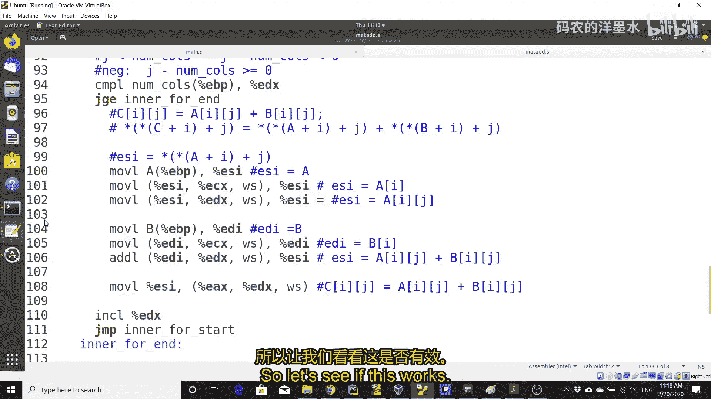

Or if we made， we screwed up。Ohpe， I must have forgotten something in line 102。可点。

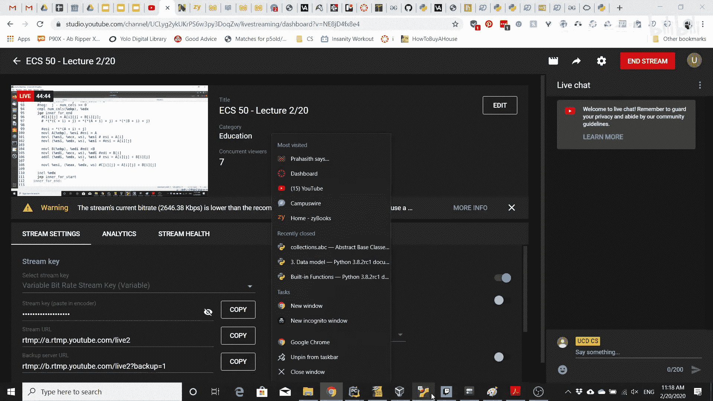

Mine 102。Oh， that's because。There was not supposed to be equal there。

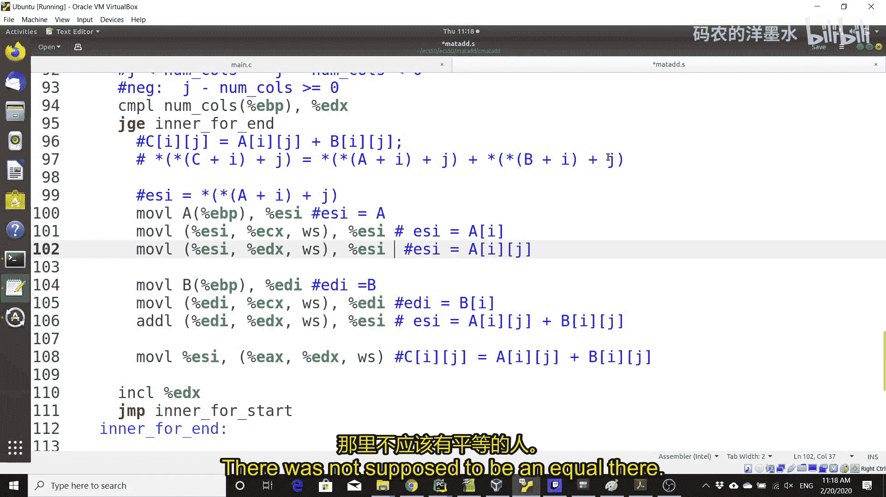

So we compiled and again， if you want to look at the make file。RightWe're just running GCC。

 but one of the main things is if we keep compiling with the M32， which does the 32 bit compilation。

 you will probably have to install multilibib。An your computers to be able to compilely with that because you guys are already running 64 bit machines。

So make sure you do that。There will be instructions of the next homework on how to install that。

 but it's just one command over here in Ubutu。And now let's see if we can make this run。

 So we'll do our X cutable， which we called。Where is our X people， Matt add that out， there it is。

And then we'll do mat A。Dot Txt， mat B dot Txt。Yay， we did it， it did edition。

So it's running that C and assembly code combined， but don't think about it as a C and assembly code combined。

 it's assembly code and assembly code combined together to make machine code。

It's just who was the person that translated the C code into the assembly code right for doing the actual ad function。

 we were the compiler of that translated our C code over to assembly code。

 whereas the main file it was translated to assembly code by the compiler right but we both produced assembly code at the end of the day。

 so it always ends up being assembly code， calling other assembly code。

It's never see calling assembly code。Or simply because call and see。

 it's assembly assembly because that' what you end up with at the end of the day。

Any questions before we do some examples？Yeah。😊，个法我。Doally run all of those like lines。

If I didn't want to so you could do it with a single line。

 you just list all of the source files on a single line。

 so like GCC dash M32 dash G and you know turn on the warnings and stuff and then you would be like main dot C Matt ad。

S so you list all the source files， the point of the make file or if you were using like a C make file is to kind of like expedite the compilation process because if you only change one file you don't want to have to change the other。

Right in terms of like the recompilation because it can take a lot of time if you have to recompile your 20。

50，000 line 100，000 line project right if you only changed one line to one file right you'd only want to if hopefully you'd only want to have to recompile that one file and then link everything together。

 which is what the make file helps with。So。Let's do some recursive functions because everybody loves recursion。

Let's see。So we'll start with everybody's favorite problem， which is the Fibonacci。So。Yeah。

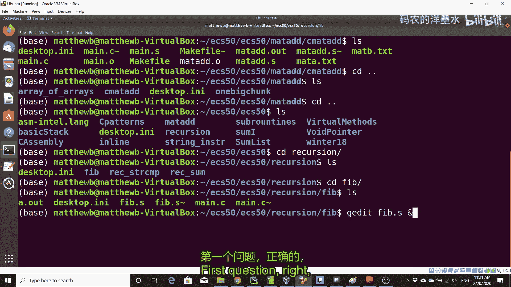

First question， right， is you guys know all how to write the Fibonacci right。

 I'm assuming you've all seen Fibonacci in。like C or Python or some other language before。

 because it's what you always teach recursion with right if n is0 or1 return1。

 otherwise return Fibonacci of n minus1 plus the Fibonacci of n minus2。不し。

I think this is on the wrong visualizer。Okay。So here we have our Fibonacci code。

 what's the first thing that we should do？是啊。We're ready to function。

 so we're doing to C style function， so what's the beating of every C style function？Yes。

The prologue， right？So we should do the。Prologgue。Right。

 so the first step of the prologue is to do what。Push EBP。Movel% EP 2% EBP， right。

 And then it's make space for any locals that we have to do， right。

 which I don't know if we have any locals to begin with。 But if we do have locals。

 we'll make space for them。 right， after we do this， what's the stack look like。 So here's EBP。

 right， It's pointing to old EBP。And what's going to be above EBP？You know， I got plus one。

The return address， right？And then above that。Your argument， right？So plus two。

 you're going to have N。Right。So if we do our EQU down here do EQU， right。

 we can do n as being two times the word size。Past。Percent， EVP。And then later on， yeah。

 we're going to have to do the。The epilogue。Somewhere down below， right， so don't forget to that。

We're great now that we've done our prologue。Step numera Uno。How do we translate this linen code？什。

4our。Sure， sure， right， so we can have you know， fib if。And。Fib if。Or maybe。You know。

 Fb else is also where this kind of starts。呵。So sure， we have our label。Sure， Mo out and past EBP。

 what register do you want to put it in？Yes。Sure， ECX。So ECX is equal to n then。Compampll。喂。ECcX。

 okay。是。Jump if equal to。张不。Jump， if not equal to。是。Yes。So。啊。And China。So jump if not equal to。

 right， we could do。So if it's not equal to， we could。Sure。I'm happy with that one。Right。

 so we could have like， if。巴黎。Or something。Right down here。

So you could do something like jump if equal to。The if body， so sure。And if we fail。

If it's not equal， what did you do？Compampo。Dollar sign one with ECX and then。Not。

That was not equal to the Fiib beltts， fantastic。Because if we fail， right。

 we know that we have to go into the elset statement。So we're now over here in our if body。

So what do we have to do？这。So move L， dollar sign 1 and two。And then down over here。

 I'm going to turn this into。A body。 So we'll set the return value， and then we will。将贴做了。

So great hour we go and we go to run that blog， right， we went to clean up。Otherwise， right。

 we're going to go in the El statement and you have to do this。Yes。Sure， you could。

Which ones do you want to use？Currently， the only register that we're kind of using is sort of is ECX。

So sure， so what do we want to put into EDX， do you want to put n minus1 or and minus2 there？

Sure n minus-1 so I'm going to get Fibonacci of n minus1 into。诶。

Into how can we call Fibonachi with NS1 and get that result into EDX？

But we want right now we have to get n minus1， right？All， so sure we could do like decal ECX， right？

That's， you know， ECX is now equal to n minus1。And then。Push percent ECX。Then call Fib。Okay， great。

 we've now called it the first time。And our return results going to end up being in。

So great EAX is now has fb of n minus1 in it。So what do I need to do now？Sitting in。Sure。

 where do you want to put the AX hat？I agree you have to store it， where do you want to store it at？

Sure， which one？Yeah。So currently like the only register that actually has something in it right now is which registers。

 which registers have values in them currently。Does EX have something in it。Maybe。是。

And then do any other registers have values besides ECX？Yes。被告。Well， there's EAX， right？E。

X has a value because we just called the function。All， so CNA。So which one do you want to is？So sure。

 so you can then say like Mo out percent EAX to percent EDX， right？Save the return value。Or save。

 she right。Probably a better way to this is EDX is equal to fib of n minus2。Now。

 what do you want to do。Iric E percent ECX。First0% ECX。Callfib。Okay。Then what。

 maybe like add a percent EDX to percent EAX， it has the sum。8ight。So great。

 we're done with the Elt statement and we now need to go do the epilogue， so what's the epilogue？

Well we didn't have any locals or arguments， so nothing that we no safe registers do don't need to restore anything。

 so that we move L% EBP， 2% ESP， pop percent EBP， and then RE。Any questions？

Before we go and try this out， see if it works。Thank you sell that。要差。Yeah。How I did it again。

You called the function。Right？Just just like we did over here in the C code， we called the function。

RightBut with n minus-1 and n minus-2 instead of it with the current value。

 so if we started with n was four right， then we're going to call a function again with n is3 and then n is 2 and then n is1 right so the functions being invoke multiple times。

Anything else before we go on training any this？So。I think this wants it on the command line， yeah。

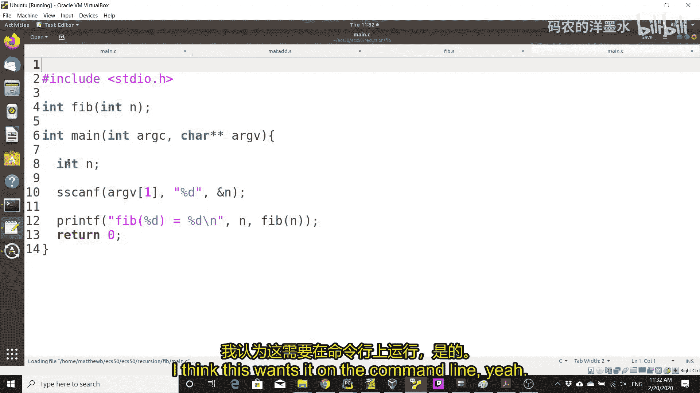

So let's try doing this， makeops。So GCC。Dash G M32， main dot cfib。t S。

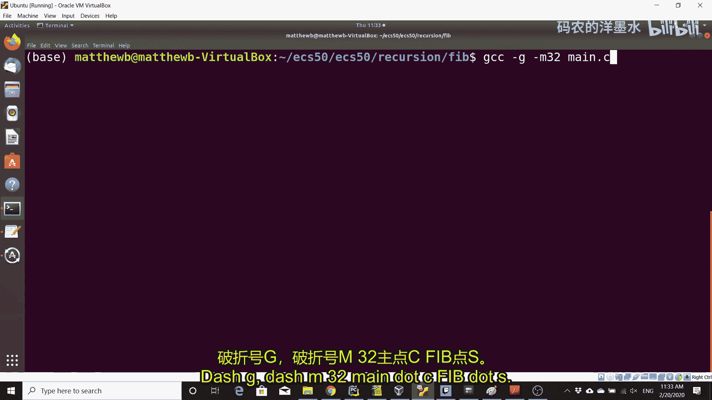

Oops line 26， apparently I have an error。

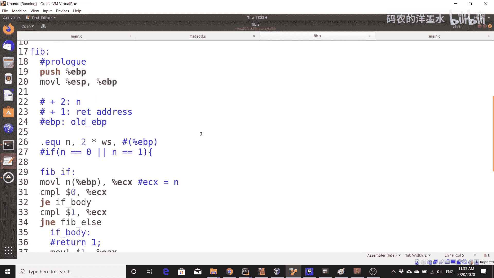

Oops， yeah， an extra comment there。So now we can try running our executable， which is 8。 outs。

 let's say we pass it the Fibonacci of zero。We got the answer， Kbonacci of one， got the answer。

 Kacchi of two。Read answer to the naci of three。Oh。

So what should we do given that our code's not working？He's bit a bugger， right。

 we shouldn't just spend our time looking at it harder because。

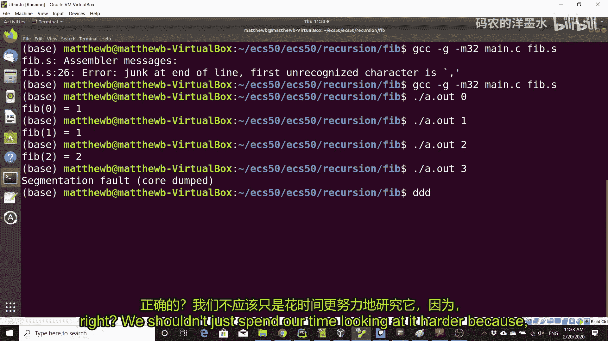

You guys all thought you wrote the right code。You know。

 maybe we're going to have to look things a little bit harder because we can't see anything actually。

Because DD is tiny。 So we'll break over here at Fib。And we'll run our code。

And we got a segmentation fault before we even got there，ops because I forgot to pass in the value。

 so run with three。This is where we broke last time。So great。

 we're now here and so we might want to display some values。

 what would be useful information to know right now。Please。Probably like what N is。Right。

 so here's the trick for doing that。 so we can say P。And then we're going to say integer pointser。

Dollar sign EBP。And going to need more parentheses because。Life is that way。

 so we're going to cast EBP to an integer pointer and then how far past EBP is N going to be？

Numb words it's two words。 So here we should put。2 for index。

Right now it doesn't have the right value because we haven't done the prologue yet。

 but after the prologue is correct， and I guess I should probably change that to be a graph display so it shows at the top。

Here's three。Which is what we expect We know eventually that we se fault so like if we continue。

And we continue and we continue， and we continue， and we continue。 Notice right now。What's N。Up here。

日嗯。对是。Okay， no， it's not， I don't know why。Sorry， I just thought you because it just like it was small。

But。I guess it's still hard to see。Is that better？It's negative one。

 Well should we ever get negative one if our code's correct？No， it's not。

I let you guys know that you do still have some problems in your code and all of them are related to the calling conventions。

 you broke them multiple times。嗯。Oops， not this。So you broke the calling conventions multiple times。

 right？Or at least in your assumptions。So again， what are our calling conventions？It。

Return values placed in the AX。So if you're the caller right and you call a function and you have anything that you care about in A。

 C， or D， you must save those values before you make the function call， right？

So did we follow that rule。No， right， over here， right when we called fib。Right on line 45。

 when we did line 47， what did we assume was in ECX？In line 47， what did we assume was still an ECX？

N minus1， right， but it's not guaranteed to have n minus1 and given that we're actually calling ourselves。

 you can totally tell that you overwrote n minus ECX because look。Look。

 you overwrite an ECX on your function call， did you save it？No。

 but you shouldn't have had to save it up here because you're following the calling conventions。

 but now when you go to call another function， it could be yourself。

 you got to make sure that you follow them so ECX， EDX and EAX will all be overwritten or you should at least assume they'll be overwritten when you do a function call so after our call is complete we no longer have n minus1 in ECX。

So how can I fix that？Yeah， so sure。 Mo L N pass percent EBP to。Percent。ECcX。

Subbo dollar sign2 from percent ECX， and then we can push it。ECX is equal to n again。

ECX is equal to and minus2。 So that was the first time you broke the calling convention。

It' was the second time you broke it too。Do you know what it is。对以对这边他。But N was never in a register。

 right， and was in memory。Right's on the stack。Does that make sense？And it's on the stack。够啲。

So that why do we use if they're going to get berid。Well， if you wanted to use like ESI and EDI。

 you totally could， but you have to make sure that you save them first at the beginning of your function。

Because the function that called you assumes you will not overwrite those methods or not overwrite those registers。

 I mean？Right， so you're going to have to save it some some time or later。

 whether it's at the beginning or in the middle。Okay。Can you see the other time you broke it？

We'll give you a hint。 It's on line 51。推天金。Okay， this is line 51 right here。Sorry。This line。

You also broke the conventions again。所我就这样。Yeah， EDX got overwritten， right？

Because you made a function call right here。So EDX got overwritten。Because again。

 you can't assume that when you call a function， assume those three registers。

 A C and D will be overwritten。And since you can assume that those three be overwritten。

 it's your job as the caller to save those values somewhere else。

So instead of saving our return value from n minus1。Here。😊，Where should we save it instead of EDX？

What are our options？It。Will any register work？Know what registers would work。Yes， I would work。Or。

你比。EDI or。EBX， right， the other ones that are AC andD。

Or what's the other option besides putting a register？Store it in memory， right？

 Which one do you want to do， Store it in a register or store it in memory。不。To mean again。

' there's no right or wrong answer here， you just got to pick one。Sure， memory。

 So if we're going to put in memory， how do we do that。No， no data section。

 and this would actually break if you did do the data section because if we make a variable up here。

Right， say like we like dot data and we had something like， you know， and minus one， right。

 and we had dot long。And we tried to save it out here。This wouldn't work， why？て。没。No。

 it doesn't have to do with where they're located at。It gets overwritten every single time， right？

When you make something in the data section， right， it's in global memoryory。

 how many times do you create this variable。It's once right， it getss created a single time。Now。

 how many ends are there going to be or like n minus ones？We don't know。

 but we can safely say that there's probably going to be at least more than。One。

 but we need to be able to save all of them because every time this function gets called。

 it gets a new n and a new n and a new n and a new n minus-1， right， And if we， you know。

 this function ends up being called 10 times， then we have 10 n minus ones。 but we' get space for。😊。

One of them。So we could not make space in the data section， it wouldn't work。

 but we could make space， not in the data section， but in or on the stack。

so we can make space on the stack， so how can we make space on the stack for our variable？Right。

 so what do we do here？How can we make space for the locals？We're going to make space on the stack。

 how do we make space？So and how much space do we need， how many things？One， right。

 timeport size from ESP and then down here。We can have a new dot EQ。

eQu and minus1 that's at negative1 times word size past percent EBP。Remember。

 so what's kind of interesting to note is that all arguments are at positive offsets past EBP and all local variables are negative offsets past EBP if you're using the stack frame pointer。

So now what can we do to save the value， what's this line change to？Okay do means why。This oneじ。

You can't literally write n minus1， but n underscore one means n minus1。In this context。

 so what do we put here？Right。So， save。Fib of n minus-1。And this line of code now becomes。

And you know， n minus1。Past percent EB。And we can try this again。TD stop。

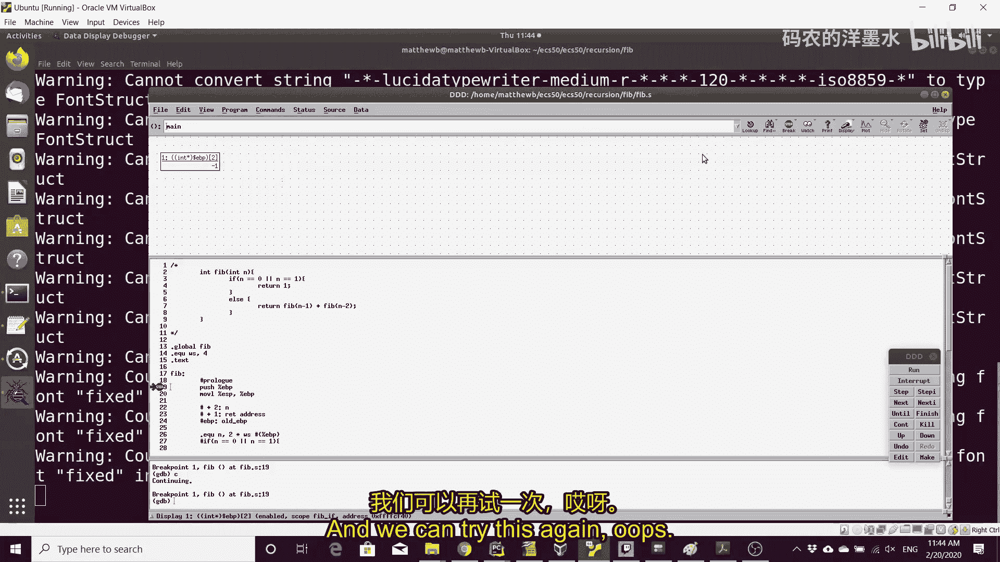

Let's see if I screwed up。Sees to be working。But to say to put dollar sign and。Something。

What does it mean if you put dollar sign in front of something on the stack？

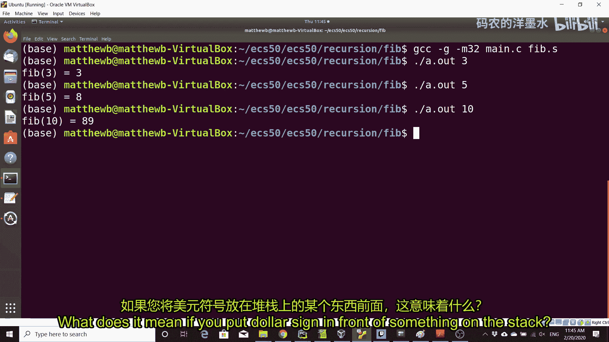

So like if we go back to our code and we wrote dollar sign， oops。

 go back to our code and we wrote like something like Do sign N。Like dollar sign。変か。

You can't write that。But the intent is what I'm assuming that you're trying to do is get the address of。

Something on the stack， so that brings us into our next subject， which is good job。

 there's an instruction called Le which is load effective address long。

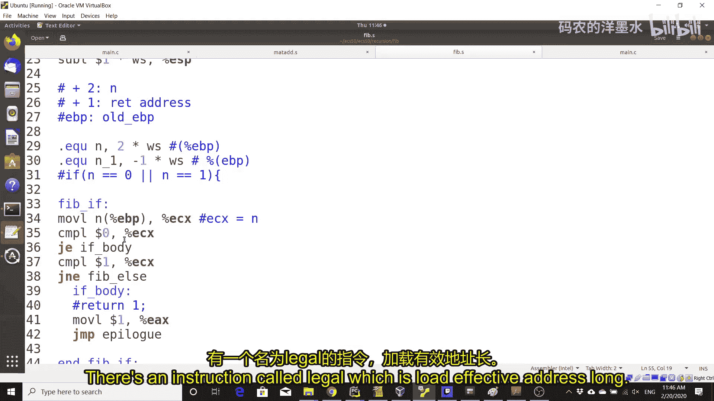

So。Come back over here。

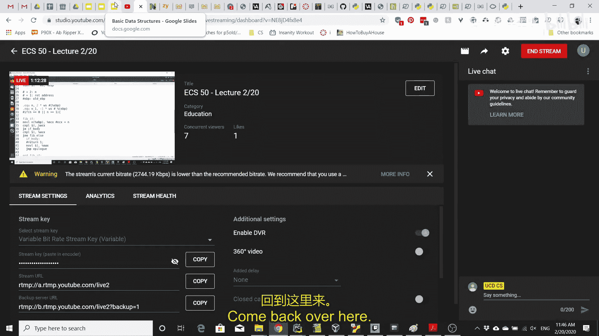

So here's your new instruction。It's Leo。And the format of this instruction。Is it。理由。第一。OIS。

To some destination， actually， the destination has to be a register here。

And the effect of this instruction is register is equal to。D plus O plus I times S。Now。

 how is this different from move？Yeah。So how does Leal DOIS register different from Moval DOIS？

Register。Yes， so。So if we do the move。We dereence it。F use Leal， do not the reference。

So that's how you can compute the address of something right。

 you just add to it to get the values because we know that the address of something like n is it's n。

 whatever that thing is like8 plus EDP so you want to add 8 plus EP if you literally do like Mo EBP to like EAX add L8 to EAX great you have it Oregon if you want to use a little bit more compact form。

 you can use LeO and you can basically treat it like the memory addresses you've been working with so far。

 but it will not actually do the D reference。So that's how you can do constants or you get addresses or do you like point your arithmetic too。

As well。Any other questions？Okay， I don't think we have time for more examples。

 but next week we should wrap up the assembly code Tuesday， we should be done with。

Like the stack stuff and then Thursday we should be done with the inline stuff。

And then we'll go on to the rest of the class， which is just like how does the operating system do things？

Like the interaction between the hardware and the software。

I will see you either in office hours or I will see you next week。こします。Yeah， one second。

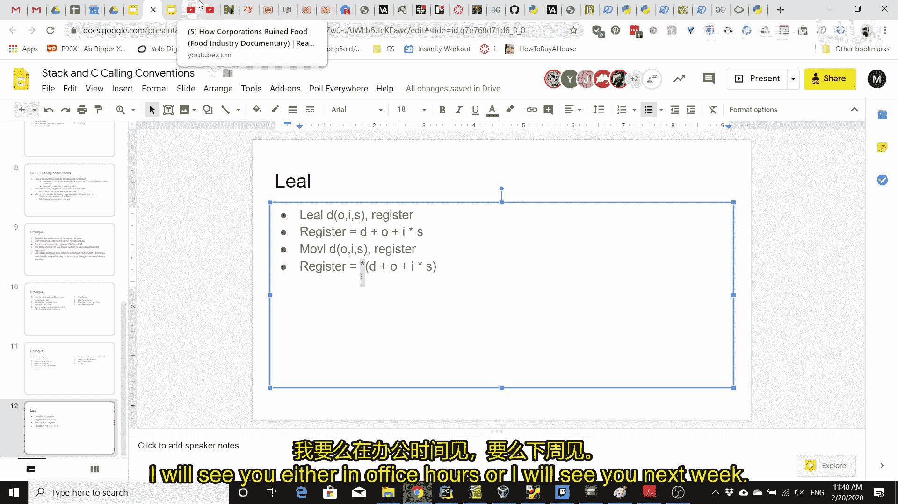