# 【全集】加州大学戴维斯分校 C语言与汇编语言 中英字幕 1080P p14 Lecture 14 - 递归与栈 -BV1xefZBHEas_p14-

Okay， we're going to get rolling today just in terms of announcements， like meetet the professors。

 is this Friday？So stop by then if you want， I believe it's from 12 to 230 in。嚟。3000 or。11，11。

 let's see。I got the email。

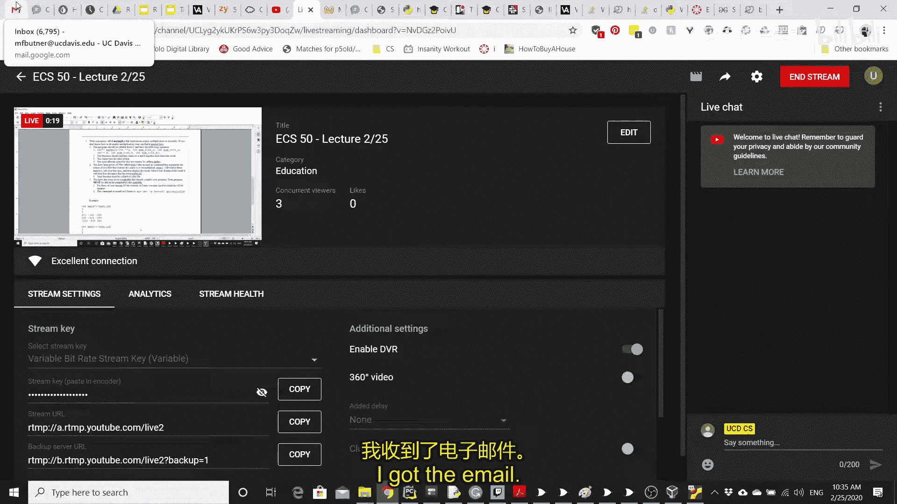

I我 got moved。It's now 33。I in Che for 1131， so stop by there if you want to just talk with us or hang out with other students and get to know us a little bit better。

 I unfortunately won't be able to be there。Because。Albeit。Office hours。

But you can talk with the rest of us get know a little bit better， there'll be pizza there。

 so free food。So stop by if you're hungry or just want to get to know better。

Your midterm should be out today， so you can finally get started on that even though it's way past the midterm of this course expect it to be very similar to quizzes one and two so nothing too different there and then we should be able to get the rest of the questions out to you fairly regularly so we have。

One week for this homework， are we going to have one week for the next homework？

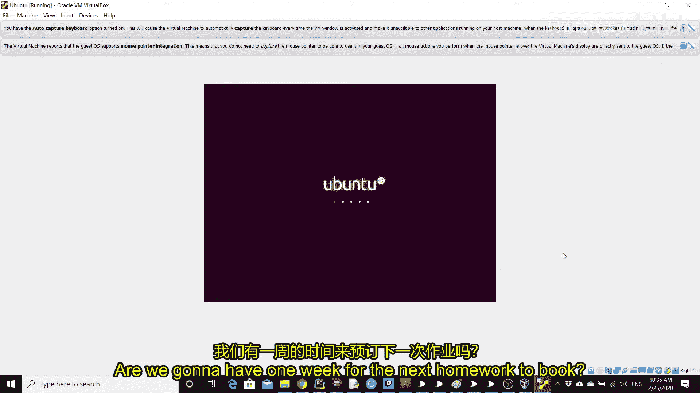

So the next homework already posted， I believe， right， Yeah， yeah， but there are two more， right？

That that was。One in there was two more total， right， which is， oh this is the last no， no no。

 there should be homework force should be yeah。

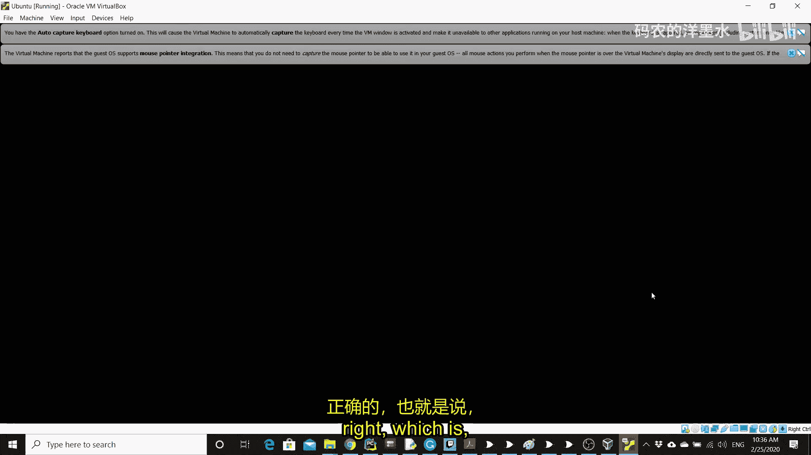

believe it should be。There's only one question for homework4。嗯。Rere different。But。Oh，Thank you。

So they should all be up I might give you I probably should give you guys a little bit more time for quiz three I thought we you know we have like three weeks of lecture left I guess it looks like including this week so I thought when we were down to two so I can give you guys a little bit more time on that assignment。

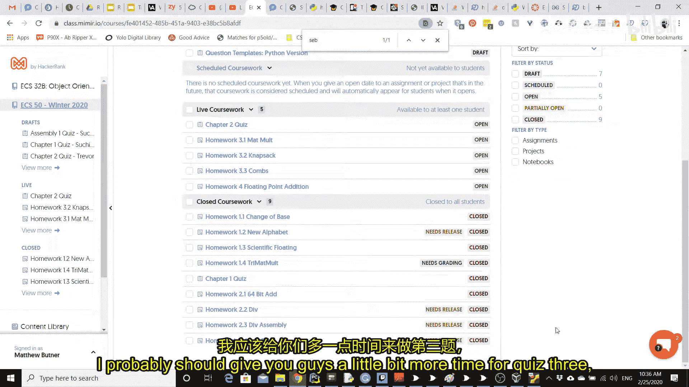

Anything else before we get started today？What。Yes。Any other questions before we get going？

Give you more time for homework three。不看。Okay， so we're gonna to pick up from where we left off。

 we're still talking about integrating our code into see。

 we're going to do one more example of a recursive function that utilizes theele。

 and then we will also talk a little bit more about stack frames and kind of give you some visual examples of like how they're created and when they're destroyed and how they can be again。

 again， they're useful because they give you constant offsets to your local variables and to your arguments。

Ohoops。hos。So let's say we wanted to write a function that could find the sum of a list of numbers。

 but we want to do it recursively。Does that make sense。

 you guys have probably done this one before many times， so what should we do first？

In writing this function。起的。Yeah， write the C code right。

 it should always be the very first thing that we end up doing。

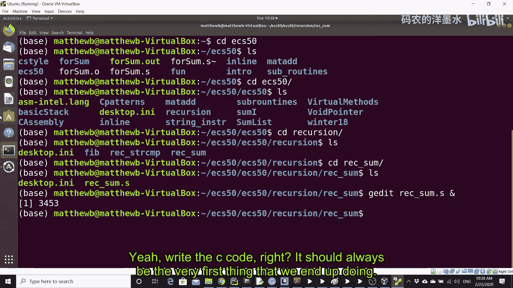

So I'll just get rid of all this。Yeah。Okay， so。If you're going to find the sum of a list of numbers recursively。

What's our base case。Because that's what you should always start with when you're working with recursive functions。

It's the easiest list of numbers that I could give you to sum up。Easier than one number， No numbers。

 right， generally with recursion all when your basic is going to be you have nothing because nothing's really easy to do。

 So what's the sum of zero numbers。0ero， right， So if one。Is equal to0。 We can just return。0ero。

Otherwise。How can we define the sum of our numbers？Right so we know that to reach our base case。

 right， we have to reach zero numbers。Right， so how could we make our problem a little bit smaller so that it's closer to having zero numbers。

 if I had this list of numbers， you know， 10，20 o。10 or whatever stop。10 4376。

 how could I make this list of numbers be a little bit closer to being the empty list？So yeah。

 you can decrease the length by one， you can just say minus one， but what does that mean？Right。

 like if you want to make this list of numbers smaller。

 what do you have to do beside just say length -1。Again， think about it naturally as a human being。

 you have this list of things， you want to make it smaller。How do you make it smaller？Sure。Yeah。

It's not necessarily some some of them， but。这是。We could just take an element out。

If I take one element out， wouldn't you agree that the list is smaller？Right so again。

 in terms of just thinking as like human beings， like if I want to make that list number smaller。

 I just need to take one thing out of it right if I want fewer toys in the toy box。

 I take a toy out of it。Right， so you might decide that we want to take。Say the 10 out。

 the first element。So I had the 10 and this list of numbers 43 and 76。

 Well what would be fantastic to know about the rest of those numbers？Like， you know。

 just the absolute best thing to know about them， the most useful thing for this problem。

Those sum of the numbers， right， that would be fantastic because if you knew what that sum of those numbers were。

 what could you do with the 1？Just add 10 to it， right？That makes sense， right？ You could。

 if you knew what the sum of the rest of the numbers were， right， you could just add 10 to it。

 and that would be the sum of。All of the numbers， right。

 well what function happens to find the sum of a list of numbers？然。

This function finds the sum of a list of numbers， right？ And if you believe it works， you can just。

Call it， right。So otherwise， right， if there's more than one number， you could just say， well。

 it's the first number。Numbs at one。Numbs of zero。Right？Plus， well。

 the recursive sum of the remainder of the numbers。 Now， how do I say the remainder of the numbers。

 I know that length will be -1。But how do I say the rest of the numbers？All the numbers。

 but the first one。然后。然什么。啊。Just nu plus one。RightNumbs plus one is the pointer arithmetic right so at the beginning wheres nus pointing to nus is pointing to the 10 right the first number。

 So then if you say add one to this pointer， well， it's going to point to the next integer and because arrays they're all consecutive in memory they're next to each other right the next number after 10 has to be。

The 43 right if we start our list of two numbers from 43， we'll have 43 and 76。Does that make sense？

Are any questions about this example， besides the fact that maybe you need to practice recursion？

At least that mindset because it's not something you do all the time， but it is a really。

 really useful skill。Okay， so what do we do down here now？

We got our C code that was step Numerro Uno。What do we do for the rest？How do we translate it？什么。

Well， we have a prologue， but the prologue needs to be at the beginning of。The function， right。

 do we even have something that marks the be of function， No。

 so what do we need to mark the be of function。A label， right， or a label should be。Next。Rx sum。

 right， and where should this label be at？Should be in the text section right so don't forget that text and well we want to use this symbol outside of this file right so how do I make it usable outside the file？

globalbalre sum right， and then we'll have our dot EQU word size S4。So yeah。

 the first thing to do is the prologue。Prologue。And what's the first thing that we do in the prologue？

Push percent EBP。Then。Move out。Percent ESP to。EBP。Then。Make space for the locals right now。

 we don't necessarily have any right， but we could just so right now if we want to sell be zero。

Times word size。From percent ESB make space for locals。we don't have any right now， but if we do。

And then we might have to save some registers too， right？So great。We've gotten that done。

 There's a prologue taken care of the same thing each and every time except for the amount。

 The next thing that we might want to do is our EQs。

 So where is nus going to be at how far past EBP will it be。不行。Right。

 so what's the stack look like at this moment， right， So here we have EVP。

 it's currently pointing to。The old ADP， right because we just pushed it。

Right above that's going to be at plus one。刘比B。The return address。And then above that's going to be。

The parameters， which parameter first。Numbs。And then。We'll have one F plus three words。Right。

And again， if you don't want to think so hard every single time after you do the prologue。

 the first argument will always be two words past DVP。

 and then you can just start counting from there。So we want to do our EQU for nus and it's going to be to。

Times the word size， past percent EBP， and then dot EQU， we have the L。

Which will be three times the word size passed。P sent， E P。

There is probably some way of making the EQU just fully substitute to the entire expression。

 but I haven't been able to figure out how to。Okay。

So we got that taken care of now we have to translate this line。How do we do this？

And given that we have to refer toL multiple times， what's probably a good idea。公安。

Putting land to a register， what register would you like to put it into？Sure， EAX。So EAX will be1。So。

 move out。What in 2% EAX？L past EDP。so now here if we're doing this equality。

 we going to this if statement， how do we do it？Compare L。0ero with。Y X。And then。What。Jump J and Z。

 jump if not zero， or you do jump if not equal， either one will work。Right。

 because what we are translating this into is then minus0 equal equal to zero。 and then again。

 the negation is。1 minus0， not equal to。0。So jump if not equal or jump if not zero to。Right。

 the elsets， sure。Down here， there's the elsets。And if we succeed。Well， we need to do this。

So how can we return zero？时间是经。Move out the blur sign zero and 2% EAX and then。We can't just RE。

 what would happen if we just did RET right now？Where would we return to？嗯。Just。Not the prologue。

 but the。Alogue。Because if we jump back to the prologue。

 we're to go back up here and do it all again。Right， but if we did do rent right now。

 if we did have R right here， where would we go back to。哦对。

We go to old EP wherever that happened to be pointing to and we start executing instructions that happen to be on the stack。

 which is not where the instructions are actually stored at。

 so we'd probably get a segmentation fault if we did this right right now。

So we're going to jump to the epilogue。Okay。T。But yeah， that's why we put zero in there。No。

What it half？Yeah。Oh， okay， I see what you're saying because EAX has to be equal to zero to enter the statement。

 is this line redundant？Yes， I guess you could say that yes。

 this line would be redundant and you could just jump straight to the epilogue。

If you want to optimize it， right， so you could optimize this line out。If you want to。哦，确实。あバと。

我们其他肯定不确。明。How do you have做个 help。pushDSPDI。4。3。Where do they get？With be on the stack， right？

And then like the indexing。前。Well， the indexing wouldn't change because we didh blah， blah， blah。

 because we're using the。The base pointer to access the elements。

 if we had been using ESP to access them， then yes。

 our values would have to be updated because we now have more stuff on the stack。

But because we're not using ESP， but we're using EBP and EBP is not moving。

We have a fixed offset every time right， and if we were adding elements， right， the saved values。

 they would show up beneath the arguments down here somewhere。So now， right。

 we just have one more line of code to translate。How do you want to do it？姐姐。Well。

 if we get numbs at zero。Then what we have to do。What would happened right after we did numbs at zero？

We'd have to call the function， right， which would probably。

 if you put nus at zero into EAX or EX or EDX， it would just immediately overwrite it。

So it might be useful to rearrange it so that instead of doing it in this order， we do it。

In this order， which is no different arithmettically speaking。

 but it allows us to do a slight optimization where we can do for the function call first and then do it。

 though given that we need to access nus， it's probably a good idea to put Nbs into a register if we really want to optimize because it's used twice not just once。

 but we also know that if we put into EAX or ECX or EDX， it'll be overwritten by the function call。

 so we have to choose to put it where。Well， wed have to choose to put it like an ESI or EDI。Or EBX。

 right， so maybe we'll have EBx will be numb。Will be nus。EBX will。B nus， right。

 So we can just say move out nus past percent EBP to percent E BX。 But if we're using E B X。

 what do we have to do。Save it first， right？So depending on how we want to do this。

 we might say subo1 times word fries from ESP。So this will be at negative one， we'll have old。EBX。

And then dot EQ U old E BX will be at negative oops。In fact， comm and all of these， didn't I？Old E。

 B， X。We'll be at negative one times。Bor size。From percent to EP。Right or。If you wanted to be lazy。

 you could just push it and will show up on the stack。And then。

So first thing that we need to do is move out percent E Bx to。

Old EBX pass percent EBP because the subtraction just made space for it， so save old EBX。

Before overriding it。Okay， so。They got to do this line now， how can we do the call？哪三。

We can't call wreck some， because。What's the problem of just saying call Re sum right now doesn't have any arguments right。

 so it's going to have a bit of issue running correctly if we don't pass it its arguments as expecting。

 so how can we pass it as arguments？Well， well， if we're going to be putting the registers。

 if we're going to putting these values onto the stack to call the function。

 what order do they get pushed in？Which one would you push first？

We would not push nus plus one first， remember arguments are pushed right to left。

 reverse order of declaration， so we need to push L minus1 and then push nus plus one。So， yeah。私は。

性关系保。Can you move L -1 into。Len past EBP。But like。So you're asking， can I write this using a loop？

Of course you can write it using a loop， right， you've totally written the sum of a list of numbers using a loop before。

But here we're doing it recursively。 so yes， you can't totally solve this problem iteratively。

 but we don't want to right now。So how can we get L minus1 onto the S。

 given that we already have L and EAX？Yes。Right so you might say like deco percent EAX， right。

 this is L minus1。And then push for C A。Okay。对对不对？Then push percent EVX。And then， call。Next sense。

R sum。Well， do we need L anymore？In our program。No。

 so we don't have to save it right So if you need it in the future， yeah。

 you have to save it if you don't need it。Just let it get trashed。Okay， so the call completes right。

 so let's remove our arguments， so add a dollar sign2 times word size， 2% ESP， clear arts。

So now we have the return value it's in。EX， so。H子。So how do we add thumbs at zero to it？真是。Well。

 we yeah， we need to get nus at zero into a register， so how do we get nu at zero Well。

 we don't necessarily have to get nus at zero into register。

 We just need to get nus at zero and then add it to EAX。排然后面。But remember， like。

 so what do we want to put here into EAX？What should be。

The statement on the left side side what's going to be none to zero？反。PC点点。Well， I mean。

 or EBX has becomes nus plus1。All， this is EVX。Okay， so yeah， sure you could do something like decal。

Percent Evx。And then oops， cancel。And now that we've decremented it， what can we put over here？Okay。

So great。 Now E A X。Is equal to。This。And so what do we need to do now？Sitting in。我一下。On the right of。

You mean， so why isn't it likea like comm comma word size because that does word size times the scale or the word size times the index right。

 four times the index， what's our index if you don't give it？

Was the default value of the index if you don't specify it？The default value of the scale。

 if not specified， is one。 The default value of the index。 second the second field is 0。

 So 0 times 4 is。0ero， so。Wouldn't hurt， but it's also kind of like。

No point in doing it because you'll get the same answer。So what comes now？Well， yeah， but you know。

Yeah， we just have the epi blog because the sequence comes right afterwards。Okay。

 so what do we do in the upload？啊。Yeah， so Moval percent or Moval， Oh gosh。

 old EBP past percent E B X to。EBX， right， restore old EBx and then。No matter do you need popping。

Right， remember， the next line is always going to be Mo。EBP2% ESP。We locals。And Toraries。Right。

 because right now， at this point in time， ESP is right here。Because we did this abstracttract。

 so if you make ESP be equal to EBP， ESP moves up to this line here。And old D BX is now gone， right。

 It got removed from the stack because it's at an address lower than ESP。And then。Last instruction。

 return， go back to where youre called from。Are you guys happy with your solution。

 do you have any questions or comments on it？And this supposed to be used at callable from sea？

Im a little confused as to how that works So to make it callllable from C。

 you just have to obey the GCCCC calling conventions right those three rules but like how do you let's say you have。

I can can报诉他。So。O。I guess my confusion lies in。What， first of all， what does it， what C can like。

 do you call it from a different C file， Yeah， We're going to call it from a different T file。 Okay。

 and how do you describe how it is called。Breect sum parameters。

Do you call it like any other C function， we' were going to call it like you like you essentially did the compiler's job and translated this C code into assembly right so you have this function and so if you want to call it you just。

Call it。But like rec sum， So what's nouns and when， like how do you make nouns and went？

I'll show you in one second。Yeah。😊，not the0。Oh did I forget to do that， I did forget to do that。

 thank you。5 percent EDB。Any other comments or concerns you have。

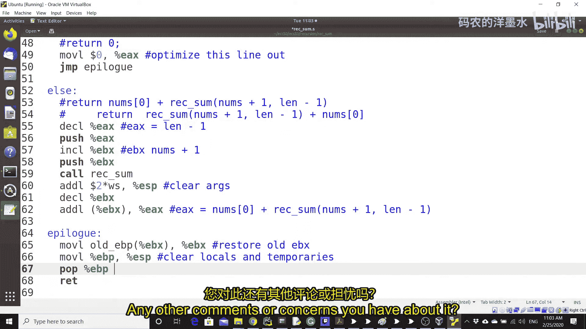

About it。

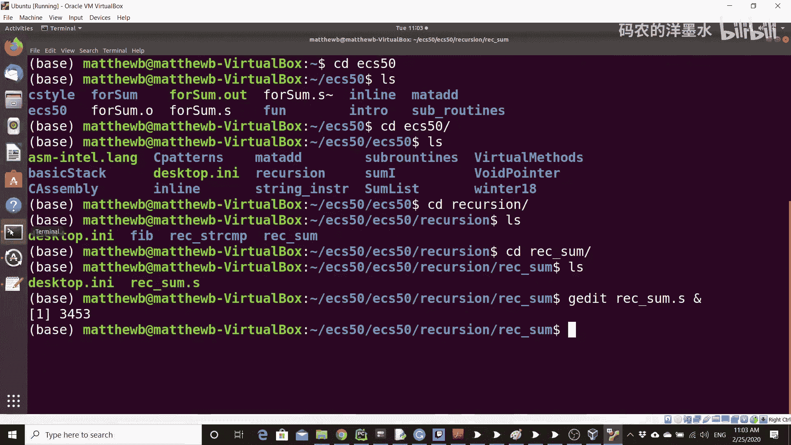

Yeah。😊，我呢。Well。Why I pop E？As I pushed it up here。Because remember。

 the thatlog just undoes the prologue。So let's say we now want to jetitmaine。c。

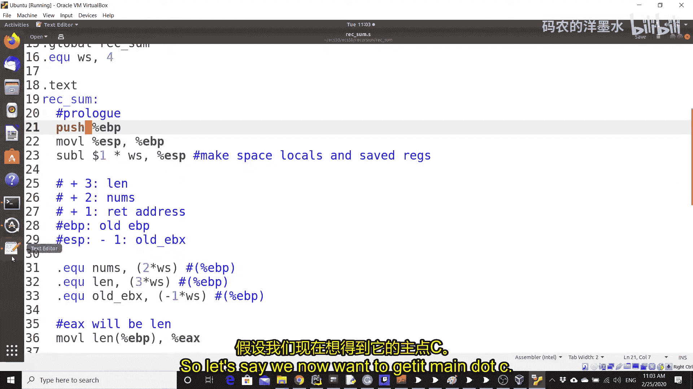

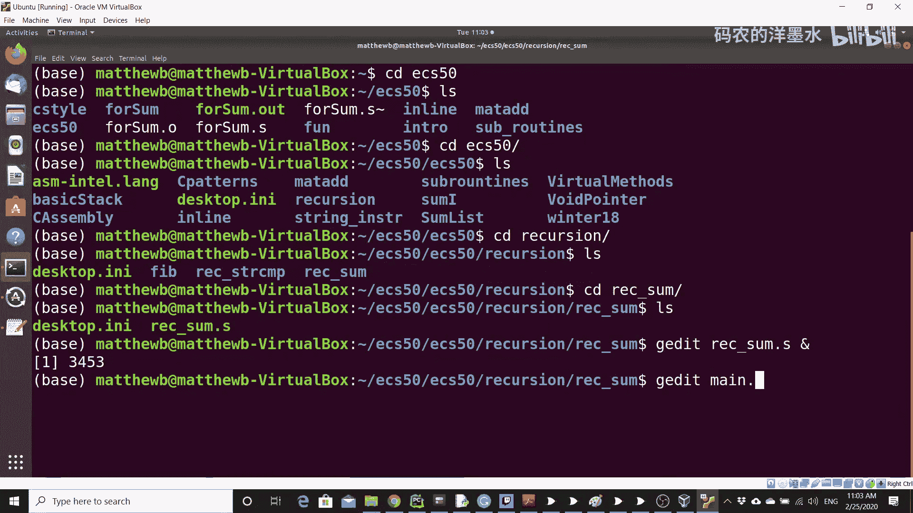

And we'll do just do this like a rough and dirty one。

 So over here at the top we'll make a declaration of Bxum so。Int Rexum。

I'm going to take in integer pointer numbs and then an int blend。And then here we have in main。

So here is our nus。Maybe we just have 10， 20， 30。Something like that。

Right and then our length is going to be equal to。3。Some good媳 far。

And then we're going to need to pound include。Sddio。h。And then don't forget to return zero here。

And again， these names， they don't matter what the names are。 they can be whatever you feel like。

 they don't have to be nuns and lend， they can be whatever we kind choose to be for inside of me。

 And then we might say something like int total。Is equal to。Rect sum no the1。

So call it like a C function because it's callable from C。And then we might just say like print F。

This of the numbers is percent。And then total。I don't really get know how numbs and lend。

 what registers do they go into。They're not， they're going to be pushed onto the stack。

RightSo you pop off the numberss and pop up then？Who is we， Ma or our function recursive sound？No。

 it's not going to pop them off because it didn't put them on the stack。Right。They are on the stack。

 right， so like when we do their call right， Len and nus are already there。Like when we're called。

 this is what the stack looks like， ESP is pointing here。At this point in time。

 and then numbs and Len are right above it。Okay， then comment you say EAX， what we lend？

Why will it be Because I put L into it and use it like it was L？Again。

 that's just like internally inside of this function， I will be using EAX as L Yeah。

 but like I guess my confusion comes from Les on the right now Sure you take？

The function that calls me， so Maine will eventually remove them from the stack。

Just like when we called ourselves， right， we called ourselves。Down here。Right， and then we。

Cleared off the arguments。to the function that we call， so any functions you call。

 you're responsible for reading that stuff off the stack before your function returns。

Like essentially like when you after you call a function， once it's done。

 the entire state of the computer needs to be identical to what it was before the call。

 except for EAX， ECX and EDX， and the contents of memory， those can change。

But everything else must be exactly the same。😡，So。We make sure that happens， yeah。就案着然后。

I to WS that undos for first。怎么事。Yes， that pops those values off because remember we talked about how push is implemented it just subtracts for for each push from ESP so since we did it。

Twice， add eight to get that be restored back to what it was。Yeah。😊，W enough。好，我们好像是那边的。我不来。す。

But each time it's going to be stored at a different spot on the stack。Right。

 because every time the function gets cold， right， it reddo this entire epilogue， right。

 or it's entire prologue， right， So it's going to make space for a new E old EB X， right。

 and that new old E B X will save the current value of E B X， whatever it happens to be。😊。

When does it actually look。Go back to。Original one。So the question is。

 when does it return back to whatever the original one was？After the function was called。

After the return。Right， because'sting。Yeah， right， because if you think about it。

 like if we have our C function right， let's say L， right， the original time we call L。

 we call it with five， how many instances of the L variable were there actually be once we get to the case where L is zero。

Six because5， four， three，2， one， zero。6， right， so there'll be six instances of the L variable。

 one for each instance of the function that was called right， So same for us。

 there are going to be six instances of old Evx， one for each version of the function that was called。

 But you're seeing the internal details of that actually going on。

 There's also going to be six copies of nus。😊，Right， because we called it six times。So again。

 you can also see like this is going to be slower than just iterating through the list because we have to keep creating new variables。

 keep pushing arguments on the stack， keep between the calls。

 That's why recursion tends to always be slower than the iteration because you have all this extra overhead of calling the functions。

 pushing the arguments， creating copies of the variables， etc。

Any other questions before we try running the sucker。Yeah。😊，Or。这是5号。That方202007。Well。

 so the locals for one function might be the arguments for another function。So you treat them as。

Yeah。Right so right now you're seeing like behind the curtains right you're seeing all the implementation details how everything is happening。

 but it's been no different than what's been going on before your locals are locals to that function and your arguments are arguments to that function we'll show you an example of what the stack frames look like in a moment where function one calls function two calls function3 with different arguments in different locals so you can kind of like visualize what's going on。

😊，Okay， so let's try compiling this， so GCC dash M32 dash wall， dash。W error。Error。Dash G。

 don't get the dash G so that you can compile main do C recursive sum letS。Oops。

 undefined reference to old EVP。Old EBX。

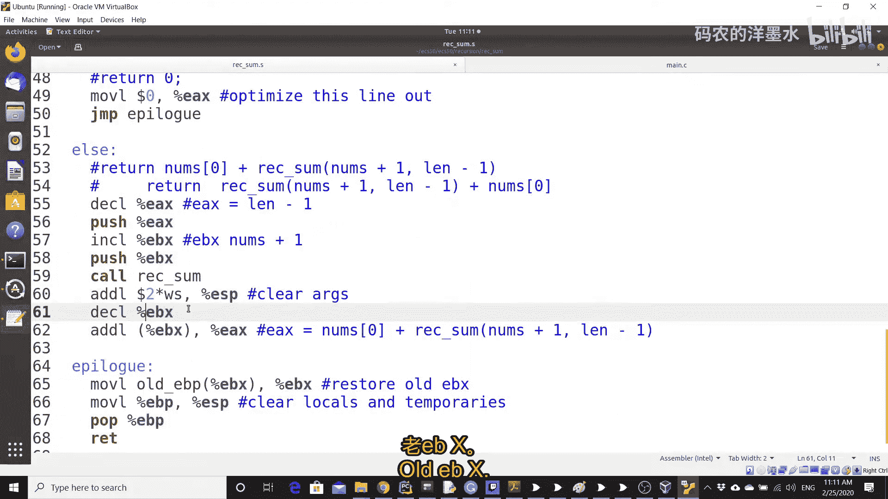

Try that again。One more time is to make sure， oh gosh， stop hitting the button。 Okay， great。

 it's done。 right， So let's try writing it。 So if everything works out。

 we'd expect to get the sum of 10 plus 20 plus 3060。 So let's see if we get that。😊，え。

You guys made a mistake。Right。Can you tell us， well， maybe we can， I don't know。

 apparently DDD hasn't worked out so hot so far。But let's see if DDD can like help give us some information about what's going on。

 So we call our function。

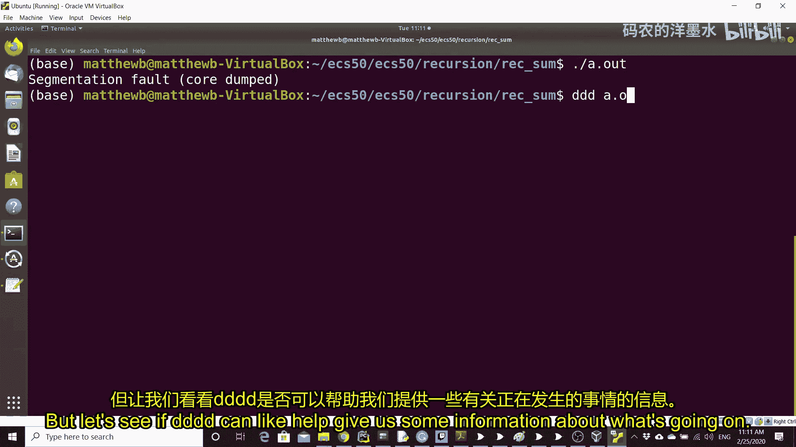

， so let's just run it and see what goes on。So it's sefolded right here on this line。

 so we should probably look at whatever EBX happens to be， so P dollar sign EBX， EBX is 2，645。

AndThat's not good， right， So somehow E BX got screwed up， so。If we come back to our code。

And we can try and look and see， well， how did EBX get screwed up？So EVX is supposed to be nus。

So it looks like， yeah， we move numbs in there。It's two words past EBP。

 so what we might want to do in when they're debugging is see kind of like where it screws up。

So if we go back to。What happened to DDD？Noep， nope， noep。There we go。

 So what might also be useful is seeing like what is L。At this point in time。So if we want to see L。

 right， it's on the stack and we know it's at position three on the stack。

So the way that you do this is you lie to the compiler， and you tell。That EBP is an integer pointer。

And we want to look at word three。Past EBP。And。It's at one。So it screwed up on the call to one。

 but it was fine。Prior to that。Right。So。That means something maybe happened in the recursion and we kind of to see like well。

 did we call it with the wrong value or did it get overwritten in the recursion and we forgot to like restore it correctly。

Now， did I restore it correctly back here？So move old EBX back to EBX， it's at negative1。

 we subtracted one times the word size， but again， probably best not to guess， but to debug。

And I'll slide this over because apparently you guys can't see that。And we'll break at recursive sum。

And then we'll try rank it again， so we're calling it。We put lane in here， you get EBX。

 so here we're going to graph display。Dollar sign， EBx。It has a number， some funny number。

 but if we kind of wanted to see it， it's being interpreted as an integer。

 so you probably want to see like what's its value as a pointer。

So I will attempt to cast it into an integer pointer。Add's a big number that makes sense。Right。

Seems fine。Right， and so here， EBx is fine。 We might also want to look at the contents of our stack so we can graph display。

Integer pointer， Do sign EBP。Add zero and then if we want to look at our stack。

 well we know that we have two arguments， but we also have old EP and the return value so we can say。

 well， maybe I want to display four things。Right， garbage， garbage。Pointer。Lith。Right。

 so this is old EBP。Right， was placed on the stack。 This is the return address。

Where to go back to and then。Are pointers to Ms， and then our length 3。 So let's say we continue。

And we do it again， we establish our guy， it's fine， seems to be cool。He has two in there。

And then if we keep going， right？Like there seems to be a sensible value on the stack like negative 12。

447 again， that big number and again every time we like added one to it it should go up by like one so we continue。

It went up by one， right？And this is kind of where things we saw were going wrong。And dec， De， ankle。

 ankle push call。We're doing ourselves at zero now。We go to the base case， hopefully。

So we jumped to the epilogue， we move old EBx back to EBX。But old EBX got five， six on there。

So notice that EBX ended up with some funny value。In it。

But EBX didn't start with a funny value over here。Right if we kind of like scroll back up。Old EBX。

 again， two words passed out， there's still this funny number。Right。

But did we put old EBX or did we put EBX nus into EBX， we did。

So maybe I want to set a break point here。But I want to add a condition。Properties。

 and that condition should be when。Basically， percent EAX is or dollar sign EAX is equal to zero。

And then so we can restart， run it again， continue， continue， continue， continue。 It's fine。

And so we're about to do this。So， did。EBX get a sensible value， it does， it has a very。

 very large value。Great。Move zero into EAX， jump to Applelogue。Now， old EBX。

Must have not had something sensible in it。Because the prior call to E B X had a funny value there。

Right， because。EBX got a sensible value from the stack， but the old EBX had a wrong value there。

Right so there's multiple reasons as to like what things could be called for problems。

 I know at least one problem in our code so we'll start there。And again。

 debugging is always fun and painful。But one of the issues right now is this。Yeah。I，65。

 did you mean like， like parent D B P。Yeah。That'll fix that one。

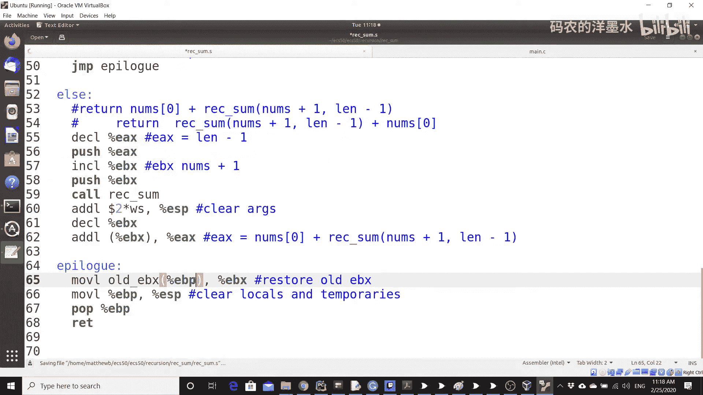

I didt mean EVP， that one definitely has happened before， that one was my bad。And if we try again。

We still get the wrong sum， so he fixed the safe fault error and the summation problem though has to do with this。

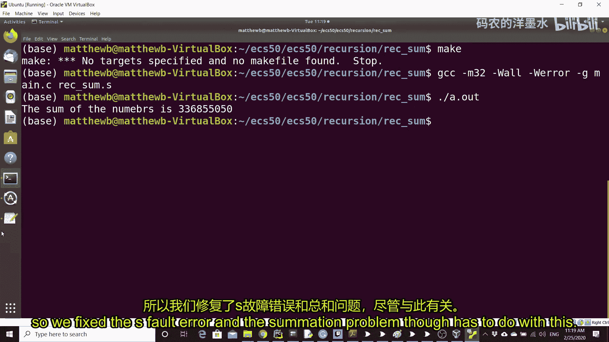

So here we're adding one to nus， right， what's nus type？What's numbs type？Numbs type is。

Integer pointer， So if you add one to an integer pointer， how many elements should you move？4。

 because it says move one。Int right， if you add one to a if you add one to a short pointer。

 how much would you move。Two， and if you add one to a character pointer。One。

 because the character is one bite big。If you add one to a double pointer， you should move。8。

 if you add one to a float pointer， you should move。4 because forts are4 bys big， right。

 It's the size of each of these variables how much you need to move when you do the integer or the pointer and integer arithmetic。

 So you are again responsible for doing the translation。

 So you got to make sure that you do it right。 Now， the easy way to do it。Instead of doing ink。

 right， we might do something like Le load effective address。

 the operation that we covered at the last time， right， and we want to move。😊。

One times word size past EBX， andll maybe we'll put that into ECX。And now ECX is equal to nums plus1。

 we can push ECX， and there's no more need for the decal。

What's the difference between this statement， LeO1 times word size parentheses EBX and move L？Yeah。

没有。And will' move the value and Leo won't right remember they both do D plus O plus I times S。

But then the move or every other instruction will then dereence it。😡。

To get the values and memory at the location， whereas Leo will just compute D plus O plus I times S and then put in the result and no de referencing。

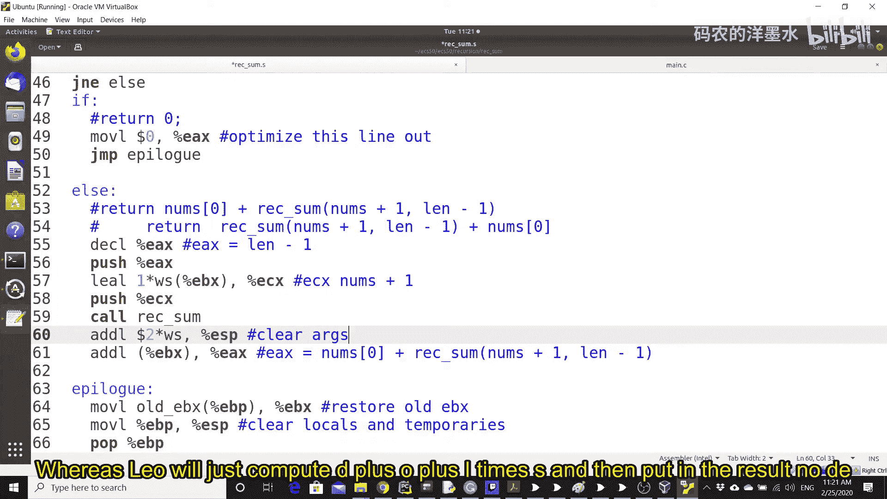

So now if we do this and we recompile， I think we should。Could I correct some？

So be really careful when you're doing the pointer arithmetic that you add the right amount Les really helpful because you can do like complex additions to pointers。

Very simply right， but if you wanted to， you could use Leal just to do arithmetic right if you wanted to do like EAX equals EBX plus EX。

 you can use Le to do that。Because it's just going to do D plus O plus I times S。

And if you just want to do EBX plus EX， whatever happens to be and put the result in EBX。Fantastic。

 you can use Le there。No problem。

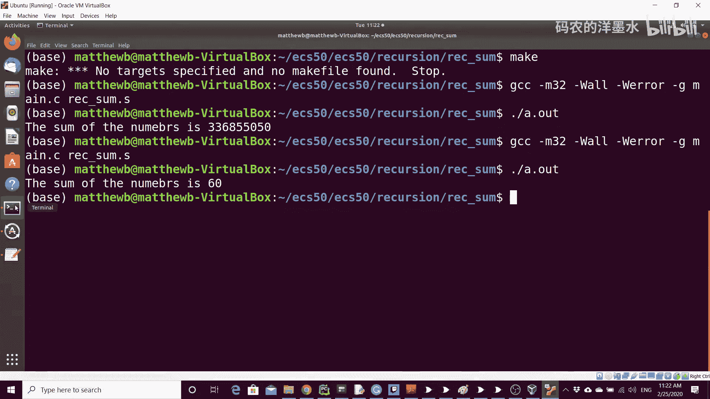

So do we cant。Well。🤧Yeah。Well ECX has nus plus one， right， which we need to put onto the stack。

 but because we didn't actually increment EBX like we did last time。

 there's no need to decrement EBX right we didn't change the value of EBX， which is nus。

So no need for that， any other questions？Yeah。So when you're wishing things on the set before you call。

Do you have to push it like the same way that argument。So when you like when you call any function。

Be it recursive or not right if it's like following the GCCCC calling conventions right you have to always follow the same rules。

 which is arguments are pushed in reverse order declaration so if you have ABC。

 you're going to push C than push B than push A and then do your function call right so again our function is just C callable a recursive functions no different than any other function you just call it after you push the arguments。

Anything else？Okay， then let's show you some examples of like what this stuff kind of looks like。

Don't pay attention to that。That's other classes stuff。Do I have to deal with。U。We're here。And then。

 we're here。And then we're here and lecture。Sly。And then you might need a new Google sheet。Great。

 and sure。And this guy will be called。Stack。有。Example。Okay。

 so let's say we have an example of some function， so let's say we have some function fo that takes in arguments。

A， B and C。It has。Locals。EFG。Yes。D， E F。And it's going to have you wants to use。Okay。

 maybe this is like a better way because。So here's our function。Locals。Extra reggs。Calls。Arts。

So over here， right， here's our function fo， it has arguments A， B and C， it has locals。D E and。

F and it's also going to use EBX and ESI。It's going to call function。You。Right。

 and it's going to call go。With a B， E F。It's not really important what these functions do。

 it's just that they're being called this way。So over here we have function Guo。

Function U has arguments。 It looks like D， E F，H， I。J and K。

 and let me do this so that you guys can actually see things。They're big enough？HI J and K。

 it has locals。L and M。And it's just going to be using EVX。And then it's going to call Wu。With。

H and M。And then down here we have function Wu。It has arguments。And and oh。

Let's say it has one local variable P， and it decides not to use any extra registers。

 And it's not going to call anybody。 Do you， or do you want to go a little layer deeper。

 Everybody you want to go one layer deeper。Okay，We'll go one layer or deeper if you guys feel like you need it。

 but for right now we're not going to。 So let's see what does the stack look like as we're calling these functions。

so here's the stack。And then here's going to be EB oops。How are we going to put this up here？

So here's the stack， here's EBP。And then here is ESP。So right before we call fo。

 what's the stack going to look like？What's going to be on it？Right， we have C， B， and A， and then。

Let's assume that Maine called it， we'd have the return address right。

 so we'd have the return back to Maine。Right。So over here。

 ESP is right here at this point in time and EBP is somewhere up that we can't see it because we just got called。

So we just call fo， what's the first thing that fo is going to do？Right。

 it's going to do the prologue， right， So it's going to push EBP， right， So over here。

 we're going to get mains。EVP onto the stack， right， and then ESP is going to。Move down， De。

Next step is to do what in the prologue。No， we push EVP then。Move out。EBP or ESP and the EBP。

 So now EBP is right here。Right， next step after that is to。Make space for the locals。

 so we're going to have D E and F right， and we'd also make space for the save registers。

Here we're going to have。诶。Gue we have mains。It would be EBX。And means。Yes， I。And now ESP has moved。

All the way down here。Right from all that's subtracting and putting the things onto the stack。

 any questions so far？Right， begin， notice that from。Right here， this is the。Start。

 I guess would be like， you know， fos。Stack frame。Because we said that the stack frame is defined to be everything between EBP and ESP。

 so right now this is going to be F stack frame at this location all the way down here。

Maybe I'll just paste that down here so that's clear。Or maybe we can just。

Make this go a little bit this way。Sure。Yeah， I can it down or highlight it， I don't know。Sure。

Anyway， it's there， foodt frame is there so。Any questions so far？So what are we about to do next？

What happens next？Right， we're going to call。G， so if we want to call G， what are we going to do？

Push the arguments。 right， So we're going to call Gu with A， B， E and F， right， So over here。Right。

 the first thing that we would push would be like F。Right， slash K， right， the same thing。

 depending on who's viewing it， right。2。Right， F right here。K， right here。 right？

 So we're pushing a copy of who's F， which is going to be treated as。Gose K， right。

 So that's why I'm doing F slash K there。 Does that make sense。

And then the next thing that we would have would be E slash J and then B slash I， and then H slash A。

And then ESP has moved all the way down here。Any questions so far？

I think this kind of goes to the question is like what are locals and what are arguments， right？

When we're pushing the arguments to call Guo right we're pushing who's the one that's doing it。

 so he's pushing his local variables right， but as soon as Guo starts looking for these values after it's called right。

 it's going to be treating them like it's。Arguments。Yeah。Okay。あ可。你点。So why is it F E BA？No啊。す一。

Super why is it CBA instead of ABC？Oh DF instead of FED。

 generally space for the local variables is allocated in order so you can assume that the variables would be pushed in order of the local variable declaration。

 so since locals would be declared DF you'd push D then push E then push F。Onto the stack。

 but it tends not to be terribly important as long as you're consistent because the only function that's going to be dealing with the local variables is。

That function。 So if it wants to do DEF or FED， it's fine as long as it treats them the， you know。

 identically throughout the entire runtime of its lifetime。嗯。😊。

So we push our arguments and then what do we do？And then we're about to call foo or call Guo， right？

And so when we call goo， right， it's going to put what onto the snack。Right， this is the return to。F。

Right。And again， ESP， which I think there's a nice， cool way of doing this view， freeze。

Up to current row。And。Now， oops。Undo。So that we can see this viewue freeze。Great。

 they should now stay at the top now。And so ESP has moved all the way down to here。

So we do our call right， and what's the first thing that Gu is going to do？

Maybe I want to freeze a little bit more。What's the first because Gu just got called now right。

 we did the call， so what's Guo going to do？It's going do。 It's prologue， right。

 just like every other function is going to do。 So the first step of the prologue is to。我谢。

Sas the stack frame， right， So here we're going to put Fs EBP onto the stack。Right。

 and now we're going to take。EBP and move it down to ESP。 So ESP is right。Here。

 and we're going to move it。From here， oops。To here。So now EBP has moved down。

And then the next thing that we do after we push it is going to be。Make space for locals。

 We have two locals。 So we're going to add L and M here。 So L and M go onto the stack。 And again。

 ESP moves down and。ESP moves down， and then we're going to need to make space for our locals。

Which are are we know， we did that， then make space for E BX。 So then E BX。Moves down here。

Should should say。Foos EBX is now here。According to what we said to do。And ESP has moved down to。

Here and EBP is there right， and so this is basically where Goose stack frame begins。

It's going to start at this point in time。Because we finished our prologue。

 So gooset frame is going to be from here and then on now。So we just can， yeah。Okay。

 so we just finished doing Goose prologue。 and what's the next thing that's going to do。

It's going to call Wu。 So to call W， what doess it have to do。啊。Push the argument。

 so which thing will it push？P he's going to push， you know， M slash O， right？M and O。

 and then H and N。And then it's going to。好。Call W right， So then onto the stack frame。

 we're going to get to the return to go。 And again。

 ESP has now moved all the way down to this point in time。Right， because we keep subtracting。

 So now we're over here in Wu。 What are we going to do。Right。

 we're going to do the prolo right all over again。 because that's the first thing that happens at the beginning of every single function。

 So yeah， we'll push EBP， right， So this will be Goose EBP。😊，We'll show up onto the stack frame。

And then ESP has moved down。Then we're going to move EBP to ESP。

And so this is going to start Woo's stack frame right here。Right。

 then we're going to make space for our locals。 We just have one。 So here goes P。And then。

ESP is going to move down。And then right， we're going to run all of Woo's code。

 and then what happens at the end of Wu。The epilogue， right。

 but before we go and we start wrapping through the epilogue to see things undone。

Any questions about what the stack looks like？Yeah。Operage。英語そ。

You mean like where's the actual instruction stored。

 they're stored in the text section of your program。

mean the one is where the instructions are stored at right and that's where it's going to look to do the it like read the instructions from right and then it'll be working with this data somewhere else right it's like imagine that you have a recipe right your recipe is going to be on a piece of paper probably held in your hands and you're reading it right or on your computer right your recipe is not your ingredients。

Does that make sense right and so you might go to your ingredients you might you know mix your eggs and mix your flour and your chocolate chips。

 whatever else together， right， but you go over there to work with the ingredients。

 the data right and you look over here to follow the instructions， which is supposed to be doing。

There're two separate sections of memory。Did the stacks like this all happened。

All of the A stuff happens were like it's happening simultaneously。 So when remember。

 like we're executing the instructions like push EBP， move out% EBP， right。Ale subtract L， right。

 those type of things。 So when we carry them out， right。

 those instructions are being executed by the ALU， right。

Just where we're telling it to like where we're the instructions are telling it to put some of the results of these。

Operations is on the stack， somewhere else in memory。Does that make sense？

Because you get a result from doing an instruction and some of them are going to store the results。

On the staff。In these steps also。はい。Well， I mean， just as much arithmetic as your instruction says to do for like push EBP。

 right， that's the instruction you read in the text section。Right， to carry out push， you know，5。

 what do you have to do。Subtract five from or subtract four from ESP and then move five to wherever ESP points to。

Also they。So like your question is， where is the instruction a five to B stored at？关键子他。

So it happens when you reach that line of the code right。

 and that instruction is going to be stored in the text section， right。

 but the result of doing the addition is going to show up onto the stack because that's where you said to place the result to。

Any other questions yeah？like you be ready。Doesn't matter about different files because when they all get linked together。

 they essentially become like one executable program， so there're one thing。

 even if there's dynamic linking involved and that one program， it has one stack。

 not multiple stacks。And one text section， not multiple text sections， yeah。The way we're doing it。

 we're adding it like。Up top because if you remember we talked about the stack pointer or the stack in Intel。

 the stack grows towards zero right so whenever we're adding space onto the stack we get closer and closer and closer to zero。

 So like the top of the stack right is closer towards zero。

 So if we had like 1000 and 500500s closer to zero that's the top of the stack。

Yes right that's where we have ESP is pointing to remember the points to the top of the stack and remember our definition of the stack is wherever ESP points to and all addresses higher than that right so ESP the top of the stack is what going to get the low ho address。

Any other questions？Okay， so we're going to start doing the prologue。 What's the prologue say to do。

It was the first step of the prologue， I mean， not the prologue epilogue， first step of the epilogue。

Right， we restore the save registers if we have any and then we。Move EBP。we move ESP。We move ESP2。

EBP， right， So where is ESP， Where is EBP at， it's right。Here， so ESP moves up。Then we do what？Pop。

EBP， right， so that says take whatever's on the top of the stack and place it into。EDP， right。

 well what's on the top of the snack？Gho's EP， right， which points to the beginning of。

Who stack frame， like you can imagine like there's like kind of like an arrow from here back up to here。

 I just can't draw that in Excel。 And if I don't do this in Excel。And did it on the whiteboard。

 you guys wouldn't have a recording of it。 So imagine there's a little line going back here。

 a pointer back to this line because that's what story there's a pointer。

 So right now what's going to happen is EBP is going to move from here。

Back to here from the pop because we put the old value goose EBP into EBP。

 right So EBP points back to goose stack frame。And then we move。ESPF1， right， because the popping。

 The next instruction would be to。Next instruction is return right and so return says take the value that's in the top of the stack and put it into。

EIP， right， go continue your execution from there， Well what's on the top of the sack。Right。

 its goo right， go back to where we're called from in go right so we're going to continue and pick up our execution from inside of。

So we've reached the end of Guo。 What are we going to do？Goose epilogue， right。

 And so what happens in the epilogue。We restore the registers right so we save some of them which maybe I forgot to do we put EBx now we saved so we restore EBx back to being foods EBx and then。

Move ESP to。EBP bam all the way up here。Right， and then。Pop EBP， right。

 So take the value here in EvP or take the value of top of stack Fos EBP and place it into。EDP。

 so EBP flies all the way back up to。Here。Because it's the value that we stored， right。

 this value links back up to here。And then this guy。ESP goes up by one because we did the pop。

 And now we。We return， right， so we going a return back to。Right。

 return to what were called in back to F。 So we go。 we do whatever the else that food does。

 And now F finishes up。 So we're going to do at the end of。Foos epilogue， right？ So fos epilogue。

 what do we do， Well， we restore these registers， So we copy these values back into EBx and ESi。

 right， Then we move ESP or move EBP into ESP。 So ESP flies all the way back up here。😊。

Then we pop EVP。So EVP gets removed or the value EVP goes back to where mains EVP is at。

 wherever that happens to be at somewhere else farther on the stack that we're not showing。

And then ESP moves up by one。And then we return back to Ma。Mike。

 as we're on what we're currently on the top of the stock is where Maine is that we go back and we continue our execution from Maine。

Does this make sense？It's what happenedt。I mean， it's still there。

 but is it considered part of the stack？No， because it's below ESP， not above it。

 So it's garbage now， right， this is why you may have had the issue where maybe you accidentally return like a reference or a pointer to something that was declared on the stack and it worked partially some of the time。

 But then later on， you did some function calls and the value got messed up it's because if you left the value on the stack。

 Sure you can have a pointer to it。 and great， the value is there。

 But when you do more function calls is gonna be overwritten。

 and then the value got like replaced with something else that you didn't want and doesn't work anymore。

Any other questions？你要听个对下。I mean， again， clearing the stack when we clear the stock， what do we do。

 We added to。ESP， right， so it just changes where ESP points to which changes what's considered to logically be part of the stack。

 but does that change the contents of memory。No。it's gone One thing that I also want to point out is notice that the stack frames are linked so when I'm in here right goose EBP this points back up to here。

Unfortunately， there's no way to draw on top of this。 Oh， I have an idea。 Well， no， it's bad idea。

 I can't show everything。Right， so this guy right here， he points back to here， this one points to。

No points， who's EBP points back up to。Here， which then points back up to main。

 so you guys may have used in like GDB or DDD that's a command called back tracece。

 which shows you the functions that were called and allows you to go back up the stack to see what the values of the variables were in the calling function。

This is accomplished because the stack frame pointers are linked right from my current function。

 I can actually go back and access my previous functions， local variable local variables。

 as well as arguments， and from that function I can go to the function that called me and access its local variables and arguments and then go back up and access its local variables and arguments。

So again， notice that a function， it has access to all of all of the function that all of the functions that call it their local variables and arguments。

Now we'll pick up with this on probably Thursday because I don't think I have enough time to show you the example。

 but think about how you would write code， given let's say we are currently inside Wu。

How could we access the C and foo， given we're currently running Wu？Does that make sense？

Given that you're in Wu， how could you access Fos C， right。

 Fo's argument or how could you access Fo's E， something that was never past or， you know？Foos D。

 something that was never ever passed any of your functions。

You can totally do it if you exploit the fact that the pointers are chained and you're able to go back up。

I'll see you guys either in office hours or I will see you in class on Thursday。

 and then Thursday we'll do that example and then we will do inline assembly。

 which is what you need to finish your final project。私？嗯。

I really don't know how I'm going to fix these three talk in time。 Like I started on halfack。I mean。

 I said we're going to give you more time what you what you're going to extend it。Oh。

 I didn't hear that。 Yeah， I thought we had less time than we did。

 So I'm gonna give you probably like another a week to full week。 I was's like I have a midter。 my。

 Oh thank you so much。 Oh my I just， I't realize how much time we had left when I sent the due dates。

 I'm like， so it's a little bit too early。 It was so scared。

 I thought we had a week less than we did。 Okay。😊，Well， still。 yeah， see in a couple minutes then Oh。

 by the way。😊，Does the Napsack own。

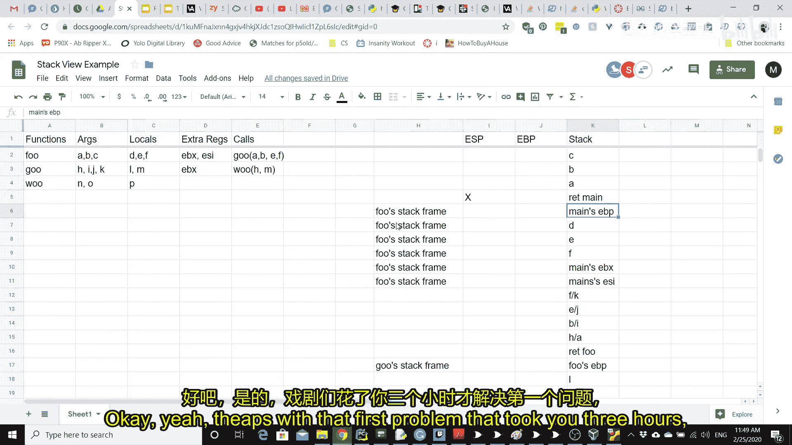

With that first problem， took you three hours， but you said if it will take us less time。

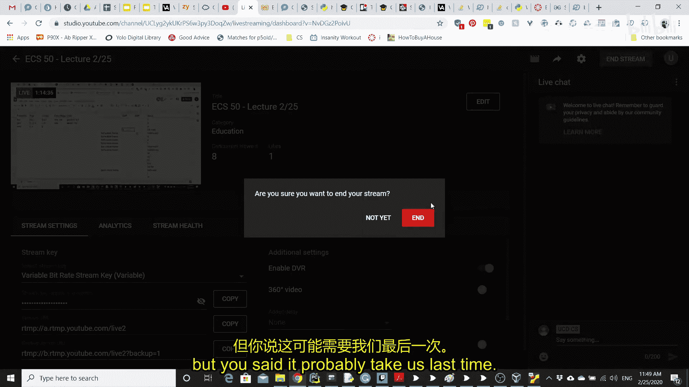