# 【全集】加州大学戴维斯分校 C语言与汇编语言 中英字幕 1080P p15 Lecture 15 - 调试 -BV1xefZBHEas_p15-

So thank you guys for coming up so we're going to do a little bit of roleplay exercise。

 you guys collectively are going to be the instructor for the class and I am going to be the student coming to you during office hours。

I， I know right。Okay， here's how we go， my code doesn't work。What doesn't work about it？

The output doesn't match the answer。Have you tried running it for your D， no。

Maybe you should try that first。I'm not sure how， I never done that before。Do you have GDPb。

 I don't know。我给你。Yeah， it looks like it's up on the screen right now， so I have a idea。

This one's supposed to be sorting some list numbers。Well， that's the compilation code。

 but it's not working。go to your seat。Where well， so。So I got sea lion。

 so I do have it even though I don't know I have it， right？

The GDPBs in there right right but where should I set a breakpoint at？

Set a breakpoint at the beginning and then see， keep running through it until it stops matching the C codes output。

 Okay， right， so that's a good idea right， as to like it's not working but I don't I mean， I mean。

 yes， ideally like that's what we should be doing right。

 But one of the things is is like that's kind of like missing here in the conversation is I told you that it didn't work right。

 And I told you it's just not matching But like we never even went drilled down further like how was it not matching。

 Is it crashing right， I it just putting out the numbers in the wrong order right。

 what's going on right So this one we're supposed to be writing it。😊。

Do I even know what the right answers to host to be yet？

I have to have all these things kind of figured out ahead of time to know whether it can work or not so here's some numbers hopefully we should get something like negative 7。

38 12 45 or 2345， 51 right that would be the hope。And when we run it。Doing its thing。Okay， right。

I mean， yeah， I have output that's good right， but now it's not working so how can you guys help me identify like where I should be setting great points on？

Right again， at least here's the main portion of our code， it's right there。

 so I parse the arguments， I sort the arguments， and then I print the answer。

So what I want to look first given my output。就。不看。So parsing the arguments right because like maybe I'm not getting the arguments correct right so maybe I might want to start like setting a break point。

 maybe like after like line 66 to see if it works correctly right maybe at a break point here。嗯。

And so it's going through the debugger， right？And then we get over here。I won't do that one yet。

 is my breakpoint not set， or I deleted an accident？Oh， looking at the wrong thing。No。

 this' is the right thing。So div here。So we're here， right， Well， how can I look。At my array。Right。

 I mean， that's what the thebuggger is showing me just by default。内容を。Yeah。

 we're there and then you can press on the。你0我。But yeah， maybe see like array， it's 12。But。

 but isn't there rate supposed to be more than 12， is it supposed to be all those numbers Yeah。

 we could go to the G tab over here。Yeah， we can use the print statement。

 so what should the print statement be to print this out？Yes。P A R。Right， zero at。

And then Ln should probably do it， right， how many things there are。Okay， right。That looks right。

So what should I do next？这他询。嗯这个。Into what。Right like maybe am I passing in to get sorted correctly so sure。

 so then I would have to like no step into here to see what's going on and again we could run that same statement。

Is there？Now what？It's not working。Yeah， you know， right？I feel the same way you guys come in。

I appreciate you not saying。唔系。I have a problem。 That looks。 I'll do the。般。Sure， that is a for loop。

I keep keep up。Right， so here it's not fantastic， right。

 we should be seeing what our code is doing and we should comparing it against what we expect to be happening Do 0。

1，2，3， right， the index of the negative 7， right， You got it。

 I think you said three because you saw three， but it is the negative 7， that's but the index。

 The index is 3。 So you had it right， but for the wrong right wrong reasons。😊，The first time， right。

 so we call our function。And while we look back over here at our variables。 Oh it's three。 fantastic。

 Okay， it's working。 What should I do。😊，Go to s open to you。What swap is doing to like。

 just make sure swap works compared to what you think it's's what it's doing versus what it's actually doing right。

 But like shouldn't I also check to see if the sortded gets the right thing too。

Because that's what's done next。Right， so here we'd want to look at sorted and if we go back over to GDP again。

Instead of printing AR， we'd probably also want to do like sorted and this is like one of the downsides。

Yes， sorted A at L。 And great。 We got the the negative7 there at the front。

 which is what we wanted to have happen。 And then we should swapwamp those values at those spots。

 right， So over here， we look back up。😊，Oops， it's going to let me look back up right。

 we should probably be swapping something like the 12 and the negative7， well does that happen？Right。

 so we do the swamp and then。We look at our RA and the 12 and the negative of7 swapped right and we want to keep looking and we want to keep looking we want to keep looking。

 but it's all about verifying our expectations as to what is happening versus。

Like what we expect to be happening， all of you guys seem to have the debugging process down so fantastic。

 but a lot of people that I still see come in and it's getting less which is good。

 there's still the questions of my code doesn't work。

And then it just ends with that statement period right and you haven't done any investigation into your code to see what's going wrong。

 Why is it breaking， what is happening in your code right you have to do some investigations。

 query your code to see what's going on right and I agree the assembly code is it gonna make it harder because it's lower level。

 there's less abstraction， but it still applies higher levels up to when you're doing your C code I it doing what I expect to do。

 So you got to know what's supposed to be going on。

 but you got to keep checking and verifying it right like as an example like yesterday right。

We had a group of people come in and were working at it and it turns out like their matrix is getting the wrong values。

Right instead of having like you know make like C and I be a pointer to the array that held the values。

 it just had the value that was there so it was going wrong now if these people are finding that you know C and I instead of having a pointer is actually having a value what should they be looking at in their code。

是。Where CI is changing right and so they should be printing out CI right you know the C at zero that it gets set appropriately and then we know that it's changing to a wrong value。

 so what do we want to find？Where it changed to the wrong value right and that's going to give us some intuition about what's going wrong right so eventually we found like as we kept de bugging that instead of when things were going wrong into ECX they assumed they had C I but they actually had C right instead of having CI right so that's why it was going to the wrong spot and then so we get to that point and we're like well ECX is supposed to be C I but it's C and so we know that's the problem so what should we be checking next？

ECX at this point in time was supposed to be C at I， but at this point in time it was actually C。

 so what should we be checking about ECX？Like when it changed right。

 we should be checking to see well did I ever put C at I in there or if I did put CI in there。

 did I accidentally change it to be something else later on。

 so youd want to be checking all of the assignments to where CI got set。Right。

And then eventually we see that， okay， well， oopies， we didn't ever actually put C I in there。

We only put C and we just made the mistake right so eventually we need to figure out how to get C I there。

 but it's all about investigating and asking your code what's going on and then making the updates a lot of times think you guys you guys can sit down and you give them a hand。

まとめ。So like a lot of times， what I'm encountering is you guys know how to use the tools， right。

 You know how to do the print statements， You know how to display things。

 but you're never actually looking at what your code is doing to figure out what's going wrong。

 You still give it the classic， good， old， hard look at。RightYou give it the hard stare。

 why aren't you working correctly right， why aren't you doing the right thing and if you just look at the code really hard。

 it's never going to tell you why it's doing the wrong thing because you assumed you wrote the right thing。

So all of a sudden， right， if you believe everything you put down was 100% correct， right？

How are you ever just going to be looking at just harder going to find where you made the mistake？

You have to have something show you like， oh， it broke here， whoops wrong value got placed there。

 right， see what's going on， investigate the code。Right， it's like。

and this is one of the things that I have like a hard time teaching you guys is like this intuition right if like we know that our code is failing to sort。

The array， right， we should look at our code that sorts the array， right。

 If we're like playing a game of battleship and we see that our AIs are shooting at the wrong locations。

 we should look at what part of the code。The part where it's shooting the wrong locations， right。

 or if our boards are displaying incorrectly in a game oftictk toe， we should go look at。

The part where we display our boards， but it might also be the part where we update our boards too because we might to put the wrong things on it。

 but you have to look at the code to see what's going on， right？

And I know you guys are still learning， but I want you to like。Still improve and get better。

 And if you keep seeing these mistakes commonly， I want to point them out so that you guys can stop doing them。

 So when you come to office hours， hopefully， it's not just my code doesn't work period。

 It's my code doesn't work。 Here's what it's doing wrong。 Here's why I think it's screwing up。

 but I'm having a hard time finding the exact area where it's going wrong。

 right I think it's screwing up in here。 Here's what's going wrong in there。

 But I'm not quite sure10% why it's breaking。 That's fine。

 but you do need to do the investigation yourself。 Does this make sense。Right， and you know。

 how many of you guys have been that position where you're just like， my code doesn't work period。

I mean， I imagine like most of you guys should probably be raising your hands。

 I know I was definitely at that point in sometimes too。

 but hopefully know as you guys have been progressing through this course and you've been learning how to work with the debugger more。

 you're getting better at figuring out how to ask your code what it's doing to figure out what's going wrong。

Or like as another example of' what's going on， like you know。

 let's say that you're working with like a painting company right and you're supposed to be pla your houses blue and all of a sudden you start getting complaints with your customers that the houses are green。

What should you do？Look at paintWell one thing you might want to do is check out the paint right go look at the paint buckets that your painters are using right and so you might open one of the paint buckets that you have on hand and you look inside of it and you know maybe it is accidentally green Well whoops。

 you found the source of your error right but maybe like you know you look at it in the office and you see that the code or the paint looks blue to you here。

What would you want to do next？What。Well maybe talk to the painters right maybe like the paint you have is good but maybe the paint they got was bad right they got the wrong shipment。

 you're sending the wrong things out， right？And so now maybe when you go look out there。

 you see that the paint buckets are actually labeled green， well whoopies right。

 you gave them the wrong buckets right， but what happens if you go out there and you look at it and you look and you see that the paint the buckets are labeled blue。

 but the paint inside now looks green to you。Well， maybe the buckets are mislabeled right。

 or maybe the buckets weren't exactly mislabeled， but maybe the quality of the light。

 whether it's under fluorescent light versus natural light causes it to look different。Right。

 or maybe like when when you go there， it's labeled correctly and it's like green。

 it's labeled like correctly it's blue right， but maybe your painters happen to be colorblind right and so they didn't notice the problem right that might be the issue or maybe when you go there。

 the paints labeled blue and when they apply it， it looks blue but as it dries out， it turns green。

Right。Maybe there's some chemical reaction going on with the pain that causes it to change colors。

 but you have to keep investigating， but notice that in this process of trying to figure out why our houses are not blue when they're supposed to be blue。

 we kept looking at for possible sources of errors right， where can mistakes have been made？

And then you have to apply that same type of logic to your code when you're debugging it， right。

 go look at those areas where things are breakingking， right。

 If you're getting like memory corruption errors， it's probably because you went either out of bounds on your array accesses or you didn't allocate enough memory right Those would be like the first things you went to check out。

 though there might also be problems where we had one issue where they were having this problem。

 And it turns out they broke the Gcc calling conventions。

 which is also a really common source of error for the set of homework assignments。

 And what they did is instead of they did push EBx push EI push Edi， then they did at the epilogue。

 they did pop EBx， pop EI pop Edi。They pop them in the same order。

 they push them when they needed to be popping them in the reverse order。

 but they push them to find the problem right so you have to keep looking and keep looking and keep looking verify。

 verify， verify， verify， verify that everything's working as it intended。Does that make sense？

Is there a way to write a a script？That you can。Okay things。For you after。

Youming to change you can then like run some script that shows all。对一个。

I'm not sure the question that you're asking for。I like。

When you put press statements inside your reached for out。

 you can see the raise but like every time it runs。Yeah， you can type display。

Are you talking about like when you go to recompile it。

 like you close DD and you open it back up again， you can run make from inside DD， just type make。

And then go to reload source instead of closing D and then reopening it。

 just run make inside of GB or D if it's inside a G it'll automatically update itself and you're just done right if you're running inside a D。

 you have to type make and it'll go update the source code then go to like source reload source to update the view that that's there and then all of your old breakpoint will still be exactly where they're at。

 all your old display statements will still be exactly where they're at and everything is fine。

One other command that you might find helpful is watch and you can say watch some location of memory generally be like watch a variable and anytime that variable changes the debugger will automatically stop and show you here was what the old value is。

 here's what the new value is so if you're like I know that this variable is getting messed up like variable X is getting messed up but I'm not quite sure where X is getting messed up at you can say watch X and now anytime x changes it'll stop for you and be like okay exchange change from here to here and you can verify whether that was right or wrong。

And if it's wrong， great， you kind of have an idea of where to start debugging that to where things are messing up。

Does this process make sense？It is a skill。 It does take time。

 I can show you how to do the print statements， but you actually have to start applying them。

 and hopefully you guys are feeling that you're getting better at debugging because you guys are probably actually debugging before this class。

 how many of you guys would routinely use a debugger when your code was not working。Okay。

 how many of you guys would instead use print debugging？To display like what was going on。

How many of you would still use the classic look at it much harder than I was looking at it before？

That one tends not to yield any answers for the most part。Right， so。

Hopefully you're getting better at it， but you know for those of you guys where the code wasn't working in the past。

 how did you ever make it right， what were your tricks to figuring out what was going wrong and how to fix it。

 what did you do？Did you guys do anything else besides those three techniques？でしない。Okay。

 yeah there's this classic start over technique， everything's broken， I don't know why it's broken。

 but maybe I won't make the same mistake next time。Anything else？Right。

 so I guess it should also has this in your first programming class you took。

 how many of you guys used it a bugger， The very first one where you learn how to program。No one。

 how many of you were doing print debugging？Okay， a very good chunk of you。

 which is happy to see how many of you were just doing the good old stare。Yeah， yeah。

 I mean it's fine did I still do it all the time an accident and I need to go do it。

 was there any other techniques that you were using to resolve your problems？Working on papers。

 stack overflow for potentially common errors， right， You might have like。

 talked with a friend or talk with your instructor about like what's going on， right。

 But some of the times it's also important that your problems be hard enough or they break。

Or you actually be forced to investigate。How many of you in your second programming class。

 you started to use as abugger？On a regular basis。Okay。

 how many in your third class you started to use a tobugger on a regular basis？喂。There's this one。

36 B and I guess so the rest of you is like this is your fourth programming class。

 so how many of you started to use a debugger routinely in this class to start solving your problems？

And so the rest of you guys， I should say， how many of you at this point in time currently use a debugger to resolve your issues when your code's not working。

Yes。And how many of you are still relying on print buggging？Okay， so again。

 I encourage you to switch it's going to make your life a lot easier if you learn how to do that There are also like other applications like designed for like CN andC plus plus like Valelgri that will tell you like where your memory leaks are happening at or where you're going out of bounds when memory axis and how far。

😊，But usually the debugger is still probably the best tool and the best time saving thing you can learn how to use。

But it's a good idea for me to kind of like know when you guys are learning that how many of you guys have taken 36 seat。

How many of you guys were using it tobugger in there to figure out what's going wrong？

Prince statements。O稍费。Well yeah， I mean， I was talking about Sean the other days。

 like no one knows how to use a debugger in my class。Whatt。32 A or so okay。

 and how many of you guys took 32A？How many of you were taught or at least shown how to use a debugger in that class？

Okay， 36 B， how many of you guys to 36 B？How many of you were taught how to use the tobuger in that class？

Okay， how many of you used it in that class？Okay， good， how many of you took 36A？

How many of you were taught how to use the bugger in that course？Okay。How many of you took 36 B？

How many of you were shown how to use a tobuger in that course？

How many of you use the debugger in that course， Okay。

 so it seems like the issue is people not teaching you early enough how to use a debugger。

Which makes sense because a lot of the pros for teaching the A course is the entire last year。

832 AM368。Yeah， but I still show everybody how to use a debuer in my class right it's the exact same thing that you use here in like sealine the same kind of interface。

 but we won't do like DDD or GB at that point。格是还说。Yeah。

 because you're like over here right like this is like sea lion right， and then there's pie charm。

 which is written by the same folks like their IDdeE， if this pops up in a second。今晚。

And I can set break points the exact same way by clicking on。Well， maybe this will actually load。

But anyway， you can do the debugging and pie charm the exact same way you do the debugging in。

S line by just clicking on the left of the line， pressing the debug button and apparently it's working very slow because they have too much other things running at this point in time。

你的。嗯。I think it's like piey bee is that debugger， and they should have like a little window over on the side。

 but this is like running really slow for whatever reason bug an idol。

Yeah well Python tutor is more like a visualization tool， it can help you debug things。

 but it's only for like small examples as to what's going wrong and it's a great teaching tool。

 but like if I'm having you write a 500 line code program you cannot put that in。

In a in like Python tutor and have it help you figure out what's going on right， But again。

 the bugging works the exact same way here And don't forget you can do conditional break points too right you know right click on the break point and say。

I want to add a condition if it ever loads， I guess I can close this because I don't need anymore。

Measures create ups and resources。

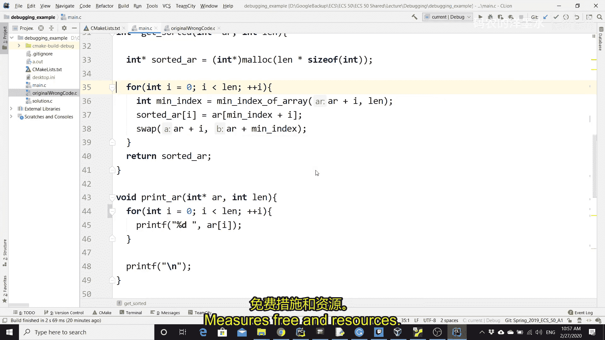

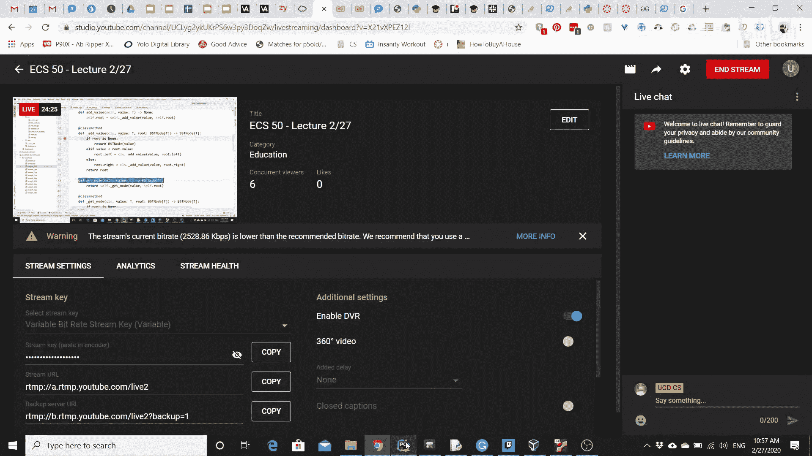

He on。It's just when you're writing recording software and a virtual machine。And an IDEE。

 and you have a ton of tabs open in。Chrome it's slow， right， So you can add your conditions here。

 Or if you're doing it in like GDB or DDD， you say break line number if。Condition。

 you write your condition out and it'll stop there。So do learn how to use the tools。

 it'll save you so much time。We just want you to be better and stop having the head banging moments。

Against the wall like where things aren't working and not being able to make any progress because that investigation is progress because you know what's working and what's not also running test cases like using unit testing is really good if you've ever learned how to do that yeah。

If you're talking about us number9 to Twitter， do you have a take on like the whole issue with switching up 36 A and 36 B。

Like John always on the about that。You mean like since we've switched from 3040 60 to the 34。

 and then we switched to of the classes。I don't know it always talking about how there was an issue with that or something else Well。

 like up until there was it like when we made the switches。

 I didn't think it's been worked out for the best so far because the entire last quarter。

 36 a was taught in Python instead of being taught in C like it was in the past it's gone back to see which I think is an improvement because now there's less content to cover in 36 B so we're not having to rush as much。

And teaching you both of those things because it's too much to do C and C++ in one class。

but then I think also some of the reason was a lot of the instructors for the A series like didn't push everybody as hard as they should have and also covered enough of like the fundamental techniques like how to use a debugger to make you be better at things as well。

All right， because like， I don't know， we did like battleship and 36 B。

 but battleship would be something like I would end 36 A with。

And a lot of students struggled with it because it was like 500 lines of code。

 which is five times larger than anything they'd ever done before。

In addition to like the object audio programming and the complexity of what's going on there。

 it was a big struggle。Oras I would end with something like thatm。32A to get them you know。

 prepped going forward to handle something like that。

Because like I pulled the students in the class and they basically hadn't done an assignment that was like over in 100 lines of code。

Yeah，Yeah。Yeah。didn't。So we make like a plastic stop。For。St that every time they do help us give。

How to do something， we can just all add it so that way you know where to。

 sometimes honestlys not actually。你是。Sure sure， sure we can do that There's one other thing I want to cover first。

 which we'll wrap back around to that over here though I wanted to go back to this example that we started with。

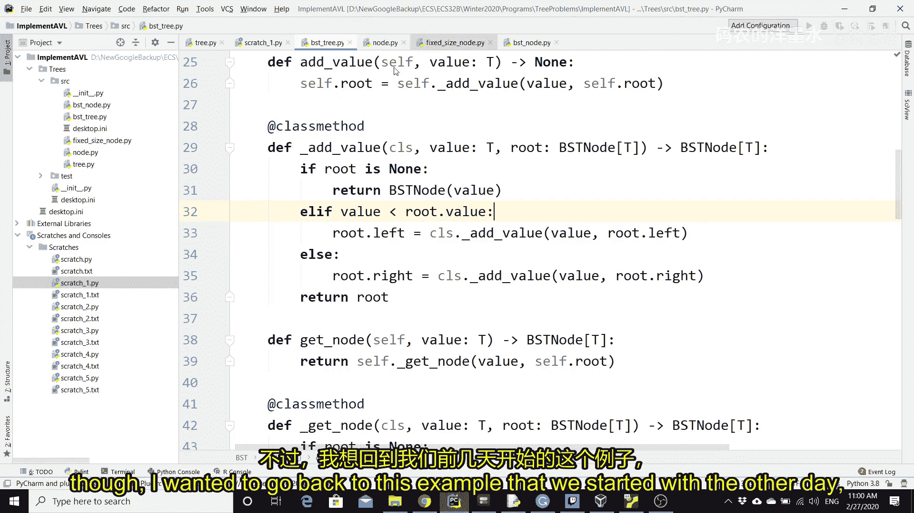

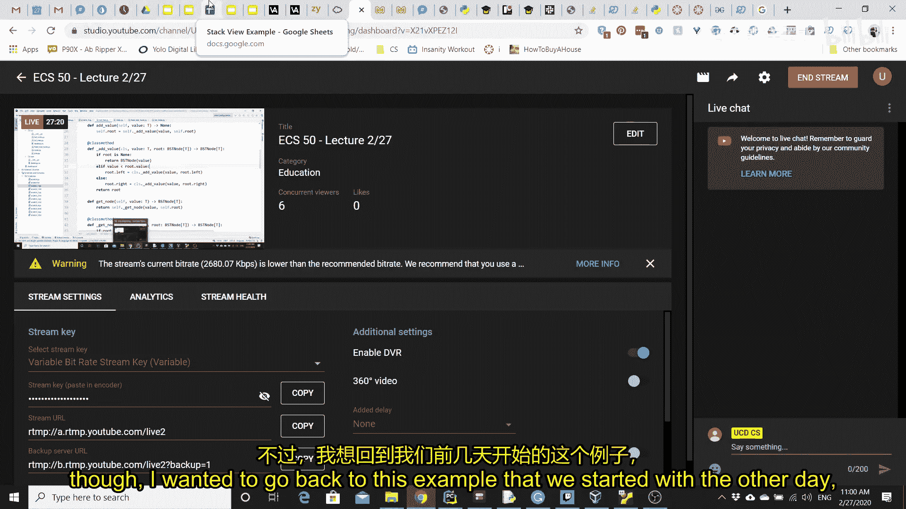

The other day， which was talking about the stack frames。

 and I said it was possible from a call function to access any of its parents arguments or any of its parents' local variables。

So assuming that we were down here。All the way in Wu。😡，Let's assume that we wanted to access who's。

 say E， how could we do that？Yes。嗯。Right，Because at this point in time， EVP is right。Here。

That's spot， right， that's a small。Right， and if you kind of remember each of these guys。

Points up to the previous one because like here when we saved。For example， we saved Fs EBP。

 this is probably like a bad oops。

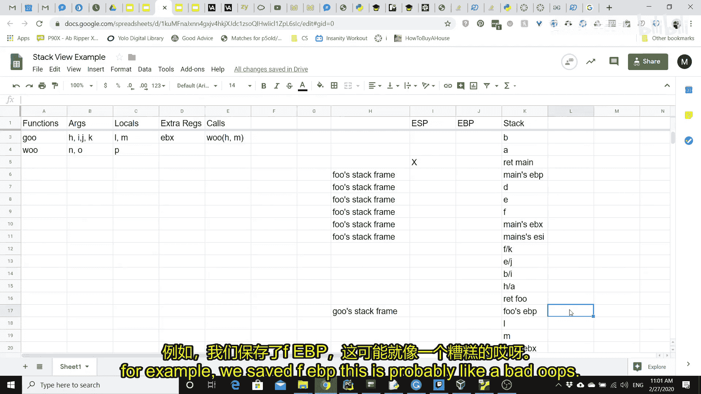

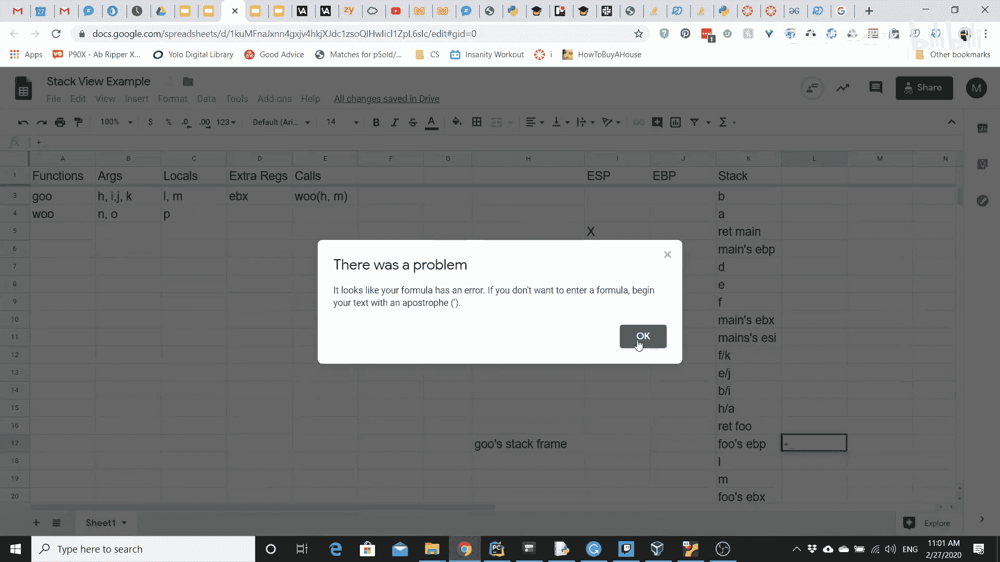

Oh， I have to begin it with an apostrophe。Make you happy。So if we're over here。Right。This guy， Fs EP。

 it points all the way back up to。Here， but best approximation of drawing a line here in Excel。Right。

Or down here， when we have W stack frame， EBP is currently pointing here。

 So here we have a pointer pointing up to。Probably something like this， no， nope。

 just want to copy that， go away。WellOkay， sure lying。Lyine。Lying。Apostrophe。Qu simple。Arrow， arrow。

 arrow， and it's pointing to here on this line。啊。So maybe I need to draw it out one more level。

So that we can see this no。Up there。APorophe lying。And then。Little  narrow。

That makes us 14 so that we can actually see it。That's my best approximation of drawing lines for you。

Here in Excel。So how could we go about doing this， how could we grab it？Yeah。

Lax is the pointer right， so let's say we did something like this move L percent EVP into EAX right now EAX points to where。

Yes。Now it's pointing to go EBP， right because we sped EBP is equal to or EX equal to EBP。

 So EAX also points to this line。 Well now I want to go up from here。To hear， how can I do that。对的。

Yeah， so move out。Perscent EAX to， say percent EAX。Now EAX is going to move from here to。Up to here。

 pointing to this line， right， So now I want to go to Fs。

 So how can I make it go to up to Fo's stack frame。嗯。No， we do the exact same thing。Right。

 because again， if we dereence it， EBP ends up pointing back up to。Here。Yeah。Opes。

 this line didn't go up enough。This line should have gone all the way up to。Here。To that point。

Right so if we do the line again， right EAX is currently at this line if I put the pointer that's there into EAX。

 EAX is going to pop up too。This line， now， let's say I want to ground E， right。

 So E is going to be how far past this offset。It's going to be negative too， right， so then movel。

Negative two times word size past EAX。2%， yes。Andvoilah we're there， and we grabbed the argument。

 or we've grabbed one of the local variables of the function two levels above us。

Right and notice that we had to dereence it twice because we wanted to move up。Two levels， right。

 because we wanted to move from Wu up twice to。Fo， right if we wanted to go to just G。

 we would just move up one level， or if we wanted to go to Maine。

 we would do the dereencing portion one more time to move up an additional level。

Does that make sense？And this is how like the back tracece command and G and DDD works to give you the stack frames of the functions that calls you。

It just follows up the stack frame pointers to get to the appropriate function and display all of their local variables and all of their arguments because they're always going to be laid out in the same order。

 you just have to know how many locals and how many arguments you have right which is what the dashG part is going to help you with。

Are there any questions here about accessing one of our called functions arguments？Yeah。

Would this be something new to not having。C。If you want to in another function。の元。啥。

So could you use this to avoid copying the variables？Yes， you could。The hard part though。

 would be like in a generalized statement， how do you know。

 how can you give your function the information of where it needs to go to grab its parameters that happen to be somewhere else？

It might be a bit difficult， or again， if you really wanted to pass that parameter。

 what would be an easier way than doing something like this if you actually wanted to pass pass the original quotation marks。

😡，下去。Well， I mean， but again， if you put the value on the stack。

 are you actually putting the original on the stack？You're putting a copy of the value right。

 which is why like in C and C+ plus， if you change the copies of values， right。

 the parameters of the value that the function I called， they don't get modified at all， right？

Yeah you push their addresses right and if you push the addresses on the stack well then you have great access to that variable and then you can dereence it so that's how you get the original right。

 but you still have to have some generalized format for passing these things in just passing the address as opposed to passing the copy of the value。

Any other questions？Okay。😊，So， then。Let's pop back over here。And。That's the wrong class。50。Sure。

Sa lecture。Let's go to assembly。So for doing the debugging commands。

 are you wanting to do them specifically for？Assembly or do you want to do them just generally？

I mean we can do both， it's not that much different， right？

So what things are you wanting to do right， So for like break points。

Or is something else besides breakpoint？So casting things to the appropriate type。

And then how much we。ちです。Okay， sure， but like for break points， it's pretty simple right。

 it's like break at location。Like be location where location。Is either a function name。

A line number in the current file。Or。File name。Colon line number。Right。

 so you could do something like break at 50， what would that do？You know， break， this would do。Bre。

At line 50 of the current file， whatever file that you happen to be in right now。Be at my fun。

Would you。Sot of break point at the beginning of my fun， wherever it happens to be。

 And if you're like you're in C plus plus land right， and you want to debug it right。

 you can say like break class Co， function name。To break at that particular classes' method。

 to stop on it。Right and then if you want to do a similar file， like be some file。You know， dot C。

 colon25。 and that's going to do what？Yeah，B it line 25 on some file that's see whatever happens to be。

 right？Conditional breakpoints。Right， so these are just like simple things。

It's break at location if condition。And the B， you can write break or any like subfix of break that you want so you can be like BR。

 BR EA， I just do B because I'm lazy。Right， so you could say something like break。50。

 if I is greater than 25， and this will set a break point online line 50 and will stop there only when I is greater than 25。

 Again， conditions can be more complicated。For printing out variables like displaying variables。

It's P expression。Show result of expression once。Right and expression can be arbitraryrbitrarilyly complicated。

 print I plus 25 minus 37 times 60 at 30， you know at summer writing， right， whatever you feel like。

P expression， display expression。Show results of expression。Every time you break。

So it'll just keep showing it up。And then the final one would be like graph display expression。

And that's just DD only。Right， so all of you guys should be hopefully good with all these ones。

Now in terms of like the assembly， right？you， displaying a register。Right。

 we might do something like。P dollar sign register name。

Right like P or you know any expression that you want right so P dollar sign EAX right if you want to see it as a particular type。

 you have to cast it right， so print， you know， as an integer pointer dollar sign EBX。

 and that'll show the result as an integer pointer， right。Are we all caught with that？

I do need a dollar sign on a percent sign。All so that's displaying a register。So this is the address。

Well， no， it'll display what's in EBX， but it'll print it as。A pointer。Right， or again。

 you could do something like。P， you know， as a short。Dollar sign， ECX。

 and this is only going to show the lower two bytes of ECX。Yeah。R。

There is no address of a register because the registers don't live in memory， they're inside the CPU。

Right， so you can't do that。Right。So。Displaying labels， right？It's just。P cast it to the type。Label。

Right， so like P as an integer。Lenen， and that will show Ln has an integer right。

 then let's say if you're working with arrays and you want to see their values right。

 you'd have to do something like P integer pointer。Throw an extra parenthees on here。

 the address of say， AR， if it was an array， and then this will show you as in an array。

 but you might want to see， you know at。five。That'll show the one at position five。RightAnd again。

 that five in there could be a much more complicated expression。

 It could be dollar sign E X dollar sign E Bx Do sign Ex plus 23， right。This can be as complicated。

As you want， right， so dollar sign EX plus 23 minus89 oops。A看。Yeah， and I'll show you AR5。Right。

 one thing that I guess I didn't show you how to do previously， what's for displaying arrays。

It's like print again or whatever the display expression you want to use。

 and then it's your array at start。At nu elements。So this will print。

This many elements from the starting position， right， So if we want。

 if there was a variable called L and so we wanted to see all of the elements in AR。

 what would our expression be。Assuming there was a variable named L that held the length of the array。

Well， yeah， but where do you want to start， we want to see the entire thing。

Zero at let' show of them。Yeah， you can story3， right， Let's say we wanted to display， right。

 This would be。Display。L elements of AR。Let's say that we wanted to display the last three elements。

Of A。で外。Right， so we could do like PAR now where do you want to start at。

 assuming me again that there was a length。Variable。

maybe like1 minus three might need to be like1 minus three minus one potentially。Right because again。

 you might do some example right if we have 10 elements right and we want to display the last three。

 10 minus3 is7 right so then we would want to display three things from there 78，9 so yeah。

 it would just be minus three and then at。3。The last three。Right。

If you have a multidimensional array， especially if it's dynamically allocated。

 this will show a sequence of memory， but because each of the rows of a dynamically allocated array starts at a different position。

 you have to do each row one at a time。Right。So like for example。

 let's assume we had like a matrix that is， you know， three by four。

And we want to display all of its contents。Yeah， and it was dynamically allocated。

 it's an array of arrays， how could we do that？Well， we have to do it one part at a time， right。

 So we do like P matrix。 Well， we want to do the first row， zero at how many things are in it。4。

And then。The next run。One and then the next one。2。There's no way around doing that。

If you remember that's too big after that。Now it'll do it。

 it'll just display what's good's what's pass the array right so you got to make sure that your bounds are correct when you're asking to display if GDP is unable to access that memory it'll say I can't display it。

But if it can access it， it will display whatever's there。Does make sense？

Right so a lot of what you're doing now is just having to figure out like what's the right thing to cast it to right so for example。

If we go down here and we'll do like。Another example。

 so let's say like we're displaying arrays again。Because it's assumed in C and it already has a hyp。

Right， if it had a label， we'd have to cast。 We have to take the address of the label and cast it to the appropriate type。

 right， So let's assume that。In EAX is the pointer to an array of integers。Five long。

How would we display it？Or graph display or print or display。

 I'm just going to do P because it's shorter， right， So P。Yes。嗯。In there your pointer parentheses。

 and then we don't really need an extra set here to wrap it up。

And then what are we going to put in here？Dollar signee x so that we only cast the EAX just to be extra careful and then what do we want to see here？

we wanted to display the entire array。Where do you want to start at？0，0。At 5。

RightBecause if you think back to the previous thing for displaying arrays， it's P。

 whatever your array is， at start at the number of elements。Here。

 the only thing that we kind of have to kind of substitute out is what's AR。And this entire oops。诶。

Explaying array。 This entire thing right here is our A， right。Oregon。

 if we said something like in EBX is the pointer to a dynamically allocated matrix that is。3 by 4。

Of shorts。Okay allocated matrix。Probably of shorts。That is three by four。What would we do to display。

Our matrix here。Now以为 I know you got it。P。Integer， but again。

 it's not just an integer pointer now it's a integer。Pointer pointer。Okay。Dollar sign EBX。

 and which road do you want to do first？Rose 0， right。

And then we want to start at the first element in that row， zero。Right， at。4。

 which I did mess up back here。 There should have been an extra zero here to start from the beginning of that row。

Right。So。Right。Very sure。Oh， whoops。Short。Pointer pointer。I cast it to the wrong thing。よ不す。And then。

1，2，3。Now， let's say in E。C， X is the pointer to a statically allocated matrix。Of doubles。

 that is3 by four。 So it was allocated as one big chunk right， but of doubles。

 how would you print it out。Yeah。😊，Yeah。What we do here if we wanted to pronounce this statically allocated array of doubles。

Again， it's one big chunk。 So in memory， it's laid out as what。We， it's a but like in in memory。

 right， our conceptual3 by4 array， if it's statically allocated， it is actually laid out as。

One dimensional array that's。12 long， right？ So here we could do something like P。Double pointer。

 just double star， right， Do sign， ECX。Pracket zero at。Three times more。12 right。

 and that will give us all of it， and it'll display in row major order because that's how C source thingss So you can use your understanding of how things are implemented under the hood to know what's going on。

Does that make sense？Any questions so far about displaying things？Now here we have the fun one。

Explain your arguments。So let's say over here， here's our function。Int fun has an int， A， A cha， B。

 and a short。C。What would you do to print A？Given that it's not in the register。

 it's on the stack always。嗯。You may also assume that the prologue has been completed。

So your first local variable， your first argument is always going to be at position two on the stack。

 so a is always going to be two words。Past a。I mean， two words passed， not a， but two words passed。

Right， EBP， so that means EBP functions like a what to A。It's a pointer right。

 and so what should the type of our pointer be？Interger pointer。 So P。Right。😊，Inteageger pointer。

 Do sign EBP， which position do you want to see it at？在。Okay， there's a second one。

Does that make sense？Now， what about printing B？Yeah。Yeah。Do you guys agree with this。想。

So you want to change integer pointer to Char pointer。So right now。

 we will be displaying the character， but we'll displaying it as in。Integer， right。

 So you got to the right spot。 If you change it to char pointer。

 it will not be correct because you won't go far enough。 You would only go3 bys。Past EBP。

 But you want to move 3。Antegerors pass to be because everything on the stack is a word size。

 so even when you're pushing even when the arguments is a like character it's like one by big。

 you still push a four by quantity， three of the bytes there just garbage。Right， so here。

 this gets you to the right spot。 But we don't want to interpret this thing as a。嗯。As an integer。

 we want to interpret it as a。Char， so we take this expression and we cast it entire thing。

Parrenheses， parentheses。And we cast this entire thing into a。Character。Isn't that fun？X。Right。

 and then what would we do to get to C？It's pretty much going to be this exact same thing。

But instead of three， it's going to be。4， right。 And then here it's going to be。

The other thing that you have to watch out though is for things that are multiples of the word size like a double a double is gonna to be two bytes big。

 I mean two words big so every time you had to go across a double make sure that you know add two for its spot in there instead of adding one。

 but everything that's smaller than a word will always be upgrade to a word size。Right。

 one final thing is。Display in。Aray that is on the stack。

And it's not really anything trickier than what you've done， but。

You just got to combine the little sub partss to solve it。

 so let's say over here here's my function and then over here I have like int na rows。And。😊。

Noumb calls。And then over here， I had a integer pointer， pointer map。Right。

So maybe what we want to do for right here， I might want to say print the first or print。

Row at index。Three of mat。How would you do it？点。也不。P。Any boy。All right， dollar sign。第一批。

And then we want to get mat， Matt， how far away。对。Right， this is at index 2，3，4。 So at 4。

 that's going to give us Matt。 But right now we're treating mat like a。Integer pointer right。

 but it actually should be a integer pointer pointer right。

 but if EBP is not going to be a pointer to mat。We can treat EBP as a。

Integer pointer pointer pointer right because if EBP points to mat and mat is an integer pointer pointer。

 then EBP must be an integer pointer pointer pointer。

 one more star than what mat is to be able to point to it。Right。But also the same of you ask。

Then you yeah， right， you could take what we had as to get to the right spot and then cast it to in in double pointer and then you reference it。

 but it's going to be a little bit more work。Right， so here。Well， we want which row？Row three。

 and what element in that row do you want to start at？Add0， add 0。 And then we want to see。

All the elements that are in there， which is going to be。So now I need to get numb columns。

 so how do I get numb columns？Yeah， integer pointer， Do sign EBP。2， three yep。

And there's your monstrosity that'll print。Row3 of Matt。All right， this part right here。

 this is just going to be numb columns。Allops this part right here。Is。Mat。😡。

So you can imagine that this is MA mat 30 at nu columns， right that's what we're trying to get。

P mat at 30 at nu columns。That was the goal and you can access the other individual elements that are there。

Another trick that we could have probably done right here， and let's see if I can get this right。

So here we might have tried to do this。Char pointer， pointer。Dollar sign EBP。

 because all pointers are the same size。Right。And so how far past EP do I want to go？3。

 and now which element do I want？0。We'd give you the same thing， I believe， right？

Does it give you the same thing？I think it should right。

 or for here we could do this and just tack on an extra star because it's not the right type。诶。

Short pointer， pointer。Dollar sign， EBP。At for at。这个。2。Because remember the square brackets。

 remember what they do is they add and then they。De referenceenced， right。

 So if I do like plus you know， square bracket 3， that's plus3 entire expression de referenceenced。

 So instead of putting the square bracket here， square bracket 0。

 I could have just stuck another star over here。Right would have been the exact same thing。

 but I think it's a little bit more convenient to just attack the square brick and zero on there instead of putting the extra star in front。

 but they should all give you the exact same things for accessing the elements。Any questions here？

Is there anything else you'd like to see？那点。Yeah那他自必。

With the GDP where when I try to set a break point that place。

 it says inferior process one process something exited normally like it just exits that means when that happens。

 that means your program just completed and you never touch that break point because you didn't pause。

So like let's say you put a break point inside of an if statement and then you ran your program。

 Let's say your program doesn't enter the if statement。 It just runs to the end。

 the process completed。So depending on where you set your if you set break pointss。

 but your breakpoints never pause。RightYou don't pause that spot。

 It means you never hit the right point for whatever reason this how you interpret that behavior。

 the one other command that I want to show you。That's kind of led to breakpoints is the watch statement。

So you can say like watch memory location。And then what this will do is it'll pause anytime the value at memory location changes。

A lot of times what the watch statements are going to look like though。

 when you're doing it like in C or C++ will be watch。A， you know， watch var var name。 So like watch。

You know， numb rows。Watch。I， right， those things would like all work。

Or you could do something like watch you know， your array at I。

What does that change it's a little bit harder to get these expressions when you're doing the assembly because generally you have to say like I want the address of normally whatever you're trying to watch and should stop there。

I don't use watch all that often and watch is useful。4。When you know something is going wrong。

With that variable。But you don't know where it is going wrong。

That's when watch is useful like I know this thing is changing， I know it's changing to a bad value。

 I have no idea where it changed that bad value at。

 which could definitely happen in some very complex programs where we have a lot of stuff going on。

Any questions here？Okay。

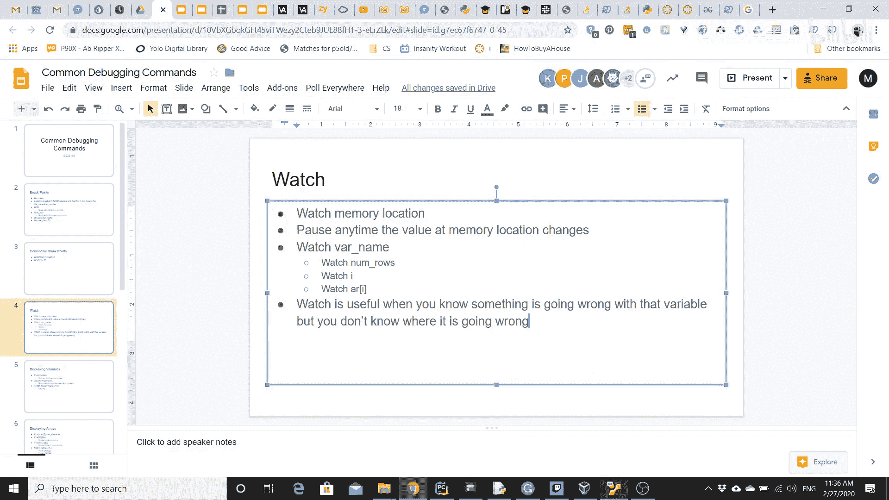

Hopefully， that aside for debugging didn't make you too sad。Again， it's a super important skill。

 like the skills that you're looking to develop。That are most important are the problem solving skills。

 not like the。Technical skills， mostly right， for loops， if statements， while loops。

They're pretty simple， right。Functions not too bad right the things that you want to practice and really work on developing are like how do I say how to solve problems right how do I organize solutions。

 how do I make sure that I'm applying abstraction and breaking problems down and decomposition And when my code doesn't work。

 how can I figure out what's going wrong with it that's what you're looking to develop the most。

During your time here at school。And those ones are always the hardest things to develop。

 and they take the most time and。They just take practice。So we're now going to talk about。

In line assembly。

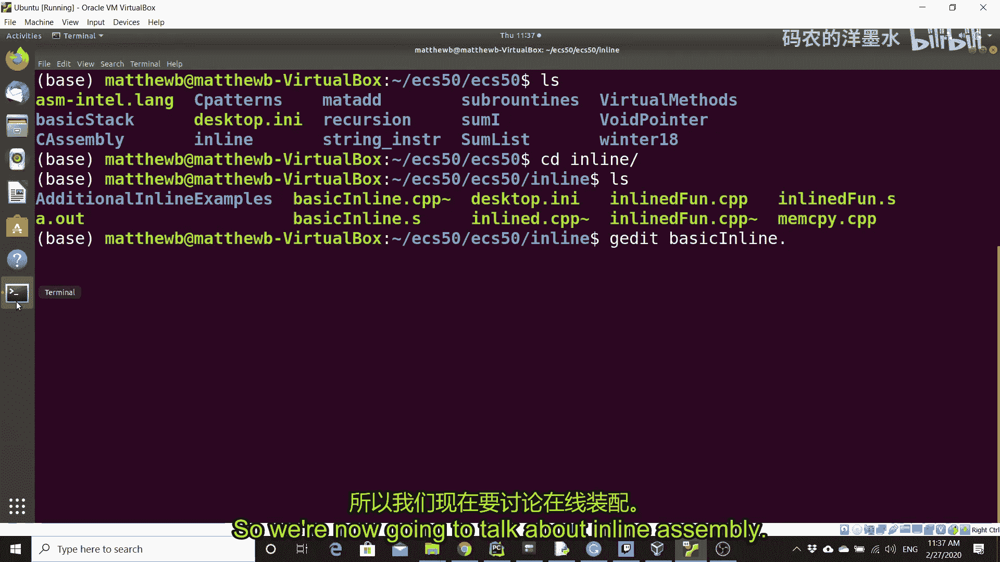

Oops， I must have misspelled that name。

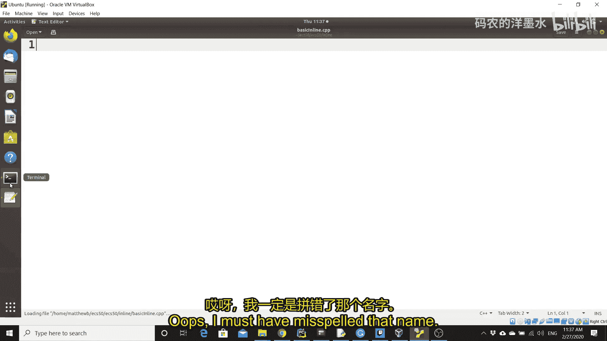

Did I delete the thing， is it not there？

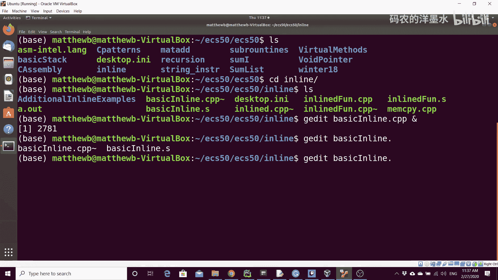

Well， I guess it's good there was a backup copy。

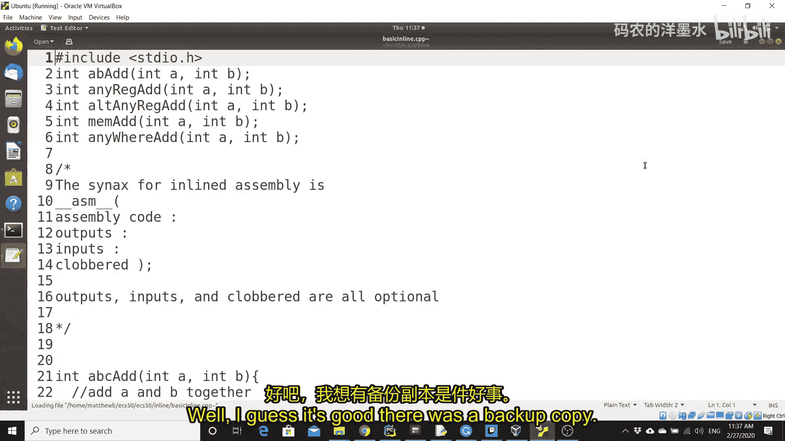

One second。So copy basic in line dot C P P。Till day to basicinline docP。

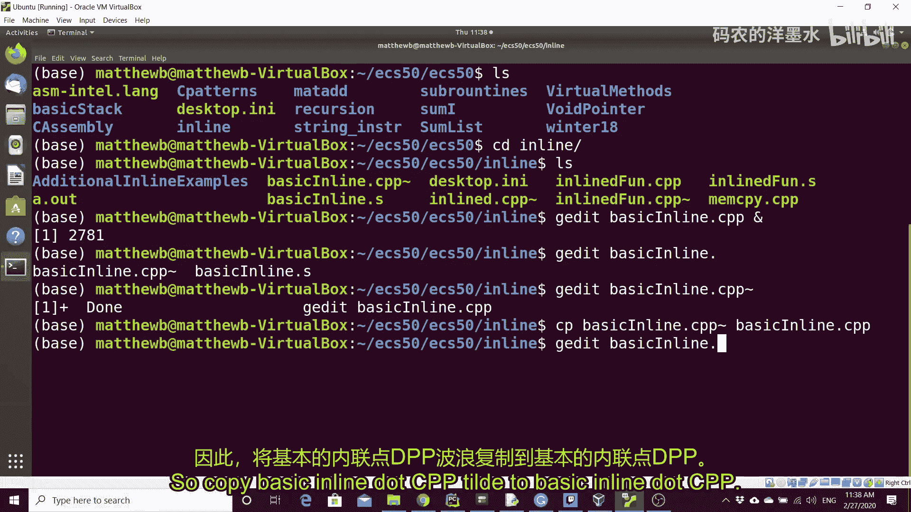

So again。We hate writing assembly code。Right， probably we've all come to the agreement that it sucks。

And again， generally， we're teaching you assembly code to give you a better understanding of how the machine works。

 And， you know， for some ways， like how are arrays laid out， right。

 You also now understand when you pass a variable to a function。 Why do you get a copy。

Of that function， right because you're always pushing copies， not the originals。 right。

 You know what's going on there。 You also understand that like recursive functions are more expensive than iterative functions because of all the additional overhead of pushing all the arguments and popping all the arguments and doing all that extra cleanup So we only want to do assembly when we absolutely have to and generally that's in a small handful of cases。

 these are you need access to special instructions that the C compiler will not use for example。

 there are cryptographic instructions inside of the Intel CPU that can cryptographically encode or decode certain values。

 and you'll want to not have to implement them by hand and implement and C because itll be one much tougher and two you're probably going to screw up。

 So just use the instructions that are there because it'll be a lot faster。

Sometimes you need direct access to the registers right， for example。

 if you're writing an operating system and you need a switch between process A running and process B。

 well you need to say process a state and process a state is made up of its registers so you need access to the registers to be able to save them and unless you write assembly code you cannot do that right you can't write and C the other time that you might do it might be is you have some like mission critical piece of code and it needs to be like the most optimized that it could ever possibly be because it needs to be running super duper fast and you think you can do a better job optimizing to the compiler fan。

Yeah Mira I would say， is there not like a C instruction for doing just that or it， I mean。

 it seems like nope。You can request that certain variables be held in registers。

 but you don're going to pick which one。OhOkay， right。So one thing that we can do。

 since we want to minimize the amount of assembly code that we want to write。

 there's C and C++ both support in line assembly， which is you can write a portion of assembly code directly inside of the C code as opposed into a dotS file and have that assembly code be run exactly where you put it。

And so the format for this assembly is it's underscore ASM。Prenheses to market。

And then there's four sections， there's the assembly code section。

 where you actually write your assembly code， but you write it as a gigantic string。

Your output section， what are your outputs going to be and the input section。

 the outputs in the input sections basically link the assembly code and the C code together。

 what things from the C code do I want to put into the assembly code， the inputs。

 and what things from the results of my assembly code running， do I want to put back into my outputs。

 the C code。The Coboard section is for things， generally registers that you decide to overwrite in your assembly code that are neither inputs nor outputs。

Right。I'll say that one more time because the cloboard section is where most people tend to get messed up。

 The cloboard section is for registers or memory that you change that are not listed as either inputs or outputs right so like if you decide to change what's an EX。

 but EX is not an input or an output， ECX goes in the cloboard section。So。

Here's a little example This is just adding to register two values together A and B and putting the result into result So over here I have results and we're going to skip over the assembly section for one moment and we're going to go over into the input section So when you want to list the variables as input。

You say what register do they go in so and you put the register in quotation mark so B would be for EBX A is for ECX。

 C is for ECX， D is for EDX， Capital D is for EDI， capital S is for ESI。Right。

 so this is going to say， hey， before my assembly code runs。

 copy what's ever in my variable B and place it into register E B X。 And again。

 before the assembly code is run， what's ever in EA X。Or whatever in C， copy it over into EAX。

The output section then says， after my assembly code is run。

 take whatever is an EAX and copy it over into results。

Any questions on the input or the output section before we go look at the assembly code that's there。

Yes。So over here we have our code， so our code is written as one giant string。

 and so we need to separate our instructions by semicollins。Now， and again， they're strings。

 because what happens in C and C++ is if you have two string literals next to each other in your code。

 they automatically get joined to form one giant string。But we don't。

 it's really annoying to have to type the new lines。 so we don't bother。 So we just said， okay， well。

 first move EBx to EAX。 Well， what's in E Bx Well that's。B。😡，Then add ECX to EAX。What's an EX。

 That's a。This guy right here does nothing， but it just puts 12 into EDI， but it does 12， I mean。

 EDI listed as an input or an output。No， we just changed it in our code right so it needs to be listed in the clober section and when you list I register in the clolobbber section it's just his name so like percent EDI。

 percent ESI， percent EAX， etc。And then after our code runs。

 we're going to take what's ever in EAX and copy it over to result。

 and what's in EAX is the sum of A and B。Also notice that in the inline assembly code。

 your registers have double percent signs。So percent percent， EAX， percent percent EVX。

 the CC down here in the Co section stands for condition codes， which for us in Intel stands for eFs。

 eFs will be changed right as a result of doing the arithmetic instructions。

 so we list that down there。Any questions before we show you some more little examples of the inline assembly code？

So the nice thing here is I don't have to go write a separate file to go stick my assembly code in and call it as a separate function。

 I can just inject that assembly code to be written right here。

And the compiler will put that assembly code right there。In this spot。Very cool。

Right and notice that for the outputs， the outputs have to have that equal sign in front of them to say it's。

Take whatevers in EAX or take whatever's in EAX and copy that the result。

 market as an output register。There are some other modifiers that you can put instead of equals。

 one of them is plus， and plus means that this variable is both in input as well as an output。Right。

 so here I said a， it's both an input and an output。 So before you run my assembly section compiler。

 please copy what's ever in A into EAX， and then after my assembly code is done。

 take whats in EAX and copy it back over to a。So do with the copy in both ways。

This little plus sign though can only show up in the output section。

 so if something's both an input and an output， it needs to show up in the output section of the inline assembly code。

嗯，是不说。分其。What these ones right here%。So you know how like in print F。

 when you want to signify a placeholder， you do like percent D or percent I。

 but if you want just a percent sign you do percent percent。

s the exact same reason right here because you'll see in a moment that we don't have to be specific about our registers。

 we can like allow GCC to pick what registers to use。

 and then we have to refer to them either by their position or by a nickname that we give them。

 which you have to specify using percents。Any other questions？O。😊，So over here。

 this one is in register ad， so instead of specifying a specific register like EAX or ECX or EDX。

 you can let the compiler choose and you're going just say percent R。

This is generally a good idea to let the compiler choose unless you know specifically that you have to use that register because the compiler knows what registers are already in use。

 and so it can make better choices about which ones to use for your variables。

So when you want to say， hey， compiler， your choice percent are。

But now we need some way to be able to refer to them and you refer to them by their position。

That they show up starting from the outputs so the first output will be percent0。

 the next output will be percent1， the next output percent 2% 3%4， and you just keep counting up0，1。

2，3，4。 So the first variable that you see right here is a so a is percent0。

And the next variable that we see over here is B， so B is percent one。

And so if we had multiple other variables over here。Like were we。Had other things。

For whatever reason， right， if you could imagine that these are all like different variables。

What would so a would still be percent zero， what would D be？D would be。After zero comes。1。

 E would be。2， and then B would be。Three， right， this count up in order zero，1， two。

 three as you find them， sorry for the first one going through the last one。

I personally don't like using the number based things because I forget all the time what numbers are what。

 so you can give them nicknames。😡，Over here。And so to the left of the string。

 you can in square brackets， put the nickname that you want to refer to the register in in the inline assembly code。

 So inside the assembly code， we can refer to whatever register that a is in as sum。

In square brackets。 So over here， percent sum is。诶。Right， whatever register this one's assigned to。

 And over here is B， right， And it's going to be in。B， normally I give the register。

 like the nicknames， the same names as the C variables because it's less confusing。That way。

 but you can name them whatever you feel like。And so add L percent B to percent sum soaring the result back into some。

 right， so some plus equals B， but some started as a because it's an input and an output because of the plus。

 and then the result will be copied back out to a， the total will end up in a。Any questions here？

So some other options that you can do。R M put the thing in memory because you might run out of registers。

 right， depending on how complicated your assembly code is。 So M is memory And G stands for general。

 I guess， and it might be placed in either register or memory。

 which I think is kind of weird because you can only have one operated memory。

 So how are you supposed to know it matters whether it's a memory or register。

I didn't quite understand that。What G said either memory or register。

And then here we could do something like G and G， go where to the you feel like compiler。

There's one small thing that we have to talk about next time on Thursday， which is what does the。

This guy mean。The early clobber， but we'll talk about that on Monday and like basically you guys know how to do the last homeworkr assignment now。

So listen if you finish the current homework assignment。

 you can start on the next homework assignment。I'll see you guys in office hours or on Thursday。

 thank you for all your help with the debugging and just giving me that information so I have a better idea of what's going on。

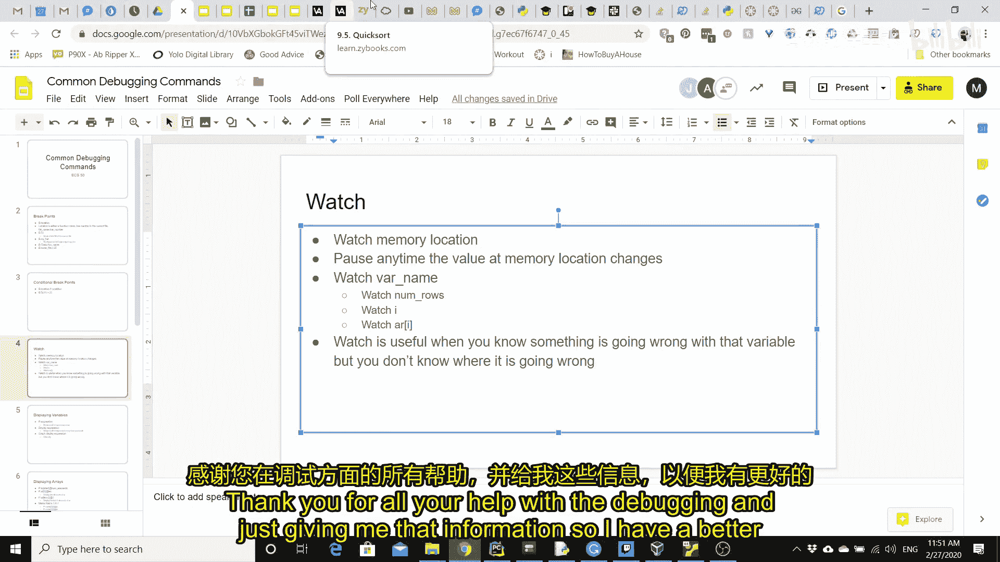

是个。我的给他。