# C语言与汇编语言：15：调试 🐛

在本节课中，我们将学习如何有效地调试程序。调试是编程中至关重要的技能，它能帮助我们找出代码中的错误并理解程序的实际运行情况。我们将通过一个角色扮演练习来模拟调试过程，并学习使用调试工具来验证代码行为。

## 调试过程概述

上一节我们介绍了调试的重要性，本节中我们来看看一个实际的调试场景。假设你是一名助教，而我是带着问题代码前来求助的学生。

我的代码无法正常工作。具体来说，输出结果与预期答案不匹配。我还没有尝试运行调试器，也不知道如何操作。

## 开始调查

首先，我们需要明确问题所在。仅仅知道“代码不工作”是不够的。我们必须深入调查，了解具体哪里出了问题。例如，是程序崩溃了，还是输出了错误的数字顺序？

为了进行调试，我们需要知道正确的预期结果。假设我们正在对一个数字列表进行排序，期望的排序结果是：-7, 38, 12, 45, 2345, 51。

当我们运行程序时，它确实有输出，但输出结果是错误的。现在，我们需要找出问题所在。

## 使用调试器定位问题

我们的代码主要分为三个部分：解析参数、排序参数和打印结果。鉴于输出错误，我们应该首先检查参数解析部分是否正确。

以下是在调试器中可以采取的关键步骤：

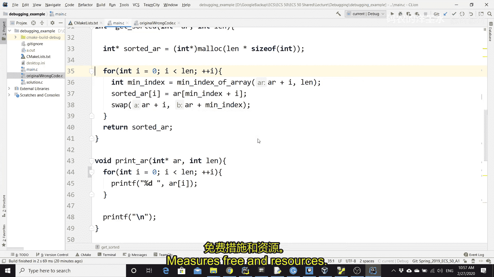

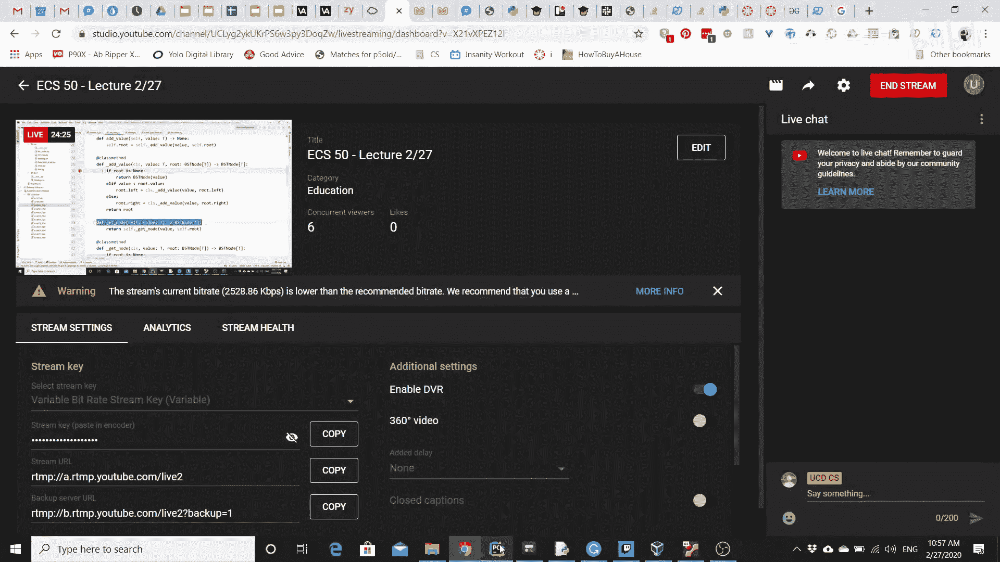

*   **设置断点**：在解析参数后的代码行（例如第66行）设置断点，以检查数组是否正确填充。
*   **检查变量**：在断点处暂停后，使用调试器的打印功能查看数组内容。例如，使用命令 `print array[0]@len` 来打印整个数组。
*   **逐步执行**：进入排序函数，逐步执行代码，观察每一步中数组元素的变化，并与预期行为进行比较。
*   **验证交换**：在排序过程中，特别关注 `swap` 函数是否正确交换了元素。在交换操作前后检查相关数组索引的值。

调试的核心在于不断验证：代码的实际行为是否符合我们的预期？我们需要像侦探一样，询问代码并检查证据。

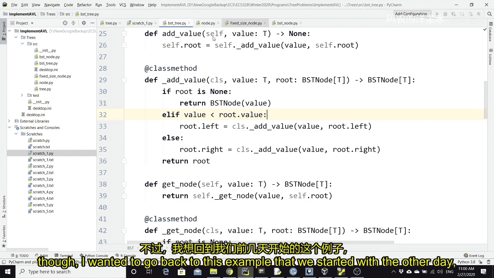

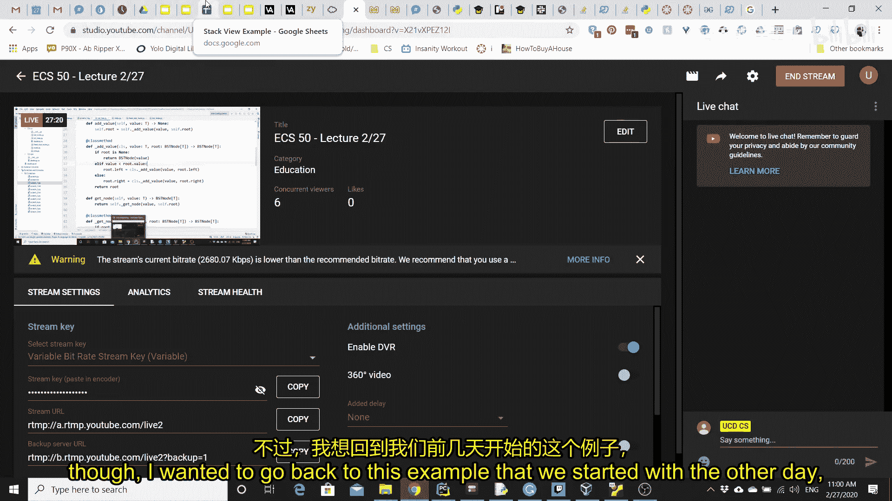

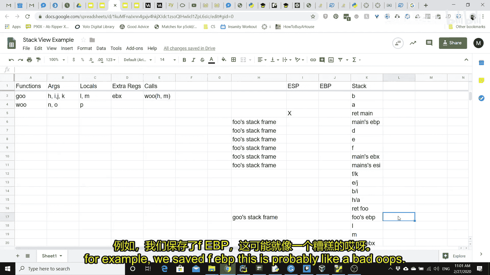

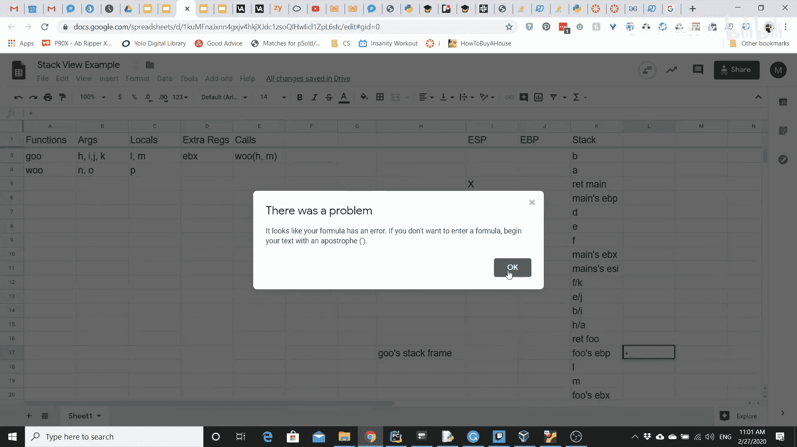

## 培养调试直觉

调试不仅仅是一项技术，更是一种需要培养的直觉。当代码出现问题时，你应该：

*   **定位相关代码**：如果排序失败，就查看排序相关的代码；如果游戏AI射击位置错误，就查看决定射击位置的代码。
*   **主动调查**：不要只是盯着代码看，期望错误自己跳出来。你必须使用工具主动调查程序的状态。
*   **提出假设**：带着假设进行调试，例如“我认为问题出在变量X被意外修改了”，然后去验证它。

一个常见的错误是，学生来到答疑时间，只说“我的代码不工作”，而没有进行任何初步调查。更有效的方式是：“我的代码不工作。这是它产生的错误输出。我认为问题可能出在XX函数里，因为YY，但我找不到确切原因。”

## 高级调试技巧

除了基本的断点和打印，调试器还提供了其他强大功能：

*   **监视点（Watchpoint）**：使用 `watch variable_name` 命令。当指定变量的值发生变化时，调试器会自动暂停，并显示旧值和新值。这对于追踪难以定位的意外修改变量非常有用。
*   **条件断点**：可以设置仅在特定条件满足时才触发的断点。例如，`break line_number if i > 25`。
*   **在调试器中编译**：在GDB或DDD中，可以直接输入 `make` 命令重新编译程序，然后使用 `reload source` 更新源代码视图，而无需退出调试器，所有断点和显示设置都会保留。

## 在汇编层面调试

在汇编语言中调试原理相同，但需要更直接地处理内存和寄存器。

以下是查看不同数据类型的命令示例：

*   **查看寄存器**：`print $eax`
*   **将寄存器值解释为指针**：`print (int *)$ebx`
*   **查看标签地址的值**：`print (int)len`
*   **查看数组**：`print *(int **)$ebx` （假设 `$ebx` 指向指针数组）
    *   要查看数组的一段内容：`print array[0]@10`
*   **查看栈上的参数/局部变量**：在函数内，第一个参数通常位于 `$ebp + 2*word_size` 处。例如，打印第一个int参数：`print *(int *)($ebp + 8)`。对于char等小于字长的类型，需要先定位到正确地址，再进行类型转换：`print *(char *)($ebp + 12)`。

## 访问调用者栈帧

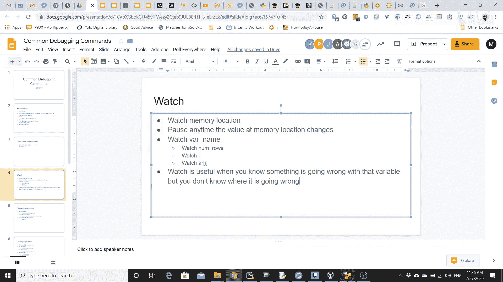

在汇编中，可以通过栈帧指针（EBP）链访问祖先函数的局部变量或参数。当前函数的EBP指向调用者栈帧的底部。通过连续解引用EBP，可以沿调用链向上回溯。

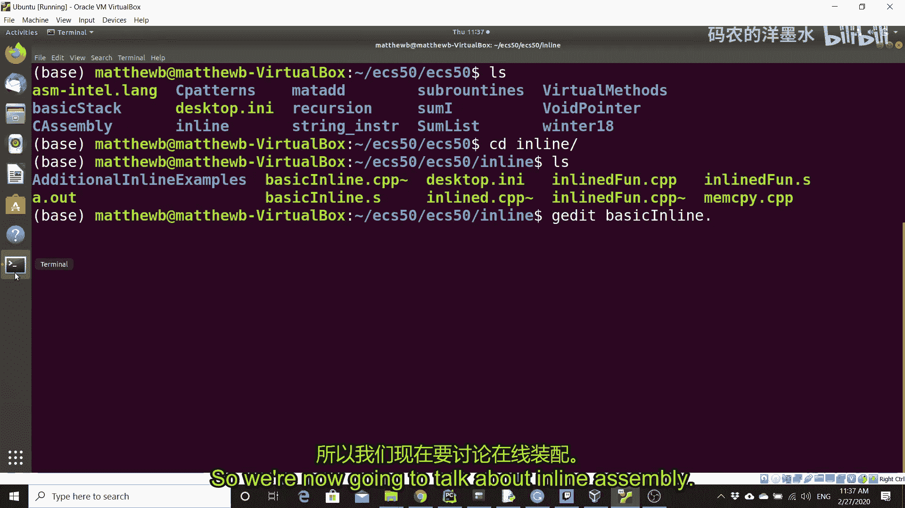

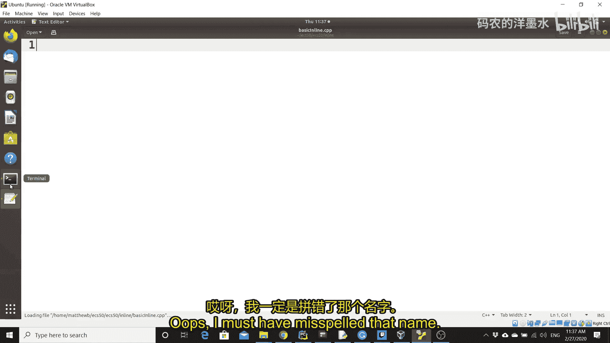

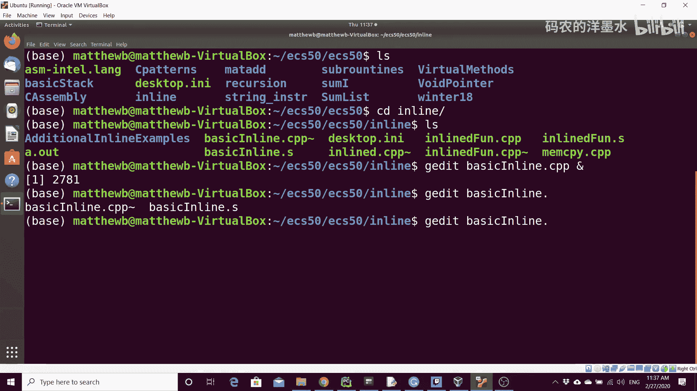

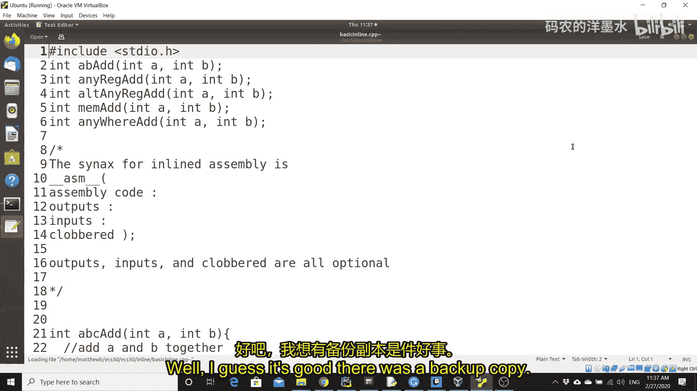

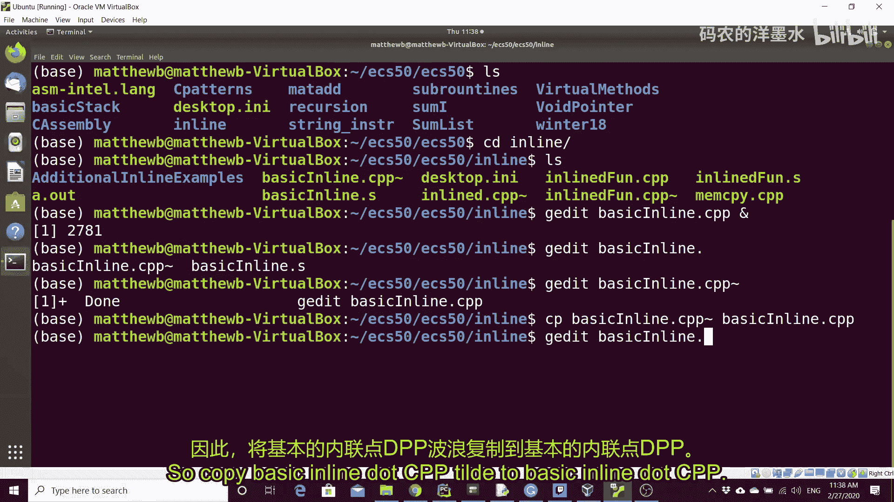

例如，在函数 `wu` 中访问函数 `fo` 的局部变量 `e`（假设 `e` 在 `fo` 的栈帧中偏移为 `-2*word_size`）：
1.  `mov %ebp, %eax` ; EAX 指向当前栈帧
2.  `mov (%eax), %eax` ; 解引用一次，EAX 指向调用者（g）的栈帧
3.  `mov (%eax), %eax` ; 再解引用一次，EAX 指向 fo 的栈帧
4.  `mov -8(%eax), %edx` ; 访问 fo 栈帧中偏移为 -8（即 -2*字长）的位置，获取变量 e

调试器的 `backtrace` 命令正是利用这个原理来显示调用栈的。

## 内联汇编简介

最后，我们简要介绍了内联汇编。虽然编写完整的汇编程序很繁琐，但有时我们不得不在C/C++代码中插入少量汇编指令（例如，使用特殊CPU指令或进行极致优化）。

内联汇编的基本格式如下：
```c
__asm__ (
    “汇编指令字符串”        // 汇编代码
    : “输出操作数列表”      // 输出到C变量的部分
    : “输入操作数列表”      // 从C变量输入的部分
    : “破坏列表”           // 会被汇编代码修改的寄存器/内存
);
```
在汇编代码字符串中，使用 `%%` 来表示寄存器名（如 `%%eax`），以区分C语言中的 `%` 操作符。通过约束字符（如 `”a”` 对应EAX，`”r”` 让编译器选择）将C变量与寄存器绑定。`”+”` 约束表示该操作数既是输入也是输出。`”&”`（早期破坏）约束等更高级的用法将在后续课程中介绍。

## 总结

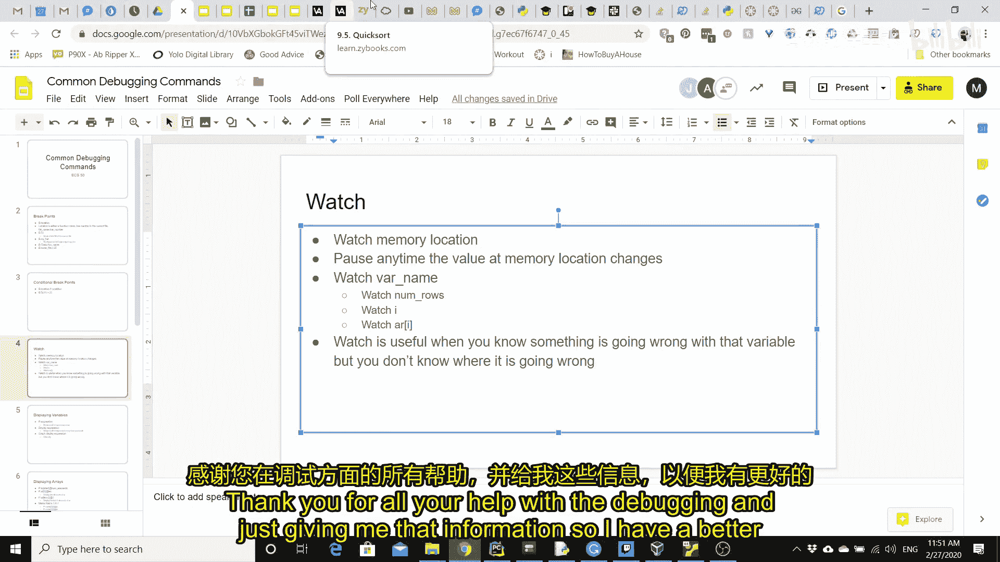

本节课中我们一起学习了系统化的调试方法。关键在于从“代码不工作”的模糊陈述，转向主动、有策略地调查程序状态。我们回顾了使用调试器设置断点、检查变量、逐步执行代码的流程，并介绍了监视点、条件断点等高级功能。我们还探讨了在汇编层面调试的特殊性，以及如何通过栈帧指针访问调用链上的数据。最后，我们简要了解了内联汇编的概念和基本语法。请记住，调试是一项通过不断练习才能熟练掌握的核心技能，它能极大地提升你解决问题的效率和能力。