# 【全集】加州大学戴维斯分校 C语言与汇编语言 中英字幕 1080P p16 Lecture 16 - 内联汇编与字符串指令 -BV1xefZBHEas_p16-

Do you guys have any questions about anything？Do pass what ray into a river。Anyone看。嗯。Me to be right。

So like you're trying to pass in like array plus five。something like that or like。

 are you just trying to pass in like AR and AR is an in pointer？

Like it would be like if you're doing it。As far。So you want to pass in。

 you're saying your question is， do you want to pass in a reference or do you want to pass its address？

So references in C++ are essentially hidden pointers。In terms of implementation details。

 So what you'd want to do is， again， try to write your code and C because it gives you a better corresponding to the assembly。

 So here you would just pass in probably， if you wanted to。

It guess depends what you're planning on doing with the array。

 If you're planning on modifying just the elements inside of the array。

 you can just pass the pointer itself。 So if you have an array integers right called AR and you'd like to modify that you know the elements inside of the array。

 the actual values， you can just pass an A， the integer pointer， That's fine right。

 But if you want to modify the integer pointer itself。 Like you want to resize the array。

 you'd have to pass it in an integer pointer pointer and then pass in the address of Ar to your function。

Does that answer your question， Okay， anything else？

So we're going to pick up on the inline assembly code from where we left off on。But before we do。

 what are the GCCCC calling conventions？What at least just give me one of them。

The prologue and epilogue aren't part of the actual calling conventions。

 they are normal things that will be done just because it makes writing the functions so easier。

这长时间这两个为。Yeah， so the return value is going to be an EX。

 the arguments are passed on the stack and what order are they pushed？Yeah。

 they push right to left and then what's the third rule？This is。YeahSo。It depends what you mean。

 which function， the calling function or the called function。

The calling function is responsible for saving A C and D， the called function。

 the one that's actually getting called， so function one calls function 2。

 function one's the one doing the calling function one is responsible for saving A C and D if it's using any of them and then function two。

 the one being called is responsible for saving all the other registers that it plans on using besides those three。

Again， it's really important that you follow these conventions because if you don't。

Your code won't work。It'll break。

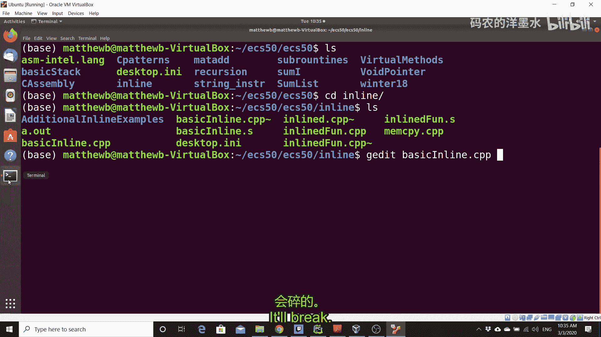

It's just like driving on the right hand side of the road。Or left hand side of the road。

 it's not going to work out so well， right， things are going to break down。

Okay so last time we left offright we talked about the basic format of the inline assembly code。

 that's underscore underscore ASM underscore underscore to get started right there's four sections。

 there's the text section， there's the output section。

 there's the input section and then there's the clobi section。

 each of these sections is optional so you don't have to provide them if you don't want to。

 but you can also if you want to leave a section blank。

 you just put a colon in that spot and then move on notice the spots are separated by colons to separate each of the fields。

Remember the code that's in the input section， right， whatever's in here。

 before the inline assembly code will be run， the compiler will copy whatever you say that you want to copy over here in the Sealand over into this location in the assembly GB in general the compiler figures out where it's supposed to go。

 and this is how you can refer to it inside of the inline assembly code。Right。

 then your in assembly code will run。And then after it's done running。

 the compiler will run the output section， which will take what's in the specified register right。

 who you'll talk about inside the in assemblyly code with this name and copy it back out to the C variable。

Right， do you remember what the plus means？It's both input and output right so before the inline assembly code is run right we'll copy that value in copy the value A into wherever register the compiler decides to pick and then after the inline assembly code is done which in this register will be copied back out to a。

Right， are there any questions。On the basic format so far。

 probably the ones you're going to write are going to look a little bit more like this one。

But are there any questions here。About what any of the parts mean or what any of the parts do。嗯。

RightAnd remember， instead of the plus， the other thing that you can put in the output section is the equal sign。

 which just means the result will be placed， whatevers in this register at the end of the day will be copied over into this C variable after it's done running。

The final thing that we have to talk about。In terms of the modifiers you can put on the register specifiers。

Is the ampersand。So the Ampers Sand stands for Earl Kbbber。

Now what this means and what it does is really important。

 but we have to first understand what assumptions the compiler is going to make about your inline assembly code。

In terms of the outputs and the inputs， so the compiler makes the following assumption。

RightYou will not write to any outputs。Before you are done。Using all of the inputs。

I'll see that again， the compiler assumes that you will not write to any of the outputs。

Before you are done， using all of the inputs。Does this make sense in terms of this assumption？

Right so again， this means before we put anything into results， right？

We have to be completely done using， let just say， you know before we put anything into this register results sort at。

 we have to be finished using whatever we're using this register A for and whatever this register B for right once we're done。

 then we can write to the results now some of the assembly code that we write might not make sense to follow that assumption。

Right， so if we look over here， notice， am I following that rule。

Am I following keeping to the assumption that the compiler is making about my assembly code？No。

 right， because I wrote to the output before I was done using all the inputs。Right。

So if you ever do this， if you have a write to an output。

Before you using it or before you finish using all the inputs。

 you have to market early clobbber to let the compiler know that you're not following the convention for that register。

 so since I write to result before I am done using all the inputs。

 I have to say that result is early clobber。Does that make sense when to apply it？

Right so if you write to an output。Before you're done， using all the inputs。

You must mark as early cler。A lot of people still get confused by that。

 so if that statement doesn't make sense to you or how you can recognize when that's happening。

 let me know right now so we can clear that up。Okay， so again。

 the compiler makes the assumption that you will not write to any output before you're done using all the inputs and under this assumption it can do something called register sharing。

Where it maps both outputs and inputs to the same register。😡。

This is legal for the compiler to do because you won't write to the output。

 you won't treat it like an output until you're done using all the inputs， treat it like an input。

Does that make sense？So again， the compiler is trying to optimize the register usage。

 so under its original assumption， again， that you will not write to the outputs before you're done with the inputs。

 it it can have an output and an input mapped to the same register。

So what might happen is the compiler might decide that for maybe B， it wants to put B in EAX， right？

And it might decide that it wants to put a。And let's just say A goes into EAX and B goes into EBX。

 keep things simple。RightNow， if I don't mark this early clobber。

The compiler can decide to put either results into EAX or results into EBX。

If we did not market as early cl。This might cause some problems right if this happened。

 so again imagine this isn't there， let's say that result is say EAX so over here and then a is EAX well here we put zero into results right but result is what register。

In our example。EAX， but what's our input register also？So what had just happened to your value A？

You got overwritten with the value zero and it broke。I'll show you that's actually happening。

But I just want to make sure are you guys clear on when to apply the early quabb because everyone every year always gets confused。

Okay， then。Hopefully you guys don't make the same mistake。

 so I'll try taking this out and I'll show you it breaking。

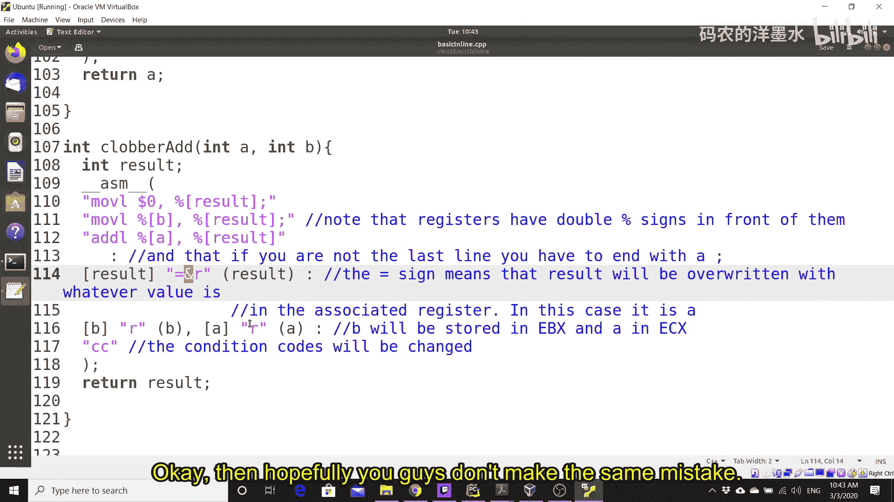

So over here， G+ Fl basicinline。cppP。Soilicon piles， and we run it。

 And all of them are doing 100 plus 10。

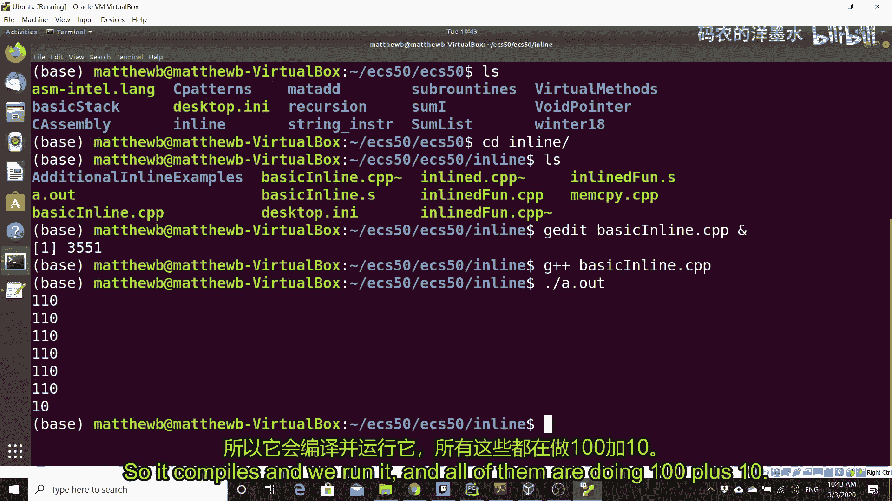

In terms of what they're doing， so they're all trying to add 110。

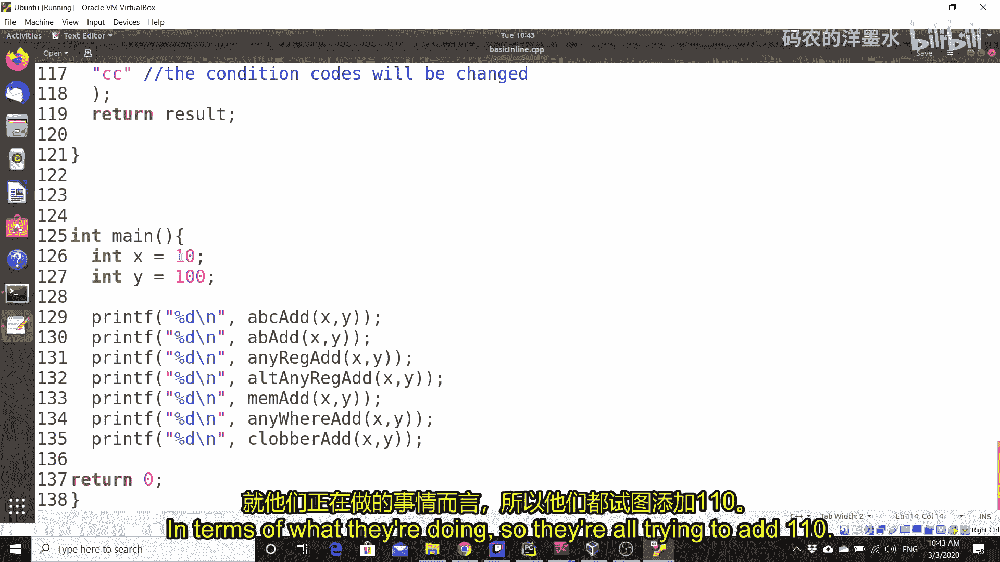

And notice that all of them work except for the last one。

 the very last one is the one with the Claawboard register。And here you can see why。

If we do G plus plus dash S， and then the inline。Oops， what do we call the basic inline， right？

G plus plus S basicinline。cpp。

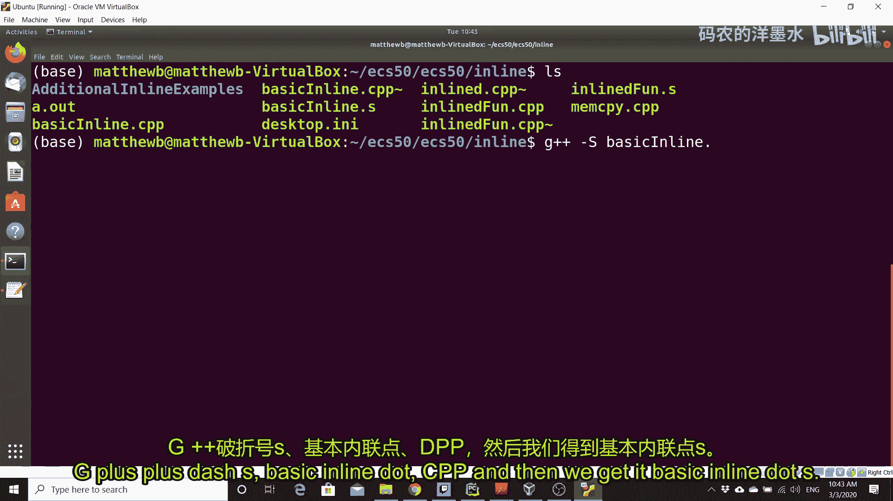

And then we jet it basicinline。s。And then we turn on the highlighting so we can all see a little bit better。

So one thing to note is that the compiler does something called name mangling and G++ that's not being done in GCC in terms of like the C code because remember and C。

 how many functions can you have that have the same name？Just one， so in C。

 each function has to have a unique name in C++。What's the limit on the number of functions that can share the same name？

There isn't a limit。 multiple functions can have the same name。

 The limiting factor in C++ is what what has to be unique for our function。It's signature， right。

 it's combination of name and parameters。Right， so the way that the compiler actually does the translation into the labels is that it kind of adds。

The information about the arguments in there。 So this is ABC add II into drainageger。

So it's going to do some messing up with the names so that each of the label names ends up being unique for each of the functions。

So that's just something to point out， something cool to notice。So let's go to the clawawbid a。

So over here， this app， no app， this is where our assembly code is being done。

This is our inline assembly code where the compile decide to insert it。

 and I'll knock it on different lines so that it's a little bit easier to see。So over here。

 here's where our basic inline function is going to be。 So here we moved 0 into EAX， right。

 The first line of our code that we said to do was to move zero into results。

 So what register did the compiler decide to use for result。Yes。Now， if we look over here。

 we then move EA X to EA X。 And then down here， we said move percent B to results。

 So what registered did it choose to use for。B。😡，EAX， right。

 and then the next line of code was move EDX to EAX， so the compiler must have chosen EDX for a。

Right， but notice it used， like we said， they have the problem happen where it picked the same register for the output and the input because it's trying to share registers because theres such because there was such a small number of them。

Right， and it's not working because we broke the assumption the compiler had that we would not write to the output before we finished with all the inputs。

Does this make sense？Whites breakinging。So when you mark something as early clobber， right。

 you tell the compiler， hey， I'm actually going to be writing to this output before I finish using all the inputs。

And so what the compiler has to do is give it its own separate register to be in。

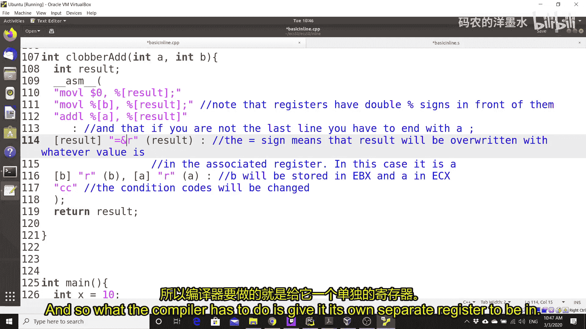

So if we recompile。We get 110 and then if we recompile the assembly code。

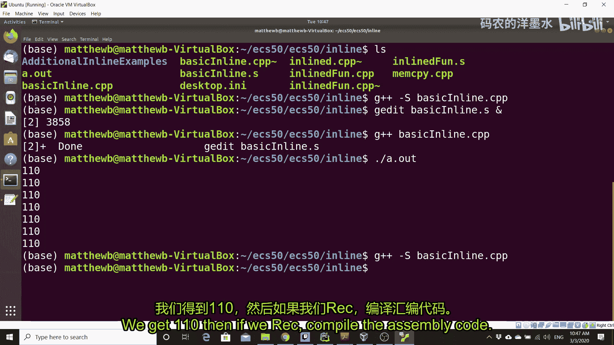

And then we go back to Clawbid。Add， and now we go over here。To our assembly code。

Notice the compiler was forced to pick different registers， now result is EAX。

Over here we have E D x。 E D x is going to be。B。And then ECX is going to be a。

 so now we don't have this problem of there being that register sharing and we accidentally overriding the input。

Does make sense？Therere any questions about writing in line assembly code。Yeah。

 so you're saying that。Tackact the output input the forward section delay。は。Okay。

 so so here's the code section， so everything up and down heres the code and what marks the delimiters are these colons。

So notice we have code， colon。Output。Coin。Input。Coin。And then the clobbard section。We into the semi。

すごい。Inside the section。So the colon theote the sections， right， there's four sections。

Asmb like assembly code outputs， inputs clobbered right and the colons denote like kind of like the end of the section so you put all of your assembly code down and then a colon in some ways to mark the end to move on to the output section you lift your outputs。

Cohen。Then your inputs。Colon， and then your clobbered section， Cls inside of the strings。

 separate the lines of code inside the assembly so that we actually get legal instructions。

 If you forgot to put these semicoes here， your code just wouldn't run。Yeah。😊，So你。However。

 if you don't forget or hover， does that mean that our always does the most efficient thing。生た。

So if you don't mark a register as being early clobber， yes。

 the compiler will attempt to be as efficient with the registers as possible and do the register sharing again。

 you have to mark an output as early cloer right if you write to that output。

Before you finish using all the inputs。Right and like the easy way to know that is you write your assembly code and you look at where you write to your outputs and you're like。

 well， I did this right to my output， I look at the rest of my assembly code。

 am I using any of my inputs。Right below that line。 If your answer is， yes。

 I'm still using some of my inputs， that outputs early clobber and you're done， right。

 It's really easy to recognize in terms of like what needs to be done because you just watch the assembly code like down here。

Right。I wrote to my output。Do I reference any of my inputs below this line of code？Yes， right？

On line 111 and 112， therefore result has to be early colloror。

that's just the way to do it so you can start with them。

 none of them being early cl and then just look at the code that you write and figure out from that which ones need to be set the early cl。

You don't have to mark any of the ones that had the pluses as early clobbs because they're inputs and outputs。

 so they're already being reserved for that one use and they can't be shared right because you already said what's supposed to go into it。

Right whatever the input's supposed to be， and then the output will be placed in the same register。

Any other questions？Okay。Let's talk about some additional instructions then。So again。

 there may be some times where you would like to reach for the inline assembly when you want to use some special instructions。

 where are my special instructions。Yeah。So some of these instructions the compiler would never use。

 they're called string instructions just to give you an example of something the compiler wouldn't use。

And they do a couple of different things， there's really three of them， there's moves。

 so move string， there's sts， store string， and then there's comps， compare strings。

And they each do something a little bit different what the moves section is going to do。

 it's going to take whatever is an ESI。So go to that location and memory where ESI is pointing to and it's going to copy it to wherever EDI points to。

So notice we're moving something from memory directly to somewhere else in memory without having to specify an intermediate register。

Which is pretty nice sometimes if you need to do like moving a， right。

 moving the contents of one array to another array， like doing an array copy。

It will then decrement ECX。Then there's something about the direction flag if the direction flag is set。

 then EDI will be decremented by one， otherwise EDI will be incremented by one same thing for ESI。

 so if direction is set， you'll do minus1 and if direction is not set， it's currently zero。

 you'll go plus one， you'd want to set the direction flag if you want to do things in reverse。

 like go from right to left。So that's all the move instruction does and the only thing that's really different is about the size of the things that you're moving right。

 move a byte， move a word， move along， and therefore like EDI and ESI have to be incremented by one。

 two or four depending on whether you're moving a byte， moving a short or moving like an integer。

Yeah。😊，What's that。C。It was the contents and memory。

 So this is like a notation that Professor Matt Laus in is book。

 So its's memory at location EDI is equal to memory at location ESI。

Are there any questions about what the Mos instruction does？Then there's the StoOS instruction。

 which will take what's in EX and then copy it toever EDI points to。

go copy that value in there and then again ECX will be decremented and then EDI will be either be incremented or documentremented based off of the direction flag。

And then comps can be used to compare two things in memory。

So what comps will do is it'll do a subtraction， it'll do whatever in ESI。

 right that location of memory at ESI minus the location and memory at EDI。

 subtract them to and again incrementing and documentmenting of EDI and ESI and then EX always goes down by one。

And then there's the SC instruction， which is like the string compared to like literal or compared to a constant。

 so over here it'll always do like essentially EAX minus the contents of EDI for doing the comparison and then again ECX goes down by one and EDI will go up by one or down by one depending on whether you have the direction flag set or not。

So it seems kind of weird， right， like why is ECX always being decremented given that you're just comparing two things or moving two things？

Generally， these instructions aren't used by themselves。

 but they're used with the repetition prefixes。So in front of each of these instructions。

 scroll down。You can put some of these optional prefixes so you can say rep moves or or rep sttos for the instruction or there's also repeats repeat with equal or repeat while not equal which you can do with the comps and the gas instructions and what the whole point of those instructions will do is they'll keep repeating though the rep ones will keep doing the instruction over and over and over and over again until ECX reacheses。

0。RightSo if you had two arrays that like that are supposed to be the same same size。

 maybe they're like 10 long， right， so you could say put into ECX the value 10 because you want to copy 10 elements。

Put your destination into EDI， the pointer to the array that you want to copy things to。

 put your source into ESI right， where you want to copy from。

 and then just do rep moves with the appropriate suffix to copy the entire array。

Instead of having you to write that manual little loop yourself， the copy each element。

Does that make sense？Any questions so far about these instructions before we show you some examples of using them？

We to manually store the results。have。What do you mean for the result what do you because all the results in some ways kind of go to memory。

 at least for the moves and the sto right they move something into memory whereas the comps and the scarce or comparison instructions so you would check like the E flags afterwards so after you did like a comps or dose you probably have like a jump of greater than our jump of less than。

But like。Where where can you start where。So EDI is the destination right。

 it's the pointer to where and memory you want to copy the result to。

So right so if you wanted to copy your results to location 100 memory。

 you would set EDI to be 100 if you wanted to copy from the array beginning at location of 500。

 you'd set ESI to you 500。The one thing that's a little bit interesting about the comps and gas。

 right？They'll keep going like if you do the repeat while equal or will not equal。

 repeat while equal will keep comparing the values until either ECX reaches zero。Or。

The value stop being equal right okay'll keep comparing them while they're equal right or until ECX becomes  zero。

 so it'll stop either when ECX becomes zero or there's a difference between the elements。

Whereas repeat while not equal， we'll keep going while the elements are not equal to each other。

 so it stops on the first difference or when ECX reaches zero， whatever one happens first。

Now the problem that you might have here is， well， how do I know if I got to the end？

Right or if there was a difference between the elements。

 if you were doing say like repeat while equal， right。

 did I stop because they stopped being equal or did I stop because ECX reached zero？

So what you can do。Scroll down， Come on。So there's another jump instruction， it's JECX Z。

Which is jump if ECX is zero， which will only be true if ECX is zero right so if that ones zero。

 it means you reach the end right ECX became zero and then the jump of zero or jump of not in zero or jump of equal or jump of not equal you would use the test to see if you stopped for the elements either being equal or not equal。

Right because you don't know why you stopped after you stopped just that you stopped and this is how you can tell a difference right the J E or J Z or JNZ or JN E right you can use for the quality checks right this will help you figure out if you stop that they were。

Not equal to each other or equal to each other， depending on what suffix you're using。

 and then JCXZ can be used to figure out if you reach the end。Does that make sense？

So I now have questions for you， can you think of any things that you can be useful to use these instructions for？

Alay， so what do you think moves would be useful for？Copying arrays from one location to another。

 do you guys know what the name of the built in like see library function that does that？Yes。

Not string copy， because string copy copies， strings， right？It's Mem copypy。

What MemCopy will do is it'll copy like X bytes from source to destination。

 which sounds like you could implement it really easy with this instruction。What about Stos be。

What do you think it would be U， like any of the Sttots instructions。

 what do you think it would be useful for？Given that it's going to change the contents and memory to whatever' is an EAX。

We're not copying what。We're not copying erase， right because the S instruction。

 it just takes a single value and it places it in that location memory。Yeah。

 filling an array with some constant value maybe you want all the elements in your rate to be  zero right you can use S for that right you want all the elements in your rate to be 10 you can use St for that It's whenever you want to fill some section of memory with the same value right The instruction that does that Oh gosh。

 what's the one that does that in C。Mmet。So it's like the ME set function where you'll set the elements in memory to be one constant value。

 but MEMS set， be careful with it if you do use it later on in your programming life because it sets bytes。

Change X byte to the value that you specify So if you tried to say， well。

 I want every element in my array to be 10 right and you have an array of integers you could not use mem set and say okay set all you know the size of my array times the size of integer to 10 because it'll set each byte to 10 right and so those four byte quantities will not be it'll be 10。

1010，1010， but that'll be interpreted as one integer which is not 10。

So it wouldn't be filled in correctly。What about。Compamps are scarce。

What do you think they could be useful for？确定。Well， not that the arrays are the same size， right。

 because before you would even compare the arrays you'd have to。

Know their size right if you didn't know the size of the array ahead of time。

You couldn't compare the elements correctly。What else might they be useful for？Because again。

 remember now you also have these other prefixes you can use。

 you can use repeat while equal or repeat while not equal。

 so keep doing the comparison while things are either equal to each other or keep doing the comparison while things are not equal to each other。

哦。So。But does that mean we have to know when to stop？Because remember， like the comps and the SCs。

 they don't copy values， they compare values。RightThey just keep doing the comparison。

 either like while they're still equal or while they're。Not equal。

And then the comps will be comparing two strings or like two arrays at the same position。Right。

More gas will be comparing a constant。I like。A fixed value with the elements in an array。有。等下。

But move inside the array to what？But you already know where the end of the array is at。

Because you have to know the size。Because if the size of the array was 10。

 right you can just do array plus 9 and get to the end。

 right no need to go through the elements in between。Check that two later。

checkot the two arrays have the same values， right？If you knew the size of both of the V arrays。

 right， you could do a repeat while equal and you keep going through the elements。

 comparing them while they're equal。 And you want to stop And when you reach the first occurrence that's not the same。

 right， So you repeat well equal。 And then you check， well， if E X is equal to 0， it means。

The arrays are the same。But if the ECX is not equal to zero， right。

 it means the arrays are different。Right because you stopped before you reached the end of the array because you would load ECx beside the size the rate first。

That's how you could use comps， what about the Sask comparing with a constant value？

could see if the element is in an array or figure out where the element is at in the array right those would be some uses for it And aside from those uses。

 I have not been able to think of another single use for those instructions。

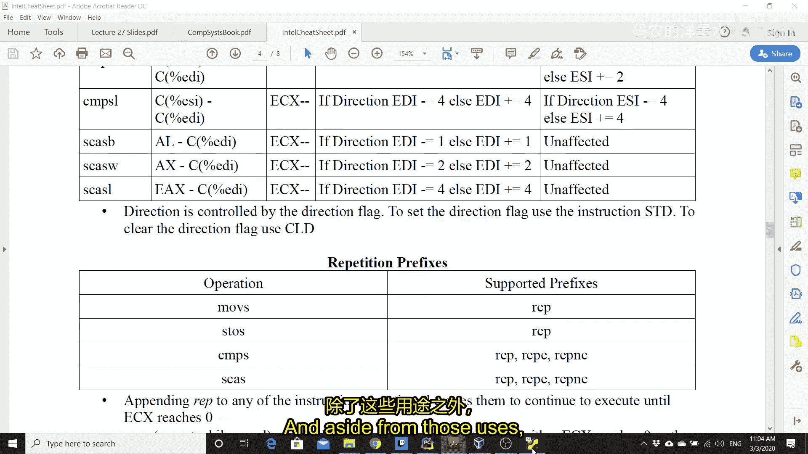

Right so I think it's kind of sad that there's like actual dedicated hardware for essentially accomplishing one function。

 a piece。

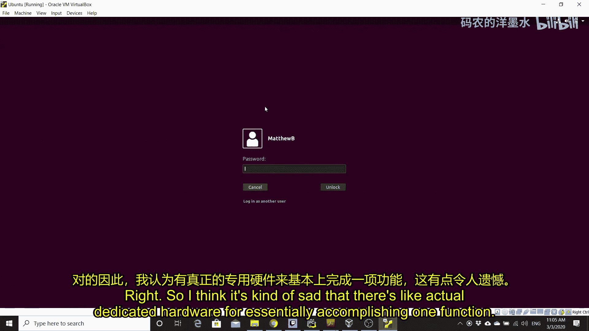

I cannot think of any other way of using it。

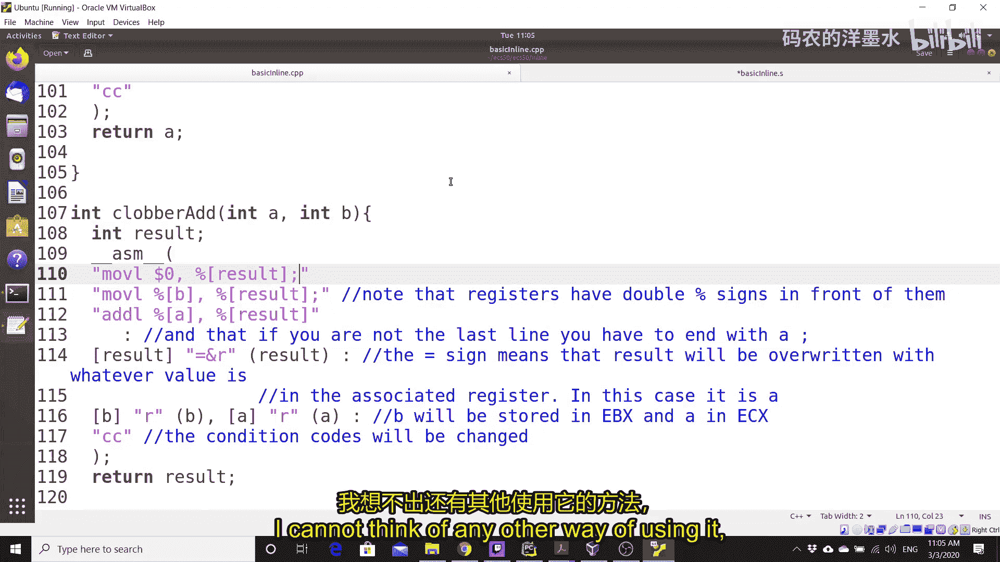

So let's show you some examples of me actually using them。

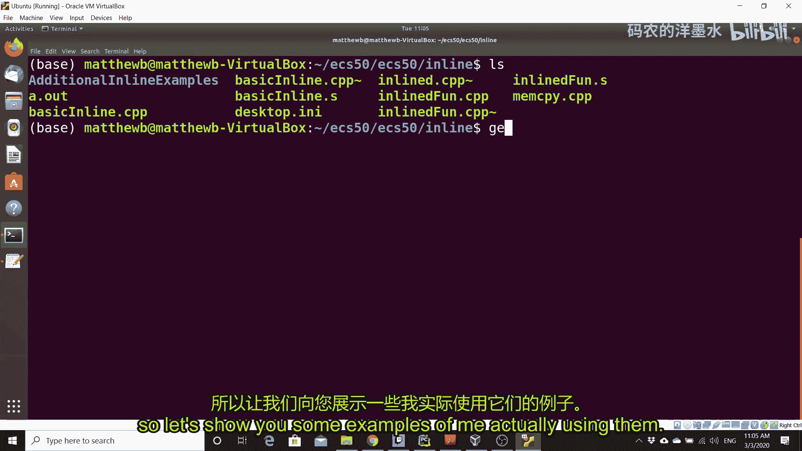

Inlinef dot。So here's the first one， which is the MEPS set。

hi I said what it does is it fills in some section of memory with this value。But it fill in that。

It fills in number of bytes beginning at pointer with value where value is one byte big。

 Does that make sense。So we want to fill nu bitetes。Starting at pointer with value。

So what I do is here's my inline assembly code， so I clear the direction flag。

 so there's CLD which clears the direction flag and there's STD， which is set the direction flag。

And so this will control whether which direction you're going。

 so I want to clear the direction flag so that I move forward just in case it happened to be set。

And then all I do is rep dose B， essentially one single instruction。

The reason that this works is before my inline assembly code runs right in the input section。

 I put pointer into EDI。I put my value into EAX， and I put the number of elements into。ECX。

The condition codes will actually change because I'm changing the direction flag and the contents of memory will also be modified because I'm changing what's there。

Therere any questions about this little small guy and how it works。Yeah。😊，有钱。He see see how。

changenge but how that works。How does ECX change？喂。The number of elements you'd like to copy。Right。

 so when you're running around。You check until that。Yeah， I mean。

 like the rep instruction will keep the rep prefix will keep redoing that instruction until ECX becomes zero and notice that each one of these instructions。

 what do they do each time they also decrement ECX right so they're really designed to be used with the of the rep prefix and not really designed to be used standalone though they they can be and I'll show you an example of that in a minute。

Yeah。Could please clarify why you size tea for the type of ground as the。

That's what I use size key because that's what the documentation online said was the signature。

Sometimes you're going to have issues when you're going across different machine sizes。

About like what the size of the variables are， for example。

 is your integer going to be 32 bits big or is it going to be 64 bits big？thanks。Yeah。

 there are it depends it'll be like a fixed size quantity which you can like look up online and there's also ways of specifying like how big you want your integer to be like you can do like you in't underscore 32 for an unsigned integer that's 32 bits right or you int underscore 64 for a 64 bit integer when those size issues matter。

To make your code more portable and work on more platforms。嗯。😊，So here's Mem copy。

RightThis is what like Mem copy would look like if you wrote it as a loop。Right。

This is like the assembly code right， first we make ECX our counter be equal to zero， right？

Then we compare size with ECX right while ECX is less than size。

 jump if it's greater than or equal to get out of the loop。

 then we'll move whatever's at source right ECX pass source so source that I goes into BL then move BL to your destination。

 increment ECX and then go back to the top of the loop and do it again right if you actually wanted to write all that inline assembly。

And I don't have any outputs in my output section because I'm only changing memory。

And then again I said， hey， compiler you can choose where source goes。

 where destination goes and where size goes， and I'm also going to be changing EX and EBX of my code not as EX changed here。

 EBX changed here， but they're not listed as either inputs or outputs。

 so I need to make sure that I do that。Also， memory changed and then Efls change too。

This seems like a lot of work， right？Well。Here's the version if we use gas。Or not this gas。Ros。

That's pretty short。Right， we're reusing the instructions that are there。

 the specialized instruction。 so again， we just make。EDI be our destination。

 we make ESI be our source， we put our size of the ECX， then we do Mo V。

 it copies everything over for us and we're done。Any questions about this version。Yeah。Yes。

Somewhere technically in memory， the answer will be stored at destination。Yes。

At desk right but here you're just telling the compiler that memory changes because what the compiler might be doing is it might be caching values from memory in registers which you guys have probably been doing when writing your own assembly code right you say like EX is going to be I and you keep using EAX or Exs I the whole time right instead of that location of memory that you reserve for I so because you've changed something to memory if the compiler was caing anything in certain registers。

 it's going have to go refresh those values for memory to make sure that they're still up to date in case you in case you change them in the assembly code。

Does that make sense right after this function？And thating just。Yeah。So， here's contains。

It's a little bit longer。Right so at the beginning， we're going to put elements into EDI。

 put the value that we're looking for in a， and then we're going to put size into memory somewhere。

So here we're going to move size into ECX， it's our counter just again show you that happening。

 and then we'll do a repeat while not equal with SC， but notice it's scarce L。

 keep comparing values while they're not equal right while they're not the thing that we're looking for。

 keep going。We're either going to stop when either ECX is zero。

Or when the things are equal to each other。So we'll jump to ECX， you know if ECX is zero。

 that means we didn't find it， right we went all the way through the array and we stopped because ECX was zero。

 so go to not found and put negative one， we didn't locate the value into index。Otherwise， right。

 we're going to put size into index。 that's where we kind of found it at。

 but the put size into index and then subtract out ECX we kind of need to do。

Because we searched ECX Comp decremented， and so we need to figure out how far we moved。

So you get to do this subtract to get the amount that you moved。

 or what might be somewhat easier is if you did it in reverse。

Then ECX would just have the position that I found to that。Because if our array is 10 big， right？

And we find it at position2， ECX will be8 because ECX started as 10， it wasn't at zero。

 so we went up to one， right， it wasn't there so we went up to index2， so we went down to 8。

 10 minus8。I's 2。 So is it index 2。 That's what the subtractions there。

Put that into index and then jump to done。Any questions here？In the clobber use e x。嗯。

So one thing that I tried to do was I tried to do stirir comp using the。The compare strings。

 the comps string function for doing that and what I thought I could do is I could put ECX as being infinity so make it the largest possible number ever right and I'll keep going and I'll go until the end and if I get to the end we'll break through the same but if I find a mismatch well they won't be the same so they're done。

Right the problem with doing this is if you compare a string with itself。

 they're going to start the same location and memory and how long will they be the same for？

Forever because you're starting at locate both start at 100， while 100 is equal to 100。

 101 is equal to， 101， 102 is equal to 102， and so you write yourself an event loop。So for this one。

I believe I had to， it was just like the recursive function。Now。Over here。

 I just used comps B to compare it， but notice there's no rep prefix。

So I would just compare then if they're not the same， great， we're done。

 otherwise we'll move forward by one automatically。

 but I need to have more finite or more fine control over what was happening than just say keep going while they're equal or keep going well。

 they're not equal。So those's some examples of using some instructions to do some things。Again。

 there are a lot of other built in instructions in the Intel hardware it's called a complex instruction set because it has a lot of different instructions in there。

 but again the compiler doesn't use most of them so one of the reasons you might use the inline assembly code is because you need access to one of those special instructions for example。

 there is an instruction in there that does。Encryption values。

 and it's much easier to use the encryption algorithm that's built into your hardware because you know it's 100% correct and you don't have to reimplement it and it has all the security features that you need and it's well tested and so you can just invoke that instruction on it to encrypt your data instead of having to actually write the encryption algorithm yourself。

It。That's it for assembly code do you guys have any questions before we move to our next topic？ok。

So now we're going to move and we're going to talk about the operating system and all the nice things that it does for you。

So the first thing that I want you to let you know is the OS。Is a program。

So just like all the programs， you're write。The OS is just a program。Right。A large， complex program。

Friten by a lot of people。But。😊，Still a program， right？

What do you think makes the operating system though be special？More special than your programs。

Because the OS can do certain things that your program can't。What's your guess？对。I mean。

 well you can write the files too right， that's all it means that it means to be written permanently you just write to the hard drive。

And your programs themselves， they're also stored on the hard drive when they're not running。I。Yeah。

 I definitely can direct traffic， but like what gives it that special privilege。

 why can't you do that in your programs？It's only special because if I knew how to spell special。

It is the first program run。Right so when the computer turns on right the operating system turns on it's going to start or the computer turns on so' going to start running the operating system now the operating system。

 when it's running on the CPU will be have access to all the special permissions and all the special functions。

But when the operating system goes and runs your programs it turns off all those special permissions so it's like no。

 you don't get that and because it's the first one that's run and it controls you know who else gets run and with what permissions it can turn those off right if your program was the first program run。

 it could do everything the operating system does right and it would have all those special privileges as well。

Right。So a question to you is。Assuming。Only a single CPU with a single core。

If your program is running。Is the OSs running？Yes。So how many of you guys think the OS is running at this point in time？

How many you say no。For those of you that say， no， why do you think not？Okay， let's do this analysis。

 so how many programs can a single CPU with a single core run simultaneously？

Just means that there's no parallelism。So how many programs could it run at once？One。

 so if your program is the program that's running。That's one program that's running。

 which means what？That's the program that's running so can the OS be running if your program's running no not under this situation right。

 which should hopefully make sense right， but even in these circumstances you've seen that things can actually be running at the same time or the operating system can take control。

so how can control？Between programs change。What do you think are the ways that the control between programs can change。

 right， or control over the CPU， how can that change？It's very。So。Yeah， but you know。

 I'm running right now。How can we make sure that control switches between me to somebody else。

 how could that happen？Yes。Like imagine you're back in daycare right and there's a favorite toy that everyone wants to play with。

And you're playing with it right now， how can the next person get access to that toy？

You can just give it to them， right so you could voluntarily relinquish control， right？

So whenever you do a system call， you're saying， hey， I would like to stop running。Right。

 somebody else， please run instead。Gerally when you're saying the other person to run。

 you're saying operating system， please do something on my behalf when you're doing a system call。

So what are some other ways that control could change？Besides， you give that toy to somebody else。

What well， they take it， but let's assuming like， you know。

 the other children are incapable of taking it， who else happens to be at the daycare。

The teacher could take it right and give that toy to somebody else， right。

 The other way that this kind of happens is that the hardware。Can interrupt。

The program that is running。Right so when I'm typing like my keys。

 it'll interrupt the program that's running and it will cause some other program to be run instead。

Just make sure I got all that stuff。 right， So if you're looking at for like where we're at in the book。

 we are now in chapter。9。Okay， good。 cut all those things itself。

So one other question before we move on is， what does it mean for your program to be running？

How would you know that it's actually your program running right now and not some other program？

So what does it mean for a program to be running， how can you tell what program's running？Yeah。on。

Well yeah， you can see it， but like how looking inside the computer。

 could you know which program is running？Yeah。Yeah这。

I mean like your program's being running is running right so you're saying but we're trying to figure out how our program is the one being run。

 so you could say you're saying that if ESP is pointing to the stack that belongs to our program。

 then our program is running。You could probably go with that。 What about EIP。

 the instruction pointer？I would say like your program is running if EIP is pointing to memory belonging to your program。

Because EIP controls what instructions is being done。

 and if EIP is currently pointing to one of your program's instructions。

Your program must be the one that's being run， does that make sense？其一行音常。整我先知。Correct。

W should hopefully make sense right the two CPUs could be doing two different programs right。

 or even crazier， they could be working together in a single program to solve one problem。

Right that's how you can get some parallelism into your programs。

 so the OS is responsible for a couple of different things。It manages the file system。It。Let's see。

 it manages memory。It manages processes。And then the first one。File system memory processes。

I believe。It also manages。Manages IO。So the first things like the file system。

 and this is probably the one that you and I encounter like the most apparently when we're working with a computer is when you say that you want to open some file。

 what do you give to say what do you give to the computer to say， I want to open this file。

 what do you provide it？那个。Well， yes， but what input。

Right you just give it some text string right the path to that file right but this file it's actually going to be stored somewhere on your hard drive So what the operating system does is given where that text string that it takes that text string right then it has some mapping for where that file actually exists on the hard drive then it goes to that location on the hard drive right and then reads that contents from the hard drive into memory and then provides those values to you to be able to use right I'm super happy I don't have to deal with the spinning magnetic disk to figure out which bytes actually belong to my program and actually dealing with the reading from that hardware device to make sure that I get what I want。

Operating system also manages memory and like the other resources to make sure that they're shared evenly right you don't have to worry about when you write your program what other programs are running。

RightWhen you've written your program， have you ever cared where your program got placed into memory at or how many other programs were running at that point in time？

No， you've always written your program like what？You were the only program running， right？😡。

And so you didn't have to deal with you know where in memory is my program placed right where are the other programs at how much space do I actually have available to me right because I can't really act like I own all of memory when I'm writing my program because there are other applications in there so I don't have to deal with only having like a fixed amount of space and keep evicting parts of myself to the hard drive and then really new parts of myself back in I don't have to do with any of that which is really really nice the OS also manages processes to make sure that they get equal turns to run the CPU to get their job done this is what makes it look like I could have 20 different tabs open up up here and be running five other applications when really they're each just taking turns one at a time running。

And it also manages the IO devices， so if you want to like read from the keyboard or write to the screen or make the the speaker goop。

 right， whatever it does。You don't do that directly， you ask the operating system。

 do that on your behalf， and so it makes sure that everyone shares these devices equally so everyone can make use of them。

Any questions about these responsibilities so far？哎。Okay。

 so we'll talk a little bit more in depth about one of them， which is。Application load。Right。

 so you're sitting at your terminal and you type。Dot slash8 out out on the terminal。

Your program then starts running right， but the operating system is the one that actually makes that go right And when you type a out into the terminal。

 right， you're typing a out into the shell。 So what's going to need to happen next。

 right If you were the person designing this process。What would you need to make happen？

To actually get this program up and running。What would your first step need to be。

 given that you typed ada out on the show。Instructions。

Locate the instructions and these instructions are stored where。They're not in memory yet， right。

 because a out out， what's it look like？Right，What's the difference between8 it out and slash home slash。

Work slash。You know， my file。What's the difference between these two things？哎。

Where are they both located at？They're both on the hard drive right， so your program isn't in memory。

 so your first step is to do what。You have to go figure out where it's at on the hard drive right。

 but the first thing is because right now oops。The terminal is the one that's running。

 not the operating system， the terminal。We'll execute。EXECVE。Hate it out。

What the EXECVE command means， it means run that program。Or actually。

 it means replace my memory image with this program's memory image and then start running it。

 but it essentially means run the program。To。Tell the O to start running。E it out so again。

 the shell is just a program， so you can have programs that run other programs。

Can you think of an example in your life where you encounter programs that run other programs on a regular basis？

How about Memir？What are we doing， we're running programs that run your program and see if the output matches right so programs that run other programs。

Do totally happen， and you can also do this as well。Right， so you tell BOS to say， hey。

 I'd like to go run this control。Start8 out， so control switches toOS。So like was mentioned。

 the first thing that we have to do is locate。8 out out on the。Hard drive。So great。

 we found8do out on the hard drive。What do we need to do next？

Given that we know where it's at on the disc。不他这。We need to put it into memory， right。

 but where into memory should we put it？选。Well I mean the instruction pointers should point to the memory that eventually should point to the memory that belongs to your program right。

 but you probably don't want to copy the current programs that contents in memory to where EIP is because you would replace the operating system code with your program's code。

And you probably don't want that to happen。 Probably don't want that to happen。Yeah。Yeah。And so。Yeah。

 right。Looccate a free enough section or locate a free section。Of memory， large enough。

To hold8 out out， right？The OS does all of the memory management。So， it knows。

Which locations are free and which are in use？Right。

Computers like programs themselves can't allocate memory without going through the operating system so the operating system knows what's in use and what's not in use right and it knows。

This。Because it keeps track。Of。Memory tables。That show which sections。A a news。And which are free。

So the OS maintains two tables and in use and a free table and the in use will tell it what sections are in use。

 and the free table will tell it which sections are still available to be used。

So it can locate a section that's big enough to fit Ada out， but notice in that statement。

 what did we assume that we knew？The size of。Ate on out， right。

Do we know that have we got that information？So like the next step before between three and four would actually be to read eight out outs。

Headters。Heer。This has info like about8 out out， such as its size。Where the text section is at。

Where the data section is at。et cetera， so it has various bits of information about the program。

 like its size， where's the text section at， where's the data sectionction at？

Where is underscore start？Wheres the program begin at， et cetera。

 right so we can read that information in。Then once we know how big it is， right。

 we can go and copy it。So we'll it it out and copy it there。So we copy it into memory， right？

Because we know what sections are big enough to fit it， so it's now in memory。What do you do next？

Yeah。What。What does Decode mean？Are you talking about like the CPU cycle， the fetch tocode execute。

 right？Not quite。So great， you've copied your program into memory， right？Is it running yet？No。

 why not？Who's still running right now？The operating system is running。

So if we want to start this new application， what do we have to do？Sit again。ion upgrade。

But we are the operating system， right？The operating system has been doing all of this work so far。

なです。How事。Well bit how do we go run that section？Of code， right， given that weve copied it in there。

To that programs。Start right， so then you could say something like jump。To8 out out underscore start。

 right， And we know where that is because we read its header file previously。Right。

But if we just jump straight to8 out out start， right，8 out out will be running。

 but what happened to all of our information？Is there anything that we need to set up before we go and start8 it out？

Well， I mean， that's not prologue because we're not calling a function， right。

 we're running a program。Thank。Right， we need to save the operating system state right。

 so before we can start running our new program。We need to。Save the operating systems。State， right。

 which are going to be like its registers， right， so we save all of its registers。

And there's one other thing that we have to do before we jump to8 out outs underscore start。

Has to do with the registers。そした。Yes。Well， again， the OS has already saved the values of its registers right。

 so it' saved EAX E， BX E， C EX， every single one of them， right？There's something else though。

 that we have to do。4前。Not return， right， well， we have to like wipe。They registers。Clean right。

 so clean them out because if we don't clean them out。

 we might potentially be leaking information to this program。Right， so a little security thing。

And we just set ESP to。Programs。Up to the beginning of the program snack。

And then we can jump data out， right。 So wipe our registers clean。

 get rid of what we have in like EA X， E X， E D X before we start that program。

 And then we also need to make sure that we set ESP first by the stack pointer to the beginning of that function stack。

 Otherwise， it would be pointing to our stack。The operating system stack。

 which would probably be a bad thing。Because then that program could change stuff in the operating systems memory。

What is。Whent you over them。So like wouldn't the new program？

Oh wouldn the new program overwrite this registers anyway yeah。

 wiping the registers is more a security thing right if you don't wipe the registers information can leak between programs。

Which attackers could exploit potentially。Any other questions？Great。Now a out out。It's now running。

 so this is what it takes to actually get your application going every time you do8 out out or whatever your program's name happens to be on the terminal。

Yes。Does that make sense？Are there any questions here？2是。

There's we will talk about switching between programs in a minute or probably on Thursday。

 but there's。A little bit of difference because when the two programs are switching。

 we're assuming that they're both already in memory so there's no need to fetch it from the disk you need to like save your the current program state and then load the other programs save state。

So there's a little bit of differences， but some of this stuff is the same。公谢经看到底下就了下我讲。

Then at what point does you hear say。Where the story save states。

Like like when it runs out of resources， it runs out of memory， right。

 but like you probably would be noticing like a lot of。

Degraded performance long before it actually ran out of space because what will happen is not all programs that you're running are in memory simultaneously。

 the ones that it's not using right now they'll be copied over to the hard drive to make space for something that's running at the moment but if you're trying to have a lot of programs taking turns frequently they'll have to keep moving different things in and out from the hard drive into memory and going to the hard drive is really really slow so you notice your computers like performing poorly or performing slowly so you might decide to probably close down some tabs to close down some applications that you're not like really needing at the moment so that you can get better performance with the stuff that you are doing。

So guess what's the limitation like going you。超了他不。ま just。

So when the application is like actually closed out。

 it'll make a call to exit and then the operating system will just kind of like kill it and it's no longer running。

 It's no longer to be eligible to be running again in the future for applications that aren't doing anything at the moment they'll still get turns but if they're not doing anything they might be like。

 well I'm not doing anything just put me back to sleep and then it'll switch the next guide inline。

So earlier， right， we said that the operating system is a program。Right。But we also said that。

The operating system is the program that loads programs。

But if the operating system is a program and the operating system loads programs。

 how does the operating system。Get loaded。You see the problem here？

If the operating system is the program that loads programs。

 but the operating system is itself a program， how does the operating system get loaded？

But how if it's gonna to load itself， right， this is like the chicken and egg problem。

 which came first， the chicken or the egg right because if chickens lay eggs right， well。

 then the chicken could come first and then we get the egg but chickens hatch from eggs so the chicken had to come from an egg。

How do you resolve this dilemma？喂。😊，7到。So， but how？ItIt runs a program， right。

 But if you're going to say there's a program that runss the operating system。 Well。

 then how did that program start running。Right， but then you say， well。

 there's a program that ran that program。 Well then how did that program get running。这什么。P。Sure。Yeah。

 so that's definitely one of the things that's done right so one of the issues with kind of the problem that we're dealing with right now is we're assuming that programs are all stored in what。

programs are stored in when their' running are stored in。Memory， right RA。

 but RA like we talked about earlier is volatile right so when you turn off the computer what's in the RA gets lost。

Right so this program that's supposed to load other programs， can you store it in RAM？No， right。

 you have to store it in something else。So the way this works is the bootloader。Is stored in wrong。

 So it's stored in read only memory， right， It's non volatile。 So when you turn off the power。

 what the contents of this location and memory are， don't get， don't get overwritten。

 We should also say that。The intel。When it turns on。EIP is set to O X。S，S， S。F，F， F。It's 1，2。F 0。

Right。So， this。Is where we place the bootloader。Right。

 so if the CPU turns on and it's going to be an O x F0， right。

 that's the program that's going to be run at the beginning of the day。

 right what's going to be running because where EI is pointing。

 So we're going to make sure that at that location and memory。

 we actually have the wrong set up so that the。The CPU starts runninging the boot loader。

So your bootloader is running， right at this point in time， well what's the bootloader need to do？W。

It。Well， so like what do you think the bootloader's job is to get running？

The operating system right so we need to run the operating system that's our job right the operating system when it's not running is going to be stored where。

It's going to be stored on the hard drive， right， So we're going to need to go get the operating system。

From the hard drive and。Copy it into memory right now if you were the designer and you want to make this program set up as simple as possible。

 where would you put the operating system at on the hard drive？

The first thing right you put it at the beginning right because if it's not at the beginning right it needs to kind of if it's not the beginning it needs to be at some fixed location right because it's not going to be possible to write like a very small program that can fit in your rom that can do some complex instructions and go find some operating system at some random arbitrary place on the file or on the hard drive right so what's going to happen is the bootloader。

Reads the first sector。Of the disc。And copies。It into。And copies， it's into memory。

Currently at this time， there's nothing in memory， so every space is essentially free。

Because you live in Rome， which is not a part of RA。

 so just go into memory and copy it somewhere probably at the beginning of memory。Right。

The OS saved itself。See this first sector。That's what happens when you install the operating system。

 it's going to be overriding a party hard drive to go put the OS there。

 it's going to put itself at the first sector。Right。We then jump to that。We then jump to。

The location and memory。We copied。First sector。Two， and execute the instructions。That are now there。

 which again， thats the OS。B O。Then loads the rest of itself。From the hard drive。Into memory。

RightBecause the first sector is not going to be of the disk is not going to be big enough to fit the entire hard drive or not it' not going to be enough to fit the entire operating system right so there's only going to be a small portion of the operating system there and that portion of the operating system will then go and read the rest of the operating system from disk into memory and then create your operating system is up and running。

Does this makes sense in terms of how it's done right this is kind of the reason why it's called the bootloader is from the saying like pull yourself up by your bootsraps。

Right， you know。can't really physically do it or you can't pull yourself up by your belt right。

 but you know get yourself going so we get itself started right by putting just the first sector in and then it pulls itself up by its bootstraps by voting the best of itself into memory and then great we're set up and we're good to go。

I will see all of you guys in class on Thursday or in office hours if you stopped by earlier。

 just one second。 Let me just stop。

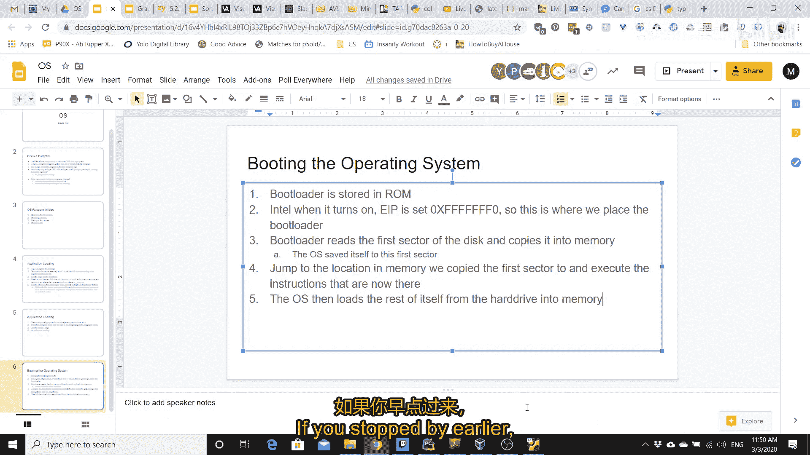

Stream okay。