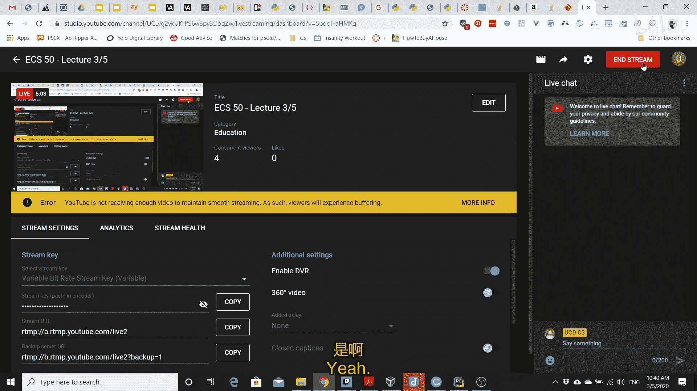
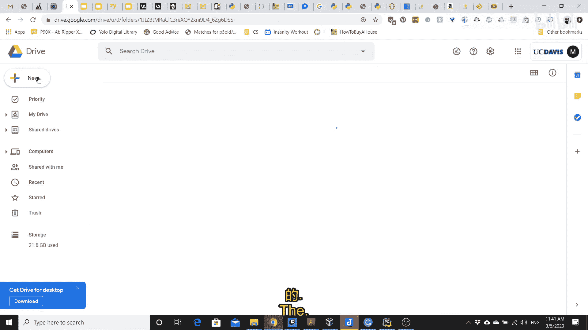
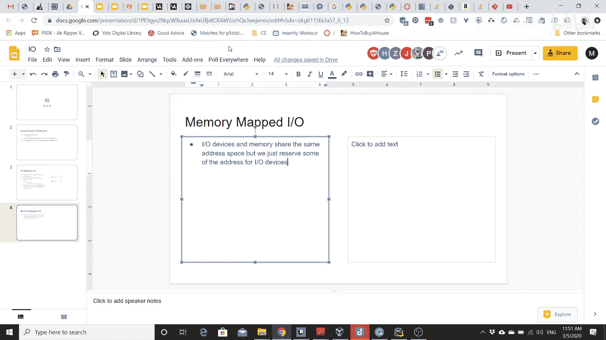

# 【全集】加州大学戴维斯分校 C语言与汇编语言 中英字幕 1080P p17 Lecture 17 - 调用约定、程序加载与进程切换 -BV1xefZBHEas_p17-

Be carefulful about that。So for example， if you're supposed to like enter hello。And you did Ho space。

 we can account for that in Mimeer， but if you do hello space in Canvas， it'll be like， no。

 that's wrong。So watch out that you don't enter in any additional white space in your answers。

 so be careful with that， the ones they pay like special attention to in terms of like finiciness are the ones that ask you to write the debugger code to print out like values on the stack or values and registers。

They're just a little bit more picky about what they can accept and putting in additional options is more complicated there。

 So that's why it's more strict。U。Most of the quizzes are due on the last day of instruction which is the 13th so a week from tomorrow and then the final is due on the 19th you know enough to be able to do all the quizzes and all the midterms that are there you don't know enough to do the final yet because we're still talking about some of the topics。

Are there any questions before we get into lecture though today？Yeah。或是。啊。

For some of the instructions。不要在般。Person yeah， even if even if I like follow the instructions。

 you have like given on the size， it won't like give me the answer。 And the same goes for like。

Question number 14， which is doing doing like calling the function。

 but it works for the opposite like the return works well and。你婆婆说。

So stop by office hours and we can take a look over those questions。

 someone did post about this in on canvas， but their answer that they had for like push was push。

Oh no so I'm like， well， it kind of makes sense but the question that asked you to implement push and your answer was push is not correct because you got to use other instructions。

 So that was the the person that mentioned that， that was the only problem that I saw with their answer。

 But if you're doing the correct stuff and you're showing me that you know how push is actually implemented。

 stop by office hour today will'll take a look over the questions and we'll see if it's either a problem on the testing end or a problem with your answer。

 If you do have like additional like don't leave extra blank。😊，Blans in there。

 take those out because you might be counted against you for that。Yeah， Haley。

Proably as well as space honey think。You can off one homework。And no， I do not drop one homework。

Yeah。😊，点嘅声暂。No， there are no more coding assignments after homework 4。switch to。

So originally the problems were all on canvas， but again their input formats a lot more finicky。

 so we were trying to do the conversion from the Canva questions to MimeR to allow you to have more flexible input and be better able to match answers or handle like small error errors in your input but the TAs didn't have enough time to do all the conversions for everything so we had to fall back and use the canvas ones that I had already done in previous quarters。

Anything else。Yeah，Yes， they do。 They have like three attempts apiece， for the most part。

Anything else？Generally my recommendation is try it once if you get it wrong。

 go look up what you got wrong and then try it again and then if you still get it wrong come to office hours for help one of like the downsides again of like the canvas is like if you miss one question and you want to redo it。

 you have to redo the entire quiz。Yeah， which is again。

 one of the reasons why we're converting things over to Mimeer because it would just let you redo the question instead of redo the entire thing。

Anything else？Okay， what are the GCCCC calling dimensions。

 this tends to be one of the biggest mistakes that I've been seen in office hours。

 so what are our three rules？继续。Return values are placed in EAX。你证据。So the calling function， right。

 it's responsible for saving EAX， EX and EDX， the function that is called is responsible for saving all of the other ones。

And。The last one has to do with how do you get arguments。The arguments are placed on the stack。

 right， and they're pushed in reverse order。 So the functions that you're writing。

 are you the caller or are you the called function。嗯。Yeah。对。Color。

So you're the function that's doing the calling， you are the called function。You are both。

You're going to be both， right， because？We have something like。咩。

Maybe over here。Right， because we have something like。Function one， right。

 calls function  two calls function 3。Right， you're essentially a function2 in terms of that sequence。

 right， My main code is going to call your function and your function is likely to call other functions。

 So when your function is called fun2， it's responsible for saving what registers at the beginning。

Of its running。So fun too， when it's first run， what register is it responsible to save。

 assuming that they wants to use all of the registers。Yeah。So is it EAX， EX and EDX。

 or is it everything else？So is it AC C and D？Everything else。But your function 2。

 you are just called。 You are the called function， right， The call was function。One。

 function one was responsible for saving。A C And D before it called you， right。

 You are the called function。 So you're responsible for saving everything else at the beginning。

 If you're planning on using it。 So function 2 at the very beginning。

 right after you do your prologue， you would want to save like E， S I， E， D， I， E， B， X。

 if you're going to be using E， S， I， E， D I or E， B， X， right， Now。

 when function 2 calls function 3。😊，What register is it responsible to save。A C And D。

 assuming that it's using them and it has values that it cares about them， because at that point。

 it's the calling function and the calling function is responsible for saving EA X， E X and E D X。

 right， A lot of you guys were getting this like the other way around。Backwards。

 so pay careful attention to that that you're following the rules。

 I think they're pretty straightforward as to like what you， what they mean， right。

 But the implementation details are also。Poposed to be straightforward to right like return value foot in EX when you want to call a function。

 you push the arguments， push them in the reverse order right to left。When you get called。

 if you want to use EBX， ESI， or EDI。Save them。Right when you call something else。

 if you have anything in EAX， EX3DX， save them first， then do the call。嗯。Actually so。that小ょ。

So if you currently like， can you be more specific by that stuff？所以。Which registers？

Okay and new function。Let's say yes， more than David。say you just那这边 time。So if you have things in A。

 C or D that you don't care about， you don't have to save them because。😡。

You don't care about them right so if you have values in AC and D right temporary things that don't matter and you're okay with them being overwritten。

 you're no longer using them Sure don't save them right but if you have something in those registers that you care about and you still want to be able to use those values after the function call completes save them first。

And I'm also confused。When you push something on， when you're pushing the actual thing or're when you're pushing a copy。

系fi哼。So so you're always pushing copies。需要。You can't push not a copy， right。

 but if you're talking about C plus plus， how can we like。

 you know call a function that accepts a reference。Is that your question？Right。

 so how could we like implement something like this if I have like my function and it takes like an integer reference。

You know， E， how can we implement this？Right， so let's say like in this function。

 we do something like a is equal to5 right， something very simple along these lines。

If you had to write this function in C。How would you do it？Not in C++ anymore。

 you're forced to write an equivalent or as equivalent as possible a function in C。没有。

Right this function， its signature would be like know fun one in the C version。

 and it's going to accept an integer。Pointter right， A。 And then down here。

 you would have to say star a is equal to5。So the way that references are implemented is they' I they're like ninja pointers。

 right， they're just pointers is in terms of how they're implemented at the back end。

 but you just don't have to dereference them。When you're working with them and then you don't have to pass the address of when you call the function right if we were going to call if we were doing the same thing over in the C code。

 though， we would do like int X equals seven。And then call fun one， though with the address。Of X。

How youくた。How do you get X's address？Yeah， you can use LeL the X's address or if you had something like this。

Like integer pointer P is equal to the address of x。 I mean， you still have to get the address of x。

 And you can also just pass in P here。 And that's the exact same thing。

Right you'll get the same effect right the reason that this works right you get the real object with the pointer is because if x is stored address 100 right。

 you would pass in 100 as the address of x how many addresses 100 are there in the computer？One。

 right so everybody's going to talk about address 100。

 which is at one exact spot in memory and so everyone deals with the original as opposed to dealing with a copy right。

 but the function right when you call it， it gets a copy of the address which would be 100 so a copy of 100 gets placed onto the stack。

Right。the 100 right is a pointer， it's a value， its value is 100。

 and so when you push onto the stack right like P or you push onto the stack， the address of x。

 really all you're putting there is 100。A copy of where the thing is located at memory。

 a copy of the address。Okay，I want and。一に。お list？You want to push the focus on this stack But when you have to put something in a register and then push it。

 And once you just push the name， like blank capacity。

So you could always do push blank past EBP if what you wanted to push was the thing itself。Right。

 so if you wanted to push X， you could say push X pass percent E P。

 assuming you had X regardless of whatever Xs type is， assuming that when you in your C code。

 you were trying to call the function with。Ex。Right， but if you want to do x plus one， well。

 then you're got to copy x into a register， add one to it and then push it。

 because when you call the function with x plus one， you don't change。X， right。

 the adding of one shouldn't modify x。 so you couldn't do something like add1 to x because that would be x plus equals1。

 and then x would be modified。最 think if you看。E is equal to 12，3，4，5。えすぜ。What you see。

 is it pushing one to three or five， or is it just pushing？It's pushing again。

 it's like if your function accepts， think about what your function accepts， the function accepts n。

Inage your pointer right so you would be passing one address right the address 100。

 which is where the beginning of the array starts at because if you think about it。

 if I know where the array starts at，I'm great。 I'm golden right because if I want to access the element atposition 100。

 I can do like you know array at0 and that's gonna to give me memory at location 100。

 but if I want to access the next element， well that's array at one， which we do array 100 plus1。

101 de referenceence to get the second element in the array and this is why it's important that the elements in the array be contiguous。

 they have to be next to each other in memory， otherwise this breaks apart and no longer works。😊。

Does that make sense so really what you're pushing when when you've been thinking I push the array。

 really you're just pushing the address to the first element in the array and then well great that array starts at location 100 and so when you dereference it you're going to go to location 100 which is where the array is at memory if we do array at three。

 we're going go three past 100 right and then access the element that's there and hopefully that's still a part of our array and we'll get the element at index3。

You're pushing blank pass you。Yeah， some label。Are you getting the address of a copy。

Or are you getting the address of that？You're getting a copy of the arrays address。

So it is like the original。Well you will you like you get a copy of the arrays address， right。

 So over here， let's say again， address of x is 100 P is。100。 and now when I do this call， right。

 I'm going to be pushing what onto the stack。100， which is a copy of。X' is address。

 Not that P itself， if inside function 1， right， we did something like this。Oh gosh， come on。

Like a is equal to 500。After we do this call。Right， what's the value of P。Right again。

 if we said in our example， the address of x is equal to 100。

 what's the value of P after the call is complete？How many of you guys think it's 500？

How many of you think it's still 100。How many of you think it's something else besides 100 or 500？

Because again， think about what happens under the hood when we're doing this call。啊。

Theyve got to get rid of all these extra spaces right so let's assume that we're trying to implement this little section of code and calling our function。

 right？And again， assume that we have like P past EBP， right？So in implementing this。

 we could just do something like push， P past。Percent EBP， right？Call fund1。 And again。

 if we want to get P itself， right， we could do something like Le X past EBP and to say percent EAX move L percent EAX to P past EBP。

Right。This is。EA X is equal to the address of x。This is P is。

Equal to the address of x pushing the argument。Colling the function。Is X N P。No， what's in P。Not X。

 but。The address of x is in P， but P itself is not。RightAnd again。

 you could never even put P or x into P。 You could only put a copy of x's value into P because there' are two different memory locations。

 right cant。Force them to be the same thing， right。

 You can say two pointers point to the same location memory， perfectly fine， right。

 but memory locations are unique and you can only have copies of values of different spots。

So if we're now doing this over here and we're over here in fun one。here's our label。

So here's fun one， right？You know， we do like push percent EBP， Mo percent。

EBP percent ESP to percent EBP， right？So after we do this， what's the stack look like？

EBP is pointing to。Right， old EBP。So that's at plus zero above old EBP is going to be。嗯。Right。

 the return address。Above that is going to be。Well， I mean， well the address of X。 but again。

 like we think about what we got called with it it's。A， right。

 because that was the name of the variable。Again， back here， we called it。A， so we have a。

 and then if we think above that， we probably have something like P and then X。

There are different locations in memory。Right， so our function fund one， who's he going to mess with？

Our function fund one， who's it going to mess with？Hey， right。

 so in terms of like implementing this code right， if we wanted to do exactly what it says to do there。

 we would do something like Move a pass percent EBP two words right pass EBP to maybe EAX。

 then Mol dollar sign5 to percent EAX， right？This is E A X is equal to a。 This is。Star A is equal to。

啥。Right。Which was。This first line of code that we want to do。 Now we want to say a is equal to 500。

So you move well。Dollar sign 500 to。喂。Again， we're trying to do a is equal to 500。

So I would move 500 to。A past EP， right， The function then completes。 Were done。 right， So remember。

X， when we started at the beginning， x had the value。Oh， like 7 in it， right， P had the value。

100 in it。And A had the value 100 in it。After we do this line of code right here。

 this says go to wherever P points to or wherever A points to， which a is pointing to address 100。

 which is where x is at。 so this is going to change the value to be5。

The seven is going to go to a five。Then we do move 500 to a， so a goes from 100 to。500。

The function then cleans up right， so it's going to like。

 you know we return right all the arguments are cleared up， so we're going to remove a。

 what's P's value still？But 100 p didn't change， right？

And we can't change P because we only get into this function a copy of P's value， right， you always。

 always， always， always， always pass copies。You never pass anything else。 So if you change the copy。

 the only thing that's changed is going to be。The copy right。

 whether that be a copy of a pointer or a copy of a nonpointer。

 the only thing you get is the variable itself or copy the variable。

 so you can only change the copy right now if you get a pointer。

 you can go to where that pointer points to and change what's in that memory at that location and it will be modified and since there's only one location for each address if everybody's talking about that same location that one location will be changed。

Yeah。😊，他基本原来。个实啊。But no， we pushed。P， right， Because P was supposed to go into the spot for。A， right。

 So we pushed a copy of P's value should be put into a。Which is what we did right。

 that's what this line code right here did， right？Call your function with P's value right P's value was 100。

 so we put a copy of P's value on the set。So the only actually they went on the stack。

E track address。Well， I mean， our function， right， function one。

 it's only going to care about these things。 It's never going to talk about anything else。

 assuming it's written correctly。 So even though， yes， on the stack。

 we have X and we have P functionction 1 has no idea about that。Right。

 or at least it's completely agnosttic of the fact because it never knows where it's going to be called or what it's going to be called with。

 so it's only going to reach for its arguments。If you pass a copy though of one of the locals。

 the local from the function above is still going to be on the stack but above you。

 but you're never going to look there。Unless you're past an address and you're told to go to that address and modify the value like we were able to change x from seven to five。

Anything else？It。Yeah你谁给你撤。So what's the rule on the limit for the memory opera？

You can have at most one operaand in memory。 So if you look at that instruction， a past EBP。

 that's in memory， but 500 is a。Constant， which is not in memory， It's not a memory access。

 so you're fine， right， you just can't have two memory accesses。 So one of them。

 one of the other things always has to be if you have one thing as a memory access。

 the other one has to either be a register or a constant， could not be another memory address。

Anything else？嗯。Okay。😊，So we'll pick up from where we left off。

 I'll just leave that at the bottom of the presentation。

 so last time right we talked about how an application gets loaded。

Do you remember what the steps are to make that happen？These are types a out out in the terminal。

 what's going to happen next？对。Cian。Not find it in memory。It's okay to look at your notes。

 that's hopefully why you took them。Well。Well X we' do EX ECVE of a。

 out right that says operating system please go run the program so we say operating system run the program by making a call to EX ECVE right so now the operating systems running the control got turned over from the terminal to operating system。

 what's the operating system have to do next。Again。

 you can think logically what would have to happen， right， where is AO out currently located？

A dot out like Bob dot text or funny P do Jpeg or cool dot Giff， right， those are all what。

In your computer。They're all files， right， but your program， it's also a。File2， right。

 It's just a file that contains。Instructions to run right， that's all the program is。

 it's for the file that contains instructions for the computer to run right so where are files kept at。

On the hard drive， right， so you want to run 8。 o， it's currently where。It's on the hard drive。

 so what do you have to go do？Go find it on the hard drive， great。

 you've now gone and you've found it on the hard drive。

 which take the operating systems class and they'll tell you how that's actually done because that's a big step in itself。

So great， you found A out on the hard drive， what should you do next？We have to find space for it。

 right， how do we know which space is available？Yeah。嗯。Yeah。

 the operating system has memory tables that keep track of which spots and memory are free and which spots and memory are in use。

The operating system is able to do this because the operating system is what manages the memory right it's the thing that's always allocating memory for all the other programs or all the other processes that need to be run。

So you need to look for a spot in memory， but it needs to be big enough to what。Fit your program。

 but how do you know how big the program is？You read the headers right so you read the headers and they'll tell you like how big the program is right it's going to tell you where is the start it's going to tell you where the text section begins at it's going to tell you where the data section begins at so's great so you know。

How big it is you found a location big enough in memory to hold it。 What do you do next？Not quite。

Because all we know is this button memory is big enough， right？

I have my program that's still on the hard disk， so what should I do？Copy it over。 great。

 So we've copied it over。 Now the program is in memory because when programs are running。

 they are in memory。Right， so they're in memory right now。Right， and so。Even though it's in memory。

 is it currently running？No， right。How do we know it's not running？

The OS is running and what's it mean for a program to be running？

The instruction pointer is pointing to memory that belongs to that program， right？

So what do we have to make happen if we want to be able to run the program？

Set the instruction pointer to be equal to。So what？

The start of what your program is which again you know where it is because you've read the headers so you can jump to the start of the program but what happened was you were currently doing something right you currently had some state saved in your registers right if you just go and run that program that program can overwrite your state and it probably will right Currently the stack pointer is set to the operating operating system stack so that program could overwrite that area and memory too to make it do something that it shouldn't be doing so before we go and we jump to the program what do we have to have happen。

Sap sir again。So before we wipe or wipe the registers we should save them right we should then go wipe the registers。

 I agree so we can wipe EAX EX mediaDX， but we should also set ESP to 0。2。

A out out stack wherever that begins at right so set8 out out stack to it's supposed to begin begin wipe our registers and then we can do the jump hopefully the series of steps makes sense to you and doesn't seem enormously complicated or you know overly detailed but it should just be a logical consequence of what do we want to have happen next right what we do we have to make happen to run the program right we got to go find the program right put it into memory at some spot that we can hold it save our own state and then start that program up right。

which should hopefully make sense in terms of what we need to do the other thing that we talked about was the operating system。

 like we discussed it's a program， a big complicated program， right， but it's a program。

 but the OS is the program that loads programs。How does the operating system itself get loaded？Yeah。

 the bootloader， right？What's different about where the bootloader is stored in terms of programs than normal programs？

The bootloader is stored in wrong， right， that's important。This resolves the chicken and egg problem。

 right？As assume who comes first， right？So we go and we have our bootloader stored in wrong and so when Intel is turned on EIP will be set to this weird address so you make sure our bootloader is there right the bootloader is just going to go and grab that first sector of the hard drive because it needs to be a small simple program and it's going to copy that into memory。

And then it's going to go jump to that location in memory and start running that program that it just copied in there。

turns control over to that。 What the operating system will make sure to do because it wants to be the first program that's run is it's going to put itself at the first sector of the disk。

And so it was going to go and run your OS and your OS will load the rest of itself in。

 and then your OS is running and then great， you can go do everything else that you want to with your computer。

Does this process make sense？Now， some of you guys might dobo right。

 you start up your computer and you choose like do I want to boot into OSX or do I want to boot into Windows or do I want to boot into Linux？

How do you think that's accomplished？P。对。Boootloader， sure， I mean， but the bootloader。

 the bootloader all is going to do is is going to read that first sector of disk into memory， right。

 jump to it and run it。Yes。Sitting in。I mean， the OS is a file， right？First。So sure。

 but how do we make it so that the I don't know， the program that lets you choose which operating system you want to boot into is the first program that's run。

그 말我지。No， that would be trying to change what's in the bootloader。

 we don't want to change the bootloader。But what' does the bootlet always do？

Sector of the disk and memory， right， It's going to be a lot easier to change What's at the first sector of the disk and memory than it's going to be to change what's in the bootloader itself right So what you could do is you could move your operating system from the first sector of the disk。

To somewhere else， right And then go put your your boot chooseoser。

 I don't know what you want to call it your boot chooseoser program at the first sector of the disk memory。

 So when it the boot loader goes and copies the first sector in。

 it runs the program that's going to allow you to choose which operating system that you want to boot into that program needs to save where it's moved all the other operating systems to。

 And then what it can do is it can just go jump to that sector of the disk and memory。

 copy it in and then run it and great。 you're now running windows or running Lsx or running abuuntu。

 depending on which other sector of the disk you copy into memory and then ran。

So it's not a much more complicated process， it's just now there's two stages， right？

Put the boot chooser at the beginning， the boot chooser then will go load the appropriate operating system。

And a lot of times， these bootloaders actually do run at multiple layers where they keep loading progressively more complex programs into memory to finish loading the rest。

 so you might actually have like two or three stages of bootloading to actually get the entire operating system into memory and it to be running。

re any questions about booting the operating system？Okay。Let's talk about our next topic then。

 which I believe。Time sharing。So time sharing。Is just， let me see， make sure I get the right term。

Hope， not that。Yeah， it is time sharing。So time sharing is just multiple processes。Taking turns。So。

 quickly。That it appears that they are running。Simultaneously。Aly。The key word here is a appearss。

So have any of you guys ever like watch Dragon balls Z？Right， you know。

 the parts in Dr balls eat where the guys like move around the other guy so quickly。

 right that it looks like they've completely surrounded the bad guy and they're all of those positions at once。

But are they really at all those positions at once？No， right。

 they're really just taking turns being at each spot。

 but because they're going so fast right between each and every spot。

 it looks like they're in every spot simultaneously。

 but they're really not therere just moving really。

 really quickly or another way of thinking about it if you guys don't watch anime is you could think about a light switch right in a light bulb if you take that light bulb and that light switch and you flick that switch really。

 really， really rapidly， What's it look like if you're able to go quick enough。

 Does it look like the light goes on off， on off， on off， on off。If you go breathe really fast。

What actually happens， what it appear to your he and I when you're detecting this phenomenon？What？

Just speak， I'm just having a hard time hearing you。It's like it looks like it's always on。

 but it will look the same as when it's just fully on the whole time。

It'll be dimmer right the light will not be as strong and if you actually have LED lights。

 that's how they work when you have the dimmer switch right on them。

 they don't really just get less intense， they just start flashing really quickly and so they're on off on off on off。

 but to our human eye it just appears like the lights got dimmer。

Right the same concept is here right it's not really that the light got dimmer。

 it's really that it's going on off on off， it's not really that the programs are running simultaneously。

 it's that they're taking turns really， really really quickly right。Does that make sense。

s what time sharing is？So in time sharing。嗯。Processes are given a time slice。Or also。Quantum。To run。

RightTo give you an analogy， maybe each program has five seconds。

 so your time slice or your quantum would be five seconds， so we run program8 for five seconds。

Program A then finishes， and we run program B for five seconds。 and program C， program B finishes。

 We run program C for five seconds。 Program C might finish。

 We go back to running program A for another five seconds。

 These time slices are actually going to be a lot smaller than5 seconds right probably like on the order of milliseconds in terms of how frequently they run。

So to us， it still looks like they're running simultaneously。

 but you get a small amount of time to run。Does this make sense？好。

We may have accidentally skipped a topic， but we can go back to that one。嗯。

So the way that this is implemented is there is a timer that goes off。Every， say， X seconds。

This timer goes off more frequently。Then a time slice。So let's say， for example。

 that the timer goes off every one second， but you want every program to run for five seconds。

How do you make that happen？Yes。So again， the timer goes off every one second。

 but you want every program to run for five seconds。What。Right way。Well， no， it's。

 it's always gonna go off every one second。 right， Maybe your alarm goes off at 7 AM every morning。

 right， But do you get up。Now， what happens？H the s news， right， the alarm goes off again。

 then what happens。Hit the snooze button， right， It goes off again。 hit the snooze button， right。

 And then， you know， finally， you might actually get up right， in terms of what's going on。

 But can we have that happen， do something similar when we were our program， right。

 The alarm has gone off， right， And you know that it goes off every one second。

 But we also know that want our program to go off to run for five seconds。

 So the alarm goes off the first time。 The timer goes off the first time， right。

 How much time has passed for this program。😊，One second， so has it run for five seconds？No。

 so what should you do？Like start that program again， right， kind of like you know。

 count the fact that the timer has gone off， it's gone off one time。for this program。

Then you're like， well， okay， well， fantastic， I count that program， continue running。

 timer goes off again。It's now gone off two times， so we ran for two seconds。

 so mark the fact that it's gone off for the second time。Continue with the program。

It's got out the third time again， Mark that it happened the third time， continue the program。

 Mark that it happened the fourth time， right？Continue the program goes off again the fifth time。

 so we now have the programs run for five seconds。So what you you？Stop that program and then。

Run the next program right in line， stop writing program A and then go run program B。

 but then set program Bs timer to be or like timer count to be zero， right。

 It's not like a very complicated thing you have to do just think about it wants to go off for five when went up for five seconds right。

But it goes off every one second， just mark the fact of how many times it's gone off and when you're ready to change and enough time it's passed。

 switch the next program， same thing happens inside the computer， right？So。We might want。

The time slice to be y。Seconds， right？So when the timer goes off。Right。Timer count。Plus plus。

It goes up by one。Then。When timer counts。Is equal to y over x。Something like that。

Or like something along those lines， right？Yeah， that makes sense。Then。Which。To the next process。

Do you guys know what the difference between a process and a program is？

So just here a process is an instance of a program。Right。For example。

 right you might have Google running。Preakable Chrome。

That's an instance of the program Google Chrome， but how many Google Chromes can you have open？

Quite a few， right， look at my taps。Right so every time we want to have like a new instance of Google Chrome right。

 a new process， right， we go and start it up so you can have multiple instances of the same program running right with different data doing different things。

The process is just an instance of a program。这不是。So if we're thinking about time sharing， right。

 how would we want to implement it， right？How would you go and decide to do it？

If you are responsible for implementing this part of the operating system。Right， assuming that。

 right at this point in time。A。Our process。X was currently running。And its time is now over。

And we want to switch to process。Again， think what would be your strategy for solving this problem。

 right， A turn is over。 We now want to run B。 How can we make that switch happen。我。Yeah。

 it's going to be very similar， but。There's going to be some differences。

 so we have program process A is running， we want to switch to process B， how can we do that？

would your first step be right， just got to get step by step， what makes sense to do？

Talk with your neighbor for two or three minutes。And see what steps you guys come up with to saving it。

 right， what things would you have to do to make that switch happen between the two processes？She。

We have。切。这。Yeah。从汽车。ます。Yeah。是。一。S。Yeah。그。这的。照时。好。现在。所以他。超级。实在的。I I。不是谢。嗯。I。他怎么先示。す。好。Yeah。谢。Okay。

 so do you guys have some thoughts， what would your first step be if you want to switch between these two processes between X and Y？

你死。I they two you。Do you care。Does it matter？It doesn't right， right？

It's because you're going just from one process to another process and you're kind of agnostic whether that process is different it came from a different program or it came from the same program doesn't really matter。

 it's just that next process is turn。Yes。Because again like if you're running two instances of Microsoft Word right and you're writing in one right and then you want to you know the other one should still be writeritable。

 still be accessible， does it matter whether it's Microsoft Word for document A or Microsoft Word for document B。

 or does it matter that it's Microsoft Word and like YouTube。Now。

 you just want to switch between the two。switch。Hopefully。Right， because again。

 like you don't like the operating system。Yes， it knows in some ways which program they came from。

 but in this case， we don't really care right you must switch from that process to the next process and knowing whether they came from the same original application or not doesn't matter in terms of doing the switch。

So what should you do in making that switch between A and B or between x and y？Yeah。

Just save for last。Right， so we need to save。X is state， right？

What is so we'll come back that so we save excess state then。其实就是。Load Y state。And then。Start why。

 you know， start the process。Right， which hopefully seems fairly obvious as to like what should go on。

 right， Save the one that was running so that we can run it again in the future， right。

 Take the one that we want to run， which we must have saved it previously in the past。

Put it state in there。And then started the program。So what's the state of a process composed of。

 what things are you going to have to save？So you want to save that entire program's memory。

Like it's but again， that stuff right that the program itself is already in memory right as long as you don't replace what's in that location in memory with something else。

It's still going to be in memory， everything that it had there。 So all of its text， all of its data。

 all of its stack， all of its heat is still going to be there， right。

 because you already put it into memory， right， and hopefully process X and process Y。

 they're not sharing that same space。Because that means like x would be over overriding part of y and y would be overing of x and then things aren't going to work well if they're overwritingiding each other's memories so they should be in two distinct separate areas of memory。

 so you don't have to save what's in memory。What else？Sa word。So yeah。

 you'll have to save its location， but the operating system kind of already knows where its location is because it put it there。

 so it's not thing that's necessary to save， what else is there besides the program's memory that you might want to save。

Again， but the locals are stored in。Memory。Its when you say switching between bus， just。会接婚。

Having one Microsoft behind you So so like clicking between them like giving them focus doesn't cause this to happen。

 They're all actually running simultaneously right but the one that you might not have in focus that you're not working with right now it might to decide to immediately end its turn as soon as it started because it knows you're not working with it right but if it has some other work to do it might do something right because if you think about it if you have like a YouTube video playing in the background right it's still running even though you're working in Microsoft Word so they're still taking turns but again these turns are so fast it looks like they're running simultaneously。

So what else is composed of the program state aside for its contents and memory？Yeah。

 I think I heard somebody say it。It's registers， you need to save the program's registers。

so you need to save its EAX， EX， EDX， ESI， EBI， EP， ESP， EIP， you've got to save all of them。Right。

 because they're all currently going to be used by that program， right？

So you save that process as registers。All of them。Where should you save this state too？

You got to put it somewhere。What makes sense to put it at？And in memory， I agree。

Where in memory would you want to put it？不下。Not necessarily on your stack because you don't know when you're going to be called again because notice neither program is running right now。

 neither X nor Y， so who's running at the moment。The operating system。

 So we probably don't want to put it on the operating systems stack because we don't know like when the next program is going to be run。

 right， We keep pushing and pushing and pushing。 we keep switch programs。

 But then how do I get back to。You know， if it goes AB，CD， right， and then goes back to A。

 how am I supposed to get A's information if I don't know how many programs we're running in between？

So somewhere probably else beside the stack。So a register file is just a name to refer to the collection of registers in the CPU generally the data registers。

 so like the register file for like Intel would be like AAX， EX， EDX。

 E IDI E feed right but that's inside the CPU right we're trying to save that information。

And we need to put it somewhere else。 I agree。 it needs to go to memory because it can't be saved in the registers because process Y is about to go use those。

But where in memory makes sense。What？I agree in Ram right。

 but we kind of have to be able to make this system work these processes running it multiple times right we might need to have some additional information set aside to make this whole scheme work or we can have extra programs run right like if you were implementing this what information would you want to store and how would you store it again if you had to say like。

I have some set of processes that running， and they need to take turns。 AB，C， D， ABC D， AB，C，D。

 Great， B is done。 A C， D， A，D， Great， A is done。 C， D， C，D， C，D， Oh， great。

 Now we have a new process。 E， C， D， E， C， D， E， C， D， E， C， D， E。How would you make that happen？啊。

Not unless you make them。Absolutely。so we're going to save X state。In x's entry in the Os， Oss。

Process table， right。 So the Os maintains a table per process where we can go store this information。

 right， It'll have things like the process Id， as well as the processes state。

 Probably what application it originally came from， right。

But all the information will be stored in this table so you go and you go and you locate X as entry。

 wherever entry X happens to be at， you go toss the information there。

 right just copy over all the registers。Well， then we need to load wide state。

 where should we get Y state from？么意思。From wise is entry， right， in the。OS's process table pros。Yes。

Right？So then how do we start why。Right again， because again just loading the state， again。

 the state is just registers right， go copy all the registers back。

What register is going to cause us to go pick up running why？喂。😊。

Not the ISP because your ISP is your internet service provider。

But you have some of the right letters， you have like two out of three。

And two of them are in the wrong order。The I and the P are right。The I&P stand for。

Instruction pointser than in Intel that's referred to as EIP。

 the extended instruction pointer like what really happened and I'm not quite sure why they is like naming convention is like when you have like the there's register A right。

 which is the one byte quantity， well the X and AX stands for extended and then the E and EAX also stands for extended so it's like the extended extended A。

Which is kind of weird， but yes。In memory。RightSo as part of like the operating systems program。

 it will have reserved a section of memory eight for itself to put for its process table so they can put processes in there。

It is a fixed size， so it limits the number of processes you can run simultaneously。

It might be fairly large。Right， so so infinite， but not quite infinite。

 but big enough to fit the most normal average case of maybe having like a few。I don't know。

 a few dozen running， it tends to be the norm， maybe it says like 100， maybe 200 big。

 but probably not more than that。But isn't really an intent to not me need to be that big。😡。

So we need can start why right， which is just。嗯。You know， setting EIP。Back to the instruction。

That why was on。Now， one of the things that we haven't talked about。

 which is going to be our next subject is。Accessing EIP。

 one of the problems with accessing EIP is iss not a programmer accessible register。

 You can't just say Mo EIP to。EAX or move out EIP to some location of memory or take some location in memory and。

Save it right The other thing that's kind of interesting to think about is if we want to save X state。

 we have to save X registers one of those registers would also have to be。EIP， right。

 But right now are we running X。No， we're running the operating system right because the operating system is the one doing the switching。

 so where is EIP currently pointing to？그。D O， right？ So how can I get what X's EIP is。Right。

That seems to be a problem， right， because if I'm running the L。

 how do I even know what X was doing last？Another thing that we kind of also talked about was when a program is running。

It's running， right， And that means nothing else is running。

Right and we talked about there's two ways that a program can relinquish control one is voluntarily through a system call which we can't guarantee that's going to happen within our time slice right that our program's going to make a system call and so then allow us to able be able to switch right the other way that we talked about was through interrupts which is something that we haven't discussed next。

 but they're actually essential for making this happen right this time sharing is not possible without interrupts which is going to be part of our next conversation on IO。

But before we get to that， do you guys have any questions about what the operating system does for you？

Or what things we talked about in a little bit more detail it can do。Or does do。Right。

 like the main thing to kind of get from about the operating system is its just。

Mostly at the end of the day， it's kind of just like a resource manager right your computer has a finite amount of physical resources CPU time right。

 memory， hard drive space， you know， access to the keyboard and the monitor right and all those other things the operating system's job is just really to make sure that every process gets fair access to those resources so that that process can't complete。

Right so make sure each process is able to get some CPU time is able to get some memory is able to get access easy access to files in the hard drive so that I can do its job and be done right the operating system might also provide common tasks that are done repeatedly by many programs so that we don't have to keep reimmenting the wheel right。

 for example， accessing the file system right if youre responsible for and every single one of the programs you wrote for converting between。

The path to the actual location on the disk and then actually writing the code to read the file from the disc。

Be nightmare right if you have to do that for every single program。

 so the operating system provides that convenience for you。Right。

So that's the main ideas behind the OS yeah。This one。When you see same。Registered for X。

 And there's already stuff。What's in Rammmering now and what's in registers。

What's the difference between what's in RAM and what's in the registers？Well。

 like what's in the registers is whatever the program is currently decided to put into those registers to do right so whatever temporary local things it's working on in its computation the other major ones would be like EIP。

 what instruction we're currently working on and ESP， where's the stack at。Right。

But like the contents of memory for that process， right。

 they're going to contain the program's instructions， text section， It's data section if it has one。

 and then all of its locals and you know， temporaries and everything else that's decided to place into memory。

Right so like you can think about the registers are essentially what the CP or what the process is doing currently like right now。

 and then in memory， you kind of have like the entire process。So in a lot of ways。

 if you'd like taking multi4 a you learn about caching right。

 the registers are like a cash for the cash， the cash is a cash for。

Memory and memory is a cache for the hard drive。Right and at the end of the day like your program is stored on the hard drive。

 your process， in the instance of it will be depending on you know with the virtual memory。

 part of it will be in memory and part of it may also be on the hard drive depending who's in use when and the cache has the more locally accessed recently accessed things and then the register has like the most recently accessed things it's working on right now at this moment。

Hopefully that makes a little bit more sense。RightBecause we can't fit entire all of the instructions into the CPU at once because the CPU is very small in terms of how much data they can store we can't fit all the data into the CPU it's just what we can be working on right now。

 what instruction are we working on right now， and then the IP doesn't help us figure out what instruction we should do next because we can advance from there either by a jump if we're doing a jump instruction or just by going like plus one to get to the next one if it's not a jump instruction。

Thank。こ度感。第三问。So your question is like when you type on the computer。

 how does that get resolved by the program you're working with？

That's what we're going to talk about in a moment， which has to do with in some ways the interrupts because every time you press a button on the computer or click on the mouse。

 it creates an interrupt which causes whatever programs running right now to like pause for a second。

 the operating system then goes and handles the interrupt like it gets the key that you pressed and then it'll go give the key that you pressed if your program was waiting for it to that program。

For example， like when you call scanF。Your program pauses and waits for the user to finish entering input right the user's typing every time the user's typing。

 the operating system is kind of like saving those characters。

And then once the user finally presses enter， the operating system knows that El great you're done。

 then takes all that stuff that you've entered， whatever happens to be right now and moves it over to your program and then your program gets restarted and then handles that input。

Same thing with mouses， but you can also make it。There are other ways of getting input beside scanF that can be just like every time a key is pressed。

 run my program and do something with whatever I was getting and I'll just immediately give the key that was pressed to the program instead of like buffering all the input and that line and then passing it forward。

Yes。Yes。

And then this would be IO。Maybe IO dash because slashes probably wouldn't work for the name。

 the path separator。

I knew。Science。So。The first issue that we have to deal with is。Accessing the IO devices。

Like how do we actually talk to them， how do we want to have them connected？This is in our book。

This is chapter 8。Right， so Io devices。Have Ids。Right。0， one， two， three， going up。Right。

 depending on。Like the。The actual ID。Depends on the IO。Ort。It is connected to。

So if you're connected to port zero， your device's ID is zero， if you're connected to port one。

 your I device one， if you're connected to port two， your I device2。

So how do you guys have any ideas about how we might be able to access those devices or ways that we could say talk to them？

Yeah。So there are two different techniques， one is called IO Mapped。IO。And the other。Is memory mat。

哎有。So let's talk about IO mapap Iio。So in IO map Io， the IO devices。And。Memory have。Separate。

Address spaces。we go and we insert a table。So this might be for IO。This would be like zero。1，2。

But then， we might also。Not like how this looks。So， big。嗯。And then we might have memory。Right。

 so there's separate address spaces。 There's I address 0， I address 1， I address 2， I address 3。

 It's also gonna be memory address 0， memory address 1， memory address to memory address 3 and so on。

 The I address space tends to be a lot smaller than memory。

 because there's a lot fewer I devices connected to your computer， right。

 You have things like your wfi card， maybe like your ethernet card， your monitor， your speakers。

 your mouse， your keyboard。😊，Couple of USB ports， maybe like your HDMI port a few other things right so like in general like the I address base might be like a few dozen big。

In order to support all of the IO devices that you have connected to it was like you know。

 memory two to the 32 in terms of the number of elements or two to the 64 in terms of elements。

 depending on what the size of your CPU is。So how can you distinguish between the two？Right。

 so how can I distinguish between I address zero and？Memory address  zero。

 I address 1 and memory address one in terms of if you were implementing this。

What instruction do you use to access memory？Right now in Intel。

Most the general one that you've used to grab a value from memory or put a value into memory。

Move right move out with the advanced indexing mode right so if you say move L something to address zero it goes to memory address zero if you move L something to memory address one。

 it goes to memory address one move L will to memory address 1000 it goes to memory address 1000 right。

So if I have an instruction that allows me to say put this thing into memory。

How can I kind of mimic something like that to allow me to access Io devices？

Just have another instruction， right， so separate instructions。For accessing memory and Io， right。

In Intel。Right，Me， like we said， is like move。Again， other instructions can of course。

 access memory as well， like add， subtract， multiply， etc。But then for IO。They have。In。For reading。

And out for writing。 and they are literally called in and out。So if you say in from address 100。

 you're going to read from IO device 100， if you say in from IO address3。

 you're going to read from IO device 3， if you say I want to write a value to IO address5。

 if you out to address 5， you're going to put the value at IO device5。 so separate addresses。

Does that make sense， so separate addresses， so separate instructions to be able to distinguish between the two。

 right？This might。Also cause us to have slightly larger buses。Right a bus is what？Remember buses？

Chapter two， what's a bus？It's what？It's just wires right that connect the different components together。

 right， so it might have a slightly larger bus because we need an IO bus。And a memory bus， right？

They'll be able to access those two different things。So again。

 you have to add maybe a couple more wires to your computer to be able to support this type of system。

So instead of splitting the address space up， what might be alternative？嗯。Instead of putting it up。

 what could we do？We can have them share the same address。Right， that's。Memory， mapped， IO。

Which is just I devices。And memory， share the same address space。But we just。

Reserve some of the addresses。For IO devices。So you might say reserve like the first 100 addresses for IO devices。

 so anything that goes to address zero1， two， three，4， right？That would go to Io divide 01。

234 Anything after that goes to memory。So we're out of time for today。

 we'll pick this up on Tuesday and wrap this up on Tuesday。

Probably either finish on Tuesday or just only have a little bit of lecture on Thursday and then wrap up early then。

Unless you guys have more questions and you want to talk about more things。

 I will see you guys either in office hours or on class next week。Right。承多这个。

好。