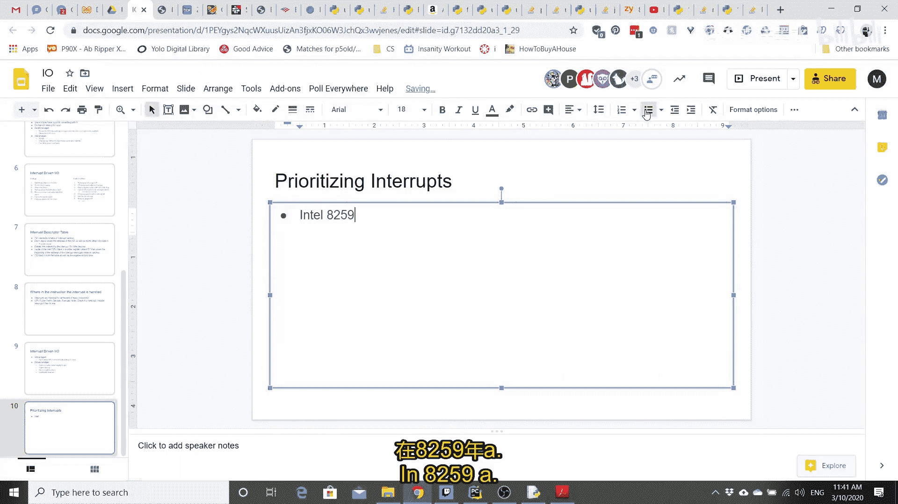
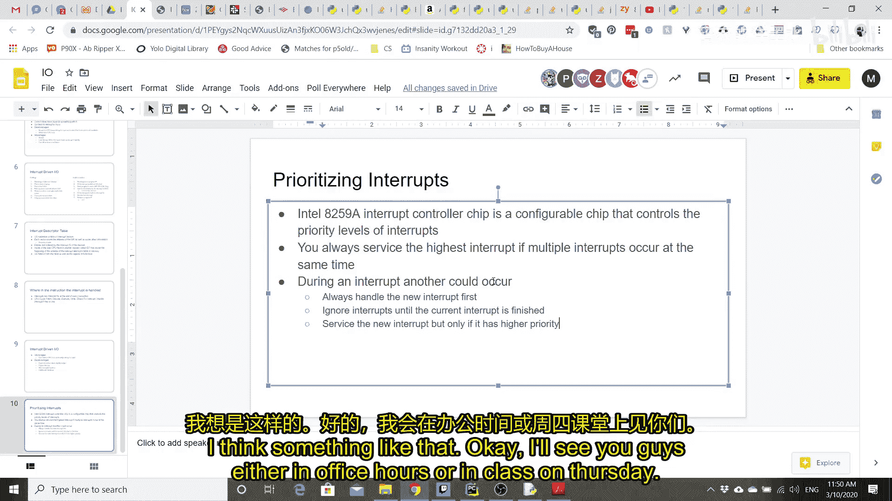

# 【全集】加州大学戴维斯分校 C语言与汇编语言 中英字幕 1080P p18 Lecture 18 - IO与内存系统 -BV1xefZBHEas_p18-

因为。So we're going to pick up from where we left off last week。

She。This。Which is talking about。The IO system and how that works on your computer。Come on。

There you go。Also， are there any other questions though before we get started？

So last time we were talking about how we just going to access our memory system。

 there are various IO devices scattered throughout your system， they're accessed via their ports。

 which is like their IDs， they have0，1，2，3，4， etc ce。

 and we're talking about different ways that we could actually communicate with them one method that we talked about was the IO map Io。

 which is where memory addresses and IO devices have separate address spaces。

Right so you can say I want to read IO address two， I want to read memory address2。

 I want to read IO device5， I want to read memory at location5 to be able to support this we had to come up with two different or with different instructions to be able to specify we wanted the IO devices as opposed to the memory and the instructions that we came up with were in and out so to be able to access the IO you'd do in for reading and out for writing。

And then again， accessing memory to move or essentially any other instruction。

The other way that we could also have to do things。

Is called memory mapap IO and IO devices in this system。

 they're going to share the same address space as memory。

 but we're just going to reserve a part of the address space to be used for the IO devices。

So it's going to be one unified address base， we might say like the first 100 addresses are all reserved for I devices。

 everything after that actually maps to real memory。

So instead of having two separate address spaces like we had last time。

It's going to look something like。This。Where we only have a single thing and this might be you know。

大有。Io。系有。Memory， memory， memory。And so on for the rest of our days， right？

Inser a column above this or row， above this。This might be addressed zero，1，2， three，4， five。

 and so on going down。That's my look pretty。Any questions so far about the system。And how it works。

How is the number determined。What do you mean like how like which like how many you addresses we're going to reserve for like if you have a mouse which is an IO device how do you like a five or a three euro？

It depends on which port it's connected to。So apparently。Siding things that way made it look ugly。

This欢。M true。But then it's going to make it like big， isn't it？

Or do I just resize to my table and then say。Okay。I guess that works。 Thank you。Right。

 so Intel does not use memory map Io。 but you know， if Intel。Did use memory map Dio。

How would you access IO？What instruction would you use to access IO if we use memory map IO？But。No。

Intel does use the IO map system where it does had those separate instructions。

 but if we assumed that Intel had actually used memory map IIO instead。

 what instruction would you use to access the IO devices？Versus accessing memory。

 what we use to like read and write for memory。Yeah， just move， right？

What would you use to access the IO devices in this setup？来吃为什。I mean， yeah。

 but like what instruction would you use？Because it's not an instruction。yeah， also move。

Right because we're treating the address space the same way right we're not treating IO addresses any different than memory addresses so we can use a single instruction move so just say read from there or write to there it'll just happen that in the example on the right hand side if we moved some value to address one that's actually going to go to an IO device or if we moved to read from address one we would read from an Io device but if we move to write to address4 right we would write to a memory address or if we read from address5 we would read from a memory address but to the CPU。

It doesn't look any different than any other location of memory。

Reads from it like normal and writes to it like normal。

 The only difference is like the programs you would write would know， oh， hey。

 if I want to read from Io device 3， I might have to format it so that when I do my right to Io device 3。

 I actually send it the information that it needs to know how to do the right correctly or how to do the read correctly。

So just some like disadvantages。You know。Slightly， you know。

Youd like some unaccessible memory addresses。Because the reserved for the IO devices you don't actually have that memory。

 but the number of IO devices that we're going to have is going to be relatively small to the total amount of memory right you might reserve like 100 200 addresses right for I devices but we might have like two to the 32 or2 to the 64 potential memory addresses like the percentage of those elements is really really small right。

All right， if we did something like， oh， we're going to reserve 200 out of two to the 32。

I don't know。 It's a pretty small percentage。Of the available addresses， so not really a loss per se。

Right。The advantages。Get to treat。IO devices。Like memory。All right， no additional instructions。

Can write。C code， C， O， C， C plus plus code。To access。IO devices， right。

 you wouldn't actually have to write any assembly if you knew your I device was at address5。

You could just take some pointer and set its value to be equal to。5。

 and so now when you dereence the pointer， you're going to go to memory address5 and write the I device or read from the I device。

 depending on whether you put the assignment on the left or。

 you know star pointer equals something right to the I device， Something equals star pointer。

 read from the I device。That's actually pretty convenient， really nice， but again。

 we're not using this scheme， we're using IO mapped Io。Any questions before we go on into。

The like how do we actually work with the I devicesicees？

So let's say you guys had to interact with I device6。Right。

Or maybe we'll give a more concrete example。嗯。Nope， I don't know。 I do not want the。

Introduction set reference mail。 You're totally free to use anything that you find in there。

 There's just a lot of stuff。嗯。So on Intel， the keyboard data port。It's at address 60。

 Hex 60 in memory。Or I address x60， this status port is at OX 64。

One of the things that the keyboard status force will tell you is whether you actually pressed a key or not。

If it has been pressed， bit4 will be a1， and if a key has not been pressed。

 bit4 is actually going to be zero。Right bit5 also plays a role he says when you read the character。

 you have to actually tell the keyboard that yes， I've actually gotten the character you no longer need to save it So the way that you do that is you briefly set bit5 to one and then you set it back to zero right this will also cause bit4 to revert back to zero2 So let's say you were trying to read a character from the keyboard。

Oops。Yeah。Okay， come on。 scroll up。Let's say you're trying to read a character from the keyboard。

 how would you go about doing that？What code would you write given that you know the following that port is actually going to have whatever it is that you've read。

 it's at address 60， the status port will tell you whether you've set a bit to one or not or whether a key has been typed or not。

 you can look at bit four。What would you do if you wanted to talk to the keyboard to be able to read the character that was typed？

What seems simple。Yeah， you have to extract the bits， right。

 but like is a key going to be typesd all the time？No， so what do you have to do。

 given that currently like right now I'm not typing in the keyboard。

 but we still want to be able to read the next key that's typed。I mean， thinking about at high level。

 what would you do if you take away all the keyboard， data port and status port things？

What would you do， how would you implement it， what's your algorithm going to be in English？

State something sensible。是控。Discuss with your neighbor sitting next to you。

 how would you do it for the next two or three minutes right。

 but whatever you come up with it should be fairly simple， it doesn't have to be very complicated。

In terms of what should happen。嗯。Yes。そし。工程。Yeah。哎。そ。是。

 could you have a loop of that's again parallel with other things。Look。

 we don't care if other things are running right now， but sure。

 if you want to assume that it's running in parallel with other things， that's fine。 Yeah right。

 you could be like， hey， is there input and So you ask the keyboards status for it you know。

 was a key typed right， little bit for and it'll be like yes or no， if it's no right， what do you do。

Ask again， do you have input？ It's like， no， and you're like， well， do you have input now， No， well。

 do you have input now， No， well， you have input now， It's like， no， do you have input now， Yeah。

 I do。 right， Finally tells you you have input。 So great。 You have the input。 What should do next。😊。

read the input， right， and then tell the keyboard that you read the input。

 And then if you want to read the next key， do it all over again， ask it， hey， do you have input。

 Do you have input， Do you have input？ And if we look at the book。

 Professor Matloff does have that solution just below。 scroll down。

So here's this loop until the character is ready， so he does an NB from address 64。

 that's the status port。And he puts it into BL， hey。What's the value of the status board。

 He then does an and to check it just a bit for0，1，2，3， then4 right， so one followed by four zeros。

 right indexing starts at  zero， That's why it's 10。 Hey， is there a one there If it's zero right。

 no bit was set， ask in ask in ask in ask in until finally there's input。

And then once we finally get out of that loop， we have the input。

 so then he reads from address 60 into C， right， grab the character。

Then we need to tell the keyboard that yeah， we've gotten the thing， so we or B to BL。

 that's going to set bit5 of BL， which again has the keyboard status quo。Right， set。

And then he'll turn that bit to five， he'll write it back out to the keyboard statusport great I read your character。

 he'll flip that bit back to being zero， which is what's happening here and then he puts that bit that status that bite back out to the keyboard statusport to acknowledge that he's gotten the character right so again。

 do you have input， do you have input， do you have input， do you have input， do you have input。

 finally get input， you do something with it This is called weight loop bio or pulling。Right。

Under this scheme。Repeatedly。Ask Io deviceice。If it has input。Once it does have input。

Do something with it。And then finally， you know， go back to asking again。As。科制英。Oh yeah。 I mean。

 you know might be really good。 Maybe you do like 100 words a minute or something。

 but how fast is your CPU run。Right， you know，3 gigahertz， it does， you know。

 three times10 to the nine things per second。So yeah it can ask much。

 much faster than you can actually type or again probably than any IO device can actually function even an IO device like your hard drive because your hard drive it's a traditional hard drive is an electrical mechanical disk right or again if or talking with like the ethernet card the rate that it probably can pull data down from whatever website you're asking is going to be slower then you've being able to ask it whether it has input or not。

 So what seems like some disadvantages for this system。

It's asking a lot and if we assume that we only have one CPU， if you're asking for input。

 what are you not doing？Anything else？Right， so if you're asking for input。

 you are not productively spending time， right， So one of the disadvantages。Of this is a。

Keeps the CPU busy。Asking for inputs。And most of the time。Inputs is not available。

That's the bad thing right if we were asking for input and input was there most of the time。

 would it be a downside？No， because you're actually actively doing something instead instead just saying do you have input。

 do you have input， do you have input， do you have input right this would be like if we had to do phone calls and you just have you want to call your friend and you pick up the phone you're like are you there are you there are you there are you there are you there are you there are you there are you there and then finally your friend goes and grabs their phone it's like hey I'm here and then you can have your conversation you know do something it's extremely wasteful of your time because you're just sitting are you there are you there are you there when you guys probably have many other more beneficial ways of spending your time then just asking if someone's there on the phone。

Right？So， it's wasteful。As CPU time。Because again， the input's not normally available。

Are there any advantages？To this system。Yeah， it's simple。What else？なです。Well， I mean。

 hopefully in our other systems we never miss inputs either， right， but when the input shows up。

 how quickly do we get it？Really quickly， right， so it has low latency。

which is just when the input shows up。Right。Another advantage that here about to see is it can all be done in software。

You can write that little loop that says， do you have input， do you have input， do you have input。

 do you have input quite easily。Are there any questions about weight loop bio？Yeah。

So they think back。So。0ro点。So how big was the thing that we set？To one and then to 0。

How large was it？Yes。No。It was one bit。You could have the null character。

 which is one byte big right but in talking with the keyboard right that was one bit that we set to zero or set to one and then set back to zero。

RightSo the null character was not reserved because we're only working with a bit， not a byte。

Differentiate between。There。But the input。Or is just something that's sitting there right now。Me。

Because again like when the keyboard status part we're talking with it。

 if nothing's been typed right it'll tell you nothing's been typed and then it'll just mean there's nothing there so if you tried to access the data port would that make sense。

The keyboard told you I have no characters， but then you go said。

 giveive me the character that you have。Would that make sense to do？

I mean there's something there right， but it's probably garbage， you don't know what it is。

 or again if you think it back to like the return semantics for the GCCCC calling conventions。

Right a return value is placed in EAX if the function returns right， so you have a void function。

 does it return anything？Now， will there still be something in EAX after the function finishes？

There will be， should you use it？You look at the keep like for like when you call a void function。

 you know the function is。Void， right？ So when you call a void function， would you ever want to。

 after you call that function， use the return value， A X is the return value。 No。

 so you just wouldn't write the code to do it。 Again， the same thing here。

 when you ask the keyboard status port， do you have a character， And it tells you， no。

 you probably shouldn't attempt to read the character that's there。Does that make sense？

I guess when in my head， it's not that no one's there， like someone's there， it's just not someone。

Well， I guess this is， you know， think about it maybe instead like if you're thinking about the telephone analogy。

 think about like the string cup telephone。Right， you could yell into that string cup， right。

Does there have to be someone on the other end？No， so you would keep saying， hey。

 you know are you there， are you there， are you there， are you there， are you there。

 maybe maybe you have the other one up to your ear。

 are you there are you there there and then eventually from instance someone finally says I'm here right I have a value right up until that time that someone came and said hey I'm here right there was no one there on the other end of the line。

Yeah， there's a question that friend so's look like。That second input on the keyboard。So。

So one of the things kind of like we talked about with the operating system is that if someone wants to access any of the IO devices。

 the keyboard， for example， they have to go through the operating system to do that。

So if when you call something like Re， Reed has will be like a system called translated over to the operating system。

 the operating system will go run， it'll go collect the input for you。

 and then once it has the input， you know somebody press enter。

 it'll go give those values back to you。So I guess you could say both are doing it in your question with the Google Doc and your computer because you're Google like the Google Doc program it will be like hey。

 when a key is entered please let me know right and so it'll go basically like pause itself and wait for input in some ways until you type and then when you type it'll be given to the program。

And that program can do whatever it feels like a lot of the times like when we've been working with like scanf or like CN。

 it's called blocklocking IO。Right where you wait for that input and you don't do anything else until the input comes。

 There's also other forms of input called non blocklocking IO where you say， hey， give me the input。

 and I'm gonna check every now and then on it to see if I got it right or they might set a notification。

 Please call this function when you do have input right with the value。

And then you go and you do whatever it else is is that you're doing with the rest of your time until that input shows up。

So that's probably more like what the Google lock is doing is doing the non blocking IO。

Any other questions？So if we go back to the telephone analogy， right。

 let's say you're waiting for like an important call to。

Like from Google right for a possible job hiring， right。

 are you going to be sitting in front of your phones saying， are you there， are you there。

 are you there， are you there， are you there？No， right。

 So in this analogy you probably are going to be doing something else at that point in time。

 maybe you're watching videos on YouTube。So what's going to happen right。

 you know they're expecting a call eventually， so you're watching your YouTube video。

 maybe try to take your mind off of it so that you're not so stressed out。

 but then what's going to happen。What。Your phone's going to ring。

 right so the phone rings starts ringing， what do you do next？那一点一点。喂。Oh， you're like。

 you're not going to take that phone call from Google but a possible job hiring opportunity。Well no。

 let's say， you're expecting the call， right？But。What's going to happen， right？

 So you're watching your video， your phone starts ringing。What do you do next？Right。

 you pause the video， right？I mean， could be kind of awkward having the video playing while you're in your phone call。

 right？So you pause the video， right？You then pick up your phone and assuming we live back in the olden days where we don't have our phones displaying the caller ID。

 right， what are you going to do？Yeah， like， hello， right。 I'm Matthew。 who's calling right， There。

 F back。 This is John from Google， right。😊，What happens after that？

RightYou start talking right you have your conversation right and hopefully your interview goes very well right your interview then finishes。

 right。😊，Say goodbye， you hang up。Then what happens next？Yeah。

 you unpause your video and you go back to watching it。Right， so。

I don't know if you actually need the phone analogy in there。

 but what kind I gonna think about that would be a fantastic thing to have in our computer right as well being able to have this little ringer that goes off whenever someone needs something done right Someone clicks on the mouse ring。

 ring ring right go handle that mouse clip Someone types in the keyboard ring ring ring。

 go handle that keyboard input right Oh you got some more data that you download from the internet ring ring ring。

 go do something with it right This is called interrupt driven IO。

And so if we kind of break down our analogy as to what we wanted to have happened， right？What's。

Right， I guess maybe we'll split it so that you can see it on both sides。So here's our analogy。

Here's the implementation。Right。So over here， right。

 the first thing that we're doing right is we're watching a video。

What would that correspond to over in the implementation inside your actual computer？You， right。

 you're running the program。Right？Then what happened。In our analogy， right。

 you were watching your video。Right， you know， phone starts ringing。Over here。

 this will be an IO device。Generates and interrupt。The next thing that we did was。Right。

Pause the video。What do you think that corresponds to over here inside the computer？是。

But not only do we need to like stop the program， right？We need to save the program state， right？

In this case， the state is just going to mean EIP。嗯。E flags。And the segment register。

So it only saves those three things， it doesn't save anything else right now。

Next thing that we did was what？What。RightSo we're answering the phone and what was the first thing that we did？

喂。And you ask， who is this， right？What should we do over here？Right， you know。Get the IO。Devices。

Interrupts。ID。Who would with me， who's calling？The next thing that we did was。After we said。

 you know， you know。They said， hello， actually we ask who is it， what happened next in this analogy。

No， there's one thing that we know that they're going to have to。

 they're going to have to do first before you actually have your conversation。Right。

 know we're in the progress， hello， who is this？What happens next？Yeah， right。

 they reply back who they are， right？A person on other end replies with their name。So here。

 the I device。Gives back。It's interrupt。I D， I guess， so。Here， this should be ask the IO device。

For its interrupt ID。This is done with。In a。It's called acknowledgeledge interrupt。A no。

Wge interrupt。So you're like， hey。I got your interrupt。Who's interrupting me， right。

 who's bothering me， right， who's the person that's calling on the other end。

 Deotais gives back its interrupt ID。So after the person on the other end replied with their name。

What do we do？have your conversation。RightOver here someone might say， hey I'm the mouse right， hey。

 I'm the keyboard， hey I'm the Ethernet card， hey， I'm the hard drive， right？

So what do you think having the conversations that I mean over here？What。Well， again。

 it's not always input right that you're going to be grabbing right because the IO device might be asking you to do something else besides grab its input。

 right， but you service the interrupt。You handle it。

 whatever it happens to be right because the keyboard or the mouse or the hard drive or the ethernet card。

 right？Someone's bothering you go handle them right you know how to handle them because they told you who you are and you have a set routine that you do whenever you get interrupted by that person right just maybe like you have like a set of like the same conversation topics you have whenever you talk to your friend or you talk to your mom or your dad right you go through that same kind of pattern that same routine when you talk with them。

Right。So the conversation ended up being over， right？What do we do afterwards？等。Yeah。So you hang up。

And then do what。I， go back。Hang up and restart the video。So then over here。

You finished servicing the interrupt。这么。like， you know。Resume。Program P。

 this is done with an Ire instruction， which is interrupt return or return from interrupt So you have to have a special instruction to go back because you got here not in a normal way。

 right。There was this part where the interrupt happened。 It wasn't like a function was called。

Some little pulse of current called interrupt said， hey。Pope， poke， I need to go do something for me。

 right？Like the keyboard didn't go call some function to make it this happen。

Are there any questions over here？About how this works？

We do have some more details that we still need to flesh out。

 but this is the main overview of what happens and hopefully it makes sense as to what's going on。

Yess one like be。Believe that's what it's called。都 check。嗯。

Because it's called the interrupt descriptor table。So the OS maintains。A table。Of interrupt。Inffects。

Each vector。Stores， the address。Of the ISR。As well as。Some other information。Right。

 some other information might be like protection levels。As to what it can be run at。Right。Each。

 I should say like。Entries are indexed。By the。Interrupt。Id of the devices。So， for example。

 the IO device with interrupt ID0， it will have its interrupt vector at index0 the table。

 the IO device with the interrupt number two will have its entry at entry 2 in the table Io device 20 right it'll have its interrupt vector at。

Entry 20 in the table。 so that's how you know where to go look up to what to do and to how to handle the interrupt。

Right。Because we've gotten back to this point right， we saved the program state right， EIP E flags。

 the segment register that all got pushed onto the stack automatically， right？

Then you say hey Io device， who are you， you interrupt acknowledge the I device sends you back the ID right。

 then you use that ID to go into the interrupt descriptor table to then go and access the appropriate interrupt vector to run。

嗯。Basically all that's in there is the address and memory of where the function is at that should be run so you just jump to that entry in the table right so if that entry said okay for Io device 50。

 my function is that address 500 you then go to jump to address 500 and you continue running that program that's there right that program will then end it'll servicely interrupted I'll go do whatever needs to be done for the IO device。

And then we'll resume the program by doing an IET to go back to where we were called from。

not where we go back where we're called from， but go back to the program that was running。😡。

Does that make sense？Right， inside。Of the intel。CPU， there is another register。All the IDT。

That stores。The beginning。Of the address of the interrupt descriptor。Table and memory right。

 so inside of the CPU， there's a register， it points to the beginning of the interrupt descriptor table when the OS was bootied up。

 it filled out that register to say， here's where the interrupt descriptor table is going to be at。

Say O。F in both the table。As well。Register at。Time。

Norm gives a little bit more detail of what happens。Scroll down。 Sc down。

So this is what happens when an interrupt occurs。Oh gosh。Scroll scroll， please。ok。So again。

 the interrupt hasn't just happened， so we save the state of the current program， we push E flags。

 we push CS， we push PC， right？The CP will then insert the interrupt acknowledge line right， hey。

 I've been interrupted， please tell me who you are。

The CP will then read the interrupt ID of the device that was given to it so you get either there。

 we're going to compute the entry in that table that we want to go to each of the interrupt vectors is8 bytes big。

So we're going to do the contents of the interrupt descriptor table。 right。

 That's what the beginning of our table is at in memory。 Then add eight times I to that。

So go to that entry。Again， there's basically two hals for the interrupt descriptor tape or the interrupt vector。

 the first half has like permissions and other various bits of information like are we going to allow interrupts to happen in this interrupt？

Right or not。And then we will go set the interrupt hardware options that are set like whether we're disabling interrupts or not。

Then we're going to read location J， which is the address right the beginning of that interrupt vector。

 which has the address of the Inter service routine， we then jump there。

Which is the CPU places it into K right because K is the cons at CHJ。

 we then go jump to that location， great we're now handling the interrupt service routine。

 the interrupt service routine will come back with an IET。

So one of the things that I asked you earlier。Was when we were doing the context switching， right？

way to change from program A running to program B running。

The way that that whole system gets started up is with it interrupt right because when program A is running。

 nobody else is running but we have that alarm go off at set intervals and when it's time to change we'll switch from the currently running program to the next running program。

 but we had to save all of that program state right which included all of its registers EAX， EBX， EX。

 E I EI EBP， ESP， every single one of them one of the other ones that was really important to save was also EIP right what instruction were you currently doing when you got interrupted。

But I also said that that register EIP is not a programmable accessible register。

 You can't say move EIP to。Some location move memory or move EIP to somewhere else。Also。

 that wouldn't be very effective here because we would be currently running the operating systems code。

 not old program As， right because we're doing our stuff right now。 So how can we save。

Program As EIP before we switch to the next program。

How can we access that David that we've now talked about more on how interrupts actually function？

The answer is on the screen。It's on the stack。You can see right here the current PC。

 whatever instruction that we were running， when A got interrupted by the timer。

 that address got saved on the stack。Right。So now when we want to go read the value。

 we can just read its PC， its EIP from the stack right we can also grab its efls too because maybe what was happening last time was it just did a comparison instruction right we did a compar and we were right about to do a jump。

Right，But before we could do the jump， we got interrupted。

Well now we're going to run some other program that program is going to be running and it's going to mess up EFs right there's no way around that that's going to be changing because it's going to be doing some arithmetic operations along the way。

But so when we go back to our program running right。

 we want to take the jump or not based on that comparison that we just did。

 so we also have to make sure that e flags gets restored as well right so you can save that。As well。

嗯。By grabbing it off the stack and go save it into your entry in the process table。

Now when we want to go set our new process running process B， right。

 we need to not only restore Bs registers， EAX， ECX， EDX， right。

 but we're also going to have to restore B's E flags and restore B's EIP。

Go back to the instruction that program B was running。Again， EIP， EFs。

 they're not directly accessible by the programmer。

How could you restore them so that we go back to running program B？Sitting in。Well。

 what instruction is going to pop them off？The Ire instruction will pop them off right because what the IRA instruction does is it will pop PC pop CS。

 pop E flags， essentially take those values back and place them into the registers that's what the return from any rep instruction does right so if we know that the Ire is going to do that popping each of those three things。

 what should we make sure is in the PC right we were just interrupted when a was running so currently the PC value on the stack is that A's PC or B PC。

Is it program again， we want to switch from program A running to program B。

 right A was just interrupted， so is it A's PC on the stack or is it B's PC on the stack。It's As。

 right， but when we do the IE， we want to go back to。B running right So if I just did't IE right now。

 whose PC would be placed back？ADs， but what could I replace in memory？

At the position where As PC is at。B， right， so you overwrite A's PC on the stack with B's PC。

 right overwrite。Bs or ACs on the snack with B CSs overwrite A's EIP on the snack with Bs EIP， right？

On the snack。You reset all of Bs registers， E A X， E， B， X， E， X， right。

 the normal ones back to what they're supposed to do。 Then you do an Ire。

 and the IE will pop those values off。 But since you put Bs information on the stack。

 we're going to go back instead of running a， we're gonna run。B。

 so that's how the change actually happens， the switch is done in between the two。

Its you have to understand the interrupt system and how it's done。

 right and how things are to replaced on the stack to actually allow the context switching and switching between two programs to work。

Because if we didn't know this information。We wouldn't be able to do it。ど分会。So think about it， right。

 program A just got interrupted。Right we're then going to go run the interrupt service routine for the context switch right so you are not the context switching function。

 right？You know that A just got interrupted and you want to go and now start B afterwards。

 so the first thing that you would do is you would save a state。

So you go copy all the registers that you find right now， EAX， EBX， EX， et ceter。

Over to A's entry in the process table， you would also make sure to grab off of the stack， E flag。

 CS and PC， all of A's currently right now and save those into A's entry in the process table。

You now want to go run B。 So what should you do？Yeah。Well again。

 you've already remembered where it came from because you had to have been switched from previously right so where is all of these information going to be stored at？

Yeah， and it the be's entry in the process table， so you're going to go to be's entry in the process table and do what？

不然后。We're going to go take like you know Bs entry you go a bes entry in the process table。

 take that value that you find for EAX and copy it over to EAX， copy EBX。

 EX ESI right so every entry that you find for the corresponding register you copy it back into the actual register and the CPU right you also go and you copy Bs EIP Bs CS and Bs E flags into the appropriate locations on the stack。

so you've now gotten B all set up to run， B's ready to go， you just do an IreT。😡。

Return from interruptt I will pop those three values off the stack and put them into the appropriate registers。

 But since now B's information is there， B is going to go run instead of a resuming。

Does that make sense？些话。Well， if you think about what the steps are， right， they're pretty generic。

 right， Sa a states， load B state， start B up， right。公自。Well， again。

 like a lot of that stuff is all just done in software， right。

 The operating system is the one doing all those instructions。Right yes。

 you have to understand enough that well great I need to save a state right so you need some place to actually have a and be able to figure out where A is at and have that stored so some of like the implementation details might be slightly complicated or a little bit more annoying to implement than you like probably as you found if you ever see any algorithm in pseudocode and you' got to do it you're like oh man there's this thing that the algorithm makes look really easy but it's a pain in the butt to actually go do in my programming language right so you might have some of those problems。

 but like the intuition is to what you happen shouldn't be too complicated。And you。

 I believe are very capable of actually writing it you would just have to think about it and plan it out and say。

 well， what do you need to do， but the important thing here is to also understand that you have you also have to know how the hardware works too and what it's going to do for each of the instructions you have to go read that Intel developer manual for each of the instructions to see what's going to happen。

Which is annoying in terms of like doing the actual hardware implementation。

 that's like the 154 a stuff or 154 B。 But the CPU itself isn't too complicated。

 And I imagine that you could make it do。This stuff here。

But one of the key things to note about like the interrupts is that it requires both the hardware and the software to work in tandem to actually have something like context switching work or any interrupt driven IO work one you have to have an operating system that you know sets up the table right fills it in has all those methods for what should be happening when that particular interrupt triggers。

But then we also have to have the hardware that supports the interrupts。

 able to those generate those interrupt signals at certain intervals or when certain events occur。

 like you press a key on your keyboard or you click with your mouse。

So they're working in tandem here， it's important to differentiate who's doing what。

So if we look at our steps， right， and we need to think about， well。

 is the computer doing this or is the operating system doing this？While some programs' running。

 that's not important right， the IO device generates in interrupt is that the operating system's responsibility or the hardware's responsibility。

嗯。Who does that？Does the hardware generate the interrupt or does the operating system generate the interrupt？

Right away。Opering system， Well， again， if we go back to part one and again。

 we assume there's only a single CPU。Who's currently running？No， step one， who's currently running？

Program P program P is some arbitrary program it's not the operating system。

 we said earlier when we're talking about operating systems， if some program is running。

 what does that mean about all the other programs？They're not running right。

 so could the operating system actually generate the interrupt given that it's not running？No， right。

 So it has to be the hardware。 It should also give you some intuition as to like the hardwares they thing generate the interrupt。

 because the keyboard generated the interrupt。 The mouse generated the interrupt。

 the ethernet card generated the interrupt。 The hardware drive generated the interrupt。

 Those are all physical things， right， that you can interact with their physical devices。

 That's the hardware part of your computer， physical parts。

 So the hardware generateds that interrupt。😊，Right。😊，Then the program state。

 at least the EIP E flags and the segment register are all saved， who's doing that。

 is it the hardware that's doing it， the CPU， or is it the operating system that's saving those values under the stack？

Hardware CPU is doing this。Operating system is doing this。It's actually the hardware。

 the operating system's not running yet。RightBecause again。

 if it's supposed to be doing the interrupting right， it's not running。

 I let you know the operating system is not even running until you actually service the interrupt protein。

Because that's the operating systems code， right and tell that it's all hardwired in the CPU to do these things。

so the saving of the program state， just the EIP E flaggling segment register。

 those things being pushed on the stack， that's all hardware doing that， right？

The Intel CPU was built to do that。Asking for the IO device for the interrupt ID。

 write the interrupt acknowledge。Who was doing that。Again it's the hardware right。

 we haven't started up the operating system yet until we get to the interrupt service routine。

 the operating systems I not doing anything。The IO device gives back its interrupt ID。

Hardware or software。Hway。Software。Again it's going to be the hardware because again。

 if you just look at the statement， the IO device does this right。

 the answer is already in the statement， so the IO device is the one that's doing it。

 so it's hardware， we then service the interrupt， who's doing that hardware or the operating system。

Operism。The hardware。This is where the operating system is actually running because we switched over and we're running whatever routine the operating system is put in there。

 right？This is like the interruptive scriptor table right we go to that entry in the interruptive scriptor table。

 we then go run the function that we find there。That's now turned control over to the operating system。

 operating system is now running。We then go back， resume the program。

 I read the hardware instruction， but the operating system will be the one that invokes that method because it'll be at the end of the operating systems's interrupt service routine。

Does that make sense？Okay。So。If we talk about the interrupt driven。Iio， what are the advantages？

Of interrupt driven I O。Yeah。Yeah， right？Don't waste。CPU time， constantly asking for input， right？

We only actually。So technically， like what happens and something we didn't quite discuss is。So right。

 you might be in the middle of doing some long writing instruction， right。

 you might have just started your ad instruction or maybe you've just finished your subtraction instruction When would you actually like then the interrupt comes in right So like you just began your ad instruction right the interrupt comes in。

Or you might have just finished some subtract instruction， then the interrupt comes in。

 where in an instruction should you handle the interrupt？Should you handle it as soon as you get it。

 or should you wait to finish doing whatever it is that you were doing and then go handle it。

So handle it as soon as it comes in。Wait till you finish your current instruction and then go。

Handle interrupt so why would you wait until after you finish the current instruction？いす。理下。

You don't want to lose anything right And if you allow yourself to be interrupted in the middle of an instruction。

 it might be a lot harder to say what your state is right because you have to say like where now in the middle of that adding am I at versus oh。

 the addition's completed。 The result has been written right' that instruction's been fully completed now let's go handle the next one right The example might be like you know you're working on like some homework problem right then the phone rings right you finish up doing that homework problem so you don't forget where you're at it and then you go pick up the phone。

So interrupts are checked for at the end of。Every instruction。So like your new CPU cycle。Is now。

Frerench。Decode。Spendch thecode， execute。Right。Check for interrupt。And then， you know， handle。

 interrupt。If there is one。So that's what the new CPU cycle looks like。

 where do we notice now about the CPU cycle？Thank。What it's slightly bigger， right。

 So going to take potentially slightly longer， right， The way that I kind of imagine this is， like。

 imagine you're like in the middle of doing your homework way back when when you're in kindergarten。

 you're doing like the summation tables， right， like do 100 sums or 10 multiplications or whatever。

 right， You do your one summation。 You look at your phone。 Do you have a text message。😊，No， right。

 You do your next summation。 Oh， do I have text message。 No， oh， right。

 you do your next summation finishish that one。 Oh， do I have text message。 Yes， reply to it， right。

Do the next one。 Look at the phone again。 the next one。 Look at the phone again。 right。

 What do we notice about the amount of time that's going to take to complete your。

Complete your additions。You know， practice problems if with having the phone there versus not having the phone there。

这啥。It's going to take longer， right， because even if you don't receive any text messages。

During that time that you're doing all of your summations or or your multiplications。

 you still have to do what？You're still going to check your phone， check your phone。

 check your phone， check your phone， right？At the end of every single instruction。 So in some ways。

 there's still this like。Business， or we repeatedly keep checking to see if something's happened。

 But the check since it's done in hardware is a lot more efficient。

 And we also keep doing something useful right， instead just asking， do you have input。

 Do you have input， Do you have input， Do you have input， Do you have input， It's do something。

 Do you have input， Do something else， Do you have input， Do something else， Do you have input。

 do something else， Do you have input， Oh， you have input， Let me go do that。Right。

 so it will take slightly longer to complete each instruction， right。

 not like a huge amount of time longer。 But again， each instruction is slightly slower because。

We have this checking part right here。So like one of the disadvantages。Of this is， you know。

 each instruction takes slightly longer。What are some other advantages or disadvantages？这 I。the same。

Right， so。Slightly， you know。RightBecause instead of asking do you have input， do you have input。

 do you have input， do you have input right you got to finish that instruction first and then go ask。

 finish that instruction first， then go ask， finish that instruction first。

 then go ask and that instruction depending on what you're doing might be a slightly longer instruction again the latency。

 I should say not lower latency， higher latency takes longer。For you to respond to it。

 but probably not enough where it matters there are some things though in real life that are called like realtime systems where you have a constrained amount of time to be able to respond to your input like you must reply within x seconds right these might be like controllers like on airplanes right in terms of like auators or the sensors there they must give me back some input in a certain amount of time so you might choose to use wait loop bio there because you have to be incredibly responsive to the input you can't be running something like an operating system over there where we'll get to it eventually。

Right， any other disadvantages？Or advantages。这也中国这至会的。Right， so you might say you know。

Slightly a more complex system， right than just the weight looppao。

We also have to have like some additional hardware。

To support this as well right we have to have something to be able to generate interrupts we also have to have that additional support to be able to handle the interrupt inside of the CPU right that does have a small cost to it again these disadvantages are relatively minor though in comparison to the gains so even though that list might look more daunting。

We save。Oops， okay， left's click， we save so much time right。

 not just repeatedly asking for input all the time。

 but these disadvantages are totally worth it right they make up for it。Any other questions。

What should happen then if multiple interrupts occurs simultaneously？Because couldn't that happen。

 couldn't like， you know， you press a keyboard and click the mouse at the same time， right。

 or couldn't some packet arrive from the internet as you press the keyboard。What do you do？What Well。

 again， can you， I mean， you will eventually need to service all of them。 I agree， right。

But can you service all of them simultaneously， No， right， So what do you have to do right， again。

 like imagine you're doing your homework right， and your friend calls and your mom calls simultaneously。

 What do you do？换位。Where， who do you make weight。Okay。

Right which would probably be your friend right you pick up and you answer your phone call from your mom right and talk to her and then you know you put your other friend on hold and then once you're done having your conversation with your mom right then you go and service the request from your friend you have your conversation with them right so you need some way of prioritizing interrupts。

Ting interrupts。And。I always forget what this thing is called。So it's the Intel 8259。

 a interrupt controller trip。Just is why you can never remember what it is。

 it's a configurable chip inside your computer that does the prioritizing of the interrupts so you can configure which interrupts are more important than other interrupts。

哎不是啊。Intel。And an 825，9， a。

啊。

Okay。So the other thing to consider is you might not have two interrupts happening simultaneously。

 but what else could happen？Right again， if we go back to our phone analogy。

 instead of two people calling you at the same time， what could happen？

Well I mean not you call to people at the same time， you。

 you're always going to be the one receiving phone calls in our analogy， you're popular。Right。

 or like while you're like having while one person right calls you， right， you're talking with them。

 someone else to call you。 or yeah， you have someone else show up at the door， right。

 What do you choose to do then， This is the question of when I'm handling and interrupt。

 another interrupt happens。What do you do， how can you handle that？Yeah。😊。

Push it somewhere right is there like stack equivalent I don't think a stack would work for the situation。

 I mean， this is the perfect place for a stack。 The stack is the perfect kind of data structure for whenever you want to like you're doing something and you want to set something aside for later to do something more important。

Right you save it right and then you go do the new thing right then if another error happens。

 save it and then go do the new thing right and then you can kind of pop pop pop pop。

 pop pop pop back。To get back to where you need to be going to and then you start them back up again。

Right， so some things that might happen oops。Is during an interrupt， another could occur。Right。

A couple of options are always handle it， right？So in the middle of interrupt another interrupt curse。

 you could always go and handle it， what might be some other things。Besides。

 always go always handle the new interrupt first， which is what the proposed。I think a topic was。So。

So anytime a new one occurs， go do that one。Before you complete the one that're drawn。

 what might be some other strategies？没个字。You could say essentially ignore。Interrupts， right。

 until this one is complete until。The current interrupt。It's finished。

And there are ways of turning this off right， we talked about some of the additional bits in the interrupt vector。

 some of those additional bits control whether interrupts are on or off during your interrupt。

So you could turn the interrupts off right go do your thing then turn the interrupts back on this is also a really easy way to if you're doing this to screw up if you forget to do this or at least to turn them back on because you essentially break your computer at that point。

Because that interrupt happens， you turn interrupts off， you go handle your thing。

 you forget to turn them back on and you go back。 Well。

 now no more interrupts work in the system because you never turn them back on。

 And so all your keyboard doesn't work and all your mouse doesn't work and nothing works at all。

Which would be terrible right So make sure if you turn them off to turn them back on again and then turning them off should be like the very first thing that happens in your。

LikeThe very first instruction that youd want to run in your interrupt service routine because you can't afford to be interrupted during the other portion that's going on right this might be like a mission critical interrupt that has to be service and you can't do anything else until you're done with that what might be a third option besides ignore new ones you know and complete the current one first or always handle the new ones first when they come in。

Again， that's the first option Always handle the interrupt first so you'd have to save the one that you're on for right now and then go do it versus if you're saving that new interrupt that came in for later。

 you're in the case where you're ignoring the interrupt。那个。Well。

 I mean like because that device is going to keep interrupting you until it gets serviced， right。

 it's like a crying kid。Right， till you feed it or whatever it's going to keep yell at you。Again。

 like， you know， priorities， right， you know？Service， the new interrupt。

But only if it has higher priority。Right given like the example where we're having the phone call right。

 if you're talking to your mom first and your friend calls。

 well maybe you ignore your friend because they have lower priority and then you continue talking to your mom。

 well maybe if that interview from Google calls， you have to as much as you love your mom。

 you have to put her on hold so that you can have that interview because it's your once in your lifetime opportunity or I guess it's a once and however many times you apply to Google opportunity。

Any questions about that？So this is interrupts， all we have left to talk about on Thursdays a little bit more interrupt service routines。

Which is like how do we ask the operating system to do something on our behalf？Great。

 we also might want to talk about like what actually is an assembly instruction。

 you've been ready them your entire time。Right， and kind of like how that information is represented inside the computer。

 So'll wrap that up on Thursday。 Then， of course， we're done and I will see you。In office hours。

 like well have office hours during finals week。 If you need to stop by and ask questions。

 I'm currently plenty on holding them from。10 to2 every day。So if you need help。

 you should hopefully be able to get it， but again， that won't start until final week。

Any questions before we leave Yeah for the last assignment in terms of like。Allocating time for it。

sYou said it was took one hour。But you also didn't put the little hint down like this will take you extra long if you have the previous so for the current homework assignment like the。

The floating point edition， there's only a very small amount of assembly code it's about this much I think in total that you write for the project。

 but the rest of it C+ plus right so you're going to have to think about how do I add floating point numbers together。

think back to those topics that we covered at the beginning of the quarter like how are the foing point numbers represented right。

 how should I do addition between them how can I handle subtraction Here's a hint for you what's another way of writing a minus B where you don't write a minus B。

April negative a was negative B。 So if you get your addition to work for both positive numbers and negative numbers or should say same sign numbers and different sign numbers。

 you could just negate。The second number and then call your addition method for subtraction。Right。

 so time me to rewrite that all out。东。In the inland assembly， you should have no need to do that。

Right and as for like getting the bits out and putting them back in。

 you've already at least done getting the bits out in a previous homework assignment。Oh， well。

 then I would say refer back to the slides where we talk about extracting fields and then think about how to do the opposite for packing those fields back together right it's a couple of bit wise operators right。

To be able to pull the fields out and to put them back in。嗯。I don't think it's extremely challenging。

 but it's going to require a lot more thought in some of the other ones okay so same time roughly as some theie probably right。

 but you're only doing one like I would say maybe the time it took you to do calms。Okay。

I think something like that。Okay， I see you guys either in office hours or in class on Thursday？

