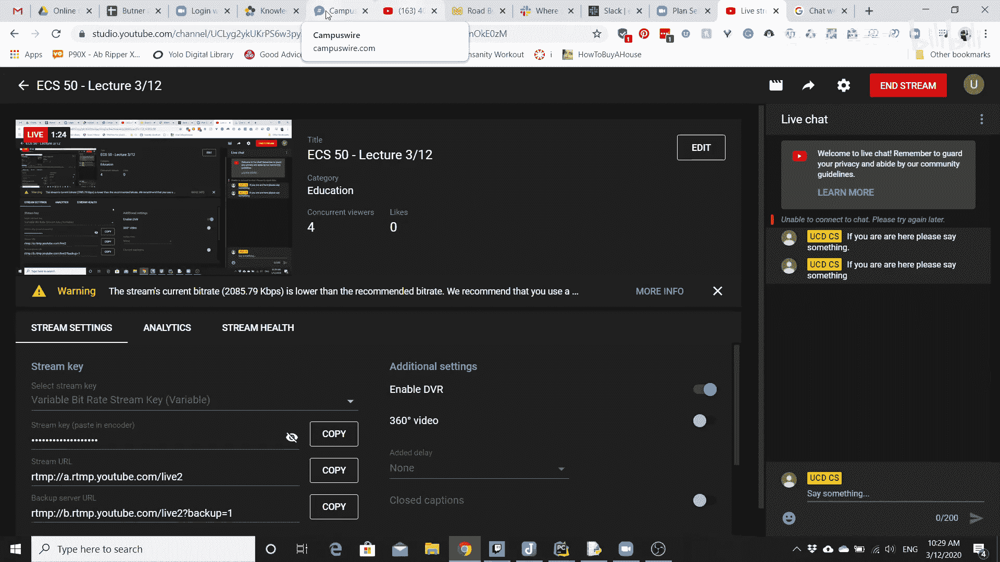
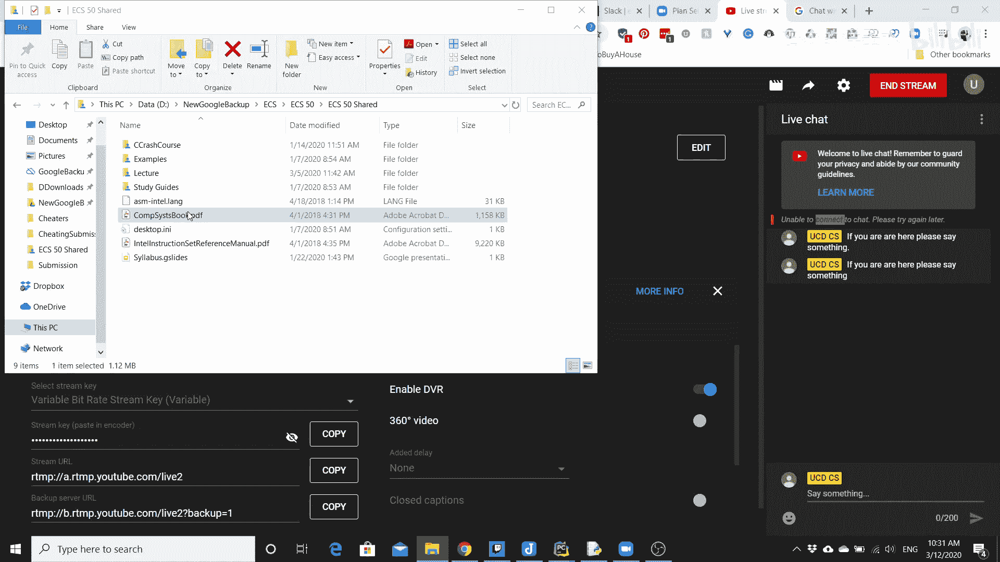
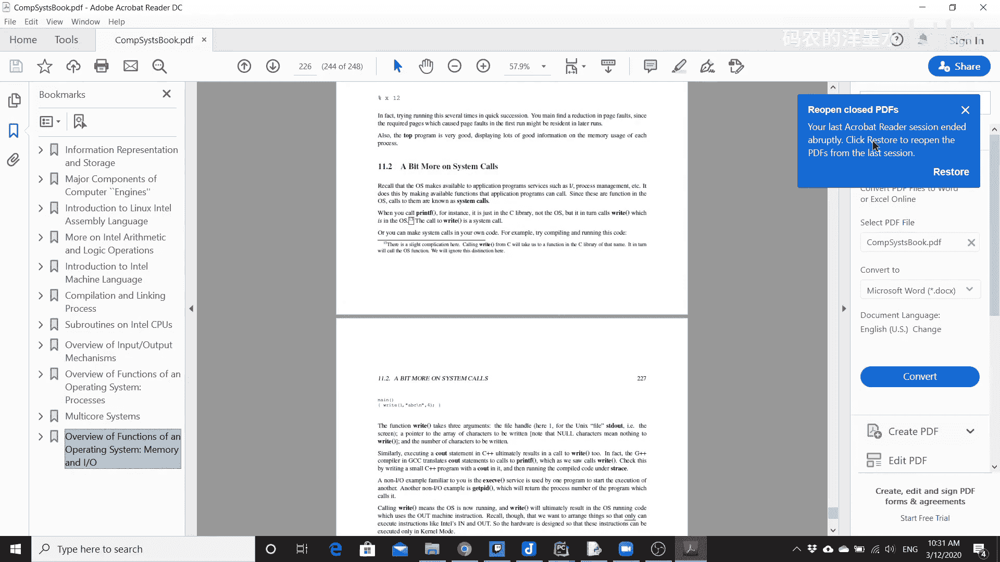
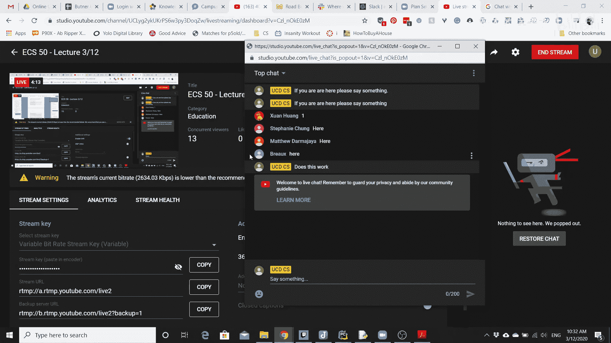
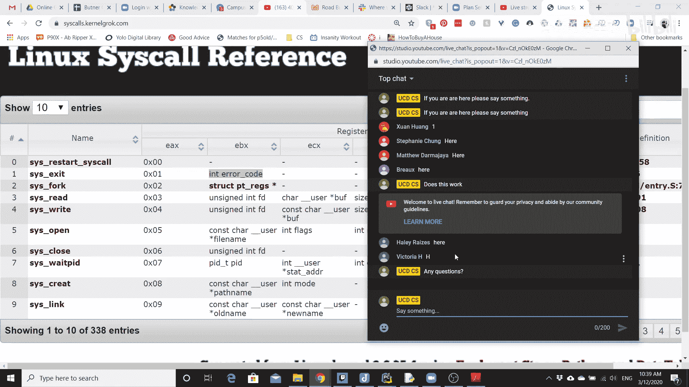
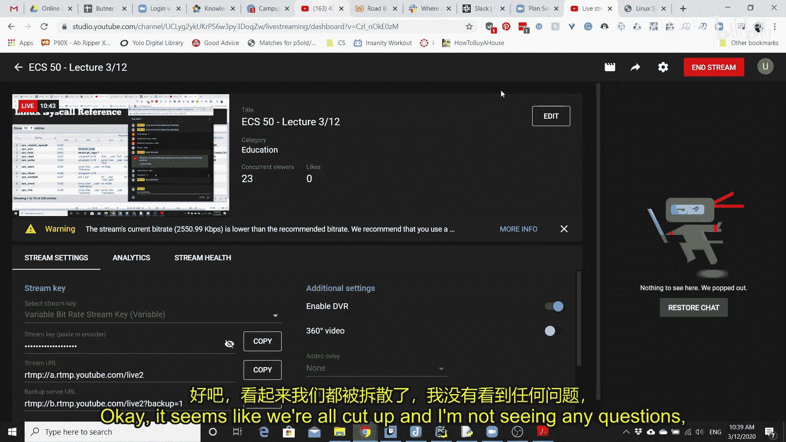
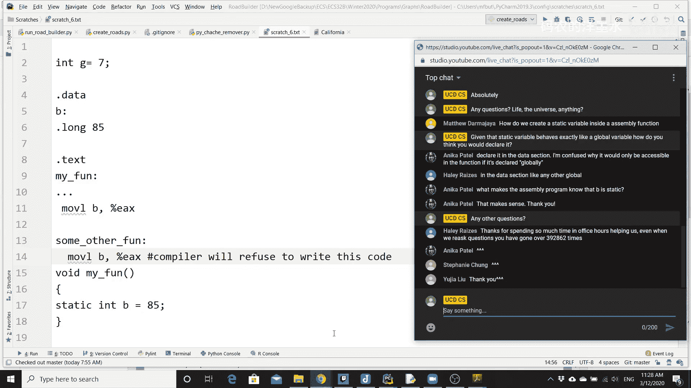
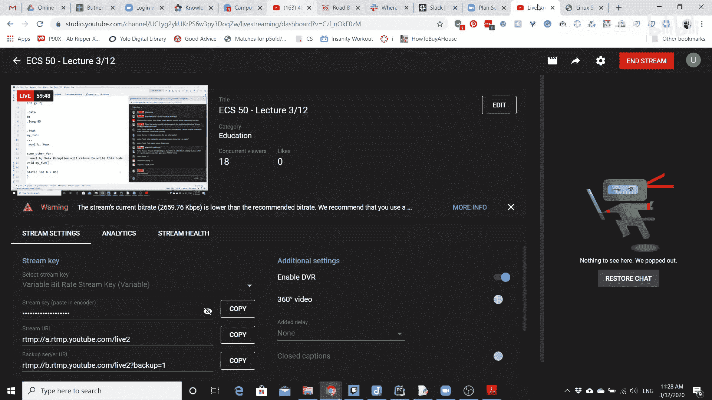

# 【全集】加州大学戴维斯分校 C语言与汇编语言 中英字幕 1080P p19 Lecture 19 - IO设备与内存映射 -BV1xefZBHEas_p19-

So if you guys are here， can you please say something？I can figure out。

You know if this is working or not？

So if you guys are here can you say something so I know that this is working or not。

Okay， let me try refreshing。Let's see if that works。Okay。Great， seems to be working now。

 So if you guys have a question， let me know by responding here。

 I'm not sure how much of a delay there's going to be， because this is the first time doing this。

But hopefully it works well and we're able to respond to your questions。咁你。Hop this out。

And we'll get through things。

So last time we left off， we were talking about the IO。Portion of the computer。And。

One of the things that the interrupt system that we're talking about can be used for is in addition to doing。

Cont switching。One of the things that it lets us do is system calls。Because as you guys can remember。

 we discussed the fact that。嗯。Oh， that's going to be annoying to try to put in there。

We discussed the fact that。When a program is running， another program is not running。

But there's also things that a program can't do on its own。

 such as access the I devicesice it has to go through the operating system。Now。

 if we had the operating system just provide a series of functions。

It would be potentially unsafe just to allow the users to call those functions to access the other devices because the user might do something naughty and not something that we intended to happen。

Um， so we kind of have to make sure that there's certain permissions set and that we don't do things the wrong way。

The other problem with having it with just a set of functions。

That we could provide the operating system for the user to call is that the user doesn't have the correct permissions to be able to use those instructions that would be required by that function。

For example， when we need to read from the IO system。

 we're going to need to be using in or if we want to write to an IO device。

 we have to use out those instructions aren't enabled in user mode。

 so regular user programs just cannot use them if they attempt to utilize those instructions。

 the an interrupt will be triggered and it will kill that process。

So we know that we need to utilize these instructions like in and out， and we know that we want。

Operating systemsed up on our behalf， and we need some way of switching。So one possible suggestion。

Might be to。Have an instruction that just says，T on the permissions。

But if we just had an instruction that just says， turn the permissions on。Well。

 or turn the provisions off， then the user could use those instructions if they wanted to just by writing a little bit of assembly code。

 which should be a pretty bad idea。So the way that system calls are going to actually be implemented is through。

嗯。Interrupts。So what what the program will do is it's going to trigger a software interrupt。

And in Intel， the way to trigger a software interrupt is with the int instruction。

 trigger and interrupt， and then you provide the interrupt ID。In this case， Do sign OX 80。

 this is going to be the interrupt ID for a system call。Where a system call might be something like。

Exit or a system call， or we want to do a system call might be like exit or reading from the keyboard or rating or writing to the screen or reading from a file or writing to a file if we wanted to execute that。

So one way that we have to figure out is how should we actually pass the parameters？

To the operating system。We can't necessarily push them on the stack because the operating system has a separate stack from us。

 so the way that operating system calls are made is slightly different。And we can see over here。

This table kind of tells us what we need to do if we want to call it。

So the first argument to the system call is going to be placed into EAX。

And EAX actually identifies which system call you like to do， so if we want to do exit。

 we call we put oh we put the constant value one into EAX， if we want to do a fork。

 we put two into EX， if we want to do a read， put three into EAX， we want to do a write。

 put the four into EAX。The remaining registers。Over here are going to be the additional parameters that function。

 So for a call like exit， EBX is the error code。 So when we do something like exit1。

The one should be placed in the EBX， or if we do exit5， then five should be placed into EBX。

Or if we're doing a read into EVX， we should put the ID or the file ID of the file that we're trying to read from。

 we should put the buffer where we want to place the result into into ECX。

 and then we should place how many bytes that we'd like to read into EDX。

And then we would invoke our system call with int Do sign OX80。Before I keep plowing on。

 do you guys have any questions？Wait here for a minute to see if you guys have anything。

Okay， it seems like we're all cut up and I'm not seeing any questions so we're going to keep moving on。

So let's say， for example。Then you scratch file over here。呃。

So let's say we wanted to implement the following system call。Into assembly。

So the way that we would do something like exit5， well。

 we know from looking at the UniX process table。That exit is going to be one。

 So system call  one is exit。 So we're going to put。Dollar sign 1 into E X。 This is the。Function。

Or at these just probably say。The system called IDd goes into EAX。Then we have our only argument。

 which is going to be 5。 and we're going to place that to EBX， So Moville dollar sign5，2% EBX。Right。

Additional arguments。2。Then we actually need to invoke the system call。

 which we'll do with int Do sign OX 80。Which is。Going to trigger a software interrupt。

With the I D for a system。好。So entry 80， like we talked about in the interrupt descriptor table。

 Hex 80 contains the。The interrupt service routine for dealing with a system call。

So we're going to utilize that hardware to actually。Do these system calls here。

Right there any other easy system calls to do？like maybe we wanted to open a file。

So if we wanted to call cis open。Instead。Like this。I Bob that。

And then I'm not sure we put for the flags， maybe our flag is going to be something like。seven。

And then， we wanted to do it。With read mode。The way that we would do this is first put the system call ID。

 which in this case for open is five。In 2% EAX。Then we would move out。Our pointer to our file。

 let's say the pointer to our file。We have a label out in memory for Bob。txt called Bob。

 so we'd move out dollar signed Bob。2% EBX。Move out dollar sign7 to percent ECX。

And then we'll also assume that we have another label mode in the data section。Right。

 so up here in thet data section， we're going to assume that there's a label。Fob。

 which had dot string。Bob。 Txt， and then we had mode。Which was a Dutchtch。Reading。

We would move out dollar sign mode and 2% EDx。And then do int dollar sign。OX 80。

So given that we have to pass the arguments through registers。

What's one limitation that system calls have。That regular functions do not have。So again。

 the question is given that。Arguments are passed。Oh my goodness。Registers。What limitation。

The system calls。Have that regular。Functions。算啦。So what do you guys think？Yeah， absolutely right。

 we're limited to as many arguments as there are registers。

But how could we possibly work around that if。We needed to pass potentially more arguments。

To our system called， Then we had registers。 let's say， for whatever reason。

We had a system call that needed to take。Quotation mark 9 parameters。Right。Again。

 we' only going to have six registers to pass those values through。

How could we possibly work around that？And I'll pop back over here to give you guys a hint。

So there's a little hint on the screen for figuring out how we can get around having more arguments。

 quotation marks than there are registers。Any thoughts。

 any guesses on that right if we needed to have a function that took quotation mark nine parameters？

How could we pass that to our system call？So ForRC has an example of how you could get around passing additional arguments。

What does Fort accept？That allows us to pass more than one thing in a single thing。

Pass more than one value in a single register。Yes， so we could pass fork or pass any one of our system calls astruct and into thatstruct。

 we could put multiple values。 So even though we have a limitation in the the number of parameters that we could pass。

 right。We're still limited to only passing things through EBX through EDI if we needed to pass more values than that。

 we could place them into a struct and then just pass the struct， so then we only pass one thing。

 a pointer to the struct。Instead of which is just one value。

 even though this container our truck can hold multiple things。

 So that's how we can work around that potential limitation。 So good job， guys。

So if you guys remember at the beginning when we first started writing assembly。

All of our programs would always crash at the very end， no matter what we did。

 even if they' were working correctly， and the reason that they would do that is because they were missing this system called exit。

The called exit says， hey， operating system， I'm done running。

 please don't run me anymore because I've finished doing what I need to do。So if we stuck something。

Like this at the end of our。Our original homework assignments？

Like probably zero saying that we succeeded successfully。

 this would actually allow them to finish without crashing。

But even though they finish without crashing。They still went't print anything because we hadn't learned how to print because doing a called the print F is a lot more complicated than what we had covered at that point and we require you utilizing the stack。

And still would be a lot more work than just actually using it tobuger to print things out。

The other topic that I want to talk about today。没有。Man， that the is rough。

So the other thing I want to talk about is we've been writing assembly code this entire time。

But what actually is assembly code。So remember， our simply instructions have to be represented inside of the computer。

And since the instructions。Have to be represented inside the computer。

And the only thing that we have to work with in the computer is bits。

 that means everything inside of the computer also has to be represented with bits as well。

So the first part of any instruction is going to be its op code and the op code identifies what instruction is。

And we're going to need every instruction that we want to do。

 It's going to need to have a unique op code。So for example， this op code right here。

Is set up to be move L。It's actually going to be a register to register move。

So we need our circuit tree and our harbor to be set up so that every time it sees this pit pattern。

It knows that it wants to move something from one register to another register。Right， which is。

The responsibility of the hardware designer。 Now， if we're running code to run our computer。

 we can literally write this stream of ones and zeros in binary。That's a lot of work。

It's pretty challenging to remember that， and given that I have to type this arbitrary bit string。

It's very likely that all screw up， so instead we write an assembly and we have their asssembler run through it。

The as simpleler， every time it sees something like Move。

 all it does is translate it to this binary string， so it's very， very simple。

 and this is why we have that one to one correspondence between a assembly instruction and machine instruction。

Because every time you see this instruction， you immediately translate it to be this bit pattern。

 so it's easier for us to write and we'll make less mistakes， even though I'll be honest。

 I still make a lot of mistakes when I'm running my assembly code。

But I'm going to make fewer mistakes than if I had to type out this bit pattern every single time。

The other thing that we have to do is we have to encode our registers to see how we want to recognize them in the instruction。

Right，So guess this bit pattern right here means that we want to move some bits from one register another to another register。

 What register do we want to move them from and what register do we want to move them to。

 So we're gonna to have to provide those as arguments to our instruction。

 But we also need some way to represent those arguments in binary。

 So the way the designers of Intel decided to do things was that。

EAX is going to be the bit pattern 000， EBX is going to be the bit pattern 011。

 ECX is going to be the bit pattern 001， and EDX is going to be 010。Of course。

 ESI and EDI also have their own codes， but we're just not going to talk about them here。

So now every time the compiler sees something like percent EVX is just going to substitute it with its bit pattern 011。

Where every time it sees something like percent EAX。

 it's going to substitute it with 000 as the bit pattern， or it sees percent EDX010。

So there's still going to be a one to one mapping。And we know exactly what's supposed to happen。

So over here， again， when we see this food instruction。These first couple of bits。

Are going to be what instruction you want to do， the move。

So if we do move L percent EX to percent EBX。Up until here， this is the op code。

This is the portion of the instructions saying what we want to do， Well。

 where do we want to move it from our source EAX？0，0， zero。Right， to our destination， EBX011。

And that's how the move instruction actually gets translated。So like with everything in the computer。

 it's all just binary and we just have to figure out some interpretation and some way of understanding it。

So I'm going to take a bit of a pause right here to allow you guys to catch up and also ask any questions that you might have。

So I mean， again， if you guys have questions， please just ask them and I'll make sure to get to them。

 hows you guys ask。So one way that you can figure out what the compiler is are the assmbrs actually going to produce is when you run the asssembler。

 you can add the dash a option， and this will also print out the machine code along with the assembly code。

So over here here's the assembly code on the left hand side， the machine code on the right hand side。

This first part here is showing you kind of like where in memory the instructions is going to be at。

 So here our first long is at address0 in the data section。

 Then the next long is that address 4 because longs are 4 bys big， then at 8， then at 12。

One thing that you might notice is that it looks a little bit weird that this seems like not quite the binary encoding for one or not quite the binary encoding for five shouldn't the  zero1 be over here？

The reason it's over here on the left hand side is instead of on the right hand side is that Intel is little Indian。

 so remember everything in memory is going to be stored in reverse order in terms of the bites。

So if we know that this is the least significant byte 01， goes actually on the far right hand side。

 then we'd have a whole bunch of zeros and that would indeed give us one。

So you can see all of the actual binary。That the assemmbler is producing。

So we kind of already saw how to do the constant five in there in the data section。

But there are some other instructions that we need to consider like the one on 24。

The one over here on line 24 is Mo dollar sign  for into EAX。

This is called an immediate to register instruction because we have an immediate value that needs to be placed into a register。

Right now one question you might have is where the heck does this value for actually come from。

 how do we store it in here to know to be able to move it？Which is a really good question， right？

This constant value has to be placed somewhere in memory for us to be able to then load it into the register。

 but where in memory can it be placed？Now the trick here for doing these immediate type instructions is that the immediate value is actually stored as part of the instruction itself。

So over here， the way that the movel with a constant value is going to be stored at right is here's our op code。

Then our DDDD is our destination， which register do we want to put it into？

And then we have our immediate。Value， which is a four byte immediate constant that comes right afterwards。

So if we look back at our instruction。The first byte of our instruction is 11，1。

110 right it's telling us what we want to do， but we notice that the last four bytes are going to make it that constant value。

So if we scroll back up to the instruction of line 24。The last four bytes of the value a。

4 are right here。Right。The app code。The immediate。And then the。The immediate。

 and then part of these bits over here are used for the destination。

 and then the rest are say the four bit immediate is one。Two bytes， three bytes， four bytes。

 that's the value four here。And the B8 is telling us where we want to move it from and the fact that we're doing a move instruction。

 move the value into EAX。The value itself being the value for。Now。

 one of the interesting things that we can do。One of the interesting things that we can do is you notice like this instruction decal。

It just has the hex value 48。So what we could do is instead of writing DeO EAX。

 because we know that it actually translates into just hex 48。

 we could put a single byte here that has the value 48 and get the exact same effect。

And Professor Mattloff even talks about that down here。

So here he shows you that instead of writing that decal。As the decal percent EAX。

 we know that it's a single byte 48， so instead of writing just dot。

 we could just write dot byte 48 here and we'd have the exact same effect because for decal percent EAX and dot byte OX48 have the exact same binary representation and because it's in the text section and not the data section。

 we're going to interpret this byte OX 48 to mean the instruction decrement。So again。

 like we talked about at the very beginning of the class。Everything is bits， it's all bits。

 and it's never been anything but bits。And if we want to see like the format of some of the instructions here。

What we can do is we can go look at this Intel instruction set manual。

 and it's actually going to give us what the instruction format looks like。

And this is what the format for an Intel instruction looks like。

Here we have our instruction prefixes， the instruction prefixes might be things like the rep or repeat while not equal。

 or repeat while equal opt codes that you saw before with some of the interesting instructions。

Then we have our op code over here。Which tells us what we want to do and Intel is what's referred to as a variable length instruction set register or a variable length instruction set。

Paradigm where every instruction can have a different length。

So sometimes our op codes are going to be one byte big， sometimes our op codes will be two bytes big。

 sometimes our op codes will be three bytes big， but we don't know quite how big the op code is going to be for just a random instruction right it might be one。

 two or three so we might first read the first byte and then if we know that oh we don't have enough information to know what。

Instructions supposed to be doing， read the next byte if I still don't have enough information to figure out what instruction I supposed to be doing。

 read the third byte， and then you'd have all the information if you had a three byte off code。

If it was only one， you would have enough information from reading that first opcode to know what to do。

 to know not to read the next two。Then over here， this mod slash RM part right here。

This is kind of telling us like where we want to go。In memory， right。

 you can see that the scale index space， right from the。

The scale index base from the advanced indexing mode is here。

RightAnd this mod R slash M is the part that's going to tell us whether we're moving from a register or whether it's going to be from memory。

 and if it's going to be from memory， then we'll have the scale index and base。

 but if we have just a register， it's just going to be the register's op code。

One of those two things。And then we have a displacement。Right， scale index base。

 but there's also always going to be that field for displacement。Which is one，2， or 4。

Right and then we had that immediate value though， if we're doing an immediate type instruction。

 which can possibly one by， two bytes， four bytes or none bytes。

 it'll be no bytes if we're not using the immediate field。

 this thing just won't exist and it'll be gone。So it's a pretty complicated instruction format。

 and there are other types of instruction formats besides the one that Intel uses。

So instead of having a variable length instruction set， we might have a fixed length instruction set。

Which means。That every instruction that we have has the exact same length。For example。

 MIPS uses a fixed length instruction set and every variable or every instruction in the MIPS architecture is going to be four bytes big。

Having every instruction be four bytes big makes the decoding of the instructions a little bit easier because when I finished doing this instruction。

 I know exactly what instruction to do next it's going to be four bytes away from where I'm currently at the next one will be four bytes after that the next one will be four bytes after that。

Oras something with like an Intel CPU with this variable length instruction set。

 it makes it a lot more complicated because I have to move the size of the instruction。

But size of this instruction might be one byte big， it might be two bytes big。

 it might be four bytes big， it might be eight bytes big or 16。

 it all kind of depends on what fields we're using。And what instructions we're using。

 so doing that incrementing to get to the next instructions is going to be a lot more complicated because each instruction has a different size。

But can you guys think of any advantages for using a variable length instruction set over a fixed length instruction set？

The fixed length instruction set again has the advantage of being easier to decode and easier to design the hardware for。

 but what advantages do you think a variable length instruction set has over the fixed length instruction set？

Yeah， I can absolutely save space。If we give it where our more common instructions have shorter lengths。

Then the size of our overall programs can be smaller。

RightThis would be really important if memory was a very expensive commodity or our computers had a very limited amount。

 We'd want to minimize its usage， which this was very much the case when computers were first created。

 The amount of memory that we had was very， very small。 We'd have much to work with。

So one of the goals for some of the early instruction set designs was to minimize the amount of space that they used。

So as you guys know now。Memoory is very cheap。 The memory is very plentiful。

 so it's not really that big of an issue if you're using something like a fixed size。Instruction。

Set because memory is very plentiful， it's very cheap and you'd rather be willing to waste a little bit of extra space and memory with each instruction to be able to go a little bit faster。

Because that decoding time will be shorter for the fixed slate instruction set so again it's that classical kind of tradeoff between time or space versus time right if we utilize more space。

 we can probably go faster but if we utilize but if we want to save space we're probably have to go to go slower because we have to do more work。

That's pretty much the main things about like， how our instructions are actually know， implemented。

 They're just binary。Just like everything else in the computer。

 and we just have to have some way of understanding it。When you go on to take ECS 24A。

 that's when you actually learn how to build a CPUU and you get those skills to be able to do that this class was focused on you figuring out how to talk to a CPU and how to interact with it as well as also hopefully helping you understand where the hardware and the software interactions lie or why there might now be certain restraints or certain reasons for things happening。

Right hopefully after taking this class， you have a better understanding of why recursion is always going to be slower than iteration when solving a problem because we have to keep pushing all of those arguments onto the stack。

 then reading all of those arguments off of the stack and then doing a lot of different jumps around a memory。

 which is going to take more time than if we just do a simple loop。

You guys also understand that when we are writing like a C program。

And we want to have a function that accepts a static array。Something like this。

Where we want to accept like a static array AR， right。

 we have to specify the size of all the dimensions。But the first， right， because we know that。

With a statically allocated array， it's going to be allocated as one big chunk and in order to be able to correctly access the elements that are inside of the array。

 we need to know how big the dimensions are except for the first because we're using real major order。

You also understand a little bit better about how the IO devices interact with the software and how the interrupts are extremely important for us to actually have this type of monitoring function computers that we have right now that are able to run multiple programs simultaneously via context switching。

 so they're just taking turns though really quickly。And hopefully you know。

 allow yourself to better write more efficient code in the future as you go on。

 knowing what's going on under the hood will allow you to do that。

 but I hope I think all of you hope that you'll never ever ever have to write assembly again because it's a pain in the butt and having those low levelvel implementations kind of makes it harder for us to think and harder for us to describe solutions and harder for us to notice when we make mistakes because everything is so tiny in terms of what's happening。

Which is why， you know， you want to be working in a higher level language like C， right or Python。

 probably un preferferably， which would make things a lot easier for you。Um。

 I don't really have anything else extra to say， but I'll pause here for a moment to see if you guys have any questions。

I also apologize for， you know。The quality of this lecture being a lot worse than the others。

 just not having you in front of me to be able to look at you and ask questions makes this whole thing way。

 way， way harder because I can't get any of that visual feedback from you to see like if you're nodding your head or like。

 yeah， I get it or everybody has confused looks on their face。 So if you have questions。

 please do ask them now and I'll try to answer them。But if you guys don't have any questions。

 just say I don't have any questions and we'll end the day a little bit early and then I will pop on over into the online office hours and start that a little bit early today。

So static variables are essentially they behave in every way， shape and form like a global variable。

 but the only difference between the two is where they're accessible from with a global variable。

Right。Like this guy in G。G is accessible throughout the entire program in any function。

But if we have something like my function。Right， and inside my function。We have like a static int。B。

B is only accessible inside of my fun。But it's actually going to behave exactly like G is going to be in that there's only one copy of B。

 and if we change it， it gets changed forever and it's not recreated each time you call my fun。So。

It's a global variable that's only accessible inside that function。

 and the reason that it's only accessible inside of that function is because the compiler will refuse to access it anywhere outside of that function。

So if over here。I have some other fun。And I try to say B。

The compiler could theoretically access the B from MyF。But it's just going to say， no。

 I'm not going to do that。So like a so how do you think you would declare B given that it behaves exactly like a global variable？

Yeah， exactly。 You would want to declare in the data section， just like any other global variable。

 It's just that the compiler is not going to。Access it anywhere else。

 It just won't write the assembly code to do it anywhere else。

So if we think about the assembly code right over here， we would just have doc data。

 and then here's you know B。It's a dot long。Right， maybe has the value 85 to start with。In this case。

 you guys are correct。 B is technically going to be accessible right down here in the text section where I have my fun。

 right？And then。Down here where we have some other fun。In both of these functions， we could say。

Move out B is percent EAX。And this would work in both the other functions。

It's just that in some other fun。The compiler。Willll refuse to write this code。It could write it。

 it's just not going to to help preserve the model of what a static variable is supposed to be。😡。

Does that clear things up or do you still have some more questions abouttic variables？

The assembly program doesn't know that B is static， it doesn't have any knowledge of it。

It's just that you have to think about who's writing that assembly program。

It's going to be the compiler that's right in the assembly program and the compiler knows because it read the C source code that B is supposed to be a static variable。

 so it will refuse access to be outside of any other function besides my fun。

 it just won't write that assembly code。Does that make sense？Great。嗯。Any other questions？

Not a problem Im happy to help you guys out， so I don't think there are any more questions。

 but I want to say I really appreciate like all of the hard work that you guys have put in。

 all the time and all the dedication， all the questions that really makes the class a lot better and hopefully you got a lot more out of that for it so I really appreciate you guys for doing all of that stuff and hopefully you're able to you know especially debug better。

 hopefully that you got a lot of practice doing that this quarter and you have a better understanding of how to interact with your programs。

 how to ask them questions， how to get feedback from them， to be able to figure out。

What it is that you need to do to correct them。Hopefully you guys have also gotten a better appreciation of doing like some abstraction and decomposition。

RightBefore you go and actually jump in and start your programming， right。

 most of you guys probably found that it was a lot better to first write out your solution。

 then write it and see and then translate it to assembly versus just jumping straight into the assembly because that's a lot harder to write if you don't have an idea of what you're doing and it's going to be a lot more complicated and a lot more messy。

 but I hope you guys continue to apply those ideas to all of your other programming classes。

Because they're really key and they're really important for helping you grow as programmers and helping you to solve problems more efficiently。

It might seem like all we ever ask you for is just to turn in the assignments right so the important thing is to write is the code but doing some of that setup work ahead of time where you do some of those examples you write out some English statement of what you want to do。

 you think about what classes you want and how they should be organized。

 how they should be related to each other， taking that hour or two to do that will save you many。

 many hours going forward， then if you jump just jump straight into it。

So I hope you guys continue to practice that and I look forward to seeing you guys in office hours if you still feel like stopping by。

 which I'll be there in a minute， or maybe I will see you guys in some future class like154ay and I'll be happy to see you there too and as always you guys are more than welcome just to stop by my office hours or my office anytime I happen to be there just to stop by in chat and see what's going on love seeing like what you're doing and how things are going on in your life and in your academic career。

Um， and like， you know， helping establish that relationship too also helps us as instructors write better letters of recommendation for you if we ever need that or if you ever need that from us in the future。

 because if all we know is you took our class and you did good。

All we can say is you took our class and you did good and we can't say much more than that。

So I will be signing off now and popping over into that spreadsheet for the class office hours in a minute and I'll be helping you guys out there so see you soon and again thank you guys for the great quarter。

