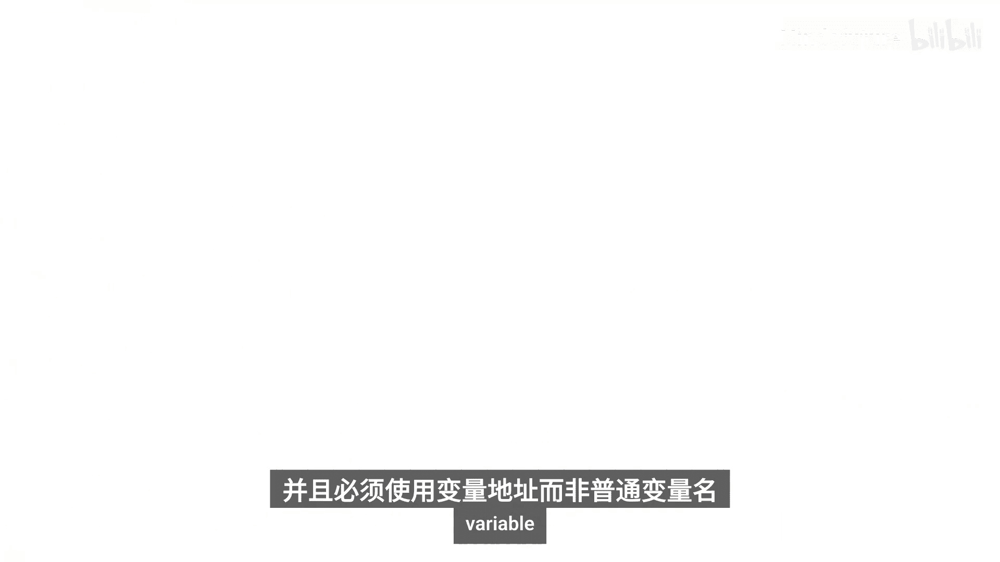

# 006：示例-圆代码

## 概述
在本节课中，我们将学习一个结合了输入和输出的C语言程序。这个程序将演示如何从用户那里获取信息，进行计算，然后输出结果。我们将通过一个计算圆面积的经典示例来理解这些概念。

## 程序结构与元素
上一节我们介绍了基本的程序结构。本节中我们来看看一个更完整的程序，它包含了用户交互。

程序需要捕获用户输入的信息，并利用这些信息进行计算和响应。我们将编写一个简单的程序来计算圆的面积，单位使用米。

让我们再次查看代码，熟悉如何编写一个简单的C程序及其构成元素。后续课程会详细讲解每个部分。

## 代码详解
和之前一样，程序以标准注释开头，用于提高可读性。这个注释说明程序用于计算圆的面积。

`#include <stdio.h>` 是预处理指令，它引入了 `printf` 和 `scanf` 函数。`scanf` 是用于输入的基本例程。在大多数情况下，默认输入来自键盘。

这里我们看到另一个指令 `#define`。它执行一个有趣的操作。按照惯例，我们定义一个预处理器令牌 `PI`，使其值为六位有效数字的3.14159，这是双精度浮点数通常能存储的精度。这同样是为了文档化和提高程序可读性。

接着是 `main` 函数，以一个复合语句的左花括号开始。

第一个语句是声明语句，我们定义了两个标识符 `area` 和 `radius`。标识符可以是普通的单词，只要不是像 `double` 这样的关键字。我们将 `area` 和 `radius` 初始化为 0.0，使用 0.0 可以清楚地表明我们处理的是双精度常量，使用 0 也是允许的。

然后我们提示用户输入。如果我们省略这个提示，屏幕会停止等待，用户将不知道需要做什么。这被称为提示信息。

提示用户输入半径。`scanf` 函数需要特殊的 `&` 操作符，这表示变量 `radius` 的地址。我们将在课程后期详细解释这个概念，因为它涉及到地址、内存和指针。

接下来是面积计算，公式是 **`area = PI * radius * radius`**。C语言中没有简单的平方表示法（如 `**`），所以我们使用重复乘法。

最后，我们打印计算结果，并以 `return 0;` 结束程序。

## 程序测试
让我们确保这个程序可以运行。我已经编译了它，现在执行它。

程序提示“Enter radius”。我们测试半径为 1.0 的情况，结果是 3.14159，这是正确的。调试程序时，我们首先使用已知答案的简单测试数据。

再次运行程序，输入半径 2.5，结果是 19.634937，同样正确。

## 总结
本节课中我们一起学习了如何编写一个同时包含输入和输出的简单C程序。我们通过计算圆面积的例子，了解了使用 `scanf` 进行输入、使用 `printf` 进行输出，以及利用 `#define` 定义常量的方法。关键在于，对于 `scanf` 函数，除了使用格式字符串（如 `%lf` 对应双精度浮点数），还需要使用变量的地址（即 `&` 操作符）。

