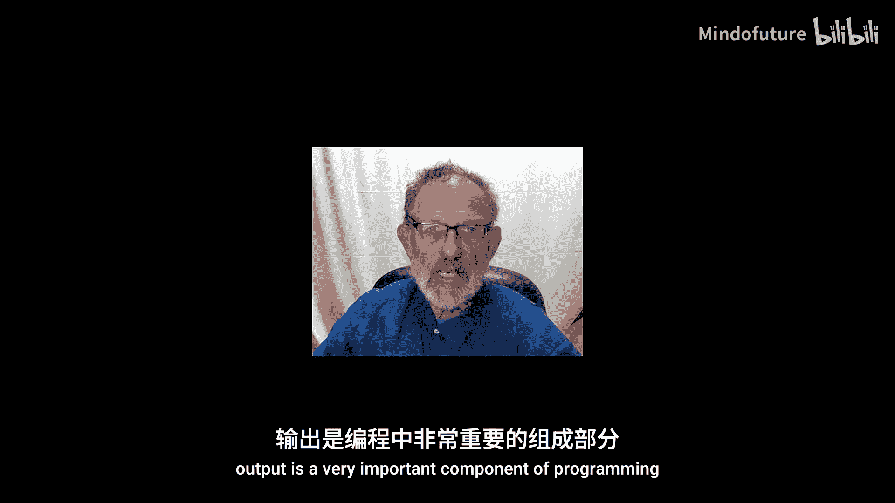
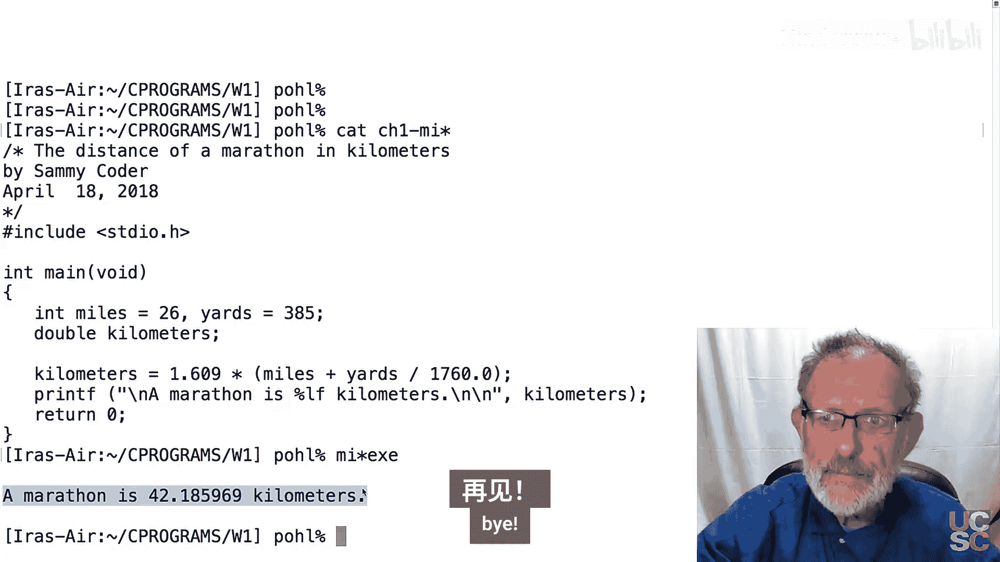

# 007：示例-马拉松距离转换



在本节课中，我们将学习一个完整的C语言程序示例。这个程序将马拉松的距离从英里和码转换为公里。通过这个例子，我们将深入理解C语言的基本结构，包括注释、预处理指令、变量声明、数据类型、表达式计算以及格式化输出。

## 程序概述与结构

上一节我们介绍了简单的输出，本节中我们来看看一个更完整的程序。输出是编程中至关重要的组成部分，正如那句著名的格言“垃圾进，垃圾出”。在大多数情况下，无法产生结果的程序是没有用处的，因此输出至关重要。

让我们来看一个将马拉松距离从英里和码转换为公里的程序。

```c
/* 马拉松距离转换程序
   最后更新： [日期]
   作者： [姓名]
   用途： 将26英里385码的马拉松距离转换为公里
*/

#include <stdio.h>

int main(void) {
    int miles = 26;
    int yards = 385;
    double kilometers;

    kilometers = 1.609 * (miles + yards / 1760.0);
    printf("\nA marathon is %lf kilometers.\n\n", kilometers);

    return 0;
}
```

## 代码详解

### 注释的作用

程序开头的部分是注释。注释是会被编译器忽略的文本。既然会被忽略，我们为什么还需要注释呢？原因在于我们需要让代码具有可读性。首先，需要有人来维护程序，他们必须理解程序的用途和开发历史。因此，我们通常喜欢注明程序最后更新或编码的时间、作者，以及关于程序用途的总体说明。

### 预处理指令

C代码中首先出现的是所谓的预处理指令，即 `#include`。尖括号内的 `stdio.h` 是一个头文件（`.h` 扩展名表示头文件）。这意味着这个文件中的代码将自动包含到我们的程序中。它之所以被称为“预处理”指令，是因为它发生在C代码被编译之前。额外添加的代码是我们执行 `printf` 函数所必需的。没有它，`printf` 将被视为未声明。

### 主函数

然后我们开始实际的代码，以关键字 `int` 开头，这表示一个名为 `main` 的函数。在我们入门课程中，几乎所有程序都会有一个 `main` 函数，程序从这里开始执行，这是C语言系统所理解的。

*   `int` 是一个关键字，表示程序返回一个整数。
*   `void` 是另一个关键字，在这里表示函数没有参数。

### 代码块与变量声明

接下来我们看到一个花括号 `{`。开括号意味着代码块的开始。在编程语言中，有很多成对出现的符号。我们已经看到星号`*`、尖括号`<>`、圆括号`()`需要匹配。确保正确匹配括号对于语法正确至关重要。这个花括号有一个对应的闭括号 `}`，这被称为复合语句，是一系列可执行语句的集合。

在代码块内，我们有两个整型变量。这被称为声明，并且是带有初始化的声明。

*   `miles` 被初始化为 `26`。
*   `yards` 被初始化为 `385`。

一个好的程序员会选择有意义的标识符名称。`miles` 和 `yards` 就是标识符。为什么选择这样的名字而不是 `M` 和 `Y` 呢？虽然 `M` 和 `Y` 可能也可以，但使用像 `miles` 或 `yards` 这样的实际单词可以在不增加成本的情况下为程序添加文档，使程序更具可读性。

然后，结果变量 `kilometers` 将被声明为 `double`（双精度浮点）类型。

### 计算公式与类型转换

计算公式是：`kilometers = 1.609 * (miles + yards / 1760.0);`

这里需要特别强调一点，这一点很重要，我们后面会再次强调。我们没有选择使用 `1760` 而是用了 `1760.0`，原因是 `yards` 是一个整数。如果这里使用 `1760`（整数），那么 `yards / 1760` 将进行整数除法，`385 / 1760` 的结果将是 `0`。

我们通过使用 `1760.0`（一个双精度浮点常量）来避免这个问题。这样，整个表达式会进行隐式类型转换，取更广泛的类型（这里是 `double`），使整个表达式成为该类型。我们以后还会学到，也可以使用**类型转换**来实现。另一个技巧是写成 `1.0 * yards / 1760`。

### 输出语句与程序返回

接下来是 `printf` 打印语句。在打印语句中，首先有一个控制格式的字符串。再次注意，我们看到匹配的双引号。之前有一次我漏掉了一个引号，结果出现了语法错误。你应该看看如果漏掉一个匹配的符号会发生什么，有时会得到非常奇怪且难以理解的语法错误。

这个格式字符串的意思是：打印一个换行符（意味着在屏幕上换行），然后打印“A marathon is”，接着 `%lf` 表示使用长浮点数（即 `double`）格式打印 `kilometers` 的值，再打印“kilometers.”，最后打印两个换行符。然后，`kilometers` 的值被解释并以长浮点数格式打印出来。

最后是 `return 0;`。因为我们声明 `main` 函数返回一个整型值，所以这里返回 `0`。这个 `0` 会神秘地返回给操作系统，`0` 是一个表示程序正确结束的代码。

## 程序执行结果

让我们执行这个程序。确实，我们得到了正确的结果：`A marathon is 42.185969 kilometers.`

## 总结



本节课中我们一起学习了一个比之前程序更复杂的C语言示例。它包含了注释、预处理指令、`main` 函数、变量声明与初始化、数据类型、涉及类型转换的表达式计算以及格式化输出。这个例子提供了许多关键概念，我们将在后续课程中更详细地探讨这些内容。请仔细研究这个程序，它对于理解C语言基础非常有帮助。