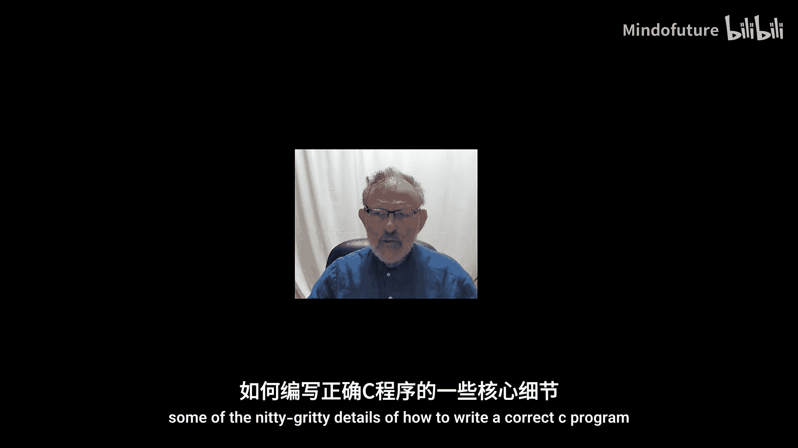
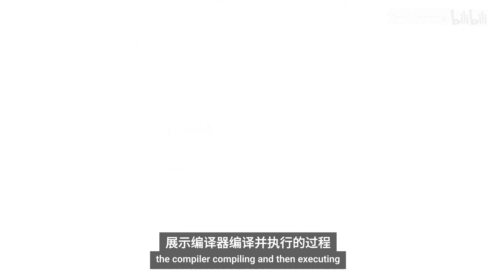

# 010：字符集和标记



## 概述
在本节课中，我们将学习如何编写一个语法正确的C程序。我们将关注构成C程序的基本元素——字符和标记，并理解编译器如何解析它们。通过一个简单的加法程序示例，我们将了解常见的语法错误及其修正方法。

---

## 字符与标记：程序的基本构成单元

上一节我们介绍了编程的基本概念，本节中我们来看看C程序的具体构成。

一个C程序由一系列字符组成，就像一篇英文文章。然而，与可以容忍拼写和标点错误的文章不同，C程序中的拼写错误、标点错误等会被编译器捕获，导致程序无法运行。一个好的编译器会提供清晰的错误信息，帮助我们定位问题。

首先，C程序将字符组合成我们称为“标记”的单元。标记是词法分析的基本单位。

以下是C程序中常见的几种标记类型：

*   **注释**：注释以 `/*` 开始，可以包含任意字符，直到遇到 `*/` 结束。例如：`/* 这是一个注释 */`。如果忘记写结束标记，注释会一直延续下去，导致编译错误。
*   **预处理器指令**：以 `#` 开头，通常位于行首。例如 `#include` 指令告诉编译器包含特定的库文件，如我们常用的 `#include <stdio.h>`。其他重要的标准库还包括数学库 `<math.h>`、字符处理库 `<ctype.h>` 和时间库 `<time.h>` 等。
*   **标识符**：用于命名变量、函数等。标识符可以是单个字母（如 `a`, `b`）或多个字母的组合。`main` 是一个特殊的标识符，它指明了程序开始执行的位置。
*   **运算符**：执行操作的符号。例如，`+` 是加法运算符（在特定上下文中也可能是正号），`&` 是取地址运算符，而 `&&` 是逻辑与运算符。
*   **标点符号**：在语言中具有特定用途的符号，如开括号 `{`、闭括号 `}` 和分号 `;`。这些符号必须正确使用，否则会导致语法错误。

一个程序必须语法正确。我们写下程序后，由编译器检查其语法。例如，如果在 `int main()` 后面错误地使用了圆括号 `(` 而不是花括号 `{`，编译器就会报错。编译器通常会指出它认为错误开始的位置，并给出（希望是）有帮助的英文错误信息。我们必须理解错误发生的位置并加以修正。

比语法正确更难的是让程序语义正确，即程序能按预期工作。这通常需要我们反复运行、修改和测试程序。

---

## 示例程序：理解标记的解析与执行

上一节我们介绍了各种标记，本节中我们通过一个实际代码来看看编译器如何解析和执行这些标记。

接下来我们将看到一段实际代码，其中包含了上述标记。编译器会解析这些标记，编译程序，然后执行它。

这是一个简单的程序，它使用 `scanf` 读取两个浮点数，计算它们的和，并使用 `printf` 显示结果。

```c
#include <stdio.h>

int main() {
    float a, b, sum;

    printf("请输入两个数字：");
    scanf("%f %f", &a, &b);

    sum = a + b;

    printf("两数之和为：%f\n", sum);

    return 0;
}
```

---



## 总结
本节课中我们一起学习了C程序的基础构成。我们了解到程序由字符组成，并组合成注释、预处理器指令、标识符、运算符和标点符号等不同类型的标记。编译器的任务是检查这些标记是否符合C语言的语法规则。编写正确的程序首先需要避免语法错误，然后通过测试确保其语义正确，即能完成预定的功能。理解这些基本元素是编写任何C程序的第一步。