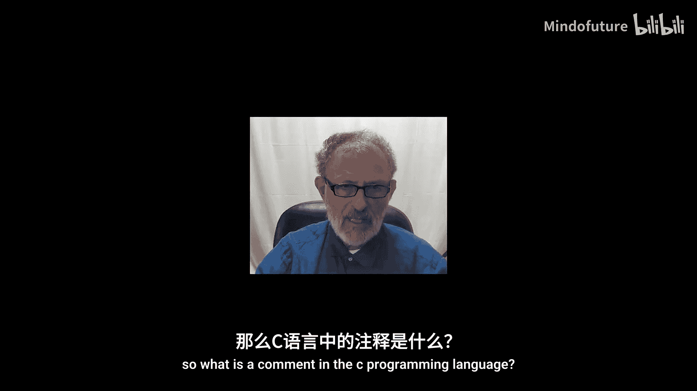
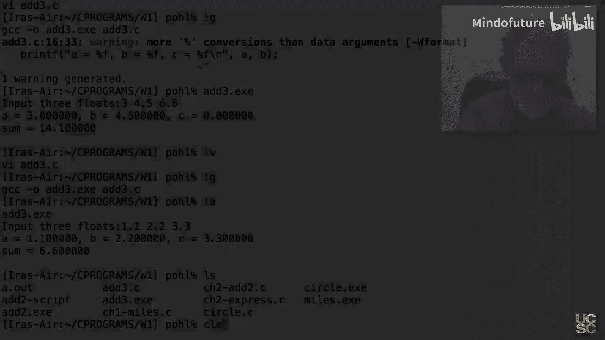
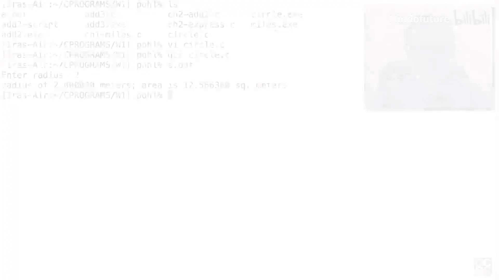

# 011：注释

## 概述
在本节课中，我们将要学习C语言中一个非常基础但极其重要的概念：注释。注释是程序员在代码中添加的说明性文字，它们不会被编译器执行，但对于代码的文档化和可读性至关重要。





## 什么是注释？
在C编程语言中，注释是一种特殊的语法，用于在源代码中添加说明、解释或备注。这些文字会被编译器完全忽略，不会影响程序的执行。

## 注释的重要性
上一节我们介绍了注释的基本概念，本节中我们来看看为什么注释如此重要。注释的核心价值在于提高代码的**文档化**和**可读性**。为了能够维护、修改程序并理解其用途，我们希望程序是“可读的”。

## 注释的语法
以下是C语言中两种主要的注释语法：

### 1. 多行注释（经典风格）
这种注释以 `/*` 开始，以 `*/` 结束。在这两个符号之间的所有内容都会被编译器视为注释并忽略。这种注释可以跨越多行。

**语法公式：**
```
/* 这里是注释内容，
   可以跨越多行 */
```

### 2. 单行注释（现代风格）
这种注释以两个斜杠 `//` 开始。从 `//` 开始直到该行结束的所有内容都会被编译器视为注释。这种风格更现代，通常更不容易出错。

**语法公式：**
```
// 这里是单行注释
```

## 注释的处理过程
为了理解注释，我们可以回忆一下C编译器的工作流程。首先，**预处理器**会处理源代码。随后，**词法分析器（tokenizer）** 会扫描代码，并丢弃所有注释内容。因此，注释在效果上等同于空白。

## 实践示例
让我们通过一个具体的程序 `circle.c` 来看注释的实际应用。

```c
/* 计算圆的面积 */
#include <stdio.h>
#define PI 3.14159

int main() {
    double radius, area;

    // 提示用户输入半径
    printf("Enter radius: ");
    scanf("%lf", &radius);

    // 计算面积
    area = PI * radius * radius; // 面积公式：π * r²

    // 输出结果
    printf("Area is %.3f square meters\n", area);

    return 0;
}
```

在这个例子中，我们使用了两种注释风格。开头的多行注释描述了程序的目的。在代码内部，我们使用单行注释来解释每一步操作，例如提示输入、计算公式和输出结果。

编译并运行这个程序没有问题。例如，输入半径 `2`，会得到面积 `12.566` 平方米。



## 总结
本节课中我们一起学习了C语言的注释。我们了解到注释是用于提高代码可读性和可维护性的非执行文本。C语言支持两种主要注释风格：经典的多行注释 `/* ... */` 和现代的单行注释 `// ...`。虽然注释会被编译器完全忽略，但它们是编写清晰、易于理解代码的关键工具。