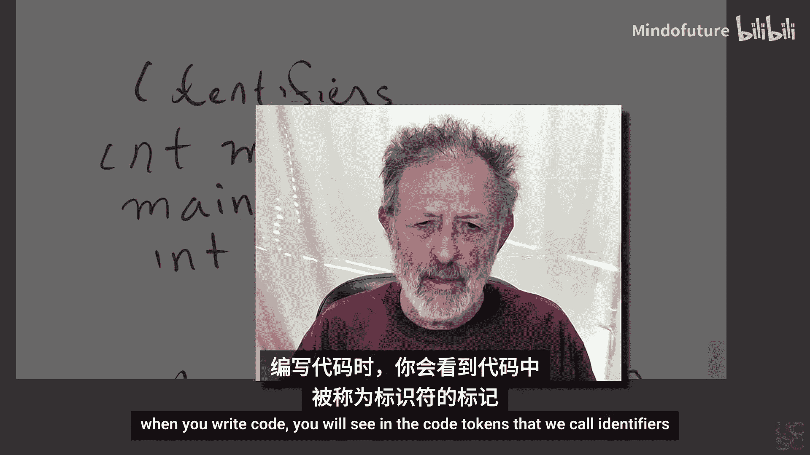
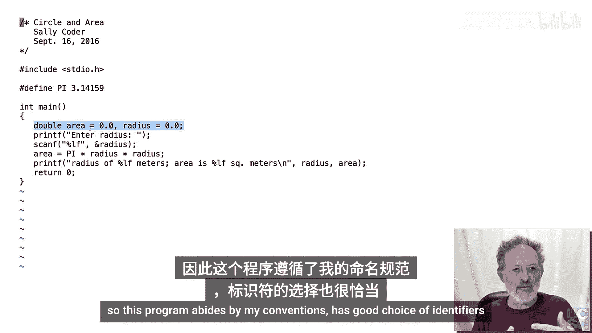

# 013：标识符详解




在本节课中，我们将深入学习C语言中的标识符。我们将探讨标识符的构成规则、命名规范，以及如何通过良好的命名习惯来提高代码的可读性和可维护性。

## 标识符的定义与作用

上一节我们介绍了代码的基本构成，本节中我们来看看标识符的具体定义和作用。

在编写代码时，我们会遇到被称为“标识符”的记号。例如，在代码 `int main()` 中，`int` 是一个关键字，而不是标识符。`main` 是一个标识符，它是程序执行起始函数的名称。括号 `()` 不是标识符的一部分，它们用于函数调用。

## 标识符的构成规则

了解标识符的构成规则是正确命名的基础。以下是标识符的语法定义。

标识符在C语言中由以下部分构成：
*   一个字母或下划线字符（必须至少有一个）。
*   其后可以跟随零个或多个字母、下划线或数字。

用语法公式可以表示为：
**identifier = (letter | '_') (letter | '_' | digit)***

这意味着标识符可以任意长，但通常我们看到的标识符长度不会超过10到12个字符。

以下是符合规则的标识符示例：
*   `k`：常用于表示辅助整数。
*   `_printf`：这可能是系统程序员在设计 `printf` 函数时使用的标识符。
*   `two_words`：使用下划线分隔两个单词是一种命名约定。
*   `twoWords`：将两个单词连在一起，并将第二个单词首字母大写，是另一种标准约定。
*   `my_DNA23`：在第一个字符之后，可以使用数字。

以下是不符合规则的标识符示例：
*   `#me` 或 `me#`：字符 `#` 不允许出现在标识符中。
*   `-x`：这会被解释为表达式“负x”，而不是标识符。
*   `23myDNA`：标识符的第一个字符不能是数字。

总结规则：数字可以出现在除首字符外的任何位置；下划线和字母可以出现在任何位置，包括首字符。

## 良好的标识符命名实践

良好的标识符命名有助于为程序提供文档，并提高代码的可读性。

以下是一些好的标识符选择示例：
*   `main`, `printf`, `sqrt`：这些是标准库中常见的标识符。
*   `superman`：如果代码与超人角色相关，这个名称能提供清晰的意象。
*   `radius`：清晰地表示了半径。
*   `i`, `j`, `k`：在编程和数学社区中，约定俗成地用于计数或表示整数。

当然，必须为标识符选择正确的用途。

以下是一些可能不好的标识符选择：
*   `grX33`, `_pp_25`：我们无法理解它们可能代表什么，因此不具备可读性和文档性。
*   `i_am_four_words`：虽然意思明确，但混合了两种命名约定（下划线与大小写），在一定程度上削弱了其清晰度。

有些标识符的好坏取决于上下文：
*   `data`：可能不够具体，也许需要 `heightData` 或 `weightData`。
*   `x`：如果它表示XY平面上的一个坐标，则非常合适。
*   `p`, `q`：在逻辑编程社区中，通常用于表示布尔变量，因此在特定上下文中可能是合适的。

## 代码示例分析

最后，让我们通过一个简单的程序来观察这些命名规范的实际应用。

以下是一个计算圆面积的代码片段：
```c
#include <stdio.h>
#define PI 3.14159

int main() {
    double area, radius;

    printf("Enter the radius: ");
    scanf("%lf", &radius);

    area = PI * radius * radius;

    printf("Area: %f\n", area);
    return 0;
}
```

请注意代码中的标识符：
*   `main`：是一个标识符。
*   `PI`：在C语言中，这是一个预处理器命令中的标识符。按照惯例，常量通常使用大写字母命名。
*   `area` 和 `radius`：它们的含义清晰，我们能在程序中理解其用途。
*   `double`：是一个关键字。
*   `printf` 和 `scanf`：是标准输入输出库中的标准标识符。

这个程序遵循了命名约定，选择了良好的标识符，从而使其易于阅读和理解。

## 总结



本节课中我们一起学习了C语言标识符的核心知识。我们明确了标识符是由字母、下划线和数字按特定规则组成的名称，用于标记变量、函数等代码元素。我们掌握了标识符的构成语法，并理解了通过遵循社区命名惯例（如使用有意义的名称、合理运用下划线或驼峰命名法、常量全大写等）来选择良好的标识符，是编写可读、可维护代码的关键实践。