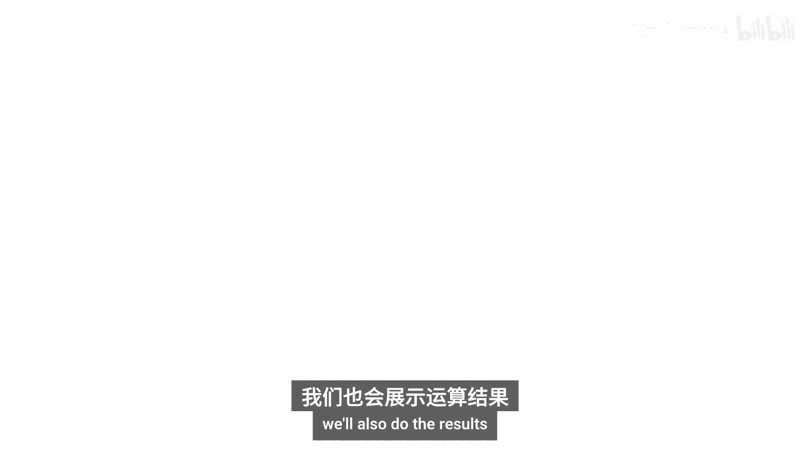

# 014：运算符优先级详解

## 概述
在本节课中，我们将深入学习C语言中运算符的优先级规则。理解运算符优先级对于正确计算表达式至关重要。我们将通过完整的优先级表格和具体示例，帮助你掌握如何确定表达式的计算顺序。

## 运算符优先级表
上一节我们介绍了运算符的基本概念，本节中我们来看看完整的运算符优先级规则。下图展示了C语言的完整运算符优先级表。

该表格由William Swanson制作，它清晰地描述了C语言读取表达式的顺序。例如，在表达式 `A = 4 + B * 2` 中，包含多个运算符。乘法运算符 `*` 的优先级高于加法运算符 `+`，因此 `B * 2` 会先被计算，然后其结果再与4相加。

## 优先级与结合性
运算符优先级决定了计算的先后顺序，而结合性则决定了当多个相同优先级的运算符出现时，计算是从左到右还是从右到左进行。

以下是主要的运算符优先级层级及其结合性说明：

*   **第一级：基本表达式运算符**
    *   这些运算符具有最高的优先级。
    *   包括后缀自增 `++`、后缀自减 `--`、数组索引 `[]` 和函数调用 `()`。

*   **第二级：一元运算符**
    *   优先级仅次于基本表达式运算符。
    *   包括解引用 `*`、取地址 `&`、一元正号 `+`、一元负号 `-`、逻辑非 `!`、前缀自增 `++`、前缀自减 `--`、类型转换 `(type)` 和 `sizeof` 运算符。
    *   注意：一元正号 `+` 和一元负号 `-` 比二元加法和减法运算符绑定得更紧密，优先级更高。

*   **第三级及以后：二元与三元运算符**
    *   接下来是乘法 `*`、除法 `/` 和取模 `%` 运算符。
    *   然后是加法 `+` 和减法 `-` 运算符。
    *   之后是关系运算符（如 `<`, `>`）、相等性运算符（`==`, `!=`）、位运算符和逻辑运算符。
    *   还有一个特殊的三元条件运算符 `? :`，它接受三个操作数。

*   **最低优先级：赋值与逗号运算符**
    *   赋值运算符（如 `=`, `+=`, `-=` 等）的优先级很低。
    *   逗号运算符 `,` 的优先级最低。它强制表达式从左到右依次求值，有时用于确保特定的执行顺序。

## 符号重载与上下文
C语言中存在符号重载的情况，同一个符号在不同上下文中有不同含义。理解上下文是关键。

以下是常见的符号重载示例：

*   `&` 作为一元运算符时表示“取地址”，但在二元运算符中表示“按位与”。
*   `*` 作为一元运算符时表示“解引用”，但在二元运算符中表示“乘法”。
*   `<<` 和 `>>` 可以是“位左移/右移”运算符，但在流操作中（如C++）有不同用途。逻辑运算符 `&&` 和 `||` 则是独立的符号。

## 示例与练习
为了确保你理解这些规则，让我们通过一些示例来练习。

以下是一些表达式及其计算过程的说明：

*   `3 * 5` 的结果是 `15`。这是简单的乘法。
*   `3 * 5 + 2` 中，乘法 `*` 优先级高于加法 `+`，因此先计算 `3 * 5` 得到 `15`，再加 `2`，最终结果为 `17`。
*   可以使用括号 `()` 来显式覆盖默认的优先级。`3 * (5 + 2)` 会先计算括号内的 `5 + 2` 得到 `7`，再乘以 `3`，结果是 `21`。而 `(3 * 5) + 2` 则与默认顺序一致。
*   表达式 `+8` 中的 `+` 是一元正号运算符，其结果就是 `8`。
*   `3 / 5` 是整数除法，结果为 `0`（因为商为0，余数被丢弃）。
*   `3.0 / 5` 中，`3.0` 是双精度浮点数常量，因此执行浮点数除法，结果为 `0.6`。

理解这些区别对于编写正确的程序非常重要。

## 总结
本节课中我们一起学习了C语言运算符的完整优先级规则。我们回顾了从最高优先级的基本表达式运算符到最低优先级的逗号运算符的各个层级，并强调了结合性的概念。我们还指出了C语言中符号重载的现象，即同一符号在不同上下文中有不同含义。最后，通过一系列示例，我们巩固了如何应用优先级规则来解析和计算表达式。掌握这些规则是写出正确、可预测的C语言代码的基础。

