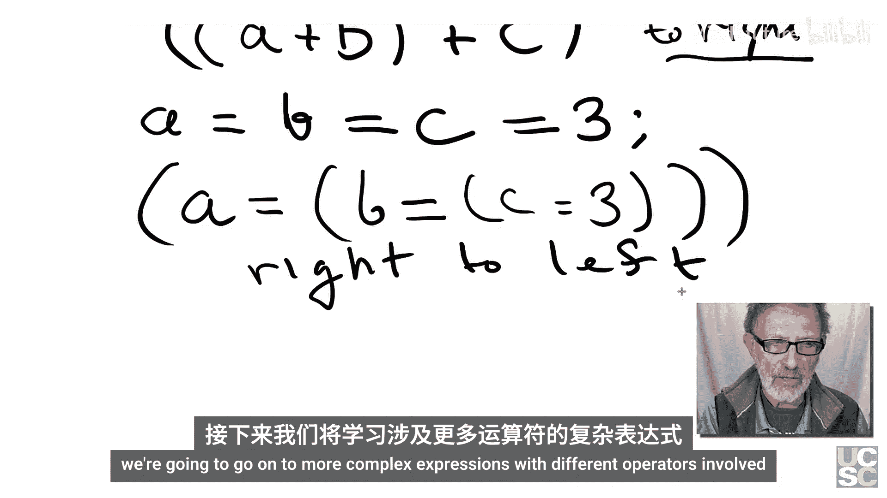
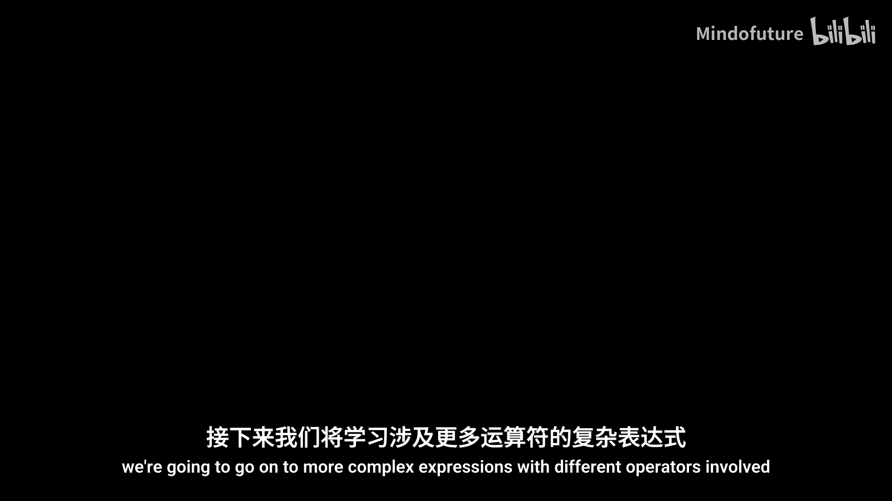

# 015：表达式与优先级


## 概述
在本节课中，我们将要学习C语言中表达式的求值规则，特别是运算符的优先级和结合性。理解这些概念对于编写正确且可预测的代码至关重要。

## 表达式求值基础

C语言拥有丰富的运算符。了解这些运算符如何组合以及它们被应用的顺序非常重要。我们将通过一些简单的案例来帮助你掌握核心概念。核心思想是：了解运算符的工作原理，知道其优先级，并理解其结合性。

我们首先声明三个简单的变量。在C语言中，我们会这样写：
```c
int a = 1;
int b = 2;
int c;
```
这里的 `=` 是初始化符号。变量 `a` 被初始化为1，`b` 被初始化为2，而 `c` 未被初始化。在大多数系统中，`c` 的初始值会是0。这样我们就有了三个变量用于后续的代码示例。

## 赋值表达式

以下是一个使用这些变量的简单表达式：
```c
c = a + b;
```
这里的 `=` 表示赋值。因此，这是一个赋值语句。可以理解为：将表达式 `a + b` 的值赋给 `c`。分号 `;` 表示操作的结束，它标志着一个序列点。该行上的所有计算完成后，程序才会继续执行下一行。

我们知道 `a` 被初始化为1，`b` 被初始化为2，因此我们预期 `c` 会变成3。这是一个赋值表达式，其内部包含一个二元加法运算符 `+`。它表示 `c` 被赋予 `a + b` 的值。

在C语言中，括号 `()` 对于表达式求值至关重要，因为它们总是会覆盖表达式中任何其他部分的优先级。当你感到困惑，或者表达式非常复杂时，使用括号可以清晰地表明你期望的求值顺序。正如我们刚才所说，`c` 变成了3，这应该很直接。

## 运算符优先级

C语言中大约有16个优先级的运算符。优先级非常低的运算符（例如赋值运算符）往往最后执行。然而，某些操作，如逻辑非（使用感叹号 `!` 表示）等一元运算符，具有非常高的优先级。自增 `++` 和自减 `--` 运算符也是如此。

算术运算符处于中间优先级。在算术运算符中，乘法（使用星号 `*` 表示）的优先级高于简单的二元加法 `+` 和减法 `-`。请注意，你还可以使用一元减号 `-` 和一元加号 `+`。区分它们的唯一方法是根据上下文或括号。像这样的一元运算符比对应的二元加法和减法具有更高的优先级。二元运算符需要两个参数，而一元运算符只需要一个参数。

乘法、除法 `/` 以及取余运算符 `%`（有时也称为模运算符）具有相同的较高优先级，都高于加法和减法。这一点很重要，因为当这些运算符在表达式中混合使用时，你必须知道哪个先执行。

## 运算符结合性

你需要了解的另一个概念是结合性。运算符是如何结合的？例如，当你有一个表达式 `a + b + c`，这里有两个运算符。哪个先执行？是先计算 `b + c` 然后加上 `a`，还是先计算 `a + b` 然后加上 `c`？事实证明，这些运算符是**从左到右**结合的。绝大多数运算符都是左结合的。

为了清晰地展示基于结合性的隐式求值顺序，我们可以用括号完全括起这个表达式：`( (a + b) + c )`。

现在，看另一个表达式：`a = b = c = 3`。赋值运算符是**从右到左**结合的。这意味着 `c = 3` 首先执行，然后将这个表达式的值赋给 `b`，最后赋给 `a`。最终，所有变量都会变成3。





## 总结
本节课中，我们一起学习了C语言表达式的求值规则。我们了解了如何使用括号来明确求值顺序，掌握了运算符优先级的概念（例如乘除法优先于加减法），并理解了运算符的结合性（大多数从左到右，赋值从右到左）。请尝试理解并吸收这些知识，确保你能编写这类代码并知道如何求值。接下来，我们将继续学习涉及不同运算符的更复杂表达式。