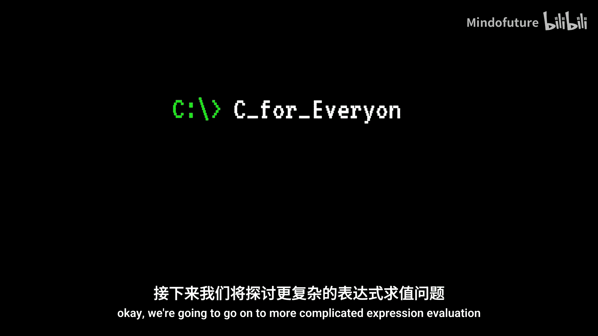
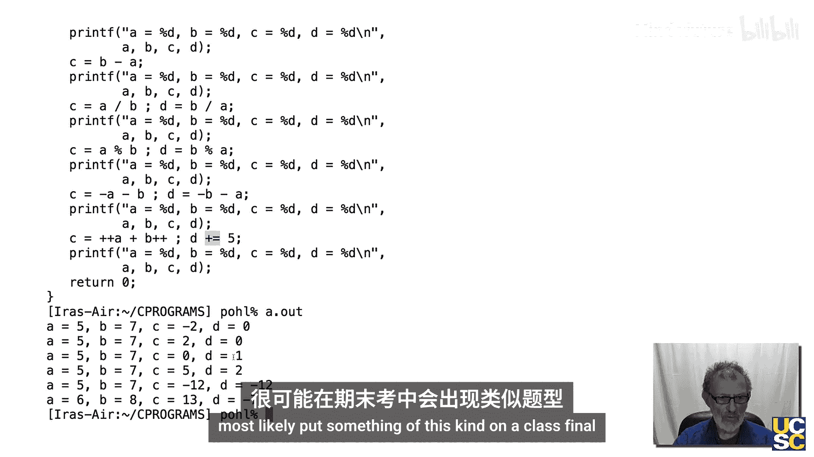

# 016：表达式和求值进阶



## 概述
在本节课中，我们将学习更复杂的C语言表达式求值。我们将探讨运算符在不同上下文中的多重含义、自增自减运算符、复合赋值运算符，以及如何使用括号来明确运算顺序。理解这些概念对于编写正确且易于理解的代码至关重要。

## 运算符的多重含义
上一节我们介绍了基本的运算符，本节中我们来看看运算符在不同上下文中的不同含义。初学者常犯的一个错误是忘记某些符号（如斜杠 `/`）在不同情境下代表不同的操作。

*   斜杠 `/` 在表达式中通常表示除法，但它可以是**整数除法**或**浮点数除法**，具体取决于操作数的类型。
*   取余运算符 `%`（模运算符）在日常编程中不常用，因此需要特别记住其用法。
*   C语言还有一些独特的运算符，例如自增 `++` 和自减 `--`。
*   此外，还有基于赋值的运算符，如普通赋值 `=`，以及复合赋值运算符如 `+=`、`-=`。需要注意的是，`==` 是逻辑相等运算符，而非赋值。

这些特性并非C语言独有，许多受C语言启发的语言（如Java、C++）也采用了类似的运算符。

## 使用括号明确优先级
当表达式变得复杂且容易混淆时，为了让自己和阅读、维护代码的人清晰理解，请使用括号 `()`。

括号可以覆盖运算符内置的**优先级**和**结合性**。例如，表达式 `A * B + C` 会先计算 `A * B`（因为 `*` 的优先级高于 `+`），然后加上 `C`。但如果你希望先计算 `B + C`，就必须使用括号：`A * (B + C)`。

## 需要注意的细节
以下是表达式求值中一些常见的“陷阱”：

*   **整数除法**：整数除法会丢弃余数。例如，`3 / 7` 的结果是 `0`，而 `7 / 3` 的结果是 `2`。
*   **浮点数除法**：如果操作数中有一个是浮点数，则进行浮点数除法。例如，`5 / 2.0` 的结果是 `2.5`。
*   **模运算符**：模运算符 `%` 返回整数除法的余数。例如，`3 % 7` 是 `3`，`7 % 3` 是 `1`。

## 自增与自减运算符
自增 `++` 和自减 `--` 运算符非常实用，它们可以简化代码。

以下是前缀和后缀形式的区别：

*   **前缀自增**：`A = ++B;`
    *   含义：先执行 `B = B + 1`，然后将 `B` 的新值赋给 `A`。
    *   如果 `B` 初始为 `5`，执行后 `B` 变为 `6`，`A` 也被赋值为 `6`。
*   **后缀自增**：`A = B++;`
    *   含义：先将 `B` 的当前值赋给 `A`，然后执行 `B = B + 1`。
    *   如果 `B` 初始为 `5`，执行后 `A` 被赋值为 `5`，然后 `B` 变为 `6`。

**注意**：后缀自增运算符的优先级高于前缀自增。

## 代码实验与分析
理解理论的最佳方式是实践。以下是一段用于实验的代码，你可以尝试编写或运行类似的代码来验证你的理解。

```c
#include <stdio.h>

int main() {
    int a = 5, b = 7, c, d = 0;

    // 基础减法
    c = a - b;
    printf("a = %d, b = %d, c = %d, d = %d\n", a, b, c, d);

    // 整数除法
    c = 5 / 7; // 结果为 0
    d = 7 / 5; // 结果为 1
    printf("After integer division: c = %d, d = %d\n", c, d);

    // 一元运算符与二元运算符
    c = -5 - 7; // 等价于 (-5) - 7，结果为 -12
    printf("After unary and binary minus: c = %d\n", c);

    // 后缀自增
    c = a++ + b; // a(5) + b(7) = 12 赋给 c，然后 a 变为 6
    printf("After post-increment: a = %d, b = %d, c = %d\n", a, b, c);

    // 复合赋值运算符
    d += 5; // 等价于 d = d + 5，假设之前 d 是 -12，则 d 变为 -7
    printf("After += operation: d = %d\n", d);

    return 0;
}
```

运行上述代码，你将得到以下输出结果：
```
a = 5, b = 7, c = -2, d = 0
After integer division: c = 0, d = 1
After unary and binary minus: c = -12
After post-increment: a = 6, b = 7, c = 12
After += operation: d = -7
```

请仔细分析每一行代码，确保机器的执行结果符合你的预期。




## 总结
本节课我们一起深入学习了C语言中更复杂的表达式求值。我们探讨了运算符的多重含义、括号在控制运算顺序中的关键作用、整数除法与模运算的细节，以及前缀/后缀自增自减运算符的区别。通过编写和运行实验代码，你可以巩固这些概念，并避免在未来的编程中陷入常见的“陷阱”。务必理解这些内容，因为它们很可能是课程考核的重点。